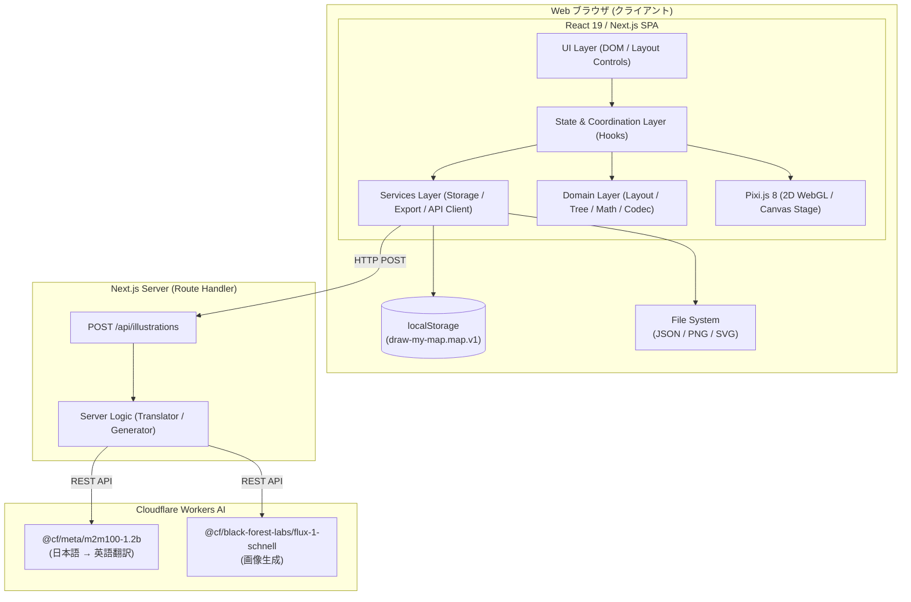
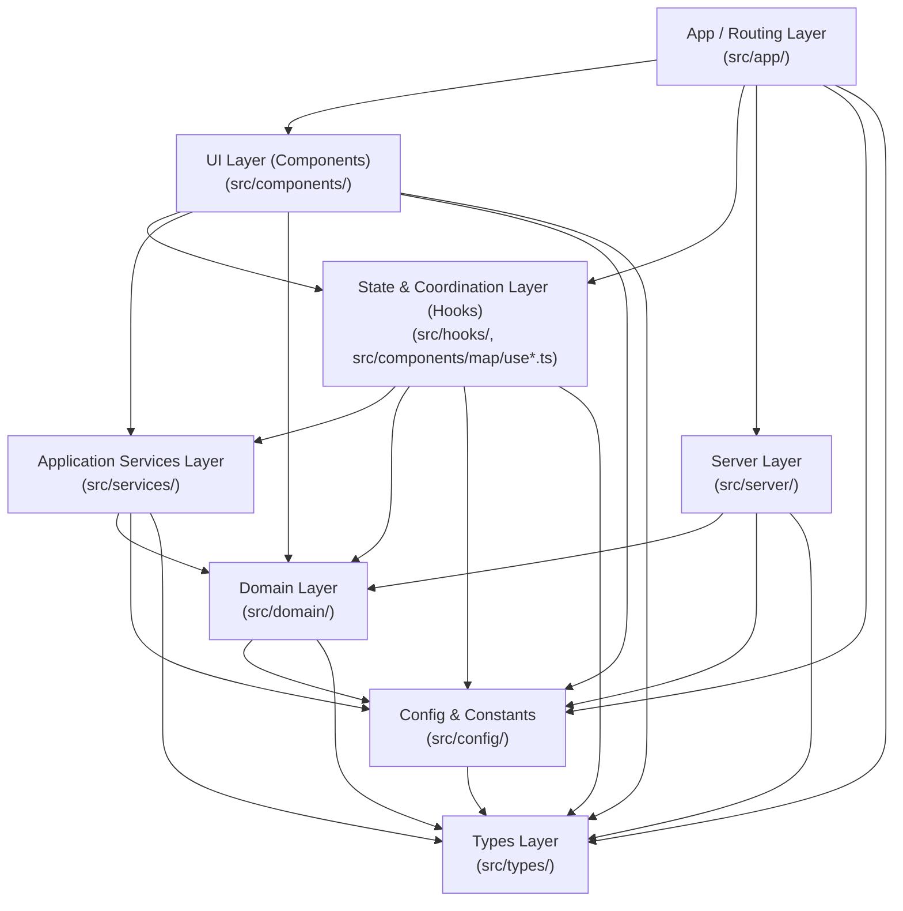
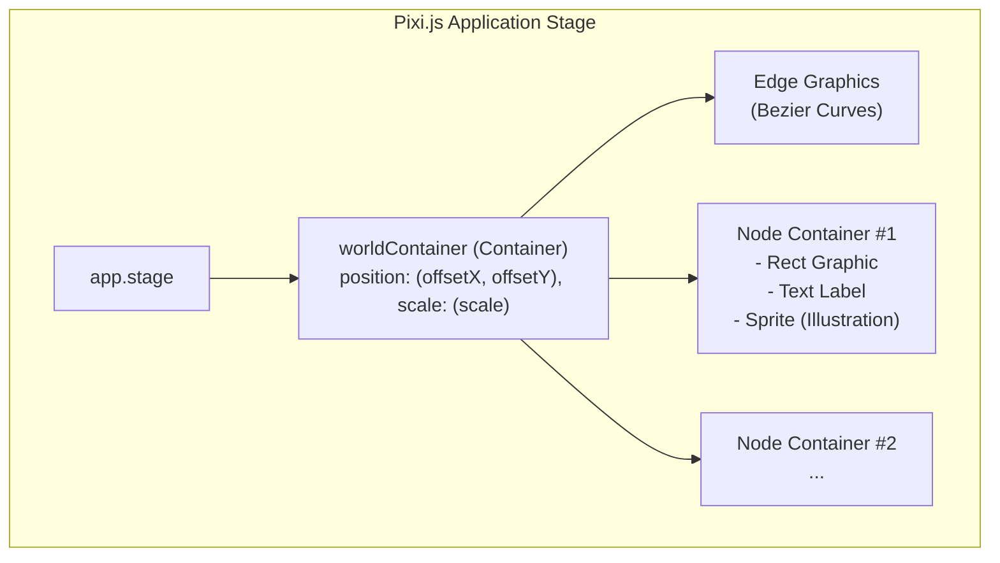
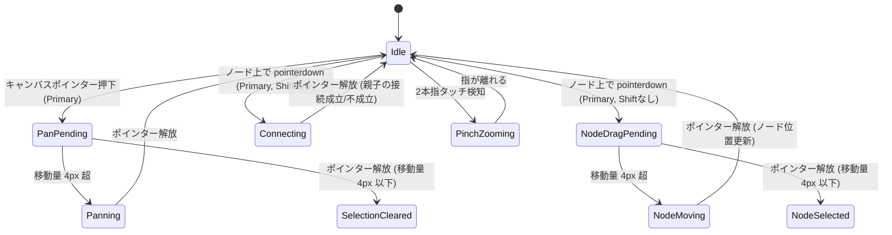
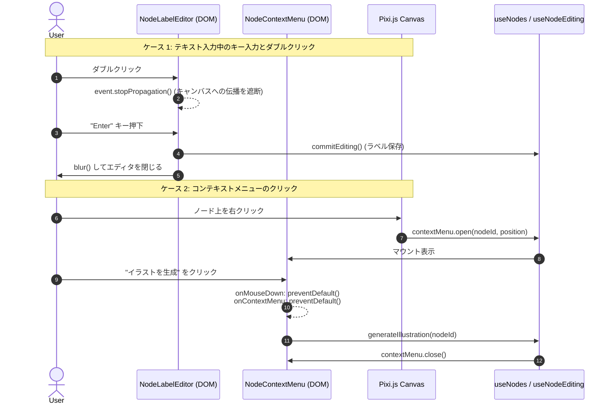
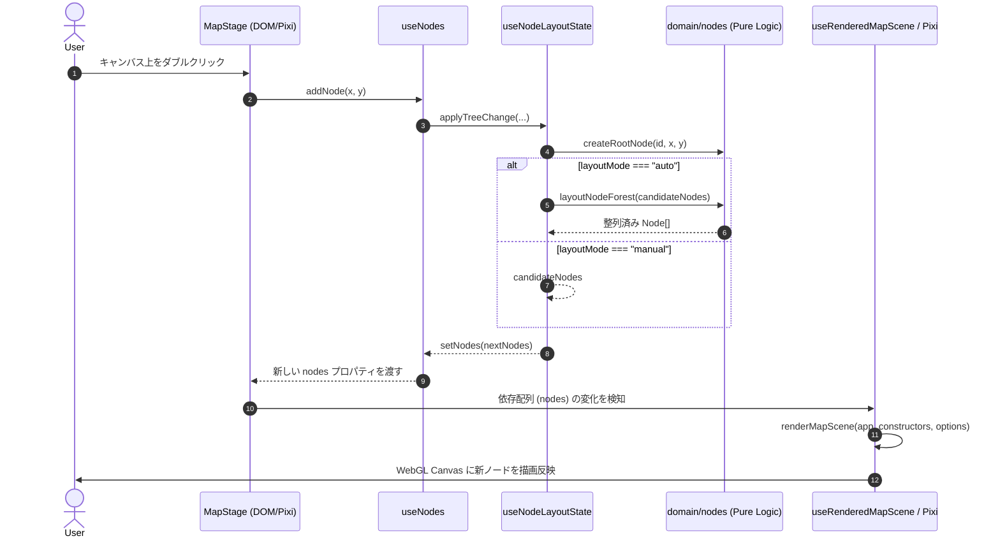

# システムアーキテクチャ設計書

Draw My Map のシステム全体アーキテクチャ、レイヤード設計、2D WebGL/Canvas（Pixi.js）と React 19（DOM）の協調レンダリングモデル、状態管理、およびテスト設計に関する仕様書です。

---

## 1. アーキテクチャ概要

### 1.1 システム方針

Draw My Map は、思考の整理・アイデア発想を直感的に支援する**ブラウザ完結型シングルページ・マインドマップアプリケーション**（SPA）です。

- **ローカルファースト & クライアント完結**: マップデータ（ノードツリー、配置座標、重要度、レイアウトモード）はすべてブラウザ上の React 状態および `localStorage` で安全に保持・管理され、外部データベースへの認証や接続なしにオフラインでも動作します。JSON ファイルとしてのエクスポート/インポート、SVG/PNG 形式の画像書き出しもすべてクライアントサイドで処理されます。
- **軽量サーバーサイド連携（BFF / Route Handler）**: AI によるノードイラスト生成機能のみ、Next.js App Router の Route Handler（`POST /api/illustrations`）を介して Cloudflare Workers AI（`@cf/meta/m2m100-1.2b` による日本語プロンプト英訳、`@cf/black-forest-labs/flux-1-schnell` による画像生成）と安全に通信します。API キー等の機密情報はサーバーサイドでのみ保持されます。



### 1.2 レイヤードアーキテクチャの採用理由と単一責任原則（SRP）

マインドマップアプリケーションは、以下のような多岐にわたる関心事が混在しやすい特性を持ちます：
1. **複雑なグラフ構造・ツリー演算**: 循環参照の防止、部分木のトラバース、ノード階層に応じた自動レイアウト計算。
2. **高速・大量のグラフィックス描画**: 数百ノードや曲線の 60fps スムーズなパン・ズーム、Tween アニメーション。
3. **リッチなユーザー操作**: キーボードショートカット、ドラッグ移動、Shift+ドラッグ接続、ピンチズーム、インラインテキスト入力。
4. **外部システム連携**: ブラウザ API、ファイル入出力、AI API 通信。

これらが単一のコンポーネントやフックに混在すると、描画パフォーマンスの低下やテスト困難性、保守性の破綻を招きます。  
Draw My Map では**単一責任原則（Single Responsibility Principle: SRP）**を徹底し、関心事ごとに厳密に分離された**レイヤードアーキテクチャ**を採用しています。

- **ドメイン知識の純粋化**: 配置幾何計算やツリー操作、JSON スキーマ検証などは一切の UI・フレームワーク・ブラウザ API に依存しない純粋関数として記述され、100% 独立してユニットテスト可能です。
- **副作用の隔離**: Canvas のピクセル操作や `localStorage`、ネットワーク通信などの副作用は Services 層にカプセル化されます。
- **宣言的調停**: React フックは状態の保持とドメイン関数・サービス関数の呼び出しの調停のみを担い、複雑なビジネス計算自体は持ちません。

### 1.3 技術スタックとコンパイラ・ビルド設定

| カテゴリ | 採用技術・バージョン | 設定・構成の特徴 |
| :--- | :--- | :--- |
| **アプリケーション基盤** | **Next.js 16.1.6** (App Router) | クライアント SPA + Route Handler (`POST /api/illustrations`) |
| **UI ランタイム** | **React 19.2.3** (`react`, `react-dom`) | 宣言的 DOM レンダリング、カスタムフックによる状態管理 |
| **React Compiler** | **`babel-plugin-react-compiler` 1.0.0** | `client/next.config.ts` にて **`reactCompiler: true`** を有効化。ビルド時の自動メモ化により不要な再レンダリングを最適化 |
| **2D グラフィックス** | **Pixi.js ^8.16.0** (`pixi.js`) | WebGL / Canvas による高速シーンツリー描画、ビューポート変換、Tween 制御 |
| **スタイリング** | **Tailwind CSS v4** (`@tailwindcss/postcss`, `@tailwindcss/cli`) | `src/app/globals.css` ベース、ライト / ダークモード対応 |
| **型システム** | **TypeScript ^5** | `client/tsconfig.json`: `target: "ES2017"`, `strict: true`, `module: "esnext"`, `moduleResolution: "bundler"`, `isolatedModules: true`, `jsx: "react-jsx"`, パスエイリアス `"@/*": ["./src/*"]` |
| **テスト・品質保証** | **Jest ^30.2.0** + **Testing Library** (`@testing-library/react` ^16.3.2, `@testing-library/jest-dom` ^6.9.1) + **ESLint ^9** | `client/jest.config.ts` (`jest-environment-jsdom`)、`client/jest.setup.ts` |

---

## 2. レイヤードアーキテクチャ詳細

システムのディレクトリ構造は、責務に応じて以下の 8 レイヤー（および横断テスト基盤 `src/testing/`）に階層化されています。依存関係は**上位レイヤーから下位レイヤーへの単方向**に限定され、逆方向の依存や循環依存は厳格に禁止されています。

```text
client/src/
├── app/             # 1. App / Routing Layer (Next.js App Router ページ & Route Handler)
├── components/      # 2. UI Layer (Layout DOM & Map Canvas Wrapper / Pixi Renderer)
│   ├── layout/      #    ヘッダー、セレクター、通知、右サイドパネル等の HTML/DOM コンポーネント
│   └── map/         #    Pixi.js ステージ、ジェスチャー制御、DOM オーバーレイ、ステージ用テストハーネス
│       ├── pixi/    #    Pixi.js シーン描画・ポインタ/タッチジェスチャー・Tween アニメーター・Pixi 単体ハーネス
│       └── testing/ #    MapStage 統合テスト用ランタイム & 自動レイアウト統合ハーネス
├── hooks/           # 3. Application State & Coordination Layer (カスタムフック)
├── services/        # 4. Application Services Layer (ブラウザ API・副作用の抽象化)
├── domain/          # 5. Domain Layer (純粋ビジネスロジック・幾何演算・スキーマ検証)
├── server/          # 6. Server Layer (サーバーサイド API 処理・Cloudflare Workers AI 連携)
├── config/          # 7. Config & Constants Layer (アプリケーション共通定数)
├── types/           # 8. Shared Types & Interfaces (TypeScript 型定義)
└── testing/         # 共通テストヘルパー・フィクスチャ (createTestNode, createTestMapHistoryLease, jpegFixture)
```

### 2.1 各レイヤーの責務と構成

#### 1. App / Routing Layer (`src/app/`)
- **責務**: Next.js App Router のエントリポイント、グローバルレイアウト、グローバルスタイル、および API Route Handler。
- **構成ファイル（全 5 ファイル）**:
  - `src/app/layout.tsx`: HTML シェル、Geist フォント設定、メタデータ定義。
  - `src/app/page.tsx`: マップエディタの最上位ページコンポーネント。各フックから状態を取得し、`AppHeader`・`AppWorkspace`・`MapStage`・`IllustrationPanel` 等へ注入。
  - `src/app/globals.css`: Tailwind CSS v4 インポートおよびカラースキーム（ライト/ダーク）変数定義。
  - `src/app/favicon.ico`: アプリケーションアイコン。
  - `src/app/api/illustrations/route.ts`: イラスト生成 API エンドポイント（`POST /api/illustrations`, `dynamic = "force-dynamic"`）。
- **依存可能レイヤー**: UI (Components), Hooks, Server (Route Handler のみ), Config, Types

#### 2. UI Layer (Components) (`src/components/layout/`, `src/components/map/`)
- **責務**: ユーザーに対するプレゼンテーション、DOM イベントの捕捉、および Pixi.js Canvas ステージと DOM オーバーレイの統合。
- **構成モジュール**:
  - **レイアウト UI (`src/components/layout/` 全 14 ファイル)**:
    - `AppHeader.tsx`: タイトル、レイアウトモード切替、操作ヒント、重要度・解像度フィルタ切替、元に戻す／やり直すボタン、枝を複製ボタン、枝のコピー＆ペーストの常設案内、JSON/画像エクスポートボタン、操作通知バーを統合するヘッダー。
    - `AppWorkspace.tsx`: ヘッダー下の 2 カラム（メインキャンバス領域 + 右サイドパネル）レイアウト。
    - `LayoutModeSelector.tsx`: `手動配置` / `自動配置` 切り替えボタングループ（`role="group"`, `aria-label="レイアウトモード"`）。
    - `MapHistoryControls.tsx`: ヘッダーの `元に戻す` / `やり直す` ボタン（履歴の有無に応じて `disabled`）。
    - `NodeDuplicateControl.tsx`: ヘッダーの `枝を複製` ボタン（ノード未選択時は `disabled`）。クリックごとに 1 回複製し、押したあともフォーカスを移さない。`Enter` の押し続け（`repeat`）だけ `preventDefault()` で抑止する。
    - `LayoutModeOperationHint.tsx`: 現在の `layoutMode` に応じた操作ガイド文字列の表示。
    - `NodeImportanceSelector.tsx`: 選択中ノードの重要度（`高` / `中` / `低`）切り替えボタングループ（`role="group"`, `aria-label="重要度"`）。
    - `ResolutionFilterSelector.tsx`: 表示フィルタ（`自動` / `高のみ` / `中以上` / `すべて`）切り替えボタングループ（`role="group"`, `aria-label="表示"`）および自動時の現在レベル表示。
    - `MapPersistenceControls.tsx`: `JSON書き出し` / `JSON読み込み` ボタンと非表示 `<input type="file">`。
    - `MapImageExportControls.tsx`: `PNG書き出し`（変換中 `disabled` 制御付き） / `SVG書き出し` ボタン。
    - `MapOperationNotice.tsx`: 操作結果・警告・エラー通知を表示するアクセシブルな通知コンポーネント（`role="status"` / `role="alert"`）。
    - `IllustrationPanel.tsx`, `illustrationPanelView.ts`, `IllustrationImage.tsx`: 右サイドパネル UI（`<aside aria-label="イラスト">`）、パネル表示状態導出ロジック（`getIllustrationPanelView`）、および Data URL 用ネイティブ `` ラッパー。
  - **マップステージ・DOM オーバーレイ・座標/イベント補助 (`src/components/map/` コンポーネント 3 ファイル + 補助モジュール 17 ファイル)**:
    - `MapStage.tsx`: Pixi.js キャンバス要素と DOM オーバーレイ（`NodeLabelEditor`, `NodeContextMenu`）を統合するステージ親コンポーネント。
    - `NodeLabelEditor.tsx`, `nodeLabelEditorLayout.ts`: ノードテキストインライン編集用 `<input>` DOM オーバーレイと、ビューポート倍率およびイラスト有無（`topInset`）に応じた配置矩形算出。
    - `NodeContextMenu.tsx`, `nodeContextMenuLayout.ts`, `nodeContextMenuDom.ts`, `nodeContextMenuStaleness.ts`, `nodeContextMenuTarget.ts`, `mapContextMenuAction.ts`, `menuActivationDoubleClick.ts`: 右クリックコンテキストメニュー DOM オーバーレイ、176×44px クランプ配置、メニュー内外 DOM 判定、失効（Stale）判定、右クリック時のアクション解決、メニュー項目実行後 500ms 以内のダブルクリック誤発火防止。
    - `mapViewport.ts`, `mapGeometry.ts`, `mapDoubleClickAction.ts`, `nodeViewportFocus.ts`, `viewportFocusShortcut.ts`, `wheelZoom.ts`, `textEntryTarget.ts`, `editableTarget.ts`, `mapHistoryShortcut.ts`, `browserMapVisibilityEnvironment.ts`: ビューポート座標変換・クランプ、ノードヒットテスト（`findNodeAtPoint`）、ダブルクリックアクション分岐、ノード中央フォーカス計算、ホイールズームデルタ正規化、テキスト入力要素判定（`textEntryTarget.ts`）、編集可能要素（input・textarea・select・contenteditable）の判定（`editableTarget.ts`）、元に戻す・やり直すのショートカットの判定（`mapHistoryShortcut.ts`）、`requestAnimationFrame` / `prefers-reduced-motion` ブラウザ環境アダプタ。
  - **Pixi.js 描画・ジェスチャーエンジン (`src/components/map/pixi/` 全 23 ファイル — うち `usePixiApplication.ts` は Hooks としても機能)**:
    - シーン描画: `renderMapScene.ts`, `renderMapNodes.ts`, `renderMapEdges.ts`, `clearMapScene.ts`, `applyViewportTransform.ts`, `illustrationTextureLoader.ts`, `pixiTypes.ts`。
    - 可視性トランジション: `mapVisibilityAnimator.ts`, `mapVisibilityTween.ts`, `mapVisibilityKeys.ts`, `pixiVisibilityTarget.ts`。
    - ポインタ・タッチジェスチャー: `stageInteractions.ts`, `pointerGesture.ts`, `pointerGestureSession.ts`, `pointerSample.ts`, `dragActivation.ts`, `canvasPanGesture.ts`, `nodeMoveGesture.ts`, `nodeConnectionGesture.ts`, `touchGestureCoordinator.ts`, `pinchZoomGesture.ts`, `pinchViewport.ts`。
- **依存可能レイヤー**: Hooks, Services, Domain, Config, Types

#### 3. Application State & Coordination Layer (Hooks) (`src/hooks/`, `src/components/map/use*.ts`)
- **責務**: アプリケーション状態の保持（React State / Ref / Reducer）、ライフサイクル制御、および Domain / Services 層の呼び出し調停。
- **構成モジュール**:
  - **アプリケーション状態フック (`src/hooks/` 全 19 ファイル)**:
    - `useNodes.ts`, `useNodeLayoutState.ts`: ノードツリーの CRUD・選択・重要度・イラスト更新・枝の複製（`duplicateSubtree`）・枝のコピー（`copySubtree`）と貼り付け（`pasteSubtree`）と、手動/自動レイアウトモードの状態管理（複製と貼り付けの挿入処理は内部関数 `applySubtreeInsertion` を共有する）・ツリー変更時の `layoutNodeForest` 自動整列トリガー。
    - `useMapResolutionFilter.ts`, `mapResolutionFilterState.ts`: ズーム倍率・ヒステリシス・手動/自動モード遷移・マップ置換時の `pendingResetScale` 同期に基づく可視ノードフィルタリング状態管理。
    - `useMapPersistence.ts`, `useMapStoragePersistence.ts`, `useMapStorageRestoration.ts`, `useMapStorageAutoSave.ts`, `useMapFilePersistence.ts`, `useMapJsonExport.ts`, `useMapJsonImport.ts`: `localStorage` からの初期復元・300ms デバウンス自動保存、および JSON ファイルのエクスポート/インポート調停。
    - `useMapImageExport.ts`, `useMapPngExport.ts`, `useMapSvgExport.ts`: PNG / SVG 画像エクスポート処理、空マップ警告、PNG 書き出し中フラグ（`isExportingPng`）と通知状態管理。
    - `useIllustrationGeneration.ts`: 非同期 AI イラスト生成のステートマシン管理（`idle` / `generating` / `succeeded` / `failed`）、同時 1 件制限、および `AbortController` による中断制御。
    - `useNodeDuplicationAction.ts`: 選択ノードの枝を `useNodes.duplicateSubtree` で複製し、成功 / 失敗の通知を `useRevisionScopedNotice` へ渡す。
    - `useRevisionScopedNotice.ts`: 操作結果の通知を、次の通知か `documentRevision` の変化まで残す。通知を出した時点の `documentRevision` と組にして保持し、現在の値と違う通知を隠す。`useNodeDuplicationAction.ts`（複製の通知）と `page.tsx`（コピー／貼り付けの通知）がそれぞれ別の枠として呼ぶ。
    - `useMapHistory.ts`: 編集履歴（Undo / Redo）の ref 管理と React state への反映。`useNodeLayoutState` から呼ばれる。
    - `useResettingMapReplacement.ts`: マップ置換時に `resetRevision` をインクリメントし、ステージ・コンテキストメニュー・解像度フィルタを同期リセットするフック（イラスト生成は `documentRevision` で失効する）。
  - **マップステージ制御フック (`src/components/map/use*.ts` 18 ファイル + `pixi/usePixiApplication.ts`)**:
    - `pixi/usePixiApplication.ts`: Pixi.js `Application` の非同期初期化・リサイズ追従・アンマウント時破棄。
    - `useRenderedMapScene.ts`, `useIllustrationTextures.ts`, `useMapVisibilityTransition.ts`: React 状態から Pixi シーンへの差分描画同期、`PixiRuntime` ごとのイラスト `Texture` セッションキャッシュと `destroy(true)` 解放、160ms フェード Tween 調停。
    - `useMapViewport.ts`, `useViewportScaleNotification.ts`, `useMapWheelZoom.ts`, `useMapViewportShortcut.ts`: ビューポート状態管理、親への `scale` 変更通知、ホイールズーム登録、`F` キー中央フォーカスショートカット。
    - `useMapStageInteractions.ts`, `useStageInteractionValues.ts`: ステージポインタイベントのバインディングと最新 Props/State Ref の同期。
    - `useNodeEditing.ts`, `useNodeKeyboardShortcuts.ts`: インラインラベル編集状態（開始・確定・キャンセル）と、`Tab` / `Enter` / `Delete` / `Backspace` キーボードショートカット。
    - `useNodeContextMenu.ts`, `useNodeContextMenuDismissal.ts`: コンテキストメニューの開閉・Stale 自動クローズ・外部操作による Dismiss 制御。
    - `useHiddenNodeInteractionReset.ts`, `useMapStageReset.ts`: 非表示化したノードの選択・編集・ジェスチャー強制リセット、および `resetRevision` 更新時のステージ状態一括初期化。
    - `useDocumentRestoreInteractionReset.ts`: `documentRevision`（マップ置換・成功した Undo / Redo）の更新時に、編集中のラベル・進行中のジェスチャー・コンテキストメニューを閉じる（viewport は維持）。
    - `useMapHistoryShortcuts.ts`: Undo / Redo のキーボードショートカット登録。
    - `useMapClipboardEvents.ts`: `window` の `copy` / `paste` イベントを 1 回だけ登録し、選択ノードの枝のコピーとクリップボードの枝の貼り付けを仲介する。対象判定（イベント対象とフォーカス要素が編集可能、DOM の範囲選択、ラベル編集中、ジェスチャー中、`defaultPrevented` のときはブラウザに任せる）、`clipboardData` の読み書き、`subtreeClipboardCodec` による検証、通知の生成だけを担い、スナップショット生成と挿入は `MapStage` の props（`onCopySubtree` / `onPasteSubtree`）に委ねる。コピー失敗時は `preventDefault` しない。最新の props を ref 経由で使い、アンマウント時にリスナーを解除する。
- **依存可能レイヤー**: Services, Domain, Config, Types

#### 4. Application Services Layer (`src/services/`)
- **責務**: ブラウザ API、DOM、ストレージ、ネットワーク通信等の副作用の抽象化および外部入出力。UI や特定の React フックには依存しない。
- **構成サブパッケージ（全 14 ファイル）**:
  - `services/persistence/` (3 ファイル):
    - `mapStorage.ts`: `window.localStorage`（キー `draw-my-map.map.v1`）への読み書き、容量上限超過（`QuotaExceededError` 等）の捕捉と `MapDocumentResult` 返却。
    - `mapJsonDownload.ts`: JSON スナップショット文字列から `Blob` と一時 Object URL を生成し、`draw-my-map-YYYYMMDD-HHmmss.json` としてダウンロードさせる処理。
    - `mapJsonFileReader.ts`: **`await file.text()`（`Blob.prototype.text()` 非同期テキスト読み取り API）** を用いてローカル JSON ファイルの内容を読み取るアダプタ。
  - `services/illustration/` (3 ファイル):
    - `illustrationClient.ts`: `POST /api/illustrations` への `fetch` 通信、HTTP ステータスコード別の `IllustrationRequestError`（エラー種別型 `IllustrationErrorKind`）分類、およびユーザー向けエラー文言変換（`describeIllustrationError`）。
    - `illustrationThumbnail.ts`: オフスクリーン `<canvas>` と `HTMLImageElement` を用いた中央正方形クロップ、128×128px リサイズ、JPEG（品質 `0.85`）圧縮。
    - `illustrationGeneration.ts`: API リクエスト（`requestIllustration`）とサムネイル生成（`createIllustrationThumbnail`）を連結する統合ファサード（`generateIllustrationThumbnail`）。
  - `services/imageExport/` (8 ファイル):
    - `createMapSvgExport.ts`, `mapSvgArtifact.ts`, `mapImageDownload.ts`, `mapImageFileName.ts`: テキスト計測とバウンディングボックス算出に基づく SVG ドキュメント生成、SVG XML の `Blob` 変換（`createMapSvgBlob`）、ファイル名生成（`createMapImageFileName`）、およびブラウザダウンロード発火（`downloadMapImage`）。
    - `mapPngRasterizer.ts`, `loadMapSvgImage.ts`, `mapCanvasPngEncoder.ts`: `createMapPngEncoder` によるオフスクリーン Canvas 寸法の上限検証（`MAX_CANVAS_ATTRIBUTE_DIMENSION`）と 2倍スケール PNG エンコード、`withLoadedMapSvgImage` による SVG `Blob` Object URL の `HTMLImageElement` 読み込みと完了/失敗時の確実な `URL.revokeObjectURL` 解放。
    - `mapTextMeasurement.ts`: Canvas 2D コンテキストを用いたテキスト幅計測（`createMapTextMeasurer`。2D コンテキストが取得できない場合は `throw new Error("Canvas 2D context is unavailable")` を送出）。
- **依存可能レイヤー**: Domain, Config, Types

#### 5. Domain Layer (`src/domain/`)
- **責務**: システムの中核となる純粋なビジネスルール、数学・幾何計算、ツリー操作アルゴリズム、データ検証・変換。**React や Pixi.js、DOM、ブラウザ固有 API（window, document, localStorage 等）には一切依存しない純粋関数群**。
- **構成サブパッケージ（全 45 ファイル）**:
  - `domain/nodes/` (24 ファイル):
    - `nodeAutoLayout.ts`, `nodeLayoutForest.ts`, `nodeLayoutForestRelations.ts`, `nodeLayoutForestTraversal.ts`, `nodeLayoutGeometry.ts`, `nodeLayoutMetrics.ts`, `nodeLayoutPlacement.ts`, `nodeLayoutSpacing.ts`, `nodeLayoutArithmetic.ts`: 木構造・森構造の幾何配置計算（親子関係とルート抽出 `buildNodeForestRelations`、非再帰トラバーサルとサイクル検出 `traverseNodeForest`、フォレストインデックス化 `indexNodeForest`、座標展開 `calculateNodePositions`、深さ別列 X 座標とサブツリー垂直スパン計測 `calculateNodeLayoutMetrics`、双方向垂直中央揃え配置 `placeNodeForest`、数値オーバーフロー・浮動小数点 ULP 精度劣化防御および最小間隔判定 `checkedAdd`/`checkedSubtract`/`checkedMultiply`/`calculateRoundingTolerance`/`hasSufficientGap`、垂直間隔検証 `hasValidVerticalSpacing`）。
    - `nodeTree.ts`: ノード親子付け替え（`connectNodeTree`）、**自己接続・存在しないノード・循環参照検出（`canConnectNodes`）**、部分木 ID 収集（`collectSubtreeIds`。親子の隣接表と queue による非再帰・線形の走査で、親子が循環した入力でも停止する）、部分木連動移動（`moveNodeSubtree`）。
    - `nodePlacement.ts`: 新規ルートノード（`createRootNode`）、子ノード（`createChildNode`）、兄弟ノード（`createSiblingNode`）の初期座標算出。
    - `nodeIdGenerator.ts`, `nodeIdAllocator.ts`: 単調増加 ID 生成（`createMonotonicIdGenerator`）および既存ノード ID との衝突を回避する空きノード ID 採番（`createNodeIdAllocator`。1 件ずつの `nextAvailableId` と、複製と貼り付け用に占有集合を 1 回だけ作る一括採番 `nextAvailableIds`）。
    - `nodeSubtreeDuplication.ts`: 選択ノードと全子孫の複製候補を生成する純粋関数（`duplicateNodeSubtree`）。複製元の部分木を `nodeTree.collectSubtreeIds` で集め、挿入・配置・採番は `nodeSubtreeInsertion.ts` の `insertNodeSubtree` に委ねる（複製根は複製元と同じ親）。
    - `nodeSubtreeInsertion.ts`: 部分木を新しい ID で既存ノード配列へ挿入する純粋関数（`insertNodeSubtree`）。枝の複製（`nodeSubtreeDuplication.ts`）と枝の貼り付けで共有する。ID 対応表による親子の付け替え、手動配置での真下への平行移動（既存ノードがあるときのみ。空マップではコピー時の座標を維持）、非有限値・丸めによる配置不能時の `null` 返却、自動配置での既存レイアウトへの受け渡しを担う。手動配置の検査はすべて採番より前に済ませ、ID は `NodeIdAllocator.nextAvailableIds` で 1 回だけ一括採番する。
    - `nodeDisplayLabel.ts`: 空文字ラベル時に `FALLBACK_NODE_LABEL`（`"新しいノード"`）を返す表示用ラベル解決（`getNodeDisplayLabel`）。
    - `nodeIllustration.ts`, `nodeIllustrationUpdate.ts`: イラスト描画矩形（`getNodeIllustrationRect`）、ラベル中心Yオフセット（`getNodeLabelCenterOffset`）、イラスト付きノードの最小高さ保証（`getIllustratedNodeMinHeight`）およびイラストの紐付け・解除更新（`replaceNodeIllustration`, `clearNodeIllustration`）。
    - `nodeImportance.ts`, `nodeImportanceUpdate.ts`: 重要度（`"high" | "medium" | "low"`, デフォルト `"medium"`）のドメインルールと更新（`replaceNodeImportance`）。
    - `nodeResolution.ts`, `nodeResolutionLevel.ts`, `nodeVisibility.ts`: 表示レベルに応じた重要度判定（`isNodeVisibleAtLevel`）、ヒステリシス付き自動解像度レベル判定（`resolveAutomaticResolutionLevel`, `resolveResolutionLevel`）、および祖先ノードの可視維持を含む可視ノード ID 収集（`collectVisibleNodeIds`）。
    - `nodeEdgeCurve.ts`: ノード間を結ぶ三次ベジェ曲線（親の右端中央 → 子の左端中央、`controlX = start.x / 2 + end.x / 2`）の制御点幾何計算（`getNodeEdgeCurve`）。
  - `domain/clipboard/` (1 ファイル):
    - `subtreeClipboardCodec.ts`: 枝のクリップボード専用形式（`{"type":"draw-my-map/subtree","version":1,"nodes":[...]}`）の書き出し（`encodeSubtreeClipboard`。選択根の `parentId` を `null` に切り離し、上限と貼り付け可能性を確認）と、読み取り・検証（`decodeSubtreeClipboard`。文字数 5,000,000・ノード数 10,000 の上限、`type` / `version`、V3 のノード検証 `normalizeMapDocumentNode(..., 3)`、単一の根、`validateMapDocumentGraph`）。判定は線形で、結果は `{ ok: true, value } | { ok: false, reason: "invalid" | "too-large" }`。
  - `domain/history/` (1 ファイル):
    - `mapHistory.ts`: 編集履歴の純粋な遷移（記録・Undo・Redo・同値判定・最大100操作の上限）。
  - `domain/illustration/` (5 ファイル):
    - `illustrationPrompt.ts`: 入力ラベルの検証（`validateIllustrationLabel`: トリム後 1〜200 文字）、日本語文字判定（`needsTranslation`）、FLUX.1 用英語プロンプト合成（`buildIllustrationPrompt`）。
    - `illustrationActionLabel.ts`: イラスト有無に応じたアクション文言（`"イラストを生成"` / `"イラストを再生成"`）の解決（`getIllustrationActionLabel`）。
    - `illustrationCrop.ts`: 画像の中央正方形トリミング領域算出（`calculateCoverCrop`）。
    - `illustrationDataUrl.ts`: Base64 JPEG Data URL フォーマットおよび文字長上限（`100,000` 文字）の検証（`isIllustrationDataUrl`）。
    - `jpegDimensions.ts`: JPEG ヘッダー（SOF0〜SOF15 マーカー）バイナリ解析によるデコードレス画像幅・高さ抽出（`getJpegDimensions`）および画像寸法上限（`512×512px`）の検証（`isAcceptableIllustrationSize`）。
  - `domain/persistence/` (8 ファイル):
    - `mapDocumentCodec.ts`, `mapDocumentEncoder.ts`, `mapDocumentDecoder.ts`: マップドキュメント（JSON Version 1, 2, 3）のエンコード（`createMapDocument`, `serializeMapDocument`）・デコード（`parseMapDocumentJson`, `parseMapDocumentJsonWithVersion`）・Version 3 マイグレーション。
    - `mapDocumentNode.ts`, `mapDocumentNodeImportance.ts`, `mapDocumentNodeIllustration.ts`, `mapDocumentNodeProjection.ts`: 各ノードフィールドの型検証・バージョン別 `importance` / `illustration` の正規化（`normalizeMapDocumentNode`, `normalizeMapDocumentNodeImportance`, `normalizeMapDocumentNodeIllustration`）・余剰プロパティを除去するプロジェクション（`projectMapDocumentNode`）。
    - `mapDocumentGraph.ts`: ノード ID 重複・親ノード存在・非再帰トラバーサルによる循環参照（サイクル）のグラフ整合性検証（`validateMapDocumentGraph`）。
  - `domain/imageExport/` (6 ファイル):
    - `mapSvgDocument.ts`, `mapSvgNodes.ts`, `mapSvgEdges.ts`, `mapExportBounds.ts`, `mapExportText.ts`, `mapXmlText.ts`: ベクター画像としての SVG XML 文字列の決定論的生成、外接バウンディングボックス算出（余白 32px）、指数探索＋二分探索によるテキスト折り返しレイアウト計算、および XML 1.0 文字サニタイズ・エスケープ。
- **依存可能レイヤー**: Config, Types

#### 6. Server Layer (`src/server/`)
- **責務**: サーバーサイド（Next.js Route Handler）専用ロジック。Cloudflare Workers AI API との通信、認証設定検証、エラー分類、リトライ制御。
- **構成ファイル（`src/server/illustration/` 全 5 ファイル）**:
  - `handleIllustrationRequest.ts`: リクエストの検証、日本語プロンプト英訳、画像生成のパイプライン処理、NSFW 誤判定（`content-rejected`）時の自動リトライループ（最大 3 回）。
  - `cloudflareTranslator.ts`: `@cf/meta/m2m100-1.2b` 機械翻訳モデルの呼び出し（タイムアウト 30 秒）。
  - `cloudflareImageGenerator.ts`: 環境変数（`CLOUDFLARE_ACCOUNT_ID`, `CLOUDFLARE_API_TOKEN`）の検証（`readCloudflareConfig`）および `@cf/black-forest-labs/flux-1-schnell` 画像生成モデルの呼び出し（`steps: 4`, タイムアウト 60 秒）。
  - `cloudflareRunModel.ts`: Workers AI REST API 呼び出しの共通 HTTP クライアント基盤（レスポンス本文の JSON パース完了までタイムアウトを維持する `AbortController` + `setTimeout(() => controller.abort(), timeoutMs)`、HTTP ステータスおよびエラーコード 8007 等の分類）。
  - `cloudflareErrors.ts`: サーバー側ドメイン例外クラス定義（`ImageGenerationError`, `ImageGenerationErrorKind`）。
- **依存可能レイヤー**: Domain, Config, Types

#### 7. Config & Constants Layer (`src/config/`)
- **責務**: アプリケーション全体で共有される静的定数、寸法、スタイル定義。
- **構成ファイル（全 3 ファイル）**:
  - `config/shapes.ts`: ノード矩形サイズ（`RECT_WIDTH = 100`, `RECT_HEIGHT = 60`）、ノード配置間隔（`CHILD_HORIZONTAL_GAP = 120`, `SIBLING_VERTICAL_GAP = 40`, `TREE_VERTICAL_GAP = 80`）、およびイラスト配置寸法（`ILLUSTRATION_SIZE = 48`, `ILLUSTRATION_TOP_PADDING = 8`, `ILLUSTRATION_AREA_HEIGHT = 56`, `ILLUSTRATED_NODE_HEIGHT = 116`）。
  - `config/nodeLabel.ts`: 空ラベル時のフォールバックノードラベル定義（`FALLBACK_NODE_LABEL = "新しいノード"`）。
  - `config/illustration.ts`: 保存・縮小用サムネイル解像度と品質（`ILLUSTRATION_THUMBNAIL_SIZE = 128`, `ILLUSTRATION_THUMBNAIL_QUALITY = 0.85`）、`localStorage` 容量制限用上限値（`MAX_ILLUSTRATION_DATA_URL_LENGTH = 100_000`）、画像デコード時の保護上限値（`MAX_ILLUSTRATION_IMAGE_DIMENSION = 512`）。
- **依存可能レイヤー**: Types

#### 8. Types Layer (`src/types/`)
- **責務**: アプリケーション横断で共有される TypeScript 型定義、インターフェース、ユニオン型。
- **構成ファイル（全 9 ファイル完全網羅）**:
  - `types/node.ts`: `Node`（`id`, `parentId`, `x`, `y`, `width`, `height`, `label`, `importance`, `illustration?`）。
  - `types/nodeImportance.ts`: `NodeImportance`（`"high" | "medium" | "low"`）。
  - `types/nodeLayout.ts`: `NodeLayoutMode`（`"manual" | "auto"`）。
  - `types/nodeMapState.ts`: `NodeMapState`（`layoutMode`, `nodes`）。
  - `types/nodeResolution.ts`: `ResolutionLevel`（`"high" | "medium" | "all"`）、`ResolutionFilterMode`（`"auto" | ResolutionLevel`）。
  - `types/mapDocument.ts`: `MapDocumentVersion`（`1 | 2 | 3`）、`MapDocumentV1`、`MapDocumentV3`、`MapDocument`、`MapDocumentResult<T>`。
  - `types/mapImageExport.ts`: 画像エクスポート関数シグネチャ型（`CreateSvgExport`, `DownloadImage`, `RasterizePng`）。※戻り値型参照のため `domain/imageExport/mapSvgDocument` の `MapSvgDocument` 型のみを `import type`（コンパイル時のみの型参照・実行時依存ゼロ）しています。
  - `types/illustrationGeneration.ts`: `IllustrationGenerationState`（`idle` / `generating` / `succeeded` / `failed` の判別共用体）。
  - `types/operationNotice.ts`: `OperationNotice`（`kind: "status" | "warning" | "error"`, `message: string`）。
- **依存可能レイヤー**: なし（最下位層。ただし `types/mapImageExport.ts` から `domain/imageExport/mapSvgDocument` への `import type` のみ例外的に許容）

---

### 2.2 レイヤー間依存関係図・マトリックス



#### 依存関係マトリックス

| 参照元 \ 参照先 | App | UI | Hooks | Services | Domain | Server | Config | Types |
| :--- | :---: | :---: | :---: | :---: | :---: | :---: | :---: | :---: |
| **App** | - | ○ | ○ | × | × | ○ | ○ | ○ |
| **UI** | × | - | ○ | ○ | ○ | × | ○ | ○ |
| **Hooks** | × | × | - | ○ | ○ | × | ○ | ○ |
| **Services** | × | × | × | - | ○ | × | ○ | ○ |
| **Server** | × | × | × | × | ○ | - | ○ | ○ |
| **Domain** | × | × | × | × | - | × | ○ | ○ |
| **Config** | × | × | × | × | × | × | - | ○ |
| **Types** | × | × | × | × | △ | × | × | - |

*(○: 依存許可, △: `import type`（コンパイル時型参照）のみ許可［`types/mapImageExport.ts` → `domain/imageExport/mapSvgDocument.ts`］, ×: 依存禁止, -: 同一レイヤー)*

---

## 3. Pixi.js (2D WebGL/Canvas) と React 19 (DOM) の協調レンダリングモデル

Draw My Map のキャンバス描画とユーザーインタラクションは、**Pixi.js v8（WebGL/WebGPU レンダラー）**と **React 19（DOM レンダラー）**が緊密かつ整然と役割を分担するハイブリッドアーキテクチャによって実現されています。

### 3.1 ハイブリッド設計の役割分担

| 関心事 | 担当エンジン | 採用理由・技術的メリット |
| :--- | :--- | :--- |
| **マップ要素描画** (ノード、ベジェ曲線、イラスト) | **Pixi.js 8** (WebGL) | 数十〜数百個のノードや曲線を一括バッチ描画。GPU アクセラレーションによる 60fps の高速パン・ズーム・Tween アニメーション。 |
| **ビューポート変換** (パン・ズーム・ピンチ) | **Pixi.js** (Container Transform) | シーン全体の親コンテナ（`worldContainer`）の `position` と `scale` を書き換えるだけで瞬間的に追従（DOM リフローゼロ）。 |
| **テキストインライン編集** | **React DOM** (`<input>`) | 日本語 IME（変換候補ウィンドウ、未確定文字列入力）のネイティブ挙動の完全保証。アクセシビリティとモバイルキーボード対応。 |
| **コンテキストメニュー** | **React DOM** (`<div role="menu">`) | OS・ブラウザ標準のアクセシビリティツリーへの露出、キーボードフォーカス管理、Tailwind CSS スタイリング。 |
| **操作パネル / ツールバー** | **React DOM** (HTML/Tailwind) | レスポンシブ配置、ボタンの hover/active 状態、ARIA 属性、モーダル・トースト通知の表示。 |

---

### 3.2 Pixi Application のライフサイクル管理

Pixi.js の初期化と破棄は、`src/components/map/pixi/usePixiApplication.ts` カスタムフックによって React 19 のライフサイクルと完全に同期して管理されます。

1. **非同期初期化**:
   - `useEffect` 内でダイナミックインポート（`await import("pixi.js")`）を行い、SSR（Server-Side Rendering）時の `window` 未定義エラーを防止。
   - `new Application()` を生成し、`app.init()` で親コンテナのサイズに自動リサイズ追従（`resizeTo: container`）、Retina ディスプレイ対応（`resolution: window.devicePixelRatio || 1`, `autoDensity: true`）、背景透過（`backgroundAlpha: 0`）を設定。
2. **DOM マウント**:
   - 生成された `createdApp.canvas` をコンテナ要素へ追加。
   - CSS スタイルとして `position: absolute`, `inset: 0px`, `touch-action: none` を適用し、ブラウザ既定のスクロールジェスチャーを遮断。
3. **確実なクリーンアップ**:
   - コンポーネントのアンマウント時、または React StrictMode による再マウント時に、進行中の初期化をキャンセル（`cancelled = true`）。
   - すでに初期化済みの場合は `app.destroy(true, { children: true, context: true })` を呼び出し、GPU メモリ、テクスチャ、WebGL コンテキストを完全に解放してメモリリークを防ぎます。

---

### 3.3 シーンツリー描画モデル

Pixi シーンの構築と React 状態の同期は `useRenderedMapScene.ts` および `renderMapScene.ts` で行われます。



- **差分レンダリングの最適化**:
  - ノードの追加・削除・接続変更・ラベル変更などの**構造的変更**が発生した時のみ、`renderMapScene` が呼び出され、`clearMapScene` で既存の子要素を破棄した上で新しいノードとエッジを再構築します。
  - 単なる**パンやズーム（ビューポート変化）**の際は、ノードの再構築は行わず、既存の `worldContainer` の `position` と `scale` のみを `applyViewportTransform` で更新します。これにより、ズームやパンの操作中に不要なオブジェクト再生成が一切発生しません。

---

### 3.4 ビューポート変換と座標系

Draw My Map では、2 つの独立した座標系を厳密に区別して運用します。

1. **スクリーン座標系（Screen Coordinates）**:
   - ブラウザの表示領域（ピクセル単位）。マウスイベントの `clientX, clientY` や DOM 要素の配置基準。
2. **ワールド座標系（World Coordinates）**:
   - マインドマップの無限キャンバス空間。ノードの保持する座標 `(node.x, node.y)` の基準。

変換ロジックは `src/components/map/mapViewport.ts` に純粋関数として実装されています：

$$
\begin{aligned}
\text{Screen}_X &= \text{World}_X \times \text{scale} + \text{offsetX} \\
\text{Screen}_Y &= \text{World}_Y \times \text{scale} + \text{offsetY}
\end{aligned}
$$

$$
\begin{aligned}
\text{World}_X &= \frac{\text{Screen}_X - \text{offsetX}}{\text{scale}} \\
\text{World}_Y &= \frac{\text{Screen}_Y - \text{offsetY}}{\text{scale}}
\end{aligned}
$$

#### ズームアンカリング（Anchor Zooming）
マウスホイールやピンチ操作によるズームでは、マウスカーソル（またはピンチ中心点）のワールド座標がズーム前後でズレないように `zoomViewportAt` 関数によってオフセットが再計算されます：

$$
\begin{aligned}
r &= \frac{\text{newScale}}{\text{oldScale}} \\
\text{newOffsetX} &= \text{anchor}_X \times (1 - r) + \text{oldOffsetX} \times r \\
\text{newOffsetY} &= \text{anchor}_Y \times (1 - r) + \text{oldOffsetY} \times r
\end{aligned}
$$

ズーム倍率は `MIN_VIEWPORT_SCALE = 0.25`（25%）から `MAX_VIEWPORT_SCALE = 4.0`（400%）の範囲にクランプされます。

---

### 3.5 可視性トランジション (Tween アニメーション)

解像度フィルタリング（ズーム連動または手動フィルタ）によるノードの表示/非表示の切り替え時、瞬時にノードが消失・出現すると視覚的な認知負荷が高まります。そのため、`src/components/map/pixi/mapVisibilityAnimator.ts` および `src/components/map/pixi/mapVisibilityTween.ts` によるスムーズなフェードイン/フェードアウトアニメーション（標準 `DEFAULT_DURATION_MS = 160`、160ms）が適用されます。

- **Tween 状態機械**:
  - 各ノードおよび接続線に対して `MapVisibilityTarget` インターフェース（`setOpacity`, `setInteractive`, `setRendered`）を生成。
  - `requestAnimationFrame` ループ（`sampleVisibilityTween`）により、不透明度を 0.0 ⇔ 1.0 へ**3次イージング関数（`1 - (1 - progress) ** 3`、cubic ease-out）による補間**で更新します。
- **イベント遮断の即時性**:
  - フェードアウトが開始された瞬間、即座に `setInteractive(false)` を呼び出します。これにより、薄くフェードアウトしつつある非表示対象ノードを誤ってクリック・ドラッグしてしまう事故を完全に防ぎます。
- **アクセシビリティ配慮（Reduced Motion）**:
  - ユーザーの OS 設定で `prefers-reduced-motion: reduce` が有効化されている場合、アニメーション時間は 0ms となり、不透明度は即座に 0 または 1 に切り替わります（`subscribeReducedMotion` で動的な変更もリアルタイム検知）。

---

### 3.6 ジェスチャーハンドリングと競合調停

キャンバス上のポインター操作は、`src/components/map/pixi/stageInteractions.ts`、`src/components/map/pixi/pointerGestureSession.ts`、`src/components/map/pixi/touchGestureCoordinator.ts` によって一元管理されます。



1. **ドラッグしきい値制御 (`dragThreshold = 4px`)**:
   - キャンバスパンおよび通常のノード移動（`Shift` キーなし）では、クリックとドラッグの誤認を防ぐため、移動量が 4px を超えるまでは移動を開始せず、4px 以下でポインターが離れた場合は単一クリック（選択または選択解除）として扱われます。
2. **Pinch-to-Zoom と Pan の排他制御**:
   - タッチデバイスで 2 本のポインターが検出された場合、`touchGestureCoordinator` が進行中の単一ポインタジェスチャー（パンやノード移動）を強制キャンセルし、2 本指ピンチズームに遷移します（すべての指が離れるまで `suppressUntilAllReleased` により単一ポインタ操作の再開を抑止）。
3. **Shift キーによるモード分岐**:
   - ノード上で主ボタン押下（`pointerdown`）した際、`Shift` キーが押下されていれば 4px の移動しきい値を待たずに直ちに**接続ジェスチャー**（`src/components/map/pixi/nodeConnectionGesture.ts`）へ遷移し、ポインタ下の接続可能な候補ノードがハイライトされます。`Shift` キーがなければ**ノード移動ジェスチャー**（`src/components/map/pixi/nodeMoveGesture.ts`）となり、4px 超の移動開始後に子孫ノードを連動して移動させます。

---

### 3.7 DOM オーバーレイ UI との連携・イベント遮断

キャンバス上に重なって表示される React DOM 要素（`NodeLabelEditor`、`NodeContextMenu`、`IllustrationPanel`）と、背面にある Pixi.js キャンバスのイベント競合は以下のメカニズムで徹底的に防止されています。



- **インラインエディタ (`NodeLabelEditor.tsx`, `nodeLabelEditorLayout.ts`)**:
  - `getNodeLabelEditorLayout(node, viewport)` により、ビューポートの `scale` およびパン位置に追従し、イラスト付きノード（高さ 116px）では上部 `56px`（`topInset = 56px`）のイラスト領域を避けた下部 60px のラベル領域のみに `<input>` を重畳配置します。
  - エディタのダブルクリックイベントで `event.stopPropagation()` を実行し、親要素（キャンバス）のダブルクリックハンドラによる「新規ノードの作成」が誤発火するのを防止。
  - グローバルキーボードショートカット（`useNodeKeyboardShortcuts.ts`）は、内部関数 `isInteractiveTarget(event.target)`（ボタンや input、textarea、select、リンク、contenteditable 等の包括的判定: `target.closest("button, input, textarea, select, a[href], [contenteditable]")`）を用いており、入力要素フォーカス中やテキスト編集中（`isEditing: editing.editingNodeId !== null`）、あるいはノード未選択時には、全てのショートカット（Tab, Enter, Delete, Backspace 等）の処理をバイパスします。
- **コンテキストメニュー (`NodeContextMenu.tsx`, `nodeContextMenuLayout.ts`, `menuActivationDoubleClick.ts`)**:
  - `clampNodeContextMenuPosition`（`nodeContextMenuLayout.ts`）により、固定サイズ `176×44px`（`NODE_CONTEXT_MENU_SIZE`）のメニューがステージ境界内 `[0, container.width - 176] × [0, container.height - 44]` に収まるようクランプ配置されます。
  - `onMouseDown={(e) => e.preventDefault()}`、`onContextMenu={(e) => e.preventDefault()}`、`onDoubleClick={(e) => e.stopPropagation()}` を設定。メニューアイテムのクリック時にキャンバスの選択解除（`onSelectNode(null)`）や新規ノード生成が誤ってトリガーされるのを完全に防止。
  - メニュー項目をクリックしてメニューが閉じた直後、素早い 2 回目のクリックが背面キャンバスに到達して `dblclick`（新規ノード生成や編集開始）が誤発火するのを防ぐため、`menuActivationDoubleClick.ts` によりメニュー実行後 **500ms 以内**（`MENU_ACTIVATION_DOUBLE_CLICK_WINDOW_MS = 500`）のダブルクリックを無視します。
- **非表示化時のインタラクション即時リセット (`useHiddenNodeInteractionReset.ts`)**:
  - 解像度フィルタの切り替えやズームアウトによって、現在選択中（`selectedNodeId`）またはインライン編集中（`editingNodeId`）のノードが `visibleNodeIds` から外れて非表示になった場合、`useHiddenNodeInteractionReset` が `useLayoutEffect` で即座に選択解除（`onSelectNode(null)`）、インライン編集のキャンセル（`cancelEditing()`）、および進行中ジェスチャーの強制解除（`cancelActiveGesture()`）を実行し、非表示ノードに対するゴースト操作を防ぎます。

---

## 4. 状態管理とデータフロー

### 4.1 トップレベルの状態管理構造

アプリケーションのルート状態は `client/src/app/page.tsx` において以下のカスタムフックにより集約・調停されます：

1. **`useNodes`**:
   - アプリケーションの基本データ構造であるノード配列（`Node[]`）、現在選択中のノード ID（`selectedNodeId`）、現在のレイアウトモード（`manual` / `auto`）を保持。
   - `useNodeLayoutState` を内部で利用し、非構造的変更（ラベル・重要度）と構造的変更（追加・削除・親子接続・枝の複製・枝の貼り付け）を適切に分離して更新。
   - `useNodeLayoutState` 経由で `useMapHistory` を保持し、ノード編集・移動・レイアウトモード変更の履歴（最大100操作）と `undo` / `redo` / `canUndo` / `canRedo` を `useNodes` が公開。履歴の呼び出し元は `useNodeLayoutState` で、画面側（ヘッダーのボタンとショートカット）は公開された関数を呼ぶだけ。
   - `documentRevision` を保持し、成功した Undo / Redo と `replaceMap` で増加させる。
2. **`useNodeLayoutState`**:
   - `layoutMode: "auto"` の場合、ノードの追加・削除・親子付け替え・イラスト追加などの構造変更時に、ドメイン関数の `layoutNodeForest(nodes)` を自動実行して全ノードの座標を再配置。
   - 手動レイアウト（`manual`）時は、自由なドラッグ移動を許可。
3. **`useMapResolutionFilter`**:
   - ビューポートの `scale` に連動して、表示すべきノード ID のセット（`visibleNodeIds`）を算出。
   - 閾値付近での微小なズーム往復によるノードのチラつきを防ぐヒステリシス制御ロジックを内包。
4. **`useMapPersistence`**:
   - マップ状態の変更を検知し、`localStorage` へのデバウンス自動保存を実施。
   - JSON ファイルのエクスポート（ダウンロード）およびインポート（ファイル読み込み・スキーママイグレーション検証・マップ置換）を提供。
5. **`useIllustrationGeneration`**:
   - ノードごとのイラスト生成状態（`idle` | `generating` | `succeeded` | `failed`）を管理。
   - 生成中のキャンセル用 `AbortController` を保持し、マップ置換（リセット）時や Undo / Redo の成功時（`documentRevision` の増加時）には進行中のリクエストと既存のプレビューを失効させる。
6. **`useNodeDuplicationAction`**:
   - 選択ノードの枝の複製を呼び、結果の通知を `useRevisionScopedNotice` で保持する。`documentRevision` が変わると古い通知を隠す。
7. **`useRevisionScopedNotice`**:
   - 操作結果の通知を、通知を出した時点の `documentRevision` と組にして保持し、`documentRevision` が変わると古い通知を隠す。`useNodeDuplicationAction` が複製の通知に、`page.tsx` が `MapStage` の `useMapClipboardEvents` からのコピー／貼り付けの通知に、それぞれ別の枠として使う。

#### 編集履歴の所有とリビジョン

- **所有者**: 編集履歴は `useNodeLayoutState` が呼ぶ `useMapHistory`（純粋な遷移は `domain/history/mapHistory.ts`）が所有する。ref を正とし、同じ結果を React state へ反映するため、同一イベント内の連続操作（追加→削除→Undo など）でも最新の状態を使える。`NodeMapState`（`nodes` と `layoutMode`）だけを記録し、選択・viewport・表示フィルターは含めない。
- **ドラッグのグループ**: Pixi 側はドラッグの閾値を越えた最初の有効な移動を通知する直前に `onBeginNodeMove` を呼んで履歴グループのリースを受け取り（クリックだけでは履歴を開始しない）、移動のたびに有効かを確認する。ドラッグ全体が1操作になり、Undo / Redo / 別編集 / マップ置換でリースは失効し、遅れて届いた古い移動通知は無視される。
- **二種類のリビジョン**:
  - `resetRevision`: JSON 読み込みと初回復元による**マップ置換**で増加する。ステージの viewport 初期化、解像度フィルターのリセットなど、マップを開き直したときの初期化に使う。
  - `documentRevision`: マップ置換に加えて、**成功した Undo / Redo** でも増加する。編集中の状態・ジェスチャー・コンテキストメニューを閉じ、進行中のイラスト生成と既存プレビュー、枝の複製の通知、枝のコピー／貼り付けの通知を失効させる。viewport と表示フィルターは維持する。
- **保存**: 復元後のマップは通常の 300ms デバウンス自動保存に流れる。履歴は保存しない。

#### 枝の複製の流れ

- ヘッダーの `NodeDuplicateControl` が `useNodeDuplicationAction.duplicateSelected` を呼び、`useNodes.duplicateSubtree(sourceId)` へ渡す。
- `useNodes` は内部関数 `applySubtreeInsertion`（貼り付けと共通）を通じて `applyTreeChange` を 1 回だけ呼ぶ。コールバックは、最新の `layoutMode` を第 2 引数で受け取り、`duplicateNodeSubtree` を実行する（ID は `nextAvailableIds` で一括採番）。追加と自動配置が 1 回の履歴になる。失敗時（`null`）はマップ・選択・履歴を変えない。成功時は複製根の ID を返し、選択する。
- `documentRevision` は増やさない。成功 / 失敗の通知は、`documentRevision` が変わる（Undo / Redo・マップ置換）と隠れる。

#### 枝のコピー＆ペーストの流れ

- `MapStage` が `useMapClipboardEvents` を 1 回呼び、`window` の `copy` / `paste` イベントを受ける（`keydown` で C / V を捕まえず、`navigator.clipboard` も使わない）。`Home` は `useNodes` の `copySubtree` / `pasteSubtree` と通知の発行関数を `MapStage` の props（`onCopySubtree` / `onPasteSubtree` / `onClipboardNotice`）として渡す。
- コピー: `copySubtree(sourceId)` が最新のノード配列から `encodeSubtreeClipboard` で専用形式の文字列を作る（ノード・選択・履歴は変えない）。hook が `clipboardData.setData("text/plain", ...)` して `preventDefault` する。失敗時は `preventDefault` せず、エラー通知だけを出す。
- 貼り付け: hook が `preventDefault` し、`getData("text/plain")` を `decodeSubtreeClipboard` で検証して `pasteSubtree(data)` に渡す。`useNodes` は複製と共通の内部関数 `applySubtreeInsertion` を通じて `applyTreeChange` を 1 回だけ呼び、最新の `layoutMode` で `insertNodeSubtree`（親は `null`、新しい根として追加）を実行する。追加と自動配置が 1 回の履歴になる。失敗時（`null`）はマップ・選択・履歴・Redo を変えない。成功時は新しい根を選択し、`documentRevision` は増やさない。
- 同期のイベント処理なので、非同期のクリップボード要求の世代管理は持たない。

---

### 4.2 単一方向データフローとシーケンス

#### ノード作成・移動・レンダリングフロー



#### AIイラスト生成・サムネイル反映フロー

```mermaid
sequenceDiagram
    autonumber
    actor User
    participant Menu as NodeContextMenu
    participant GenHook as useIllustrationGeneration
    participant Service as services/illustration
    participant Route as Route Handler (Next.js)
    participant CF as Cloudflare Workers AI
    participant UseNodes as useNodes

    User->>Menu: "イラストを生成" クリック
    Menu->>GenHook: generateIllustration(nodeId)
    GenHook->>GenHook: setGeneration({ status: "generating" })
    GenHook->>Service: generateIllustrationThumbnail(label)
    Service->>Route: POST /api/illustrations { label }
    Route->>CF: 翻訳 (@cf/meta/m2m100-1.2b)
    CF-->>Route: 英語プロンプト
    Route->>CF: 画像生成 (@cf/black-forest-labs/flux-1-schnell)
    CF-->>Route: PNG/JPEG バイナリ
    Route-->>Service: 200 OK { image: base64 }
    Service->>Service: オフスクリーン Canvas で 128px 正方形にトリミング & JPEG 圧縮
    Service-->>GenHook: data:image/jpeg;base64,...
    GenHook->>GenHook: setGeneration({ status: "succeeded", dataUrl })
    User->>GenHook: "ノードに設定" をクリック
    GenHook->>UseNodes: attachIllustration(nodeId, dataUrl)
    UseNodes->>UseNodes: nodes ステート更新
    UseNodes->>User: Pixi キャンバスおよびサイドパネルにイラスト表示
```

---

## 5. テスト設計と品質保証

Draw My Map では、レイヤードアーキテクチャの利点を最大限に活かした**多層的な自動テスト戦略**を採用しています。

### 5.1 レイヤー別テスト方針と Jest 設定

- **Jest テスト環境設定**:
  - `client/jest.config.ts`: `next/jest.js` をベースに、`testEnvironment: "jest-environment-jsdom"`、`setupFilesAfterEnv: ["<rootDir>/jest.setup.ts"]`、およびパスエイリアス解決 `moduleNameMapper: { "^@/(.*)$": "<rootDir>/src/$1" }` を設定しています。
  - `client/jest.setup.ts`: `import "@testing-library/jest-dom";` を読み込み、DOM マッチャーを全テストで利用可能にしています。

| レイヤー | テスト種別 | 主なツール | 検証内容・目標 |
| :--- | :--- | :--- | :--- |
| **Domain** | 単体テスト (Unit) | Jest | - 外部依存ゼロの純粋関数テスト。<br/>- ツリー探索、幾何計算、ベジェ曲線、境界矩形、JSON Codec、SVG 生成等の**カバレッジ 100% を維持**。 |
| **Services** | 単体・モックテスト | Jest | - `localStorage` の書き込み失敗（容量超過）ハンドリング。<br/>- `File.text()`（`Blob.prototype.text()`）、Fetch API、オフスクリーン Canvas、`HTMLImageElement`、`URL.createObjectURL` / `revokeObjectURL` のモックを用いた境界値検証。 |
| **Server** | 統合テスト (Integration) | Jest | - `handleIllustrationRequest` の入力検証、正常系、Cloudflare エラー（400, 422, 429, 502, 503）および NSFW 誤判定リトライ動作の検証。 |
| **Hooks** | フック単体・結合テスト | `@testing-library/react` | - `renderHook` を用いた状態遷移、デバウンス、自動レイアウト連動、リセット動作の検証。 |
| **Components** | 統合テスト (Integration) | React Testing Library + Pixi / MapStage Test Harnesses | - ユーザー操作（クリック、ドラッグ、ショートカット、IME 入力）に対するイベント発火と状態更新の結合検証。 |

---

### 5.2 テストハーネスと共通フィクスチャの階層設計

Pixi.js は WebGL / Canvas コンテキストを必要とするため、通常の Node.js / jsdom 環境ではそのまま初期化できません。Draw My Map ではテストの粒度に応じて **3 種類の専用テストハーネス**と **2 種類の共通テストヘルパー**を明確に使い分けています。

#### 1. Pixi シーン描画単体テスト用ハーネス (`src/components/map/pixi/testing/pixiTestHarness.ts`)
- **役割**: `renderMapScene`、`renderMapNodes`、`renderMapEdges`、`clearMapScene` など、`src/components/map/pixi/` 内の描画関数を React コンポーネントから切り離して単体検証するための軽量スタブハーネス（`createPixiTestHarness`）です。
- **提供するモック**: `stage`（`removeChildren`, `addChild`）および Pixi コンストラクタ群（`Graphics`, `Text`, `Container`, `Sprite`, `Texture`）の Jest モックを提供し、`containers` や `containerHandlers` 配列を通じて矩形・ベジェ曲線描画、テキスト・スプライト配置、ノード別ポインタハンドラ登録（`on("pointerdown", ...)`）を直接検証します。

#### 2. `MapStage` 統合テスト用ランタイム (`src/components/map/testing/mapStageTestRuntime.tsx`)
- **役割**: `<MapStage />` コンポーネントと React フック群・DOM オーバーレイの統合動作をヘッドレスに検証するための共有ランタイムです。
- **提供するユーティリティ**:
  - `createMockPixiModule()`: `pixi.js` モジュールの `Application`（非同期 `init` / `destroy` / `canvas` / `screen: 800×600`）、`Graphics`、`Text`、`Container`、および `mockStage` を一括生成。
  - `pointer(globalX, globalY, options)`: `composedPath`・`shiftKey`・`button` 等を備えたステージポインタイベント（`MockPointerEvent`）を生成し、`mockStageHandlers` や `mockNodePointerHandlers` を介してドラッグパン・ノード移動・Shift+ドラッグ接続をシミュレート。
  - `renderReady(ui)`: `MapStage` をレンダーし、`usePixiApplication` の非同期 `Application.init()` マイクロタスク完了まで `act` 内で待機。
  - `mockStageBounds(container, left, top)`: ステージ DOM 要素の `getBoundingClientRect`（800×600）をモック。
  - `lastWorldContainer()` / `resetMapStageTestRuntime()`: 最新の `worldContainer` の取得、および各テストケース間のモック状態・ハンドラのリセット。

#### 3. 自動整列統合テスト用ハーネス (`src/components/map/testing/AutoLayoutMapStageHarness.tsx`)
- **役割**: `useNodes` フック（`layoutMode: "auto"`）と `<MapStage />` を実際に結合し、初期ルートノード生成・選択・自動整列モード移行後のキーボード操作やステージ操作による状態変化を `<output data-testid="node-state">` / `<output data-testid="selected-node-id">` 経由で統合検証するハーネスコンポーネントです。

#### 4. アプリケーション共通テストヘルパー (`src/testing/`)
- `src/testing/createTestNode.ts` (`createTestNode`): デフォルト値（`id: 1, parentId: null, x: 0, y: 0, width: 100, height: 60, label: "", importance: "medium"`）を持ち、任意のフィールドを `Partial<Node>` でオーバーライドできるテスト用ノード生成ファクトリ。
- `src/testing/createTestMapHistoryLease.ts` (`createTestMapHistoryLease`, `createMapHistoryLeaseSpy`): 常に有効な `MapHistoryGroupLease` と、開始・終了・失効を記録する spy を生成する。`onBeginNodeMove` 用の lease が必要なテストで共通に使う。
- `src/testing/jpegFixture.ts` (`createJpegBytes`, `bytesToJpegDataUrl`, `createJpegDataUrl`): 指定した幅・高さと SOF マーカー（デフォルト `0xc0`）を持つ最小構成の JPEG バイナリ配列（SOI + APP0 + SOF + EOI）および `data:image/jpeg;base64,...` Data URL を生成するフィクスチャ。JPEG 寸法解析や Data URL バリデーションの境界値テストで使用されます。

---

### 5.3 一括検証パイプライン (`npm run verify`)

コードベースの品質を担保するため、`client/package.json` に統合検証スクリプトが定義されています：

```bash
cd client && npm run verify
```

このコマンドは以下の 5 つのステップを直列実行し、すべてがエラーなく成功することを確認します：
1. `npm run tailwind:scan`: Tailwind CSS v4 のクラススキャン検証。
2. `npm run lint`: ESLint による静的構文解析とルールチェック。
3. `npm run typecheck`: TypeScript コンパイラ（`tsc --noEmit`）による厳格な型整合性チェック。
4. `npm test -- --runInBand`: Jest による全ユニット・統合テストの実行（約 160 テストファイル、数千アサーション）。
5. `npm run build`: Next.js 本番ビルドの成否確認（SSR・バンドル最適化エラーの早期検出）。
