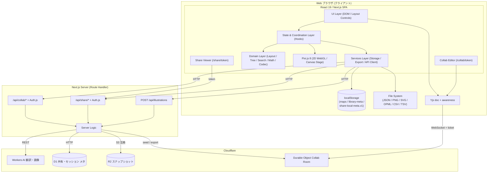
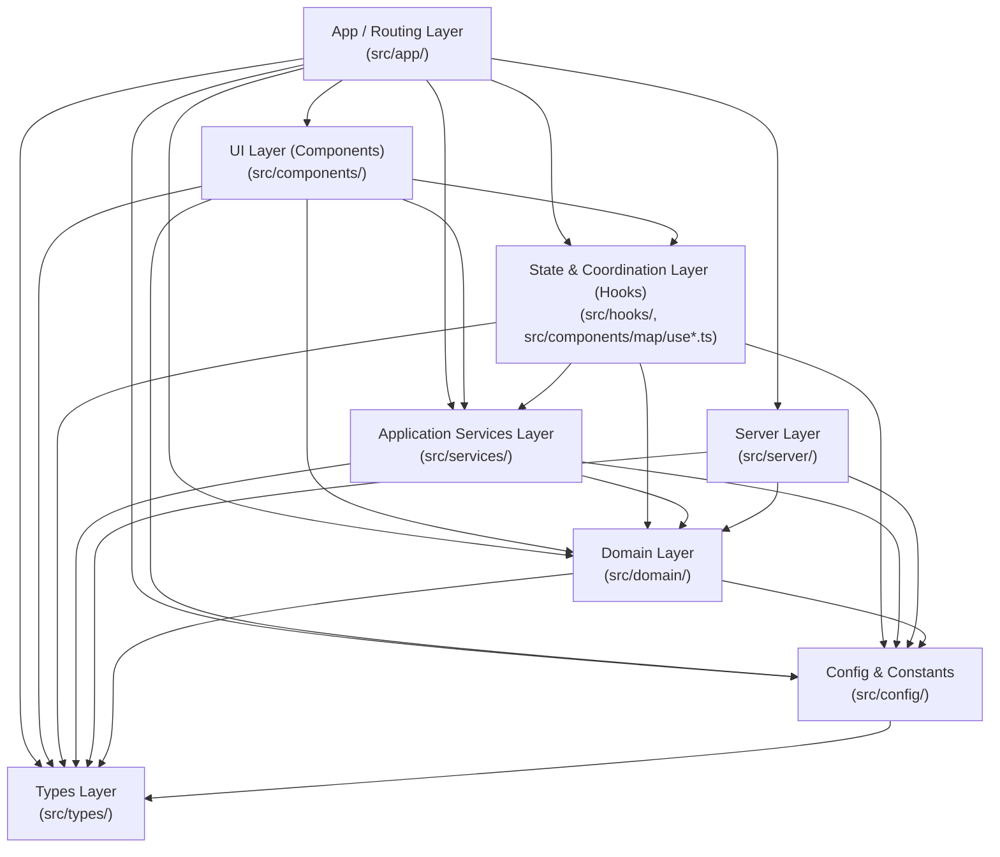
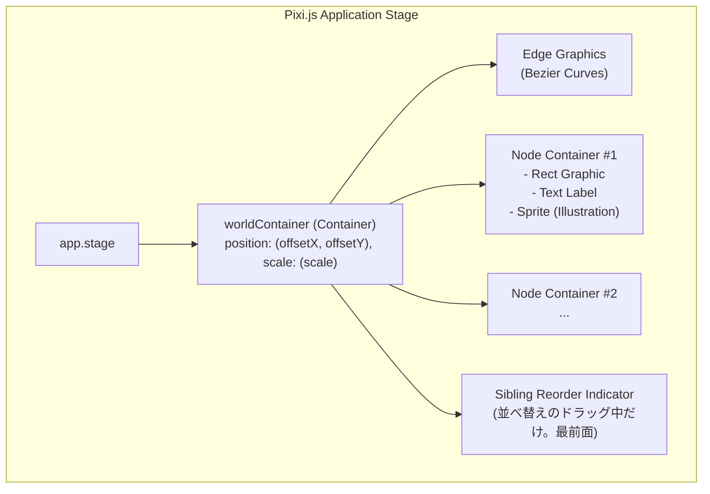
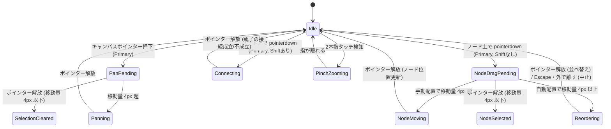
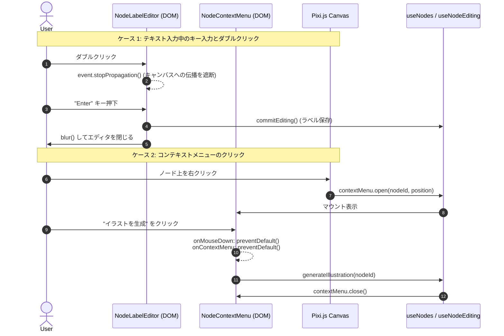
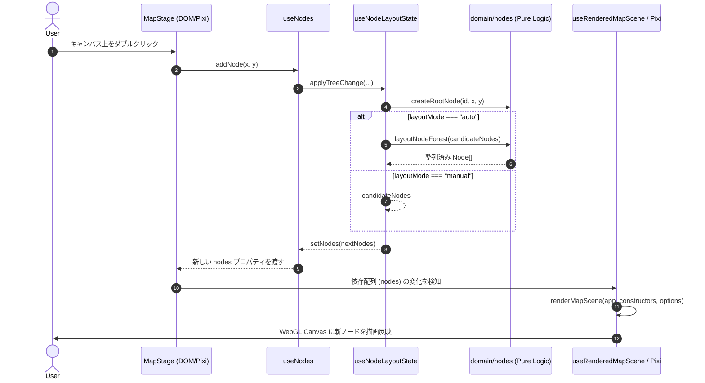
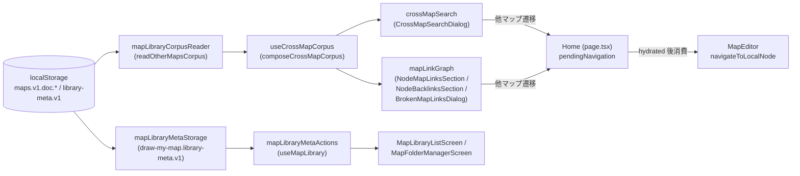

# システムアーキテクチャ設計書

Draw My Map のシステム全体アーキテクチャ、レイヤード設計、2D WebGL/Canvas（Pixi.js）と React 19（DOM）の協調レンダリングモデル、状態管理、およびテスト設計に関する仕様書です。

---

## 1. アーキテクチャ概要

### 1.1 システム方針

Draw My Map は、思考の整理・アイデア発想を直感的に支援する**ブラウザ完結型シングルページ・マインドマップアプリケーション**（SPA）です。

- **ローカルファースト & クライアント完結**: マップデータ（ノードツリー、配置座標、重要度、レイアウトモード）はすべてブラウザ上の React 状態および `localStorage` で安全に保持・管理され（Phase 12 から、名前を付けた複数のマップを一覧のインデックスとマップごとの本体に分けて保存）、外部データベースへの認証や接続なしにオフラインでも動作します。JSON ファイルとしてのエクスポート/インポート、SVG/PNG 形式の画像書き出し、OPML/CSV/TSV による他ツールとのデータ交換もすべてクライアントサイドで処理されます。共有（Phase 37）でも編集の正本はローカルのままです。共同編集（Phase 39）は**セッション中だけ** Durable Object 上の Yjs を正本にし、終了後は再び localStorage へ戻します。
- **軽量サーバーサイド連携（BFF / Route Handler）**: Next.js App Router の Route Handler 経由で、(1) AI イラスト生成（`POST /api/illustrations` → Cloudflare Workers AI）、(2) AI 支援（`/api/ai-assist/*`）、(3) 共有（Auth.js Google・`/api/share/*` → Cloudflare D1／R2）、(4) 共同編集（`/api/collab/*` → 短命チケット発行・セッション管理、Yjs 同期は Durable Object）を扱います。API キー・OAuth 秘密・共有／共同編集用資格情報はサーバーサイドでのみ保持されます。



### 1.2 レイヤードアーキテクチャの採用理由と単一責任原則（SRP）

マインドマップアプリケーションは、以下のような多岐にわたる関心事が混在しやすい特性を持ちます：
1. **複雑なグラフ構造・ツリー演算**: 循環参照の防止、部分木のトラバース、ノード階層に応じた自動レイアウト計算。
2. **高速・大量のグラフィックス描画**: 数百ノードや曲線の 60fps スムーズなパン・ズーム、Tween アニメーション。
3. **リッチなユーザー操作**: キーボードショートカット、ドラッグ移動、Shift+ドラッグ接続、ピンチズーム、インラインテキスト入力。
4. **外部システム連携**: ブラウザ API、ファイル入出力、AI API 通信。

これらが単一のコンポーネントやフックに混在すると、描画パフォーマンスの低下やテスト困難性、保守性の破綻を招きます。  
Draw My Map では**単一責任原則（Single Responsibility Principle: SRP）**を徹底し、関心事ごとに厳密に分離された**レイヤードアーキテクチャ**を採用しています。

- **ドメイン知識の純粋化**: 配置幾何計算やツリー操作、JSON スキーマ検証などは一切の UI・フレームワーク・ブラウザ API に依存しない純粋関数として記述され、100% 独立してユニットテスト可能です。
- **副作用の隔離**: Canvas のピクセル操作や `localStorage`、ネットワーク通信などの副作用は Services 層にカプセル化されます。
- **宣言的調停**: React フックは状態の保持とドメイン関数・サービス関数の呼び出しの調停のみを担い、複雑なビジネス計算自体は持ちません。

### 1.3 技術スタックとコンパイラ・ビルド設定

| カテゴリ | 採用技術・バージョン | 設定・構成の特徴 |
| :--- | :--- | :--- |
| **アプリケーション基盤** | **Next.js 16.1.6** (App Router) | クライアント SPA + Route Handler（イラスト・AI 支援・共有・共同編集） |
| **所有者認証** | **Auth.js / next-auth ^5**（Google） | 共有・共同編集の所有者／参加者識別。未ログインでもローカル編集可 |
| **共同編集同期** | **Yjs** + **Cloudflare Durable Objects**（`collab-worker/`） | セッション中のみ DO 上の Yjs 正本。WS は短命チケット検証後 |
| **UI ランタイム** | **React 19.2.3** (`react`, `react-dom`) | 宣言的 DOM レンダリング、カスタムフックによる状態管理 |
| **Markdown 表示** | **`react-markdown` ^10.1.0** + **`remark-gfm` ^4.0.1** | 詳細メモの安全な Markdown（CommonMark + GFM）プレビュー描画（`rehype-raw` 不使用） |
| **React Compiler** | **`babel-plugin-react-compiler` 1.0.0** | `client/next.config.ts` にて **`reactCompiler: true`** を有効化。ビルド時の自動メモ化により不要な再レンダリングを最適化 |
| **2D グラフィックス** | **Pixi.js ^8.16.0** (`pixi.js`) | WebGL / Canvas による高速シーンツリー描画、ビューポート変換、Tween 制御 |
| **スタイリング** | **Tailwind CSS v4** (`@tailwindcss/postcss`, `@tailwindcss/cli`) | `src/app/globals.css` ベース、ライト / ダークモード対応 |
| **型システム** | **TypeScript ^5** | `client/tsconfig.json`: `target: "ES2017"`, `strict: true`, `module: "esnext"`, `moduleResolution: "bundler"`, `isolatedModules: true`, `jsx: "react-jsx"`, パスエイリアス `"@/*": ["./src/*"]` |
| **テスト・品質保証** | **Jest ^30.2.0** + **Testing Library** (`@testing-library/react` ^16.3.2, `@testing-library/jest-dom` ^6.9.1) + **ESLint ^9** | `client/jest.config.ts` (`jest-environment-jsdom`)、`client/jest.setup.ts` |

---

## 2. レイヤードアーキテクチャ詳細

システムのディレクトリ構造は、責務に応じて以下の 8 レイヤー（および横断テスト基盤 `src/testing/`）に階層化されています。依存関係は**上位レイヤーから下位レイヤーへの単方向**に限定され、逆方向の依存や循環依存は厳格に禁止されています。

```text
client/src/
├── app/             # 1. App / Routing Layer (Next.js App Router ページ & Route Handler)
├── components/      # 2. UI Layer (Layout DOM & Map Canvas Wrapper / Pixi Renderer / Outline Editor)
│   ├── layout/      #    ヘッダー、セレクター、通知、右サイドパネル等の HTML/DOM コンポーネント
│   ├── map/         #    Pixi.js ステージ、ジェスチャー制御、DOM オーバーレイ、ステージ用テストハーネス
│   │   ├── pixi/    #    Pixi.js シーン描画・ポインタ/タッチジェスチャー・Tween アニメーター・Pixi 単体ハーネス
│   │   └── testing/ #    MapStage 統合テスト用ランタイム & 自動レイアウト統合ハーネス & 兄弟の順序・階層のショートカットの target の要素の補助
│   ├── outline/     #    アウトラインエディタ・ツールバー等のアウトライン UI コンポーネント
│   ├── share/       #    閲覧専用シェル（ShareViewer / ShareMapView / ShareOutlineView）
│   └── auth/        #    AuthSessionProvider 等
├── hooks/           # 3. Application State & Coordination Layer (カスタムフック)
├── services/        # 4. Application Services Layer (ブラウザ API・副作用の抽象化)
│   ├── illustration/  # イラスト生成通信・サムネイル生成
│   ├── imageExport/   # PNG/SVG 画像エクスポート
│   ├── outlineExport/ # Markdown/テキスト等のアウトライン書き出し
│   ├── exchange/      # OPML・CSV/TSV のテキストダウンロード
│   ├── persistence/   # ストレージ・ファイル永続化・バックアップ復元・共有ローカルメタ
│   ├── share/         # D1/R2 HTTP クライアント・共有 API クライアント
│   └── collab/        # Yjs 接続・ドキュメントセッション・presence 橋渡し
├── domain/          # 5. Domain Layer (純粋ビジネスロジック・幾何演算・スキーマ検証)
│   └── collab/        # MapDocument ↔ Yjs codec・共同編集ガード・文言
├── server/          # 6. Server Layer (イラスト / AI 支援 / 共有 / 共同編集 API)
├── config/          # 7. Config & Constants Layer (アプリケーション共通定数)
├── types/           # 8. Shared Types & Interfaces (TypeScript 型定義)
└── testing/         # 共通テストヘルパー・フィクスチャ (createTestNode, createTestMapHistoryLease, jpegFixture, createTestStorageSession, mapLibraryTestStorage)
```

### 2.1 各レイヤーの責務と構成

#### 1. App / Routing Layer (`src/app/`)
- **責務**: Next.js App Router のエントリポイント、グローバルレイアウト、グローバルスタイル、および API Route Handler。
- **構成ファイル（全 5 ファイル）**:
  - `src/app/layout.tsx`: HTML シェル、Geist フォント設定、メタデータ定義。
  - `src/app/page.tsx`: シェル（`Home`）。アンマウントされない最上位で、`useMapLibrary`（マップの一覧・起動の判定・作成・切り替え・名前変更・削除・枝の別マップへの移動・お気に入り／最近使用／フォルダーメタデータ管理）、`useMapLibraryDialogState`（ダイアログの画面・一覧タブとフォルダー絞り込み状態・フォーカスの戻し先）、および `usePendingMapNavigation`（他マップ特定ノードへの遷移要求 `pendingNavigation`・`switchToMapTarget`・`consumePendingNavigation`・`clearPendingNavigation`。他遷移や保護モード移行で自動破棄）を持ち、`MapLibraryNoticeRegion`、`MapEditor`（`key={現在のマップの id}:{storageMode}`。同じ id のまま保護モードへ移るときも原本を読み直す）、`MapLibraryDialog` を描画する。マップ一覧から `BrokenMapLinksDialog` を起動する `brokenLinksDialogRequest` / `onBrokenLinksDialogClosed` もここで調停する。ダイアログ内のマウスのクリックの時刻を ref（`dialogMouseClickedAtRef`）に控え、`MapEditor` を通して `MapStage` へ渡す（再マウントをまたいで引き継ぐため、シェルが持つ）。`useMapLibrary` へ渡す既定の依存（`getBrowserMapLibraryStorage`、`generateMapId`、`now`）をここで組み立てる。再マウントの後は、新しいヘッダーのボタンの `ref` がつながった後の `useLayoutEffect` で、ダイアログの戻し先へフォーカスする。
  - `src/app/globals.css`: Tailwind CSS v4 インポートおよびカラースキーム（ライト/ダーク）変数定義。
  - `src/app/favicon.ico`: アプリケーションアイコン。
  - `src/app/api/illustrations/route.ts`: イラスト生成 API エンドポイント（`POST /api/illustrations`, `dynamic = "force-dynamic"`）。処理は持たず、`process.env` と本物の Cloudflare の実装（`createCloudflareTranslator`・`createCloudflareImageGenerator`）を `handleIllustrationRequest` へ渡す配線だけを行う。
- **依存可能レイヤー**: UI (Components), Hooks, Services（`page.tsx` が `useMapLibrary` の既定の依存として `getBrowserMapLibraryStorage` と `generateMapId` を渡すためだけ）, Server (Route Handler のみ), Config, Types。Domain は `import type` と空メタデータ既定値（`createEmptyMapLibraryMeta`）だけ

#### 2. UI Layer (Components) (`src/components/layout/`, `src/components/map/`, `src/components/outline/`)
- **責務**: ユーザーに対するプレゼンテーション、DOM イベントの捕捉、Pixi.js Canvas ステージと DOM オーバーレイの統合、およびアウトライン編集画面の提供。
- **構成モジュール**:
  - **レイアウト UI (`src/components/layout/` 全 109 ファイル)**:
    - `AppHeader.tsx`: タイトル、マップの操作（必須の `mapControls`。タイトルの直後）、現在のマップ本体の保存状態（必須の `saveStatus`。マップ操作の直後に常設表示）、表示モード切替（マップ/アウトライン）、ノード検索、レイアウトモード切替、操作ヒント、重要度・解像度フィルタ切替、枝の折りたたみ・展開ボタンと非表示件数（`NodeCollapseControl`）、元に戻す／やり直すボタン、枝を複製ボタン、「枝を移動」ボタン（`BranchMoveControl`）、マップ表示でだけ出す「一括置換」ボタン（`LabelReplaceControl`）、マップ表示でだけ出す「ノードを分割」ボタン（`NodeSplitControl`）と「ノードを統合」ボタン（`NodeMergeControl`）、兄弟の順序の「上へ」「下へ」ボタン、階層の「階層を上げる」「階層を下げる」ボタン、「親を挿入」ボタン、「ノードだけ削除」ボタン、枝のコピー＆ペーストの常設案内、「箇条書きから追加」ボタン、JSON/画像エクスポートボタン、操作通知バーを統合するヘッダー（操作のボタン群と通知は `MapEditor` が `operationControls`・`operationNotices` として渡す）。
    - `EditorViewModeControl.tsx`: マップ表示（キャンバス）とアウトライン表示の表示モード切り替えボタングループ（`role="group"`, `aria-label="表示モード"`）。
    - `MapSaveStatus.tsx`: 現在のマップの保存状態（保存済み／保存中／保存失敗／保護モード／競合／削除）の常設バッジ表示（`role="status"`）。
    - `MapConflictNotice.tsx`: 複数タブでの編集競合・外部更新・外部削除を通知し、「別名で保存」「最新を読み込む」「JSON書き出し」の解決手段を提供する常設ライブリージョン通知コンポーネント（`role="alert"` / `aria-live="assertive"`）。
    - `MapConflictConfirmDialog.tsx`: 複数タブ競合時に「最新を読み込む」を選択した際、未保存変更の破棄を確認するモーダルダイアログ（安全側のキャンセル初期フォーカス、キーリピート連打抑止）。
    - `OutlineExportControls.tsx`: Markdown・インデント付きテキスト（箇条書き）形式でのアウトライン書き出しボタン。
    - `NodeSearchBox.tsx`, `nodeSearchKeyAction.ts`: ARIA combobox/listbox による検索欄と最大50件の候補一覧、および矢印・Enter・Escape・IME変換中のキー判定。URL だけで一致した候補には補助行に「 · URL 一致」、アクセシブルネームに「URL 一致」を足す。
    - `AppWorkspace.tsx`: ヘッダー下の 2 カラム（メインキャンバス領域 + 右サイドパネル）レイアウト。
    - `LayoutModeSelector.tsx`: `手動配置` / `自動配置` 切り替えボタングループ（`role="group"`, `aria-label="レイアウトモード"`）。
    - `LayoutStyleControl.tsx` / `MapHeaderLayoutControls.tsx`: ヘッダーの「レイアウト様式」直交／放射（Phase 29）とツリー方向・配置間隔・整列等の配線。manual 時は様式・方向・間隔が disabled（値保持）。radial 中はツリー方向が disabled（値保持）、間隔は有効。`useMapHeaderLayoutControls` 経由。
    - `LabelTextStyleControl.tsx`: ヘッダーの「文字」開示パネル（マップ表示・主選択ちょうど 1 件・保護モード外・選択 ID が `nodes` に存在するとき表示）。トリガーは `aria-expanded` / `aria-controls`、パネルは `role="group"`（native `<select>` と `aria-pressed` トグルを置くため `menu` / `menuitem` は使わない）。サイズセレクト（12／14／18／24）と太字・下線トグル。`locked` では disabled。`visible` 消失で開状態を閉じる（L-214）。`MapHeaderLayoutControls` / `useMapHeaderLayoutControls` 経由で配線。
    - `NodeCollapseControl.tsx`: 選択中の親ノードの枝を折りたたみ・展開するボタン、非表示件数（選択中の親が閉じている間はその全子孫数。未選択・葉・展開中は 0件）、保存・画像出力と表示用配置の説明を表示する。
    - `MapHistoryControls.tsx`: ヘッダーの `元に戻す` / `やり直す` ボタン（履歴の有無に応じて `disabled`）。`Enter` の押し続けを `preventRepeatedEnterClick` で止め、押したボタンが無効になったときのフォーカスの引き継ぎは `usePairedButtonFocusHandover` を使う。
    - `NodeDuplicateControl.tsx`: ヘッダーの `枝を複製` ボタン（ノード未選択時は `disabled`）。クリックごとに 1 回複製し、押したあともフォーカスを移さない。`Enter` の押し続け（`repeat`）だけ `preventDefault()` で抑止する。
    - `NodeSiblingOrderControl.tsx`: ヘッダーの `上へ` / `下へ` ボタン（`role="group"`, `aria-label="兄弟の順序"`。`aria-label` は `枝を上へ移動` / `枝を下へ移動`、`aria-keyshortcuts` は `Alt+ArrowUp` / `Alt+ArrowDown`）。必須の props `canMoveUp`・`canMoveDown`・`onMoveUp`・`onMoveDown` を受け取り、動かせない向きは `disabled`。`Enter` の押し続けを `preventDefault()` する。両方のボタンに `data-tree-edit-shortcut-button` 属性（`treeEditShortcutGuard.ts` の `TREE_EDIT_SHORTCUT_BUTTON_ATTRIBUTE`）を付け、フォーカスがあっても `Alt+↑/↓` のショートカットが働くようにする（ボタン自身は `Alt+↑/↓` を処理しないので二重に動かない）。押したボタンが端で無効になったときは、フォーカスがそのボタンか `body` にあれば、もう一方の有効なボタンへ移す（`usePairedButtonFocusHandover`。`MapHistoryControls` と共有）。
    - `NodeIndentControl.tsx`: ヘッダーの `階層を上げる` / `階層を下げる` ボタン（`role="group"`, `aria-label="階層"`。`aria-label` は `枝の階層を上げる` / `枝の階層を下げる`、`aria-keyshortcuts` は `Alt+ArrowLeft` / `Alt+ArrowRight`）。`NodeSiblingOrderControl` の右隣に置く。必須の props `canOutdent`・`canIndent`・`onOutdent`・`onIndent` を受け取り、動かせない向きは `disabled`。`Enter` の押し続けを `preventDefault()` する。両方のボタンに `data-tree-edit-shortcut-button` 属性を付け、フォーカスがあっても `Alt+←/→` と `Alt+↑/↓` のショートカットが働くようにする（ボタン自身はこれらのキーを処理しない）。フォーカスの引き継ぎは `usePairedButtonFocusHandover` を使う。
    - `NodeParentInsertControl.tsx`: ヘッダーの `親を挿入` ボタン（`aria-label="選択中のノードに親を挿入"`、`aria-keyshortcuts="Alt+Enter"`、`title="選択中のノードに親を挿入（Alt/Option+Enter）"`）。`NodeIndentControl` の右隣、「ノードだけ削除」の前に置く。必須の props `canInsert`・`onInsert` を受け取り、選択が無い・見えていないときは `disabled`。`Enter` の押し続け（`event.repeat`）を `preventDefault()` する（Space は止めない）。`data-tree-edit-shortcut-button` 属性を付け、フォーカスがあっても `Alt+Enter` ほか5つのショートカットが働くようにする（ボタン自身はこれらのキーを処理しない）。成功しても無効にならず、フォーカスは入力欄の `autoFocus` で移るので、`usePairedButtonFocusHandover` は使わない。`event.detail` で弾かず、ダブルクリックは2回の挿入になる。
    - `NodeOnlyDeleteControl.tsx`: ヘッダーの `ノードだけ削除` ボタン（`aria-label="子孫を残してノードだけ削除"`）。子ノードを昇格させて選択ノードのみを削除する。
    - `usePairedButtonFocusHandover.ts`: 2つのボタンの片方が無効になったときのフォーカスの引き継ぎ（`usePairedButtonFocusHandover(firstEnabled, secondEnabled)`。`firstRef`・`secondRef`・`handleFocus`・`handleBlur` を返す）。押したボタンが無効になり、フォーカスがそのボタンか `body` にあれば、もう一方が有効ならそちらへ移す。移せる先が無ければ記録を捨てる。`MapHistoryControls`・`NodeSiblingOrderControl`・`NodeIndentControl` が使う。
    - `repeatedEnterClick.ts`: ボタンの `keydown` で、リピートの `Enter`（`event.repeat`）だけ `preventDefault()` してブラウザの click の合成を止める `preventRepeatedEnterClick`（単発の `Enter` と Space は止めない）。押し続けで操作が連続しないよう、`MapHistoryControls`・`NodeCollapseControl`・`NodeDuplicateControl`・`NodeSiblingOrderControl`・`NodeIndentControl`・`NodeParentInsertControl` の `onKeyDown` に渡す。止める理由（往復・連続挿入など）は各コンポーネントのコメントに残す。 同じファイルの `preventRepeatedActivationClick` は Space のリピートも止め、`BranchMoveControl`・`LabelReplaceControl`・`NodeSplitControl`・`NodeMergeControl`・`LabelReplaceDialog`・`NodeSplitDialog`・`NodeMergeDialog` の確定とキャンセルのボタン・`MapPersistenceControls` の「JSON書き出し」が使う。
    - `LayoutModeOperationHint.tsx`: 現在の `layoutMode` に応じた操作ガイド文字列の表示。
    - `NodeImportanceSelector.tsx`: 選択中ノードの重要度（`高` / `中` / `低`）切り替えボタングループ（`role="group"`, `aria-label="重要度"`）。必須の props `selectionCount`・`mixed` を受け取る。`aria-live="polite"` の件数表示を常に描画し、2件以上の選択では `N件選択中`、重要度が混在しているときは `N件選択中・混在` と読み上げる。2件以上ではグループの `aria-label` が `重要度（N件選択中）`、混在時は `重要度（N件選択中・混在）` になる。
    - `ResolutionFilterSelector.tsx`: 表示フィルタ（`自動` / `高のみ` / `中以上` / `すべて`）切り替えボタングループ（`role="group"`, `aria-label="表示"`）および自動時の現在レベル表示。
    - `MapPersistenceControls.tsx`: `JSON書き出し` / `JSON読み込み` ボタンと非表示 `<input type="file">`。
    - `MapImageExportControls.tsx`: `PNG書き出し`（変換中 `disabled` 制御付き） / `SVG書き出し` ボタン。
    - `MapOperationNotice.tsx`: 操作結果・警告・エラー通知を表示するアクセシブルな通知コンポーネント（`role="status"` / `role="alert"`）。
    - `MapOperationNoticeList.tsx`: 操作通知バーの通知の並び（`MapOperationNoticeList({ notices })`）と、通知が1つでもあるかの判定（`hasOperationNotice(notices)`）。配列の位置が系統を表し、`null` はその系統の通知が無いことを表す。位置を `key` にするため、ほかの系統の通知が増減しても要素を作り直さない。`MapEditor` は通知が1つも無いときは `null` を渡し、`AppHeader` に通知行を確保させない。
    - `NodeDetailPanel.tsx`: 右サイドパネル（`w-72`、縦スクロール。`aria-label` は選択種で切替: マップ表示で関連線なら「関連線の詳細」、グループなら「グループの詳細」、それ以外は「ノードの詳細」）。マップ表示で関連線／グループ選択時は `RelationDetailSection` / `GroupDetailSection` だけを出し、ノード向けの節（詳細メモ〜イラスト）は抑止する（アウトラインでは関連線／グループ選択が残ってもノード UI を出す）。ノード選択時は上から詳細メモ、見た目（`NodeAppearanceSection`。icon / kind）、タグ、リンク、出典、マップ間リンク、被リンク、イラストの節を積み、選択中のノードがあるときだけ `NodeNoteEditor` を `key={`${id}:${documentRevision}`}` で描く。`NodeTagsSection`・`NodeLinksSection`・`NodeSourcesSection`・`NodeMapLinksSection` はノードの ID だけの `key={`tags:${id}`}`・`key={`links:${id}`}`・`key={`sources:${id}`}`・`key={`mapLinks:${id}`}`（未選択は `tags:none`・`links:none`・`sources:none`・`mapLinks:none`）でノード切替時に作り直し、`documentRevision` は props で渡す（`documentRevision` 変化時は再マウントせず、節の中で下書きとエラーだけを消し、フォーカスを保つ）。`RelationDetailSection.tsx` / `GroupDetailSection.tsx`: 関連線の kind・有向、グループのラベル編集。`NodeNoteSection.tsx`: 詳細メモの表示部品（見出し・対象・複数選択の文言・ノード選択時のみ描画する `role="tablist"`（「編集」「プレビュー」の 2 タブ、roving `tabIndex`、`ArrowRight`/`ArrowLeft`/`Home`/`End` キー操作）・両 `role="tabpanel"` の DOM 保持と `hidden` 切替・プレビュー切替時の `<textarea>` `blur()` 即時確定・`<textarea maxLength={10000}>`・文字数・常設の `role="status"`）。`NodeNoteEditor.tsx`: `useNodeNoteEditing` と表示モード `mode`（`useState<NodeNoteViewMode>("edit")`）を持ち、`NodeNoteSection` へ値を渡す接続の部品（ノード ID と `documentRevision` の変化による再作成で `"edit"` に戻る）。`NodeNoteMarkdown.tsx`: `react-markdown` + `remark-gfm`（`rehype-raw` なし）による CommonMark + GFM プレビュー描画部品（`normalizeNodeNote` で正規化した文字列を描画し、結果が `undefined` の空・空白のみメモは「メモはありません」を表示。`urlTransform` 恒等関数と `toSafeNoteMarkdownLinkHref` / `toSafeNoteMarkdownImageHref` によるリンク・画像 URL の安全性検証、`InsideMarkdownLinkContext` による `<a>` 入れ子防止、`` を出さずに `formatNoteMarkdownImageLabel` でリンク文字化、表示専用 checkbox、`<pre>` / `<table>` の `tabIndex`・独立スクロールなしでの折り返し表示）。`NodeLinksSection.tsx`: 「リンク」節（`<section>`、見出し「リンク」）。URL の一覧（`toSafeLinkHref` で確かめた `<a target="_blank" rel="noopener noreferrer">` と削除ボタン）・件数と上限の `role="status"`・追加のフォーム（`<form noValidate onSubmit>` で確定は送信の 1 か所、`type="url"`、IME 変換中・押し続けの `Enter` は `preventDefault`、失敗は `role="alert"`）と、入力欄の下書き・エラー・フォーカス（成功と削除の後は入力欄へ）を持つ。入力欄とボタンは `disabled` にしない。`NodeTagsSection.tsx`: 「タグ」節（`<section>`、見出し「タグ」）。タグの一覧（`<ul>` の項目にタグ名と「×」の削除ボタン（名前「タグを削除: {名前}」））・件数と上限の `role="status"`・追加のフォーム（`<form noValidate onSubmit>` で確定は送信の 1 か所、`type="text"`、IME 変換中・押し続けの `Enter` は `preventDefault`、失敗は `role="alert"`）と、入力欄の下書き・エラー・フォーカス（成功と削除の後は入力欄へ）を持つ。入力欄とボタンは `disabled` にしない。
    - `RelationPartnerPickerDialog.tsx`: 関連線の相手ノード選択ダイアログ（`role="dialog"`）。「関連線を追加」から開き、候補一覧から to 側を選んで `addRelation` する（Phase 28）。
    - `NodeSourcesSection.tsx`: 「出典」節（`<section>`、見出し「出典」）。出典の一覧（タイトル、ページがあれば `p. {page}`、URL があれば `toSafeLinkHref` の `<a target="_blank" rel="noopener noreferrer">`、削除ボタン（名前「出典を削除: {タイトル}」に、ページがあれば `p. {page}`、URL があれば URL を空白区切りで続ける））・件数と上限の `role="status"`・追加のフォーム（`<form noValidate onSubmit>` でタイトル・ページ・URL の 3 入力、IME 変換中・押し続けの `Enter` は `preventDefault`、失敗は `role="alert"`）と、入力欄の下書き・エラー・フォーカス（成功と削除の後はタイトル入力欄へ）を持つ。入力欄とボタンは `disabled` にしない。タイトルが空の送信は何もしない。
    - `NodeMapLinksSection.tsx`: 「マップ間リンク」節（`<section>`、見出し「マップ間リンク」）。選択中ノードの登録済みリンクを `resolveNodeMapLink` で状態別（`valid` の移動ボタン / `protected-unavailable` の保護モード案内 / `missing-map`・`missing-node`・`unreadable-map` のリンク切れバッジと理由）に表示し、値一致削除（削除後フォーカスを「対象マップ」セレクトへ戻す）、件数・上限の常設 `role="status"`、および「対象マップ」「対象ノード（任意）」セレクトによる追加フォーム（下書きの対象を一覧と corpus で選べる値へ正規化するのは `nodeMapLinkDraftTargets.ts` の `resolveNodeMapLinkDraftTargets`、`<form noValidate>`, IME / repeat 抑止、入力欄とボタンは上限時も `disabled` にしない）を提供する。
    - `NodeBacklinksSection.tsx`: 「被リンク」節（`<section>`、見出し「被リンク」）。`collectBacklinks` で取得した「このノードへ」「このマップ全体へ」の被リンク一覧を表示し、クリックで参照元マップ・ノードへ移動する。保護モード時や読込不可マップ存在時は注意文言を表示する。
    - `CrossMapSearchDialog.tsx`: 全マップ横断検索モーダルダイアログ（`role="dialog"`, `aria-modal="true"`, 見出し「全マップ検索」）。`searchCrossMapCorpus` で最大 100 件を一覧表示し、保護モード案内・読込不可マップ警告（`role="alert"`）・常設件数表示（`role="status"`）・矢印キー循環選択・Enter/クリック遷移・IME/repeat 抑止・`useDialogFocusTrap`・`handleDialogClickCapture` を備える。
    - `BrokenMapLinksDialog.tsx`: 全マップのリンク切れ一括確認モーダルダイアログ（`role="dialog"`, `aria-modal="true"`, 見出し「リンク切れの確認」）。`collectBrokenMapLinks` の結果（`マップなし` / `ノードなし` / `読込失敗`）を一覧表示し、「参照元へ移動」および現在マップ項目限定の「このリンクを削除」（値一致削除・即再スキャン・削除後フォーカスを閉じるボタンへ復帰）を提供する。
    - `NodeAppearanceSection.tsx`: 右パネルの「見た目」節（icon チップ／入力・kind ラジオ。主選択ちょうど 1・マップ・非保護のときだけ表示。locked 時は `disabled`）。
    - `IllustrationPanel.tsx`, `illustrationPanelView.ts`, `IllustrationImage.tsx`: イラストの UI（`<section aria-label="イラスト">`。幅・縁は `NodeDetailPanel` が持つ。AI 生成に加え「画像を添付」+ `accept="image/*"` + 上書き確認で既存 `createIllustrationThumbnail` / `attachIllustration` を再利用。`NodeDetailPanel` は locked・保護モード・主選択≠1 のとき `disabled` を渡す）、パネル表示状態導出ロジック（`getIllustrationPanelView`）、および Data URL 用ネイティブ `` ラッパー。
    - `MapLibraryControls.tsx`: ヘッダーの現在のマップ名（「マップ: <名前>」、`truncate` と `title`）と「マップ一覧」「新しいマップ」ボタン（`aria-haspopup="dialog"`、押し続けの Enter・Space を `preventDefault()`、保護モードでは `disabled` と理由の文言）。
    - `MapLibraryNoticeRegion.tsx`: シェルの通知の常設ライブリージョン（`role="status"` と `role="alert"` を最初から空で置き、`useReannouncedNotice` で `sequence` が変わるたびに一度空にしてから次のフレームで文言を入れる）。`MapEditor` の外に置くため、再マウントでも `inert` でも消えない。
    - `MapLibraryDialog.tsx`: モーダルダイアログの枠（`max-w-[36rem]`、`onClickCapture` で `detail > 0` のマウスのクリックごとに `onMouseClick` を呼び、シェルへ通知する。`role="dialog"`、`aria-modal="true"`、余白を押したときにフォーカスを受け止める `tabIndex={-1}`、画面によらない `aria-label="マップの管理"`）。各画面の中身は画面（と対象のマップ・フォルダー）ごとに key を変えて作り直す `role="group"` で包み、group の `aria-labelledby` で見出しを、削除の確認では group の `aria-describedby` で本文を指す。画面（一覧・新規作成・名前変更・削除・ゴミ箱・フォルダー管理・フォルダー名変更・フォルダー削除確認・バックアップ・追加復元の確認）を切り替え、`focusTarget` を `useLayoutEffect` で適用し（行・フォルダー行のボタンは `data-map-id` / `data-folder-id` と `data-map-action` / `data-folder-action` で探す。属性とセレクタの対応は `mapLibraryListButtons.ts`）、常設の `role="status"`・`role="alert"` への通知は `useReannouncedNotice` で `sequence` ごとに一度空にし、次のフレームで入れ直す。開閉と画面の状態は持たない。
    - `MapLibraryListScreen.tsx`, `MapLibraryListRow.tsx`, `MapLibraryListFilters.tsx`, `MapLibraryMetaStatusNotice.tsx`, `MapFolderManagerScreen.tsx`, `MapFolderRenameScreen.tsx`, `MapFolderDeleteConfirmScreen.tsx`, `MapLibraryNameForm.tsx`, `MapLibraryDeleteConfirm.tsx`, `MapLibraryBackupConfirm.tsx`, `MapLibraryRestoreConfirm.tsx`, `MapLibraryConfirmActions.tsx`: 一覧画面（表示切替タブ「すべて」「お気に入り」「最近使用」「アーカイブ」（`MapLibraryListFilters` の第4タブ）とフォルダー絞り込み `<select aria-label="フォルダーで絞り込み">`（select の値との相互変換は `mapListFolderFilterValue.ts`）、メタ破損時「メタデータを初期化」・読込不能時案内は `MapLibraryMetaStatusNotice`、`<ul aria-label="保存済みのマップ">`、行コンポーネント `MapLibraryListRow` によるお気に入りトグル `★`/`☆`・所属フォルダー選択 `<select>`・開いているマップの `aria-current`・「更新: …」/「最終閲覧: …」/アーカイブタブでは「アーカイブ: …」・名前変更・アーカイブ（アーカイブタブでは「アーカイブ解除」）・削除ボタン、「フォルダー管理」「リンク切れを確認」「ゴミ箱」「全マップをバックアップ」「バックアップから復元」ボタン）、フォルダー管理画面（`MapFolderManagerScreen` / `MapFolderRenameScreen` / `MapFolderDeleteConfirmScreen`：新規作成・上限 50 件案内・`<ul aria-label="登録済みのフォルダー">`・所属件数（`countMapsByFolder`）・名前変更・削除確認。3 画面で共有するボタンの見た目と Enter・ダブルクリックの抑止は `mapFolderScreenControls.ts`）、新規作成・名前変更画面（`<form>` の送信だけで確定、入力中の50文字の検証、IME 変換中の Enter を送信しない）、削除確認画面（「キャンセル」を先に置き、「このマップを削除」は押し続けとダブルクリックを無視）、一括バックアップ確認画面、追加復元確認画面、確認ダイアログ共通アクションボタン。
    - `suppressBackupRestoreActionKey.ts`: バックアップ・復元ダイアログの確定ボタンにおけるキーリピート連打抑止。
    - `mapLibraryListButtons.ts`: 一覧の画面のボタン（行の「開く」「名前を変更」「削除」、一覧の「新しいマップ」「フォルダー管理」、フォルダー管理画面の入力欄・行の「名前を変更」「削除」）に付けるデータ属性（`mapLibraryListButtonAttributes` / `mapLibraryFolderTargetAttributes`）と、ダイアログがフォーカス先を探すセレクタ（`mapLibraryListButtonSelector` / `mapLibraryFolderTargetSelector`）。付ける側と探す側の対応を1か所で定める。
    - `MapLibraryTrashScreen.tsx`, `MapLibraryTrashEmptyConfirm.tsx`, `MapLibraryTrashPermanentDeleteConfirm.tsx`: マップ一覧のダイアログの中のゴミ箱の画面（削除済みのマップの一覧と、行ごとの「復元」「完全に削除」）と、ゴミ箱を空にする確認・1件を完全に削除する確認の画面。
    - `OutlineImportControl.tsx`: ヘッダーの「箇条書きから追加」ボタン（`aria-haspopup="dialog"`、ダイアログを開いている間だけ `true` の `aria-expanded`、押し続けの Enter・Space を `preventDefault()`）。`MapEditor` が渡す `ref` を付け、閉じたときのフォーカスの戻し先にする。
    - `BranchMoveControl.tsx`: ヘッダーの「枝を移動」ボタン（`aria-haspopup="dialog"`。未選択では無効。押し続けた `Enter`・`Space` を止める）。
    - `BranchMoveDialog.tsx`: 枝の移動のダイアログの表示（移動先マップと親の選択肢、別マップの注意、エラー）とフォーカストラップ、マウスのクリックの時刻の記録。状態は持たない。
    - `branchMoveMapOption.ts`: 移動先マップの選択肢の表示文字列（現在のマップの印、同名のときの更新日時）を作る純粋関数。
    - `branchMoveParentOption.ts`: 移動先の親の選択肢の表示文字列（同名のときだけ親のラベルなどを併記）を作る純粋関数。
    - `BranchExtractDialog.tsx`: 枝の別マップへの切り出しのダイアログの表示（切り出す枝のラベル、Undo 不可の注意、エラー）とフォーカストラップ、マウスのクリックの時刻の記録。状態は持たない。入口は `NodeContextMenu` の「枝を別マップに切り出す」（`MapStage` が `onBeginBranchExtract` を渡す）。
    - `LabelReplaceControl.tsx`: ヘッダーの「一括置換」ボタン（`aria-haspopup="dialog"`・`aria-expanded`。ノードが無いと無効。押し続けた `Enter`・`Space` を止める）。`MapEditor` が `viewMode === "map"` のブロックの中の「枝を移動」の隣に置く（アウトライン表示では出さない）。
    - `LabelReplaceDialog.tsx`: 一括置換のダイアログの表示（検索語・置換語の入力欄、範囲のチェックボックス、状態文言の常設ライブリージョン、プレビューの一覧と上限超過の注記、エラー、確定とキャンセル）、フォーカストラップ、IME・リピートの `Enter`、マウスのクリックの時刻の記録。状態は持たない。
    - `NodeSeparatorField.tsx`: 分割・統合のダイアログが共有する区切り文字の入力。可視のラベル「区切り文字」のプルダウン（`NODE_SEPARATOR_PRESETS` の選択肢と「その他」）と、「その他」を選んだときだけ出す可視のラベル「その他の区切り文字」の入力欄。「その他」の入力欄の `Enter` は、IME 変換中（`isComposing`・`keyCode === 229`）とリピートを除いて `onCustomEnter` を呼ぶ。プルダウンの `Enter` では確定しない。状態は持たない。
    - `NodeSplitControl.tsx`, `NodeMergeControl.tsx`: ヘッダーの「ノードを分割」「ノードを統合」ボタン（`aria-haspopup="dialog"`・`aria-expanded`。無効のときは理由を `title` と `aria-describedby` で結ぶ `sr-only` の説明で示す。押し続けた `Enter`・`Space` を止める）。`MapEditor` が `viewMode === "map"` のブロックの中の「一括置換」の右に、「ノードを分割」「ノードを統合」の順に置く（アウトライン表示では出さない）。
    - `NodeSplitDialog.tsx`, `NodeMergeDialog.tsx`: ノードの分割・統合のダイアログの表示（見出し・説明、`NodeSeparatorField`、状態文言の常設ライブリージョン、分割は断片の一覧、統合は「残すノード」「統合後のラベル」「重要度」「イラスト」「付け替える子」とイラストの警告と「統合されて消えるノード」の一覧、エラー、確定とキャンセル）、フォーカストラップ、マウスのクリックの時刻の記録。ラベルは `formatPreviewLabel` で整形し、前後の空白を畳まず折り返して全文を出す（単独の長いラベルは `max-h-40` で内側スクロール、プレビューの見出しは `shrink-0`、分割の断片と注記の間に `sr-only` の読点）。状態は持たない。ダイアログの枠は共通部品にせず、それぞれが持つ。
    - `dialogClickCapture.ts`: `OutlineImportDialog`・`MapLibraryDialog`・`BranchMoveDialog`・`BranchExtractDialog`・`LabelReplaceDialog`・`NodeSplitDialog`・`NodeMergeDialog` の `onClickCapture` の共通処理（`detail > 0` のクリックの記録と、`detail > 1` の遮断）。
    - `OutlineImportDialog.tsx`: 箇条書きからの追加のモーダルダイアログの枠（`role="dialog"`、`aria-modal="true"`、`tabIndex={-1}`、画面によらない `aria-label="箇条書きから追加"`）。`useDialogFocusTrap` で閉じ込めと Escape（入力の画面では閉じる、プレビューの画面では戻る）を扱い、画面ごとに key を変えて作り直す `role="group"`（プレビューでは `aria-describedby` で要約と警告を指す）で画面の中身を包む。`focusRequest` の `"input"`・`"preview"` を `useLayoutEffect` で入力欄・プレビューの領域へ当て（`"header"` は `MapEditor` が扱う）、常設の `role="status"`・`role="alert"` へのダイアログ内の通知は `useReannouncedNotice` で入れ直す。`onClickCapture` で `detail > 0` のクリックごとに `onMouseClick` を呼ぶ。画面の状態とテキストは持たない。
    - `OutlineImportInputScreen.tsx`, `OutlineImportPreviewScreen.tsx`, `OutlinePreviewTree.tsx`: テキスト入力の画面（`<label>`「テキスト」付きの `<textarea>`、常設の `role="alert"` の入力エラーの欄と、エラーの間だけの `aria-invalid`、上限を超えている間の「現在 N 文字」、押し続けの Enter の抑止）、プレビューの画面（要約、「注意: 」付きの警告、`role="region"` のプレビューの領域、200件の打ち切りの表示、追加する位置のラジオボタン、「マップに追加」の押し続けと `detail > 1` の無視）、プレビューの入れ子の `<ul>`。
    - `outlineParentCandidate.ts`: プレビューの画面に渡す親の候補（`OutlineParentCandidate`）を、開いた時点で控えた `parentCandidateId` と `parentCandidateStale` と今の `nodes` から引く純関数 `resolveOutlineParentCandidate`（未選択は `none`、マップが置き換わった後と見つからないときは `missing`、見つかれば `getNodeDisplayLabel` の先頭40コードポイント）。`MapEditor` が呼ぶ。
    - `useDialogFocusTrap.ts`: ダイアログのフォーカスの閉じ込め（`document` の `focusin` で外へ出たフォーカスを戻す、背景の `pointerdown`・`mousedown` を `preventDefault()`）、Tab の循環（無効なボタンを除いて毎回数え直す `listFocusableElements`）、`window` の capture の `keydown` での Escape（IME 変換中と `repeat` は無視）。
    - `useReannouncedNotice.ts`: 常設のライブリージョンに出す値を入れ直す共通フック。`sequence` が変わるたびに一度 null にし、`requestAnimationFrame` で次のフレームに値を入れる。アンマウントや次の変更ではフレームを `cancelAnimationFrame` で取り消す。`MapLibraryNoticeRegion`、`MapLibraryDialog`、`OutlineImportDialog`、`OutlineImportInputScreen`、`BranchMoveDialog`、`BranchExtractDialog`、`LabelReplaceDialog`、`NodeSplitDialog`、`NodeMergeDialog` が使う。
  - **アウトライン UI (`src/components/outline/` 全 3 ファイル)**:
    - `OutlineEditor.tsx`: アウトラインツリー構造のインライン編集・キーボード操作（Tab/Shift+Tab での階層変更、Enter での兄弟追加、矢印キー移動、Esc でのマップ復帰）を提供するアウトラインビューコンポーネント。
    - `OutlineRowAppearance.tsx`: アウトライン行の見た目（kind 色バー・icon）。行の選択・編集操作とは別責務。
    - `OutlineToolbar.tsx`: アウトライン画面上部の専用操作バー（Markdown/箇条書きエクスポートボタン、マップ表示への復帰ボタン等）。
  - **マップステージ・DOM オーバーレイ・座標/イベント補助 (`src/components/map/` コンポーネント 4 ファイル + 補助モジュール 25 ファイル)**:
    - `MapEditor.tsx`: 1つのマップの編集画面（Phase 11 までの `page.tsx` の中身）。必須の props `mapId`、`mapName`、`storageSession`、`storageMode`（`Home` の保存モードを保存状態の保護モード判定まで渡す）、`mapControls`、`exportButtonRef`、`mapMoveTargets`、`onMoveBranchToMap`、`shortcutsEnabled`、`dialogMouseClickedAtRef`（シェルが持つ、ダイアログ内で最後にマウスでクリックした時刻の ref。そのまま `MapStage` へ渡し、直後の `dblclick` を無視させる）を受け取り、`useNodes` から `MapStage` までを組み立てる。重要度ボタンの対象は、キャンバスでは選択集合、アウトラインでは主選択のみ（アウトラインは単一選択のため、キャンバスで残った複数選択を見えないまま変えない）。シェルが `key={マップの id}:{storageMode}` で描画するため、切り替えや保護モードへの移行で履歴・表示状態・エディタ内の通知・保存待ちのタイマーごと破棄される。`shortcutsEnabled` が `false`（ダイアログ表示中）の間は根に `inert` を付け、ショートカットのフックへ `enabled: false` を渡す。`useOutlineImport` を呼び、ヘッダーの「箇条書きから追加」、操作通知バーの8系統目（取り込みの成功）、`OutlineImportDialog` を配線する。枝の構造の変更の通知の枠（`useRevisionScopedNotice` 1つ。操作通知バーの9系統目）を持ち、その `publishNotice` を `useSiblingReorderAction`・`useNodeIndentAction`・`useNodeOnlyDeletionAction`・`useBranchMoveDialog`・`useLabelReplaceDialog`・`useNodeSplitDialog`・`useNodeMergeDialog` へ、`publishNotice` と `clearNotice` を `useNodeParentInsertionAction` へ渡す。`useSiblingReorderAction` を呼び、ヘッダーの「上へ」「下へ」（`NodeSiblingOrderControl`）と `MapStage` の `layoutMode`・`onReorderSibling` を配線する。`useNodeIndentAction`（`expandNodes` は `useBranchCollapse` のもの）を呼び、ヘッダーの「階層を上げる」「階層を下げる」（`NodeIndentControl`）と `MapStage` の `onChangeNodeIndent` を配線する。`useNodeParentInsertionAction` を呼び、ヘッダーの「親を挿入」（`NodeParentInsertControl`）と `MapStage` の `onInsertParentNode`・`labelEditRequest` を配線する。`useBranchMoveDialog` を呼び、ヘッダーの「枝を移動」（`BranchMoveControl`）と `BranchMoveDialog` を配線する。`useLabelReplaceDialog`（`nodes`・`selectedNodeIds`・`documentRevision`・`updateNodeLabels` と枝の構造の変更の通知の `publishNotice` を渡す）を呼び、`viewMode === "map"` のときだけ出すヘッダーの「一括置換」（`LabelReplaceControl`）と `LabelReplaceDialog` を配線し、閉じたときの `focusRequest: "header"` を `useLayoutEffect` で「一括置換」（無効なら「JSON書き出し」）へ当てる。`useNodeSplitDialog`（`mapId`・`nodes`・`selectedNodeId`・可視集合・`documentRevision`・`splitNode` と枝の構造の変更の通知の `publishNotice` を渡す）と `useNodeMergeDialog`（`selectedNodeIds` も渡し、`mergeNodes` を使う）を呼び、`viewMode === "map"` のときだけ出すヘッダーの「ノードを分割」（`NodeSplitControl`）「ノードを統合」（`NodeMergeControl`。「一括置換」の右）と `NodeSplitDialog`・`NodeMergeDialog` を配線し、閉じたときの `focusRequest: "header"` を `useHeaderFocusReturn` でそれぞれのボタンへ当てる（ボタンが無効なときの戻り先 `fallbackRefs` は、分割は「JSON書き出し」、統合は「ノードを分割」、それも無効なら「JSON書き出し」の順）（枝の移動と一括置換の `useLayoutEffect` による同形のフォーカス戻しは、そのまま残している）。`editorShortcutsEnabled = shortcutsEnabled && outlineImport.screen === "closed" && branchMove.screen === "closed" && labelReplace.screen === "closed" && nodeSplit.screen === "closed" && nodeMerge.screen === "closed" && !crossMapDialogs.crossMapSearchOpen && !crossMapDialogs.brokenLinksDialogOpen && !persistence.isConfirmOpen` を作り、根の `inert`、`useMapHistoryShortcuts`、`useCrossMapSearchShortcut`（`Cmd`/`Ctrl`+`Shift`+`F`）、`MapStage` の `shortcutsEnabled` のすべてに渡す。`useCrossMapCorpus` で横断コーパスを保持し、`useCrossMapNavigation` でローカル/他マップへのノードジャンプおよび `pendingNavigation` 1 回消費を調停し、`useCrossMapDialogs` で全マップ検索・リンク切れ確認ダイアログの開閉とフォーカス復帰を管理して、`AppHeader` の `searchControls` へ「全マップ検索」ボタンを配置（マップ・アウトライン両表示で表示）、`CrossMapSearchDialog` と `BrokenMapLinksDialog` を `inert` 外に描画する。操作通知バーの 11 系統（表示用の自動配置の失敗・JSON の保存と読み込み・画像書き出し・アウトライン書き出し・複製・コピー／貼り付け・検索での移動・ノード／他マップ移動エラー（`navigationNotice`）・箇条書きからの追加・枝の構造の変更・複数タブ競合の解決アクション（`persistence.conflictActionNotice`））を表示する順の配列にまとめ、`MapOperationNoticeList` で描く。返す値はフラグメントで、ダイアログは根の `<div data-map-id>` の兄弟（`inert` の外）に描く。プレビューの画面に出す親の候補を `resolveOutlineParentCandidate`（`outlineParentCandidate.ts`）で作り、閉じたときの `focusRequest: "header"` を `useLayoutEffect` でヘッダーのボタンへ当てる。
    - `MapStage.tsx`: Pixi.js キャンバス要素と DOM オーバーレイ（`NodeLabelEditor`, `NodeContextMenu`）を統合するステージ親コンポーネント。必須の props `layoutMode`・`onReorderSibling`・`onChangeNodeIndent`・`onInsertParentNode`・`labelEditRequest` を受け取り、`useMapStageInteractions`（ドラッグの分岐）、`useSiblingReorderShortcut`（`enabled` は `shortcutsEnabled`）、`useSiblingReorderDragEscape`、`useNodeIndentShortcut`（`enabled` は `shortcutsEnabled`）、`useNodeParentInsertionShortcut`（`enabled` は `shortcutsEnabled`。`onInsertParentNode` を渡す）へ渡し、`labelEditRequest` を `useNodeLabelEditRequest` に渡す。ダイアログやメニューを閉じた直後の 500ms は `dblclick` に加えて押下（Pixi の `pointerdown`。`shouldIgnorePointerDown`）も無視し、`mousedown` の既定の動作（フォーカスの移動）も止める。`shortcutsEnabled` が false になると、`cancelActiveGesture()` で進行中のジェスチャーを中止する。
    - `NodeLabelEditor.tsx`, `nodeLabelEditorLayout.ts`: ノードテキストインライン編集用 `<input>` DOM オーバーレイ（`aria-label="ノードのラベル"` でアクセシブルな名前を付ける。リピートの `Enter`（`event.repeat`）では確定せず `preventDefault()` だけする。ボタンの `Enter` の押し続けがフォーカスの移った入力欄へ届いても確定しないための、`NodeParentInsertControl` と組の対策。`blur` での確定と `Escape` は変えない）と、ビューポート倍率およびイラスト有無（`topInset`）に応じた配置矩形算出。
    - `NodeContextMenu.tsx`, `nodeContextMenuLayout.ts`, `nodeContextMenuDom.ts`, `nodeContextMenuStaleness.ts`, `nodeContextMenuTarget.ts`, `mapContextMenuAction.ts`, `menuActivationDoubleClick.ts`: 右クリックコンテキストメニュー DOM オーバーレイ、176×44px クランプ配置、メニュー内外 DOM 判定、失効（Stale）判定、右クリック時のアクション解決、メニュー項目の実行後、またはダイアログ内のマウスのクリックの後 500ms 以内のダブルクリック誤発火防止（`isDoubleClickFromOverlayActivation`）。
    - `mapViewport.ts`, `mapGeometry.ts`, `mapDoubleClickAction.ts`, `nodeViewportFocus.ts`, `viewportFocusShortcut.ts`, `wheelZoom.ts`, `textEntryTarget.ts`, `editableTarget.ts`, `interactiveTarget.ts`, `mapHistoryShortcut.ts`, `treeEditShortcutGuard.ts`, `siblingReorderShortcut.ts`, `nodeIndentShortcut.ts`, `nodeParentInsertionShortcut.ts`, `siblingReorderDropSlot.ts`, `browserMapVisibilityEnvironment.ts`: ビューポート座標変換・クランプ、ノードヒットテスト（`findNodeAtPoint`）、ダブルクリックアクション分岐、ノード中央フォーカス計算、ホイールズームデルタ正規化、テキスト入力要素判定（`textEntryTarget.ts`）、編集可能要素（input・textarea・select・contenteditable）の判定（`editableTarget.ts`）、対話要素（`button, input, textarea, select, a[href], [contenteditable]`）の内側かの判定（`interactiveTarget.ts`。`useNodeKeyboardShortcuts` と兄弟の順序変更・階層の上げ下げのショートカットで共有）、元に戻す・やり直すのショートカットの判定（`mapHistoryShortcut.ts`）、兄弟の順序変更・階層の上げ下げ・親の挿入のショートカットの共通の条件（`treeEditShortcutGuard.ts`。5つのボタンの目印の属性 `TREE_EDIT_SHORTCUT_BUTTON_ATTRIBUTE`、入力の型 `TreeEditShortcutInput`、キーの条件 `passesTreeEditKeyGuard` とキー以外のすべての条件 `passesTreeEditShortcutGuard`、`KeyboardEvent` と呼び出し元の状態（`isEditing`・`selectedNodeId`・`hasActiveGesture`）から入力を作る `createTreeEditShortcutInput`（`useSiblingReorderShortcut`・`useNodeIndentShortcut`・`useNodeParentInsertionShortcut` で共有））、兄弟の順序変更のショートカットの判定（`siblingReorderShortcut.ts` の `resolveSiblingReorderShortcut`。キー以外の条件は `treeEditShortcutGuard.ts` の `passesTreeEditShortcutGuard`。対話要素の内側では止めるが、`data-tree-edit-shortcut-button`（`TREE_EDIT_SHORTCUT_BUTTON_ATTRIBUTE`）を持つボタンの内側だけは止めない）、階層の上げ下げのショートカットの判定（`nodeIndentShortcut.ts` の `resolveNodeIndentShortcut`。`→` で `"indent"`、`←` で `"outdent"`。条件は並べ替えと同じ `passesTreeEditShortcutGuard`）、親の挿入のショートカットの判定（`nodeParentInsertionShortcut.ts` の `resolveNodeParentInsertionShortcut`。条件は同じ `passesTreeEditShortcutGuard` で、`Enter` かつ `repeat` が偽なら `"insert"`、真なら `"suppress"`。入力の型 `NodeParentInsertionShortcutInput` は `TreeEditShortcutInput` に `repeat` を足したもの）と、Windows・Linux の「戻る」「進む」（`Alt+←/→`）を止めるかの判定（`shouldSuppressAltArrowNavigation`。`passesTreeEditKeyGuard` を満たし、文字入力欄（`isEditableTarget`）の外なら止める）、ドラッグの挿入位置・挿入先・線の位置の判定（`siblingReorderDropSlot.ts` の `resolveSiblingReorderDrop`。型 `SiblingReorderIndicator`・`SiblingReorderPreview`）、`requestAnimationFrame` / `prefers-reduced-motion` ブラウザ環境アダプタ。
    - `hiddenNodeInteractionReset.ts`: 非表示になった選択・編集中のノードに対する解除の手順（選択の整理・ジェスチャーの取り消し・編集の取り消し）を決める純関数（`planHiddenNodeInteractionReset`・`sameHiddenInteractionSnapshot`。`useHiddenNodeInteractionReset` が使う）。
    - `nodeRequestProcessing.ts`: ノードへの要求（`NodeFocusRequest`・`NodeLabelEditRequest`）を、処理済みの `sequence`・現在の `documentRevision`・`nodes` から `skip`（要求が無い・処理済み）、`discard`（`documentRevision` が違う・ノードが無い）、`ready`（対象のノードを添える）に振り分ける純関数（`classifyNodeRequest`）。
  - **Pixi.js 描画・ジェスチャーエンジン (`src/components/map/pixi/` 全 30 ファイル — うち `usePixiApplication.ts` は Hooks としても機能)**:
    - シーン描画: `renderMapScene.ts`, `renderMapNodes.ts`（URL を持つノードの右上の角に「リンクあり」の印（`createNodeLinkMarker`。半径 6 の青い円、白い縁、表示専用）を描く）, `renderMapEdges.ts`（親子線）, `renderMapRelations.ts`（Phase 28・関連線。両端可視時のみ・kind 色・有向矢印）, `renderMapGroups.ts`（Phase 28・グループ枠。メンバー AABB＋余白 12px・背面）, `renderSiblingReorderIndicator.ts`（並べ替えのドラッグの挿入位置の線）, `clearMapScene.ts`, `applyViewportTransform.ts`, `illustrationTextureLoader.ts`, `pixiTypes.ts`。ヒット優先: ノード > 関連線 > グループ枠。
    - 可視性トランジション: `mapVisibilityAnimator.ts`, `mapVisibilityTween.ts`, `mapVisibilityKeys.ts`, `pixiVisibilityTarget.ts`。
    - ポインタ・タッチジェスチャー: `stageInteractions.ts`, `pointerGesture.ts`, `pointerGestureSession.ts`, `pointerSample.ts`, `dragActivation.ts`, `canvasPanGesture.ts`, `nodeMoveGesture.ts`, `nodeConnectionGesture.ts`, `siblingReorderGesture.ts`（自動配置の並べ替えのドラッグ `createSiblingReorderGesture`）, `touchGestureCoordinator.ts`, `pinchZoomGesture.ts`, `pinchViewport.ts`。
    - 複数選択のジェスチャー: `marqueeSelectGesture.ts`（`Alt` + 空き背景のドラッグの矩形選択。`createMarqueeSelectGesture`）, `renderMarquee.ts`（矩形の描画）, `shiftNodePendingGesture.ts`（`Shift` + ノードの範囲選択）, `toggleNodePendingGesture.ts`（`Cmd`/`Ctrl` + ノードの選択トグル）, `wrapBackgroundGesture.ts`（背景のジェスチャーが未 activated のまま終端したら選択を解除する）。
- **依存可能レイヤー**: Hooks, Services, Domain, Config, Types

#### 3. Application State & Coordination Layer (Hooks) (`src/hooks/`, `src/components/map/use*.ts`)
- **責務**: アプリケーション状態の保持（React State / Ref / Reducer）、ライフサイクル制御、および Domain / Services 層の呼び出し調停。
- **構成モジュール**:
  - **アプリケーション状態フック (`src/hooks/` 全 98 ファイル)**:
    - `useNodeNoteEditing.ts`: 詳細メモのテキスト欄の下書き・途中反映（300ms のデバウンス、直前の反映の後の最初の入力から 2 秒の打ち切り、IME 変換中は張らず `compositionend` で張る）・`blur` での確定（履歴グループを閉じる）・`Escape` の取り消し・アンマウントでの反映（グループが有効なときだけ）。
    - `nodeNotePreviewDelay.ts`: 詳細メモの途中反映の待ち時間の純関数（`getNodeNotePreviewDelay(pendingSince, now)`。デバウンスの 300ms（`NODE_NOTE_PREVIEW_DELAY_MS`）と、打ち切り（`NODE_NOTE_PREVIEW_MAX_WAIT_MS = 2000`）までの残りの短い方。過ぎていれば 0）。`useNodeNoteEditing` がタイマーを張るときに使う（定数の import 元はこのファイルだけ）。React に依存しない。
    - `useNodes.ts`, `useNodeLayoutState.ts`: ノードツリーの CRUD・選択・重要度（`updateNodesImportance` は選択集合の重要度を1操作で一括変更する）・ラベルの一括置換（`updateNodeLabels`。`applyNonStructuralChange` で `replaceNodeLabels` を1回だけ呼んで1操作として記録し、受理したかを返す）・ラベル書式の更新（`setLabelFontSize`・`toggleLabelBold`・`toggleLabelUnderline`。いずれも `applyNonStructuralChange` で domain の `updateNodeLabelFontSize` / `toggleNodeLabelBold` / `toggleNodeLabelUnderline` を1回だけ呼び、受理したかを返す）・詳細メモの更新（`previewNodeNote`。メモの唯一の更新経路で、履歴グループ中は履歴に積まない。`useNodeLayoutState` の `applyNonStructuralPreview`（配置モードに依存しない `preview`）を呼ぶ）・タグの追加と削除（`addNodeTag`・`removeNodeTag`。最新の状態から判定し、成功なら `applyNonStructuralChange` で 1 回の履歴。失敗は理由（`AddNodeTagOutcome`）を返して何も変えない）・出典の追加と削除（`addNodeSource`・`removeNodeSource`。最新の状態から判定し、成功なら `applyNonStructuralChange` で 1 回の履歴。失敗は理由（`AddNodeSourceOutcome`）を返して何も変えない。削除は index）・マップ間リンクの追加と削除（`addNodeMapLink`・`removeNodeMapLink`。最新 ref の状態から判定し、成功なら `applyNonStructuralChange` で 1 回の履歴。削除は `nodeMapLinkKey` の値一致）・URL の追加と削除（`addNodeLink`・`removeNodeLink`。`applyNonStructuralChange` で 1 回の履歴。`addNodeLink` は `getCurrentState` の最新の状態から判定し、失敗は理由（`AddNodeLinkOutcome`）を返して何も変えない）・イラスト更新・枝の複製（`duplicateSubtree`）・枝のコピー（`copySubtree`）と貼り付け（`pasteSubtree`）・箇条書きの森の追加（`insertForest`）・兄弟の順序変更（`reorderSibling`。`applyTreeChange` を1回だけ呼ぶ）・階層の上げ下げ（`changeNodeIndent`。`applyTreeChange` を1回だけ呼び、結果 `ChangeNodeIndentResult` を返す）・親の挿入（`insertParentNode`。`applyTreeChange` を1回だけ呼び、その中の最新の配列で対象を解決して新しい ID を採番し、成功したときだけ新しいノードを選択する。結果 `InsertParentNodeResult` を返す）・ノードの分割（`splitNode(nodeId, separator, visibleNodeIds, expected)`。`applyTreeChangeWithOutcome` の中で最新の配列から `planNodeSplit` を作り直して `expected` と `isSameNodeSplitPlan` で照合し、違えば何も変えず `plan-changed` を返す。再計画の失敗はその理由を返す。新しい ID は計画が通った後に `nextAvailableIds` で 1 回だけ（断片数 − 1 個）採番し、選択と `documentRevision` は変えない）・ノードの統合（`mergeNodes(ids, primaryId, joiner, visibleNodeIds, expected, currentMapId)`。`currentMapId` は統合するノード（残すノード・吸収されるノード）を指すマップ間リンクを除くために使う。同じく最新の配列から `planNodeMerge` を作り直して `isSameNodeMergePlan` で照合し、成功したときだけ残したノードを `selectOnly` で選択する。`documentRevision` は変えない）と、手動/自動レイアウトモードの状態管理（複製・貼り付け・森の追加の挿入処理は内部関数 `applySubtreeInsertion` を共有する）・ツリー変更時の `layoutNodeForest` 自動整列トリガー。関連線／グループ／キャンバス選択 API（`relations` / `groups` / `canvasSelection` / `addRelation` / `removeRelation` / `updateRelation` / `addGroup` / `removeGroup` / `updateGroupLabel` / `selectRelation` / `selectGroup`）は `useRelationGroupActions` を呼び出し再公開するファサード（正本は `useRelationGroupActions`。ノード操作ガードも同フックの `isNodeOpBlocked` を配線）。
    - `useMapResolutionFilter.ts`, `mapResolutionFilterState.ts`: ズーム倍率・ヒステリシス・手動/自動モード遷移・マップ置換時の `pendingResetScale` 同期に基づく可視ノードフィルタリング状態管理。
    - `useMapLibrary.ts`: シェルの状態と操作。起動の判定を1回だけ確定させ（`startupRef`）、インデックス・現在のマップ・保護モード・起動時の通知・メタデータ（`libraryMeta` / `libraryMetaStatus`）を持つ。作成（`createMap`）・切り替え（`switchMap`、成功時に遷移先 `sessionNumber` を返す）・名前変更（`renameMap`）・削除（`deleteMap`）・枝の別マップへの移動（`moveBranchToMap`。flush の後に保存済みのインデックスを読み直して `transferStoredBranch` を呼び、確定の後にだけセッションを作り直す。復旧が要るときは保護モードへ移す）・枝の別マップへの切り出し（`extractBranchToNewMap`。`extractStoredBranch` / `mapBranchExtract.ts`。成功後に新マップを開き履歴リセット。Undo 不可）・別名保存（`saveCurrentAsNewMap`。競合時に旧マップ flush を完全にバイパスして新規マップとして直接退避保存し切り替える）・メタデータ操作（`toggleFavorite`・`assignFolder`・`createFolder`・`renameFolder`・`deleteFolder`・`archiveMap`・`unarchiveMap`・`resetLibraryMeta`）を、`localStorage` を先に書いて成功したときだけ `commitLibrary` 経由で状態を更新する順で行い（`revisionRef` 同期）、結果を `MapLibraryOperationResult` で返す。競合中における `switchMap` / `moveBranchToMap` / `extractBranchToNewMap` / `confirmRestore` は安全に中断・拒否し、`createMap` は旧マップ flush を安全にバイパスして遷移を継続する。現在のマップが変わるたびにセッション番号を進めて `MapStorageSession` を作り直し、`writeBody` と `registerFlush` をセッション番号で照合する。flush の登録先も持つ。セッション番号・状態・flush の登録先の ref を持ち、操作の順序を決めるのはこのフックで、照合の規則と表示用の値の導出・メタデータアクションは `mapLibrarySession.ts`・`mapLibraryState.ts`・`mapLibraryMetaActions.ts` に置く。公開する名前（`useMapLibrary`、型 `MapLibraryDeps`・`MapLibraryView`・`MapLibraryOperationResult`・`UseMapLibraryResult`）は変えず、`MapLibraryView`・`MapLibraryOperationResult` は `mapLibraryState.ts` から再エクスポートする。
    - `mapLibraryMetaActions.ts`: `useMapLibrary` から分離されたメタデータアクション実装（`loadStartupLibraryMeta`, `persistMapOpenedMeta`, `persistDeletionMeta`, `persistRestoredMeta`, `runToggleFavorite`, `runAssignFolder`, `runCreateFolder`, `runRenameFolder`, `runDeleteFolder`, `runArchiveMap`, `runUnarchiveMap`, `runResetLibraryMeta`）。React に依存せず、破損・読込不能・容量不足・保護モードのガードと通知生成を担う。
    - `useCrossMapCorpus.ts`: 全マップ横断検索・マップ間リンク解決・被リンク収集・リンク切れ検出の共通入力となる `CrossMapCorpus` を構築するフック。他マップの読み込み結果（`readOtherMapsCorpus`）を `maps`・`currentMapId`・`storage`・`storageMode`・`corpusRefreshKey` でメモ化し、現在マップの `nodes` 編集時は `composeCrossMapCorpus` だけを軽量に再計算する。`libraryMeta` の `mapMeta` から各マップの `isArchived` を `composeCrossMapCorpus` へ渡し、アーカイブ印の変化（`mapArchiveKey`）でも合成をやり直す。ダイアログ起動時の `refreshCorpus()` を公開し、保護モード時は他マップを読まず空の他マップコーパスを返す。
    - `useCrossMapNavigation.ts`: `MapEditor` から分離されたマップ内・マップ間ノードジャンプおよび `pendingNavigation` 1 回消費フック。アウトライン表示中からの直接ジャンプ時は解像度・折りたたみ展開の可否を `planOutlineNodeJump`（`crossMapNavigationPlan.ts`）で状態更新より先に検証し、不在時は副作用なく `navigationNotice` のみを発行する。
    - `crossMapNavigationPlan.ts`: `useCrossMapNavigation` の純粋な計算。アウトライン表示中からのジャンプで、初期ズーム基準の解像度判定と `resolveNodeSearchReveal` から、展開する祖先・切り替える解像度・表示する通知を決める `planOutlineNodeJump`（表示できないときは `null`）。React に依存しない。
    - `useCrossMapDialogs.ts`: `MapEditor` から分離された全マップ検索ダイアログ・リンク切れ確認ダイアログの開閉、起動前コーパス更新（`refreshCorpus`）、`brokenLinksDialogRequest` 同期、および閉じた後のフォーカス復帰を管理するフック。
    - `usePendingMapNavigation.ts`: `page.tsx`（シェル）から分離された他マップ特定ノードへの保留ナビゲーション管理フック。保護モードガード・`switchMap` 連携・トークン採番・セッション不一致による自動破棄を担う。
    - `pendingMapNavigationState.ts`: 保留ナビゲーションの有効性の判定。シェル側の破棄判定 `isPendingNavigationStale(pending, view)`（現在のマップ・セッション・永続モードとの不一致）と、編集画面側の消費判定 `isPendingNavigationReadyToConsume(pending, { mapId, sessionNumber, hydrated })`。React に依存しない。
    - `mapLibrarySession.ts`: 通常のモードのマップごとの保存のセッション（`createPersistentMapSession(context)`）と、現在のセッションの flush の呼び出し（`flushRegisteredSession(registration, activeSessionNumber)`）。React に依存せず、呼ばれた時点のセッション番号とインデックスを `context` の関数（`getActiveSessionNumber`・`getActiveIndex`）から読む。セッションオブジェクトに `sessionNumber` と注入された `storage` を公開する。内部で `lastPersistedSnapshotRef` を保持し、`writeBody` 直前に `storage.readMapBody(mapId)` を同期実行して楽観ロック照合を行い、ストレージ上の値と不一致なら `{ status: "conflict" }` を返して書き込みを中止する。一致している場合は本体と更新日時を進めたインデックスを書き、成功時に `lastPersistedSnapshotRef` を更新する。`registerFlush` は古いセッションからの登録を無視し、解除では自分の登録だけを外す。
    - `mapLibraryState.ts`: `useMapLibrary` が持つ状態の型（`LibraryState`・`PersistentLibraryState`）、表示用の値の導出（`toMapLibraryView(library)`。通常のモードでは一覧を表示順に並べ、現在のマップがインデックスに無ければ例外）、操作の結果の組み立て（`UNCHANGED_OPERATION_RESULT`・`succeededOperation`・`failedOperation`・`protectedModeFailure`）、新しいマップの id の選択（`pickNewMapId`。インデックスの id と、本体だけが残っている id を避ける）。React に依存しない。
    - `useMapLibraryDialogState.ts`: ダイアログの画面遷移（`closed | list | create | rename | delete | trash | trashPermanentDelete | trashEmptyConfirm | folders | folderRename | folderDeleteConfirm | backupConfirm | restoreReading | restoreConfirm`）、一覧の表示タブ（`listTab`）・フォルダー絞り込み状態（`folderFilter`。選択中フォルダー削除時は自動で `all` へ復帰）、操作の結果のダイアログ内の通知とシェルの通知への振り分け、フォーカスの戻し先（ダイアログ内の `focusTarget` と、再マウント後のヘッダーの `headerFocusRequest`）。起動時の通知を1回だけシェルの通知にする。`moveBranchToMap` は `useMapLibrary` の枝の移動を呼び、再マウントを伴う成功はシェルの通知と「マップ一覧」へのフォーカスに、保護モードへ移った失敗（`enteredProtectedMode`）はシェルの通知と「JSON書き出し」へのフォーカス（`headerFocusRequest: "export"`）にする。
    - `mapLibraryDialogState.ts`: `useMapLibraryDialogState` の状態の型（`DialogState`）と遷移の純粋関数（`openScreen`・`closeDialog`・`showFailure`・`closeAfterSuccess`・`backFrom`、ゴミ箱の操作の後の戻り先 `returnToTrashAfterAction`、ゴミ箱・フォルダー・フィルタ済み一覧から取り除いた後のフォーカス先選択など）。React に依存しない。
    - `useMapPersistence.ts`, `useMapStoragePersistence.ts`, `useMapStorageRestoration.ts`, `useMapStorageAutoSave.ts`, `useMapFilePersistence.ts`, `useMapJsonExport.ts`, `useMapJsonImport.ts`: `storageSession`（`readBody` / `writeBody` / `registerFlush` / `registerBackupSnapshot` / `readBackupSnapshot`）を通したマップ本体の初期復元（復元完了フラグ `hydrated: boolean` も公開）・300ms デバウンス自動保存・同期の `flushPendingSave`（`useMapStoragePersistence` がセッションへ登録）・自動保存の失敗の通知だけを消す `clearSaveFailureNotice`、および JSON ファイルのエクスポート（ファイル名に `mapName` を使う）/インポート調停（アンマウント後に読み取りが終わった結果は捨てる）。`storageMode` に加え、複数タブ競合状態（`conflictState`）と書き込み競合コールバック（`onWriteConflict`）を受け渡し、未保存変更の厳密な判定 `hasPendingEdits` を公開する。`useMapStorageAutoSave` は `writeBody` からの `conflict` 受信時にタイマーを停止して競合状態へ遷移させ、競合中は自動保存タイマーをブロックする。
    - `useStorageConflictMonitor.ts`: `storageEventHub` 経由で window `storage` イベントを購読し、`sessionNumber` の一致を確認した上で `classifyStorageChange` を呼び出し、外部更新・外部削除・編集競合のコールバックを発火するフック（StrictMode の二重実行でもリスナーが喪失しないライフサイクルを保証）。
    - `useMapConflictController.ts`: `MapEditor` から競合状態管理・監視・状態昇格・最新読込（確認ダイアログ制御、ストレージ読込・マップ置換）・別名保存（退避名生成、新マップ保存API呼出）・アクション通知管理を集約・カプセル化するコントローラーフック。
    - `useMapImageExport.ts`, `useMapPngExport.ts`, `useMapSvgExport.ts`: PNG / SVG 画像エクスポート処理（ファイル名に `mapName` を使い、PNG は書き出しを始めた時点の名前）、空マップ警告、PNG 書き出し中フラグ（`isExportingPng`）と通知状態管理。PNG はアンマウント後にラスタライズが終わった結果を捨てる。
    - `useIllustrationGeneration.ts`: 非同期 AI イラスト生成のステートマシン管理（`idle` / `generating` / `succeeded` / `failed`）、同時 1 件制限、および `AbortController` による中断制御。
    - `useNodeDuplicationAction.ts`: 選択ノードの枝を `useNodes.duplicateSubtree` で複製し、成功 / 失敗の通知を `useRevisionScopedNotice` へ渡す。
    - `useRevisionScopedNotice.ts`: 操作結果の通知を、次の通知か `documentRevision` の変化まで残す。通知を出した時点の `documentRevision` と組にして保持し、現在の値と違う通知を隠す。`useNodeDuplicationAction.ts`（複製の通知）、`MapEditor.tsx`（コピー／貼り付けの通知）、`useOutlineImport.ts`（箇条書きからの追加の成功の通知）、`MapEditor.tsx`（枝の構造の変更の通知。兄弟の順序変更・階層の上げ下げ・親の挿入・ノードだけ削除・同じマップ内の枝の移動・ラベルの一括置換・ノードの分割・統合の成功で共有し、`publishNotice` を `useSiblingReorderAction.ts`・`useNodeIndentAction.ts`・`useNodeParentInsertionAction.ts`・`useNodeOnlyDeletionAction.ts`・`useBranchMoveDialog.ts`・`useLabelReplaceDialog.ts`・`useNodeSplitDialog.ts`・`useNodeMergeDialog.ts` へ、`clearNotice`（枠を空にする。戻り値に足したもので、受け取らない呼び出し元は変わらない）を `useNodeParentInsertionAction.ts` へ渡す）がそれぞれ別の枠として呼ぶ。
    - `useSiblingReorderAction.ts`: ヘッダーのボタンの有効・無効（`canMoveUp` / `canMoveDown`。`getSiblingReorderAvailability` を `useMemo` で1回）、選択中のノードの移動（`moveSelected`）、`MapStage` からの要求（`reorder`。ショートカットとドラッグ）を受け持つ。`useNodes.reorderSibling` の結果を `formatSiblingReorderNotice` で文言にし、必須の引数 `publishNotice`（`MapEditor` が持つ枝の構造の変更の通知の枠。操作通知バーの9系統目）へ必ず1回出す。通知の状態は持たない。
    - `useNodeIndentAction.ts`: ヘッダーのボタンの有効・無効（`canOutdent` / `canIndent`。`getNodeIndentAvailability` を `useMemo` で1回。`nodes`・選択・表示集合のすべてを依存にする）、選択中のノードの上げ下げ（`changeSelected`）、`MapStage` からの要求（`change`。ショートカット）を受け持つ。`useNodes.changeNodeIndent` の結果が成功した下げ（`direction: "indent"`）のときだけ `expandNodes([newParentId])` で新しい親を展開し、結果を `formatNodeIndentNotice` で文言にして、必須の引数 `publishNotice`（並べ替えと共有する9系統目の枠）へ必ず1回出す。
    - `useRevisionScopedNodeRequest.ts`: ノードへの要求（中央移動・ラベルの編集）を、発行した時点の `documentRevision` と組にして持つ。`issueRequest(nodeId)` のたびに `sequence` を1増やし、`documentRevision` が今の値と違う要求は `request` として返さない。`useNodeSearchNavigation.ts` と `useNodeParentInsertionAction.ts` が別々に呼ぶ。
    - `treeChangeOutcome.ts`: `useNodes` の `applyTreeChange` を通す操作（兄弟の順序変更・階層の上げ下げ・親の挿入）の結果を決める純関数（`settleTreeChangeOutcome(applied, outcome)`）。確定でき候補が成功ならその結果、候補が失敗ならその理由、候補が無いか確定できなかったら `placement-failed`（候補を作れた後に失敗するのは全体の自動配置だけ）。3つの操作は `applyTreeChangeWithOutcome(applyTreeChange, compute)` を通す。`applyTreeChange` のコールバックの中で確定時点の配列と `mode` から `compute` を実行し、`nodes`（`null` なら確定しない）を返して、`outcome` と確定の可否を `settleTreeChangeOutcome` に渡す。
    - `stateChangeOutcome.ts`: relations / groups を含む `applyStateChange` 経路向けの同様のヘルパ（`applyStateChangeWithOutcome`）。`settleTreeChangeOutcome` を再利用し、`mergeNodes` / `deleteNodeOnly` などが手書きの outcome 代入・キャストなしで成功／失敗／`placement-failed` を返す。
    - `useRelationGroupActions.ts`: 関連線／グループのキャンバス選択（`canvasSelection` / `selectRelation` / `selectGroup`）と CRUD（`addRelation` / `removeRelation` / `updateRelation` / `addGroup` / `removeGroup` / `updateGroupLabel`）の正本。関連線／グループ選択中のノード操作を止める `isNodeOpBlocked` もここが所有者。`useNodes` は本フックを呼び、API を再公開し Raw applyへガードを配線するファサード。
    - `useLatestRef.ts`: 描画のたびに最新の値を ref に写す（`useLatestRef(value)`。`useLayoutEffect` に依存配列を付けない）。ref は常に同じオブジェクトなので、登録をやり直さない `window` のハンドラや effect から最新の値を読める。
    - `useNodeParentInsertionAction.ts`: ヘッダーのボタンの有効・無効（`canInsert`。`canInsertParentNode` を `useMemo` で求め、`nodes`・選択・表示集合のすべてを依存にする）、選択中のノードへの挿入（`insertSelected`）、`MapStage` からのショートカットの要求（`insert`）、ラベルの編集の要求（`labelEditRequest`）を受け持つ。`useNodes.insertParentNode` の結果が成功のときだけ、必須の引数 `clearNotice` で枠を空にし（成功の通知は出さない）、`NodeLabelEditRequest`（`documentRevision` と組。`sequence` は呼ぶたびに増やす。要求の保持は `useRevisionScopedNodeRequest`）を出す。失敗のときだけ `formatNodeParentInsertionFailureNotice` で文言にして `publishNotice` へ1回出す。`documentRevision` が違う要求は `labelEditRequest` として返さない。
    - `useNodeOnlyDeletionAction.ts`: ヘッダーの「ノードだけ削除」の有効・無効判定（`canDeleteOnly`）、選択ノードの単独削除実行（`deleteSelected`）、および枝構造変更通知（`publishNotice`）の配線。
    - `useOutlineCanvasReturn.ts`: アウトライン画面からキャンバス（マップ表示）へ復帰する際のビューポート・フォーカス返却制御。
    - `useOutlineEditorActions.ts`: アウトラインエディタ内でのノード追加・階層変更（Tab/Shift+Tab）・ラベル編集・削除の操作調停。
    - `useOutlineExport.ts`: アウトラインの Markdown / 箇条書き（インデント付きテキスト）エクスポート処理、ダウンロード発火、操作通知バーへの結果通知。
    - `useOutlineLabelDraft.ts`: アウトラインエディタの各行における未確定テキストのドラフト状態管理と確定・破棄制御。
    - `useOutlineImport.ts`: 箇条書きからの追加のダイアログの状態（`closed | input | preview`、テキスト、入力のエラーと `sequence`、解析の結果、開いた時点の親の候補と `documentRevision`、追加する位置、ダイアログ内の通知、フォーカスの要求）と操作（`open`・`close`・`setText`・`requestPreview`・`back`・`setTarget`・`submit`・`consumeFocusRequest`）。解析（`parseOutlineText`）は「プレビュー」のイベントで1回だけ行い、入力中は文字数の上限だけを判定する。`submit` は子として追加する場合に開いた時点から `documentRevision` が変わっていれば `insertForest` を呼ばずに失敗にし、成功したときだけ（子として追加したなら）`expandNodes([parentId])` を呼び、成功の通知を `useRevisionScopedNotice` で出し、テキストを空にして閉じる。プレビューの木は解析の結果から `useMemo` で作る派生値で、状態には持たない（解析の結果と同時に作られ、同時に無くなる）。引数（`selectedNodeId`・`documentRevision`・`insertForest`・`expandNodes`）は必須で、`useLayoutEffect` で同期する ref から読み、操作の関数の参照を変えない。
    - `useBranchMoveDialog.ts`: 枝の移動のダイアログの状態（開閉、開いた時点の移動元と `documentRevision`、選択、親の候補、確定の可否、エラーと `sequence`、フォーカスの要求）と確定。同一マップの成功では移動先の祖先の展開と通知、移動元が隠れているときの全表示を行う。
    - `branchMoveDialogState.ts`: `useBranchMoveDialog` の状態の型、遷移、確定の可否の判定、親の選択値の解釈を行う純粋関数。React に依存しない。
    - `useBranchExtractDialog.ts`: 枝の別マップへの切り出しのダイアログの状態（開閉、開いた時点の移動元と `documentRevision`、確定の可否、エラーと `sequence`、フォーカスの要求）と確定。`submit` は `onExtractBranchToNewMap` を呼び、成功でダイアログを閉じて新マップへ切り替わる（Undo 不可）。失敗はダイアログ内エラー。`documentRevision` の変化は stale として確定を止める。
    - `branchExtractDialogState.ts`: `useBranchExtractDialog` の状態の型、遷移、確定の可否の判定を行う純粋関数。React に依存しない。
    - `nodeBranchExtractAvailability.ts`（`domain/nodes/`）: コンテキストメニュー項目の有効・無効（保護・競合・locked・ルート・選択件数）。ライブラリーメタデータ（`libraryMetaStatus`）は関与しない。
    - `useLabelReplaceDialog.ts`: 一括置換のダイアログの状態（開閉、開いた時点の選択集合と `documentRevision`・`mapId`、検索語・置換語・範囲、エラーと `sequence`、フォーカスの要求）とプレビュー・確定。プレビューは最新の `nodes` から `planLabelReplace` で作り、入力の反映だけ `useDeferredValue` で遅らせる（追いつくまで確定できない）。表示する行の選別と状態文言の組み立ては `labelReplacePreview.ts` の純関数へ任せる（stale の文言とプレビューのラベルの整形は `dialogPreviewText.ts` の共有のものを使う）。プレビューの表示上限（`previewLimit`）も戻り値として返し、`MapEditor` はフックの戻り値だけをダイアログへ渡す。確定は `useLatestRef` の最新の値で再判定し、計画を作り直して（`listLabelReplacements` で `replace` 行だけを取り出し）`updateNodeLabels` を 1 回だけ呼ぶ（成功の通知は `MapEditor` から受け取った `publishNotice`＝枝の構造の変更の通知の枠へ出す）。マップが変わったときは、フォーカスを奪わずに閉じた状態として扱う。
    - `labelReplacePreview.ts`: 一括置換のプレビューの純関数。`selectLabelReplacePreviewRows` は `replace` 行を先頭の 200 件（`LABEL_REPLACE_PREVIEW_LIMIT`）まで残して超えた件数を返し、`emptied` 行は上限の枠に数えず常に残し、`unchanged` 行は出さない。`describeLabelReplaceStatus` は、オブジェクト引数 `{ stale, query, matchedRowCount, replaceCount, emptiedCount }`（`matchedRowCount` は `unchanged` を除いた一致行の数）を受け取り、stale・検索語が空・一致なし・置換できるノードなし・置換件数（空になる件数を添える）の順で状態文言を返す。React に依存しない。stale の文言（`STALE_DIALOG_MESSAGE`）とプレビューに出すラベルの整形（`formatPreviewLabel`）は `dialogPreviewText.ts` へ移し、ここからは使うだけにした。
    - `labelReplaceDialogState.ts`: `useLabelReplaceDialog` の状態の型、遷移（開く・閉じる・外から閉じる・入力・範囲・失敗・フォーカスの要求の消費）、stale の誤りの生成（文言は `dialogPreviewText.ts` の `STALE_DIALOG_MESSAGE`）、開いているかの判定、置換の対象 ID の解決（`resolveLabelReplaceTargetIds`。プレビューと確定で同じ範囲を使う）を行う純粋関数。React に依存しない。
    - `dialogPreviewText.ts`: 一括置換・ノードの分割・ノードの統合のダイアログが共有する表示用の文言と整形。開いた後にマップが更新されたときの文言 `STALE_DIALOG_MESSAGE`（「マップが更新されました。閉じてから開き直してください。」）と、プレビューに出すラベルの整形 `formatPreviewLabel`（空文字は「（空）」、空白だけは「（空白のみ）」、それ以外は入力どおり。置換・分割・統合の判定には使わない）。React に依存しない。
    - `useNodeSplitDialog.ts`, `useNodeMergeDialog.ts`: ノードの分割・統合のダイアログのフック。開いた時点の対象（分割は主選択、統合は選択集合と主選択）の固定、ヘッダーのボタンの有効判定（`canOpen`・`disabledReason`）、プレビューと確定を持つ。プレビューは最新の `nodes` から `planNodeSplit` / `planNodeMerge` を `useMemo` で作り、`useDeferredValue` では遅らせない（入力直後の古いプレビューを確定できる隙間を作らない）。確定は `useLatestRef` の最新の値で再判定し、現在の計画を `expected` として `splitNode` / `mergeNodes` を 1 回だけ呼ぶ（成功の通知は `MapEditor` から受け取った `publishNotice`＝枝の構造の変更の通知の枠へ出す）。確定した同じ処理で閉じることと `submittedRef` で二重の確定を防ぐ。開閉・区切り文字・フォーカスの要求・stale の誤りといった状態の共通部分は `useNodeSplitMergeDialogState` に委ね、このフックは対象の固定・計画・プレビュー・`canOpen`・確定だけを持つ（開閉、`documentRevision`・`mapId`、区切り文字、エラーと `sequence`、フォーカスの要求は共通フックの状態）。マップが変わったときは、フォーカスを奪わずに閉じた状態として扱う（共通フックの責務）。
    - `nodeSplitMergeDialogState.ts`: `useNodeSplitDialog`・`useNodeMergeDialog` の共通の状態の型（`NodeSplitMergeDialogState`、`NodeSplitMergeTarget`。`kind` が `split` か `merge`）、遷移（開く・閉じる・外から閉じる・区切り文字のプリセットと「その他」の入力・失敗・フォーカスの要求の消費）、現在の区切り文字の解決（`currentNodeSeparator`）、stale の誤りの生成、開いているかの判定を行う純粋関数。React に依存しない。
    - `nodeSplitPreview.ts`: 分割のプレビューの純関数。`describeNodeSplitStatus` は stale・失敗の理由（`nodeSplitMessages.ts` の文言）・成功（「N件に分割します（M件を追加）」）の順で状態文言を返す。React に依存しない。
    - `nodeMergePreview.ts`: 統合のプレビューの純関数（メモの連結の説明 `noteText` と URL の件数の説明 `linkText`・タグの件数の説明 `tagText`・出典の件数の説明 `sourceText`・マップ間リンクの件数の説明 `mapLinkText` を含む）。`describeNodeMergeStatus` は stale・失敗の理由（`nodeMergeMessages.ts` の文言）・成功（「N件を1件に統合します」）の順で状態文言を返す。`buildNodeMergePreview` は統合の計画を、残すノード（主選択）のラベル・統合後のラベル・重要度・イラストの扱い・付け替える子の件数・失われるイラストの件数・消えるノードのラベル（配列順で先頭の 200 件（`NODE_MERGE_PREVIEW_LIMIT`）まで。超えた件数も返す）にまとめる（`NodeMergePreview`）。React に依存しない。
    - `useNodeSplitMergeDialogState.ts`: `useNodeSplitDialog`・`useNodeMergeDialog` が共有するダイアログの状態のフック。`nodeSplitMergeDialogState.ts` の純関数を使い、開閉、マップが変わったときの閉じ直し（描画中の `setState`。フォーカスは奪わない）、stale の判定と stale のときの誤りへの置き換え、区切り文字（`separator`）、フォーカスの要求の消費、失敗の誤りの設定（`fail`）を持つ。対象・計画・プレビュー・確定は持たない（機能ごとのフックが持つ）。
    - `useHeaderFocusReturn.ts`: ダイアログを閉じた描画の後に、ヘッダーのボタンへフォーカスを戻す共通フック。`focusRequest` が `"header"` のとき、押したボタンへ戻し、確定でそのボタンが無効になったとき（統合の成功後など）は、`fallbackRefs`（戻り先のボタンの一覧）を先頭から順にたどって、描画されていて有効な最初のボタンへ移し、`consumeFocusRequest` を呼ぶ（すべて無効ならフォーカスは動かさない）。分割の戻り先は「JSON書き出し」、統合の戻り先は「ノードを分割」・「JSON書き出し」の順（統合の成功後に `Enter` が続いても、ダウンロードが始まらないため）。分割・統合のダイアログだけが使う（枝の移動・一括置換の同形の処理は `MapEditor` の `useLayoutEffect` のまま）。`components/layout/` の `useDialogFocusTrap` などは 1 つの部品の DOM の挙動のためのフックだが、これは `MapEditor` が、`hooks/` にあるダイアログのフックの戻り値（`focusRequest`・`consumeFocusRequest`）と、ヘッダーのボタンの ref を結ぶために呼ぶ。そのため、状態の純関数や `useLatestRef` と同じ `hooks/` に置く。
    - `useNodeLabelSearch.ts`: `nodes` の参照が変わったときに検索索引を作り直し、入力ごとに同期検索して可視性を付加した候補を返す。
    - `useNodeSearchNavigation.ts`: 選択時にノードIDの実在を再確認し、隠れている場合は閉じた祖先の展開（`expandNodes`）と必要な解像度表示への切り替えを行って通知し（両方のときは通知文を半角空白で連結）、選択と中央移動要求を発行する（要求はMapEditorの共通issuerへ委譲し、保持は `useRevisionScopedNodeRequest`）。検索操作では `documentRevision` を増やさない。
    - `useBranchCollapse.ts`: `documentRevision` とノードIDで表示専用の折りたたみ集合を管理する。文書世代が変わると全展開へ戻し、削除や葉化で無効になった指定は `normalizeCollapsedNodeIds` で描画時点から除外する。ヘッダーのボタンの可否は `canToggle`（`canCollapse` による子の有無の判定）で返し、`toggle` と検索用の `expandNodes` で集合を更新する。
    - `useMapDisplayState.ts`: 折りたたみ可視集合と解像度可視集合を統合し、自動配置時の表示用投影座標を返す。正本 `nodes` は変更しない。
    - `useMapHistory.ts`: 編集履歴（Undo / Redo）の ref 管理と React state への反映。`useNodeLayoutState` から呼ばれる。
    - `useResettingMapReplacement.ts`: マップ置換時に `resetRevision` をインクリメントし、ステージ・コンテキストメニュー・解像度フィルタを同期リセットするフック（イラスト生成は `documentRevision` で失効する）。
  - **マップステージ制御フック (`src/components/map/use*.ts` 25 ファイル + `pixi/usePixiApplication.ts`)**:
    - `pixi/usePixiApplication.ts`: Pixi.js `Application` の非同期初期化・リサイズ追従・アンマウント時破棄。
    - `useRenderedMapScene.ts`, `useIllustrationTextures.ts`, `useMapVisibilityTransition.ts`: React 状態から Pixi シーンへの差分描画同期、`PixiRuntime` ごとのイラスト `Texture` セッションキャッシュと `destroy(true)` 解放、160ms フェード Tween 調停。
    - `useMapViewport.ts`, `useViewportScaleNotification.ts`, `useMapWheelZoom.ts`, `useMapViewportShortcut.ts`: ビューポート状態管理、親への `scale` 変更通知、ホイールズーム登録、`F` キー中央フォーカスショートカット。`useMapViewport` の `panBy`・`zoomAt`・`focusNode` は、同期 Ref の最新の値から次の viewport を計算し（`updateViewport`）、計算関数が同じ参照を返した（不正な入力・変化なし）ときは state を更新しない。
    - `useMapStageInteractions.ts`, `useStageInteractionValues.ts`: ステージポインタイベントのバインディングと最新 Props/State Ref の同期（`layoutModeRef`・`onReorderSiblingRef` を含む）。並べ替えのドラッグのプレビュー（`siblingReorderPreview`）を状態に持って描画へ渡し、並べ替えのドラッグ中かを返す `isSiblingReorderActive` を公開する。
    - `useNodeEditing.ts`, `useNodeKeyboardShortcuts.ts`: インラインラベル編集状態（開始・確定・キャンセル）と、`Tab` / `Enter` / `Delete` / `Backspace` キーボードショートカット（`Alt` を含む `Enter` は兄弟を足さず `preventDefault()` もしない。親の挿入の判定に任せる。`Ctrl`・`Cmd`・`Shift` だけとの `Enter` は変えない）。
    - `useNodeContextMenu.ts`, `useNodeContextMenuDismissal.ts`: コンテキストメニューの開閉・Stale 自動クローズ・外部操作による Dismiss 制御。
    - `useHiddenNodeInteractionReset.ts`, `useMapStageReset.ts`: 非表示化したノードの選択・編集・ジェスチャー強制リセット、および `resetRevision` 更新時のステージ状態一括初期化。
    - `useDocumentRestoreInteractionReset.ts`: `documentRevision`（マップ置換・成功した Undo / Redo）の更新時に、編集中のラベル・進行中のジェスチャー・コンテキストメニューを閉じる（viewport は維持）。
    - `useMapHistoryShortcuts.ts`: Undo / Redo のキーボードショートカット登録。
    - `useCrossMapSearchShortcut.ts`: 全マップ横断検索ショートカット（`Cmd`/`Ctrl`+`Shift`+`F`）の判定（`isCrossMapSearchShortcut`。`mapHistoryShortcut.ts` の `isProcessableKeyEvent`・`hasSingleCommandModifier` と `editableTarget.ts` を共有）と `window` リスナー登録。
    - `useSiblingReorderShortcut.ts`, `useSiblingReorderDragEscape.ts`: `Alt`（`Option`）+ `↑` / `↓` の `window` の `keydown` の登録（判定は `resolveSiblingReorderShortcut`。働いたときだけ `preventDefault` して `onReorderSibling(selectedNodeId, { kind: "step", direction })` を呼ぶ）と、並べ替えのジェスチャー中（自動配置でノードを押してから離すまで。しきい値の 4px に達する前を含む）の Escape による中止（`isSiblingReorderActive` が真のときだけ `cancelActiveGesture` と `preventDefault`。中止しか行わないので `enabled` を受け取らない）。
    - `useNodeIndentShortcut.ts`: `Alt`（`Option`）+ `←` / `→` の `window` の `keydown` の登録（判定は `resolveNodeIndentShortcut`。働いたときは端でも `preventDefault` して `onChangeNodeIndent(selectedNodeId, direction)` を呼ぶ。働かないときも `shouldSuppressAltArrowNavigation` が真なら `preventDefault` だけして、ブラウザの「戻る」「進む」を止める）。`enabled` が `false` のときは「戻る」「進む」の抑止も行わない。
    - `useNodeParentInsertionShortcut.ts`: `Alt`（`Option`）+ `Enter` の `window` の `keydown` の登録（判定は `resolveNodeParentInsertionShortcut`。`"insert"` なら `preventDefault` して `onInsertParentNode(selectedNodeId)` を呼び、`"suppress"`（押し続け）なら `preventDefault` だけする）。`useNodeIndentShortcut` と同じ形で、最新の options を ref に控えて登録は1回だけ。`enabled` が `false` のときは何もしない。
    - `useNodeLabelEditRequest.ts`: 親の挿入から渡された `NodeLabelEditRequest` を、`documentRevision` が一致し、対象が `nodes` に存在するときに 1 回だけ（`sequence` ごとに）`startEditing(nodeId, "")` へ反映する。`useLayoutEffect` で処理するので、入力欄は画面に出る前に描かれ、`NodeLabelEditor` の `autoFocus` でフォーカスが移る。進行中のジェスチャーは先に中断する。要求の振り分け（処理済み・古い・ノードが無い・処理できる）は `useNodeFocusRequest` と共通の `nodeRequestProcessing.ts`（`classifyNodeRequest`）に任せる。
    - `window` にキーやクリップボードのイベントを登録する `useMapHistoryShortcuts`・`useCrossMapSearchShortcut`・`useNodeKeyboardShortcuts`・`useMapViewportShortcut`・`useSiblingReorderShortcut`・`useNodeIndentShortcut`・`useNodeParentInsertionShortcut`・`useMapClipboardEvents`・`useNodeContextMenuDismissal` は、必須の引数 `enabled` を受け取る。登録は1回のままで、`enabled` は `useLayoutEffect` で同期する ref から読み、`false`（マップのダイアログ・箇条書きからの追加のダイアログ・枝の移動のダイアログの表示中）のときはハンドラが何もせずに戻る（`preventDefault` もしない）。
    - `useNodeFocusRequest.ts`: 検索から渡された `NodeFocusRequest` を、`documentRevision` が一致し、対象が描画中の `nodes`（自動配置の折りたたみ中は表示用座標）に存在し、screen が準備できたときに 1 回だけ中央移動へ反映する。進行中のジェスチャーは先に中断する。要求の振り分けは `classifyNodeRequest` に任せ、screen が無いときは処理済みにせず待つ。
    - `useMapClipboardEvents.ts`: `window` の `copy` / `paste` イベントを 1 回だけ登録し、選択ノードの枝のコピーとクリップボードの枝の貼り付けを仲介する。対象判定（イベント対象とフォーカス要素が編集可能、DOM の範囲選択、ラベル編集中、ジェスチャー中、`defaultPrevented` のときはブラウザに任せる）、`clipboardData` の読み書き、`subtreeClipboardCodec` による検証、通知の生成だけを担い、スナップショット生成と挿入は `MapStage` の props（`onCopySubtree` / `onPasteSubtree`）に委ねる。コピー失敗時は `preventDefault` しない。最新の props を ref 経由で使い、アンマウント時にリスナーを解除する。
- **依存可能レイヤー**: Services, Domain, Config, Types。UI は `import type` のみ（`useMapLibraryDialogState.ts` → `MapLibraryNoticeRegion.tsx` の `ShellNotice`）

#### 4. Application Services Layer (`src/services/`)
- **責務**: ブラウザ API、DOM、ストレージ、ネットワーク通信等の副作用の抽象化および外部入出力。UI や特定の React フックには依存しない。
- **構成サブパッケージ（全 32 ファイル）**:
  - `services/persistence/` (20 ファイル):
    - `mapLibraryStorage.ts`: `localStorage` を直接読み書きするモジュール（枝の移動のジャーナルの書き込みと復旧は `branchMoveTransaction.ts` が、追加復元のジャーナル書き込みと復旧は `libraryRestoreTransaction.ts` が、移動の前の補正待ちのインデックスの読み取りは `mapBranchTransfer.ts` の `readBranchMoveIndex` が、注入された storage を直接呼ぶ）。キー（`MAP_INDEX_STORAGE_KEY` = `draw-my-map.maps.v1`、`MAP_BODY_KEY_PREFIX`、`MAP_INDEX_BACKUP_STORAGE_KEY`）と、本体のキーを作る唯一の関数 `mapBodyKey(id)`。起動時の読み取り（`readMapLibrarySnapshot`）、インデックス・本体・退避キーの読み書き、本体の削除、旧キーの削除（`removeLegacyMap`）、移行の書き込みと失敗時の本体の戻し、本体かインデックスが容量不足のときの旧キーを消したやり直しと旧キーの書き戻し（`writeMigratedMap`）。例外を外へ投げず、`StorageWriteResult` などの結果型で返す。
    - `storageEventHub.ts`: `window.addEventListener("storage", listener)` の登録と解除を抽象化し、ブラウザ環境外での安全な no-op 提供およびテストでの安全な差し替えを可能にするサービス。
    - `mapLibraryStartupRunner.ts`: `runMapLibraryStartup(storage, deps)`。最初に中断した枝の移動の復旧（`recoverBranchMove`）および追加復元の復旧（`recoverLibraryRestore`）を行い、復旧できないときは保護モードで起動する。その後 `planMapLibraryStartup` の計画を、書き込みが成功したときだけ次へ進む順で実行し、`persistent`（インデックスと通知）か `protected`（メモリ上の id・初期内容・通知）の結果を返す。
    - `branchMoveJournal.ts`: 枝の移動のジャーナルの型・キー・符号化と厳密な解析（`BRANCH_MOVE_JOURNAL_KEY`、`decodeBranchMoveJournal`）。
    - `branchMoveTransaction.ts`: 複数キーの書き込みと失敗時の原本の復元（`writeBranchMove`）、起動時の復旧（`recoverBranchMove`）。
    - `mapBranchTransfer.ts`: 保存済みのインデックスと本体から別マップへの移動を計算して書く（`readBranchMoveIndex`、`transferStoredBranch`）。
    - `mapDeleteTransaction.ts`: マップの削除のトランザクション。ゴミ箱への移動（`moveMapToTrash`）と、現在のインデックスからの完全削除（`permanentlyDeleteActiveMapIndex`）を、複数キーの書き込みと失敗時の取り消しで行う。
    - `mapTrashStorage.ts`: ゴミ箱のインデックス（`MAP_TRASH_INDEX_KEY`）と本体（`mapTrashBodyKey`）の `localStorage` の読み書き（`readMapTrashState`、`writeMapTrashIndex`、`readTrashBody` など）、期限切れの整理（`purgeExpiredTrash`）、壊れたゴミ箱の初期化（`forceClearCorruptTrash`）。
    - `mapTrashTransaction.ts`: ゴミ箱からの復元（`restoreMapFromTrash`）、1件の完全削除（`permanentlyDeleteTrashEntry`）、ゴミ箱を空にする操作（`emptyTrashStorage`）、状態の再読み込み（`refreshTrashState`）。複数キーの書き込みと失敗時の取り消しを行う。
    - `libraryBackupExport.ts`: 全マップの一括バックアップ JSON の構築・エクスポート処理（`prepareLibraryBackup`、`libraryMetaStatus === "ready"` 時の任意 `folders` / `mapMeta` 同梱を含む）。
    - `libraryBackupFile.ts`: バックアップファイルのダウンロード（`downloadLibraryBackup`）および `Blob.prototype.text()` を用いたファイル読み込み（`readLibraryBackupFile`）。
    - `libraryRestoreJournal.ts`: 追加復元のジャーナルの型・キー・符号化と厳密な解析（`LIBRARY_RESTORE_JOURNAL_KEY`、`decodeLibraryRestoreJournal`）。
    - `libraryRestoreTransaction.ts`: 追加復元における複数マップ書き込み・`mapIdMapping` 構築と `remapNodeMapLinks` による `mapLinks.targetMapId` 自動リマップ・失敗時のロールバック（`planLibraryRestore`, `writeLibraryRestore`）、起動時の中断復旧（`recoverLibraryRestore`）。
    - `mapLibraryMetaStorage.ts`: マップライブラリメタデータ独立キー（`MAP_LIBRARY_META_STORAGE_KEY = "draw-my-map.library-meta.v1"`）の読み書きと破損時初期化（`readMapLibraryMeta`, `writeMapLibraryMeta`, `resetMapLibraryMeta`）。破損（`corrupt`）と読込不能（`read-error`）・容量不足（`quota`）を区別して返す。
    - `mapLibraryCorpusReader.ts`: 現在マップ以外のアクティブマップを表示順で読み込み、`readMapBody`＋`parseMapDocumentJson` の結果から読込成功（`readableMaps`、本体未保存 `null` は空マップ扱い）と読込失敗・破損（`unreadableMaps`: `read-error` / `corrupt`）へ分類する `readOtherMapsCorpus`。
    - `protectedStorageSession.ts`: 保護モードの `MapStorageSession`（`createProtectedStorageSession`）。`readBody` は渡された初期内容を返し、`writeBody` は常に `inactive`。
    - `mapIdGenerator.ts`: マップ id の生成（`generateMapId`。`crypto.randomUUID()`、使えなければ時刻と乱数の 36 進数）。
    - `mapStorage.ts`: 旧キー `draw-my-map.map.v1`（`MAP_STORAGE_KEY`）の読み取り（`readStoredMapJson`）、削除（`removeStoredMapJson`）、移行のやり直しが失敗したときの書き戻し（`restoreStoredMapJson`）だけを持つ。移行専用で、`mapLibraryStorage.ts` だけが呼ぶ。
    - `mapJsonDownload.ts`: JSON スナップショット文字列から `Blob` と一時 Object URL を生成し、`<マップ名>-YYYYMMDD-HHmmss.json`（`createMapJsonFileName(mapName, now)`）としてダウンロードさせる処理。
    - `mapJsonFileReader.ts`: **`await file.text()`（`Blob.prototype.text()` 非同期テキスト読み取り API）** を用いてローカル JSON ファイルの内容を読み取るアダプタ。
  - `services/illustration/` (4 ファイル):
    - `illustrationClient.ts`: `POST /api/illustrations` への `fetch` 通信、HTTP ステータスコード別の `IllustrationRequestError`（エラー種別型 `IllustrationErrorKind`）分類、およびユーザー向けエラー文言変換（`describeIllustrationError`）。
    - `illustrationThumbnail.ts`: オフスクリーン `<canvas>` と `HTMLImageElement` を用いた中央正方形クロップ、128×128px リサイズ、JPEG（品質 `0.85`）圧縮。
    - `illustrationGeneration.ts`: API リクエスト（`requestIllustration`）とサムネイル生成（`createIllustrationThumbnail`）を連結する統合ファサード（`generateIllustrationThumbnail`）。
    - `prepareIllustrationUpload.ts`: ローカル画像の添付（`File.size` → 読取 → JPEG SOF／PNG IHDR 等のデコード前ヘッダ寸法検査 → サムネイル → illustration 受理判定）。上書き確認は UI 側。
  - `services/imageExport/` (8 ファイル):
    - `createMapSvgExport.ts`, `mapSvgArtifact.ts`, `mapImageDownload.ts`, `mapImageFileName.ts`: テキスト計測とバウンディングボックス算出に基づく SVG ドキュメント生成、SVG XML の `Blob` 変換（`createMapSvgBlob`）、ファイル名生成（`createMapImageFileName(extension, mapName, now?)`。`<マップ名>-YYYYMMDD-HHmmss.png` / `.svg`）、およびブラウザダウンロード発火（`downloadMapImage`）。
    - `mapPngRasterizer.ts`, `loadMapSvgImage.ts`, `mapCanvasPngEncoder.ts`: `createMapPngEncoder` によるオフスクリーン Canvas 寸法の上限検証（`MAX_CANVAS_ATTRIBUTE_DIMENSION`）と 2倍スケール PNG エンコード、`withLoadedMapSvgImage` による SVG `Blob` Object URL の `HTMLImageElement` 読み込みと完了/失敗時の確実な `URL.revokeObjectURL` 解放。
    - `mapTextMeasurement.ts`: Canvas 2D コンテキストを用いたテキスト幅計測（`createMapTextMeasurer`。2D コンテキストが取得できない場合は `throw new Error("Canvas 2D context is unavailable")` を送出）。
  - `services/outlineExport/` (1 ファイル):
    - `outlineTextDownload.ts`: アウトラインテキスト（Markdown・インデント付きテキスト）の `Blob` / 一時 Object URL 生成とブラウザダウンロード処理（`downloadOutlineText`）。
  - `services/exchange/` (1 ファイル):
    - `exchangeTextDownload.ts`: OPML・CSV・TSV テキストの `Blob` と `downloadExchangeText`（既存のマップ名・日時ファイル名規則を共有）。
- **依存可能レイヤー**: Domain, Config, Types

#### 5. Domain Layer (`src/domain/`)
- **責務**: システムの中核となる純粋なビジネスルール、数学・幾何計算、ツリー操作アルゴリズム、データ検証・変換。**React や Pixi.js、DOM、ブラウザ固有 API（window, document, localStorage 等）には一切依存しない純粋関数群**。
- **構成サブパッケージ（全 169 ファイル）**:
  - `domain/nodes/` (81 ファイル):
    - `nodeAutoLayout.ts`, `nodeLayoutForest.ts`, `nodeLayoutForestRelations.ts`, `nodeLayoutForestTraversal.ts`, `nodeLayoutGeometry.ts`, `nodeLayoutMetrics.ts`, `nodeLayoutPlacement.ts`, `nodeLayoutSpacing.ts`, `nodeLayoutArithmetic.ts`, `nodeRadialLayout.ts`, `nodeBranchLayout.ts`, `nodeBranchLayoutEngine.ts`, `nodeLayoutPinned.ts`: 木構造・森構造の幾何配置計算（親子関係とルート抽出 `buildNodeForestRelations`、非再帰トラバーサルとサイクル検出 `traverseNodeForest`、フォレストインデックス化 `indexNodeForest`、座標展開 `calculateNodePositions`、深さ別列 X 座標とサブツリー垂直スパン計測 `calculateNodeLayoutMetrics`、双方向垂直中央揃え配置 `placeNodeForest`、数値オーバーフロー・浮動小数点 ULP 精度劣化防御および最小間隔判定 `checkedAdd`/`checkedSubtract`/`checkedMultiply`/`calculateRoundingTolerance`/`calculateGapRoundingTolerance`/`hasSufficientGap`、垂直間隔検証 `hasValidVerticalSpacing`。Phase 29: `layoutStyle==="radial"` で放射配置、orthogonal の枝方向・`layoutPinned` 尊重）。
    - `nodeTree.ts`: ノード親子付け替え（`connectNodeTree`）、**自己接続・存在しないノード・循環参照検出（`canConnectNodes`）**、部分木 ID 収集（`collectSubtreeIds`。親子の隣接表と queue による非再帰・線形の走査で、親子が循環した入力でも停止する）、部分木連動移動（`moveNodeSubtree`）、ID ごとに配列で最初に出会ったノードを引く索引（`indexFirstNodes`。階層の上げ下げと親の挿入で共有する）。
    - `nodePlacement.ts`: 新規ルートノード（`createRootNode`）、子ノード（`createChildNode`。位置は `nodeManualPlacement.ts` の `calculateChildPlacement`）、兄弟ノード（`createSiblingNode`）の初期座標算出と、親の挿入で入れる親ノード（`createParentNode(target, id)`。座標と元の親は対象と同じ、重要度は対象から引き継ぎ、大きさは既定の `RECT_WIDTH` × `RECT_HEIGHT`、ラベルは空、`illustration`・`note`・`links`・`tags`・`sources`・`mapLinks`・`locked`・`layoutPinned`・`labelFontSize`・`labelBold`・`labelUnderline`・`icon`・`kind` は持たない）。
    - `nodeManualPlacement.ts`: 手動配置の共通の規則。マップ全体の下端から `SIBLING_VERTICAL_GAP` だけ空けた位置への真下の平行移動量（`calculateManualOffsetY`。枝の複製・貼り付けと箇条書きの新しいルートの追加で共有）と、子を追加するときの左上の位置（`calculateChildPlacement`。`createChildNode` と箇条書きの子としての追加で共有。兄弟の下端の最大値はスプレッドを使わずループで求める）。
    - `nodeIdGenerator.ts`, `nodeIdAllocator.ts`: 単調増加 ID 生成（`createMonotonicIdGenerator`）および既存ノード ID との衝突を回避する空きノード ID 採番（`createNodeIdAllocator`。1 件ずつの `nextAvailableId` と、複製と貼り付け用に占有集合を 1 回だけ作る一括採番 `nextAvailableIds`）。
    - `nodeSubtreeDuplication.ts`: 選択ノードと全子孫の複製候補を生成する純粋関数（`duplicateNodeSubtree`）。複製元の部分木を `nodeTree.collectSubtreeIds` で集め、挿入・配置・採番は `nodeSubtreeInsertion.ts` の `insertNodeSubtree` に委ねる（複製根は複製元と同じ親）。
    - `nodeSubtreeInsertion.ts`: 部分木を新しい ID で既存ノード配列へ挿入する純粋関数（`insertNodeSubtree`）。枝の複製（`nodeSubtreeDuplication.ts`）と枝の貼り付けで共有する。ID 対応表による親子の付け替え、手動配置での真下への平行移動（既存ノードがあるときのみ。空マップではコピー時の座標を維持）、非有限値・丸めによる配置不能時の `null` 返却、自動配置での既存レイアウトへの受け渡しを担う。手動配置の検査はすべて採番より前に済ませ、ID は `NodeIdAllocator.nextAvailableIds` で 1 回だけ一括採番する。手動配置の平行移動量は `nodeManualPlacement.ts` の `calculateManualOffsetY` を使う。
    - `nodeForestInsertion.ts`: 森の項目（`ForestItem`。`label`・`parentIndex` に加え Phase 30 で任意の `importance`・`note`・`tags`）を既存ノード配列の末尾へ入力の順で追加する純粋関数（`insertNodeForest`）。追加先は新しいルート（`{ kind: "root" }`）か既存ノードの子（`{ kind: "child", parentId }`）。手動配置では、取り込む森だけを `layoutNodeForest` で並べてから、新しいルートならマップの左端・下端の下へ、子なら `calculateChildPlacement` の位置へ平行移動する。自動配置では仮の座標を入れ、全体の再配置は `applyTreeChange` に任せる。項目の形・親の存在・座標の検査をすべて済ませてから `allocateIds` を1回だけ呼び、結果を `{ ok: true, nodes, rootIds } | { ok: false, reason: "parent-missing" | "invalid-items" | "placement-failed" | "locked" }` で返す。`domain/outline` は参照しない。
    - `nodeSiblingNeighbors.ts`: 兄弟の列の走査（`scanSiblingNeighbors(nodes, nodeId, visibleNodeIds)`。型 `SiblingNeighbors`・`SiblingNeighborsScan`）。`nodes` を1回走査して、対象に最も近い見えている直前・直後の兄弟（`previousVisibleId`・`nextVisibleId`）と、対象より前に隠れた兄弟があるか（`hiddenBefore`）、対象と直後の見えている兄弟の間（無ければ末尾まで）に隠れた兄弟があるか（`hiddenAfter`）を返す。対象が無い・見えていないときは `node-missing`・`node-hidden`。兄弟の順序変更（`nodeSiblingOrder.ts`）と階層の上げ下げ（`nodeIndent.ts`）で共有する。
    - `nodeSiblingOrder.ts`: 兄弟ノードの順序変更の入口。要求と結果の型（`SiblingReorderRequest`、`SiblingReorderResult`、`useNodes.reorderSibling` の戻り値 `ReorderSiblingResult` など）と、要求ごとの並べ替え（`reorderSiblingByRequest`。`step` は挿入先へ解決し、端では `direction` を足した `at-edge` を返す）、並べ替え（`reorderSiblingNodes`。対象と anchor を検証し、配列の組み替えを `nodeSiblingReorderSequence.ts` に任せたうえで、手動配置では `swapSiblingBranchPositions`、自動配置では先頭のルートが変わるときの座標の引き継ぎを適用する）。既存の import 先を保つため、`nodeSiblingReorderTarget.ts` の型と関数（`SiblingReorderDirection`、`SiblingReorderTarget`、`findSiblingReorderTarget`、`getSiblingReorderAvailability` など）を再エクスポートする。
    - `nodeSiblingReorderTarget.ts`: 上下の1段の移動先の解決。見えている隣の兄弟の解決（`findSiblingReorderTarget`。端では、その先に隠れた兄弟があるか `hiddenBeyond` とルートかどうか `isRoot` を返す）と、ボタンの有効・無効（`getSiblingReorderAvailability`。走査は1回）、型 `SiblingReorderDirection`・`SiblingReorderTarget`・`SiblingReorderTargetResult`・`SiblingReorderAvailability`。配列は変えない。
    - `nodeSiblingReorderSequence.ts`: 並べ替えの配列の組み替え。対象・anchor・最初のルートを1回の走査で求める `findReorderEndpoints` と、`nodes` を1回走査して根ノード1つだけを anchor の前後へ移した新しい配列を作る `buildReorderedSiblings`（`splice` と添字の計算を使わず、動かさないノードは同じオブジェクトのまま積む。手動配置の入れ替えに渡す上下の組 `first`・`second`、見えている兄弟の中の位置 `visibleIndex` と数 `visibleCount`、並べ替えた後の最初のルートを返す）。座標は変えない。
    - `nodeSiblingSwapPlacement.ts`: 手動配置の縦位置の入れ替え（`swapSiblingBranchPositions`）。2つの組の枝（隠れた子孫を含む）の外接範囲を `checkedAdd` / `checkedSubtract` で求め、上側の上端と間隔（負なら `SIBLING_VERTICAL_GAP`）を保って `y` だけを平行移動する。途中まで動いた配列は返さない。
    - `nodeSiblingOrderMessages.ts`: 兄弟の順序変更の通知の文言（`formatSiblingReorderNotice`。成功・端は `status`、失敗は `error`）。
    - `nodeIndent.ts`: 階層の上げ下げの型（`NodeIndentDirection`、`NodeIndentAvailability`、`NodeIndentFailureReason`、`NodeIndentResult`、`useNodes.changeNodeIndent` の戻り値 `ChangeNodeIndentResult`）と、ボタンの有効・無効（`getNodeIndentAvailability`。走査は `scanSiblingNeighbors` の1回）、上げ下げ（`changeNodeIndent(nodes, nodeId, direction, visibleNodeIds, mode)`。下げるときは見えている直前の兄弟の子の末尾へ、上げるときは元の親の直後へ、T の根ノード1つだけを1回の走査で移した新しい配列を作り、`splice` と添字の計算を使わない。子孫の `parentId` と配列位置は変えない。手動配置では `nodeIndentPlacement.ts` で枝を平行移動し、自動配置では座標を変えない）。
    - `nodeIndentPlacement.ts`: 手動配置の上げ下げの平行移動量（`calculateIndentTranslation`。子の追加の規則 `calculateChildPlacement` と同じ式。`calculateOutdentTranslation`。元の親の枝から T の枝を除いた下端の 40px 下へ枝の上端を合わせる）と枝の平行移動（`translateBranch`）、配置のモードに応じた適用（`applyBranchPlacement`。手動配置では受け取った計算で求めた平行移動を `translateBranch` で適用し、自動配置では配列をそのまま返す。上げ下げと親の挿入で共有する）。`checkedAdd` / `checkedSubtract` と `hasSufficientGap` で検査し、目的の座標と今の座標の差が丸めの許容誤差以下なら差を 0 にする。失敗は `null`（途中まで動いた配列は返さない）。
    - `nodeIndentMessages.ts`: 階層の上げ下げの通知の文言（`formatNodeIndentNotice`。成功・端は `status`、失敗は `error`。新しい親のラベルは21コードポイント以上なら先頭20コードポイントに「…」を付ける。`NODE_INDENT_NOTICE_LABEL_MAX_CODE_POINTS` = 20）。
    - `nodeParentInsertion.ts`: 親の挿入の型（`NodeParentInsertionFailureReason`、`NodeParentInsertionResult`、`useNodes.insertParentNode` の戻り値 `InsertParentNodeResult`。`useNodes` からは再 export しない）と、ボタンの有効・無効（`canInsertParentNode`）、挿入（`insertParentNode(nodes, nodeId, newNodeId, visibleNodeIds, mode)`）。対象 T の元の位置に新しいノード N を積んでから T を積み（1回の走査。`splice` と添字の計算を使わない）、T の `parentId` を N の ID に変える。対象と新しい ID の検査、N を積む段階、T の付け替えの段階をそれぞれ内部の関数に分ける。手動配置では N に子が無い段階の配列で `nodeIndentPlacement.ts` の `calculateIndentTranslation` を求め、`applyBranchPlacement` を使って T の枝を N の右へ平行移動し（新しい式は書かない）、失敗は `placement-failed`。子孫の `parentId` と配列位置、ほかのノードは同じオブジェクトのまま。見えていない・存在しない・構造が不正・ID が重なる場合は何も変えず拒否する。
    - `nodeParentInsertionMessages.ts`: 親の挿入の失敗の通知の文言（`formatNodeParentInsertionFailureNotice`。理由によらず `kind: "error"` の「親ノードを挿入できませんでした。」。成功の通知は出さない）。
    - `nodeOnlyDeletion.ts`: 子孫を残してノードだけ削除する純関数（`canDeleteNodeOnly`、`deleteNodeOnly`）。座標の検査は `nodeGeometryValidation.ts` の `hasInvalidNodeGeometry`、自動配置の先頭ルートの座標の引き継ぎは `nodeFirstRootPosition.ts` の `keepFirstRootPosition` を使う。
    - `nodeOnlyDeletionMessages.ts`: ノードだけ削除の通知の文言。
    - `nodeBranchMove.ts`: 枝の移動の純関数（同一マップの `moveNodeBranch`、別マップの `transferNodeBranch`）と結果の型。
    - `nodeSeparator.ts`: 分割・統合のダイアログが共有する区切り文字の定義。プリセット `NODE_SEPARATOR_PRESETS`（`{ id, label, value }`。`、` / `,` / `/` / `・` / 半角スペース）、「その他」の id と表示名、既定（分割は `、`、統合は半角スペース）、選ばれたプリセットと入力欄から区切り文字を決める `resolveSeparator`、区切り文字に完全一致するプリセットの id を返す `findSeparatorPresetId`。一致は完全一致の文字列で、正規化しない（全角・半角を区別する）。
    - `nodeSplit.ts`: ノードの分割の純関数。`splitLabelFragments` は、ラベルを区切り文字で分け、各断片の前後を `trim()` で削り、空の断片を捨てる（区切りが空のときは、ラベル全体を `trim` した 1 件）。`planNodeSplit` は、対象なし・非表示・座標の不正・森として不正・区切り文字が空・断片が 2 件未満・断片が 200 件（`MAX_SPLIT_FRAGMENTS`）を超える、の順に検査して計画（断片の配列）か失敗の理由を返す。`isSameNodeSplitPlan` は計画の照合、`splitNode` は最初の断片を元のノードに残し（ラベルだけ更新）、残りを新しい ID（`newNodeIds`）のノードとして元のノードの直後の兄弟に差し込む（座標は `createSiblingNode` と同じ規則、重要度は元のノードと同じ）。ほかのノードは同じオブジェクトのまま保つ。配置モードは引数に取らない（自動配置の再レイアウトは `useNodes` の `applyTreeChange` に任せる）。
    - `nodeSplitMessages.ts`: 分割の失敗の理由（`NodeSplitFailureReason`）ごとの利用者向けの文言（`formatNodeSplitFailureNotice`。どれも `kind: "error"`）。ダイアログの状態文言と確定の失敗のエラーも同じ文言を使う。
    - `nodeMerge.ts`: ノードの統合の純関数。`planNodeMerge` は、選択が 2 件未満・配列に無い ID・非表示・主選択なし・座標の不正・森として不正・親が揃わない（祖先と子孫の組み合わせを含む）・連結したメモが上限を超える（`note-too-long`）・重複を除いた URL が上限を超える（`links-too-many`）・同じタグとみなすものを除いたタグが上限を超える（`tags-too-many`）・同じ出典とみなすものを除いた出典が上限を超える（`sources-too-many`）、の順に検査して計画（残すノード・吸収されるノードの配列順・統合後のラベルと重要度・連結したメモ `note` とその元の件数 `noteSourceCount`・連結した URL `links` とその元の件数 `linkSourceCount`・重複で捨てる件数 `linkDuplicateCount`・連結したタグ `tags` とその元の件数 `tagSourceCount`・同じタグとみなして捨てる件数 `tagDuplicateCount`・連結した出典 `sources` とその元の件数 `sourceSourceCount`・同じ出典とみなして捨てる件数 `sourceDuplicateCount`・イラストの引き継ぎ元（主選択・吸収側・なし）・付け替える子の件数・失われるイラストの件数）か失敗の理由を返す。`isSameNodeMergePlan` は計画の照合（プレビューで見せた内容、つまり残すノード・吸収されるノードの順・ラベル・重要度・イラストの扱いと引き継ぎ元・失われるイラストの件数・付け替える子の件数・連結したメモとその元の件数・連結した URL（要素ごと）とその元の件数・重複の件数・連結したタグ（要素ごと）とその元の件数・重複の件数・連結した出典（要素ごと）とその元の件数・重複の件数で比べる）、`mergeNodes` は計画どおりに、ラベルの連結（配列順、空文字を除く）、重要度（`maxNodeImportance`）、イラストの引き継ぎと高さ、吸収されるノードの直下の子（隠れた子を含む）の残すノードの子の末尾への付け替え（座標は変えない）、吸収されるノードの削除を行う。自動配置で先頭のルートが吸収されたときだけ、新しい先頭のルートへ旧先頭の座標を写す（`nodeFirstRootPosition.ts` の `keepFirstRootPosition`。座標の検査は `nodeGeometryValidation.ts` の `hasInvalidNodeGeometry`）。内部では、計画の検査（`validateMergeSelection`。検査の順序は上のとおり）、イラストの選択（`chooseMergeIllustration`）、子の付け替え（`reattachAbsorbedChildren`）の関数に分けている。ほかのノードは同じオブジェクトのまま保つ。
    - `nodeMergeMessages.ts`: 統合の失敗の理由（`NodeMergeFailureReason`）ごとの利用者向けの文言（`formatNodeMergeFailureNotice`。どれも `kind: "error"`。`note-too-long` はメモの連結が上限を超える旨、`links-too-many` は URL の連結が上限を超える旨、`tags-too-many` はタグの連結が上限を超える旨、`sources-too-many` は出典の連結が上限を超える旨）。
    - `nodeGeometryValidation.ts`: 座標が有限でない、または幅・高さが 0 以下のノードがあるかを調べる `hasInvalidNodeGeometry`。`deleteNodeOnly`・分割・統合の計画が共有する。
    - `nodeFirstRootPosition.ts`: 自動配置の列の基準である先頭のルートが、ノードの削除・統合で別のノードに入れ替わったときだけ、旧先頭のルートの座標を新しい先頭のルートへ写す `keepFirstRootPosition`。`deleteNodeOnly`・`mergeNodes` が共有する。
    - `nodeDisplayLabel.ts`: 空文字ラベル時に `FALLBACK_NODE_LABEL`（`"新しいノード"`）を返す表示用ラベル解決（`getNodeDisplayLabel`）と、上限のコードポイント数を超えるラベルを先頭だけ残して「…」を付ける切り詰め（`truncateLabelByCodePoints`。サロゲートペアを途中で切らない。階層の上げ下げの通知の親のラベル（20）と、箇条書きのプレビューのラベル（80）で共有）。
    - `nodeIllustration.ts`, `nodeIllustrationUpdate.ts`: イラスト描画矩形（`getNodeIllustrationRect`）、ラベル中心Yオフセット（`getNodeLabelCenterOffset`）、イラスト付きノードの最小高さ保証（`getIllustratedNodeMinHeight`）およびイラストの紐付け・解除更新（`replaceNodeIllustration`, `clearNodeIllustration`）。
    - `nodeImportance.ts`, `nodeImportanceUpdate.ts`: 重要度（`"high" | "medium" | "low"`, デフォルト `"medium"`）のドメインルールと更新（単一の `replaceNodeImportance` と、複数 ID を1回で置き換える `replaceNodesImportance`。存在する ID が1つも無ければ `null` を返し、すでに同じ重要度のノードは参照を維持する）。重要度の序列 `IMPORTANCE_RANK`（高 2・中 1・低 0。以前は `nodeResolution.ts` の非公開の `importanceRank`。`Readonly<Record<NodeImportance, number>>` で export）と、統合で選ぶ最も高い重要度 `maxNodeImportance` を `nodeImportance.ts` に 1 つだけ持ち、解像度フィルターの表示判定と共有する。
    - `nodeNote.ts`: 詳細メモの上限（`NODE_NOTE_MAX_LENGTH = 10000`）・統合の区切り（`NODE_NOTE_MERGE_JOINER`）・正規化（`normalizeNodeNote`。末尾の対になっていない上位サロゲートを削り、空白だけは `undefined`）・上限判定・文字数の表示・メモの差し替え（`withNodeNote`。メモなしは `note` のキーごと外す。`replaceNodeNote` と統合の `applyPlanToSurvivor` が使う）・更新（`replaceNodeNote`。無変更・不在・上限超過は `null`）。
    - `nodeNoteMarkdownUrl.ts`: Markdown プレビュー内のリンク・画像 URL の安全検査・正規化と画像ラベル整形（`toSafeNoteMarkdownLinkHref` は `http:` / `https:` / `mailto:` 許可、`toSafeNoteMarkdownImageHref` は `http:` / `https:` のみ許可。10,000 文字先行判定・正規化後 `href.length` 判定・制御文字拒否・`http:` / `https:` の資格情報拒否・相対パスや危険スキーム拒否・括弧付き URL 保持。`formatNoteMarkdownImageLabel` は alt あり `[画像: trimmed]`、なし `[画像]`）。
    - `nodeLink.ts`: URL の上限（`NODE_LINKS_MAX_COUNT = 10`・`NODE_LINK_MAX_LENGTH = 2048`）・検証と正規化（`normalizeNodeLinkUrl`。前後の空白 → 空 → 入力の長さ → `new URL` → スキーム → 資格情報 → `href` の長さの順。成功値は `URL.href`）・正規化済みかの判定（`isNodeLinkUrl`）・描画用の `href`（`toSafeLinkHref`）・並びの比較（`areNodeLinksEqual`）・失敗の文言（`formatNodeLinkFailure`）・差し替え（`withNodeLinks`。空ならキーごと外す）・追加と削除（`addNodeLink`・`removeNodeLink`）。`useNodes.addNodeLink` の戻り値の型 `AddNodeLinkOutcome` もここに置く。
    - `nodeSource.ts`: 出典の上限（`NODE_SOURCES_MAX_COUNT = 10`・`NODE_SOURCE_TITLE_MAX_LENGTH = 200`・`NODE_SOURCE_PAGE_MAX_LENGTH = 80`・入力の先行判定 `NODE_SOURCE_INPUT_MAX_LENGTH = 256`）・タイトル／ページ／URL の正規化（URL は `normalizeNodeLinkUrl` を再利用）・同じ出典とみなす鍵（`nodeSourceKey`）・重複の除去（`uniqueNodeSources`）・並びの比較（`areNodeSourcesEqual`。`undefined` と空配列は同じ）・失敗の文言（`formatNodeSourceFailure`。URL 系は links と同じ文言）・差し替え（`withNodeSources`）・追加（`addNodeSource`。node-missing → 正規化 → duplicate → too-many の順）・削除（`removeNodeSource`。index。最後の 1 件でキー除去）。
    - `nodeMapLink.ts`: マップ間リンクの上限（`NODE_MAP_LINKS_MAX_COUNT = 10`）・正の整数 ID 判定（`isValidTargetNodeId`、`parsePositiveNodeIdString`）・正規化（`normalizeNodeMapLink`）・重複判定鍵（`nodeMapLinkKey`: `${targetMapId}:map` または `${targetMapId}:node:${targetNodeId}`）・重複除去（`uniqueNodeMapLinks`）・順比較（`areNodeMapLinksEqual`）・差し替え（`withNodeMapLinks`）・追加（`addNodeMapLink`: node-missing → 正規化 → self-node → duplicate → too-many）・値一致削除（`removeNodeMapLink`）・一括復元時の `targetMapId` 自動リマップ（`remapNodeMapLinks`）・失敗文言（`formatNodeMapLinkFailure`）。
    - `nodeTag.ts`: タグの上限（`NODE_TAGS_MAX_COUNT = 10`・`NODE_TAG_MAX_LENGTH = 30`・入力の先行判定 `NODE_TAG_INPUT_MAX_LENGTH = 256`）・タグ名の正規化（`normalizeNodeTagName`。前後の空白 → 空 → 入力の長さ → 空白のまとめ → 使えない文字（制御文字と、見えない書式文字＝`\p{Default_Ignorable_Code_Point}` と行内注釈の制御 `U+FFF9`〜`U+FFFB`（前者に含まれないので `INVISIBLE_FORMAT` が明示的に足す）。`U+200D`・`U+FE0E`・`U+FE0F` は許可）→ 許可した見えない書式文字と空白だけで鍵が空になる名前（invalid）→ まとめた後の長さの順）・同じタグとみなす鍵（`nodeTagKey`。`U+200D`・`U+FE0E`・`U+FE0F` を除く → NFKC → 空白のまとめと trim → 小文字化 → NFKC。見た目が同じタグを同一視するため、許可した見えない書式文字は鍵から除く（除いた文字列に NFKC をかけるのが素直なので NFKC より前に除く。最後にもう一度 NFKC をかけるので、除く位置を NFKC の後にしても鍵は変わらない。名前の検査では先に空白をまとめるので、除いた後に残る空白は鍵でもう一度まとめて trim する。NFKC が空白（と結合記号）に展開する文字（`U+FFE3` など）があるので、まとめと trim は NFKC の後にかける。`toLowerCase` の結果は NFKC の正規形とは限らず、鍵が冪等でなくなるので、最後にもう一度 NFKC をかける）。NFKC と小文字化は `domain/search` に依存しないため検索と同じ規則をここに持つ）・同じタグとみなすものの除去（`uniqueNodeTags`。最初のものを残す。統合と保存データの検証が使う）・並びの比較（`areNodeTagsEqual`）・失敗の文言（`formatNodeTagFailure`）・差し替え（`withNodeTags`）・追加（`addNodeTag`。node-missing → 名前 → duplicate → too-many の順）・削除（`removeNodeTag`。完全一致）。
    - `nodeAttributePolicy.ts`: ノードの任意の属性（`OptionalNodeKey`。`illustration`・`note`・`links`・`tags`・`sources`・`mapLinks`・`locked`・`labelFontSize`・`labelBold`・`labelUnderline`・`icon`・`kind`）の分割・統合・親の挿入での扱いの表（`NODE_ATTRIBUTE_POLICY`。`satisfies Record<OptionalNodeKey, NodeAttributePolicy>` で、任意の属性を足して表を更新しないと型エラー）。表は宣言で、実装との一致と全属性の往復・比較は `nodeAttributePolicy.test.ts` で検査する（L-825）。`icon` / `kind` は `survivor-else-first`。
    - `nodeIcon.ts`: icon 受理判定・投影・`applyProjectedNodeIcon`（更新・統合の共通経路）。
    - `nodeKindUpdate.ts`: kind 正規化・投影・`applyProjectedNodeKind`（更新・統合の共通経路。型は `types/nodeKind.ts`）。
    - `nodeAppearanceUpdate.ts`: `updateNodeIcon` / `updateNodeKind`（locked 時は `null`。投影適用は上記モジュールへ委譲）。
    - `labelTextStyle.ts`: ラベル文字サイズ・太字・下線の解決・投影・比較（許可集合は `types/labelFontSize.ts` の `LABEL_FONT_SIZES`）。単項目の解決は `resolveLabelFontSize` / `resolveLabelBold` / `resolveLabelUnderline`（欠落＝標準）。描画・HTML 向けの実効書式は `resolveLabelTextPresentation` を正本にする。永続化／更新の投影は `projectLabelTextStyle`（encode 時 14／通常／下線なしはキー省略）と、既存キーを外して載せる `applyProjectedLabelTextStyle`（更新・統合の共通経路）。実効値の等価比較は `areLabelTextStylesEqual`（履歴・競合判定の正本）。
    - `nodeLabelTextStyleUpdate.ts`: ラベル書式の更新（`updateNodeLabelFontSize`・`toggleNodeLabelBold`・`toggleNodeLabelUnderline`。`locked` / 対象不在 / 値不変は `null`）。
    - `nodeLabelUpdate.ts`: ラベルの更新。`replaceNodeLabels` は存在する ID のラベルだけを置き換え、1 件も存在しなければ何も変えずに `null` を返し、すでに同じラベルのノードは参照を維持する。
    - `nodeResolution.ts`, `nodeResolutionLevel.ts`, `nodeVisibility.ts`: 表示レベルに応じた重要度判定（`isNodeVisibleAtLevel`。重要度の序列は `nodeImportance.ts` の `IMPORTANCE_RANK` を使う）、ヒステリシス付き自動解像度レベル判定（`resolveAutomaticResolutionLevel`, `resolveResolutionLevel`）、および祖先ノードの可視維持を含む可視ノード ID 収集（`collectVisibleNodeIds`）。
    - `nodeCollapse.ts`: 非再帰の索引化（`createNodeCollapseIndex`）、全子孫数、折りたたみ可否の判定（`canCollapse`）、不在IDと葉の指定の除外（`normalizeCollapsedNodeIds`）、入れ子の折りたたみ指定の切り替えと展開（`toggleCollapsedNode`, `expandCollapsedNodes`）、折りたたみによる可視集合（`deriveNodeCollapse`）、祖先IDの算出（`collectAncestorIds`）を担う。
    - `nodeCollapseLayout.ts`: 自動配置時だけ（`projectCollapsedLayout`）、折りたたみで表示されるノードを再配置して同じIDへ座標を合成する。非表示ノードと正本座標を維持し、配置不能時は正本座標へ戻す。
    - `nodeEdgeCurve.ts`: ノード間を結ぶ三次ベジェ曲線（親の右端中央 → 子の左端中央、`controlX = start.x / 2 + end.x / 2`）の制御点幾何計算（`getNodeEdgeCurve`）。
    - `selectionImportanceSummary.ts`: 選択集合の重要度の要約（`summarizeSelectionImportance`）。対象 ID のうち実在するノードの重要度が、なし（`none`）・すべて同じ（`uniform`）・混在（`mixed`）のどれかと、その件数を返す。
  - `domain/outline/` (9 ファイル): 箇条書きテキストの解析・プレビュー、およびノードツリーからのアウトライン行変換と Markdown / テキストエクスポート。段階ごとにモジュールを分け、上限は費用の安い順（文字数 → 行数 → ラベル → 階層）に、重い処理の前に判定する。正規表現はバックトラックしない形（行頭の記号・番号は先頭に固定、改行と制御文字は1〜2文字の固定長の一致）だけを使い、計算量は入力に比例する。
    - `outlineLimits.ts`: 上限の定数（`OUTLINE_MAX_TEXT_LENGTH` = 1,000,000、`OUTLINE_MAX_ITEMS` = 10,000、`OUTLINE_LONG_LABEL_THRESHOLD` = 200）と、文字数・行数の判定。
    - `outlineLines.ts`: 先頭の BOM の除去、`\r\n`・`\r`・`\n` での分割、行頭のタブ・半角スペース・全角スペースの測定、空行の判定（`isBlankOutlineRest`）、空行でない行の一覧（`splitOutlineLines`）。
    - `outlineLabel.ts`: 制御文字の置き換え、前後の空白と行頭の記号・番号1つの除去によるラベルの取り出し（`extractOutlineLabel`。`label` / `marker-only` / `blank`）。
    - `outlineHierarchy.ts`: 標準の1段の幅の決定（`determineOutlineUnitWidth`）と、段のスタックによる深さ・親・補正した行の決定（`assignOutlineDepths`。再帰を使わず、行数に比例）。
    - `outlineParser.ts`: 段階を合成する `parseOutlineText` と、結果の型（`OutlineItem`、`OutlineWarning`、`ParsedOutline`、`OutlineParseError`、`OutlineParseResult`）、警告の集計。
    - `outlinePreview.ts`: 先頭の最大200件から入れ子のプレビュー用の木を作る `buildOutlinePreview` と、表示用のラベルの80コードポイントへの切り詰め（`truncateOutlinePreviewLabel`。`truncateLabelByCodePoints` を使う）。
    - `outlineMessages.ts`: 入力のエラー、警告、要約、打ち切り、成功、追加の失敗の文言と、追加の失敗が引用する選択肢「新しいルートとして追加」の文言（`OUTLINE_ROOT_TARGET_LABEL`。プレビューの画面と共有する）。数値は `toLocaleString("en-US")` で表し、上限は定数から組み立てる。
    - `outlineRows.ts`: ノードツリーからアウトライン行データ構造への変換、親子のインデント階層深度算出、表示順正規化。
    - `outlineExport.ts`: アウトライン行リストから Markdown 形式（`- [ ] ` または `- `）およびインデント付きテキスト（箇条書き）への書き出し文字列生成。
  - `domain/clipboard/` (1 ファイル):
    - `subtreeClipboardCodec.ts`: 枝のクリップボード専用形式（`{"type":"draw-my-map/subtree","version":1,"nodes":[...]}`）の書き出し（`encodeSubtreeClipboard`。選択根の `parentId` を `null` に切り離し、上限と貼り付け可能性を確認）と、読み取り・検証（`decodeSubtreeClipboard`。文字数 5,000,000・ノード数 10,000 の上限、`type` / `version`、V3 のノード検証 `normalizeMapDocumentNode(..., 3)`、単一の根、`validateMapDocumentGraph`）。判定は線形で、結果は `{ ok: true, value } | { ok: false, reason: "invalid" | "too-large" }`。
  - `domain/map/` (Phase 28・関連線／グループ枠、Phase 29・配置拡張の可用性):
    - `relationGroupModel.ts`: `collectUsedEntityIds` / `normalizeRelations` / `normalizeGroups` / `areRelationsEqual` / `areGroupsEqual` / `projectRelations` / `projectGroups`。
    - `relationConflict.ts`: `relationConflictKey` / `relationsConflict` / `canCommitRelation` / `dedupeRelationsByConflict`。
    - `relationGroupLifecycle.ts`: `pruneAfterRemovedNodeIds` / `pruneSourceAfterBranchMove` / `rewriteAfterNodeMerge` / `remapClosedForNodeIdMap` / `copyClosedRelationGroups` / `mergeRelationGroupSlices`。
    - `mapRelationMutation.ts` / `mapGroupMutation.ts`: 追加・削除・更新の計画（locked・重複・履歴成功時のみ）。
    - `mapRelationAvailability.ts` / `mapGroupAvailability.ts`: コンテキスト・Delete の有効判定。
    - `mapRelationGroupContextMenus.ts`: コンテキストメニュー項目（関連線追加／結ぶ／グループ化／枝グループ化）の有効判定の解決。
    - `mapCanvasSelectionGuards.ts`: 関連線／グループ選択中のノード操作無効化。
    - `mapDocumentEditGuards.ts`: `isDocumentBlocked` / `isNonNodeSelection` の共有正本。関連線・グループ枠・Phase 29 入口がここへ寄せる。
    - `relationKindLabels.ts` / `relationKindColors.ts` / `relationSegmentGeometry.ts` / `mapGroupGeometry.ts`: 表示ラベル・色・ヒット幾何。
    - `branchLayoutLifecycle.ts`: 枝方向の GC／remap／merge rewrite／append（`types/branchLayout` から移した prune／remap／rewrite／append）。
    - `mapHeaderLayoutControlTypes.ts`: ヘッダー配置コントロール共有型（`HeaderControlState` / `HeaderControlDisabledReason`）。
    - `mapLayoutStyleAvailability.ts` / `mapBranchLayoutAvailability.ts` / `mapLayoutPinnedAvailability.ts`: Phase 29 入口（様式・枝方向・ピン）の有効判定。
    - `resolvePinnedNodeDragCallbacks.ts`: MapEditor→stage のピンドラッグ配線工場（可用性判定とは分離）。
  - `domain/history/` (1 ファイル):
    - `mapHistory.ts`: 編集履歴の純粋な遷移（記録・Undo・Redo・同値判定（ノードの各キーを比べ、配列の値（`links`・`tags`）は要素ごとに比べ、`sources` は `areNodeSourcesEqual`、`mapLinks` は `areNodeMapLinksEqual`、文書級の `layoutStyle` / `branchLayouts` / `relations` / `groups` も比較対象）・最大100操作の上限）。
  - `domain/shared/` (1 ファイル):
    - `unknownRecord.ts`: 外部から受け取った `unknown` の値（JSON・`localStorage`・ネットワークの応答・リクエスト本文）を `as` のキャストなしで読むための型ガード。`isRecord(value)`（null と配列を除くオブジェクトか）、`isPlainRecord(value)`（通常・null プロトタイプのプレーンオブジェクトか）、`hasOwn(value, key)`（プロトタイプ継承を除外した自身プロパティ判定）、`hasOnlyKeys(value, allowed)`（許可キー集合外を含まないか）、`readProperty(value, key)`（オブジェクトなら `value[key]`、null やプリミティブなら `undefined`）。マップ JSON・インデックス・クリップボード・バックアップ・メタデータ・マップ間リンクのデコーダと、Cloudflare・`/api/illustrations` の読み取りで共有する。
  - `domain/search/` (4 ファイル):
    - `nodeLabelReplace.ts`: 一括置換の純関数。`planLabelReplace` は、検索語を `normalizeNodeSearchText` で正規化し（前後の空白は削らず、空なら一致なし）、ラベル全体を正規化した文字列で重ならない一致を左から探して、元のラベルのコードポイントの境界へ戻す（その手前までを正規化した文字列が全体の接頭辞になる境界だけを有効とし、対応づけられない一致は置換せず、直後の位置から探し直す）。置換語は入力どおりに入れ（`String.replace` を使わない）、行ごとに `replace`・`emptied`（置換後が空）・`unchanged` と `matchCount` を持つ計画（`LabelReplacePlan`）を返し、`targetIds` が `null` なら全ノード、空集合なら対象なしとする。`listLabelReplacements` は計画から `replace` 行だけを `nodeId → 置換後のラベル` の `Map` にし、`emptied`・`unchanged` 行は含めない（確定で `updateNodeLabels` へ渡す）。
    - `nodeLabelSearch.ts`: ラベルと検索語のNFKC正規化・小文字化、現在のノード配列順を保つ索引作成、部分一致検索、最大50件への表示制限と一致総数の集計。空ラベルの代替表示は検索対象にしない。ノードの URL も検索し（`decodeURI` で戻した形も照合。結果の `matchedBy` はラベル優先で `"label"` / `"link"`）、URL の正規化の結果は `links` の配列を鍵にした `WeakMap` で使い回す。
    - `crossMapSearch.ts`: 全マップ横断検索（`searchCrossMapCorpus`、`MAX_CROSS_MAP_SEARCH_RESULTS = 100`）。`CrossMapCorpus` 全体を対象に、ラベル > メモ（一致周辺最大 80 文字の抜粋） > タグ > リンク（`decodeURI` 含む） > 出典（`title`/`page`/`url`）の優先順で NFKC＋小文字化の部分一致検索を行い、現在マップ先頭・他マップ表示順・各マップ内配列順で先頭 100 件と総件数・該当マップ数・読込不可マップ一覧を返す。
    - `nodeSearchReveal.ts`: `resolveNodeSearchReveal` で、検索対象の閉じた祖先と解像度表示変更の要否を純粋計算し、無関係な枝と対象自身の折りたたみを維持する。
  - `domain/illustration/` (6 ファイル):
    - `illustrationPrompt.ts`: 入力ラベルの検証（`validateIllustrationLabel`: トリム後 1〜200 文字）、日本語文字判定（`needsTranslation`）、FLUX.1 用英語プロンプト合成（`buildIllustrationPrompt`）。
    - `illustrationActionLabel.ts`: イラスト有無に応じたアクション文言（`"イラストを生成"` / `"イラストを再生成"`）の解決（`getIllustrationActionLabel`）。
    - `illustrationCrop.ts`: 画像の中央正方形トリミング領域算出（`calculateCoverCrop`）。
    - `illustrationDataUrl.ts`: Base64 JPEG Data URL フォーマットおよび文字長上限（`100,000` 文字）の検証（`isIllustrationDataUrl`）。
    - `jpegDimensions.ts`: JPEG ヘッダー（SOF0〜SOF15 マーカー）バイナリ解析によるデコードレス画像幅・高さ抽出（`getJpegDimensions`）および画像寸法上限（`512×512px`）の検証（`isAcceptableIllustrationSize`）。
    - `pngDimensions.ts`: PNG 先頭 IHDR からのデコードレス画像幅・高さ抽出（`getPngDimensions`。アップロード入口の寸法ガード用）。
  - `domain/persistence/` (19 ファイル):
    - `mapDocumentCodec.ts`, `mapDocumentEncoder.ts`, `mapDocumentDecoder.ts`: マップドキュメント（JSON Version 1, 2, 3）のエンコード（`createMapDocument`, `serializeMapDocument`）・デコード（`parseMapDocumentJson`, `parseMapDocumentJsonWithVersion`）・Version 3 マイグレーション。
    - `mapDocumentNodeNote.ts`: V3 の任意項目 `note` の検証（`normalizeMapDocumentNodeNote`。上限は正規化より先に判定し、超過・文字列以外は読み込み失敗）。
    - `mapDocumentNodeLinks.ts`: V3 の任意項目 `links` の検証（`normalizeMapDocumentNodeLinks`。件数と各要素の長さを URL の解析より先に判定し、各要素を `URL.href` に正規化し、重複は後のものを捨てる）。
    - `mapDocumentNodeTags.ts`: V3 の任意項目 `tags` の検証（`normalizeMapDocumentNodeTags`。件数と各要素の長さ（前後の空白を削る前、256 以下）をタグ名の正規化より先に判定し、各要素を `normalizeNodeTagName` でまとめ、`nodeTagKey` が同じものは後のものを捨てる）。
    - `mapDocumentNodeSources.ts`: V3 の任意項目 `sources` の検証（`normalizeMapDocumentNodeSources`。件数・未知キー・各文字列の長さを正規化より先に判定し、各要素を `normalizeNodeSource` でまとめ、`nodeSourceKey` が同じものは後のものを捨てる）。
    - `mapDocumentNodeMapLinks.ts`: V3 の任意項目 `mapLinks` の検証（`normalizeMapDocumentNodeMapLinks`。件数・プレーンオブジェクト型・未知キー・各フィールド型を正規化より先に判定し、各要素を `normalizeNodeMapLink` で正規化し、`nodeMapLinkKey` が同じものは後のものを捨てる）。
    - `mapDocumentNodeLabelTextStyle.ts`: V3 の任意項目 `labelFontSize` / `labelBold` / `labelUnderline` の検証（許可集合外・`true` 以外は項目削除。文書全体は失敗させない）。
    - `mapDocumentNode.ts`, `mapDocumentNodeImportance.ts`, `mapDocumentNodeIllustration.ts`, `mapDocumentNodeIcon.ts`, `mapDocumentNodeKind.ts`, `mapDocumentNodeProjection.ts`: 各ノードフィールドの型検証・バージョン別 `importance` / `illustration` / `icon` / `kind` の正規化（`normalizeMapDocumentNode`, `normalizeMapDocumentNodeImportance`, `normalizeMapDocumentNodeIllustration`, `normalizeMapDocumentNodeIcon`, `normalizeMapDocumentNodeKind`）・余剰プロパティを除去するプロジェクション（`projectMapDocumentNode`。ラベル書式は `projectLabelTextStyle` で 14／通常／下線なしをキー省略。`icon` / `kind` は `projectNodeIcon` / `projectNodeKind`）。
    - `mapDocumentGraph.ts`: ノード ID 重複・親ノード存在・非再帰トラバーサルによる循環参照（サイクル）のグラフ整合性検証（`validateMapDocumentGraph`）。
    - `mapSaveStatus.ts`, `mapBackupSnapshot.ts`: 保存状態の導出と、書き出し・追加復元に共通する editor snapshot の資格判定。
  - `domain/mapLibrary/` (18 ファイル):
    - `mapIndex.ts`: インデックスの型（`MapIndexEntry`、`MapIndexV1`）、id の形式（`MAP_ID_PATTERN`、`isValidMapId`）、読み込みと正規化（`decodeMapIndex`）、`encodeMapIndex`、項目の追加・名前変更・更新日時・削除・最後の1つの置き換え・現在の id の変更、表示順（`sortMapEntriesForDisplay`）、削除後に開くマップ（`selectNextMapAfterRemoval`、`describeMapRemoval`）、使われていない id の選択（`pickUnusedMapId`）。
    - `mapLibraryStartup.ts`: 起動の計画 `planMapLibraryStartup(snapshot, deps)`。読み取った文字列から、書く内容・開く状態・通知を決める（副作用なし）。
    - `mapLibraryMeta.ts`: マップライブラリメタデータの公開入口およびドメイン更新操作（`toggleMapFavorite`, `recordMapOpened`, `assignMapFolder`, `createMapFolder`, `renameMapFolder`, `deleteMapFolder`, `archiveMapMeta`, `unarchiveMapMeta`, `pruneMapMetaForRemovedMap`）。以下の 4 モジュールの公開型・関数もすべて再エクスポートする。
    - `mapLibraryMetaModel.ts`: メタデータの型定義・定数（最大 50 フォルダー・名前 50 コードポイント・最近使用 20 件）・`MapUserMeta.archivedAt`（Phase 27・060）・`MapListTab`（`archived` 含む）・フォルダー名正規化と重複/上限検証（`normalizeMapFolderName`, `validateCreateMapFolderName`, `validateRenameMapFolderName`, `formatMapFolderFailure`）・共通操作ヘルパー（`getMapUserMeta`, `isMapArchived`, `pickUnusedMapFolderId`, `createEmptyMapLibraryMeta` 等）。
    - `mapLibraryMetaCodec.ts`: メタデータの永続化シリアライズ・厳格デコード（`decodeMapLibraryMeta`, `encodeMapLibraryMeta`）とバックアップ同梱メタデータ検証（`validateBackupLibraryMeta`）。
    - `mapLibraryMetaRestore.ts`: バックアップ追加復元時のフォルダー・マップメタデータマージ（`mergeLibraryMetaForRestore`）。
    - `mapLibraryMetaList.ts`: マップ一覧のフォルダー絞り込みおよびタブ別ソート・件数制限（`filterAndSortMapsForList`）。
    - `crossMapCorpus.ts`: 全マップ共通スナップショット型（`ReadableMapSnapshot`, `UnreadableMapInfo`, `OtherMapsCorpus`, `CrossMapCorpus`）と空既定値生成（`createEmptyOtherMapsCorpus`）・現在マップ合成（`composeCrossMapCorpus`）。
    - `mapLinkGraph.ts`: マップ間リンク解決（`resolveNodeMapLink`、`valid` / `missing-map` / `missing-node` / `unreadable-map` / `protected-unavailable`）・被リンク収集（`collectBacklinks`、「このノードへ」優先→「このマップ全体へ」、重複除去）・全マップのリンク切れ収集（`collectBrokenMapLinks`）。
    - `mapName.ts`: 名前の正規化（`normalizeMapName`）、コードポイント数での長さ（`countMapNameLength`）と50文字の検証（`validateMapNameInput`）、読み込み時の切り詰め（`normalizeStoredMapName`）、`DEFAULT_MAP_NAME`（「無題のマップ」）。
    - `mapFileName.ts`: ファイル名に使えない文字・予約名を避ける `toSafeFileNameBase` と、JSON・PNG・SVG 共通のファイル名 `createMapFileName(mapName, extension, now)`。
    - `mapTimestamp.ts`: 日時の補正（`normalizeMapTimestamp`）、「更新: YYYY/MM/DD HH:mm」（`formatMapUpdatedAt`）および「最終閲覧: YYYY/MM/DD HH:mm」（`formatMapLastOpenedAt`）の表示。
    - `mapLibraryMessages.ts`: マップの操作の通知の文言と、自動保存の失敗の文言 `AUTO_SAVE_FAILURE_MESSAGE`。
    - `libraryBackupCodec.ts`: 全マップの一括バックアップ JSON の符号化・復号・スキーマ検証（`createLibraryBackup`、`decodeLibraryBackup`。任意項目 `folders` / `mapMeta` の許可・検証を含む）。
    - `mapConflict.ts`: storage イベント変化分類（`classifyStorageChange`）、ドキュメント構造正規化同値比較（`isDocumentContentEqual`。`note`・`links`・`tags`（配列は要素ごと）・`sources`（`areNodeSourcesEqual`）・`mapLinks`（`areNodeMapLinksEqual`）も比べる）、退避名自動生成（`createConflictCopyName`）を行う純粋関数群。
    - `mapConflictMessages.ts`: 複数タブ競合・外部更新・外部削除の通知文言および確認ダイアログメッセージ定数。
    - `mapTrash.ts`: ゴミ箱のインデックスの型（`MapTrashEntry`、`MapTrashIndexV1`、`MapTrashState`）、保持期間（`TRASH_RETENTION_DAYS` = 30 日）、読み込みと補正（`decodeMapTrashIndex`）、符号化（`encodeMapTrashIndex`）、項目の作成（`createMapTrashEntry`）、期限切れの判定と分割（`isTrashEntryExpired`、`partitionExpiredTrashEntries`）、表示順（`sortMapTrashEntriesForDisplay`）。
    - `mapTrashMessages.ts`: ゴミ箱への移動・復元・完全削除・容量不足・破損などの通知の文言（`trashMoveFailedNotice`、`trashRestoredNotice` など）。
  - `domain/platform/` (1 ファイル):
    - `isApplePlatform.ts`: `navigator.platform` 相当の文字列から Apple 系かを判定する `isApplePlatform`（引数省略で `navigator.platform`、テストは注入で切り替える。`stageInteractions.ts` が複数選択のトグルの修飾キー（`Cmd` か `Ctrl`）を決めるのに使う）。
  - `domain/selection/` (1 ファイル):
    - `nodeSelection.ts`: ノードの選択集合（`NodeSelectionState`）の純粋な遷移。`clear`・`selectOnly`・`toggle`・`addRange`・`replaceWithMarquee`・`addMarquee`・`pruneMissing`。状態は選択集合・主選択・範囲選択の起点（`selectedIds`・`primaryId`・`anchorId`）。
  - `domain/imageExport/` (6 ファイル):
    - `mapSvgDocument.ts`, `mapSvgNodes.ts`, `mapSvgEdges.ts`, `mapExportBounds.ts`, `mapExportText.ts`, `mapXmlText.ts`: ベクター画像としての SVG XML 文字列の決定論的生成、外接バウンディングボックス算出（余白 32px）、指数探索＋二分探索によるテキスト折り返しレイアウト計算、および XML 1.0 文字サニタイズ・エスケープ。
- **依存可能レイヤー**: Config, Types

#### 6. Server Layer (`src/server/`)
- **責務**: サーバーサイド（Next.js Route Handler）専用ロジック。Cloudflare Workers AI API との通信、認証設定検証、エラー分類、リトライ制御。
- **構成ファイル（`src/server/illustration/` 全 5 ファイル）**:
  - `handleIllustrationRequest.ts`: リクエストの検証、日本語プロンプト英訳、画像生成のパイプライン処理、NSFW 誤判定（`content-rejected`）時の自動リトライループ（最大 3 回）。翻訳・生成の失敗は `upstreamFailureResponse` で HTTP 応答へ変換する（`quota-exceeded` は 429、それ以外は 502。翻訳の `content-rejected` も再試行せず 502）。翻訳・生成の実装は `IllustrationRouteDeps` で注入する。
  - `cloudflareTranslator.ts`: `@cf/meta/m2m100-1.2b` 機械翻訳モデルの呼び出し（タイムアウト 30 秒）。
  - `cloudflareImageGenerator.ts`: 環境変数（`CLOUDFLARE_ACCOUNT_ID`, `CLOUDFLARE_API_TOKEN`）の検証（`readCloudflareConfig`）および `@cf/black-forest-labs/flux-1-schnell` 画像生成モデルの呼び出し（`steps: 4`, タイムアウト 60 秒）。
  - `cloudflareRunModel.ts`: Workers AI REST API 呼び出しの共通 HTTP クライアント基盤（レスポンス本文の JSON パース完了までタイムアウトを維持する `AbortController` + `setTimeout(() => controller.abort(), timeoutMs)`、HTTP ステータスおよびエラーコード 8007 等の分類）。応答の本文は形が保証されないため `unknown` のまま `domain/shared/unknownRecord.ts` の `readProperty` で読み、`success` が真偽値の `true` のときだけ `result` を返す（`result` の中身は翻訳・画像生成の側で検証する）。
  - `cloudflareErrors.ts`: サーバー側ドメイン例外クラス定義（`ImageGenerationError`, `ImageGenerationErrorKind`）。
- **依存可能レイヤー**: Domain, Config, Types

#### 7. Config & Constants Layer (`src/config/`)
- **責務**: アプリケーション全体で共有される静的定数、寸法、スタイル定義。
- **構成ファイル（全 4 ファイル）**:
  - `config/shapes.ts`: ノード矩形サイズ（`RECT_WIDTH = 100`, `RECT_HEIGHT = 60`）、ノード配置間隔（`CHILD_HORIZONTAL_GAP = 120`, `SIBLING_VERTICAL_GAP = 40`, `TREE_VERTICAL_GAP = 80`）、およびイラスト配置寸法（`ILLUSTRATION_SIZE = 48`, `ILLUSTRATION_TOP_PADDING = 8`, `ILLUSTRATION_AREA_HEIGHT = 56`, `ILLUSTRATED_NODE_HEIGHT = 116`）。
  - `config/nodeLabel.ts`: 空ラベル時のフォールバックノードラベル定義（`FALLBACK_NODE_LABEL = "新しいノード"`）。
  - `config/resolutionLevelLabels.ts`: 表示レベルの表示名（`RESOLUTION_LEVEL_LABELS`: `高のみ` / `中以上` / `すべて`）。検索で表示を切り替えたときの通知文に使う。
  - `config/illustration.ts`: 保存・縮小用サムネイル解像度と品質（`ILLUSTRATION_THUMBNAIL_SIZE = 128`, `ILLUSTRATION_THUMBNAIL_QUALITY = 0.85`）、`localStorage` 容量制限用上限値（`MAX_ILLUSTRATION_DATA_URL_LENGTH = 100_000`）、画像デコード時の保護上限値（`MAX_ILLUSTRATION_IMAGE_DIMENSION = 512`）、任意画像アップロード入口の `File.size`／ヘッダ寸法上限（`MAX_ILLUSTRATION_UPLOAD_BYTES`、`MAX_ILLUSTRATION_UPLOAD_DIMENSION`）。
- **依存可能レイヤー**: Types

#### 8. Types Layer (`src/types/`)
- **責務**: アプリケーション横断で共有される TypeScript 型定義、インターフェース、ユニオン型。
- **構成ファイル（全 27 ファイル完全網羅）**:
  - `types/node.ts`: `Node`（`id`, `parentId`, `x`, `y`, `width`, `height`, `label`, `importance`, `illustration?`, `note?`, `links?`, `tags?`, `sources?`, `mapLinks?`, `locked?`, `layoutPinned?`, `labelFontSize?`, `labelBold?`, `labelUnderline?`, `icon?`, `kind?`）、`NodeSource`、`NodeMapLink`。
  - `types/nodeKind.ts`: `NodeKind`（`"question" | "conclusion" | "evidence" | "idea"`）、`NODE_KINDS`、`NODE_KIND_BAR_WIDTH_PX`、`NODE_KIND_BAR_CSS_VARS`、`NODE_KIND_BAR_FALLBACK_COLORS`（Pixi／SVG 用。DOM は CSS 変数）。
  - `types/nodeImportance.ts`: `NodeImportance`（`"high" | "medium" | "low"`）。
  - `types/nodeLayout.ts`: `NodeLayoutMode`（`"manual" | "auto"`）。
  - `types/nodeMapState.ts`: `NodeMapState`（`layoutMode`, `nodes`, 任意の `treeDirection?` / `layoutSpacing?` / `layoutStyle?` / `branchLayouts?` / `relations?` / `groups?`）。
  - `types/mapRelation.ts`: `MapRelation`、`RelationKind`、`RELATION_KINDS`（Phase 28）。
  - `types/mapGroup.ts`: `MapGroup`、`MAP_GROUP_LABEL_MAX_CODEPOINTS`（Phase 28）。
  - `types/mapCanvasSelection.ts`: `MapCanvasSelection`（`nodes` / `relation` / `group`）。
  - `types/nodeResolution.ts`: `ResolutionLevel`（`"high" | "medium" | "all"`）、`ResolutionFilterMode`（`"auto" | ResolutionLevel`）。
  - `types/labelFontSize.ts`: `LABEL_FONT_SIZES`、`LabelFontSize`。
  - `types/treeDirection.ts`: `TreeDirection`（`"lr" | "tb"`）。
  - `types/layoutSpacing.ts`: `LayoutSpacing`（`childGap`, `siblingGap`）。
  - `types/layoutStyle.ts`: `LayoutStyle`（`"orthogonal" | "radial"`）、`normalizeLayoutStyle` / `projectLayoutStyle` / `areLayoutStylesEqual`（Phase 29）。
  - `types/branchLayout.ts`: `BranchLayout`、`BranchLayoutDirection`、normalize／project／equal（Phase 29）。prune／remap／rewrite／append は `domain/map/branchLayoutLifecycle.ts`。
  - `types/viewport.ts`: `Viewport`、`ScreenSize`、`INITIAL_VIEWPORT`、倍率上下限、妥当性判定。
  - `types/mapViewSnapshot.ts`: `MapViewSnapshot`（viewport・選択・折りたたみ・解像度モードのメモリ上スナップショット）。
  - `types/mapDocument.ts`: `MapDocumentVersion`（`1 | 2 | 3`）、`MapDocumentV1`、`MapDocumentV3`、`MapDocument`、`MapDocumentResult<T>`。
  - `types/mapImageExport.ts`: 画像エクスポート関数シグネチャ型（`CreateSvgExport`, `DownloadImage`, `RasterizePng`）。※戻り値型参照のため `domain/imageExport/mapSvgDocument` の `MapSvgDocument` 型のみを `import type`（コンパイル時のみの型参照・実行時依存ゼロ）しています。
  - `types/illustrationGeneration.ts`: `IllustrationGenerationState`（`idle` / `generating` / `succeeded` / `failed` の判別共用体）。
  - `types/operationNotice.ts`: `OperationNotice`（`kind: "status" | "warning" | "error"`, `message: string`）。
  - `types/nodeSearch.ts`: `NodeSearchListItem`（検索の一致結果 `NodeSearchMatch` に、現在の表示で隠れているかを示す `hidden` を加えた候補）。※`domain/search/nodeLabelSearch` の `NodeSearchMatch` 型のみを `import type` しています。
  - `types/nodeLabelEditRequest.ts`: `NodeLabelEditRequest`（`nodeId`, `sequence`, `documentRevision`）。親の挿入の成功の後に、新しいノードのラベルの編集を始める要求（`NodeFocusRequest` と同じ形）。
  - `types/nodeFocusRequest.ts`: `NodeFocusRequest`（`nodeId`, `sequence`, `documentRevision`）。検索からの中央移動要求。
  - `types/revisionScopedNodeRequest.ts`: `RevisionScopedNodeRequest`（`nodeId`, `sequence`, `documentRevision`）。ノードへの要求の共通の形で、要求を発行する `hooks/useRevisionScopedNodeRequest.ts` と、要求を振り分ける `components/map/nodeRequestProcessing.ts` が共有する（`NodeFocusRequest`・`NodeLabelEditRequest` はこれと同じ形）。
  - `types/mapStorageSession.ts`: `MapStorageSession`（`mapId`, `readBody`, `writeBody`, `registerFlush`, `registerBackupSnapshot`, `readBackupSnapshot`）と結果型 `MapBodyWriteResult`（`saved` / `failed` / `inactive`）・`MapFlushResult`（`saved` / `unchanged` / `failed`）。
  - `types/mapLibraryDialog.ts`: ダイアログの画面（`MapLibraryDialogScreen`、フォルダー管理系 3 画面を含む）、フォーカス先（`MapLibraryDialogFocusTarget`）、行操作型（`MapLibraryRowAction`, `MapLibraryTrashRowAction`, `MapLibraryFolderRowAction`）、ダイアログ内の通知（`MapLibraryDialogNotices`）。
  - `types/pendingMapNavigation.ts`: 他マップの特定ノードへジャンプする際の遷移完了待ち要求（`PendingMapNodeNavigation`: `mapId`, `sessionNumber`, `nodeId`, `token`）。
- **依存可能レイヤー**: なし（最下位層。ただし `types/mapImageExport.ts` から `domain/imageExport/mapSvgDocument` への `import type`、`types/nodeSearch.ts` から `domain/search/nodeLabelSearch` への `import type` のみ例外的に許容）

---

### 2.2 レイヤー間依存関係図・マトリックス



#### 依存関係マトリックス

| 参照元 \ 参照先 | App | UI | Hooks | Services | Domain | Server | Config | Types |
| :--- | :---: | :---: | :---: | :---: | :---: | :---: | :---: | :---: |
| **App** | - | ○ | ○ | ○ | ○ | ○ | ○ | ○ |
| **UI** | × | - | ○ | ○ | ○ | × | ○ | ○ |
| **Hooks** | × | △ | - | ○ | ○ | × | ○ | ○ |
| **Services** | × | × | × | - | ○ | × | ○ | ○ |
| **Server** | × | × | × | × | ○ | - | ○ | ○ |
| **Domain** | × | × | × | × | - | × | ○ | ○ |
| **Config** | × | × | × | × | × | × | - | ○ |
| **Types** | × | × | × | × | △ | × | × | - |

*(○: 依存許可, △: `import type`（コンパイル時型参照）のみ許可［`types/mapImageExport.ts` → `domain/imageExport/mapSvgDocument.ts`、`types/nodeSearch.ts` → `domain/search/nodeLabelSearch.ts`、`hooks/useMapLibraryDialogState.ts` → `components/layout/MapLibraryNoticeRegion.tsx`（`ShellNotice`）］, ×: 依存禁止, -: 同一レイヤー。App → Services は、`page.tsx` が `useMapLibrary` の既定の依存（`getBrowserMapLibraryStorage`、`generateMapId`）を渡すためだけに使い、App → Domain は `page.tsx` の型参照（`MapIndexEntry`・`MapLibraryMetaV1`・`MapTrashEntry`）および空メタデータ既定値（`createEmptyMapLibraryMeta`）の取得にだけ使う)*

---

## 3. Pixi.js (2D WebGL/Canvas) と React 19 (DOM) の協調レンダリングモデル

Draw My Map のキャンバス描画とユーザーインタラクションは、**Pixi.js v8（WebGL/WebGPU レンダラー）**と **React 19（DOM レンダラー）**が緊密かつ整然と役割を分担するハイブリッドアーキテクチャによって実現されています。

### 3.1 ハイブリッド設計の役割分担

| 関心事 | 担当エンジン | 採用理由・技術的メリット |
| :--- | :--- | :--- |
| **マップ要素描画** (ノード、ベジェ曲線、イラスト) | **Pixi.js 8** (WebGL) | 数十〜数百個のノードや曲線を一括バッチ描画。GPU アクセラレーションによる 60fps の高速パン・ズーム・Tween アニメーション。 |
| **ビューポート変換** (パン・ズーム・ピンチ) | **Pixi.js** (Container Transform) | シーン全体の親コンテナ（`worldContainer`）の `position` と `scale` を書き換えるだけで瞬間的に追従（DOM リフローゼロ）。 |
| **テキストインライン編集** | **React DOM** (`<input>`) | 日本語 IME（変換候補ウィンドウ、未確定文字列入力）のネイティブ挙動の完全保証。アクセシビリティとモバイルキーボード対応。 |
| **コンテキストメニュー** | **React DOM** (`<div role="menu">`) | OS・ブラウザ標準のアクセシビリティツリーへの露出、キーボードフォーカス管理、Tailwind CSS スタイリング。 |
| **操作パネル / ツールバー** | **React DOM** (HTML/Tailwind) | レスポンシブ配置、ボタンの hover/active 状態、ARIA 属性、モーダル・トースト通知の表示。 |

---

### 3.2 Pixi Application のライフサイクル管理

Pixi.js の初期化と破棄は、`src/components/map/pixi/usePixiApplication.ts` カスタムフックによって React 19 のライフサイクルと完全に同期して管理されます。

1. **非同期初期化**:
   - `useEffect` 内でダイナミックインポート（`await import("pixi.js")`）を行い、SSR（Server-Side Rendering）時の `window` 未定義エラーを防止。
   - `new Application()` を生成し、`app.init()` で親コンテナのサイズに自動リサイズ追従（`resizeTo: container`）、Retina ディスプレイ対応（`resolution: window.devicePixelRatio || 1`, `autoDensity: true`）、背景透過（`backgroundAlpha: 0`）を設定。
2. **DOM マウント**:
   - 生成された `createdApp.canvas` をコンテナ要素へ追加。
   - CSS スタイルとして `position: absolute`, `inset: 0px`, `touch-action: none` を適用し、ブラウザ既定のスクロールジェスチャーを遮断。
3. **確実なクリーンアップ**:
   - コンポーネントのアンマウント時、または React StrictMode による再マウント時に、進行中の初期化をキャンセル（`cancelled = true`）。
   - すでに初期化済みの場合は `app.destroy(true, { children: true, context: true })` を呼び出し、GPU メモリ、テクスチャ、WebGL コンテキストを完全に解放してメモリリークを防ぎます。

---

### 3.3 シーンツリー描画モデル

Pixi シーンの構築と React 状態の同期は `useRenderedMapScene.ts` および `renderMapScene.ts` で行われます。



- **差分レンダリングの最適化**:
  - ノードの追加・削除・接続変更・ラベル変更などの**構造的変更**が発生した時のみ、`renderMapScene` が呼び出され、`clearMapScene` で既存の子要素を破棄した上で新しいノードとエッジを再構築します。
  - 単なる**パンやズーム（ビューポート変化）**の際は、ノードの再構築は行わず、既存の `worldContainer` の `position` と `scale` のみを `applyViewportTransform` で更新します。これにより、ズームやパンの操作中に不要なオブジェクト再生成が一切発生しません。

---

### 3.4 ビューポート変換と座標系

Draw My Map では、2 つの独立した座標系を厳密に区別して運用します。

1. **スクリーン座標系（Screen Coordinates）**:
   - ブラウザの表示領域（ピクセル単位）。マウスイベントの `clientX, clientY` や DOM 要素の配置基準。
2. **ワールド座標系（World Coordinates）**:
   - マインドマップの無限キャンバス空間。ノードの保持する座標 `(node.x, node.y)` の基準。

変換ロジックは `src/components/map/mapViewport.ts` に純粋関数として実装されています：

$$
\begin{aligned}
\text{Screen}_X &= \text{World}_X \times \text{scale} + \text{offsetX} \\
\text{Screen}_Y &= \text{World}_Y \times \text{scale} + \text{offsetY}
\end{aligned}
$$

$$
\begin{aligned}
\text{World}_X &= \frac{\text{Screen}_X - \text{offsetX}}{\text{scale}} \\
\text{World}_Y &= \frac{\text{Screen}_Y - \text{offsetY}}{\text{scale}}
\end{aligned}
$$

#### ズームアンカリング（Anchor Zooming）
マウスホイールやピンチ操作によるズームでは、マウスカーソル（またはピンチ中心点）のワールド座標がズーム前後でズレないように `zoomViewportAt` 関数によってオフセットが再計算されます：

$$
\begin{aligned}
r &= \frac{\text{newScale}}{\text{oldScale}} \\
\text{newOffsetX} &= \text{anchor}_X \times (1 - r) + \text{oldOffsetX} \times r \\
\text{newOffsetY} &= \text{anchor}_Y \times (1 - r) + \text{oldOffsetY} \times r
\end{aligned}
$$

ズーム倍率は `MIN_VIEWPORT_SCALE = 0.25`（25%）から `MAX_VIEWPORT_SCALE = 4.0`（400%）の範囲にクランプされます。

---

### 3.5 可視性トランジション (Tween アニメーション)

解像度フィルタリング（ズーム連動または手動フィルタ）や枝の折りたたみ・展開によるノードの表示/非表示の切り替え時、瞬時にノードが消失・出現すると視覚的な認知負荷が高まります。そのため、`src/components/map/pixi/mapVisibilityAnimator.ts` および `src/components/map/pixi/mapVisibilityTween.ts` によるスムーズなフェードイン/フェードアウトアニメーション（標準 `DEFAULT_DURATION_MS = 160`、160ms）が適用されます。

- **Tween 状態機械**:
  - 各ノードおよび接続線に対して `MapVisibilityTarget` インターフェース（`setOpacity`, `setInteractive`, `setRendered`）を生成。
  - `requestAnimationFrame` ループ（`sampleVisibilityTween`）により、不透明度を 0.0 ⇔ 1.0 へ**3次イージング関数（`1 - (1 - progress) ** 3`、cubic ease-out）による補間**で更新します。
- **イベント遮断の即時性**:
  - フェードアウトが開始された瞬間、即座に `setInteractive(false)` を呼び出します。これにより、薄くフェードアウトしつつある非表示対象ノードを誤ってクリック・ドラッグしてしまう事故を完全に防ぎます。
- **アクセシビリティ配慮（Reduced Motion）**:
  - ユーザーの OS 設定で `prefers-reduced-motion: reduce` が有効化されている場合、アニメーション時間は 0ms となり、不透明度は即座に 0 または 1 に切り替わります（`subscribeReducedMotion` で動的な変更もリアルタイム検知）。

---

### 3.6 ジェスチャーハンドリングと競合調停

キャンバス上のポインター操作は、`src/components/map/pixi/stageInteractions.ts`、`src/components/map/pixi/pointerGestureSession.ts`、`src/components/map/pixi/touchGestureCoordinator.ts` によって一元管理されます。



1. **ドラッグしきい値制御 (`dragThreshold = 4px`)**:
   - キャンバスパンおよび通常のノード移動（`Shift` キーなし）では、クリックとドラッグの誤認を防ぐため、移動量が 4px を超えるまでは移動を開始せず、4px 以下でポインターが離れた場合は単一クリック（選択または選択解除）として扱われます。
2. **Pinch-to-Zoom と Pan の排他制御**:
   - タッチデバイスで 2 本のポインターが検出された場合、`touchGestureCoordinator` が進行中の単一ポインタジェスチャー（パンやノード移動）を強制キャンセルし、2 本指ピンチズームに遷移します（すべての指が離れるまで `suppressUntilAllReleased` により単一ポインタ操作の再開を抑止）。
3. **Shift キーによるモード分岐**:
   - ノード上で主ボタン押下（`pointerdown`）した際、`Shift` キーが押下されていれば 4px の移動しきい値を待たずに直ちに**接続ジェスチャー**（`src/components/map/pixi/nodeConnectionGesture.ts`）へ遷移し、ポインタ下の接続可能な候補ノードがハイライトされます。`Shift` キーがなければ配置モードで分岐します。手動配置では**ノード移動ジェスチャー**（`src/components/map/pixi/nodeMoveGesture.ts`）となり、4px 超の移動開始後に子孫ノードを連動して移動させます。自動配置では**並べ替えジェスチャー**（`src/components/map/pixi/siblingReorderGesture.ts`）となり、4px 以上の移動開始後、ポインタの y から同じ親の見えている兄弟の間の挿入位置を `resolveSiblingReorderDrop` で求め、挿入先か線の座標が前回と違うときだけプレビュー（挿入位置の線とドラッグ中のノードの半透明）を更新します（ドラッグ中に自動配置で兄弟がずれたときも、次の移動で線が合う）。離したときは、その座標と最新の ref で挿入位置を求め直し、元の位置でなければ `onReorderSibling(nodeId, { kind: "drop", target })` を1回呼びます。履歴のグループ（`onBeginNodeMove`）は開きません。配置モードは `layoutModeRef` から読み、ドラッグ中に手動配置へ変わったら次の移動・解放で中止します。
4. **並べ替えのドラッグの中止**:
   - Escape（`useSiblingReorderDragEscape`）、`pointercancel`、ステージの外での解放（`pointerupoutside`）、ピンチ・ホイールでの拡大縮小、`documentRevision` の変化、対象のノードが見えなくなったときに中止し、プレビューを消して並べ替えません。

---

### 3.7 DOM オーバーレイ UI との連携・イベント遮断

キャンバス上に重なって表示される React DOM 要素（`NodeLabelEditor`、`NodeContextMenu`、`IllustrationPanel`）と、背面にある Pixi.js キャンバスのイベント競合は以下のメカニズムで徹底的に防止されています。



- **インラインエディタ (`NodeLabelEditor.tsx`, `nodeLabelEditorLayout.ts`)**:
  - `getNodeLabelEditorLayout(node, viewport)` により、ビューポートの `scale` およびパン位置に追従し、イラスト付きノード（高さ 116px）では上部 `56px`（`topInset = 56px`）のイラスト領域を避けた下部 60px のラベル領域のみに `<input>` を重畳配置します。
  - エディタのダブルクリックイベントで `event.stopPropagation()` を実行し、親要素（キャンバス）のダブルクリックハンドラによる「新規ノードの作成」が誤発火するのを防止。
  - グローバルキーボードショートカット（`useNodeKeyboardShortcuts.ts`）は、内部関数 `isInteractiveTarget(event.target)`（ボタンや input、textarea、select、リンク、contenteditable 等の包括的判定: `target.closest("button, input, textarea, select, a[href], [contenteditable]")`）を用いており、入力要素フォーカス中やテキスト編集中（`isEditing: editing.editingNodeId !== null`）、あるいはノード未選択時には、全てのショートカット（Tab, Enter, Delete, Backspace 等）の処理をバイパスします。
- **コンテキストメニュー (`NodeContextMenu.tsx`, `nodeContextMenuLayout.ts`, `menuActivationDoubleClick.ts`)**:
  - `clampNodeContextMenuPosition`（`nodeContextMenuLayout.ts`）により、固定サイズ `176×44px`（`NODE_CONTEXT_MENU_SIZE`）のメニューがステージ境界内 `[0, container.width - 176] × [0, container.height - 44]` に収まるようクランプ配置されます。
  - `onMouseDown={(e) => e.preventDefault()}`、`onContextMenu={(e) => e.preventDefault()}`、`onDoubleClick={(e) => e.stopPropagation()}` を設定。メニューアイテムのクリック時にキャンバスの選択解除（`onSelectNode(null)`）や新規ノード生成が誤ってトリガーされるのを完全に防止。
  - メニュー項目をクリックしてメニューが閉じた直後、素早い 2 回目のクリックが背面キャンバスに到達して `dblclick`（新規ノード生成や編集開始）が誤発火するのを防ぐため、`menuActivationDoubleClick.ts` によりメニュー実行後 **500ms 以内**（`MENU_ACTIVATION_DOUBLE_CLICK_WINDOW_MS = 500`）のダブルクリックを無視します。同じ判定（`isDoubleClickFromOverlayActivation`）はマップ管理ダイアログのボタンのダブルクリックにも使います。ダイアログ内のマウスのクリック（`MapLibraryDialog` の `onClickCapture` で `detail > 0` のとき `onMouseClick` を呼ぶ。`detail > 1` のクリックは、画面が切り替わった後の要素に届かないよう、同じ `onClickCapture` で止める）の時刻を、シェル（`Home`）が ref（`dialogMouseClickedAtRef`）に控え、`MapEditor` を通して `MapStage` へ渡し、`MapStage` が 500ms 以内の `dblclick` と押下（`shouldIgnorePointerDown`）を無視し、`mousedown` の既定の動作も止めます。編集画面を `key={マップの id}:{storageMode}` で作り直しても時刻を引き継ぐため、ref はシェルが持ちます（詳細は features.md 12.7）。
- **非表示化時のインタラクション即時リセット (`useHiddenNodeInteractionReset.ts`)**:
  - 解像度フィルタの切り替え、ズームアウト、枝の折りたたみ、接続の付け替えなどの構造変更によって、現在選択中（`selectedNodeId`）またはインライン編集中（`editingNodeId`）のノードが `visibleNodeIds`（折りたたみと解像度フィルターの積集合）から外れて非表示になった場合、`useHiddenNodeInteractionReset` が `useLayoutEffect` で即座に選択解除（`onSelectNode(null)`）、インライン編集のキャンセル（`cancelEditing()`）、および進行中ジェスチャーの強制解除（`cancelActiveGesture()`）を実行し、非表示ノードに対するゴースト操作を防ぎます。

---

## 4. 状態管理とデータフロー

### 4.1 トップレベルの状態管理構造

アプリケーションの状態は2段に分かれます。最上位のシェル（`client/src/app/page.tsx` の `Home`）は、マップの一覧と切り替えの状態を `useMapLibrary` と `useMapLibraryDialogState` で持ちます（後述「複数マップと切り替えの流れ」）。1つのマップの編集状態は、シェルが `key={現在のマップの id}:{storageMode}` で描画する `client/src/components/map/MapEditor.tsx` において以下のカスタムフックにより集約・調停されます：

1. **`useNodes`**:
   - アプリケーションの基本データ構造であるノード配列（`Node[]`）、現在選択中のノード ID（`selectedNodeId`）、現在のレイアウトモード（`manual` / `auto`）を保持。
   - `useNodeLayoutState` を内部で利用し、非構造的変更（ラベル・重要度）と構造的変更（追加・削除・親子接続・枝の複製・枝の貼り付け・箇条書きからの追加・兄弟の順序変更・階層の上げ下げ・親の挿入・ノードの分割・統合）を適切に分離して更新。
   - `useNodeLayoutState` 経由で `useMapHistory` を保持し、ノード編集・移動・レイアウトモード変更の履歴（最大100操作）と `undo` / `redo` / `canUndo` / `canRedo` を `useNodes` が公開。履歴の呼び出し元は `useNodeLayoutState` で、画面側（ヘッダーのボタンとショートカット）は公開された関数を呼ぶだけ。
   - `documentRevision` を保持し、成功した Undo / Redo と `replaceMap` で増加させる。
2. **`useNodeLayoutState`**:
   - 配置モードに依存しない途中反映 `applyNonStructuralPreview`（`useMapHistory.preview` を呼ぶ。詳細メモの入力の途中反映が使う）を公開。
   - `layoutMode: "auto"` の場合、ノードの追加・削除・親子付け替え・イラスト追加などの構造変更時に、ドメイン関数の `layoutNodeForest(nodes)` を自動実行して全ノードの座標を再配置。
   - 手動レイアウト（`manual`）時は、自由なドラッグ移動を許可。
3. **`useMapResolutionFilter`**:
   - ビューポートの `scale` に連動して、解像度フィルターで表示すべきノード ID のセット（`visibleNodeIds`。全 `nodes` に適用した解像度可視集合 R）を算出。MapStage へ渡す最終的な可視集合は、9 番の `useMapDisplayState` が折りたたみと統合して作る。
   - 閾値付近での微小なズーム往復によるノードのチラつきを防ぐヒステリシス制御ロジックを内包。
4. **`useMapPersistence`**:
   - マップ状態の変更を検知し、シェルから渡された `storageSession` の `writeBody` で、開いているマップの本体へデバウンス自動保存を実施。切り替えなどの前にシェルが呼ぶ `flushPendingSave` をセッションへ登録する。
   - `Home` の `storageMode` と復元由来（`restored` / `empty` / `failed`）、確認済み snapshot、強制要求、書き込み結果を `useMapStorageAutoSave` に集め、純粋関数 `deriveMapSaveStatus` で7状態を導く。`MapEditor` から `AppHeader` の常設 `MapSaveStatus` に渡す。状態はマップ本体だけを対象にし、既存の9系統の操作通知を増やさない。失敗の alert と JSON 救出案内は既存通知が担当する。
   - JSON ファイルのエクスポート（ダウンロード）およびインポート（ファイル読み込み・スキーママイグレーション検証・マップ置換）を提供。
5. **`useIllustrationGeneration`**:
   - ノードごとのイラスト生成状態（`idle` | `generating` | `succeeded` | `failed`）を管理。
   - 生成中のキャンセル用 `AbortController` を保持し、マップ置換（リセット）時や Undo / Redo の成功時（`documentRevision` の増加時）には進行中のリクエストと既存のプレビューを失効させる。
6. **`useNodeDuplicationAction`**:
   - 選択ノードの枝の複製を呼び、結果の通知を `useRevisionScopedNotice` で保持する。`documentRevision` が変わると古い通知を隠す。
7. **`useRevisionScopedNotice`**:
   - 操作結果の通知を、通知を出した時点の `documentRevision` と組にして保持し、`documentRevision` が変わると古い通知を隠す。`useNodeDuplicationAction` が複製の通知に、`MapEditor.tsx` が `MapStage` の `useMapClipboardEvents` からのコピー／貼り付けの通知に、`useOutlineImport` が箇条書きからの追加の成功の通知に、`MapEditor.tsx` が枝の構造の変更の通知（兄弟の順序変更・階層の上げ下げ・親の挿入・ノードだけ削除・同じマップ内の枝の移動・ラベルの一括置換・ノードの分割・統合の成功で共有し、`publishNotice` を `useSiblingReorderAction`・`useNodeIndentAction`・`useNodeParentInsertionAction`・`useNodeOnlyDeletionAction`・`useBranchMoveDialog`・`useLabelReplaceDialog`・`useNodeSplitDialog`・`useNodeMergeDialog` へ、`clearNotice` を `useNodeParentInsertionAction` へ渡す）に、それぞれ別の枠として使う。
8. **`useNodeLabelSearch` / `useNodeSearchNavigation`**:
   - `nodes` から作った索引を入力のたびに同期検索し、最終可視集合（折りたたみと解像度フィルターの積集合）と合わせて候補を構成する。
   - 候補選択時はノードIDの実在を確認し、閉じた祖先だけを展開し、必要なら表示モードを切り替えてから選択と `NodeFocusRequest` を発行する。検索、祖先の展開、表示切り替え、選択、viewport移動は編集履歴へ記録せず、`documentRevision` も増やさない。
9. **`useBranchCollapse` / `useMapDisplayState`**:
   - `useBranchCollapse` は表示専用の折りたたみ集合を `documentRevision` と組にして保持し、折りたたみによる可視集合 C、閉じたノードごとの全子孫数、`toggle` / `expandNodes` を返す。`documentRevision` が変わると全展開へ戻す。閉じた親へ `Tab` で子を追加できたときは、`MapEditor.tsx` が `expandNodes` でその親を展開する。閉じた兄弟の下へ階層を下げられたときは、`useNodeIndentAction` が `expandNodes` で新しい親を展開する。
   - `useMapDisplayState` は C と 3 番の解像度可視集合 R から最終可視集合 V = C ∩ R を作り、自動配置で折りたたみ中だけ表示用座標の `displayNodes` を返す。MapStage はこの `displayNodes` と V を受け取る。正本 `nodes` は変更しない。
10. **`useOutlineImport`**:
   - 箇条書きからの追加のダイアログの画面・テキスト・解析の結果・追加先の候補・ダイアログ内の通知・フォーカスの要求を持ち、成功の通知を `useRevisionScopedNotice` で保持する。`MapEditor.tsx` は `outlineImport.screen` などから `editorShortcutsEnabled` を作り、エディタの入口をまとめて止める（後述「箇条書きからの追加の流れ」）。
11. **`useSiblingReorderAction`**:
   - ヘッダーの「上へ」「下へ」の有効・無効、選択中のノードの移動、`MapStage` からのショートカット・ドラッグの要求を受け、`useNodes.reorderSibling` を呼んで結果の通知を、`MapEditor` から受け取った `publishNotice`（枝の構造の変更の通知の枠）へ出す（後述「兄弟の順序変更の流れ」）。
12. **`useNodeIndentAction`**:
   - ヘッダーの「階層を上げる」「階層を下げる」の有効・無効、選択中のノードの上げ下げ、`MapStage` からのショートカットの要求を受け、`useNodes.changeNodeIndent` を呼ぶ。成功した下げのときだけ新しい親を `expandNodes` で展開し、結果の通知を並べ替えと同じ `publishNotice` へ出す（後述「階層の上げ下げの流れ」）。
13. **`useNodeParentInsertionAction`**:
   - ヘッダーの「親を挿入」の有効・無効、選択中のノードへの挿入、`MapStage` からのショートカットの要求を受け、`useNodes.insertParentNode` を呼ぶ。成功したときだけ枠を空にして（`clearNotice`）ラベルの編集の要求を出し、失敗したときだけ通知を `publishNotice` へ出す（後述「親の挿入の流れ」）。

#### 複数マップと切り替えの流れ

- **一括バックアップと追加復元（候補007）**: `domain/mapLibrary/libraryBackupCodec.ts` が V3 専用の一括 JSON、件数・UTF-8 32 MiB 上限を検証する。`domain/persistence/mapBackupSnapshot.ts` は書き出しと追加復元に共通する editor snapshot の資格を副作用なしで判定する。`services/persistence/libraryBackupExport.ts` は保存中一覧と editor snapshot を突き合わせ、別マップ本体を読み、欠損名と孤立本体数を集める。`libraryBackupFile.ts` はファイルサイズの先行検査、読込と Blob ダウンロードを行う。`libraryRestoreJournal.ts` は専用ジャーナルを厳格に検証し、`libraryRestoreTransaction.ts` は新 ID の計画、書込・ロールバック・起動時復旧を担当する。`mapLibraryStartupRunner.ts` は通常の一覧修復より先に専用・枝移動の両ジャーナルを判定する。両方ある、記録不正、他者変更、復旧失敗では保存内容を上書きせず保護モードにする。
- **一括操作の状態と UI**: `useMapPersistence` は layout effect で最新 document とこの mount の保存成功証拠を `MapStorageSession` に登録する。`mapLibrarySession.ts` は旧 session の登録を拒み、保護 session は snapshot を返さない。`useMapLibrary` が `prepareBackup`・`downloadBackup`・`previewRestore`・`confirmRestore` と世代・session 照合を担う。`useMapLibraryDialogState` は確認・読込画面、通知とフォーカスを管理し、`Home` (`page.tsx`) が `MapLibraryListScreen`・`MapLibraryBackupConfirm`・`MapLibraryRestoreConfirm`・`MapLibraryDialog` へ4操作を配線する。通常の追加復元は新 ID を一覧に追加し、現在の editor/session を維持する。復旧不能時だけ最新有効 document を保護 session の `initialJson` に渡して再マウントし、選択・履歴・viewport をリセットする。通知はダイアログ内と既存の `MapLibraryNoticeRegion` を使い、`MapEditor` の9系統や常設 `MapSaveStatus` を増やさない。
- **責務の分担**: インデックスの解析・正規化・更新・起動の計画・名前とファイル名の規則は純関数（`domain/mapLibrary/`）、通常の `localStorage` 読み書きは `services/persistence/mapLibraryStorage.ts` が担当し、枝の移動は `branchMoveTransaction.ts` と `readBranchMoveIndex`、一括追加復元は `libraryRestoreTransaction.ts` と `libraryBackupExport.ts` が注入された storage を直接扱う、状態と操作の順序は `useMapLibrary`（セッションの照合の規則は `hooks/mapLibrarySession.ts`、表示用の値と操作の結果は `hooks/mapLibraryState.ts`）、ダイアログの画面とフォーカスは `useMapLibraryDialogState`、配線はシェル（`Home`）、表示と操作は部品（`MapLibraryControls`、`MapLibraryDialog` ほか）が受け持つ。
- **起動**: シェルは起動の判定が終わるまで `MapEditor` を描画せず、「マップを読み込んでいます…」を表示する。`useMapLibrary` の effect が `runMapLibraryStartup` を1回だけ実行し（`startupRef` で StrictMode の2回目を防ぐ）、結果から状態を作る。
- **書き込みと状態の更新**: 各操作は、最新のインデックスを持つ ref を基準に次のインデックスを計算し、`localStorage` へ書けたときだけ ref と React の状態を更新する。結果は `MapLibraryOperationResult`（`remounted` と通知）で返し、`useMapLibraryDialogState` がダイアログ内の通知かシェルの通知かに振り分ける。
- **セッション番号による照合**: `useMapLibrary` は、現在のマップが変わるたび（作成・切り替え・開いているマップの削除）にセッション番号を進め、その番号と `mapId` を閉じ込めた `MapStorageSession` を作って `MapEditor` へ渡す。`writeBody` は呼ばれた時点のシェルのセッション番号と一致し、`mapId` がインデックスにあるときだけ書き、そうでなければ `inactive` を返す。マップ id や `documentRevision` の値ではなくセッション番号で照合するため、A → B → A と切り替えても、最初の A のエディタの保存待ちが2回目の A へ書き込まれない。開いているマップの削除では、インデックスを書いた後、本体を消す前に番号を進め、旧エディタの保存が消した本体を書き戻さないようにする。
- **flush**: `MapEditor` の `useMapStoragePersistence` が `registerFlush(flushPendingSave)` を `useLayoutEffect` で登録し、`useMapLibrary` は登録したセッション番号と組で持つ。切り替えと新規作成の前に現在のセッションの登録だけを同期で呼び、`failed` なら操作を中止する。開いていない別のマップの削除では、削除の後に呼んで、空いた容量へ保存待ちを書き直す。
- **再マウント**: `MapEditor` は `key={マップの id}:{storageMode}` で描画されるため、切り替えや保護モードへの移行（`mapId` が同じままでも `storageMode` が変わる）で作り直され、`useNodes`（ノード・選択・編集履歴）、`documentRevision` と `resetRevision`（どちらも 0 から始まる）、ビューポート、解像度フィルター、折りたたみ、検索、エディタ内の通知、保存待ちのタイマーがすべて破棄される。新しいエディタの revision は旧エディタの値と一致しうるため、エディタの外へ結果を出す処理（保存、ダウンロード、シェルへの通知）は revision で照合しない。保存はセッション番号、非同期処理（`useMapJsonImport`、`useMapPngExport`）はアンマウントの印で照合し、イラスト生成は既存のアンマウント時の `abort` で止まる。
- **ダイアログ中のエディタ**: シェルはダイアログを開いている間、`MapEditor` へ `shortcutsEnabled={false}` を渡す。`MapEditor` は根に `inert` を付け、`window` にイベントを登録するショートカットのフックへ `enabled: false` を渡す。`MapStage` は `shortcutsEnabled` が false になった layout effect で `cancelActiveGesture()` を呼び、進行中のドラッグ（移動・接続・兄弟の並べ替え）とピンチを中止する。キーボードや2本目の指でダイアログを開いても、タッチの暗黙のポインタキャプチャで届く `pointerup` で操作が確定しない。シェルの通知（`MapLibraryNoticeRegion`）とダイアログは `MapEditor` の外にあるため、`inert` の影響を受けない。
- **他タブとの編集競合検出（Phase 16 候補008）**: 同一ブラウザの複数タブで同じマップを開いた際のデータ破壊を防ぐため、`services/persistence/storageEventHub.ts` が window の `storage` イベントを購読し、`hooks/useStorageConflictMonitor.ts` がセッション番号（`sessionNumber`）を照合した上で `domain/mapLibrary/mapConflict.ts`（`classifyStorageChange`）を用いて別タブでの本体更新・削除・一覧からの削除を早期検知する。さらに `createPersistentMapSession` 内で `lastPersistedSnapshotRef` を保持し、`writeBody` 実行直前にもストレージ上の最新値と照合する楽観ロック二重防御を敷く。競合検知時は自動保存タイマーおよび flush を即座にブロックし、未保存データを保護したまま、`MapSaveStatus` の警告バッジ（`"conflict"` / `"externallyDeleted"`）と操作通知バー10系統目（`MapConflictNotice`）を表示する。解決手段として「別名で保存」（旧マップへの flush をバイパスして新規マップへ直接退避）、「最新の内容を読み込む」（未保存がある場合は `MapConflictConfirmDialog` による破棄確認付き、クリーン時は即座に最新読込）、「JSON書き出し」を提供する。競合中における既存の切り替え（`switchMap`）・枝移動（`moveBranchToMap`）・一括復元（`confirmRestore`）は安全に中断・拒否し、新規作成（`createMap`）は旧マップ flush を安全にバイパスして遷移を継続する。

#### 編集履歴の所有とリビジョン

- **所有者**: 編集履歴は `useNodeLayoutState` が呼ぶ `useMapHistory`（純粋な遷移は `domain/history/mapHistory.ts`）が所有する。ref を正とし、同じ結果を React state へ反映するため、同一イベント内の連続操作（追加→削除→Undo など）でも最新の状態を使える。`NodeMapState`（`nodes`・`layoutMode` および任意の `treeDirection` / `layoutSpacing` / `layoutStyle` / `branchLayouts` / `relations` / `groups`。ノード任意属性 `layoutPinned` を含む）を記録し、選択・viewport・表示フィルターは含めない。
- **ドラッグのグループ**: Pixi 側はドラッグの閾値を越えた最初の有効な移動を通知する直前に `onBeginNodeMove` を呼んで履歴グループのリースを受け取り（クリックだけでは履歴を開始しない）、移動のたびに有効かを確認する。ドラッグ全体が1操作になり、Undo / Redo / 別編集 / マップ置換でリースは失効し、遅れて届いた古い移動通知は無視される。自動配置の並べ替えのドラッグはグループを開かず、離したときの `reorderSibling` の1回の commit だけが履歴になる。
- **二種類のリビジョン**:
  - `resetRevision`: JSON 読み込みと初回復元による**マップ置換**で増加する（マップの切り替えでは増やさず、`MapEditor` ごと作り直す）。ステージの viewport 初期化、解像度フィルターのリセットなど、マップを開き直したときの初期化に使う。
  - `documentRevision`: マップ置換に加えて、**成功した Undo / Redo** でも増加する。編集中の状態・ジェスチャー・コンテキストメニューを閉じ、進行中のイラスト生成と既存プレビュー、枝の複製の通知、枝のコピー／貼り付けの通知、ノード検索の通知と中央移動要求、箇条書きからの追加の成功の通知、枝の構造の変更の通知（兄弟の順序変更・階層の上げ下げ・親の挿入・同じマップ内の枝の移動・ラベルの一括置換・ノードの分割・統合の成功）とまだ処理していないラベルの編集の要求を失効させ、枝の折りたたみを全展開へ戻す。箇条書きからの追加のダイアログは、開いた時点の `documentRevision` と比べて、控えた追加先の親が古くなったかを判定する。viewport と表示フィルターは維持する。
- **保存**: 復元後のマップは通常の 300ms デバウンス自動保存に流れる。履歴は保存しない。

#### 枝の複製の流れ

- ヘッダーの `NodeDuplicateControl` が `useNodeDuplicationAction.duplicateSelected` を呼び、`useNodes.duplicateSubtree(sourceId)` へ渡す。
- `useNodes` は内部関数 `applySubtreeInsertion`（貼り付けと共通）を通じて `applyTreeChange` を 1 回だけ呼ぶ。コールバックは、最新の `layoutMode` を第 2 引数で受け取り、`duplicateNodeSubtree` を実行する（ID は `nextAvailableIds` で一括採番）。追加と自動配置が 1 回の履歴になる。失敗時（`null`）はマップ・選択・履歴を変えない。成功時は複製根の ID を返し、選択する。
- `documentRevision` は増やさない。成功 / 失敗の通知は、`documentRevision` が変わる（Undo / Redo・マップ置換）と隠れる。

#### 枝のコピー＆ペーストの流れ

- `MapStage` が `useMapClipboardEvents` を 1 回呼び、`window` の `copy` / `paste` イベントを受ける（`keydown` で C / V を捕まえず、`navigator.clipboard` も使わない）。`MapEditor` は `useNodes` の `copySubtree` / `pasteSubtree` と通知の発行関数を `MapStage` の props（`onCopySubtree` / `onPasteSubtree` / `onClipboardNotice`）として渡す。
- コピー: `copySubtree(sourceId)` が最新のノード配列から `encodeSubtreeClipboard` で専用形式の文字列を作る（ノード・選択・履歴は変えない）。hook が `clipboardData.setData("text/plain", ...)` して `preventDefault` する。失敗時は `preventDefault` せず、エラー通知だけを出す。
- 貼り付け: hook が `preventDefault` し、`getData("text/plain")` を `decodeSubtreeClipboard` で検証して `pasteSubtree(data)` に渡す。`useNodes` は複製と共通の内部関数 `applySubtreeInsertion` を通じて `applyTreeChange` を 1 回だけ呼び、最新の `layoutMode` で `insertNodeSubtree`（親は `null`、新しい根として追加）を実行する。追加と自動配置が 1 回の履歴になる。失敗時（`null`）はマップ・選択・履歴・Redo を変えない。成功時は新しい根を選択し、`documentRevision` は増やさない。
- 同期のイベント処理なので、非同期のクリップボード要求の世代管理は持たない。

#### 箇条書きからの追加の流れ

- **責務の分担**: 解析とプレビュー用の木は純関数（`domain/outline/`）、森の挿入は純関数 `insertNodeForest`（`domain/nodes/nodeForestInsertion.ts`）、手動配置の共通の規則は `domain/nodes/nodeManualPlacement.ts`、1回の commit は `useNodes.insertForest`、ダイアログの状態と操作の順序は `useOutlineImport`、配線は `MapEditor`、表示と操作は部品（`OutlineImportControl`、`OutlineImportDialog` ほか）が受け持つ。
- **開く**: ヘッダーの `OutlineImportControl` が `useOutlineImport.open` を呼ぶ。`open` はその時点の `selectedNodeId`（追加先の候補）と `documentRevision` を控え、画面を `input`、追加する位置を `"root"` にする。`MapEditor` は `editorShortcutsEnabled`（`shortcutsEnabled && outlineImport.screen === "closed" && branchMove.screen === "closed" && labelReplace.screen === "closed" && nodeSplit.screen === "closed" && nodeMerge.screen === "closed" && !persistence.isConfirmOpen`）が `false` になるので、根に `inert` を付け、`useMapHistoryShortcuts` と `MapStage`（その先の `useNodeKeyboardShortcuts`・`useMapViewportShortcut`・`useMapClipboardEvents`・`useNodeContextMenuDismissal`）を止める。ダイアログは根の兄弟に描くので操作できる。
- **プレビュー**: 「プレビュー」で `requestPreview` が `parseOutlineText(text)` を1回だけ呼ぶ（上限の判定 → BOM の除去と行の分割・行数の判定 → ラベルの取り出し → `W` の決定と階層の決定 → 警告の集計）。失敗（`too-long`・`too-many-lines`・`no-items`）なら `formatOutlineParseError` の文言を入力のエラーに出し、画面を変えない。成功なら解析の結果を状態に当て、画面を `preview` にしてプレビューの領域へフォーカスを当てる。プレビューの木（先頭の最大200件）は、`useOutlineImport` が解析の結果から `buildOutlinePreview` で作る（解析の結果が変わったときだけ作り直す）。
- **追加**: 「マップに追加」で `submit` が追加先を決める。子として追加する場合に、開いた時点から `documentRevision` が変わっていれば（JSON 読み込みでマップが置き換わった）、`insertForest` を呼ばずに「親が見つからない」の失敗にする。それ以外は `useNodes.insertForest(outline.items, target)` を1回呼ぶ。`insertForest` は複製・貼り付けと共通の内部関数 `applySubtreeInsertion` を通じて `applyTreeChange` を1回だけ呼び、そのコールバックで最新の `layoutMode` と allocator の `nextAvailableIds` を渡して `insertNodeForest` を実行する。全ノードの追加と自動配置の再配置が1回の履歴になる。失敗（`parent-missing`・`invalid-items`・`placement-failed`。自動配置の失敗は `placement-failed`）ではノード・選択・履歴・Redo を変えない。成功したら先頭のルートを選択し、`{ ok: true, rootId, count }` を返す。`documentRevision` は増やさない。
- **通知とフォーカス**: 成功したら、`submit` は子として追加した場合だけ `expandNodes([parentId])` で親を展開し、成功の通知（`formatOutlineImportSuccess`）を操作通知バーの8系統目へ出し、テキストを空にして閉じ、`focusRequest` を `"header"` にする。`MapEditor` は閉じた描画（根の `inert` が外れた後）の `useLayoutEffect` でヘッダーのボタンへフォーカスを当てる。失敗したら、ダイアログ内の通知（`role="alert"`）に理由（`formatOutlineInsertFailure`）を出し、画面とフォーカスを変えない。
- **ダブルクリックの続き**: ダイアログの `onClickCapture` が `detail > 0` のクリックごとに、シェルから受け取った `dialogMouseClickedAtRef` へ時刻を控える。`MapStage` はその時刻から 500ms 以内の `dblclick` を無視する（マップのダイアログと同じ仕組み）。

#### 兄弟の順序変更の流れ

- **責務の分担**: 並べ替えの規則は純関数（入口は `domain/nodes/nodeSiblingOrder.ts`、移動先の解決は `nodeSiblingReorderTarget.ts`、配列の組み替えは `nodeSiblingReorderSequence.ts`、手動配置の縦位置の入れ替えは `domain/nodes/nodeSiblingSwapPlacement.ts`、通知の文言は `domain/nodes/nodeSiblingOrderMessages.ts`）、ショートカットとドロップ位置の判定は純関数（`components/map/siblingReorderShortcut.ts`、`components/map/siblingReorderDropSlot.ts`）、1回の commit は `useNodes.reorderSibling`、ボタンの状態と通知は `useSiblingReorderAction`、配線は `MapEditor`、表示と操作は部品（`NodeSiblingOrderControl`）と Pixi のジェスチャー（`createSiblingReorderGesture`）・描画（`renderSiblingReorderIndicator`）が受け持つ。domain は hooks・components を import しない（`ReorderSiblingResult` は domain に置く）。
- **入口**: ヘッダーの「上へ」「下へ」は `useSiblingReorderAction.moveSelected(direction)`、`Alt`（`Option`）+ `↑` / `↓` は `useSiblingReorderShortcut` から、自動配置のドラッグは `createSiblingReorderGesture` の解放から、それぞれ `MapStage` の `onReorderSibling` を通じて `useSiblingReorderAction.reorder(nodeId, request)` に届く。ボタンとショートカットは `{ kind: "step", direction }`、ドラッグは `{ kind: "drop", target }`（anchor の ID と前後）を渡し、配列の添字は渡さない。
- **commit**: `reorder` は `useNodes.reorderSibling(nodeId, request, visibleNodeIds)` を呼ぶ。`reorderSibling` は `applyTreeChange` を1回だけ呼び、そのコールバックの中で最新の `currentNodes` と `mode` を使って、`reorderSiblingByRequest` を実行する（`step` なら `findSiblingReorderTarget` で挿入先へ解決してから `reorderSiblingNodes`、`drop` なら受け取った挿入先のまま `reorderSiblingNodes`）。並べ替えは正本の全 `nodes` に対して行い、隠れた兄弟を消さない。自動配置では、この後に `applyTreeChange` が `layoutNodeForest` で全体を配置し直す。配列の順・手動配置の平行移動・自動配置の再配置が1回の履歴になる。端・失敗（`node-missing`・`node-hidden`・`invalid-target`・`placement-failed`。自動配置の失敗も `placement-failed`）ではノード・選択・履歴・Redo を変えない。成功しても選択と `documentRevision` は変えない（折りたたみを保つ）。
- **通知**: `reorder` は結果を `formatSiblingReorderNotice` で文言にし、`MapEditor` から受け取った `publishNotice` へ必ず1回出す。`MapEditor` は `useRevisionScopedNotice(documentRevision)` の1つの枠（枝の構造の変更の通知）を持ち、操作通知バーの9系統目として表示する。この枠は階層の上げ下げ・親の挿入・同じマップ内の枝の移動と共有する。ドラッグで元の位置へ落とした・中止した場合は `reorder` を呼ばないので、通知も変わらない。
- **止める場面**: ダイアログを開いている間は、根の `inert` でボタンとキャンバスが押せず、ショートカットは `MapStage` の `shortcutsEnabled`（`editorShortcutsEnabled`）で止まる。開いた時点で進行中の並べ替えのドラッグは、`shortcutsEnabled` が false になったことを受けて中止する。ドラッグ中の Escape は `shortcutsEnabled` によらず中止だけを行う。

#### 階層の上げ下げの流れ

- **責務の分担**: 上げ下げの規則は純関数（`domain/nodes/nodeIndent.ts`。兄弟の走査は並べ替えと共通の `domain/nodes/nodeSiblingNeighbors.ts`、手動配置の平行移動は `domain/nodes/nodeIndentPlacement.ts`、通知の文言は `domain/nodes/nodeIndentMessages.ts`）、ショートカットの判定は純関数（`components/map/nodeIndentShortcut.ts`。共通の条件は `components/map/treeEditShortcutGuard.ts`）、1回の commit は `useNodes.changeNodeIndent`、ボタンの状態・新しい親の展開・通知の発行は `useNodeIndentAction`、通知の枠と配線は `MapEditor`、表示と操作は部品（`NodeIndentControl`。フォーカスの引き継ぎは `usePairedButtonFocusHandover`）が受け持つ。domain は hooks・components を import しない（`ChangeNodeIndentResult` は domain に置く）。
- **入口**: ヘッダーの「階層を上げる」「階層を下げる」は `useNodeIndentAction.changeSelected(direction)`、`Alt`（`Option`）+ `←` / `→` は `useNodeIndentShortcut` から `MapStage` の `onChangeNodeIndent` を通じて `useNodeIndentAction.change(nodeId, direction)` に届く。どちらも対象はノードの ID と向き（`"indent"` / `"outdent"`）で渡し、配列の添字や新しい親の ID は渡さない。ドラッグの入口は無い。
- **commit**: `change` は `useNodes.changeNodeIndent(nodeId, direction, visibleNodeIds)` を呼ぶ。`changeNodeIndent` は `applyTreeChange` を1回だけ呼び、そのコールバックの中で最新の `currentNodes` と `mode` を使って、domain の `changeNodeIndent` を実行する（新しい親はこの時点の配列で解決する）。上げ下げは正本の全 `nodes` に対して行い、隠れた兄弟を消さない・並びを変えない。自動配置では、この後に `applyTreeChange` が `layoutNodeForest` で全体を配置し直す（先頭のルートは変わらないので座標の引き継ぎは無い）。`parentId` の変更・配列の位置・手動配置の平行移動・自動配置の再配置が1回の履歴になる。端・失敗（`node-missing`・`node-hidden`・`invalid-structure`・`placement-failed`。自動配置の失敗も `placement-failed`）ではノード・選択・履歴・Redo を変えない。成功しても選択と `documentRevision` は変えない（折りたたみを保つ）。
- **展開**: `change` は、結果が成功した下げ（`ok` かつ `direction: "indent"`）のときだけ `expandNodes([newParentId])` を呼び、閉じていた新しい親を開く。commit と同じイベントの中で行うので、T が隠れた状態は描画されない。上げたとき・端・失敗では展開しない。
- **通知**: `change` は結果を `formatNodeIndentNotice` で文言にし、`MapEditor` から受け取った `publishNotice` へ必ず1回出す。兄弟の順序変更と同じ枠（操作通知バーの9系統目「枝の構造の変更の通知」）なので、並べ替えの通知の後に上げ下げをすると置き換わり、逆も同じ。親の挿入の失敗の通知も同じ枠に出し、成功したときは枠を空にする（次の「親の挿入の流れ」）。`documentRevision` が変わると消える。
- **止める場面**: ダイアログを開いている間は、根の `inert` でボタンが押せず、ショートカットは `MapStage` の `shortcutsEnabled`（`editorShortcutsEnabled`）で止まる。このときは「戻る」「進む」の抑止も行わない（既知の制限）。上げ下げにドラッグは無いので、ダイアログを開いたときに中止するジェスチャーは増えない。

#### 親の挿入の流れ

- **責務の分担**: 挿入の規則は純関数（`domain/nodes/nodeParentInsertion.ts`。新しいノードの値は `domain/nodes/nodePlacement.ts` の `createParentNode`、手動配置の平行移動は上げ下げと共通の `domain/nodes/nodeIndentPlacement.ts`、失敗の通知の文言は `domain/nodes/nodeParentInsertionMessages.ts`）、ショートカットの判定は純関数（`components/map/nodeParentInsertionShortcut.ts`。共通の条件は `components/map/treeEditShortcutGuard.ts`）、1回の commit と新しいノードの選択は `useNodes.insertParentNode`、ボタンの状態・通知・ラベルの編集の要求は `useNodeParentInsertionAction`、通知の枠と配線は `MapEditor`、ラベルの編集の開始は `MapStage` の `useNodeLabelEditRequest`、表示と操作は部品（`NodeParentInsertControl`）が受け持つ。domain は hooks・components を import しない（`InsertParentNodeResult` は domain に置く）。
- **入口**: ヘッダーの「親を挿入」は `useNodeParentInsertionAction.insertSelected`、`Alt`（`Option`）+ `Enter` は `useNodeParentInsertionShortcut` から `MapStage` の `onInsertParentNode` を通じて `useNodeParentInsertionAction.insert(nodeId)` に届く。対象はノードの ID で渡し、配列の添字や新しいノードの ID は渡さない。
- **commit**: `insert` は `useNodes.insertParentNode(nodeId, visibleNodeIds)` を呼ぶ。`insertParentNode` は `applyTreeChange` を1回だけ呼び、そのコールバックの中で最新の `currentNodes` と `mode` を使って、対象の解決と新しい ID の採番（`nodeIdAllocator`）を行い、domain の `insertParentNode` を実行する。挿入は正本の全 `nodes` に対して行い、隠れた兄弟を消さない・並びを変えない。自動配置では、この後に `applyTreeChange` が `layoutNodeForest` で全体を配置し直す。新しいノードの追加・`parentId` の変更・配列の位置・手動配置の平行移動・自動配置の再配置が1回の履歴になる（続くラベルの確定は別の1操作）。成功すると新しいノードを選択する（`documentRevision` は変えない。折りたたみを保つ）。失敗（`node-missing`・`node-hidden`・`invalid-structure`・`id-conflict`・`placement-failed`。自動配置の失敗も `placement-failed`）ではノード・選択・履歴・Redo を変えない。
- **成功のとき**: `insert` は `clearNotice` で枝の構造の変更の通知の枠を空にし（成功の通知は出さない）、`documentRevision` と組にした `NodeLabelEditRequest` を `labelEditRequest` として出す。`MapEditor` が `MapStage` へ渡し、`useNodeLabelEditRequest` が `useLayoutEffect` で `startEditing(nodeId, "")` を呼び、`NodeLabelEditor` の入力欄が描かれて `autoFocus` でフォーカスが移る。要求の `documentRevision` が違う・ノードが無い・処理済みの `sequence` のときは編集を始めない。
- **失敗のとき**: `insert` は `formatNodeParentInsertionFailureNotice` の文言（理由によらず「親ノードを挿入できませんでした。」）を、`MapEditor` から受け取った `publishNotice` へ1回出す。ラベルの編集の要求は出さず、枠も空にしない。同じ文言の失敗が続くと、2回目以降は読み上げられないことがある（既知の制限）。
- **押し続け**: ボタンの `Enter` の押し続けは、ボタンの `keydown`（`event.repeat` の `Enter` を `preventDefault()`）で止め、フォーカスが移った先の入力欄へ届くリピートの `Enter` は `NodeLabelEditor` が確定しない。この2つの対策は組で働く。`Alt` + `Enter` の押し続けは、ショートカットの判定（`repeat` は `"suppress"`）で止める。`useNodeKeyboardShortcuts` は `Alt` を含む `Enter` で兄弟を足さない。
- **止める場面**: ダイアログを開いている間は、根の `inert` でボタンが押せず、ショートカットは `MapStage` の `shortcutsEnabled`（`editorShortcutsEnabled`）で止まる。ラベル編集中・ジェスチャー中・IME 変換中・対話要素（目印のある5つのボタン以外）にフォーカスがあるときも止まる。

#### ノードだけ削除の流れ

- **ドメイン**: `domain/nodes/nodeOnlyDeletion.ts` の `canDeleteNodeOnly` が選択・実在・可視を判定し、`deleteNodeOnly` が全ノード配列から純粋な候補を作る。対象実在→可視→geometry→`indexNodeForest` の検証後、全配列順の直下の子だけを対象位置へ移し `parentId` を付け替える。孫以降は保持し、表示配列は使わない。最終layoutは呼ばない。
- **構造確定**: `useNodes.deleteNodeOnly` は `applyTreeChangeWithOutcome` の最新全ノード・modeで候補を作り `applyTreeChange` に1回渡す。`layoutNodeForest` 成功時だけ確定し、1回のUndo / Redoにする。manualでは全座標維持、autoで先頭根が変わる場合は旧先頭の座標を新先頭へ渡して再配置する。失敗は入力・選択・履歴・保存対象を変えない。成功後だけ対象選択を解除し、他の選択を保持する。ID allocator・通常成功時のdocumentRevision・V3 codecは変更しない。
- **action**: `useNodeOnlyDeletionAction` は `canDelete` と `deleteSelected` を返す。`MapEditor` から全ノード・選択・最終可視集合・削除API・`publishTreeEditNotice` を受け、成功statusまたは `nodeOnlyDeletionMessages.ts` の失敗errorを既存9系統目の枠へ1回発行する。通知状態や独自レイアウトは持たない。
- **Control**: `NodeOnlyDeleteControl` は必須の `canDelete` / `onDelete` を受け、「親を挿入」の直後へ置く。`aria-label="選択中のノードだけ削除"`、`title="子孫を残して、選択中のノードだけ削除"`、`disabled={!canDelete}`。clickのdetail 0/1を許し2以上を無視、既存 `preventRepeatedActivationClick` でEnter / Spaceのrepeatを抑止する。pointerdownやフォーカス移動は扱わない。
- **境界**: MapStageのpropsと既存 `onDeleteNode` による枝削除、入力欄の文字削除は変更しない。残る子の折りたたみを保持し、表示レベルで隠れた子を強制表示しない。disabled後のactiveElementは実ブラウザのU節で別途確認する（未実施）。

#### 枝の移動の流れ

- **責務の分担**: 枝の変換は純関数（`domain/nodes/nodeBranchMove.ts`）、ジャーナルの永続化と復旧は `services/persistence/` の `branchMoveJournal.ts`・`branchMoveTransaction.ts`・`mapBranchTransfer.ts`、セッションの調整は `useMapLibrary.moveBranchToMap`、シェルの通知とフォーカスは `useMapLibraryDialogState.moveBranchToMap`、ダイアログの操作の状態は `useBranchMoveDialog`、表示は `BranchMoveDialog` が持つ。
- **開く**: `BranchMoveControl` が `useBranchMoveDialog.open` を呼び、その時点の選択と `documentRevision` を固定する。候補は描画ごとに最新の `nodes` から導く。`submit` は `useLatestRef` の最新の値で再判定する。
- **同一マップ**: `useNodes.moveBranch` は `applyTreeChangeWithOutcome` で `moveNodeBranch` を1回の commit にする。成功の後に移動先の祖先を `expandNodes` で開き、移動元が表示レベルで隠れているときだけ全表示にし、操作通知バーへ通知する。
- **別マップ**: `Home` は現在の `storageSession` を束ねた callback を `MapEditor` へ渡す。`useMapLibrary.moveBranchToMap` は flush の後に保存済みのインデックスを読み直して `transferStoredBranch` を呼び、確定の後にだけ `commitNewSession` する。古いセッションの呼び出しと再入は `session` の同一性で拒否する。
- **失敗**: 原本へ戻せれば結果の `notice` をダイアログに表示する。戻せなければ `protectAfterBranchMove` が保護モードへ移し、`enteredProtectedMode` を返す。`MapEditor` の `key` が変わって作り直されるので、シェルの通知だけが残る。
- **フォーカス**: 閉じるときの戻し先は「枝を移動」で、無効なら「JSON書き出し」へ送る。再マウントで旧 `MapEditor` の状態は失われるため、別マップの成功と保護モードの移行は `headerFocusRequest` を通して `Home` の `useLayoutEffect` で戻す。保護モードの戻し先は `MapEditor` の prop `exportButtonRef` が指す「JSON書き出し」。

#### 枝の別マップへの切り出しの流れ（Phase 27・058）

- **責務の分担**: 枝の変換とスタブ挿入は純関数（`domain/nodes/extractBranchToMap.ts` の `extractBranchToNewMap`）、永続化 TX は `services/persistence/mapBranchExtract.ts`（枝移動ジャーナルと同系統）、セッション調整は `useMapLibrary.extractBranchToNewMap`、ダイアログ状態は `useBranchExtractDialog` / `branchExtractDialogState.ts`、表示は `BranchExtractDialog.tsx`、入口は `NodeContextMenu` と `MapStage` が持つ。
- **開く**: コンテキストメニューから `useBranchExtractDialog.open` を呼び、選択 ID と `documentRevision` を固定する。可用性は `nodeBranchExtractAvailability.ts`（meta 非関与・locked は枝内 ∪ 離脱元親。ルート直下の枝は親を検査しない）。
- **確定**: `submit` は `onExtractBranchToNewMap`（`useMapLibrary.extractBranchToNewMap`）を呼び、成功でダイアログを閉じて新マップへ切り替え（履歴リセット・Undo 不可）。失敗はダイアログ内エラー。`documentRevision` の変化は stale として確定を止める。
- **フォーカス**: 成功後は枝の別マップ移動と同様にヘッダー「マップ一覧」へ。保護モード移行時は「JSON書き出し」へ。

#### マップのアーカイブの流れ（Phase 27・060）

- **永続化**: `MapUserMeta.archivedAt`（厳密 ISO）。`mapLibraryMetaCodec.ts` の `MAP_USER_META_KEYS` に含める。`toggleMapFavorite` 等の既存更新は `archivedAt` を保持する。
- **一覧**: `filterAndSortMapsForList` が `all` / `favorites` / `recent` からアーカイブ済みを除外し、`archived` タブで `archivedAt` 降順に並べる。UI は `MapLibraryListFilters.tsx`（第 4 タブ）と `MapLibraryListRow.tsx`（アーカイブ／解除ボタン）。
- **操作**: `useMapLibrary.archiveMap` / `unarchiveMap` が `runArchiveMap` / `runUnarchiveMap` を経由してメタのみ更新（本体非タッチ）。`libraryMetaStatus !== "ready"` または保護モードでは拒否。

#### 関連線・グループ枠の流れ（Phase 28・061/062/063）

- **責務の分担**: 正規化・重複・比較・プロジェクションは純関数（`domain/map/relationGroupModel.ts`）。重複判定は `relationConflict.ts`、削除／マージ／枝移動時の GC・ID 書換は `relationGroupLifecycle.ts`。追加／削除／更新の計画は `mapRelationMutation.ts` / `mapGroupMutation.ts`。可用性は `mapRelationAvailability.ts` / `mapGroupAvailability.ts`。コンテキストメニュー項目の解決は `mapRelationGroupContextMenus.ts`。選択ガードは `mapCanvasSelectionGuards.ts`。キャンバス選択・CRUD・`isNodeOpBlocked` の正本は `useRelationGroupActions`（`addRelation` / `removeRelation` / `updateRelation` / `addGroup` / `removeGroup` / `updateGroupLabel` / `selectRelation` / `selectGroup` / `canvasSelection`）。`useNodes` は同 API の再公開と、ノード操作へのガード配線のファサード。描画は `renderMapRelations.ts` / `renderMapGroups.ts`。入口は `NodeContextMenu`（「関連線を追加」「関連線で結ぶ」「グループ化」「この枝をグループ化」）、相手ピッカーは `RelationPartnerPickerDialog.tsx`、意味／ラベル編集は右パネル `RelationDetailSection.tsx` / `GroupDetailSection.tsx`（`NodeDetailPanel`）。Delete 振替は `useNodeKeyboardShortcuts`。
- **選択**: `MapCanvasSelection`。relation / group 選択時はノード主選択をクリアし、既存のノード対象操作を無効化する（inventory 正本）。
- **永続化**: MapDocument V3 の文書級任意キー。不正要素はエントリ除去。エンコード時の空配列はキー省略（`mapDocumentEncoder` / `mapDocumentState`）。

#### 自動配置の拡張の流れ（Phase 29・064/065/066）

- **責務の分担**: 様式・枝方向の型と正規化は `types/layoutStyle.ts` / `types/branchLayout.ts`。配置コンテキストは `nodeMapLayoutContext.ts`（`NodeMapLayoutContext` / `resolveLayoutNodeForestOptions`）。配置は `layoutNodeForest`（`nodeAutoLayout.ts`）が `layoutStyle` で分岐し、放射は `nodeRadialLayout.ts`、orthogonal の枝方向は `nodeBranchLayoutEngine.ts` / `nodeBranchLayout.ts`。ピン対応配置は `nodeLayoutPinnedAwarePlacement.ts` / `nodeLayoutPlacementShared.ts`。`nodeLayoutPinned.ts` は属性の付与／解除・座標更新のみ。純計画は `planLayoutFieldUpdate.ts` / `planBranchLayoutUpdate.ts`。枝方向の lifecycle は `branchLayoutLifecycle.ts`。可用性は `mapLayoutStyleAvailability.ts` / `mapBranchLayoutAvailability.ts` / `mapLayoutPinnedAvailability.ts`（共有型は `mapHeaderLayoutControlTypes.ts`）。ピンドラッグの MapEditor→stage 配線は `resolvePinnedNodeDragCallbacks.ts`。公開操作は `useNodes.setLayoutStyle` / `setBranchLayout` / `setNodeLayoutPinned` / `movePinnedNode` / `finalizePinnedNodeMove`（実装本体は `useNodeLayoutState`）。ヘッダーは `LayoutStyleControl.tsx` / `MapHeaderLayoutControls.tsx` / `useMapHeaderLayoutControls.ts`。コンテキスト／詳細パネルは `NodeContextMenu.tsx` / `NodeDetailPanel.tsx`。ピンドラッグは `stageInteractions.ts`。
- **即時再配置**: `layoutStyle` 切替・`layoutPinned` 付与／解除は `auto` なら 1 Undo でリレイアウト。`branchLayouts` は `auto` かつ orthogonal のときのみ。radial 中は `treeDirection`／枝方向 UI を disabled（値保持）、`layoutSpacing` は有効。
- **ガード**: 関連線／グループ選択・保護／競合・アウトラインでは入口無効。locked はピン操作・ピンドラッグ拒否（inventory 正本: `docs/superpowers/specs/2026-11-24-phase29-auto-layout-extensions-inventory.md`）。
- **永続化**: MapDocument V3 の文書級任意キーとノード `layoutPinned`。未知様式は orthogonal 扱い、不正枝方向エントリは除去。エンコード時の `orthogonal`／空配列はキー省略。

#### 一括置換の流れ

- **責務の分担**: 一致の判定・位置の対応づけ・置換後のラベルの計算は純関数（`domain/search/nodeLabelReplace.ts` の `planLabelReplace`）、ラベルの適用は純関数（`domain/nodes/nodeLabelUpdate.ts` の `replaceNodeLabels`）、ダイアログの状態遷移は純関数（`hooks/labelReplaceDialogState.ts`）、プレビューの行の選別・状態文言は純関数（`hooks/labelReplacePreview.ts`。stale の文言と表示用のラベルの整形は、分割・統合と共有する `hooks/dialogPreviewText.ts`）、プレビューと確定の調整は `useLabelReplaceDialog`、履歴への 1 操作としての記録は `useNodes.updateNodeLabels`、表示は `LabelReplaceDialog` が持つ。`BranchMove` の構成（状態の純関数・フック・表示・ヘッダーのボタン）に倣う。
- **開く**: `LabelReplaceControl` が `useLabelReplaceDialog.open` を呼び、その時点の `selectedNodeIds`・`documentRevision`・`mapId` を固定する。範囲の既定は選択が 2 件以上のときだけ「選択のみ」。ボタンはマップ表示でだけ描くので、アウトラインで残った見えない複数選択を見えないまま変えない。`MapEditor` は `editorShortcutsEnabled`（`labelReplace.screen === "closed"` を含む）が `false` になるので、根に `inert` を付けてショートカットを止める。ダイアログは根の兄弟（`inert` の外）に描く。
- **プレビュー**: 最新の `nodes` と遅延させた入力から `planLabelReplace` を `useMemo` で作る。表示は `emptied`（常に）と `replace`（先頭 200 件）で、`unchanged` は出さない。状態文言のライブリージョンは常に描画する。
- **確定**: `submit` は `useLatestRef` の最新の値で、開いているか・確定できるか（対象あり・検索語あり・stale でない・入力に追いついている）を再判定し、計画を作り直して `replace` 行の `Map` を `updateNodeLabels` へ 1 回だけ渡す。`false` ならダイアログを閉じずにエラーを表示し、成功なら `publishNotice`（枝の構造の変更の通知の枠）へ成功の通知を出して閉じる。二重の確定は、確定を押した同じ処理で閉じることと `submittedRef` で防ぐ。
- **外から閉じる**: マップの切り替えは `mapId` の不一致で検出し、フォーカスを奪わずに閉じる。開いた後の `documentRevision` の変化は stale として確定を止め、状態には残さず表示するエラーに替える。
- **フォーカス**: 開くと検索語へ、閉じるとヘッダーの「一括置換」（無効なら「JSON書き出し」）へ戻す。

#### ノードの分割・統合の流れ

- **責務の分担**: 分割の規則（断片への分け方・計画・差し込み）は純関数（`domain/nodes/nodeSplit.ts`）、統合の規則（計画・ラベルの連結・重要度・イラストの引き継ぎ・メモ・URL・タグ・出典の連結（上限超過は `note-too-long`・`links-too-many`・`tags-too-many`・`sources-too-many`）・子の付け替え）は純関数（`domain/nodes/nodeMerge.ts`）、区切り文字の定義は `domain/nodes/nodeSeparator.ts`、失敗の文言は `nodeSplitMessages.ts` / `nodeMergeMessages.ts`、ダイアログの状態遷移は純関数（`hooks/nodeSplitMergeDialogState.ts`）、状態文言とプレビューの組み立ては純関数（`hooks/nodeSplitPreview.ts` / `hooks/nodeMergePreview.ts`）、開閉・区切り文字・フォーカスの要求・stale の誤りといった状態の共通部分は `useNodeSplitMergeDialogState`、プレビューと確定の調整は `useNodeSplitDialog` / `useNodeMergeDialog`、履歴への 1 操作としての記録は `useNodes.splitNode` / `useNodes.mergeNodes`、表示は `NodeSplitDialog` / `NodeMergeDialog`（区切り文字の入力は共有の `NodeSeparatorField`）が持つ。一括置換と同じ構成（状態の純関数・フック・表示・ヘッダーのボタン）に倣い、ダイアログの枠は共通部品にしない。
- **開く**: `NodeSplitControl` / `NodeMergeControl` が `open` を呼び、その時点の対象（分割は主選択、統合は選択集合と主選択）・`documentRevision`・`mapId` を固定する。ボタンはマップ表示でだけ描くので、アウトラインで残った見えない複数選択を見えないまま変えない。ボタンの有効判定は、分割が「主選択が存在し可視」、統合が「選択が 2 件以上」だけで、親が違うなどの理由は開いたあとのプレビューの状態文言で示す。`MapEditor` は `editorShortcutsEnabled`（`nodeSplit.screen === "closed"`・`nodeMerge.screen === "closed"` を含む）が `false` になるので、根に `inert` を付けてショートカットを止める。ダイアログは根の兄弟（`inert` の外）に描く。区切り文字は開くたびに既定（分割は `、`、統合は半角スペース）へ戻す。
- **プレビュー**: 最新の `nodes` から `planNodeSplit` / `planNodeMerge` を `useMemo` で作り、`useDeferredValue` では遅らせない（入力直後の古いプレビューを確定できる隙間と、追いつくまでの保留の管理をなくすため）。状態文言のライブリージョンは常に描画し、中身だけを替える。統合の「統合されて消えるノード」は先頭の 200 件だけを出し、超えた件数を注記するが、確定の対象には全件を含める。
- **確定**: `submit` は `useLatestRef` の最新の値で、開いているか・確定できるか（計画が成功・stale でない）を再判定し、現在の計画を `expected` として `splitNode` / `mergeNodes` を 1 回だけ呼ぶ。`useNodes` は `applyTreeChangeWithOutcome` の中で最新の配列から計画を作り直し、`isSameNodeSplitPlan` / `isSameNodeMergePlan` で `expected` と照合して、違えば何も変えず `plan-changed` を返す（再計画そのものが失敗したときは、その失敗の理由を返す）。一致したときだけ `applyTreeChange` を 1 回呼ぶので、確定全体が 1 操作の Undo / Redo になる。分割の新しい ID は、計画が通った後に `nextAvailableIds` で 1 回だけ採番する（計画の失敗では採番が進まず、自動配置の失敗では欠番が出る）。分割は選択を変えず、統合は成功したときだけ `selectOnly(残したノード)` で選択を置き換える。どちらも構造編集なので `documentRevision` は上げない。結果が `{ ok: false; reason }` の失敗ならダイアログを閉じずに `role="alert"` へ文言を出し、成功なら `publishNotice`（枝の構造の変更の通知の枠）へ成功の通知を出して閉じる。二重の確定は、確定を押した同じ処理で閉じることと `submittedRef` で防ぐ。
- **外から閉じる**: マップの切り替えは `mapId` の不一致で検出し、フォーカスを奪わずに閉じる。開いた後の `documentRevision` の変化は stale として確定を止め、状態文言とエラーに共有の文言（`STALE_DIALOG_MESSAGE`）を出す。
- **フォーカス**: 開くと区切り文字のプルダウンへ、閉じるとヘッダーのボタンへ戻す。戻す処理は `useHeaderFocusReturn` が行い、統合の成功後のように確定でボタンが無効になったときは、押しても無害な「ノードを分割」（統合の成功後は有効）へ、それも無効なら「JSON書き出し」へ移す。`Enter` は、「その他」の入力欄でだけ（IME 変換中・リピートを除いて）確定し、プルダウンでは確定しない。

#### 詳細メモ・Markdownメモ（候補011・候補053）の流れ

- **責務の分担**: 規則（上限・正規化・更新）は `domain/nodes/nodeNote.ts`、Markdown 内のリンク・画像 URL の検証と画像ラベル整形は `domain/nodes/nodeNoteMarkdownUrl.ts`、保存形式の検証は `domain/persistence/mapDocumentNodeNote.ts`（`mapDocumentNode.ts` から呼ぶ。`mapDocumentNodeProjection.ts` は `note` があるときだけ項目を出す。複数タブの競合の比較は `mapConflict.ts`）、更新経路は `useNodes.previewNodeNote` → `useNodeLayoutState.applyNonStructuralPreview` → `useMapHistory.preview`、テキスト欄の下書き・途中反映・確定は `useNodeNoteEditing`（途中反映の待ち時間の規則は `hooks/nodeNotePreviewDelay.ts`）、表示と表示切替は `NodeNoteSection` / `NodeNoteEditor` / `NodeNoteMarkdown` / `NodeDetailPanel` が持つ。
- **履歴と表示切替**: フォーカスで `beginMoveHistory` を呼んで履歴のグループを始め、入力の途中反映はグループの中で `preview` するため履歴に積まない。`blur` で残りを反映して `finish` し、フォーカスしてから外すまでを 1 回の履歴にする（内容が変わらなければ積まない）。`Escape` はフォーカスを入れた時点の内容へ戻して欄から出る（履歴を積まない）。ノード選択時のみ「編集」「プレビュー」タブを表示し、「プレビュー」へ切り替える際は `<textarea>` にフォーカスが残っていれば先に `blur()` して未反映の下書きを即時確定する（`activeMode === "preview"` のときだけ `<NodeNoteMarkdown>` を描画し、両 `role="tabpanel"` は DOM に残して `hidden` で切り替える）。
- **文書の入れ替え**: `NodeNoteEditor` は `key={`${id}:${documentRevision}`}` で作り直し、Undo / Redo・JSON 読み込み・マップの切り替えのあとに古い下書きを新しい文書へ書かないと同時に、表示モード `mode` も初期値 `"edit"` へ戻す。アンマウントでの反映は、グループが有効なとき（キャンバスで別のノードを選んだ場合）だけ行い、失効したグループ（文書の入れ替え）では書かない。

#### URLの添付（候補012）の流れ

- **責務の分担**: 規則（検証・正規化・追加・削除・文言）は `domain/nodes/nodeLink.ts`、保存形式の検証は `domain/persistence/mapDocumentNodeLinks.ts`（`mapDocumentNode.ts` から呼ぶ。`mapDocumentNodeProjection.ts` は `links` があるときだけ項目を出す。クリップボードの貼り付けも同じ検証を通る）、複数タブの競合と履歴の比較は `mapConflict.ts`・`mapHistory.ts`（要素ごと）、統合は `nodeMerge.ts`、検索は `nodeLabelSearch.ts`、キャンバスの印は `renderMapNodes.ts`、更新経路は `useNodes.addNodeLink` / `removeNodeLink` → `useNodeLayoutState.applyNonStructuralChange`、表示とフォームの状態は `NodeLinksSection`、配置は `NodeDetailPanel`、配線は `MapEditor` が持つ。
- **単一の解釈**: 検証・保存・「開く」は同じ `new URL(...).href` を使う。描画では `toSafeLinkHref` でもう一度確かめ、正規化済みの http / https でない値は `<a>` にしない。
- **履歴**: 追加・削除はそれぞれ即時に 1 回の履歴（途中反映・履歴グループは使わない）。`mapHistory.areNodesEqual` は配列を要素ごとに比べるので、内容が同じ `links` では履歴を積まない。
- **文書の入れ替え**: `NodeLinksSection` はノードの ID だけの `key={`links:${id}`}` で作り直し（別のノードの下書きを引き継がない）、`documentRevision` の変化（Undo / Redo・JSON 読み込み・マップの切り替え）では作り直さずに、描画中に前回の世代と比べて下書きとエラーだけを消す（作り直すとリンクや削除ボタンのフォーカスが `body` へ落ちるため。L-155・L-588）。

#### タグ（候補023）の流れ

- **責務の分担**: 規則（正規化・同じタグとみなす鍵と重複の除去（`uniqueNodeTags`）・追加・削除・文言）は `domain/nodes/nodeTag.ts`、保存形式の検証は `domain/persistence/mapDocumentNodeTags.ts`（`mapDocumentNode.ts` から呼ぶ。`mapDocumentNodeProjection.ts` は `tags` があるときだけ項目を出す。クリップボードの貼り付けも同じ検証を通る）、複数タブの競合と履歴の比較は `mapConflict.ts`・`mapHistory.ts`（要素ごと）、統合は `nodeMerge.ts`（`nodeTag.ts` の `uniqueNodeTags` で同じタグとみなすものを除き、上限超過は `tags-too-many`）、更新経路は `useNodes.addNodeTag` / `removeNodeTag` → `useNodeLayoutState.applyNonStructuralChange`、表示とフォームの状態は `NodeTagsSection`。検索・キャンバス・アウトライン書き出し・画像書き出しは使わない（JSON の書き出し・クリップボードは `tags` を出力する）。
- **単一の解釈**: 検証・保存・表示は同じ `normalizeNodeTagName` の結果（まとめた名前）を使う。同じタグかどうかは `nodeTagKey`（`U+200D`・`U+FE0E`・`U+FE0F` の除去 → NFKC → 空白のまとめと trim → 小文字化 → NFKC）だけで決め、保存と表示は最初の表記のまま。
- **履歴**: 追加・削除はそれぞれ即時に 1 回の履歴（途中反映・履歴グループは使わない）。
- **文書の入れ替え**: `NodeTagsSection` はノードの ID だけの `key={`tags:${id}`}` で作り直し、`documentRevision` の変化では作り直さずに、描画中に前回の世代と比べて下書きとエラーだけを消す（`NodeLinksSection` と同じ。L-155・L-588）。
- **属性の表**: 任意の属性の分割・統合・親の挿入での扱いは `nodeAttributePolicy.ts` の表に宣言し、`nodeAttributePolicy.test.ts` で実装との一致と全属性の往復・比較を検査する。

#### 出典情報（候補054）の流れ

- **責務の分担**: 規則（正規化・同じ出典とみなす鍵と重複の除去（`uniqueNodeSources`）・追加・削除・文言）は `domain/nodes/nodeSource.ts`、保存形式の検証は `domain/persistence/mapDocumentNodeSources.ts`（`mapDocumentNode.ts` から呼ぶ。`mapDocumentNodeProjection.ts` は `sources` があるときだけ項目を出す。クリップボードの貼り付けも同じ検証を通る）、複数タブの競合と履歴の比較は `mapConflict.ts`・`mapHistory.ts`（`areNodeSourcesEqual`。要素がオブジェクトのため参照が違っても中身が同じなら同値）、統合は `nodeMerge.ts`（`uniqueNodeSources` で同じ出典とみなすものを除き、上限超過は `sources-too-many`）、更新経路は `useNodes.addNodeSource` / `removeNodeSource` → `useNodeLayoutState.applyNonStructuralChange`、表示とフォームの状態は `NodeSourcesSection`。検索・キャンバス・アウトライン書き出し・画像書き出しは使わない（JSON の書き出し・クリップボードは `sources` を出力する）。
- **単一の解釈**: 検証・保存・表示は同じ `normalizeNodeSource` の結果を使う。同じ出典かどうかは `nodeSourceKey` だけで決め、URL は links と同じ `normalizeNodeLinkUrl` / `toSafeLinkHref`。
- **履歴**: 追加・削除はそれぞれ即時に 1 回の履歴（途中反映・履歴グループは使わない）。
- **文書の入れ替え**: `NodeSourcesSection` はノードの ID だけの `key={`sources:${id}`}` で作り直し、`documentRevision` の変化では作り直さずに、描画中に前回の世代と比べて下書きとエラーだけを消す（`NodeLinksSection` / `NodeTagsSection` と同じ。L-155・L-588）。
- **属性の表**: 任意の属性の分割・統合・親の挿入での扱いは `nodeAttributePolicy.ts` の表に宣言し、`nodeAttributePolicy.test.ts` で実装との一致と全属性の往復・比較を検査する。

#### ノード検索と移動の流れ

- `NodeSearchBox` の入力を `useNodeLabelSearch` が受け、`domain/search/nodeLabelSearch.ts` で正規化済み索引（ラベルと URL）を同期走査する。表示候補は現在の `nodes` 配列順の先頭50件で、総一致数は別に保持する。
- 検索候補の共有契約 `NodeSearchListItem` は `types/nodeSearch.ts` が所有し、検索結果の `NodeSearchMatch` に現在の表示状態 `hidden` を加えた型として、生成hookとUIの双方が依存する。
- 候補はノードIDで識別する。クリックまたは Enter の時点で `useNodeSearchNavigation` が最新の `nodes` を再検索し、削除済みならエラー通知を出して終了する。
- 対象の祖先に閉じた枝があれば、閉じた祖先だけを展開する（詳細は次の「枝の折りたたみと表示座標の流れ」）。対象が解像度フィルターで隠れていれば、重要度を表示できる最小レベルへ切り替える。両方を行ったときは通知文を半角空白で連結する。その後、ノードを選択し、`documentRevision` 付きの `NodeFocusRequest` を `MapStage` へ渡して、その描画の表示用座標で現在倍率のまま中央へ移動する。
- 検索状態とviewportは永続化対象ではなく、検索の一連の処理は `NodeMapState` を変更しない。したがって編集履歴、V3 JSON、`localStorage` の形式に影響しない。

#### 枝の折りたたみと表示座標の流れ

- `useBranchCollapse` は正本の全 `nodes` を一度索引化し、子を持つ実在ノードの折りたたみ指定と各ノードの全子孫数を管理する。ヘッダーの件数は、選択中の親が閉じている間はその全子孫数（解像度フィルターで既に非表示の子孫も含む）で、未選択・葉・展開中は 0件。折りたたみ集合は `NodeMapState` に含めず、操作によって `documentRevision` や履歴を変更しない。
- 折りたたみによる集合を C、全 `nodes` から計算した解像度可視集合を R とし、MapStage、接続線、hit test、メニュー、編集、選択解除は V = C ∩ R を共通利用する。高重要度の子孫も閉じた祖先を越えて表示されない。
- 自動配置では `nodeCollapseLayout` が C のノードだけを配置して表示用 `displayNodes` へ座標を合成する。保存、コピー、複製、削除、イラスト生成、JSON、`localStorage`、PNG / SVG は正本 `nodes` を使うため、全件と元座標を保つ。手動配置では正本座標をそのまま表示する。
- 検索結果を選ぶと `useNodeSearchNavigation` が対象の厳密な祖先だけを展開し、必要な場合だけ解像度表示も変更する。その描画の最新 `displayNodes` 座標へフォーカスする。無関係な閉じた枝と対象自身の指定は維持する。
- 閉じた親へ `Tab` で子を追加できたときだけ、`MapEditor.tsx` がその親を展開し、新規ノードの編集が見える状態にする。閉じた親への接続では折りたたみ指定を変えないため、接続した子は V から外れる。
- 手動配置で閉じた親をドラッグすると、`moveNodeSubtree` が正本 `nodes` の部分木全体を動かすため、隠れた子孫も同じ量だけ移動する。複製・貼り付けで発行した新しいIDは折りたたみ集合に含まれないため、新しい枝は展開した状態で表示され、元の枝の指定は維持される。各操作の利用者向けの説明は features.md の 10.4 節にまとめる。折りたたみや構造変更で選択中・編集中のノードが V から外れた場合は、`useHiddenNodeInteractionReset` が選択解除・編集取消・ジェスチャー取消を行う。
- import、自動復元、成功した Undo / Redo で文書世代が変わると全展開へ戻る。同じIDが再利用されても旧指定や旧フォーカス要求を持ち越さない。

---

### 4.2 単一方向データフローとシーケンス

#### ノード作成・移動・レンダリングフロー



#### AIイラスト生成・サムネイル反映フロー

```mermaid
sequenceDiagram
    autonumber
    actor User
    participant Menu as NodeContextMenu
    participant GenHook as useIllustrationGeneration
    participant Service as services/illustration
    participant Route as Route Handler (Next.js)
    participant CF as Cloudflare Workers AI
    participant UseNodes as useNodes

    User->>Menu: "イラストを生成" クリック
    Menu->>GenHook: generateIllustration(nodeId)
    GenHook->>GenHook: setGeneration({ status: "generating" })
    GenHook->>Service: generateIllustrationThumbnail(label)
    Service->>Route: POST /api/illustrations { label }
    Route->>CF: 翻訳 (@cf/meta/m2m100-1.2b)
    CF-->>Route: 英語プロンプト
    Route->>CF: 画像生成 (@cf/black-forest-labs/flux-1-schnell)
    CF-->>Route: PNG/JPEG バイナリ
    Route-->>Service: 200 OK { image: base64 }
    Service->>Service: オフスクリーン Canvas で 128px 正方形にトリミング & JPEG 圧縮
    Service-->>GenHook: data:image/jpeg;base64,...
    GenHook->>GenHook: setGeneration({ status: "succeeded", dataUrl })
    User->>GenHook: "ノードに設定" をクリック
    GenHook->>UseNodes: attachIllustration(nodeId, dataUrl)
    UseNodes->>UseNodes: nodes ステート更新
    UseNodes->>User: Pixi キャンバスおよびサイドパネルにイラスト表示
```

---

## 5. テスト設計と品質保証

Draw My Map では、レイヤードアーキテクチャの利点を最大限に活かした**多層的な自動テスト戦略**を採用しています。

### 5.1 レイヤー別テスト方針と Jest 設定

- **Jest テスト環境設定**:
  - `client/jest.config.ts`: `next/jest.js` の `createJestConfig` が返す設定をラップし、`testEnvironment: "jest-environment-jsdom"`、`setupFilesAfterEnv: ["<rootDir>/jest.setup.ts"]`、パスエイリアス解決 `moduleNameMapper: { "^@/(.*)$": "<rootDir>/src/$1" }` に加え、`transformIgnorePatterns` を `["^.+\\.module\\.(css|sass|scss)$"]` に設定して `react-markdown` / `remark-gfm` 等の ESM パッケージを SWC 変換に通しています。
  - `client/jest.setup.ts`: `import "@testing-library/jest-dom";` を読み込み、DOM マッチャーを全テストで利用可能にしています。

| レイヤー | テスト種別 | 主なツール | 検証内容・目標 |
| :--- | :--- | :--- | :--- |
| **Domain** | 単体テスト (Unit) | Jest | - 外部依存ゼロの純粋関数テスト。<br/>- ツリー探索、幾何計算、ベジェ曲線、境界矩形、JSON Codec、SVG 生成等を網羅的に検証（2026-10-30 時点の `src/domain` の文のカバレッジは約 97%。未到達の行の多くは、`switch` の網羅性を型で保証する `never` の分岐や、数値のオーバーフローに備えた防御的な分岐）。 |
| **Services** | 単体・モックテスト | Jest | - `localStorage` の書き込み失敗（容量超過）ハンドリング。<br/>- `File.text()`（`Blob.prototype.text()`）、Fetch API、オフスクリーン Canvas、`HTMLImageElement`、`URL.createObjectURL` / `revokeObjectURL` のモックを用いた境界値検証。 |
| **Server** | 統合テスト (Integration) | Jest | - `handleIllustrationRequest` の入力検証、正常系、Cloudflare エラー（400, 422, 429, 502, 503）および NSFW 誤判定リトライ動作の検証。<br/>- Route Handler（`route.ts`）は、グローバルの `fetch` を `jest.spyOn` で差し替え、環境変数から本物の Cloudflare の実装までの配線（URL・認証ヘッダー・翻訳の有無）を外部通信なしで検証。 |
| **Hooks** | フック単体・結合テスト | `@testing-library/react` | - `renderHook` を用いた状態遷移、デバウンス、自動レイアウト連動、リセット動作の検証。 |
| **Components** | 統合テスト (Integration) | React Testing Library + Pixi / MapStage Test Harnesses | - ユーザー操作（クリック、ドラッグ、ショートカット、IME 入力）に対するイベント発火と状態更新の結合検証。 |
| **App（ページ）** | 結合テスト (Integration) | React Testing Library + `src/app/testing/` | - `src/app/__tests__/page*.test.tsx`。`Home` から `useMapLibrary`・`MapEditor`・`MapStage`・`localStorage` までを本物で通し、Pixi・ダウンロード・画像化だけを差し替えて、機能ごとの操作 → 状態 → 表示・保存の流れを検証。<br/>- `pageSaveReload.test.tsx` は、編集 → 自動保存 → 再読み込み（アンマウントして同じ `localStorage` で描画し直す）の往復を検証する。追加したノード・重要度・配置モードと JSON の読み込みの内容が戻り、履歴は引き継がないこと、折りたたみと表示の絞り込みは保存しないこと、開いているマップの削除と、保存待ちの間の切り替え（flush）が再読み込み後も保たれること。 |

---

### 5.2 テストハーネスと共通フィクスチャの階層設計

Pixi.js は WebGL / Canvas コンテキストを必要とするため、通常の Node.js / jsdom 環境ではそのまま初期化できません。Draw My Map ではテストの粒度に応じて **3 種類の専用テストハーネス**、**ツリー編集ショートカットの target の補助**と **共通テストヘルパー**を明確に使い分けています。

#### 1. Pixi シーン描画単体テスト用ハーネス (`src/components/map/pixi/testing/pixiTestHarness.ts`)
- **役割**: `renderMapScene`、`renderMapNodes`、`renderMapEdges`、`clearMapScene` など、`src/components/map/pixi/` 内の描画関数を React コンポーネントから切り離して単体検証するための軽量スタブハーネス（`createPixiTestHarness`）です。
- **提供するモック**: `stage`（`removeChildren`, `addChild`）および Pixi コンストラクタ群（`Graphics`, `Text`, `Container`, `Sprite`, `Texture`）の Jest モックを提供し、`containers` や `containerHandlers` 配列を通じて矩形・ベジェ曲線描画、テキスト・スプライト配置、ノード別ポインタハンドラ登録（`on("pointerdown", ...)`）を直接検証します。

#### 2. `MapStage` 統合テスト用ランタイム (`src/components/map/testing/mapStageTestRuntime.tsx`)
- **役割**: `<MapStage />` コンポーネントと React フック群・DOM オーバーレイの統合動作をヘッドレスに検証するための共有ランタイムです。
- **提供するユーティリティ**:
  - `createMockPixiModule()`: `pixi.js` モジュールの `Application`（非同期 `init` / `destroy` / `canvas` / `screen: 800×600`）、`Graphics`、`Text`、`Container`、および `mockStage` を一括生成。
  - `pointer(globalX, globalY, options)`: `composedPath`・`shiftKey`・`button` 等を備えたステージポインタイベント（`MockPointerEvent`）を生成し、`mockStageHandlers` や `mockNodePointerHandlers` を介してドラッグパン・ノード移動・Shift+ドラッグ接続をシミュレート。
  - `renderReady(ui)`: `MapStage` をレンダーし、`usePixiApplication` の非同期 `Application.init()` マイクロタスク完了まで `act` 内で待機。
  - `mockStageBounds(container, left, top)`: ステージ DOM 要素の `getBoundingClientRect`（800×600）をモック。
  - `lastWorldContainer()` / `resetMapStageTestRuntime()`: 最新の `worldContainer` の取得、および各テストケース間のモック状態・ハンドラのリセット。

#### 3. 自動整列統合テスト用ハーネス (`src/components/map/testing/AutoLayoutMapStageHarness.tsx`)
- **役割**: `useNodes` フック（`layoutMode: "auto"`）と `<MapStage />` を実際に結合し、初期ルートノード生成・選択・自動整列モード移行後のキーボード操作やステージ操作による状態変化を `<output data-testid="node-state">` / `<output data-testid="selected-node-id">` 経由で統合検証するハーネスコンポーネントです。

#### 4. ツリー編集ショートカットの target の補助 (`src/components/map/testing/treeEditShortcutTargets.ts`)
- **役割**: 兄弟の順序変更・階層の上げ下げ・親の挿入のショートカットの共通ガード（`passesTreeEditShortcutGuard`）の target の条件を確かめる4つのテスト（`treeEditShortcutGuard.test.ts`・`siblingReorderShortcut.test.ts`・`nodeIndentShortcut.test.ts`・`nodeParentInsertionShortcut.test.ts`）で共有する、キー入力の送り先の要素の補助です。
- **提供するユーティリティ**: `insideOf(tag, attributes)`（指定した要素の内側の span）、`buttonInsideMarkedElement()`（目印 `TREE_EDIT_SHORTCUT_BUTTON_ATTRIBUTE` 付きの div の中の、目印の無い button）。

#### 5. アプリケーション共通テストヘルパー (`src/testing/`)
- `src/testing/createTestNode.ts` (`createTestNode`): デフォルト値（`id: 1, parentId: null, x: 0, y: 0, width: 100, height: 60, label: "", importance: "medium"`）を持ち、任意のフィールドを `Partial<Node>` でオーバーライドできるテスト用ノード生成ファクトリ。
- `src/testing/createTestMapHistoryLease.ts` (`createTestMapHistoryLease`, `createMapHistoryLeaseSpy`): 常に有効な `MapHistoryGroupLease` と、開始・終了・失効を記録する spy を生成する。`onBeginNodeMove` 用の lease が必要なテストで共通に使う。
- `src/testing/createTestStorageSession.ts` (`createTestStorageSession`): フックのテスト用の偽の `MapStorageSession`。書き込みの結果を `saved`・`failed`・`inactive` に切り替えられ（`failed`・`inactive` では本物と同じく書かない）、書けた内容の履歴と flush の登録を記録する。
- `src/testing/mapLibraryTestStorage.ts` (`seedMapLibrary`, `readMapIndex`, `readActiveMapJson`, `activeMapBodyKey`, `createRecordingStorage`): ページのテスト用に、インデックスと本体を書き込む補助、現在のマップの本体を読む補助、書き込み・削除の順序を記録する偽の `Storage`。本体のコードからは使わない。
- `src/testing/jpegFixture.ts` (`createJpegBytes`, `bytesToJpegDataUrl`, `createJpegDataUrl`): 指定した幅・高さと SOF マーカー（デフォルト `0xc0`）を持つ最小構成の JPEG バイナリ配列（SOI + APP0 + SOF + EOI）および `data:image/jpeg;base64,...` Data URL を生成するフィクスチャ。JPEG 寸法解析や Data URL バリデーションの境界値テストで使用されます。

---

### 5.3 一括検証パイプライン (`npm run verify`)

コードベースの品質を担保するため、`client/package.json` に統合検証スクリプトが定義されています：

```bash
cd client && npm run verify
```

このコマンドは以下の 5 つのステップを直列実行し、すべてがエラーなく成功することを確認します：
1. `npm run tailwind:scan`: Tailwind CSS v4 のクラススキャン検証。
2. `npm run lint`: ESLint による静的構文解析とルールチェック。
3. `npm run typecheck`: TypeScript コンパイラ（`tsc --noEmit`）による厳格な型整合性チェック。
4. `npm test -- --runInBand`: Jest による全ユニット・統合テストの実行（2026-11-25 時点で 635 テストファイル、9,018 テストケース）。
5. `npm run build`: Next.js 本番ビルドの成否確認（SSR・バンドル最適化エラーの早期検出）。

## アウトライン編集（Phase 15・候補004）

`MapEditor`がUI状態`map | outline`（初期map）を持ち、中央の`MapStage`と`OutlineEditor`を排他的にマウントします。outline中はcanvasのwindowショートカット/clipboard/ジェスチャーとhidden選択解除処理が残りません。右の`IllustrationPanel`、選択ID、共通ヘッダーと既存通知は共用します。outlineヘッダーではcanvas用検索・解像度・構造操作を隠します。

単一の`useNodes`がnodes/layoutMode・履歴・選択・revisionを所有し、`useMapPersistence`も同じ1つをモードに関係なく常時保持します。保存/JSON/画像には全正本を渡し続けます。モード・draft・focusは保存と履歴に含めません。全置換はrevisionでdraftを失効、別マップと保護モードは既存editor寿命で終了、dialogは既存inert/editorShortcutsEnabledへ委譲します。保存失敗の編集保持・既存通知・JSON救出・flush・競合保護を迂回しません。

- `domain/outline/outlineRows.ts`: 全正本の先行順・深さ・ID索引・全ID集合と構造異常をO(n)の明示スタックで導出。表示のフィルターを入力にせず、正本を書き換えません。
- `useOutlineLabelDraft`: revision/ID/元ラベルとenabledの検証、入力と一重確定の同期ガード、失効を所有します。
- `useOutlineEditorActions`: 既存useNodes APIを1操作1回で呼び、戻り値を見て追加編集/削除後focusと通知へ進みます。構造操作へ全ID集合を渡し、canvasには従来の可視集合を維持します。
- `OutlineEditor/OutlineToolbar`: 全行の平坦DOM、深さ12までの字下げと実深さ、textarea・局所キー・可否・roving Tab入口・一覧scroll/focusを担います。仮想化と新たな件数制限はありません。
- `useOutlineCanvasReturn`: 既存resolveNodeSearchRevealで選択の祖先/解像度を調整し、初期viewport基準でcanvasへ戻します。以前のパン/ズーム位置は引き継ぎません。

canvasフォーカスは`MapEditor`内の1つの`useRevisionScopedNodeRequest(documentRevision)`へ統一します。検索の`useNodeSearchNavigation`と`useOutlineCanvasReturn`は必須の`issueFocusRequest`を受け、MapStageは共通requestだけを消費します。mode変更前の`clearRequest`は過去の要求を消しつつsequenceを維持し、検索→復帰・復帰→初回検索の衝突と古い要求の再生を防ぎます。outline局所focusは別のrevision付き要求であり、canvas要求を上書きしません。

1万行の森/鎖は導出自動テストの対象ですが、全DOM行の実操作感・狭幅・実IMEはブラウザ確認V節で未確認として区別しています。新しい保存形式は追加していません。

## アウトライン書き出し（Phase 15・候補005）

`MapEditor` は map / outline 共通ヘッダーの `OutlineExportControls` から `useOutlineExport` を呼びます。入力は正本 `nodes` で構築済みの `buildOutlineRows` モデルと現在のマップ名です。表示用 `displayNodes`・`visibleNodeIds` は渡さず、保存失敗・保護モードでも正本全件を扱います。

`formatOutlineRows` は構造異常と空を判定し、ラベル正規化後に全行の UTF-16 長を安全整数・100万の上限で検査します。合格後だけ2スペース字下げの `.md` / `.txt` 文字列を組み立てます。`downloadOutlineText` が UTF-8 Blob、既存の安全なマップ名とローカル日時を使ったファイル名、object URL・クリック・`finally` での URL 解放を受け持ちます。フックは書き出し専用通知を既存の保存・JSON・画像通知と独立して保持します。成功はダウンロード関数の正常復帰後だけで、ディスク保存完了ではありません。正本・履歴・選択・保存形式は変更しません。

## OPML・CSV/TSV 交換（Phase 30・候補068・069）

`domain/exchange/` に `opmlCodec`・`csvTsvCodec`・`parseExchangeContent`・`exchangePreview`・`exchangeMessages` を置き、書き出しは `domain/exportScope/closeExportSubtree.ts` と `resolveExchangeExportNodes.ts` が JSON／Markdown 経路と分離して祖先閉包した `Node[]` を codec へ渡します。`MapEditor` は `useOutlineExport` の隣で `useExchangeExport`（閉包済みノード・マップ名）と `useExchangeImport`（`insertForest`・追加先・成功通知）を配線し、`ExchangeExportControls` と `ExchangeImportControl` / `ExchangeImportDialog` をヘッダーへ載せます。`editorShortcutsEnabled` は `exchangeImport.screen === "closed"` を OutlineImport と同積に含めます。取り込み成功・書き出し結果はそれぞれ専用の操作通知枠に出し、Undo は取り込み成功の 1 回のみです。

## プレゼンテーションと案内（Phase 31・候補072・073）

文書級 `tour`（`types/mapTour.ts` の `MapTour`）は `MapViewSnapshot` のステップ列と任意キャプションを V3 JSON・`localStorage` に載せます。`mapDocumentDecoder` / `mapDocumentEncoder` と `mapDocumentState` の投影が `relations` / `groups` と同型で往復し、`mapHistory` / `mapConflict` の equal に接続します。編集は `domain/map/mapTourMutation.ts` と `useMapTourActions` が `useNodes` の文書変更として 1 Undo に載せ、`useMapTourEditor` がダイアログ状態（`tourEditor.screen`）を持ちます。再生はメモリ専用の `usePresentationPlayback`（`presentation.screen`）が開始直前の表示を保持し、`useMapViewNavigation.applyView` で各ステップを適用します（第2引数なし＝閲覧履歴に載せない）。`MapEditor` は `TourEditorControl` / `PresentationStartControl` / `PresentationPlaybackBar` をヘッダーとマップ上に配線し、`editorShortcutsEnabled` に `tourEditor.screen` / `presentation.screen` を積みます。再生中は根 `inert` を付けず編集ショートカットのみ停止し、パン・ズームと再生バー操作を可能にします。新規マップ・別名保存・テンプレ新規・枝切り出し先では `mapDocumentOptionsForNewMap` が `tour` を落とします。

## 確認して適用するAI支援（Phase 32・候補075・076・077）

AI（Claude API・OpenAI API）に枝の要約と重要度を提案させ、利用者が変更ごとに採否を選んだものだけを 1 回の Undo で適用します。AI を呼ぶのはサーバーの API ルートだけで、提案・採否は保存しません（保存形式は V3 のまま）。

- `domain/aiAssist/`（React・SDK・`fetch` に依存しない純粋関数。ブラウザとサーバーの両方が使う）
  - `aiBranchInput.ts`: 送る入力の組み立て（`buildAiBranchInput`。先行順・隠れたノードも含む・抜粋 `excerptText`・上限）、指紋（`aiBranchInputFingerprint`）、サーバー側の本文の検証（`validateAiBranchInput`）、重要度の対象 ID（`importanceTargetIds`）。
  - `aiAssistOutput.ts`: AI の出力の検証と正規化（`validateBranchSummaryOutput`・`validateImportanceOutput`）。サーバーは返す前、クライアントは受け取った後に同じ関数を使う。
  - `aiProposal.ts`: 075 の共通の基盤。提案の型と作り方、メモの計画（`planNoteFromSummary`）、古さの判定（`findStaleAiProposals`）、適用（`applyAiProposals`。1 件でも古ければ何も返さない）。
  - `aiAssistEntryAvailability.ts`: 入口の可否と理由（`resolveAiAssistEntryAvailability`・`AI_ASSIST_ENTRY_MESSAGES`）。右パネル・コマンドパレット・確認画面の作り直しが同じ判定を使う。
- `server/aiAssist/`: 共通インターフェース `AiTextGenerator` と誤りの型 `AiAssistError`、提供元をまたいで同じ HTTP ステータスから誤りの種類への写像 `aiAssistErrorKindFromStatus`（`aiTextGenerator.ts`。SDK の誤りのクラスの判定は各アダプタに残す）、環境変数の読み取りと提供元の選択（`aiAssistConfig.ts`）、2 つのアダプタ（`anthropicTextGenerator.ts`・`openaiTextGenerator.ts`）、設定からアダプタを選ぶ配線（`createAiTextGenerator.ts`）、プロンプトと区切りタグの無害化・JSON スキーマ（`aiAssistPrompt.ts`）、課題の定義（`aiAssistTasks.ts`）、送信元の確認（`aiAssistRequestOrigin.ts`）、共通のハンドラと状態のハンドラ（`handleAiAssistRequest.ts`）。SDK（`@anthropic-ai/sdk`・`openai`）を import するのは 2 つのアダプタだけで、`server/aiAssist` の外から import しないことを `sdkImportBoundary.test.ts` で検査する。
- `app/api/ai-assist/{status,branch-summary,importance}/route.ts`: `env: process.env` と（POST の 2 ルートは）`createAiTextGenerator` をハンドラへ渡すだけ。
- `services/aiAssist/aiAssistClient.ts`: ブラウザ側の通信（`fetchAiAssistStatus`・`requestBranchSummary`・`requestImportanceSuggestions`）、誤りの種類と文言（`describeAiAssistError`）、150 秒の打ち切り。応答はドメインの関数で検証し直す。
- `hooks/`: `aiAssistDialogState.ts`（ダイアログの状態遷移の純関数）、`aiAssistSendPlan.ts`（送信の計画＝最新の状態からの入力の作り直しと確認画面の値、提案の組み立て）、`aiAssistDialogView.ts`（画面に渡す表示用の値の純関数）、`useAiAssistDialog.ts`（状態（useState と aiAssistDialogState の遷移関数）・`AbortController`・ref による多重送信の防止・マップ ID と `documentRevision` の監視・適用と成功時だけの通知）、`useAiAssistFocusReturn.ts`（閉じた後のフォーカスの戻し。右パネルの 2 つのボタンの ref を作って返し、右パネルから開いたときはそのボタン（無効ならキャンバス）、パレットから開いたときはキャンバス（アウトライン表示では選択行など）へ `useLayoutEffect` で当てる）。`useNodes.applyAiProposals` が最新の状態で再照合し、`applyNonStructuralChange` を 1 回だけ呼ぶ（1 回の Undo）。
- `components/layout/`: `AiAssistSection`（右パネル「AI支援」の節。`NodeDetailPanel` の必須 props `aiAssist`）、`AiAssistDialog`（確認・生成中・誤り・提案の各画面）、`AiProposalReviewList`（075 の共通の差分プレビューと採否。種類ごとの「現在の値」「提案」の表示だけを差し替える）。コマンドパレットの 2 件は `domain/commands/*` と `commandPaletteCoreDispatch.ts`。

依存の向きは components → hooks → services / domain、server → domain です。domain は server・services・React を import しません。`MapEditor` は `editorShortcutsEnabled` の積に `aiAssist.screen === "closed"` を加え、ダイアログの表示中は根を `inert` にして編集のショートカット（Undo / Redo を含む）を止めます。閉じたときは `useAiAssistFocusReturn` が入口のボタン（パレットから開いたときはキャンバス）へフォーカスを戻します。コマンドパレットの可否と理由は `aiAssist.summaryEntry`・`importanceEntry` から直接作ります。

## 音声・タブレット・狭幅（Phase 36・候補090・091・092）

音声の聞き取り状態は `useMapEditorVoice`／`useVoiceInput` のメモリ `listening` のみで、JSON には載りません。開始可否と構造編集の拒否は `domain/map/mapVoiceGuards.ts` が学習・プレゼン・選択形（`MapCanvasSelection`）と併せて先頭一本化します。確定テキストの取込は既存 `insertForest` に委譲し、コマンド可否は `resolveCommandAvailability` と `buildCommandAvailabilityContext` に `voiceListening` 等を載せます。タッチは `MapStage` 側でヒット拡大と長押しコンテキストを `pointerType === "touch"` に限定し、ピンチ／ダイアログ閉鎖窓は既存 coordinator と `dialogMouseClickedAtRef` を共有します。狭幅は `domain/view/narrowViewport.ts` の `NARROW_VIEWPORT_MAX_PX` と `useNarrowViewport` が `matchMedia` を購読し、`MapEditor` の `viewMode` 既定（アウトライン優先）と `userChoseMapOnNarrow` を `mapId` 再マウントでリセットします。

## 共有の基盤と閲覧公開（Phase 37・候補094・095）

編集の正本は従来どおり `localStorage`（MapLibrary）。公開の正本は Cloudflare D1（メタ）＋ R2（MapDocument V3 スナップショット）です。所有者は Auth.js Google（`src/auth.ts`・`/api/auth/[...nextauth]`）で識別し、未ログインでもローカル編集は可能です。共有操作だけログイン必須です。

- **ドメイン**（`domain/share/`）: `tokenHash`・`shareLinkPermission`・publish／リンク計画・`shareLocalMeta`（未共有／present／read-error を分離）・固定文言 `shareMessages`・`ShareResult`。
- **サーバー**（`server/share/`）: `readShareEnvConfig`（`CF_SHARE_*`、トークン秘密は `CF_SHARE_TOKEN_SECRET` または `AUTH_SECRET`）、D1／R2 クライアント配線、`handleShareApi`／`shareService`、レート制限、404 統一。
- **API**: `GET/POST /api/share/maps`、`POST .../publish`・`.../links`、`POST /api/share/links/:id/revoke|reissue`、`DELETE /api/share/maps/:id`、`GET /api/share/view/:token`（失効・不明は 404）。
- **UI**: ヘッダー `ShareControl`／`ShareDialog`（必須 props・Result。一覧は `loading`／`ready`／`error`）。ローカルキャッシュは `draw-my-map.share-local-meta.v1`。閲覧は `/share/[token]` の `ShareViewer`（読み取り専用 Pixi＋折りたたみアウトライン）。`MapEditor`・書き出し・共有操作はマウントしない。
- **非目標**: Magic Link／パスワード（#64）、他クラウド（#65）、クラウド正本化（#66）、招待限定・パスワード付きリンク（#67）、自動公開・ポーリング（#68）、comment（#69／Phase 38 で実装）、複数人のリアルタイム edit（Phase 39 で実装）。

## ノードコメントと解決管理（Phase 38・候補096・097）

コメントの正本は Cloudflare D1 です（公開スナップショットの R2 とローカルの MapDocument には載せません）。閲覧側は `comment` 権限のリンク（`/share/[token]`）からだけ書け、所有者は編集画面から同じスレッドを読み書き・解決します。投稿者は Auth.js Google で識別し、表示名は Google アカウントの名前をサーバーで確定します（リクエストの表示名は受け取りません）。

- **ドメイン**（`domain/share/`）: リンク権限 `shareLinkPermission`、コメントの型 `shareComment`・上限 `shareCommentLimits`・本文／表示名の正規化、可否 `shareCommentCapabilities`、公開スナップショットのノードでの振り分け `classifyShareCommentThreads`（未解決／解決済み／削除されたノード）、一覧の差し替え `shareCommentListMutations`、固定文言 `shareCommentMessages`（`SHARE_COMMENT_MESSAGES` が文言の正本）と reason → 文言キーの対応 `shareCommentOperationMessages`、開く可否 `shareCommentsOpenGuards`。
- **サーバー**（`server/share/`）: D1 のスレッド・コメント `shareCommentStore`、アクセス解決（トークン経路／所有者経路）と操作 `shareCommentService`、HTTP 層 `handleShareCommentsApi`（判定順は経路のレート制限 → アクセス解決の 404／401 → 書込みの枠 → 本文の検証 → 操作）。レート制限のキーは `shareRateLimit` の `shareViewRateKeys`（IP キーが先、トークンは keyed hash）・`shareOwnerRateKey` を閲覧 API・所有者 API と共用し、トークン経路の応答ヘッダーは `shareResponses` の `withViewResponseHeaders`、JSON 本文の読取は `shareBody` の `readJsonBody` を使います（`handleShareApi` から受け取るのは `ShareApiDeps` と `clientIpFromRequest` だけです）。
- **API**: トークン経路 `GET/POST /api/share/view/:token/comment-threads`、`POST .../comment-threads/:threadId/replies|resolve|reopen`、`DELETE /api/share/view/:token/comments/:commentId`。所有者経路は同じ形で `/api/share/maps/:id/...`。成否とも `private, no-store`、トークン経路は `Referrer-Policy: no-referrer` も付けます。
- **クライアント**: API クライアント `services/share/shareCommentsApiClient`。一覧の世代・要求番号と通知は `hooks/useShareCommentsController` が持ち、閲覧ページの `useShareViewerComments` と編集画面の `useMapEditorComments`（ダイアログの開閉は `useMapEditorCommentsDialog`）がそれを使います。
- **UI**: 共用部品は `components/share/`（`ShareCommentThreadList`・`ShareCommentComposer`・`shareCommentThreadSections` など）。閲覧ページは `ShareCommentsPanel`（ログイン導線は `onLogin` prop で受け取り、`ShareViewerPage` が `signIn` を渡す）とアウトラインの件数バッジ、編集画面はヘッダー／右パネルの入口から `components/layout/MapCommentsDialog` を開きます。学習・プレゼン再生中は開けません。
- **非目標**: コメントのリアルタイム同期（#83）。文書の同時編集は Phase 39。

## リアルタイム共同編集（Phase 39・候補099・100）

単独編集の正本は従来どおり `localStorage`。**共同編集セッション中だけ** Cloudflare Durable Object（`collab-worker/` の `CollabRoom`）上の Yjs 文書を正本にします。Next の CollabAPI はセッション・短命チケット・seed/export を扱い、Yjs バイナリ同期の常時接続は DO の WebSocket に寄せます。

- **ドメイン**（`domain/collab/`）: MapDocument ↔ Yjs codec（`nodes` は `Y.Map`、`meta.nextId` の atomic increment）、UndoManager（自操作 origin のみ）、入力／開始ガード、固定文言。
- **サーバー**（`server/collab/`）: `readCollabEnvConfig`（`CF_COLLAB_*`＋共有の `CF_SHARE_*`。チケット秘密は `CF_COLLAB_TICKET_SECRET` または `AUTH_SECRET`）、D1 `collab_sessions`／`collab_participants`、`handleCollabApi`／`collabService`、レート制限シングルトン、`wsUrl` origin は env 正本（`x-forwarded-host` 不使用）、認可応答は `private, no-store`。
- **API**: `POST /api/collab/sessions`（所有者開始）、`POST /api/collab/join`（edit トークン・ログイン必須。view/comment は 404）、`POST .../sessions/:id/end`（export 後 DO destroy）、`POST .../sessions/:id/leave`（参加者行削除）、`POST .../sessions/:id/ticket`（再発行。参加後の edit リンク revoke は新規 join のみに効き、既存参加者の reissue は session 終了まで可）、`GET .../sessions/:id`、`POST /api/collab/evacuate`（Worker TTL 退避 ingest・service secret。空 body 拒否）。同時接続上限 8 → 429（`getConnectionCount` 失敗は fail-closed）。切断 2 分以内は再接続、超過は脱落。全員切断後 TTL 5 分で成果物退避。
- **クライアント**（`services/collab/`・`hooks/useMapEditorCollab`）: WS 接続、awareness、セッション終了後の localStorage 反映。共有中なら任意の publish 確認（自動 publish しない）。
- **UI**: ヘッダー `CollabControl`（接続状態・参加者名・色・開始／退出／終了）。所有者は `/`、参加者は `/collab/[token]`（Referrer-Policy: no-referrer）。presence は他者選択の輪郭色とビューポート枠（ポインタ軌跡なし）。`/share/[token]` には共同編集 UI を載せない。
- **共有リンク**: `POST .../links` で `permission=edit` を許可（URL `/collab/[token]`）。
- **非目標**: #66 / #68 / #78–#83（クラウド正本・ポーリング・長時間オフライン完全マージ・音声・モバイル専用 UI・監査ログ・E2E・コメント RT）。

## 学習と復習（Phase 35・候補088・089）

文書級 `learn`（`types/mapLearn.ts` の `MapLearnState`）は開示済みノード ID と復習カードを V3 JSON・`localStorage` に載せます。学習モードのオン／オフは `useMapLearnMode` のメモリ `learningActive` のみで、永続化しません。`mapDocumentDecoder` / `mapDocumentEncoder` と `mapDocumentState` の投影は `tour` と同型で往復し、`mapHistory` / `mapConflict` の equal に接続します。開示・進捗リセット・カード全置換は `domain/map/mapLearnMode.ts` と `useMapLearnActions` が `useNodes` の `applyStateChange` で 1 Undo に載せます。ラベル表示は `resolveLearnLabelDisplay` が学習中かつ未開示のときだけプレースホルダにし、幅は実ラベルを `renderMapNodes` と `OutlineEditor` が使います。復習カード生成は `domain/map/mapReviewCards.ts` の `generateReviewCards`（決定的・最大 50）。`LearnReviewCardsPanel` と `useMapLearnMode` がパネル開閉・表裏・前後（非 Undo）を担当します。`MapEditor` は `LearnModeControl` と `editorShortcutsEnabled` に `!learningActive` を積み、プレゼン再生（`usePresentationPlayback`）と相互排他します。新規マップ・別名保存・テンプレ新規・枝切り出し先では `mapDocumentOptionsForNewMap` / `omitLearnFromMapDocument` が `learn` を落とします。

## AIによる発想・整理支援（Phase 33・候補078・079・080・081）

Phase 32 のダイアログと差分プレビューを **6 種の `AiAssistKind`** で再利用し、078–081 の構造提案を同じ確認・採否フローで適用します。082–084 は実装しません。

- `domain/aiAssist/aiStructureProposal.ts`: 構造提案の適用計画と `applyAiStructureProposals`（stale の再照合・merge → reparent → reorder → add の順・`AiStructureApplyOutcome`）。
- `aiAssistOutput.ts`: 4 課題の出力検証（`validateChildCandidatesOutput` など）。サーバーとクライアントで共有。
- `aiProposal.ts` / `AiProposalReviewList`: 提案 kind の拡張（`add-child`・`add-sibling`・`reparent`・`reorder-siblings`・`merge-pair`）と表示差し替え。
- `server/aiAssist/aiAssistTasks.ts`: `CHILD_CANDIDATES_TASK` など 4 タスクと `aiAssistPrompt.ts` の課題別メッセージ・JSON スキーマ。
- `app/api/ai-assist/{child-candidates,classify-reorder,duplicates,missing-perspectives}/route.ts`
- `services/aiAssist/aiAssistClient.ts`: `requestChildCandidates` など 4 関数を追加。
- `hooks/useAiAssistDialog.ts`: kind に応じた POST 分岐。構造 kind は `applyAiStructureProposals`、属性 kind は既存の `applyAiProposals`。
- `hooks/useNodes.ts`: `applyAiStructureProposals` を公開（`applyStateChange` 1 回・ブロック時 `rejected`）。
- `MapEditor` / `AiAssistSection`: 右パネル 4 ボタンと `childEntry`・`classifyEntry`・`duplicatesEntry`・`perspectivesEntry`。コマンドパレット 4 件（`COMMAND_CATALOG`）。関連線／グループ選択中は `nodeOpsBlockedByCanvasSelection` と入口可否で AI 節を抑止。

## 複数マップの検索とリンク（Phase 19・候補013・024・031・032・056・057）

複数マップの横断検索・マップ間リンク・被リンク・リンク切れ検出・お気に入り／最近使用・フォルダー管理は、既存のレイヤー境界と保護モード・複数タブ競合検出の安全性を崩さずに以下 3 系統のフローで連携します。



1. **共通横断コーパス（`crossMapCorpus.ts` → `mapLibraryCorpusReader.ts` → `useCrossMapCorpus.ts`）**:
   - `readOtherMapsCorpus` が現在マップ以外のアクティブマップを表示順で読み込み、`readableMaps`（未保存本体 `null` は空マップ扱い）と `unreadableMaps`（`read-error` / `corrupt`）に分類します。保護モード時はストレージを読まず空の他マップコーパスを返します。
   - `useCrossMapCorpus` は他マップの読込結果を `otherMapsCorpusKey`（現在マップ以外の `id`・`name`・`updatedAt` の表示順の並び）をキーにメモ化し（自動保存で現在マップの `updatedAt` だけが変わっても読み直さない）、現在マップの編集時は `composeCrossMapCorpus` で現在マップの最新 `nodes` を先頭に合成するだけにとどめます。`CrossMapSearchDialog` や `BrokenMapLinksDialog` を開くたびに `refreshCorpus()` で再読込します。
   - 構築された `CrossMapCorpus` を `searchCrossMapCorpus`（全マップ横断検索）、`resolveNodeMapLink`（マップ間リンク解決）、`collectBacklinks`（被リンク収集）、`collectBrokenMapLinks`（リンク切れ一括検出）の 4 機能が共有します。
2. **他マップ・特定ノードへのジャンプ（`pendingMapNavigation.ts`・`page.tsx`・`MapEditor.tsx`）**:
   - 同一マップ内への移動は `MapEditor` の `navigateToLocalNode` が即座に実行します（アウトライン表示中も `returnToCanvas()` を通さず直接マップ表示と初期ズーム基準の解像度判定へ切り替え、必要な祖先展開と中央フォーカスを行う）。
   - 他マップへの移動は `Home` の `onSwitchToMapTarget` が保護モード拒否 → `library.switchMap(targetMapId)`（`flushCurrentSession()` による保存確定・競合拒否）を行い、成功かつノード指定ありのときのみ `PendingMapNodeNavigation`（`mapId`, `sessionNumber`, `nodeId`, `token`）を発行します。切替先 `MapEditor` は `useMapPersistence.hydrated` 完了後に 1 回限り消費して `navigateToLocalNode` を実行し、別の遷移・削除・保護モード移行が起きれば未消費要求を破棄します。
3. **独立メタデータ永続化（`mapLibraryMeta.ts`・`mapLibraryMetaStorage.ts`・`mapLibraryMetaActions.ts`）**:
   - お気に入り・最終閲覧日時・フォルダー情報は `draw-my-map.library-meta.v1` に独立保存し、`useMapLibrary` の `PersistentLibraryState` に統合して `commitLibrary` 経由で `revisionRef` と同期します。
   - 破損時（`corrupt`）はマップ本体を保護モードへ落とさず明示操作「メタデータを初期化」で回復させ、読込不能時（`unavailable`）は初期化ボタンを出さずデータを保護します。
   - 一括バックアップ（`libraryBackupCodec.ts` / `libraryBackupExport.ts`）は `libraryMetaStatus === "ready"` 時に任意項目 `folders` / `mapMeta` を同梱し、追加復元（`libraryRestoreTransaction.ts`）は全マップ新 ID 採番後に `remapNodeMapLinks` でバックアップ内マップ同士の `mapLinks.targetMapId` を自動リマップし、本体確定後に `mergeLibraryMetaForRestore` でフォルダーを合流・上限超過分を未分類化してメタデータを保存します。
