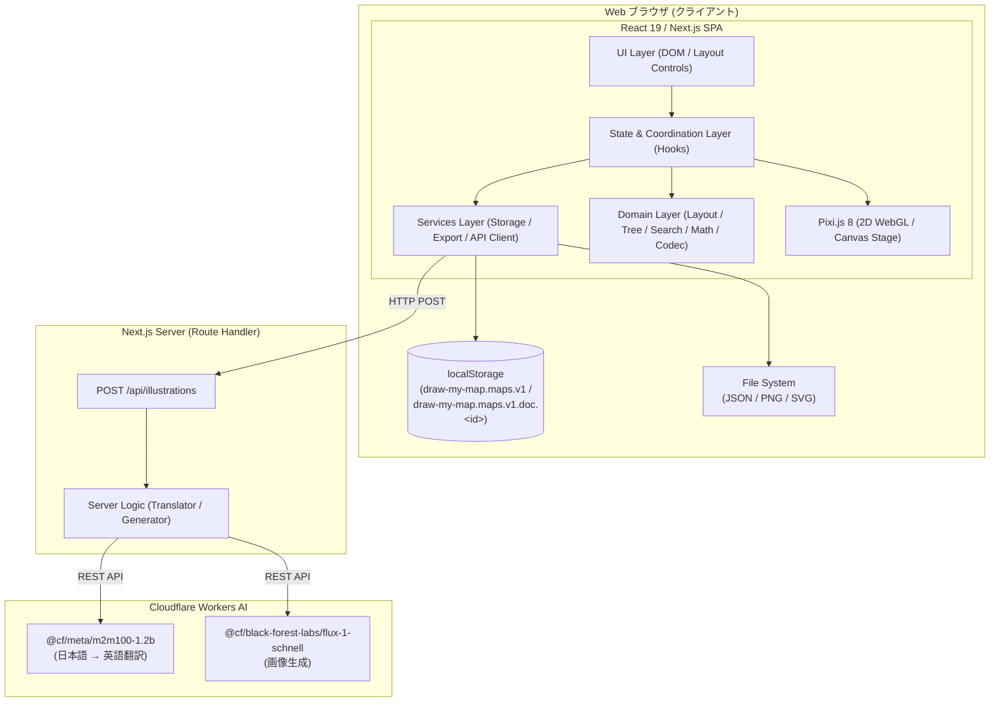
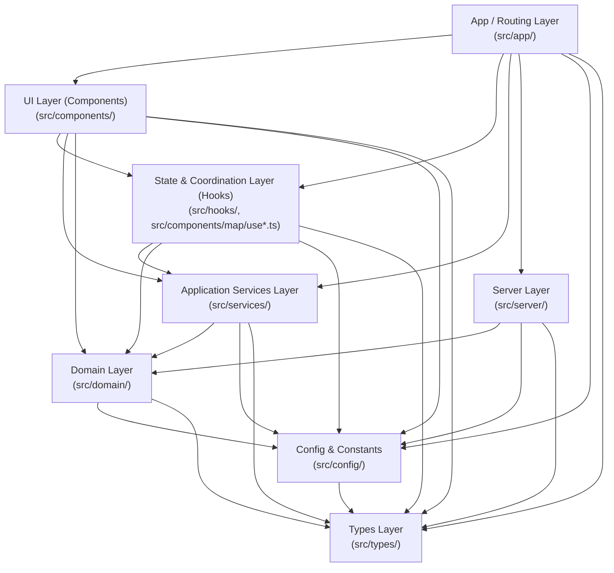
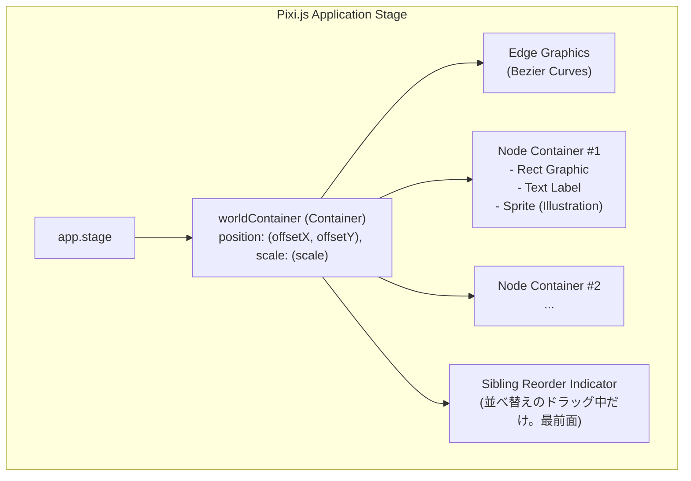
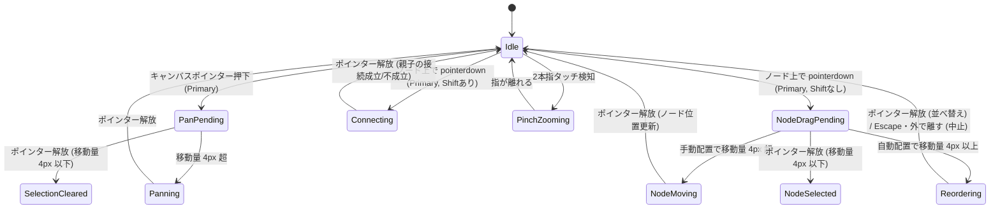
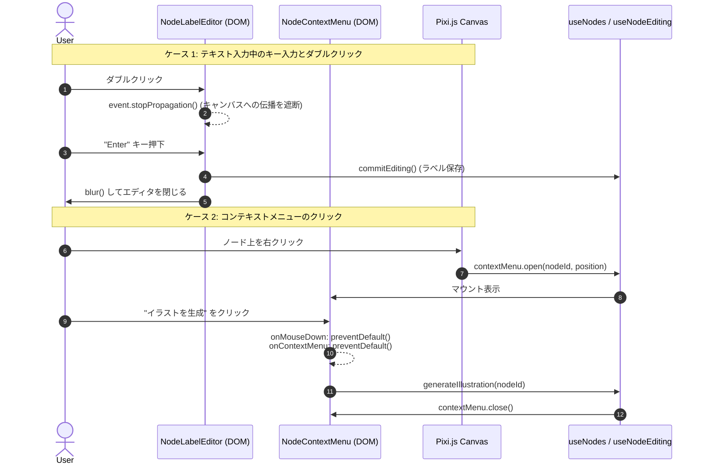
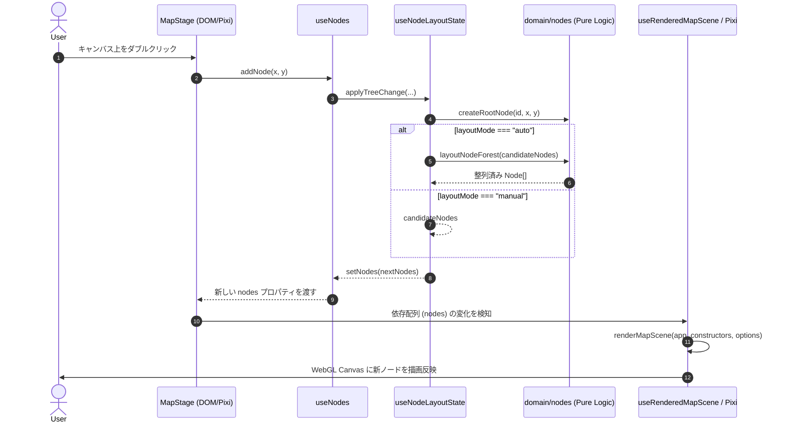

# システムアーキテクチャ設計書

Draw My Map のシステム全体アーキテクチャ、レイヤード設計、2D WebGL/Canvas（Pixi.js）と React 19（DOM）の協調レンダリングモデル、状態管理、およびテスト設計に関する仕様書です。

---

## 1. アーキテクチャ概要

### 1.1 システム方針

Draw My Map は、思考の整理・アイデア発想を直感的に支援する**ブラウザ完結型シングルページ・マインドマップアプリケーション**（SPA）です。

- **ローカルファースト & クライアント完結**: マップデータ（ノードツリー、配置座標、重要度、レイアウトモード）はすべてブラウザ上の React 状態および `localStorage` で安全に保持・管理され（Phase 12 から、名前を付けた複数のマップを一覧のインデックスとマップごとの本体に分けて保存）、外部データベースへの認証や接続なしにオフラインでも動作します。JSON ファイルとしてのエクスポート/インポート、SVG/PNG 形式の画像書き出しもすべてクライアントサイドで処理されます。
- **軽量サーバーサイド連携（BFF / Route Handler）**: AI によるノードイラスト生成機能のみ、Next.js App Router の Route Handler（`POST /api/illustrations`）を介して Cloudflare Workers AI（`@cf/meta/m2m100-1.2b` による日本語プロンプト英訳、`@cf/black-forest-labs/flux-1-schnell` による画像生成）と安全に通信します。API キー等の機密情報はサーバーサイドでのみ保持されます。



### 1.2 レイヤードアーキテクチャの採用理由と単一責任原則（SRP）

マインドマップアプリケーションは、以下のような多岐にわたる関心事が混在しやすい特性を持ちます：
1. **複雑なグラフ構造・ツリー演算**: 循環参照の防止、部分木のトラバース、ノード階層に応じた自動レイアウト計算。
2. **高速・大量のグラフィックス描画**: 数百ノードや曲線の 60fps スムーズなパン・ズーム、Tween アニメーション。
3. **リッチなユーザー操作**: キーボードショートカット、ドラッグ移動、Shift+ドラッグ接続、ピンチズーム、インラインテキスト入力。
4. **外部システム連携**: ブラウザ API、ファイル入出力、AI API 通信。

これらが単一のコンポーネントやフックに混在すると、描画パフォーマンスの低下やテスト困難性、保守性の破綻を招きます。  
Draw My Map では**単一責任原則（Single Responsibility Principle: SRP）**を徹底し、関心事ごとに厳密に分離された**レイヤードアーキテクチャ**を採用しています。

- **ドメイン知識の純粋化**: 配置幾何計算やツリー操作、JSON スキーマ検証などは一切の UI・フレームワーク・ブラウザ API に依存しない純粋関数として記述され、100% 独立してユニットテスト可能です。
- **副作用の隔離**: Canvas のピクセル操作や `localStorage`、ネットワーク通信などの副作用は Services 層にカプセル化されます。
- **宣言的調停**: React フックは状態の保持とドメイン関数・サービス関数の呼び出しの調停のみを担い、複雑なビジネス計算自体は持ちません。

### 1.3 技術スタックとコンパイラ・ビルド設定

| カテゴリ | 採用技術・バージョン | 設定・構成の特徴 |
| :--- | :--- | :--- |
| **アプリケーション基盤** | **Next.js 16.1.6** (App Router) | クライアント SPA + Route Handler (`POST /api/illustrations`) |
| **UI ランタイム** | **React 19.2.3** (`react`, `react-dom`) | 宣言的 DOM レンダリング、カスタムフックによる状態管理 |
| **React Compiler** | **`babel-plugin-react-compiler` 1.0.0** | `client/next.config.ts` にて **`reactCompiler: true`** を有効化。ビルド時の自動メモ化により不要な再レンダリングを最適化 |
| **2D グラフィックス** | **Pixi.js ^8.16.0** (`pixi.js`) | WebGL / Canvas による高速シーンツリー描画、ビューポート変換、Tween 制御 |
| **スタイリング** | **Tailwind CSS v4** (`@tailwindcss/postcss`, `@tailwindcss/cli`) | `src/app/globals.css` ベース、ライト / ダークモード対応 |
| **型システム** | **TypeScript ^5** | `client/tsconfig.json`: `target: "ES2017"`, `strict: true`, `module: "esnext"`, `moduleResolution: "bundler"`, `isolatedModules: true`, `jsx: "react-jsx"`, パスエイリアス `"@/*": ["./src/*"]` |
| **テスト・品質保証** | **Jest ^30.2.0** + **Testing Library** (`@testing-library/react` ^16.3.2, `@testing-library/jest-dom` ^6.9.1) + **ESLint ^9** | `client/jest.config.ts` (`jest-environment-jsdom`)、`client/jest.setup.ts` |

---

## 2. レイヤードアーキテクチャ詳細

システムのディレクトリ構造は、責務に応じて以下の 8 レイヤー（および横断テスト基盤 `src/testing/`）に階層化されています。依存関係は**上位レイヤーから下位レイヤーへの単方向**に限定され、逆方向の依存や循環依存は厳格に禁止されています。

```text
client/src/
├── app/             # 1. App / Routing Layer (Next.js App Router ページ & Route Handler)
├── components/      # 2. UI Layer (Layout DOM & Map Canvas Wrapper / Pixi Renderer)
│   ├── layout/      #    ヘッダー、セレクター、通知、右サイドパネル等の HTML/DOM コンポーネント
│   └── map/         #    Pixi.js ステージ、ジェスチャー制御、DOM オーバーレイ、ステージ用テストハーネス
│       ├── pixi/    #    Pixi.js シーン描画・ポインタ/タッチジェスチャー・Tween アニメーター・Pixi 単体ハーネス
│       └── testing/ #    MapStage 統合テスト用ランタイム & 自動レイアウト統合ハーネス & 兄弟の順序・階層のショートカットの target の要素の補助
├── hooks/           # 3. Application State & Coordination Layer (カスタムフック)
├── services/        # 4. Application Services Layer (ブラウザ API・副作用の抽象化)
├── domain/          # 5. Domain Layer (純粋ビジネスロジック・幾何演算・スキーマ検証)
├── server/          # 6. Server Layer (サーバーサイド API 処理・Cloudflare Workers AI 連携)
├── config/          # 7. Config & Constants Layer (アプリケーション共通定数)
├── types/           # 8. Shared Types & Interfaces (TypeScript 型定義)
└── testing/         # 共通テストヘルパー・フィクスチャ (createTestNode, createTestMapHistoryLease, jpegFixture, createTestStorageSession, mapLibraryTestStorage)
```

### 2.1 各レイヤーの責務と構成

#### 1. App / Routing Layer (`src/app/`)
- **責務**: Next.js App Router のエントリポイント、グローバルレイアウト、グローバルスタイル、および API Route Handler。
- **構成ファイル（全 5 ファイル）**:
  - `src/app/layout.tsx`: HTML シェル、Geist フォント設定、メタデータ定義。
  - `src/app/page.tsx`: シェル（`Home`）。アンマウントされない最上位で、`useMapLibrary`（マップの一覧・起動の判定・作成・切り替え・名前変更・削除）と `useMapLibraryDialogState`（ダイアログの画面とフォーカスの戻し先）を持ち、`MapLibraryNoticeRegion`、`MapEditor`（`key={現在のマップの id}:{storageMode}`。同じ id のまま保護モードへ移るときも原本を読み直す）、`MapLibraryDialog` を描画する。ダイアログ内のマウスのクリックの時刻を ref（`dialogMouseClickedAtRef`）に控え、`MapEditor` を通して `MapStage` へ渡す（再マウントをまたいで引き継ぐため、シェルが持つ）。`useMapLibrary` へ渡す既定の依存（`getBrowserMapLibraryStorage`、`generateMapId`、`now`）をここで組み立てる。再マウントの後は、新しいヘッダーのボタンの `ref` がつながった後の `useLayoutEffect` で、ダイアログの戻し先へフォーカスする。
  - `src/app/globals.css`: Tailwind CSS v4 インポートおよびカラースキーム（ライト/ダーク）変数定義。
  - `src/app/favicon.ico`: アプリケーションアイコン。
  - `src/app/api/illustrations/route.ts`: イラスト生成 API エンドポイント（`POST /api/illustrations`, `dynamic = "force-dynamic"`）。処理は持たず、`process.env` と本物の Cloudflare の実装（`createCloudflareTranslator`・`createCloudflareImageGenerator`）を `handleIllustrationRequest` へ渡す配線だけを行う。
- **依存可能レイヤー**: UI (Components), Hooks, Services（`page.tsx` が `useMapLibrary` の既定の依存として `getBrowserMapLibraryStorage` と `generateMapId` を渡すためだけ）, Server (Route Handler のみ), Config, Types。Domain は `import type`（`MapIndexEntry`）だけ

#### 2. UI Layer (Components) (`src/components/layout/`, `src/components/map/`)
- **責務**: ユーザーに対するプレゼンテーション、DOM イベントの捕捉、および Pixi.js Canvas ステージと DOM オーバーレイの統合。
- **構成モジュール**:
  - **レイアウト UI (`src/components/layout/` 全 43 ファイル)**:
    - `AppHeader.tsx`: タイトル、マップの操作（必須の `mapControls`。タイトルの直後）、ノード検索、レイアウトモード切替、操作ヒント、重要度・解像度フィルタ切替、枝の折りたたみ・展開ボタンと非表示件数（`NodeCollapseControl`）、元に戻す／やり直すボタン、枝を複製ボタン、兄弟の順序の「上へ」「下へ」ボタン、階層の「階層を上げる」「階層を下げる」ボタン、「親を挿入」ボタン、「ノードだけ削除」ボタン、枝のコピー＆ペーストの常設案内、「箇条書きから追加」ボタン、JSON/画像エクスポートボタン、操作通知バーを統合するヘッダー（操作のボタン群と通知は `MapEditor` が `operationControls`・`operationNotices` として渡す）。
    - `NodeSearchBox.tsx`, `nodeSearchKeyAction.ts`: ARIA combobox/listbox による検索欄と最大50件の候補一覧、および矢印・Enter・Escape・IME変換中のキー判定。
    - `AppWorkspace.tsx`: ヘッダー下の 2 カラム（メインキャンバス領域 + 右サイドパネル）レイアウト。
    - `LayoutModeSelector.tsx`: `手動配置` / `自動配置` 切り替えボタングループ（`role="group"`, `aria-label="レイアウトモード"`）。
    - `NodeCollapseControl.tsx`: 選択中の親ノードの枝を折りたたみ・展開するボタン、非表示件数（選択中の親が閉じている間はその全子孫数。未選択・葉・展開中は 0件）、保存・画像出力と表示用配置の説明を表示する。
    - `MapHistoryControls.tsx`: ヘッダーの `元に戻す` / `やり直す` ボタン（履歴の有無に応じて `disabled`）。`Enter` の押し続けを `preventRepeatedEnterClick` で止め、押したボタンが無効になったときのフォーカスの引き継ぎは `usePairedButtonFocusHandover` を使う。
    - `NodeDuplicateControl.tsx`: ヘッダーの `枝を複製` ボタン（ノード未選択時は `disabled`）。クリックごとに 1 回複製し、押したあともフォーカスを移さない。`Enter` の押し続け（`repeat`）だけ `preventDefault()` で抑止する。
    - `NodeSiblingOrderControl.tsx`: ヘッダーの `上へ` / `下へ` ボタン（`role="group"`, `aria-label="兄弟の順序"`。`aria-label` は `枝を上へ移動` / `枝を下へ移動`、`aria-keyshortcuts` は `Alt+ArrowUp` / `Alt+ArrowDown`）。必須の props `canMoveUp`・`canMoveDown`・`onMoveUp`・`onMoveDown` を受け取り、動かせない向きは `disabled`。`Enter` の押し続けを `preventDefault()` する。両方のボタンに `data-tree-edit-shortcut-button` 属性（`treeEditShortcutGuard.ts` の `TREE_EDIT_SHORTCUT_BUTTON_ATTRIBUTE`）を付け、フォーカスがあっても `Alt+↑/↓` のショートカットが働くようにする（ボタン自身は `Alt+↑/↓` を処理しないので二重に動かない）。押したボタンが端で無効になったときは、フォーカスがそのボタンか `body` にあれば、もう一方の有効なボタンへ移す（`usePairedButtonFocusHandover`。`MapHistoryControls` と共有）。
    - `NodeIndentControl.tsx`: ヘッダーの `階層を上げる` / `階層を下げる` ボタン（`role="group"`, `aria-label="階層"`。`aria-label` は `枝の階層を上げる` / `枝の階層を下げる`、`aria-keyshortcuts` は `Alt+ArrowLeft` / `Alt+ArrowRight`）。`NodeSiblingOrderControl` の右隣に置く。必須の props `canOutdent`・`canIndent`・`onOutdent`・`onIndent` を受け取り、動かせない向きは `disabled`。`Enter` の押し続けを `preventDefault()` する。両方のボタンに `data-tree-edit-shortcut-button` 属性を付け、フォーカスがあっても `Alt+←/→` と `Alt+↑/↓` のショートカットが働くようにする（ボタン自身はこれらのキーを処理しない）。フォーカスの引き継ぎは `usePairedButtonFocusHandover` を使う。
    - `NodeParentInsertControl.tsx`: ヘッダーの `親を挿入` ボタン（`aria-label="選択中のノードに親を挿入"`、`aria-keyshortcuts="Alt+Enter"`、`title="選択中のノードに親を挿入（Alt/Option+Enter）"`）。`NodeIndentControl` の右隣、「ノードだけ削除」の前に置く。必須の props `canInsert`・`onInsert` を受け取り、選択が無い・見えていないときは `disabled`。`Enter` の押し続け（`event.repeat`）を `preventDefault()` する（Space は止めない）。`data-tree-edit-shortcut-button` 属性を付け、フォーカスがあっても `Alt+Enter` ほか5つのショートカットが働くようにする（ボタン自身はこれらのキーを処理しない）。成功しても無効にならず、フォーカスは入力欄の `autoFocus` で移るので、`usePairedButtonFocusHandover` は使わない。`event.detail` で弾かず、ダブルクリックは2回の挿入になる。
    - `usePairedButtonFocusHandover.ts`: 2つのボタンの片方が無効になったときのフォーカスの引き継ぎ（`usePairedButtonFocusHandover(firstEnabled, secondEnabled)`。`firstRef`・`secondRef`・`handleFocus`・`handleBlur` を返す）。押したボタンが無効になり、フォーカスがそのボタンか `body` にあれば、もう一方が有効ならそちらへ移す。移せる先が無ければ記録を捨てる。`MapHistoryControls`・`NodeSiblingOrderControl`・`NodeIndentControl` が使う。
    - `repeatedEnterClick.ts`: ボタンの `keydown` で、リピートの `Enter`（`event.repeat`）だけ `preventDefault()` してブラウザの click の合成を止める `preventRepeatedEnterClick`（単発の `Enter` と Space は止めない）。押し続けで操作が連続しないよう、`MapHistoryControls`・`NodeCollapseControl`・`NodeDuplicateControl`・`NodeSiblingOrderControl`・`NodeIndentControl`・`NodeParentInsertControl` の `onKeyDown` に渡す。止める理由（往復・連続挿入など）は各コンポーネントのコメントに残す。 同じファイルの `preventRepeatedActivationClick` は Space のリピートも止め、`BranchMoveControl`・`MapPersistenceControls` の「JSON書き出し」が使う。
    - `LayoutModeOperationHint.tsx`: 現在の `layoutMode` に応じた操作ガイド文字列の表示。
    - `NodeImportanceSelector.tsx`: 選択中ノードの重要度（`高` / `中` / `低`）切り替えボタングループ（`role="group"`, `aria-label="重要度"`）。
    - `ResolutionFilterSelector.tsx`: 表示フィルタ（`自動` / `高のみ` / `中以上` / `すべて`）切り替えボタングループ（`role="group"`, `aria-label="表示"`）および自動時の現在レベル表示。
    - `MapPersistenceControls.tsx`: `JSON書き出し` / `JSON読み込み` ボタンと非表示 `<input type="file">`。
    - `MapImageExportControls.tsx`: `PNG書き出し`（変換中 `disabled` 制御付き） / `SVG書き出し` ボタン。
    - `MapOperationNotice.tsx`: 操作結果・警告・エラー通知を表示するアクセシブルな通知コンポーネント（`role="status"` / `role="alert"`）。
    - `MapOperationNoticeList.tsx`: 操作通知バーの通知の並び（`MapOperationNoticeList({ notices })`）と、通知が1つでもあるかの判定（`hasOperationNotice(notices)`）。配列の位置が系統を表し、`null` はその系統の通知が無いことを表す。位置を `key` にするため、ほかの系統の通知が増減しても要素を作り直さない。`MapEditor` は通知が1つも無いときは `null` を渡し、`AppHeader` に通知行を確保させない。
    - `IllustrationPanel.tsx`, `illustrationPanelView.ts`, `IllustrationImage.tsx`: 右サイドパネル UI（`<aside aria-label="イラスト">`）、パネル表示状態導出ロジック（`getIllustrationPanelView`）、および Data URL 用ネイティブ `` ラッパー。
    - `MapLibraryControls.tsx`: ヘッダーの現在のマップ名（「マップ: <名前>」、`truncate` と `title`）と「マップ一覧」「新しいマップ」ボタン（`aria-haspopup="dialog"`、押し続けの Enter・Space を `preventDefault()`、保護モードでは `disabled` と理由の文言）。
    - `MapLibraryNoticeRegion.tsx`: シェルの通知の常設ライブリージョン（`role="status"` と `role="alert"` を最初から空で置き、`useReannouncedNotice` で `sequence` が変わるたびに一度空にしてから次のフレームで文言を入れる）。`MapEditor` の外に置くため、再マウントでも `inert` でも消えない。
    - `MapLibraryDialog.tsx`: モーダルダイアログの枠（`onClickCapture` で `detail > 0` のマウスのクリックごとに `onMouseClick` を呼び、シェルへ通知する。`role="dialog"`、`aria-modal="true"`、余白を押したときにフォーカスを受け止める `tabIndex={-1}`、画面によらない `aria-label="マップの管理"`）。各画面の中身は画面（と対象のマップ）ごとに key を変えて作り直す `role="group"` で包み、group の `aria-labelledby` で見出しを、削除の確認では group の `aria-describedby` で本文を指す。画面（一覧・新規作成・名前変更・削除の確認）を切り替え、`focusTarget` を `useLayoutEffect` で適用し（行のボタンは `data-map-id` と `data-map-action` で探す。属性とセレクタの対応は `mapLibraryListButtons.ts`）、常設の `role="status"`・`role="alert"` への通知は `useReannouncedNotice` で `sequence` ごとに一度空にし、次のフレームで入れ直す。開閉と画面の状態は持たない。
    - `MapLibraryListScreen.tsx`, `MapLibraryNameForm.tsx`, `MapLibraryDeleteConfirm.tsx`: 一覧の画面（`<ul aria-label="保存済みのマップ">`、開いているマップの `aria-current`、「更新: …」、名前変更・削除のボタン）、新規作成・名前変更の画面（`<form>` の送信だけで確定、入力中の50文字の検証、IME 変換中の Enter を送信しない）、削除の確認の画面（「キャンセル」を先に置き、「このマップを削除」は押し続けとダブルクリックを無視）。
    - `mapLibraryListButtons.ts`: 一覧の画面のボタン（行の「開く」「名前を変更」「削除」と一覧の「新しいマップ」）に付ける `data-map-id`・`data-map-action` の属性（`mapLibraryListButtonAttributes`）と、ダイアログがフォーカス先を探すセレクタ（`mapLibraryListButtonSelector`）。付ける側と探す側の対応を1か所で定める。
    - `OutlineImportControl.tsx`: ヘッダーの「箇条書きから追加」ボタン（`aria-haspopup="dialog"`、ダイアログを開いている間だけ `true` の `aria-expanded`、押し続けの Enter・Space を `preventDefault()`）。`MapEditor` が渡す `ref` を付け、閉じたときのフォーカスの戻し先にする。
    - `BranchMoveControl.tsx`: ヘッダーの「枝を移動」ボタン（`aria-haspopup="dialog"`。未選択では無効。押し続けた `Enter`・`Space` を止める）。
    - `BranchMoveDialog.tsx`: 枝の移動のダイアログの表示（移動先マップと親の選択肢、別マップの注意、エラー）とフォーカストラップ、マウスのクリックの時刻の記録。状態は持たない。
    - `branchMoveMapOption.ts`: 移動先マップの選択肢の表示文字列（現在のマップの印、同名のときの更新日時）を作る純粋関数。
    - `branchMoveParentOption.ts`: 移動先の親の選択肢の表示文字列（同名のときだけ親のラベルなどを併記）を作る純粋関数。
    - `dialogClickCapture.ts`: `OutlineImportDialog`・`MapLibraryDialog`・`BranchMoveDialog` の `onClickCapture` の共通処理（`detail > 0` のクリックの記録と、`detail > 1` の遮断）。
    - `OutlineImportDialog.tsx`: 箇条書きからの追加のモーダルダイアログの枠（`role="dialog"`、`aria-modal="true"`、`tabIndex={-1}`、画面によらない `aria-label="箇条書きから追加"`）。`useDialogFocusTrap` で閉じ込めと Escape（入力の画面では閉じる、プレビューの画面では戻る）を扱い、画面ごとに key を変えて作り直す `role="group"`（プレビューでは `aria-describedby` で要約と警告を指す）で画面の中身を包む。`focusRequest` の `"input"`・`"preview"` を `useLayoutEffect` で入力欄・プレビューの領域へ当て（`"header"` は `MapEditor` が扱う）、常設の `role="status"`・`role="alert"` へのダイアログ内の通知は `useReannouncedNotice` で入れ直す。`onClickCapture` で `detail > 0` のクリックごとに `onMouseClick` を呼ぶ。画面の状態とテキストは持たない。
    - `OutlineImportInputScreen.tsx`, `OutlineImportPreviewScreen.tsx`, `OutlinePreviewTree.tsx`: テキスト入力の画面（`<label>`「テキスト」付きの `<textarea>`、常設の `role="alert"` の入力エラーの欄と、エラーの間だけの `aria-invalid`、上限を超えている間の「現在 N 文字」、押し続けの Enter の抑止）、プレビューの画面（要約、「注意: 」付きの警告、`role="region"` のプレビューの領域、200件の打ち切りの表示、追加する位置のラジオボタン、「マップに追加」の押し続けと `detail > 1` の無視）、プレビューの入れ子の `<ul>`。
    - `outlineParentCandidate.ts`: プレビューの画面に渡す親の候補（`OutlineParentCandidate`）を、開いた時点で控えた `parentCandidateId` と `parentCandidateStale` と今の `nodes` から引く純関数 `resolveOutlineParentCandidate`（未選択は `none`、マップが置き換わった後と見つからないときは `missing`、見つかれば `getNodeDisplayLabel` の先頭40コードポイント）。`MapEditor` が呼ぶ。
    - `useDialogFocusTrap.ts`: ダイアログのフォーカスの閉じ込め（`document` の `focusin` で外へ出たフォーカスを戻す、背景の `pointerdown`・`mousedown` を `preventDefault()`）、Tab の循環（無効なボタンを除いて毎回数え直す `listFocusableElements`）、`window` の capture の `keydown` での Escape（IME 変換中と `repeat` は無視）。
    - `useReannouncedNotice.ts`: 常設のライブリージョンに出す値を入れ直す共通フック。`sequence` が変わるたびに一度 null にし、`requestAnimationFrame` で次のフレームに値を入れる。アンマウントや次の変更ではフレームを `cancelAnimationFrame` で取り消す。`MapLibraryNoticeRegion`、`MapLibraryDialog`、`OutlineImportDialog`、`OutlineImportInputScreen` が使う。
  - **マップステージ・DOM オーバーレイ・座標/イベント補助 (`src/components/map/` コンポーネント 4 ファイル + 補助モジュール 24 ファイル)**:
    - `MapEditor.tsx`: 1つのマップの編集画面（Phase 11 までの `page.tsx` の中身）。必須の props `mapId`、`mapName`、`storageSession`、`mapControls`、`exportButtonRef`、`mapMoveTargets`、`onMoveBranchToMap`、`shortcutsEnabled`、`dialogMouseClickedAtRef`（シェルが持つ、ダイアログ内で最後にマウスでクリックした時刻の ref。そのまま `MapStage` へ渡し、直後の `dblclick` を無視させる）を受け取り、`useNodes` から `MapStage` までを組み立てる。シェルが `key={mapId}` で描画するため、切り替えで履歴・表示状態・エディタ内の通知・保存待ちのタイマーごと破棄される。`shortcutsEnabled` が `false`（ダイアログ表示中）の間は根に `inert` を付け、ショートカットのフックへ `enabled: false` を渡す。`useOutlineImport` を呼び、ヘッダーの「箇条書きから追加」、操作通知バーの7系統目（取り込みの成功）、`OutlineImportDialog` を配線する。枝の構造の変更の通知の枠（`useRevisionScopedNotice` 1つ。操作通知バーの8系統目）を持ち、その `publishNotice` を `useSiblingReorderAction`・`useNodeIndentAction`・`useNodeOnlyDeletionAction` へ、`publishNotice` と `clearNotice` を `useNodeParentInsertionAction` へ渡す。`useSiblingReorderAction` を呼び、ヘッダーの「上へ」「下へ」（`NodeSiblingOrderControl`）と `MapStage` の `layoutMode`・`onReorderSibling` を配線する。`useNodeIndentAction`（`expandNodes` は `useBranchCollapse` のもの）を呼び、ヘッダーの「階層を上げる」「階層を下げる」（`NodeIndentControl`）と `MapStage` の `onChangeNodeIndent` を配線する。`useNodeParentInsertionAction` を呼び、ヘッダーの「親を挿入」（`NodeParentInsertControl`）と `MapStage` の `onInsertParentNode`・`labelEditRequest` を配線する。`editorShortcutsEnabled = shortcutsEnabled && outlineImport.screen === "closed"` を作り、根の `inert`、`useMapHistoryShortcuts`、`MapStage` の `shortcutsEnabled` のすべてに渡す。操作通知バーの8系統（表示用の自動配置の失敗・JSON の保存と読み込み・画像書き出し・複製・コピー／貼り付け・検索での移動・箇条書きからの追加・枝の構造の変更）を表示する順の配列にまとめ、`MapOperationNoticeList` で描く。返す値はフラグメントで、ダイアログは根の `<div data-map-id>` の兄弟（`inert` の外）に描く。プレビューの画面に出す親の候補を `resolveOutlineParentCandidate`（`outlineParentCandidate.ts`）で作り、閉じたときの `focusRequest: "header"` を `useLayoutEffect` でヘッダーのボタンへ当てる。
    - `MapStage.tsx`: Pixi.js キャンバス要素と DOM オーバーレイ（`NodeLabelEditor`, `NodeContextMenu`）を統合するステージ親コンポーネント。必須の props `layoutMode`・`onReorderSibling`・`onChangeNodeIndent`・`onInsertParentNode`・`labelEditRequest` を受け取り、`useMapStageInteractions`（ドラッグの分岐）、`useSiblingReorderShortcut`（`enabled` は `shortcutsEnabled`）、`useSiblingReorderDragEscape`、`useNodeIndentShortcut`（`enabled` は `shortcutsEnabled`）、`useNodeParentInsertionShortcut`（`enabled` は `shortcutsEnabled`。`onInsertParentNode` を渡す）へ渡し、`labelEditRequest` を `useNodeLabelEditRequest` に渡す。`shortcutsEnabled` が false になると、`cancelActiveGesture()` で進行中のジェスチャーを中止する。
    - `NodeLabelEditor.tsx`, `nodeLabelEditorLayout.ts`: ノードテキストインライン編集用 `<input>` DOM オーバーレイ（`aria-label="ノードのラベル"` でアクセシブルな名前を付ける。リピートの `Enter`（`event.repeat`）では確定せず `preventDefault()` だけする。ボタンの `Enter` の押し続けがフォーカスの移った入力欄へ届いても確定しないための、`NodeParentInsertControl` と組の対策。`blur` での確定と `Escape` は変えない）と、ビューポート倍率およびイラスト有無（`topInset`）に応じた配置矩形算出。
    - `NodeContextMenu.tsx`, `nodeContextMenuLayout.ts`, `nodeContextMenuDom.ts`, `nodeContextMenuStaleness.ts`, `nodeContextMenuTarget.ts`, `mapContextMenuAction.ts`, `menuActivationDoubleClick.ts`: 右クリックコンテキストメニュー DOM オーバーレイ、176×44px クランプ配置、メニュー内外 DOM 判定、失効（Stale）判定、右クリック時のアクション解決、メニュー項目の実行後、またはダイアログ内のマウスのクリックの後 500ms 以内のダブルクリック誤発火防止（`isDoubleClickFromOverlayActivation`）。
    - `mapViewport.ts`, `mapGeometry.ts`, `mapDoubleClickAction.ts`, `nodeViewportFocus.ts`, `viewportFocusShortcut.ts`, `wheelZoom.ts`, `textEntryTarget.ts`, `editableTarget.ts`, `interactiveTarget.ts`, `mapHistoryShortcut.ts`, `treeEditShortcutGuard.ts`, `siblingReorderShortcut.ts`, `nodeIndentShortcut.ts`, `nodeParentInsertionShortcut.ts`, `siblingReorderDropSlot.ts`, `browserMapVisibilityEnvironment.ts`: ビューポート座標変換・クランプ、ノードヒットテスト（`findNodeAtPoint`）、ダブルクリックアクション分岐、ノード中央フォーカス計算、ホイールズームデルタ正規化、テキスト入力要素判定（`textEntryTarget.ts`）、編集可能要素（input・textarea・select・contenteditable）の判定（`editableTarget.ts`）、対話要素（`button, input, textarea, select, a[href], [contenteditable]`）の内側かの判定（`interactiveTarget.ts`。`useNodeKeyboardShortcuts` と兄弟の順序変更・階層の上げ下げのショートカットで共有）、元に戻す・やり直すのショートカットの判定（`mapHistoryShortcut.ts`）、兄弟の順序変更・階層の上げ下げ・親の挿入のショートカットの共通の条件（`treeEditShortcutGuard.ts`。5つのボタンの目印の属性 `TREE_EDIT_SHORTCUT_BUTTON_ATTRIBUTE`、入力の型 `TreeEditShortcutInput`、キーの条件 `passesTreeEditKeyGuard` とキー以外のすべての条件 `passesTreeEditShortcutGuard`、`KeyboardEvent` と呼び出し元の状態（`isEditing`・`selectedNodeId`・`hasActiveGesture`）から入力を作る `createTreeEditShortcutInput`（`useSiblingReorderShortcut`・`useNodeIndentShortcut`・`useNodeParentInsertionShortcut` で共有））、兄弟の順序変更のショートカットの判定（`siblingReorderShortcut.ts` の `resolveSiblingReorderShortcut`。キー以外の条件は `treeEditShortcutGuard.ts` の `passesTreeEditShortcutGuard`。対話要素の内側では止めるが、`data-tree-edit-shortcut-button`（`TREE_EDIT_SHORTCUT_BUTTON_ATTRIBUTE`）を持つボタンの内側だけは止めない）、階層の上げ下げのショートカットの判定（`nodeIndentShortcut.ts` の `resolveNodeIndentShortcut`。`→` で `"indent"`、`←` で `"outdent"`。条件は並べ替えと同じ `passesTreeEditShortcutGuard`）、親の挿入のショートカットの判定（`nodeParentInsertionShortcut.ts` の `resolveNodeParentInsertionShortcut`。条件は同じ `passesTreeEditShortcutGuard` で、`Enter` かつ `repeat` が偽なら `"insert"`、真なら `"suppress"`。入力の型 `NodeParentInsertionShortcutInput` は `TreeEditShortcutInput` に `repeat` を足したもの）と、Windows・Linux の「戻る」「進む」（`Alt+←/→`）を止めるかの判定（`shouldSuppressAltArrowNavigation`。`passesTreeEditKeyGuard` を満たし、文字入力欄（`isEditableTarget`）の外なら止める）、ドラッグの挿入位置・挿入先・線の位置の判定（`siblingReorderDropSlot.ts` の `resolveSiblingReorderDrop`。型 `SiblingReorderIndicator`・`SiblingReorderPreview`）、`requestAnimationFrame` / `prefers-reduced-motion` ブラウザ環境アダプタ。
    - `nodeRequestProcessing.ts`: ノードへの要求（`NodeFocusRequest`・`NodeLabelEditRequest`）を、処理済みの `sequence`・現在の `documentRevision`・`nodes` から `skip`（要求が無い・処理済み）、`discard`（`documentRevision` が違う・ノードが無い）、`ready`（対象のノードを添える）に振り分ける純関数（`classifyNodeRequest`）。
  - **Pixi.js 描画・ジェスチャーエンジン (`src/components/map/pixi/` 全 25 ファイル — うち `usePixiApplication.ts` は Hooks としても機能)**:
    - シーン描画: `renderMapScene.ts`, `renderMapNodes.ts`, `renderMapEdges.ts`, `renderSiblingReorderIndicator.ts`（並べ替えのドラッグの挿入位置の線）, `clearMapScene.ts`, `applyViewportTransform.ts`, `illustrationTextureLoader.ts`, `pixiTypes.ts`。
    - 可視性トランジション: `mapVisibilityAnimator.ts`, `mapVisibilityTween.ts`, `mapVisibilityKeys.ts`, `pixiVisibilityTarget.ts`。
    - ポインタ・タッチジェスチャー: `stageInteractions.ts`, `pointerGesture.ts`, `pointerGestureSession.ts`, `pointerSample.ts`, `dragActivation.ts`, `canvasPanGesture.ts`, `nodeMoveGesture.ts`, `nodeConnectionGesture.ts`, `siblingReorderGesture.ts`（自動配置の並べ替えのドラッグ `createSiblingReorderGesture`）, `touchGestureCoordinator.ts`, `pinchZoomGesture.ts`, `pinchViewport.ts`。
- **依存可能レイヤー**: Hooks, Services, Domain, Config, Types

#### 3. Application State & Coordination Layer (Hooks) (`src/hooks/`, `src/components/map/use*.ts`)
- **責務**: アプリケーション状態の保持（React State / Ref / Reducer）、ライフサイクル制御、および Domain / Services 層の呼び出し調停。
- **構成モジュール**:
  - **アプリケーション状態フック (`src/hooks/` 全 36 ファイル)**:
    - `useNodes.ts`, `useNodeLayoutState.ts`: ノードツリーの CRUD・選択・重要度・イラスト更新・枝の複製（`duplicateSubtree`）・枝のコピー（`copySubtree`）と貼り付け（`pasteSubtree`）・箇条書きの森の追加（`insertForest`）・兄弟の順序変更（`reorderSibling`。`applyTreeChange` を1回だけ呼ぶ）・階層の上げ下げ（`changeNodeIndent`。`applyTreeChange` を1回だけ呼び、結果 `ChangeNodeIndentResult` を返す）・親の挿入（`insertParentNode`。`applyTreeChange` を1回だけ呼び、その中の最新の配列で対象を解決して新しい ID を採番し、成功したときだけ新しいノードを選択する。結果 `InsertParentNodeResult` を返す）と、手動/自動レイアウトモードの状態管理（複製・貼り付け・森の追加の挿入処理は内部関数 `applySubtreeInsertion` を共有する）・ツリー変更時の `layoutNodeForest` 自動整列トリガー。
    - `useMapResolutionFilter.ts`, `mapResolutionFilterState.ts`: ズーム倍率・ヒステリシス・手動/自動モード遷移・マップ置換時の `pendingResetScale` 同期に基づく可視ノードフィルタリング状態管理。
    - `useMapLibrary.ts`: シェルの状態と操作。起動の判定を1回だけ確定させ（`startupRef`）、インデックス・現在のマップ・保護モード・起動時の通知を持つ。作成（`createMap`）・切り替え（`switchMap`）・名前変更（`renameMap`）・削除（`deleteMap`）を、`localStorage` を先に書いて成功したときだけ状態を更新する順で行い、結果を `MapLibraryOperationResult` で返す。現在のマップが変わるたびにセッション番号を進めて `MapStorageSession` を作り直し、`writeBody` と `registerFlush` をセッション番号で照合する。flush の登録先も持つ。セッション番号・状態・flush の登録先の ref を持ち、操作の順序を決めるのはこのフックで、照合の規則と表示用の値の導出は次の2つのモジュールに置く。公開する名前（`useMapLibrary`、型 `MapLibraryDeps`・`MapLibraryView`・`MapLibraryOperationResult`・`UseMapLibraryResult`）は変えず、`MapLibraryView`・`MapLibraryOperationResult` は `mapLibraryState.ts` から再エクスポートする。
    - `mapLibrarySession.ts`: 通常のモードのマップごとの保存のセッション（`createPersistentMapSession(context)`）と、現在のセッションの flush の呼び出し（`flushRegisteredSession(registration, activeSessionNumber)`）。React に依存せず、呼ばれた時点のセッション番号とインデックスを `context` の関数（`getActiveSessionNumber`・`getActiveIndex`）から読む。`writeBody` はセッション番号が一致し、マップがインデックスにあるときだけ本体を書いて、そのマップの更新日時を進めたインデックスを書き（書けたときだけ `commitIndex` で反映し、書けなくても本体は保存済みとして `saved`）、そうでなければ `inactive` を返す。`registerFlush` は古いセッションからの登録を無視し、解除では自分の登録だけを外す。
    - `mapLibraryState.ts`: `useMapLibrary` が持つ状態の型（`LibraryState`・`PersistentLibraryState`）、表示用の値の導出（`toMapLibraryView(library)`。通常のモードでは一覧を表示順に並べ、現在のマップがインデックスに無ければ例外）、操作の結果の組み立て（`UNCHANGED_OPERATION_RESULT`・`succeededOperation`・`failedOperation`）、新しいマップの id の選択（`pickNewMapId`。インデックスの id と、本体だけが残っている id を避ける）。React に依存しない。
    - `useMapLibraryDialogState.ts`: ダイアログの画面遷移（`closed | list | create | rename | delete`）、操作の結果のダイアログ内の通知とシェルの通知への振り分け、フォーカスの戻し先（ダイアログ内の `focusTarget` と、再マウント後のヘッダーの `headerFocusRequest`）。起動時の通知を1回だけシェルの通知にする。`moveBranchToMap` は `useMapLibrary` の枝の移動を呼び、再マウントを伴う成功はシェルの通知と「マップ一覧」へのフォーカスに、保護モードへ移った失敗（`enteredProtectedMode`）はシェルの通知と「JSON書き出し」へのフォーカス（`headerFocusRequest: "export"`）にする。
    - `useMapPersistence.ts`, `useMapStoragePersistence.ts`, `useMapStorageRestoration.ts`, `useMapStorageAutoSave.ts`, `useMapFilePersistence.ts`, `useMapJsonExport.ts`, `useMapJsonImport.ts`: `storageSession`（`readBody` / `writeBody` / `registerFlush`）を通したマップ本体の初期復元・300ms デバウンス自動保存・同期の `flushPendingSave`（`useMapStoragePersistence` がセッションへ登録）・自動保存の失敗の通知だけを消す `clearSaveFailureNotice`、および JSON ファイルのエクスポート（ファイル名に `mapName` を使う）/インポート調停（アンマウント後に読み取りが終わった結果は捨てる）。
    - `useMapImageExport.ts`, `useMapPngExport.ts`, `useMapSvgExport.ts`: PNG / SVG 画像エクスポート処理（ファイル名に `mapName` を使い、PNG は書き出しを始めた時点の名前）、空マップ警告、PNG 書き出し中フラグ（`isExportingPng`）と通知状態管理。PNG はアンマウント後にラスタライズが終わった結果を捨てる。
    - `useIllustrationGeneration.ts`: 非同期 AI イラスト生成のステートマシン管理（`idle` / `generating` / `succeeded` / `failed`）、同時 1 件制限、および `AbortController` による中断制御。
    - `useNodeDuplicationAction.ts`: 選択ノードの枝を `useNodes.duplicateSubtree` で複製し、成功 / 失敗の通知を `useRevisionScopedNotice` へ渡す。
    - `useRevisionScopedNotice.ts`: 操作結果の通知を、次の通知か `documentRevision` の変化まで残す。通知を出した時点の `documentRevision` と組にして保持し、現在の値と違う通知を隠す。`useNodeDuplicationAction.ts`（複製の通知）、`MapEditor.tsx`（コピー／貼り付けの通知）、`useOutlineImport.ts`（箇条書きからの追加の成功の通知）、`MapEditor.tsx`（枝の構造の変更の通知。兄弟の順序変更・階層の上げ下げ・親の挿入・ノードだけ削除で共有し、`publishNotice` を `useSiblingReorderAction.ts`・`useNodeIndentAction.ts`・`useNodeParentInsertionAction.ts`・`useNodeOnlyDeletionAction.ts` へ、`clearNotice`（枠を空にする。戻り値に足したもので、受け取らない呼び出し元は変わらない）を `useNodeParentInsertionAction.ts` へ渡す）がそれぞれ別の枠として呼ぶ。
    - `useSiblingReorderAction.ts`: ヘッダーのボタンの有効・無効（`canMoveUp` / `canMoveDown`。`getSiblingReorderAvailability` を `useMemo` で1回）、選択中のノードの移動（`moveSelected`）、`MapStage` からの要求（`reorder`。ショートカットとドラッグ）を受け持つ。`useNodes.reorderSibling` の結果を `formatSiblingReorderNotice` で文言にし、必須の引数 `publishNotice`（`MapEditor` が持つ枝の構造の変更の通知の枠。操作通知バーの8系統目）へ必ず1回出す。通知の状態は持たない。
    - `useNodeIndentAction.ts`: ヘッダーのボタンの有効・無効（`canOutdent` / `canIndent`。`getNodeIndentAvailability` を `useMemo` で1回。`nodes`・選択・表示集合のすべてを依存にする）、選択中のノードの上げ下げ（`changeSelected`）、`MapStage` からの要求（`change`。ショートカット）を受け持つ。`useNodes.changeNodeIndent` の結果が成功した下げ（`direction: "indent"`）のときだけ `expandNodes([newParentId])` で新しい親を展開し、結果を `formatNodeIndentNotice` で文言にして、必須の引数 `publishNotice`（並べ替えと共有する8系統目の枠）へ必ず1回出す。
    - `useRevisionScopedNodeRequest.ts`: ノードへの要求（中央移動・ラベルの編集）を、発行した時点の `documentRevision` と組にして持つ。`issueRequest(nodeId)` のたびに `sequence` を1増やし、`documentRevision` が今の値と違う要求は `request` として返さない。`useNodeSearchNavigation.ts` と `useNodeParentInsertionAction.ts` が別々に呼ぶ。
    - `treeChangeOutcome.ts`: `useNodes` の `applyTreeChange` を通す操作（兄弟の順序変更・階層の上げ下げ・親の挿入）の結果を決める純関数（`settleTreeChangeOutcome(applied, outcome)`）。確定でき候補が成功ならその結果、候補が失敗ならその理由、候補が無いか確定できなかったら `placement-failed`（候補を作れた後に失敗するのは全体の自動配置だけ）。3つの操作は `applyTreeChangeWithOutcome(applyTreeChange, compute)` を通す。`applyTreeChange` のコールバックの中で確定時点の配列と `mode` から `compute` を実行し、`nodes`（`null` なら確定しない）を返して、`outcome` と確定の可否を `settleTreeChangeOutcome` に渡す。
    - `useLatestRef.ts`: 描画のたびに最新の値を ref に写す（`useLatestRef(value)`。`useLayoutEffect` に依存配列を付けない）。ref は常に同じオブジェクトなので、登録をやり直さない `window` のハンドラや effect から最新の値を読める。
    - `useNodeParentInsertionAction.ts`: ヘッダーのボタンの有効・無効（`canInsert`。`canInsertParentNode` を `useMemo` で求め、`nodes`・選択・表示集合のすべてを依存にする）、選択中のノードへの挿入（`insertSelected`）、`MapStage` からのショートカットの要求（`insert`）、ラベルの編集の要求（`labelEditRequest`）を受け持つ。`useNodes.insertParentNode` の結果が成功のときだけ、必須の引数 `clearNotice` で枠を空にし（成功の通知は出さない）、`NodeLabelEditRequest`（`documentRevision` と組。`sequence` は呼ぶたびに増やす。要求の保持は `useRevisionScopedNodeRequest`）を出す。失敗のときだけ `formatNodeParentInsertionFailureNotice` で文言にして `publishNotice` へ1回出す。`documentRevision` が違う要求は `labelEditRequest` として返さない。
    - `useOutlineImport.ts`: 箇条書きからの追加のダイアログの状態（`closed | input | preview`、テキスト、入力のエラーと `sequence`、解析の結果、開いた時点の親の候補と `documentRevision`、追加する位置、ダイアログ内の通知、フォーカスの要求）と操作（`open`・`close`・`setText`・`requestPreview`・`back`・`setTarget`・`submit`・`consumeFocusRequest`）。解析（`parseOutlineText`）は「プレビュー」のイベントで1回だけ行い、入力中は文字数の上限だけを判定する。`submit` は子として追加する場合に開いた時点から `documentRevision` が変わっていれば `insertForest` を呼ばずに失敗にし、成功したときだけ（子として追加したなら）`expandNodes([parentId])` を呼び、成功の通知を `useRevisionScopedNotice` で出し、テキストを空にして閉じる。プレビューの木は解析の結果から `useMemo` で作る派生値で、状態には持たない（解析の結果と同時に作られ、同時に無くなる）。引数（`selectedNodeId`・`documentRevision`・`insertForest`・`expandNodes`）は必須で、`useLayoutEffect` で同期する ref から読み、操作の関数の参照を変えない。
    - `useBranchMoveDialog.ts`: 枝の移動のダイアログの状態（開閉、開いた時点の移動元と `documentRevision`、選択、親の候補、確定の可否、エラーと `sequence`、フォーカスの要求）と確定。同一マップの成功では移動先の祖先の展開と通知、移動元が隠れているときの全表示を行う。
    - `branchMoveDialogState.ts`: `useBranchMoveDialog` の状態の型、遷移、確定の可否の判定、親の選択値の解釈を行う純粋関数。React に依存しない。
    - `useNodeLabelSearch.ts`: `nodes` の参照が変わったときに検索索引を作り直し、入力ごとに同期検索して可視性を付加した候補を返す。
    - `useNodeSearchNavigation.ts`: 選択時にノードIDの実在を再確認し、隠れている場合は閉じた祖先の展開（`expandNodes`）と必要な解像度表示への切り替えを行って通知し（両方のときは通知文を半角空白で連結）、選択と中央移動要求を発行する（要求の保持は `useRevisionScopedNodeRequest`）。検索操作では `documentRevision` を増やさない。
    - `useBranchCollapse.ts`: `documentRevision` とノードIDで表示専用の折りたたみ集合を管理する。文書世代が変わると全展開へ戻し、削除や葉化で無効になった指定は `normalizeCollapsedNodeIds` で描画時点から除外する。ヘッダーのボタンの可否は `canToggle`（`canCollapse` による子の有無の判定）で返し、`toggle` と検索用の `expandNodes` で集合を更新する。
    - `useMapDisplayState.ts`: 折りたたみ可視集合と解像度可視集合を統合し、自動配置時の表示用投影座標を返す。正本 `nodes` は変更しない。
    - `useMapHistory.ts`: 編集履歴（Undo / Redo）の ref 管理と React state への反映。`useNodeLayoutState` から呼ばれる。
    - `useResettingMapReplacement.ts`: マップ置換時に `resetRevision` をインクリメントし、ステージ・コンテキストメニュー・解像度フィルタを同期リセットするフック（イラスト生成は `documentRevision` で失効する）。
  - **マップステージ制御フック (`src/components/map/use*.ts` 24 ファイル + `pixi/usePixiApplication.ts`)**:
    - `pixi/usePixiApplication.ts`: Pixi.js `Application` の非同期初期化・リサイズ追従・アンマウント時破棄。
    - `useRenderedMapScene.ts`, `useIllustrationTextures.ts`, `useMapVisibilityTransition.ts`: React 状態から Pixi シーンへの差分描画同期、`PixiRuntime` ごとのイラスト `Texture` セッションキャッシュと `destroy(true)` 解放、160ms フェード Tween 調停。
    - `useMapViewport.ts`, `useViewportScaleNotification.ts`, `useMapWheelZoom.ts`, `useMapViewportShortcut.ts`: ビューポート状態管理、親への `scale` 変更通知、ホイールズーム登録、`F` キー中央フォーカスショートカット。`useMapViewport` の `panBy`・`zoomAt`・`focusNode` は、同期 Ref の最新の値から次の viewport を計算し（`updateViewport`）、計算関数が同じ参照を返した（不正な入力・変化なし）ときは state を更新しない。
    - `useMapStageInteractions.ts`, `useStageInteractionValues.ts`: ステージポインタイベントのバインディングと最新 Props/State Ref の同期（`layoutModeRef`・`onReorderSiblingRef` を含む）。並べ替えのドラッグのプレビュー（`siblingReorderPreview`）を状態に持って描画へ渡し、並べ替えのドラッグ中かを返す `isSiblingReorderActive` を公開する。
    - `useNodeEditing.ts`, `useNodeKeyboardShortcuts.ts`: インラインラベル編集状態（開始・確定・キャンセル）と、`Tab` / `Enter` / `Delete` / `Backspace` キーボードショートカット（`Alt` を含む `Enter` は兄弟を足さず `preventDefault()` もしない。親の挿入の判定に任せる。`Ctrl`・`Cmd`・`Shift` だけとの `Enter` は変えない）。
    - `useNodeContextMenu.ts`, `useNodeContextMenuDismissal.ts`: コンテキストメニューの開閉・Stale 自動クローズ・外部操作による Dismiss 制御。
    - `useHiddenNodeInteractionReset.ts`, `useMapStageReset.ts`: 非表示化したノードの選択・編集・ジェスチャー強制リセット、および `resetRevision` 更新時のステージ状態一括初期化。
    - `useDocumentRestoreInteractionReset.ts`: `documentRevision`（マップ置換・成功した Undo / Redo）の更新時に、編集中のラベル・進行中のジェスチャー・コンテキストメニューを閉じる（viewport は維持）。
    - `useMapHistoryShortcuts.ts`: Undo / Redo のキーボードショートカット登録。
    - `useSiblingReorderShortcut.ts`, `useSiblingReorderDragEscape.ts`: `Alt`（`Option`）+ `↑` / `↓` の `window` の `keydown` の登録（判定は `resolveSiblingReorderShortcut`。働いたときだけ `preventDefault` して `onReorderSibling(selectedNodeId, { kind: "step", direction })` を呼ぶ）と、並べ替えのジェスチャー中（自動配置でノードを押してから離すまで。しきい値の 4px に達する前を含む）の Escape による中止（`isSiblingReorderActive` が真のときだけ `cancelActiveGesture` と `preventDefault`。中止しか行わないので `enabled` を受け取らない）。
    - `useNodeIndentShortcut.ts`: `Alt`（`Option`）+ `←` / `→` の `window` の `keydown` の登録（判定は `resolveNodeIndentShortcut`。働いたときは端でも `preventDefault` して `onChangeNodeIndent(selectedNodeId, direction)` を呼ぶ。働かないときも `shouldSuppressAltArrowNavigation` が真なら `preventDefault` だけして、ブラウザの「戻る」「進む」を止める）。`enabled` が `false` のときは「戻る」「進む」の抑止も行わない。
    - `useNodeParentInsertionShortcut.ts`: `Alt`（`Option`）+ `Enter` の `window` の `keydown` の登録（判定は `resolveNodeParentInsertionShortcut`。`"insert"` なら `preventDefault` して `onInsertParentNode(selectedNodeId)` を呼び、`"suppress"`（押し続け）なら `preventDefault` だけする）。`useNodeIndentShortcut` と同じ形で、最新の options を ref に控えて登録は1回だけ。`enabled` が `false` のときは何もしない。
    - `useNodeLabelEditRequest.ts`: 親の挿入から渡された `NodeLabelEditRequest` を、`documentRevision` が一致し、対象が `nodes` に存在するときに 1 回だけ（`sequence` ごとに）`startEditing(nodeId, "")` へ反映する。`useLayoutEffect` で処理するので、入力欄は画面に出る前に描かれ、`NodeLabelEditor` の `autoFocus` でフォーカスが移る。進行中のジェスチャーは先に中断する。要求の振り分け（処理済み・古い・ノードが無い・処理できる）は `useNodeFocusRequest` と共通の `nodeRequestProcessing.ts`（`classifyNodeRequest`）に任せる。
    - `window` にキーやクリップボードのイベントを登録する `useMapHistoryShortcuts`・`useNodeKeyboardShortcuts`・`useMapViewportShortcut`・`useSiblingReorderShortcut`・`useNodeIndentShortcut`・`useNodeParentInsertionShortcut`・`useMapClipboardEvents`・`useNodeContextMenuDismissal` は、必須の引数 `enabled` を受け取る。登録は1回のままで、`enabled` は `useLayoutEffect` で同期する ref から読み、`false`（マップのダイアログか箇条書きからの追加のダイアログの表示中）のときはハンドラが何もせずに戻る（`preventDefault` もしない）。
    - `useNodeFocusRequest.ts`: 検索から渡された `NodeFocusRequest` を、`documentRevision` が一致し、対象が描画中の `nodes`（自動配置の折りたたみ中は表示用座標）に存在し、screen が準備できたときに 1 回だけ中央移動へ反映する。進行中のジェスチャーは先に中断する。要求の振り分けは `classifyNodeRequest` に任せ、screen が無いときは処理済みにせず待つ。
    - `useMapClipboardEvents.ts`: `window` の `copy` / `paste` イベントを 1 回だけ登録し、選択ノードの枝のコピーとクリップボードの枝の貼り付けを仲介する。対象判定（イベント対象とフォーカス要素が編集可能、DOM の範囲選択、ラベル編集中、ジェスチャー中、`defaultPrevented` のときはブラウザに任せる）、`clipboardData` の読み書き、`subtreeClipboardCodec` による検証、通知の生成だけを担い、スナップショット生成と挿入は `MapStage` の props（`onCopySubtree` / `onPasteSubtree`）に委ねる。コピー失敗時は `preventDefault` しない。最新の props を ref 経由で使い、アンマウント時にリスナーを解除する。
- **依存可能レイヤー**: Services, Domain, Config, Types。UI は `import type` のみ（`useMapLibraryDialogState.ts` → `MapLibraryNoticeRegion.tsx` の `ShellNotice`）

#### 4. Application Services Layer (`src/services/`)
- **責務**: ブラウザ API、DOM、ストレージ、ネットワーク通信等の副作用の抽象化および外部入出力。UI や特定の React フックには依存しない。
- **構成サブパッケージ（全 21 ファイル）**:
  - `services/persistence/` (7 ファイル):
    - `mapLibraryStorage.ts`: `localStorage` を直接読み書きする唯一のモジュール。キー（`MAP_INDEX_STORAGE_KEY` = `draw-my-map.maps.v1`、`MAP_BODY_KEY_PREFIX`、`MAP_INDEX_BACKUP_STORAGE_KEY`）と、本体のキーを作る唯一の関数 `mapBodyKey(id)`。起動時の読み取り（`readMapLibrarySnapshot`）、インデックス・本体・退避キーの読み書き、本体の削除、旧キーの削除（`removeLegacyMap`）、移行の書き込みと失敗時の本体の戻し、本体かインデックスが容量不足のときの旧キーを消したやり直しと旧キーの書き戻し（`writeMigratedMap`）。例外を外へ投げず、`StorageWriteResult` などの結果型で返す。
    - `mapLibraryStartupRunner.ts`: `runMapLibraryStartup(storage, deps)`。`planMapLibraryStartup` の計画を、書き込みが成功したときだけ次へ進む順で実行し、`persistent`（インデックスと通知）か `protected`（メモリ上の id・初期内容・通知）の結果を返す。
    - `branchMoveJournal.ts`: 枝の移動のジャーナルの型・キー・符号化と厳密な解析（`BRANCH_MOVE_JOURNAL_KEY`、`decodeBranchMoveJournal`）。
    - `branchMoveTransaction.ts`: 複数キーの書き込みと失敗時の原本の復元（`writeBranchMove`）、起動時の復旧（`recoverBranchMove`）。
    - `mapBranchTransfer.ts`: 保存済みのインデックスと本体から別マップへの移動を計算して書く（`readBranchMoveIndex`、`transferStoredBranch`）。
    - `protectedStorageSession.ts`: 保護モードの `MapStorageSession`（`createProtectedStorageSession`）。`readBody` は渡された初期内容を返し、`writeBody` は常に `inactive`。
    - `mapIdGenerator.ts`: マップ id の生成（`generateMapId`。`crypto.randomUUID()`、使えなければ時刻と乱数の 36 進数）。
    - `mapStorage.ts`: 旧キー `draw-my-map.map.v1`（`MAP_STORAGE_KEY`）の読み取り（`readStoredMapJson`）、削除（`removeStoredMapJson`）、移行のやり直しが失敗したときの書き戻し（`restoreStoredMapJson`）だけを持つ。移行専用で、`mapLibraryStorage.ts` だけが呼ぶ。
    - `mapJsonDownload.ts`: JSON スナップショット文字列から `Blob` と一時 Object URL を生成し、`<マップ名>-YYYYMMDD-HHmmss.json`（`createMapJsonFileName(mapName, now)`）としてダウンロードさせる処理。
    - `mapJsonFileReader.ts`: **`await file.text()`（`Blob.prototype.text()` 非同期テキスト読み取り API）** を用いてローカル JSON ファイルの内容を読み取るアダプタ。
  - `services/illustration/` (3 ファイル):
    - `illustrationClient.ts`: `POST /api/illustrations` への `fetch` 通信、HTTP ステータスコード別の `IllustrationRequestError`（エラー種別型 `IllustrationErrorKind`）分類、およびユーザー向けエラー文言変換（`describeIllustrationError`）。
    - `illustrationThumbnail.ts`: オフスクリーン `<canvas>` と `HTMLImageElement` を用いた中央正方形クロップ、128×128px リサイズ、JPEG（品質 `0.85`）圧縮。
    - `illustrationGeneration.ts`: API リクエスト（`requestIllustration`）とサムネイル生成（`createIllustrationThumbnail`）を連結する統合ファサード（`generateIllustrationThumbnail`）。
  - `services/imageExport/` (8 ファイル):
    - `createMapSvgExport.ts`, `mapSvgArtifact.ts`, `mapImageDownload.ts`, `mapImageFileName.ts`: テキスト計測とバウンディングボックス算出に基づく SVG ドキュメント生成、SVG XML の `Blob` 変換（`createMapSvgBlob`）、ファイル名生成（`createMapImageFileName(extension, mapName, now?)`。`<マップ名>-YYYYMMDD-HHmmss.png` / `.svg`）、およびブラウザダウンロード発火（`downloadMapImage`）。
    - `mapPngRasterizer.ts`, `loadMapSvgImage.ts`, `mapCanvasPngEncoder.ts`: `createMapPngEncoder` によるオフスクリーン Canvas 寸法の上限検証（`MAX_CANVAS_ATTRIBUTE_DIMENSION`）と 2倍スケール PNG エンコード、`withLoadedMapSvgImage` による SVG `Blob` Object URL の `HTMLImageElement` 読み込みと完了/失敗時の確実な `URL.revokeObjectURL` 解放。
    - `mapTextMeasurement.ts`: Canvas 2D コンテキストを用いたテキスト幅計測（`createMapTextMeasurer`。2D コンテキストが取得できない場合は `throw new Error("Canvas 2D context is unavailable")` を送出）。
- **依存可能レイヤー**: Domain, Config, Types

#### 5. Domain Layer (`src/domain/`)
- **責務**: システムの中核となる純粋なビジネスルール、数学・幾何計算、ツリー操作アルゴリズム、データ検証・変換。**React や Pixi.js、DOM、ブラウザ固有 API（window, document, localStorage 等）には一切依存しない純粋関数群**。
- **構成サブパッケージ（全 77 ファイル）**:
  - `domain/nodes/` (39 ファイル):
    - `nodeAutoLayout.ts`, `nodeLayoutForest.ts`, `nodeLayoutForestRelations.ts`, `nodeLayoutForestTraversal.ts`, `nodeLayoutGeometry.ts`, `nodeLayoutMetrics.ts`, `nodeLayoutPlacement.ts`, `nodeLayoutSpacing.ts`, `nodeLayoutArithmetic.ts`: 木構造・森構造の幾何配置計算（親子関係とルート抽出 `buildNodeForestRelations`、非再帰トラバーサルとサイクル検出 `traverseNodeForest`、フォレストインデックス化 `indexNodeForest`、座標展開 `calculateNodePositions`、深さ別列 X 座標とサブツリー垂直スパン計測 `calculateNodeLayoutMetrics`、双方向垂直中央揃え配置 `placeNodeForest`、数値オーバーフロー・浮動小数点 ULP 精度劣化防御および最小間隔判定 `checkedAdd`/`checkedSubtract`/`checkedMultiply`/`calculateRoundingTolerance`/`calculateGapRoundingTolerance`/`hasSufficientGap`、垂直間隔検証 `hasValidVerticalSpacing`）。
    - `nodeTree.ts`: ノード親子付け替え（`connectNodeTree`）、**自己接続・存在しないノード・循環参照検出（`canConnectNodes`）**、部分木 ID 収集（`collectSubtreeIds`。親子の隣接表と queue による非再帰・線形の走査で、親子が循環した入力でも停止する）、部分木連動移動（`moveNodeSubtree`）、ID ごとに配列で最初に出会ったノードを引く索引（`indexFirstNodes`。階層の上げ下げと親の挿入で共有する）。
    - `nodePlacement.ts`: 新規ルートノード（`createRootNode`）、子ノード（`createChildNode`。位置は `nodeManualPlacement.ts` の `calculateChildPlacement`）、兄弟ノード（`createSiblingNode`）の初期座標算出と、親の挿入で入れる親ノード（`createParentNode(target, id)`。座標と元の親は対象と同じ、重要度は対象から引き継ぎ、大きさは既定の `RECT_WIDTH` × `RECT_HEIGHT`、ラベルは空、`illustration` は持たない）。
    - `nodeManualPlacement.ts`: 手動配置の共通の規則。マップ全体の下端から `SIBLING_VERTICAL_GAP` だけ空けた位置への真下の平行移動量（`calculateManualOffsetY`。枝の複製・貼り付けと箇条書きの新しいルートの追加で共有）と、子を追加するときの左上の位置（`calculateChildPlacement`。`createChildNode` と箇条書きの子としての追加で共有。兄弟の下端の最大値はスプレッドを使わずループで求める）。
    - `nodeIdGenerator.ts`, `nodeIdAllocator.ts`: 単調増加 ID 生成（`createMonotonicIdGenerator`）および既存ノード ID との衝突を回避する空きノード ID 採番（`createNodeIdAllocator`。1 件ずつの `nextAvailableId` と、複製と貼り付け用に占有集合を 1 回だけ作る一括採番 `nextAvailableIds`）。
    - `nodeSubtreeDuplication.ts`: 選択ノードと全子孫の複製候補を生成する純粋関数（`duplicateNodeSubtree`）。複製元の部分木を `nodeTree.collectSubtreeIds` で集め、挿入・配置・採番は `nodeSubtreeInsertion.ts` の `insertNodeSubtree` に委ねる（複製根は複製元と同じ親）。
    - `nodeSubtreeInsertion.ts`: 部分木を新しい ID で既存ノード配列へ挿入する純粋関数（`insertNodeSubtree`）。枝の複製（`nodeSubtreeDuplication.ts`）と枝の貼り付けで共有する。ID 対応表による親子の付け替え、手動配置での真下への平行移動（既存ノードがあるときのみ。空マップではコピー時の座標を維持）、非有限値・丸めによる配置不能時の `null` 返却、自動配置での既存レイアウトへの受け渡しを担う。手動配置の検査はすべて採番より前に済ませ、ID は `NodeIdAllocator.nextAvailableIds` で 1 回だけ一括採番する。手動配置の平行移動量は `nodeManualPlacement.ts` の `calculateManualOffsetY` を使う。
    - `nodeForestInsertion.ts`: 箇条書きの項目（`ForestItem`）を森として既存ノード配列の末尾へ入力の順で追加する純粋関数（`insertNodeForest`）。追加先は新しいルート（`{ kind: "root" }`）か既存ノードの子（`{ kind: "child", parentId }`）。手動配置では、取り込む森だけを `layoutNodeForest` で並べてから、新しいルートならマップの左端・下端の下へ、子なら `calculateChildPlacement` の位置へ平行移動する。自動配置では仮の座標を入れ、全体の再配置は `applyTreeChange` に任せる。項目の形・親の存在・座標の検査をすべて済ませてから `allocateIds` を1回だけ呼び、結果を `{ ok: true, nodes, rootIds } | { ok: false, reason: "parent-missing" | "invalid-items" | "placement-failed" }` で返す。`domain/outline` は参照しない。
    - `nodeSiblingNeighbors.ts`: 兄弟の列の走査（`scanSiblingNeighbors(nodes, nodeId, visibleNodeIds)`。型 `SiblingNeighbors`・`SiblingNeighborsScan`）。`nodes` を1回走査して、対象に最も近い見えている直前・直後の兄弟（`previousVisibleId`・`nextVisibleId`）と、対象より前に隠れた兄弟があるか（`hiddenBefore`）、対象と直後の見えている兄弟の間（無ければ末尾まで）に隠れた兄弟があるか（`hiddenAfter`）を返す。対象が無い・見えていないときは `node-missing`・`node-hidden`。兄弟の順序変更（`nodeSiblingOrder.ts`）と階層の上げ下げ（`nodeIndent.ts`）で共有する。
    - `nodeSiblingOrder.ts`: 兄弟ノードの順序変更の入口。要求と結果の型（`SiblingReorderRequest`、`SiblingReorderResult`、`useNodes.reorderSibling` の戻り値 `ReorderSiblingResult` など）と、要求ごとの並べ替え（`reorderSiblingByRequest`。`step` は挿入先へ解決し、端では `direction` を足した `at-edge` を返す）、並べ替え（`reorderSiblingNodes`。対象と anchor を検証し、配列の組み替えを `nodeSiblingReorderSequence.ts` に任せたうえで、手動配置では `swapSiblingBranchPositions`、自動配置では先頭のルートが変わるときの座標の引き継ぎを適用する）。既存の import 先を保つため、`nodeSiblingReorderTarget.ts` の型と関数（`SiblingReorderDirection`、`SiblingReorderTarget`、`findSiblingReorderTarget`、`getSiblingReorderAvailability` など）を再エクスポートする。
    - `nodeSiblingReorderTarget.ts`: 上下の1段の移動先の解決。見えている隣の兄弟の解決（`findSiblingReorderTarget`。端では、その先に隠れた兄弟があるか `hiddenBeyond` とルートかどうか `isRoot` を返す）と、ボタンの有効・無効（`getSiblingReorderAvailability`。走査は1回）、型 `SiblingReorderDirection`・`SiblingReorderTarget`・`SiblingReorderTargetResult`・`SiblingReorderAvailability`。配列は変えない。
    - `nodeSiblingReorderSequence.ts`: 並べ替えの配列の組み替え。対象・anchor・最初のルートを1回の走査で求める `findReorderEndpoints` と、`nodes` を1回走査して根ノード1つだけを anchor の前後へ移した新しい配列を作る `buildReorderedSiblings`（`splice` と添字の計算を使わず、動かさないノードは同じオブジェクトのまま積む。手動配置の入れ替えに渡す上下の組 `first`・`second`、見えている兄弟の中の位置 `visibleIndex` と数 `visibleCount`、並べ替えた後の最初のルートを返す）。座標は変えない。
    - `nodeSiblingSwapPlacement.ts`: 手動配置の縦位置の入れ替え（`swapSiblingBranchPositions`）。2つの組の枝（隠れた子孫を含む）の外接範囲を `checkedAdd` / `checkedSubtract` で求め、上側の上端と間隔（負なら `SIBLING_VERTICAL_GAP`）を保って `y` だけを平行移動する。途中まで動いた配列は返さない。
    - `nodeSiblingOrderMessages.ts`: 兄弟の順序変更の通知の文言（`formatSiblingReorderNotice`。成功・端は `status`、失敗は `error`）。
    - `nodeIndent.ts`: 階層の上げ下げの型（`NodeIndentDirection`、`NodeIndentAvailability`、`NodeIndentFailureReason`、`NodeIndentResult`、`useNodes.changeNodeIndent` の戻り値 `ChangeNodeIndentResult`）と、ボタンの有効・無効（`getNodeIndentAvailability`。走査は `scanSiblingNeighbors` の1回）、上げ下げ（`changeNodeIndent(nodes, nodeId, direction, visibleNodeIds, mode)`。下げるときは見えている直前の兄弟の子の末尾へ、上げるときは元の親の直後へ、T の根ノード1つだけを1回の走査で移した新しい配列を作り、`splice` と添字の計算を使わない。子孫の `parentId` と配列位置は変えない。手動配置では `nodeIndentPlacement.ts` で枝を平行移動し、自動配置では座標を変えない）。
    - `nodeIndentPlacement.ts`: 手動配置の上げ下げの平行移動量（`calculateIndentTranslation`。子の追加の規則 `calculateChildPlacement` と同じ式。`calculateOutdentTranslation`。元の親の枝から T の枝を除いた下端の 40px 下へ枝の上端を合わせる）と枝の平行移動（`translateBranch`）、配置のモードに応じた適用（`applyBranchPlacement`。手動配置では受け取った計算で求めた平行移動を `translateBranch` で適用し、自動配置では配列をそのまま返す。上げ下げと親の挿入で共有する）。`checkedAdd` / `checkedSubtract` と `hasSufficientGap` で検査し、目的の座標と今の座標の差が丸めの許容誤差以下なら差を 0 にする。失敗は `null`（途中まで動いた配列は返さない）。
    - `nodeIndentMessages.ts`: 階層の上げ下げの通知の文言（`formatNodeIndentNotice`。成功・端は `status`、失敗は `error`。新しい親のラベルは21コードポイント以上なら先頭20コードポイントに「…」を付ける。`NODE_INDENT_NOTICE_LABEL_MAX_CODE_POINTS` = 20）。
    - `nodeParentInsertion.ts`: 親の挿入の型（`NodeParentInsertionFailureReason`、`NodeParentInsertionResult`、`useNodes.insertParentNode` の戻り値 `InsertParentNodeResult`。`useNodes` からは再 export しない）と、ボタンの有効・無効（`canInsertParentNode`）、挿入（`insertParentNode(nodes, nodeId, newNodeId, visibleNodeIds, mode)`）。対象 T の元の位置に新しいノード N を積んでから T を積み（1回の走査。`splice` と添字の計算を使わない）、T の `parentId` を N の ID に変える。対象と新しい ID の検査、N を積む段階、T の付け替えの段階をそれぞれ内部の関数に分ける。手動配置では N に子が無い段階の配列で `nodeIndentPlacement.ts` の `calculateIndentTranslation` を求め、`applyBranchPlacement` を使って T の枝を N の右へ平行移動し（新しい式は書かない）、失敗は `placement-failed`。子孫の `parentId` と配列位置、ほかのノードは同じオブジェクトのまま。見えていない・存在しない・構造が不正・ID が重なる場合は何も変えず拒否する。
    - `nodeParentInsertionMessages.ts`: 親の挿入の失敗の通知の文言（`formatNodeParentInsertionFailureNotice`。理由によらず `kind: "error"` の「親ノードを挿入できませんでした。」。成功の通知は出さない）。
    - `nodeBranchMove.ts`: 枝の移動の純関数（同一マップの `moveNodeBranch`、別マップの `transferNodeBranch`）と結果の型。
    - `nodeDisplayLabel.ts`: 空文字ラベル時に `FALLBACK_NODE_LABEL`（`"新しいノード"`）を返す表示用ラベル解決（`getNodeDisplayLabel`）と、上限のコードポイント数を超えるラベルを先頭だけ残して「…」を付ける切り詰め（`truncateLabelByCodePoints`。サロゲートペアを途中で切らない。階層の上げ下げの通知の親のラベル（20）と、箇条書きのプレビューのラベル（80）で共有）。
    - `nodeIllustration.ts`, `nodeIllustrationUpdate.ts`: イラスト描画矩形（`getNodeIllustrationRect`）、ラベル中心Yオフセット（`getNodeLabelCenterOffset`）、イラスト付きノードの最小高さ保証（`getIllustratedNodeMinHeight`）およびイラストの紐付け・解除更新（`replaceNodeIllustration`, `clearNodeIllustration`）。
    - `nodeImportance.ts`, `nodeImportanceUpdate.ts`: 重要度（`"high" | "medium" | "low"`, デフォルト `"medium"`）のドメインルールと更新（`replaceNodeImportance`）。
    - `nodeResolution.ts`, `nodeResolutionLevel.ts`, `nodeVisibility.ts`: 表示レベルに応じた重要度判定（`isNodeVisibleAtLevel`）、ヒステリシス付き自動解像度レベル判定（`resolveAutomaticResolutionLevel`, `resolveResolutionLevel`）、および祖先ノードの可視維持を含む可視ノード ID 収集（`collectVisibleNodeIds`）。
    - `nodeCollapse.ts`: 非再帰の索引化（`createNodeCollapseIndex`）、全子孫数、折りたたみ可否の判定（`canCollapse`）、不在IDと葉の指定の除外（`normalizeCollapsedNodeIds`）、入れ子の折りたたみ指定の切り替えと展開（`toggleCollapsedNode`, `expandCollapsedNodes`）、折りたたみによる可視集合（`deriveNodeCollapse`）、祖先IDの算出（`collectAncestorIds`）を担う。
    - `nodeCollapseLayout.ts`: 自動配置時だけ（`projectCollapsedLayout`）、折りたたみで表示されるノードを再配置して同じIDへ座標を合成する。非表示ノードと正本座標を維持し、配置不能時は正本座標へ戻す。
    - `nodeEdgeCurve.ts`: ノード間を結ぶ三次ベジェ曲線（親の右端中央 → 子の左端中央、`controlX = start.x / 2 + end.x / 2`）の制御点幾何計算（`getNodeEdgeCurve`）。
  - `domain/outline/` (7 ファイル): 箇条書きのテキストの解析とプレビュー用の木。段階ごとにモジュールを分け、上限は費用の安い順（文字数 → 行数 → ラベル → 階層）に、重い処理の前に判定する。正規表現はバックトラックしない形（行頭の記号・番号は先頭に固定、改行と制御文字は1〜2文字の固定長の一致）だけを使い、計算量は入力に比例する。
    - `outlineLimits.ts`: 上限の定数（`OUTLINE_MAX_TEXT_LENGTH` = 1,000,000、`OUTLINE_MAX_ITEMS` = 10,000、`OUTLINE_LONG_LABEL_THRESHOLD` = 200）と、文字数・行数の判定。
    - `outlineLines.ts`: 先頭の BOM の除去、`\r\n`・`\r`・`\n` での分割、行頭のタブ・半角スペース・全角スペースの測定、空行の判定（`isBlankOutlineRest`）、空行でない行の一覧（`splitOutlineLines`）。
    - `outlineLabel.ts`: 制御文字の置き換え、前後の空白と行頭の記号・番号1つの除去によるラベルの取り出し（`extractOutlineLabel`。`label` / `marker-only` / `blank`）。
    - `outlineHierarchy.ts`: 標準の1段の幅の決定（`determineOutlineUnitWidth`）と、段のスタックによる深さ・親・補正した行の決定（`assignOutlineDepths`。再帰を使わず、行数に比例）。
    - `outlineParser.ts`: 段階を合成する `parseOutlineText` と、結果の型（`OutlineItem`、`OutlineWarning`、`ParsedOutline`、`OutlineParseError`、`OutlineParseResult`）、警告の集計。
    - `outlinePreview.ts`: 先頭の最大200件から入れ子のプレビュー用の木を作る `buildOutlinePreview` と、表示用のラベルの80コードポイントへの切り詰め（`truncateOutlinePreviewLabel`。`truncateLabelByCodePoints` を使う）。
    - `outlineMessages.ts`: 入力のエラー、警告、要約、打ち切り、成功、追加の失敗の文言と、追加の失敗が引用する選択肢「新しいルートとして追加」の文言（`OUTLINE_ROOT_TARGET_LABEL`。プレビューの画面と共有する）。数値は `toLocaleString("en-US")` で表し、上限は定数から組み立てる。
  - `domain/clipboard/` (1 ファイル):
    - `subtreeClipboardCodec.ts`: 枝のクリップボード専用形式（`{"type":"draw-my-map/subtree","version":1,"nodes":[...]}`）の書き出し（`encodeSubtreeClipboard`。選択根の `parentId` を `null` に切り離し、上限と貼り付け可能性を確認）と、読み取り・検証（`decodeSubtreeClipboard`。文字数 5,000,000・ノード数 10,000 の上限、`type` / `version`、V3 のノード検証 `normalizeMapDocumentNode(..., 3)`、単一の根、`validateMapDocumentGraph`）。判定は線形で、結果は `{ ok: true, value } | { ok: false, reason: "invalid" | "too-large" }`。
  - `domain/history/` (1 ファイル):
    - `mapHistory.ts`: 編集履歴の純粋な遷移（記録・Undo・Redo・同値判定・最大100操作の上限）。
  - `domain/shared/` (1 ファイル):
    - `unknownRecord.ts`: 外部から受け取った `unknown` の値（JSON・`localStorage`・ネットワークの応答・リクエスト本文）を `as` のキャストなしで読むための型ガード。`isRecord(value)`（null と配列を除くオブジェクトか）と `readProperty(value, key)`（オブジェクトなら `value[key]`、null やプリミティブなら `undefined`）。マップ JSON・インデックス・クリップボードのデコーダ（`isRecord`）と、Cloudflare の応答・`/api/illustrations` の応答とリクエスト本文の読み取り（`readProperty`・`isRecord`）で共有する。
  - `domain/search/` (2 ファイル):
    - `nodeLabelSearch.ts`: ラベルと検索語のNFKC正規化・小文字化、現在のノード配列順を保つ索引作成、部分一致検索、最大50件への表示制限と一致総数の集計。空ラベルの代替表示は検索対象にしない。
    - `nodeSearchReveal.ts`: `resolveNodeSearchReveal` で、検索対象の閉じた祖先と解像度表示変更の要否を純粋計算し、無関係な枝と対象自身の折りたたみを維持する。
  - `domain/illustration/` (5 ファイル):
    - `illustrationPrompt.ts`: 入力ラベルの検証（`validateIllustrationLabel`: トリム後 1〜200 文字）、日本語文字判定（`needsTranslation`）、FLUX.1 用英語プロンプト合成（`buildIllustrationPrompt`）。
    - `illustrationActionLabel.ts`: イラスト有無に応じたアクション文言（`"イラストを生成"` / `"イラストを再生成"`）の解決（`getIllustrationActionLabel`）。
    - `illustrationCrop.ts`: 画像の中央正方形トリミング領域算出（`calculateCoverCrop`）。
    - `illustrationDataUrl.ts`: Base64 JPEG Data URL フォーマットおよび文字長上限（`100,000` 文字）の検証（`isIllustrationDataUrl`）。
    - `jpegDimensions.ts`: JPEG ヘッダー（SOF0〜SOF15 マーカー）バイナリ解析によるデコードレス画像幅・高さ抽出（`getJpegDimensions`）および画像寸法上限（`512×512px`）の検証（`isAcceptableIllustrationSize`）。
  - `domain/persistence/` (8 ファイル):
    - `mapDocumentCodec.ts`, `mapDocumentEncoder.ts`, `mapDocumentDecoder.ts`: マップドキュメント（JSON Version 1, 2, 3）のエンコード（`createMapDocument`, `serializeMapDocument`）・デコード（`parseMapDocumentJson`, `parseMapDocumentJsonWithVersion`）・Version 3 マイグレーション。
    - `mapDocumentNode.ts`, `mapDocumentNodeImportance.ts`, `mapDocumentNodeIllustration.ts`, `mapDocumentNodeProjection.ts`: 各ノードフィールドの型検証・バージョン別 `importance` / `illustration` の正規化（`normalizeMapDocumentNode`, `normalizeMapDocumentNodeImportance`, `normalizeMapDocumentNodeIllustration`）・余剰プロパティを除去するプロジェクション（`projectMapDocumentNode`）。
    - `mapDocumentGraph.ts`: ノード ID 重複・親ノード存在・非再帰トラバーサルによる循環参照（サイクル）のグラフ整合性検証（`validateMapDocumentGraph`）。
  - `domain/mapLibrary/` (6 ファイル):
    - `mapIndex.ts`: インデックスの型（`MapIndexEntry`、`MapIndexV1`）、id の形式（`MAP_ID_PATTERN`、`isValidMapId`）、読み込みと正規化（`decodeMapIndex`）、`encodeMapIndex`、項目の追加・名前変更・更新日時・削除・最後の1つの置き換え・現在の id の変更、表示順（`sortMapEntriesForDisplay`）、削除後に開くマップ（`selectNextMapAfterRemoval`、`describeMapRemoval`）、使われていない id の選択（`pickUnusedMapId`）。
    - `mapLibraryStartup.ts`: 起動の計画 `planMapLibraryStartup(snapshot, deps)`。読み取った文字列から、書く内容・開く状態・通知を決める（副作用なし）。
    - `mapName.ts`: 名前の正規化（`normalizeMapName`）、コードポイント数での長さ（`countMapNameLength`）と50文字の検証（`validateMapNameInput`）、読み込み時の切り詰め（`normalizeStoredMapName`）、`DEFAULT_MAP_NAME`（「無題のマップ」）。
    - `mapFileName.ts`: ファイル名に使えない文字・予約名を避ける `toSafeFileNameBase` と、JSON・PNG・SVG 共通のファイル名 `createMapFileName(mapName, extension, now)`。
    - `mapTimestamp.ts`: 日時の補正（`normalizeMapTimestamp`）と「更新: YYYY/MM/DD HH:mm」の表示（`formatMapUpdatedAt`）。
    - `mapLibraryMessages.ts`: マップの操作の通知の文言と、自動保存の失敗の文言 `AUTO_SAVE_FAILURE_MESSAGE`。
  - `domain/imageExport/` (6 ファイル):
    - `mapSvgDocument.ts`, `mapSvgNodes.ts`, `mapSvgEdges.ts`, `mapExportBounds.ts`, `mapExportText.ts`, `mapXmlText.ts`: ベクター画像としての SVG XML 文字列の決定論的生成、外接バウンディングボックス算出（余白 32px）、指数探索＋二分探索によるテキスト折り返しレイアウト計算、および XML 1.0 文字サニタイズ・エスケープ。
- **依存可能レイヤー**: Config, Types

#### 6. Server Layer (`src/server/`)
- **責務**: サーバーサイド（Next.js Route Handler）専用ロジック。Cloudflare Workers AI API との通信、認証設定検証、エラー分類、リトライ制御。
- **構成ファイル（`src/server/illustration/` 全 5 ファイル）**:
  - `handleIllustrationRequest.ts`: リクエストの検証、日本語プロンプト英訳、画像生成のパイプライン処理、NSFW 誤判定（`content-rejected`）時の自動リトライループ（最大 3 回）。翻訳・生成の失敗は `upstreamFailureResponse` で HTTP 応答へ変換する（`quota-exceeded` は 429、それ以外は 502。翻訳の `content-rejected` も再試行せず 502）。翻訳・生成の実装は `IllustrationRouteDeps` で注入する。
  - `cloudflareTranslator.ts`: `@cf/meta/m2m100-1.2b` 機械翻訳モデルの呼び出し（タイムアウト 30 秒）。
  - `cloudflareImageGenerator.ts`: 環境変数（`CLOUDFLARE_ACCOUNT_ID`, `CLOUDFLARE_API_TOKEN`）の検証（`readCloudflareConfig`）および `@cf/black-forest-labs/flux-1-schnell` 画像生成モデルの呼び出し（`steps: 4`, タイムアウト 60 秒）。
  - `cloudflareRunModel.ts`: Workers AI REST API 呼び出しの共通 HTTP クライアント基盤（レスポンス本文の JSON パース完了までタイムアウトを維持する `AbortController` + `setTimeout(() => controller.abort(), timeoutMs)`、HTTP ステータスおよびエラーコード 8007 等の分類）。応答の本文は形が保証されないため `unknown` のまま `domain/shared/unknownRecord.ts` の `readProperty` で読み、`success` が真偽値の `true` のときだけ `result` を返す（`result` の中身は翻訳・画像生成の側で検証する）。
  - `cloudflareErrors.ts`: サーバー側ドメイン例外クラス定義（`ImageGenerationError`, `ImageGenerationErrorKind`）。
- **依存可能レイヤー**: Domain, Config, Types

#### 7. Config & Constants Layer (`src/config/`)
- **責務**: アプリケーション全体で共有される静的定数、寸法、スタイル定義。
- **構成ファイル（全 4 ファイル）**:
  - `config/shapes.ts`: ノード矩形サイズ（`RECT_WIDTH = 100`, `RECT_HEIGHT = 60`）、ノード配置間隔（`CHILD_HORIZONTAL_GAP = 120`, `SIBLING_VERTICAL_GAP = 40`, `TREE_VERTICAL_GAP = 80`）、およびイラスト配置寸法（`ILLUSTRATION_SIZE = 48`, `ILLUSTRATION_TOP_PADDING = 8`, `ILLUSTRATION_AREA_HEIGHT = 56`, `ILLUSTRATED_NODE_HEIGHT = 116`）。
  - `config/nodeLabel.ts`: 空ラベル時のフォールバックノードラベル定義（`FALLBACK_NODE_LABEL = "新しいノード"`）。
  - `config/resolutionLevelLabels.ts`: 表示レベルの表示名（`RESOLUTION_LEVEL_LABELS`: `高のみ` / `中以上` / `すべて`）。検索で表示を切り替えたときの通知文に使う。
  - `config/illustration.ts`: 保存・縮小用サムネイル解像度と品質（`ILLUSTRATION_THUMBNAIL_SIZE = 128`, `ILLUSTRATION_THUMBNAIL_QUALITY = 0.85`）、`localStorage` 容量制限用上限値（`MAX_ILLUSTRATION_DATA_URL_LENGTH = 100_000`）、画像デコード時の保護上限値（`MAX_ILLUSTRATION_IMAGE_DIMENSION = 512`）。
- **依存可能レイヤー**: Types

#### 8. Types Layer (`src/types/`)
- **責務**: アプリケーション横断で共有される TypeScript 型定義、インターフェース、ユニオン型。
- **構成ファイル（全 15 ファイル完全網羅）**:
  - `types/node.ts`: `Node`（`id`, `parentId`, `x`, `y`, `width`, `height`, `label`, `importance`, `illustration?`）。
  - `types/nodeImportance.ts`: `NodeImportance`（`"high" | "medium" | "low"`）。
  - `types/nodeLayout.ts`: `NodeLayoutMode`（`"manual" | "auto"`）。
  - `types/nodeMapState.ts`: `NodeMapState`（`layoutMode`, `nodes`）。
  - `types/nodeResolution.ts`: `ResolutionLevel`（`"high" | "medium" | "all"`）、`ResolutionFilterMode`（`"auto" | ResolutionLevel`）。
  - `types/mapDocument.ts`: `MapDocumentVersion`（`1 | 2 | 3`）、`MapDocumentV1`、`MapDocumentV3`、`MapDocument`、`MapDocumentResult<T>`。
  - `types/mapImageExport.ts`: 画像エクスポート関数シグネチャ型（`CreateSvgExport`, `DownloadImage`, `RasterizePng`）。※戻り値型参照のため `domain/imageExport/mapSvgDocument` の `MapSvgDocument` 型のみを `import type`（コンパイル時のみの型参照・実行時依存ゼロ）しています。
  - `types/illustrationGeneration.ts`: `IllustrationGenerationState`（`idle` / `generating` / `succeeded` / `failed` の判別共用体）。
  - `types/operationNotice.ts`: `OperationNotice`（`kind: "status" | "warning" | "error"`, `message: string`）。
  - `types/nodeSearch.ts`: `NodeSearchListItem`（検索の一致結果 `NodeSearchMatch` に、現在の表示で隠れているかを示す `hidden` を加えた候補）。※`domain/search/nodeLabelSearch` の `NodeSearchMatch` 型のみを `import type` しています。
  - `types/nodeLabelEditRequest.ts`: `NodeLabelEditRequest`（`nodeId`, `sequence`, `documentRevision`）。親の挿入の成功の後に、新しいノードのラベルの編集を始める要求（`NodeFocusRequest` と同じ形）。
  - `types/nodeFocusRequest.ts`: `NodeFocusRequest`（`nodeId`, `sequence`, `documentRevision`）。検索からの中央移動要求。
  - `types/revisionScopedNodeRequest.ts`: `RevisionScopedNodeRequest`（`nodeId`, `sequence`, `documentRevision`）。ノードへの要求の共通の形で、要求を発行する `hooks/useRevisionScopedNodeRequest.ts` と、要求を振り分ける `components/map/nodeRequestProcessing.ts` が共有する（`NodeFocusRequest`・`NodeLabelEditRequest` はこれと同じ形）。
  - `types/mapStorageSession.ts`: `MapStorageSession`（`mapId`, `readBody`, `writeBody`, `registerFlush`）と結果型 `MapBodyWriteResult`（`saved` / `failed` / `inactive`）・`MapFlushResult`（`saved` / `unchanged` / `failed`）。
  - `types/mapLibraryDialog.ts`: ダイアログの画面（`MapLibraryDialogScreen`）、フォーカス先（`MapLibraryDialogFocusTarget`）、ダイアログ内の通知（`MapLibraryDialogNotices`）。
- **依存可能レイヤー**: なし（最下位層。ただし `types/mapImageExport.ts` から `domain/imageExport/mapSvgDocument` への `import type`、`types/nodeSearch.ts` から `domain/search/nodeLabelSearch` への `import type` のみ例外的に許容）

---

### 2.2 レイヤー間依存関係図・マトリックス



#### 依存関係マトリックス

| 参照元 \ 参照先 | App | UI | Hooks | Services | Domain | Server | Config | Types |
| :--- | :---: | :---: | :---: | :---: | :---: | :---: | :---: | :---: |
| **App** | - | ○ | ○ | ○ | △ | ○ | ○ | ○ |
| **UI** | × | - | ○ | ○ | ○ | × | ○ | ○ |
| **Hooks** | × | △ | - | ○ | ○ | × | ○ | ○ |
| **Services** | × | × | × | - | ○ | × | ○ | ○ |
| **Server** | × | × | × | × | ○ | - | ○ | ○ |
| **Domain** | × | × | × | × | - | × | ○ | ○ |
| **Config** | × | × | × | × | × | × | - | ○ |
| **Types** | × | × | × | × | △ | × | × | - |

*(○: 依存許可, △: `import type`（コンパイル時型参照）のみ許可［`types/mapImageExport.ts` → `domain/imageExport/mapSvgDocument.ts`、`types/nodeSearch.ts` → `domain/search/nodeLabelSearch.ts`、`app/page.tsx` → `domain/mapLibrary/mapIndex.ts`（`MapIndexEntry`）、`hooks/useMapLibraryDialogState.ts` → `components/layout/MapLibraryNoticeRegion.tsx`（`ShellNotice`）］, ×: 依存禁止, -: 同一レイヤー。App → Services は、`page.tsx` が `useMapLibrary` の既定の依存（`getBrowserMapLibraryStorage`、`generateMapId`）を渡すためだけに使う)*

---

## 3. Pixi.js (2D WebGL/Canvas) と React 19 (DOM) の協調レンダリングモデル

Draw My Map のキャンバス描画とユーザーインタラクションは、**Pixi.js v8（WebGL/WebGPU レンダラー）**と **React 19（DOM レンダラー）**が緊密かつ整然と役割を分担するハイブリッドアーキテクチャによって実現されています。

### 3.1 ハイブリッド設計の役割分担

| 関心事 | 担当エンジン | 採用理由・技術的メリット |
| :--- | :--- | :--- |
| **マップ要素描画** (ノード、ベジェ曲線、イラスト) | **Pixi.js 8** (WebGL) | 数十〜数百個のノードや曲線を一括バッチ描画。GPU アクセラレーションによる 60fps の高速パン・ズーム・Tween アニメーション。 |
| **ビューポート変換** (パン・ズーム・ピンチ) | **Pixi.js** (Container Transform) | シーン全体の親コンテナ（`worldContainer`）の `position` と `scale` を書き換えるだけで瞬間的に追従（DOM リフローゼロ）。 |
| **テキストインライン編集** | **React DOM** (`<input>`) | 日本語 IME（変換候補ウィンドウ、未確定文字列入力）のネイティブ挙動の完全保証。アクセシビリティとモバイルキーボード対応。 |
| **コンテキストメニュー** | **React DOM** (`<div role="menu">`) | OS・ブラウザ標準のアクセシビリティツリーへの露出、キーボードフォーカス管理、Tailwind CSS スタイリング。 |
| **操作パネル / ツールバー** | **React DOM** (HTML/Tailwind) | レスポンシブ配置、ボタンの hover/active 状態、ARIA 属性、モーダル・トースト通知の表示。 |

---

### 3.2 Pixi Application のライフサイクル管理

Pixi.js の初期化と破棄は、`src/components/map/pixi/usePixiApplication.ts` カスタムフックによって React 19 のライフサイクルと完全に同期して管理されます。

1. **非同期初期化**:
   - `useEffect` 内でダイナミックインポート（`await import("pixi.js")`）を行い、SSR（Server-Side Rendering）時の `window` 未定義エラーを防止。
   - `new Application()` を生成し、`app.init()` で親コンテナのサイズに自動リサイズ追従（`resizeTo: container`）、Retina ディスプレイ対応（`resolution: window.devicePixelRatio || 1`, `autoDensity: true`）、背景透過（`backgroundAlpha: 0`）を設定。
2. **DOM マウント**:
   - 生成された `createdApp.canvas` をコンテナ要素へ追加。
   - CSS スタイルとして `position: absolute`, `inset: 0px`, `touch-action: none` を適用し、ブラウザ既定のスクロールジェスチャーを遮断。
3. **確実なクリーンアップ**:
   - コンポーネントのアンマウント時、または React StrictMode による再マウント時に、進行中の初期化をキャンセル（`cancelled = true`）。
   - すでに初期化済みの場合は `app.destroy(true, { children: true, context: true })` を呼び出し、GPU メモリ、テクスチャ、WebGL コンテキストを完全に解放してメモリリークを防ぎます。

---

### 3.3 シーンツリー描画モデル

Pixi シーンの構築と React 状態の同期は `useRenderedMapScene.ts` および `renderMapScene.ts` で行われます。



- **差分レンダリングの最適化**:
  - ノードの追加・削除・接続変更・ラベル変更などの**構造的変更**が発生した時のみ、`renderMapScene` が呼び出され、`clearMapScene` で既存の子要素を破棄した上で新しいノードとエッジを再構築します。
  - 単なる**パンやズーム（ビューポート変化）**の際は、ノードの再構築は行わず、既存の `worldContainer` の `position` と `scale` のみを `applyViewportTransform` で更新します。これにより、ズームやパンの操作中に不要なオブジェクト再生成が一切発生しません。

---

### 3.4 ビューポート変換と座標系

Draw My Map では、2 つの独立した座標系を厳密に区別して運用します。

1. **スクリーン座標系（Screen Coordinates）**:
   - ブラウザの表示領域（ピクセル単位）。マウスイベントの `clientX, clientY` や DOM 要素の配置基準。
2. **ワールド座標系（World Coordinates）**:
   - マインドマップの無限キャンバス空間。ノードの保持する座標 `(node.x, node.y)` の基準。

変換ロジックは `src/components/map/mapViewport.ts` に純粋関数として実装されています：

$$
\begin{aligned}
\text{Screen}_X &= \text{World}_X \times \text{scale} + \text{offsetX} \\
\text{Screen}_Y &= \text{World}_Y \times \text{scale} + \text{offsetY}
\end{aligned}
$$

$$
\begin{aligned}
\text{World}_X &= \frac{\text{Screen}_X - \text{offsetX}}{\text{scale}} \\
\text{World}_Y &= \frac{\text{Screen}_Y - \text{offsetY}}{\text{scale}}
\end{aligned}
$$

#### ズームアンカリング（Anchor Zooming）
マウスホイールやピンチ操作によるズームでは、マウスカーソル（またはピンチ中心点）のワールド座標がズーム前後でズレないように `zoomViewportAt` 関数によってオフセットが再計算されます：

$$
\begin{aligned}
r &= \frac{\text{newScale}}{\text{oldScale}} \\
\text{newOffsetX} &= \text{anchor}_X \times (1 - r) + \text{oldOffsetX} \times r \\
\text{newOffsetY} &= \text{anchor}_Y \times (1 - r) + \text{oldOffsetY} \times r
\end{aligned}
$$

ズーム倍率は `MIN_VIEWPORT_SCALE = 0.25`（25%）から `MAX_VIEWPORT_SCALE = 4.0`（400%）の範囲にクランプされます。

---

### 3.5 可視性トランジション (Tween アニメーション)

解像度フィルタリング（ズーム連動または手動フィルタ）や枝の折りたたみ・展開によるノードの表示/非表示の切り替え時、瞬時にノードが消失・出現すると視覚的な認知負荷が高まります。そのため、`src/components/map/pixi/mapVisibilityAnimator.ts` および `src/components/map/pixi/mapVisibilityTween.ts` によるスムーズなフェードイン/フェードアウトアニメーション（標準 `DEFAULT_DURATION_MS = 160`、160ms）が適用されます。

- **Tween 状態機械**:
  - 各ノードおよび接続線に対して `MapVisibilityTarget` インターフェース（`setOpacity`, `setInteractive`, `setRendered`）を生成。
  - `requestAnimationFrame` ループ（`sampleVisibilityTween`）により、不透明度を 0.0 ⇔ 1.0 へ**3次イージング関数（`1 - (1 - progress) ** 3`、cubic ease-out）による補間**で更新します。
- **イベント遮断の即時性**:
  - フェードアウトが開始された瞬間、即座に `setInteractive(false)` を呼び出します。これにより、薄くフェードアウトしつつある非表示対象ノードを誤ってクリック・ドラッグしてしまう事故を完全に防ぎます。
- **アクセシビリティ配慮（Reduced Motion）**:
  - ユーザーの OS 設定で `prefers-reduced-motion: reduce` が有効化されている場合、アニメーション時間は 0ms となり、不透明度は即座に 0 または 1 に切り替わります（`subscribeReducedMotion` で動的な変更もリアルタイム検知）。

---

### 3.6 ジェスチャーハンドリングと競合調停

キャンバス上のポインター操作は、`src/components/map/pixi/stageInteractions.ts`、`src/components/map/pixi/pointerGestureSession.ts`、`src/components/map/pixi/touchGestureCoordinator.ts` によって一元管理されます。



1. **ドラッグしきい値制御 (`dragThreshold = 4px`)**:
   - キャンバスパンおよび通常のノード移動（`Shift` キーなし）では、クリックとドラッグの誤認を防ぐため、移動量が 4px を超えるまでは移動を開始せず、4px 以下でポインターが離れた場合は単一クリック（選択または選択解除）として扱われます。
2. **Pinch-to-Zoom と Pan の排他制御**:
   - タッチデバイスで 2 本のポインターが検出された場合、`touchGestureCoordinator` が進行中の単一ポインタジェスチャー（パンやノード移動）を強制キャンセルし、2 本指ピンチズームに遷移します（すべての指が離れるまで `suppressUntilAllReleased` により単一ポインタ操作の再開を抑止）。
3. **Shift キーによるモード分岐**:
   - ノード上で主ボタン押下（`pointerdown`）した際、`Shift` キーが押下されていれば 4px の移動しきい値を待たずに直ちに**接続ジェスチャー**（`src/components/map/pixi/nodeConnectionGesture.ts`）へ遷移し、ポインタ下の接続可能な候補ノードがハイライトされます。`Shift` キーがなければ配置モードで分岐します。手動配置では**ノード移動ジェスチャー**（`src/components/map/pixi/nodeMoveGesture.ts`）となり、4px 超の移動開始後に子孫ノードを連動して移動させます。自動配置では**並べ替えジェスチャー**（`src/components/map/pixi/siblingReorderGesture.ts`）となり、4px 以上の移動開始後、ポインタの y から同じ親の見えている兄弟の間の挿入位置を `resolveSiblingReorderDrop` で求め、挿入先か線の座標が前回と違うときだけプレビュー（挿入位置の線とドラッグ中のノードの半透明）を更新します（ドラッグ中に自動配置で兄弟がずれたときも、次の移動で線が合う）。離したときは、その座標と最新の ref で挿入位置を求め直し、元の位置でなければ `onReorderSibling(nodeId, { kind: "drop", target })` を1回呼びます。履歴のグループ（`onBeginNodeMove`）は開きません。配置モードは `layoutModeRef` から読み、ドラッグ中に手動配置へ変わったら次の移動・解放で中止します。
4. **並べ替えのドラッグの中止**:
   - Escape（`useSiblingReorderDragEscape`）、`pointercancel`、ステージの外での解放（`pointerupoutside`）、ピンチ・ホイールでの拡大縮小、`documentRevision` の変化、対象のノードが見えなくなったときに中止し、プレビューを消して並べ替えません。

---

### 3.7 DOM オーバーレイ UI との連携・イベント遮断

キャンバス上に重なって表示される React DOM 要素（`NodeLabelEditor`、`NodeContextMenu`、`IllustrationPanel`）と、背面にある Pixi.js キャンバスのイベント競合は以下のメカニズムで徹底的に防止されています。



- **インラインエディタ (`NodeLabelEditor.tsx`, `nodeLabelEditorLayout.ts`)**:
  - `getNodeLabelEditorLayout(node, viewport)` により、ビューポートの `scale` およびパン位置に追従し、イラスト付きノード（高さ 116px）では上部 `56px`（`topInset = 56px`）のイラスト領域を避けた下部 60px のラベル領域のみに `<input>` を重畳配置します。
  - エディタのダブルクリックイベントで `event.stopPropagation()` を実行し、親要素（キャンバス）のダブルクリックハンドラによる「新規ノードの作成」が誤発火するのを防止。
  - グローバルキーボードショートカット（`useNodeKeyboardShortcuts.ts`）は、内部関数 `isInteractiveTarget(event.target)`（ボタンや input、textarea、select、リンク、contenteditable 等の包括的判定: `target.closest("button, input, textarea, select, a[href], [contenteditable]")`）を用いており、入力要素フォーカス中やテキスト編集中（`isEditing: editing.editingNodeId !== null`）、あるいはノード未選択時には、全てのショートカット（Tab, Enter, Delete, Backspace 等）の処理をバイパスします。
- **コンテキストメニュー (`NodeContextMenu.tsx`, `nodeContextMenuLayout.ts`, `menuActivationDoubleClick.ts`)**:
  - `clampNodeContextMenuPosition`（`nodeContextMenuLayout.ts`）により、固定サイズ `176×44px`（`NODE_CONTEXT_MENU_SIZE`）のメニューがステージ境界内 `[0, container.width - 176] × [0, container.height - 44]` に収まるようクランプ配置されます。
  - `onMouseDown={(e) => e.preventDefault()}`、`onContextMenu={(e) => e.preventDefault()}`、`onDoubleClick={(e) => e.stopPropagation()}` を設定。メニューアイテムのクリック時にキャンバスの選択解除（`onSelectNode(null)`）や新規ノード生成が誤ってトリガーされるのを完全に防止。
  - メニュー項目をクリックしてメニューが閉じた直後、素早い 2 回目のクリックが背面キャンバスに到達して `dblclick`（新規ノード生成や編集開始）が誤発火するのを防ぐため、`menuActivationDoubleClick.ts` によりメニュー実行後 **500ms 以内**（`MENU_ACTIVATION_DOUBLE_CLICK_WINDOW_MS = 500`）のダブルクリックを無視します。同じ判定（`isDoubleClickFromOverlayActivation`）はマップ管理ダイアログのボタンのダブルクリックにも使います。ダイアログ内のマウスのクリック（`MapLibraryDialog` の `onClickCapture` で `detail > 0` のとき `onMouseClick` を呼ぶ。`detail > 1` のクリックは、画面が切り替わった後の要素に届かないよう、同じ `onClickCapture` で止める）の時刻を、シェル（`Home`）が ref（`dialogMouseClickedAtRef`）に控え、`MapEditor` を通して `MapStage` へ渡し、`MapStage` が 500ms 以内の `dblclick` を無視します。編集画面を `key={mapId}` で作り直しても時刻を引き継ぐため、ref はシェルが持ちます（詳細は features.md 12.7）。
- **非表示化時のインタラクション即時リセット (`useHiddenNodeInteractionReset.ts`)**:
  - 解像度フィルタの切り替え、ズームアウト、枝の折りたたみ、接続の付け替えなどの構造変更によって、現在選択中（`selectedNodeId`）またはインライン編集中（`editingNodeId`）のノードが `visibleNodeIds`（折りたたみと解像度フィルターの積集合）から外れて非表示になった場合、`useHiddenNodeInteractionReset` が `useLayoutEffect` で即座に選択解除（`onSelectNode(null)`）、インライン編集のキャンセル（`cancelEditing()`）、および進行中ジェスチャーの強制解除（`cancelActiveGesture()`）を実行し、非表示ノードに対するゴースト操作を防ぎます。

---

## 4. 状態管理とデータフロー

### 4.1 トップレベルの状態管理構造

アプリケーションの状態は2段に分かれます。最上位のシェル（`client/src/app/page.tsx` の `Home`）は、マップの一覧と切り替えの状態を `useMapLibrary` と `useMapLibraryDialogState` で持ちます（後述「複数マップと切り替えの流れ」）。1つのマップの編集状態は、シェルが `key={現在のマップの id}` で描画する `client/src/components/map/MapEditor.tsx` において以下のカスタムフックにより集約・調停されます：

1. **`useNodes`**:
   - アプリケーションの基本データ構造であるノード配列（`Node[]`）、現在選択中のノード ID（`selectedNodeId`）、現在のレイアウトモード（`manual` / `auto`）を保持。
   - `useNodeLayoutState` を内部で利用し、非構造的変更（ラベル・重要度）と構造的変更（追加・削除・親子接続・枝の複製・枝の貼り付け・箇条書きからの追加・兄弟の順序変更・階層の上げ下げ・親の挿入）を適切に分離して更新。
   - `useNodeLayoutState` 経由で `useMapHistory` を保持し、ノード編集・移動・レイアウトモード変更の履歴（最大100操作）と `undo` / `redo` / `canUndo` / `canRedo` を `useNodes` が公開。履歴の呼び出し元は `useNodeLayoutState` で、画面側（ヘッダーのボタンとショートカット）は公開された関数を呼ぶだけ。
   - `documentRevision` を保持し、成功した Undo / Redo と `replaceMap` で増加させる。
2. **`useNodeLayoutState`**:
   - `layoutMode: "auto"` の場合、ノードの追加・削除・親子付け替え・イラスト追加などの構造変更時に、ドメイン関数の `layoutNodeForest(nodes)` を自動実行して全ノードの座標を再配置。
   - 手動レイアウト（`manual`）時は、自由なドラッグ移動を許可。
3. **`useMapResolutionFilter`**:
   - ビューポートの `scale` に連動して、解像度フィルターで表示すべきノード ID のセット（`visibleNodeIds`。全 `nodes` に適用した解像度可視集合 R）を算出。MapStage へ渡す最終的な可視集合は、9 番の `useMapDisplayState` が折りたたみと統合して作る。
   - 閾値付近での微小なズーム往復によるノードのチラつきを防ぐヒステリシス制御ロジックを内包。
4. **`useMapPersistence`**:
   - マップ状態の変更を検知し、シェルから渡された `storageSession` の `writeBody` で、開いているマップの本体へデバウンス自動保存を実施。切り替えなどの前にシェルが呼ぶ `flushPendingSave` をセッションへ登録する。
   - JSON ファイルのエクスポート（ダウンロード）およびインポート（ファイル読み込み・スキーママイグレーション検証・マップ置換）を提供。
5. **`useIllustrationGeneration`**:
   - ノードごとのイラスト生成状態（`idle` | `generating` | `succeeded` | `failed`）を管理。
   - 生成中のキャンセル用 `AbortController` を保持し、マップ置換（リセット）時や Undo / Redo の成功時（`documentRevision` の増加時）には進行中のリクエストと既存のプレビューを失効させる。
6. **`useNodeDuplicationAction`**:
   - 選択ノードの枝の複製を呼び、結果の通知を `useRevisionScopedNotice` で保持する。`documentRevision` が変わると古い通知を隠す。
7. **`useRevisionScopedNotice`**:
   - 操作結果の通知を、通知を出した時点の `documentRevision` と組にして保持し、`documentRevision` が変わると古い通知を隠す。`useNodeDuplicationAction` が複製の通知に、`MapEditor.tsx` が `MapStage` の `useMapClipboardEvents` からのコピー／貼り付けの通知に、`useOutlineImport` が箇条書きからの追加の成功の通知に、`MapEditor.tsx` が枝の構造の変更の通知（兄弟の順序変更・階層の上げ下げ・親の挿入・ノードだけ削除で共有し、`publishNotice` を `useSiblingReorderAction`・`useNodeIndentAction`・`useNodeParentInsertionAction`・`useNodeOnlyDeletionAction` へ、`clearNotice` を `useNodeParentInsertionAction` へ渡す）に、それぞれ別の枠として使う。
8. **`useNodeLabelSearch` / `useNodeSearchNavigation`**:
   - `nodes` から作った索引を入力のたびに同期検索し、最終可視集合（折りたたみと解像度フィルターの積集合）と合わせて候補を構成する。
   - 候補選択時はノードIDの実在を確認し、閉じた祖先だけを展開し、必要なら表示モードを切り替えてから選択と `NodeFocusRequest` を発行する。検索、祖先の展開、表示切り替え、選択、viewport移動は編集履歴へ記録せず、`documentRevision` も増やさない。
9. **`useBranchCollapse` / `useMapDisplayState`**:
   - `useBranchCollapse` は表示専用の折りたたみ集合を `documentRevision` と組にして保持し、折りたたみによる可視集合 C、閉じたノードごとの全子孫数、`toggle` / `expandNodes` を返す。`documentRevision` が変わると全展開へ戻す。閉じた親へ `Tab` で子を追加できたときは、`MapEditor.tsx` が `expandNodes` でその親を展開する。閉じた兄弟の下へ階層を下げられたときは、`useNodeIndentAction` が `expandNodes` で新しい親を展開する。
   - `useMapDisplayState` は C と 3 番の解像度可視集合 R から最終可視集合 V = C ∩ R を作り、自動配置で折りたたみ中だけ表示用座標の `displayNodes` を返す。MapStage はこの `displayNodes` と V を受け取る。正本 `nodes` は変更しない。
10. **`useOutlineImport`**:
   - 箇条書きからの追加のダイアログの画面・テキスト・解析の結果・追加先の候補・ダイアログ内の通知・フォーカスの要求を持ち、成功の通知を `useRevisionScopedNotice` で保持する。`MapEditor.tsx` は `screen` から `editorShortcutsEnabled` を作り、エディタの入口をまとめて止める（後述「箇条書きからの追加の流れ」）。
11. **`useSiblingReorderAction`**:
   - ヘッダーの「上へ」「下へ」の有効・無効、選択中のノードの移動、`MapStage` からのショートカット・ドラッグの要求を受け、`useNodes.reorderSibling` を呼んで結果の通知を、`MapEditor` から受け取った `publishNotice`（枝の構造の変更の通知の枠）へ出す（後述「兄弟の順序変更の流れ」）。
12. **`useNodeIndentAction`**:
   - ヘッダーの「階層を上げる」「階層を下げる」の有効・無効、選択中のノードの上げ下げ、`MapStage` からのショートカットの要求を受け、`useNodes.changeNodeIndent` を呼ぶ。成功した下げのときだけ新しい親を `expandNodes` で展開し、結果の通知を並べ替えと同じ `publishNotice` へ出す（後述「階層の上げ下げの流れ」）。
13. **`useNodeParentInsertionAction`**:
   - ヘッダーの「親を挿入」の有効・無効、選択中のノードへの挿入、`MapStage` からのショートカットの要求を受け、`useNodes.insertParentNode` を呼ぶ。成功したときだけ枠を空にして（`clearNotice`）ラベルの編集の要求を出し、失敗したときだけ通知を `publishNotice` へ出す（後述「親の挿入の流れ」）。

#### 複数マップと切り替えの流れ

- **責務の分担**: インデックスの解析・正規化・更新・起動の計画・名前とファイル名の規則は純関数（`domain/mapLibrary/`）、`localStorage` の読み書きは `services/persistence/mapLibraryStorage.ts` だけ、状態と操作の順序は `useMapLibrary`（セッションの照合の規則は `hooks/mapLibrarySession.ts`、表示用の値と操作の結果は `hooks/mapLibraryState.ts`）、ダイアログの画面とフォーカスは `useMapLibraryDialogState`、配線はシェル（`Home`）、表示と操作は部品（`MapLibraryControls`、`MapLibraryDialog` ほか）が受け持つ。
- **起動**: シェルは起動の判定が終わるまで `MapEditor` を描画せず、「マップを読み込んでいます…」を表示する。`useMapLibrary` の effect が `runMapLibraryStartup` を1回だけ実行し（`startupRef` で StrictMode の2回目を防ぐ）、結果から状態を作る。
- **書き込みと状態の更新**: 各操作は、最新のインデックスを持つ ref を基準に次のインデックスを計算し、`localStorage` へ書けたときだけ ref と React の状態を更新する。結果は `MapLibraryOperationResult`（`remounted` と通知）で返し、`useMapLibraryDialogState` がダイアログ内の通知かシェルの通知かに振り分ける。
- **セッション番号による照合**: `useMapLibrary` は、現在のマップが変わるたび（作成・切り替え・開いているマップの削除）にセッション番号を進め、その番号と `mapId` を閉じ込めた `MapStorageSession` を作って `MapEditor` へ渡す。`writeBody` は呼ばれた時点のシェルのセッション番号と一致し、`mapId` がインデックスにあるときだけ書き、そうでなければ `inactive` を返す。マップ id や `documentRevision` の値ではなくセッション番号で照合するため、A → B → A と切り替えても、最初の A のエディタの保存待ちが2回目の A へ書き込まれない。開いているマップの削除では、インデックスを書いた後、本体を消す前に番号を進め、旧エディタの保存が消した本体を書き戻さないようにする。
- **flush**: `MapEditor` の `useMapStoragePersistence` が `registerFlush(flushPendingSave)` を `useLayoutEffect` で登録し、`useMapLibrary` は登録したセッション番号と組で持つ。切り替えと新規作成の前に現在のセッションの登録だけを同期で呼び、`failed` なら操作を中止する。開いていない別のマップの削除では、削除の後に呼んで、空いた容量へ保存待ちを書き直す。
- **再マウント**: `MapEditor` は `key={mapId}` で描画されるため、切り替えると `useNodes`（ノード・選択・編集履歴）、`documentRevision` と `resetRevision`（どちらも 0 から始まる）、ビューポート、解像度フィルター、折りたたみ、検索、エディタ内の通知、保存待ちのタイマーがすべて破棄される。新しいエディタの revision は旧エディタの値と一致しうるため、エディタの外へ結果を出す処理（保存、ダウンロード、シェルへの通知）は revision で照合しない。保存はセッション番号、非同期処理（`useMapJsonImport`、`useMapPngExport`）はアンマウントの印で照合し、イラスト生成は既存のアンマウント時の `abort` で止まる。
- **ダイアログ中のエディタ**: シェルはダイアログを開いている間、`MapEditor` へ `shortcutsEnabled={false}` を渡す。`MapEditor` は根に `inert` を付け、`window` にイベントを登録するショートカットのフックへ `enabled: false` を渡す。`MapStage` は `shortcutsEnabled` が false になった layout effect で `cancelActiveGesture()` を呼び、進行中のドラッグ（移動・接続・兄弟の並べ替え）とピンチを中止する。キーボードや2本目の指でダイアログを開いても、タッチの暗黙のポインタキャプチャで届く `pointerup` で操作が確定しない。シェルの通知（`MapLibraryNoticeRegion`）とダイアログは `MapEditor` の外にあるため、`inert` の影響を受けない。
- **他タブ**: `storage` イベントは購読しない。各タブはメモリ上のインデックスを基準に丸ごと書くため、最後に書いたタブのインデックスが残る。

#### 編集履歴の所有とリビジョン

- **所有者**: 編集履歴は `useNodeLayoutState` が呼ぶ `useMapHistory`（純粋な遷移は `domain/history/mapHistory.ts`）が所有する。ref を正とし、同じ結果を React state へ反映するため、同一イベント内の連続操作（追加→削除→Undo など）でも最新の状態を使える。`NodeMapState`（`nodes` と `layoutMode`）だけを記録し、選択・viewport・表示フィルターは含めない。
- **ドラッグのグループ**: Pixi 側はドラッグの閾値を越えた最初の有効な移動を通知する直前に `onBeginNodeMove` を呼んで履歴グループのリースを受け取り（クリックだけでは履歴を開始しない）、移動のたびに有効かを確認する。ドラッグ全体が1操作になり、Undo / Redo / 別編集 / マップ置換でリースは失効し、遅れて届いた古い移動通知は無視される。自動配置の並べ替えのドラッグはグループを開かず、離したときの `reorderSibling` の1回の commit だけが履歴になる。
- **二種類のリビジョン**:
  - `resetRevision`: JSON 読み込みと初回復元による**マップ置換**で増加する（マップの切り替えでは増やさず、`MapEditor` ごと作り直す）。ステージの viewport 初期化、解像度フィルターのリセットなど、マップを開き直したときの初期化に使う。
  - `documentRevision`: マップ置換に加えて、**成功した Undo / Redo** でも増加する。編集中の状態・ジェスチャー・コンテキストメニューを閉じ、進行中のイラスト生成と既存プレビュー、枝の複製の通知、枝のコピー／貼り付けの通知、ノード検索の通知と中央移動要求、箇条書きからの追加の成功の通知、枝の構造の変更の通知（兄弟の順序変更・階層の上げ下げ・親の挿入）とまだ処理していないラベルの編集の要求を失効させ、枝の折りたたみを全展開へ戻す。箇条書きからの追加のダイアログは、開いた時点の `documentRevision` と比べて、控えた追加先の親が古くなったかを判定する。viewport と表示フィルターは維持する。
- **保存**: 復元後のマップは通常の 300ms デバウンス自動保存に流れる。履歴は保存しない。

#### 枝の複製の流れ

- ヘッダーの `NodeDuplicateControl` が `useNodeDuplicationAction.duplicateSelected` を呼び、`useNodes.duplicateSubtree(sourceId)` へ渡す。
- `useNodes` は内部関数 `applySubtreeInsertion`（貼り付けと共通）を通じて `applyTreeChange` を 1 回だけ呼ぶ。コールバックは、最新の `layoutMode` を第 2 引数で受け取り、`duplicateNodeSubtree` を実行する（ID は `nextAvailableIds` で一括採番）。追加と自動配置が 1 回の履歴になる。失敗時（`null`）はマップ・選択・履歴を変えない。成功時は複製根の ID を返し、選択する。
- `documentRevision` は増やさない。成功 / 失敗の通知は、`documentRevision` が変わる（Undo / Redo・マップ置換）と隠れる。

#### 枝のコピー＆ペーストの流れ

- `MapStage` が `useMapClipboardEvents` を 1 回呼び、`window` の `copy` / `paste` イベントを受ける（`keydown` で C / V を捕まえず、`navigator.clipboard` も使わない）。`MapEditor` は `useNodes` の `copySubtree` / `pasteSubtree` と通知の発行関数を `MapStage` の props（`onCopySubtree` / `onPasteSubtree` / `onClipboardNotice`）として渡す。
- コピー: `copySubtree(sourceId)` が最新のノード配列から `encodeSubtreeClipboard` で専用形式の文字列を作る（ノード・選択・履歴は変えない）。hook が `clipboardData.setData("text/plain", ...)` して `preventDefault` する。失敗時は `preventDefault` せず、エラー通知だけを出す。
- 貼り付け: hook が `preventDefault` し、`getData("text/plain")` を `decodeSubtreeClipboard` で検証して `pasteSubtree(data)` に渡す。`useNodes` は複製と共通の内部関数 `applySubtreeInsertion` を通じて `applyTreeChange` を 1 回だけ呼び、最新の `layoutMode` で `insertNodeSubtree`（親は `null`、新しい根として追加）を実行する。追加と自動配置が 1 回の履歴になる。失敗時（`null`）はマップ・選択・履歴・Redo を変えない。成功時は新しい根を選択し、`documentRevision` は増やさない。
- 同期のイベント処理なので、非同期のクリップボード要求の世代管理は持たない。

#### 箇条書きからの追加の流れ

- **責務の分担**: 解析とプレビュー用の木は純関数（`domain/outline/`）、森の挿入は純関数 `insertNodeForest`（`domain/nodes/nodeForestInsertion.ts`）、手動配置の共通の規則は `domain/nodes/nodeManualPlacement.ts`、1回の commit は `useNodes.insertForest`、ダイアログの状態と操作の順序は `useOutlineImport`、配線は `MapEditor`、表示と操作は部品（`OutlineImportControl`、`OutlineImportDialog` ほか）が受け持つ。
- **開く**: ヘッダーの `OutlineImportControl` が `useOutlineImport.open` を呼ぶ。`open` はその時点の `selectedNodeId`（追加先の候補）と `documentRevision` を控え、画面を `input`、追加する位置を `"root"` にする。`MapEditor` は `editorShortcutsEnabled`（`shortcutsEnabled && screen === "closed"`）が `false` になるので、根に `inert` を付け、`useMapHistoryShortcuts` と `MapStage`（その先の `useNodeKeyboardShortcuts`・`useMapViewportShortcut`・`useMapClipboardEvents`・`useNodeContextMenuDismissal`）を止める。ダイアログは根の兄弟に描くので操作できる。
- **プレビュー**: 「プレビュー」で `requestPreview` が `parseOutlineText(text)` を1回だけ呼ぶ（上限の判定 → BOM の除去と行の分割・行数の判定 → ラベルの取り出し → `W` の決定と階層の決定 → 警告の集計）。失敗（`too-long`・`too-many-lines`・`no-items`）なら `formatOutlineParseError` の文言を入力のエラーに出し、画面を変えない。成功なら解析の結果を状態に当て、画面を `preview` にしてプレビューの領域へフォーカスを当てる。プレビューの木（先頭の最大200件）は、`useOutlineImport` が解析の結果から `buildOutlinePreview` で作る（解析の結果が変わったときだけ作り直す）。
- **追加**: 「マップに追加」で `submit` が追加先を決める。子として追加する場合に、開いた時点から `documentRevision` が変わっていれば（JSON 読み込みでマップが置き換わった）、`insertForest` を呼ばずに「親が見つからない」の失敗にする。それ以外は `useNodes.insertForest(outline.items, target)` を1回呼ぶ。`insertForest` は複製・貼り付けと共通の内部関数 `applySubtreeInsertion` を通じて `applyTreeChange` を1回だけ呼び、そのコールバックで最新の `layoutMode` と allocator の `nextAvailableIds` を渡して `insertNodeForest` を実行する。全ノードの追加と自動配置の再配置が1回の履歴になる。失敗（`parent-missing`・`invalid-items`・`placement-failed`。自動配置の失敗は `placement-failed`）ではノード・選択・履歴・Redo を変えない。成功したら先頭のルートを選択し、`{ ok: true, rootId, count }` を返す。`documentRevision` は増やさない。
- **通知とフォーカス**: 成功したら、`submit` は子として追加した場合だけ `expandNodes([parentId])` で親を展開し、成功の通知（`formatOutlineImportSuccess`）を操作通知バーの7系統目へ出し、テキストを空にして閉じ、`focusRequest` を `"header"` にする。`MapEditor` は閉じた描画（根の `inert` が外れた後）の `useLayoutEffect` でヘッダーのボタンへフォーカスを当てる。失敗したら、ダイアログ内の通知（`role="alert"`）に理由（`formatOutlineInsertFailure`）を出し、画面とフォーカスを変えない。
- **ダブルクリックの続き**: ダイアログの `onClickCapture` が `detail > 0` のクリックごとに、シェルから受け取った `dialogMouseClickedAtRef` へ時刻を控える。`MapStage` はその時刻から 500ms 以内の `dblclick` を無視する（マップのダイアログと同じ仕組み）。

#### 兄弟の順序変更の流れ

- **責務の分担**: 並べ替えの規則は純関数（入口は `domain/nodes/nodeSiblingOrder.ts`、移動先の解決は `nodeSiblingReorderTarget.ts`、配列の組み替えは `nodeSiblingReorderSequence.ts`、手動配置の縦位置の入れ替えは `domain/nodes/nodeSiblingSwapPlacement.ts`、通知の文言は `domain/nodes/nodeSiblingOrderMessages.ts`）、ショートカットとドロップ位置の判定は純関数（`components/map/siblingReorderShortcut.ts`、`components/map/siblingReorderDropSlot.ts`）、1回の commit は `useNodes.reorderSibling`、ボタンの状態と通知は `useSiblingReorderAction`、配線は `MapEditor`、表示と操作は部品（`NodeSiblingOrderControl`）と Pixi のジェスチャー（`createSiblingReorderGesture`）・描画（`renderSiblingReorderIndicator`）が受け持つ。domain は hooks・components を import しない（`ReorderSiblingResult` は domain に置く）。
- **入口**: ヘッダーの「上へ」「下へ」は `useSiblingReorderAction.moveSelected(direction)`、`Alt`（`Option`）+ `↑` / `↓` は `useSiblingReorderShortcut` から、自動配置のドラッグは `createSiblingReorderGesture` の解放から、それぞれ `MapStage` の `onReorderSibling` を通じて `useSiblingReorderAction.reorder(nodeId, request)` に届く。ボタンとショートカットは `{ kind: "step", direction }`、ドラッグは `{ kind: "drop", target }`（anchor の ID と前後）を渡し、配列の添字は渡さない。
- **commit**: `reorder` は `useNodes.reorderSibling(nodeId, request, visibleNodeIds)` を呼ぶ。`reorderSibling` は `applyTreeChange` を1回だけ呼び、そのコールバックの中で最新の `currentNodes` と `mode` を使って、`reorderSiblingByRequest` を実行する（`step` なら `findSiblingReorderTarget` で挿入先へ解決してから `reorderSiblingNodes`、`drop` なら受け取った挿入先のまま `reorderSiblingNodes`）。並べ替えは正本の全 `nodes` に対して行い、隠れた兄弟を消さない。自動配置では、この後に `applyTreeChange` が `layoutNodeForest` で全体を配置し直す。配列の順・手動配置の平行移動・自動配置の再配置が1回の履歴になる。端・失敗（`node-missing`・`node-hidden`・`invalid-target`・`placement-failed`。自動配置の失敗も `placement-failed`）ではノード・選択・履歴・Redo を変えない。成功しても選択と `documentRevision` は変えない（折りたたみを保つ）。
- **通知**: `reorder` は結果を `formatSiblingReorderNotice` で文言にし、`MapEditor` から受け取った `publishNotice` へ必ず1回出す。`MapEditor` は `useRevisionScopedNotice(documentRevision)` の1つの枠（枝の構造の変更の通知）を持ち、操作通知バーの8系統目として表示する。この枠は階層の上げ下げ・親の挿入と共有する。ドラッグで元の位置へ落とした・中止した場合は `reorder` を呼ばないので、通知も変わらない。
- **止める場面**: ダイアログを開いている間は、根の `inert` でボタンとキャンバスが押せず、ショートカットは `MapStage` の `shortcutsEnabled`（`editorShortcutsEnabled`）で止まる。開いた時点で進行中の並べ替えのドラッグは、`shortcutsEnabled` が false になったことを受けて中止する。ドラッグ中の Escape は `shortcutsEnabled` によらず中止だけを行う。

#### 階層の上げ下げの流れ

- **責務の分担**: 上げ下げの規則は純関数（`domain/nodes/nodeIndent.ts`。兄弟の走査は並べ替えと共通の `domain/nodes/nodeSiblingNeighbors.ts`、手動配置の平行移動は `domain/nodes/nodeIndentPlacement.ts`、通知の文言は `domain/nodes/nodeIndentMessages.ts`）、ショートカットの判定は純関数（`components/map/nodeIndentShortcut.ts`。共通の条件は `components/map/treeEditShortcutGuard.ts`）、1回の commit は `useNodes.changeNodeIndent`、ボタンの状態・新しい親の展開・通知の発行は `useNodeIndentAction`、通知の枠と配線は `MapEditor`、表示と操作は部品（`NodeIndentControl`。フォーカスの引き継ぎは `usePairedButtonFocusHandover`）が受け持つ。domain は hooks・components を import しない（`ChangeNodeIndentResult` は domain に置く）。
- **入口**: ヘッダーの「階層を上げる」「階層を下げる」は `useNodeIndentAction.changeSelected(direction)`、`Alt`（`Option`）+ `←` / `→` は `useNodeIndentShortcut` から `MapStage` の `onChangeNodeIndent` を通じて `useNodeIndentAction.change(nodeId, direction)` に届く。どちらも対象はノードの ID と向き（`"indent"` / `"outdent"`）で渡し、配列の添字や新しい親の ID は渡さない。ドラッグの入口は無い。
- **commit**: `change` は `useNodes.changeNodeIndent(nodeId, direction, visibleNodeIds)` を呼ぶ。`changeNodeIndent` は `applyTreeChange` を1回だけ呼び、そのコールバックの中で最新の `currentNodes` と `mode` を使って、domain の `changeNodeIndent` を実行する（新しい親はこの時点の配列で解決する）。上げ下げは正本の全 `nodes` に対して行い、隠れた兄弟を消さない・並びを変えない。自動配置では、この後に `applyTreeChange` が `layoutNodeForest` で全体を配置し直す（先頭のルートは変わらないので座標の引き継ぎは無い）。`parentId` の変更・配列の位置・手動配置の平行移動・自動配置の再配置が1回の履歴になる。端・失敗（`node-missing`・`node-hidden`・`invalid-structure`・`placement-failed`。自動配置の失敗も `placement-failed`）ではノード・選択・履歴・Redo を変えない。成功しても選択と `documentRevision` は変えない（折りたたみを保つ）。
- **展開**: `change` は、結果が成功した下げ（`ok` かつ `direction: "indent"`）のときだけ `expandNodes([newParentId])` を呼び、閉じていた新しい親を開く。commit と同じイベントの中で行うので、T が隠れた状態は描画されない。上げたとき・端・失敗では展開しない。
- **通知**: `change` は結果を `formatNodeIndentNotice` で文言にし、`MapEditor` から受け取った `publishNotice` へ必ず1回出す。兄弟の順序変更と同じ枠（操作通知バーの8系統目「枝の構造の変更の通知」）なので、並べ替えの通知の後に上げ下げをすると置き換わり、逆も同じ。親の挿入の失敗の通知も同じ枠に出し、成功したときは枠を空にする（次の「親の挿入の流れ」）。`documentRevision` が変わると消える。
- **止める場面**: ダイアログを開いている間は、根の `inert` でボタンが押せず、ショートカットは `MapStage` の `shortcutsEnabled`（`editorShortcutsEnabled`）で止まる。このときは「戻る」「進む」の抑止も行わない（既知の制限）。上げ下げにドラッグは無いので、ダイアログを開いたときに中止するジェスチャーは増えない。

#### 親の挿入の流れ

- **責務の分担**: 挿入の規則は純関数（`domain/nodes/nodeParentInsertion.ts`。新しいノードの値は `domain/nodes/nodePlacement.ts` の `createParentNode`、手動配置の平行移動は上げ下げと共通の `domain/nodes/nodeIndentPlacement.ts`、失敗の通知の文言は `domain/nodes/nodeParentInsertionMessages.ts`）、ショートカットの判定は純関数（`components/map/nodeParentInsertionShortcut.ts`。共通の条件は `components/map/treeEditShortcutGuard.ts`）、1回の commit と新しいノードの選択は `useNodes.insertParentNode`、ボタンの状態・通知・ラベルの編集の要求は `useNodeParentInsertionAction`、通知の枠と配線は `MapEditor`、ラベルの編集の開始は `MapStage` の `useNodeLabelEditRequest`、表示と操作は部品（`NodeParentInsertControl`）が受け持つ。domain は hooks・components を import しない（`InsertParentNodeResult` は domain に置く）。
- **入口**: ヘッダーの「親を挿入」は `useNodeParentInsertionAction.insertSelected`、`Alt`（`Option`）+ `Enter` は `useNodeParentInsertionShortcut` から `MapStage` の `onInsertParentNode` を通じて `useNodeParentInsertionAction.insert(nodeId)` に届く。対象はノードの ID で渡し、配列の添字や新しいノードの ID は渡さない。
- **commit**: `insert` は `useNodes.insertParentNode(nodeId, visibleNodeIds)` を呼ぶ。`insertParentNode` は `applyTreeChange` を1回だけ呼び、そのコールバックの中で最新の `currentNodes` と `mode` を使って、対象の解決と新しい ID の採番（`nodeIdAllocator`）を行い、domain の `insertParentNode` を実行する。挿入は正本の全 `nodes` に対して行い、隠れた兄弟を消さない・並びを変えない。自動配置では、この後に `applyTreeChange` が `layoutNodeForest` で全体を配置し直す。新しいノードの追加・`parentId` の変更・配列の位置・手動配置の平行移動・自動配置の再配置が1回の履歴になる（続くラベルの確定は別の1操作）。成功すると新しいノードを選択する（`documentRevision` は変えない。折りたたみを保つ）。失敗（`node-missing`・`node-hidden`・`invalid-structure`・`id-conflict`・`placement-failed`。自動配置の失敗も `placement-failed`）ではノード・選択・履歴・Redo を変えない。
- **成功のとき**: `insert` は `clearNotice` で枝の構造の変更の通知の枠を空にし（成功の通知は出さない）、`documentRevision` と組にした `NodeLabelEditRequest` を `labelEditRequest` として出す。`MapEditor` が `MapStage` へ渡し、`useNodeLabelEditRequest` が `useLayoutEffect` で `startEditing(nodeId, "")` を呼び、`NodeLabelEditor` の入力欄が描かれて `autoFocus` でフォーカスが移る。要求の `documentRevision` が違う・ノードが無い・処理済みの `sequence` のときは編集を始めない。
- **失敗のとき**: `insert` は `formatNodeParentInsertionFailureNotice` の文言（理由によらず「親ノードを挿入できませんでした。」）を、`MapEditor` から受け取った `publishNotice` へ1回出す。ラベルの編集の要求は出さず、枠も空にしない。同じ文言の失敗が続くと、2回目以降は読み上げられないことがある（既知の制限）。
- **押し続け**: ボタンの `Enter` の押し続けは、ボタンの `keydown`（`event.repeat` の `Enter` を `preventDefault()`）で止め、フォーカスが移った先の入力欄へ届くリピートの `Enter` は `NodeLabelEditor` が確定しない。この2つの対策は組で働く。`Alt` + `Enter` の押し続けは、ショートカットの判定（`repeat` は `"suppress"`）で止める。`useNodeKeyboardShortcuts` は `Alt` を含む `Enter` で兄弟を足さない。
- **止める場面**: ダイアログを開いている間は、根の `inert` でボタンが押せず、ショートカットは `MapStage` の `shortcutsEnabled`（`editorShortcutsEnabled`）で止まる。ラベル編集中・ジェスチャー中・IME 変換中・対話要素（目印のある5つのボタン以外）にフォーカスがあるときも止まる。

#### ノードだけ削除の流れ

- **ドメイン**: `domain/nodes/nodeOnlyDeletion.ts` の `canDeleteNodeOnly` が選択・実在・可視を判定し、`deleteNodeOnly` が全ノード配列から純粋な候補を作る。対象実在→可視→geometry→`indexNodeForest` の検証後、全配列順の直下の子だけを対象位置へ移し `parentId` を付け替える。孫以降は保持し、表示配列は使わない。最終layoutは呼ばない。
- **構造確定**: `useNodes.deleteNodeOnly` は `applyTreeChangeWithOutcome` の最新全ノード・modeで候補を作り `applyTreeChange` に1回渡す。`layoutNodeForest` 成功時だけ確定し、1回のUndo / Redoにする。manualでは全座標維持、autoで先頭根が変わる場合は旧先頭の座標を新先頭へ渡して再配置する。失敗は入力・選択・履歴・保存対象を変えない。成功後だけ対象選択を解除し、他の選択を保持する。ID allocator・通常成功時のdocumentRevision・V3 codecは変更しない。
- **action**: `useNodeOnlyDeletionAction` は `canDelete` と `deleteSelected` を返す。`MapEditor` から全ノード・選択・最終可視集合・削除API・`publishTreeEditNotice` を受け、成功statusまたは `nodeOnlyDeletionMessages.ts` の失敗errorを既存8系統目の枠へ1回発行する。通知状態や独自レイアウトは持たない。
- **Control**: `NodeOnlyDeleteControl` は必須の `canDelete` / `onDelete` を受け、「親を挿入」の直後へ置く。`aria-label="選択中のノードだけ削除"`、`title="子孫を残して、選択中のノードだけ削除"`、`disabled={!canDelete}`。clickのdetail 0/1を許し2以上を無視、既存 `preventRepeatedActivationClick` でEnter / Spaceのrepeatを抑止する。pointerdownやフォーカス移動は扱わない。
- **境界**: MapStageのpropsと既存 `onDeleteNode` による枝削除、入力欄の文字削除は変更しない。残る子の折りたたみを保持し、表示レベルで隠れた子を強制表示しない。disabled後のactiveElementは実ブラウザのU節で別途確認する（未実施）。

#### 枝の移動の流れ

- **責務の分担**: 枝の変換は純関数（`domain/nodes/nodeBranchMove.ts`）、ジャーナルの永続化と復旧は `services/persistence/` の `branchMoveJournal.ts`・`branchMoveTransaction.ts`・`mapBranchTransfer.ts`、セッションの調整は `useMapLibrary.moveBranchToMap`、シェルの通知とフォーカスは `useMapLibraryDialogState.moveBranchToMap`、ダイアログの操作の状態は `useBranchMoveDialog`、表示は `BranchMoveDialog` が持つ。
- **開く**: `BranchMoveControl` が `useBranchMoveDialog.open` を呼び、その時点の選択と `documentRevision` を固定する。候補は描画ごとに最新の `nodes` から導く。`submit` は `useLatestRef` の最新の値で再判定する。
- **同一マップ**: `useNodes.moveBranch` は `applyTreeChangeWithOutcome` で `moveNodeBranch` を1回の commit にする。成功の後に移動先の祖先を `expandNodes` で開き、移動元が表示レベルで隠れているときだけ全表示にし、操作通知バーへ通知する。
- **別マップ**: `Home` は現在の `storageSession` を束ねた callback を `MapEditor` へ渡す。`useMapLibrary.moveBranchToMap` は flush の後に保存済みのインデックスを読み直して `transferStoredBranch` を呼び、確定の後にだけ `commitNewSession` する。古いセッションの呼び出しと再入は `session` の同一性で拒否する。
- **失敗**: 原本へ戻せれば結果の `notice` をダイアログに表示する。戻せなければ `protectAfterBranchMove` が保護モードへ移し、`enteredProtectedMode` を返す。`MapEditor` の `key` が変わって作り直されるので、シェルの通知だけが残る。
- **フォーカス**: 閉じるときの戻し先は「枝を移動」で、無効なら「JSON書き出し」へ送る。再マウントで旧 `MapEditor` の状態は失われるため、別マップの成功と保護モードの移行は `headerFocusRequest` を通して `Home` の `useLayoutEffect` で戻す。保護モードの戻し先は `MapEditor` の prop `exportButtonRef` が指す「JSON書き出し」。

#### ノード検索と移動の流れ

- `NodeSearchBox` の入力を `useNodeLabelSearch` が受け、`domain/search/nodeLabelSearch.ts` で正規化済み索引を同期走査する。表示候補は現在の `nodes` 配列順の先頭50件で、総一致数は別に保持する。
- 検索候補の共有契約 `NodeSearchListItem` は `types/nodeSearch.ts` が所有し、検索結果の `NodeSearchMatch` に現在の表示状態 `hidden` を加えた型として、生成hookとUIの双方が依存する。
- 候補はノードIDで識別する。クリックまたは Enter の時点で `useNodeSearchNavigation` が最新の `nodes` を再検索し、削除済みならエラー通知を出して終了する。
- 対象の祖先に閉じた枝があれば、閉じた祖先だけを展開する（詳細は次の「枝の折りたたみと表示座標の流れ」）。対象が解像度フィルターで隠れていれば、重要度を表示できる最小レベルへ切り替える。両方を行ったときは通知文を半角空白で連結する。その後、ノードを選択し、`documentRevision` 付きの `NodeFocusRequest` を `MapStage` へ渡して、その描画の表示用座標で現在倍率のまま中央へ移動する。
- 検索状態とviewportは永続化対象ではなく、検索の一連の処理は `NodeMapState` を変更しない。したがって編集履歴、V3 JSON、`localStorage` の形式に影響しない。

#### 枝の折りたたみと表示座標の流れ

- `useBranchCollapse` は正本の全 `nodes` を一度索引化し、子を持つ実在ノードの折りたたみ指定と各ノードの全子孫数を管理する。ヘッダーの件数は、選択中の親が閉じている間はその全子孫数（解像度フィルターで既に非表示の子孫も含む）で、未選択・葉・展開中は 0件。折りたたみ集合は `NodeMapState` に含めず、操作によって `documentRevision` や履歴を変更しない。
- 折りたたみによる集合を C、全 `nodes` から計算した解像度可視集合を R とし、MapStage、接続線、hit test、メニュー、編集、選択解除は V = C ∩ R を共通利用する。高重要度の子孫も閉じた祖先を越えて表示されない。
- 自動配置では `nodeCollapseLayout` が C のノードだけを配置して表示用 `displayNodes` へ座標を合成する。保存、コピー、複製、削除、イラスト生成、JSON、`localStorage`、PNG / SVG は正本 `nodes` を使うため、全件と元座標を保つ。手動配置では正本座標をそのまま表示する。
- 検索結果を選ぶと `useNodeSearchNavigation` が対象の厳密な祖先だけを展開し、必要な場合だけ解像度表示も変更する。その描画の最新 `displayNodes` 座標へフォーカスする。無関係な閉じた枝と対象自身の指定は維持する。
- 閉じた親へ `Tab` で子を追加できたときだけ、`MapEditor.tsx` がその親を展開し、新規ノードの編集が見える状態にする。閉じた親への接続では折りたたみ指定を変えないため、接続した子は V から外れる。
- 手動配置で閉じた親をドラッグすると、`moveNodeSubtree` が正本 `nodes` の部分木全体を動かすため、隠れた子孫も同じ量だけ移動する。複製・貼り付けで発行した新しいIDは折りたたみ集合に含まれないため、新しい枝は展開した状態で表示され、元の枝の指定は維持される。各操作の利用者向けの説明は features.md の 10.4 節にまとめる。折りたたみや構造変更で選択中・編集中のノードが V から外れた場合は、`useHiddenNodeInteractionReset` が選択解除・編集取消・ジェスチャー取消を行う。
- import、自動復元、成功した Undo / Redo で文書世代が変わると全展開へ戻る。同じIDが再利用されても旧指定や旧フォーカス要求を持ち越さない。

---

### 4.2 単一方向データフローとシーケンス

#### ノード作成・移動・レンダリングフロー



#### AIイラスト生成・サムネイル反映フロー

```mermaid
sequenceDiagram
    autonumber
    actor User
    participant Menu as NodeContextMenu
    participant GenHook as useIllustrationGeneration
    participant Service as services/illustration
    participant Route as Route Handler (Next.js)
    participant CF as Cloudflare Workers AI
    participant UseNodes as useNodes

    User->>Menu: "イラストを生成" クリック
    Menu->>GenHook: generateIllustration(nodeId)
    GenHook->>GenHook: setGeneration({ status: "generating" })
    GenHook->>Service: generateIllustrationThumbnail(label)
    Service->>Route: POST /api/illustrations { label }
    Route->>CF: 翻訳 (@cf/meta/m2m100-1.2b)
    CF-->>Route: 英語プロンプト
    Route->>CF: 画像生成 (@cf/black-forest-labs/flux-1-schnell)
    CF-->>Route: PNG/JPEG バイナリ
    Route-->>Service: 200 OK { image: base64 }
    Service->>Service: オフスクリーン Canvas で 128px 正方形にトリミング & JPEG 圧縮
    Service-->>GenHook: data:image/jpeg;base64,...
    GenHook->>GenHook: setGeneration({ status: "succeeded", dataUrl })
    User->>GenHook: "ノードに設定" をクリック
    GenHook->>UseNodes: attachIllustration(nodeId, dataUrl)
    UseNodes->>UseNodes: nodes ステート更新
    UseNodes->>User: Pixi キャンバスおよびサイドパネルにイラスト表示
```

---

## 5. テスト設計と品質保証

Draw My Map では、レイヤードアーキテクチャの利点を最大限に活かした**多層的な自動テスト戦略**を採用しています。

### 5.1 レイヤー別テスト方針と Jest 設定

- **Jest テスト環境設定**:
  - `client/jest.config.ts`: `next/jest.js` をベースに、`testEnvironment: "jest-environment-jsdom"`、`setupFilesAfterEnv: ["<rootDir>/jest.setup.ts"]`、およびパスエイリアス解決 `moduleNameMapper: { "^@/(.*)$": "<rootDir>/src/$1" }` を設定しています。
  - `client/jest.setup.ts`: `import "@testing-library/jest-dom";` を読み込み、DOM マッチャーを全テストで利用可能にしています。

| レイヤー | テスト種別 | 主なツール | 検証内容・目標 |
| :--- | :--- | :--- | :--- |
| **Domain** | 単体テスト (Unit) | Jest | - 外部依存ゼロの純粋関数テスト。<br/>- ツリー探索、幾何計算、ベジェ曲線、境界矩形、JSON Codec、SVG 生成等を網羅的に検証（2026-10-30 時点の `src/domain` の文のカバレッジは約 97%。未到達の行の多くは、`switch` の網羅性を型で保証する `never` の分岐や、数値のオーバーフローに備えた防御的な分岐）。 |
| **Services** | 単体・モックテスト | Jest | - `localStorage` の書き込み失敗（容量超過）ハンドリング。<br/>- `File.text()`（`Blob.prototype.text()`）、Fetch API、オフスクリーン Canvas、`HTMLImageElement`、`URL.createObjectURL` / `revokeObjectURL` のモックを用いた境界値検証。 |
| **Server** | 統合テスト (Integration) | Jest | - `handleIllustrationRequest` の入力検証、正常系、Cloudflare エラー（400, 422, 429, 502, 503）および NSFW 誤判定リトライ動作の検証。<br/>- Route Handler（`route.ts`）は、グローバルの `fetch` を `jest.spyOn` で差し替え、環境変数から本物の Cloudflare の実装までの配線（URL・認証ヘッダー・翻訳の有無）を外部通信なしで検証。 |
| **Hooks** | フック単体・結合テスト | `@testing-library/react` | - `renderHook` を用いた状態遷移、デバウンス、自動レイアウト連動、リセット動作の検証。 |
| **Components** | 統合テスト (Integration) | React Testing Library + Pixi / MapStage Test Harnesses | - ユーザー操作（クリック、ドラッグ、ショートカット、IME 入力）に対するイベント発火と状態更新の結合検証。 |
| **App（ページ）** | 結合テスト (Integration) | React Testing Library + `src/app/testing/` | - `src/app/__tests__/page*.test.tsx`。`Home` から `useMapLibrary`・`MapEditor`・`MapStage`・`localStorage` までを本物で通し、Pixi・ダウンロード・画像化だけを差し替えて、機能ごとの操作 → 状態 → 表示・保存の流れを検証。<br/>- `pageSaveReload.test.tsx` は、編集 → 自動保存 → 再読み込み（アンマウントして同じ `localStorage` で描画し直す）の往復を検証する。追加したノード・重要度・配置モードと JSON の読み込みの内容が戻り、履歴は引き継がないこと、折りたたみと表示の絞り込みは保存しないこと、開いているマップの削除と、保存待ちの間の切り替え（flush）が再読み込み後も保たれること。 |

---

### 5.2 テストハーネスと共通フィクスチャの階層設計

Pixi.js は WebGL / Canvas コンテキストを必要とするため、通常の Node.js / jsdom 環境ではそのまま初期化できません。Draw My Map ではテストの粒度に応じて **3 種類の専用テストハーネス**、**ツリー編集ショートカットの target の補助**と **共通テストヘルパー**を明確に使い分けています。

#### 1. Pixi シーン描画単体テスト用ハーネス (`src/components/map/pixi/testing/pixiTestHarness.ts`)
- **役割**: `renderMapScene`、`renderMapNodes`、`renderMapEdges`、`clearMapScene` など、`src/components/map/pixi/` 内の描画関数を React コンポーネントから切り離して単体検証するための軽量スタブハーネス（`createPixiTestHarness`）です。
- **提供するモック**: `stage`（`removeChildren`, `addChild`）および Pixi コンストラクタ群（`Graphics`, `Text`, `Container`, `Sprite`, `Texture`）の Jest モックを提供し、`containers` や `containerHandlers` 配列を通じて矩形・ベジェ曲線描画、テキスト・スプライト配置、ノード別ポインタハンドラ登録（`on("pointerdown", ...)`）を直接検証します。

#### 2. `MapStage` 統合テスト用ランタイム (`src/components/map/testing/mapStageTestRuntime.tsx`)
- **役割**: `<MapStage />` コンポーネントと React フック群・DOM オーバーレイの統合動作をヘッドレスに検証するための共有ランタイムです。
- **提供するユーティリティ**:
  - `createMockPixiModule()`: `pixi.js` モジュールの `Application`（非同期 `init` / `destroy` / `canvas` / `screen: 800×600`）、`Graphics`、`Text`、`Container`、および `mockStage` を一括生成。
  - `pointer(globalX, globalY, options)`: `composedPath`・`shiftKey`・`button` 等を備えたステージポインタイベント（`MockPointerEvent`）を生成し、`mockStageHandlers` や `mockNodePointerHandlers` を介してドラッグパン・ノード移動・Shift+ドラッグ接続をシミュレート。
  - `renderReady(ui)`: `MapStage` をレンダーし、`usePixiApplication` の非同期 `Application.init()` マイクロタスク完了まで `act` 内で待機。
  - `mockStageBounds(container, left, top)`: ステージ DOM 要素の `getBoundingClientRect`（800×600）をモック。
  - `lastWorldContainer()` / `resetMapStageTestRuntime()`: 最新の `worldContainer` の取得、および各テストケース間のモック状態・ハンドラのリセット。

#### 3. 自動整列統合テスト用ハーネス (`src/components/map/testing/AutoLayoutMapStageHarness.tsx`)
- **役割**: `useNodes` フック（`layoutMode: "auto"`）と `<MapStage />` を実際に結合し、初期ルートノード生成・選択・自動整列モード移行後のキーボード操作やステージ操作による状態変化を `<output data-testid="node-state">` / `<output data-testid="selected-node-id">` 経由で統合検証するハーネスコンポーネントです。

#### 4. ツリー編集ショートカットの target の補助 (`src/components/map/testing/treeEditShortcutTargets.ts`)
- **役割**: 兄弟の順序変更・階層の上げ下げ・親の挿入のショートカットの共通ガード（`passesTreeEditShortcutGuard`）の target の条件を確かめる4つのテスト（`treeEditShortcutGuard.test.ts`・`siblingReorderShortcut.test.ts`・`nodeIndentShortcut.test.ts`・`nodeParentInsertionShortcut.test.ts`）で共有する、キー入力の送り先の要素の補助です。
- **提供するユーティリティ**: `insideOf(tag, attributes)`（指定した要素の内側の span）、`buttonInsideMarkedElement()`（目印 `TREE_EDIT_SHORTCUT_BUTTON_ATTRIBUTE` 付きの div の中の、目印の無い button）。

#### 5. アプリケーション共通テストヘルパー (`src/testing/`)
- `src/testing/createTestNode.ts` (`createTestNode`): デフォルト値（`id: 1, parentId: null, x: 0, y: 0, width: 100, height: 60, label: "", importance: "medium"`）を持ち、任意のフィールドを `Partial<Node>` でオーバーライドできるテスト用ノード生成ファクトリ。
- `src/testing/createTestMapHistoryLease.ts` (`createTestMapHistoryLease`, `createMapHistoryLeaseSpy`): 常に有効な `MapHistoryGroupLease` と、開始・終了・失効を記録する spy を生成する。`onBeginNodeMove` 用の lease が必要なテストで共通に使う。
- `src/testing/createTestStorageSession.ts` (`createTestStorageSession`): フックのテスト用の偽の `MapStorageSession`。書き込みの結果を `saved`・`failed`・`inactive` に切り替えられ（`failed`・`inactive` では本物と同じく書かない）、書けた内容の履歴と flush の登録を記録する。
- `src/testing/mapLibraryTestStorage.ts` (`seedMapLibrary`, `readMapIndex`, `readActiveMapJson`, `activeMapBodyKey`, `createRecordingStorage`): ページのテスト用に、インデックスと本体を書き込む補助、現在のマップの本体を読む補助、書き込み・削除の順序を記録する偽の `Storage`。本体のコードからは使わない。
- `src/testing/jpegFixture.ts` (`createJpegBytes`, `bytesToJpegDataUrl`, `createJpegDataUrl`): 指定した幅・高さと SOF マーカー（デフォルト `0xc0`）を持つ最小構成の JPEG バイナリ配列（SOI + APP0 + SOF + EOI）および `data:image/jpeg;base64,...` Data URL を生成するフィクスチャ。JPEG 寸法解析や Data URL バリデーションの境界値テストで使用されます。

---

### 5.3 一括検証パイプライン (`npm run verify`)

コードベースの品質を担保するため、`client/package.json` に統合検証スクリプトが定義されています：

```bash
cd client && npm run verify
```

このコマンドは以下の 5 つのステップを直列実行し、すべてがエラーなく成功することを確認します：
1. `npm run tailwind:scan`: Tailwind CSS v4 のクラススキャン検証。
2. `npm run lint`: ESLint による静的構文解析とルールチェック。
3. `npm run typecheck`: TypeScript コンパイラ（`tsc --noEmit`）による厳格な型整合性チェック。
4. `npm test -- --runInBand`: Jest による全ユニット・統合テストの実行（2026-10-30 時点で 275 テストファイル、約 3,950 テストケース）。
5. `npm run build`: Next.js 本番ビルドの成否確認（SSR・バンドル最適化エラーの早期検出）。
