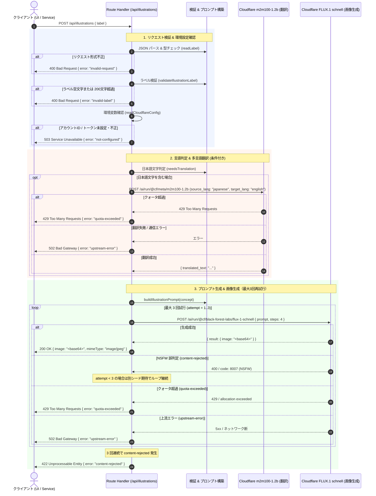

# Draw My Map イラスト生成 API 仕様書

本書は、**Draw My Map** におけるノードアイコン・イラスト生成エンドポイント（`POST /api/illustrations`）の詳細な API 仕様、内部アーキテクチャ、処理パイプライン、クライアント側画像処理、および本番公開に向けた運用・セキュリティ考慮事項をまとめた技術仕様書です。

---

## 目次

1. [API 概要](#1-api-概要)
2. [リクエスト仕様](#2-リクエスト仕様)
3. [レスポンス仕様](#3-レスポンス仕様)
4. [内部処理パイプラインとアーキテクチャ](#4-内部処理パイプラインとアーキテクチャ)
5. [クライアント側での画像処理パイプライン](#5-クライアント側での画像処理パイプライン)
6. [エラーハンドリングと UI 表現](#6-エラーハンドリングと-ui-表現)
7. [本番公開に向けたセキュリティ・運用の考慮事項](#7-本番公開に向けたセキュリティ運用の考慮事項)
8. [開発・テスト・環境設定](#8-開発テスト環境設定)

---

## 1. API 概要

### 1.1 目的と役割

マインドマップの各ノードのテキスト（ラベル）をもとに、マインドマップの可読性と視認性を高めるフラットデザインのアイコン・イラスト画像を生成する Next.js App Router Route Handler です。

- **入力**: ユーザーがノードに入力したテキスト（日本語または多言語）
- **変換**: 必要に応じて日本語から英語へ自動機械翻訳し、視認性の高いフラットイラスト用プロンプトを自動合成
- **推論**: Cloudflare Workers AI の画像生成モデル（FLUX.1 schnell）を呼び出して画像を生成
- **出力**: Base64 エンコードされた JPEG 画像データおよび MIME タイプ

### 1.2 エンドポイント情報

| 項目 | 内容 |
| :--- | :--- |
| **HTTP メソッド** | `POST` |
| **エンドポイントパス** | `/api/illustrations` |
| **Route Handler 動的設定** | `export const dynamic = "force-dynamic";` (キャッシュ無効・完全動的実行) |
| **認証方式（現行）** | サーバー側環境変数による Cloudflare API トークン認証（クライアント側は未認証） |
| **主要外部 AI モデル** | 翻訳: `@cf/meta/m2m100-1.2b`<br>画像生成: `@cf/black-forest-labs/flux-1-schnell` |

### 1.3 関連ソースコード一覧

本 API および連携機能は、関心の分離（SoC）と単一責任の原則（SRP）に基づき以下のレイヤー構造で実装されています。

```text
client/
├── src/
│   ├── app/api/illustrations/
│   │   └── route.ts                       # Next.js App Router POST エントリポイント
│   ├── server/illustration/
│   │   ├── handleIllustrationRequest.ts   # リクエスト受付・オーケストレーション（翻訳・生成ループ制御）
│   │   ├── cloudflareImageGenerator.ts    # FLUX.1 schnell 画像生成アダプタ & 環境変数検証
│   │   ├── cloudflareTranslator.ts        # m2m100 機械翻訳アダプタ
│   │   ├── cloudflareRunModel.ts          # Workers AI HTTP クライアント基盤（タイムアウト・エラー分類）
│   │   └── cloudflareErrors.ts            # ドメイン例外定義（ImageGenerationError）
│   ├── domain/illustration/
│   │   ├── illustrationPrompt.ts          # ラベル検証、言語判定、プロンプトテンプレート合成
│   │   ├── illustrationCrop.ts            # カバースクエアクロップ計算（正方形中央トリミング）
│   │   ├── illustrationDataUrl.ts         # Data URL フォーマット・サイズ検証
│   │   ├── illustrationActionLabel.ts     # ノードイラスト状態に応じた操作ボタンラベル決定（getIllustrationActionLabel）
│   │   └── jpegDimensions.ts              # JPEG バイナリ（SOF マーカー）からの画像サイズ抽出・寸法上限検証（getJpegDimensions, isAcceptableIllustrationSize）
│   ├── config/
│   │   └── illustration.ts                # イラスト関連定数（サムネイルサイズ、品質、文字数上限）
│   ├── services/illustration/
│   │   ├── illustrationClient.ts          # フロントエンド用 API クライアント & エラー分類
│   │   ├── illustrationThumbnail.ts       # Canvas を用いた 128x128 JPEG サムネイル生成
│   │   └── illustrationGeneration.ts      # 生成・サムネイル化の統合パイプラインファサード
│   └── components/map/
│       ├── useIllustrationTextures.ts     # Pixi.js テクスチャのセッションキャッシュ・重複ロード防止フック
│       └── pixi/
│           └── illustrationTextureLoader.ts # Data URL からの Image デコード & Pixi Texture 生成
```

---

## 2. リクエスト仕様

### 2.1 HTTP リクエスト

- **URL**: `POST /api/illustrations`
- **Headers**:
  - `Content-Type: application/json`

### 2.2 リクエストボディ

```json
{
  "label": "企画の背景"
}
```

#### TypeScript 型定義

```typescript
export interface IllustrationRequestBody {
  label: string;
}
```

#### フィールド定義

| フィールド名 | 型 | 必須 | 制約 | 説明 |
| :--- | :--- | :---: | :--- | :--- |
| `label` | `string` | **必須** | トリム後 1 文字以上、200 文字以下 | イラストのモチーフとなるノードテキスト（概念）。 |

### 2.3 バリデーションルール

リクエストはサーバー側で以下の 2 段階の検証が行われます。

1. **リクエスト構造検証 (`readLabel`)**:
   - リクエストボディが有効な JSON オブジェクト（`Record<string, unknown>`）であること（配列、プリミティブ、null は不可）。
   - `label` プロパティが存在し、その型が `string`（`typeof label === "string"`）であること。
   - 検証に失敗した場合は、直ちに `400 Bad Request`（`error: "invalid-request"`）を返します。
2. **ラベル文字検証 (`validateIllustrationLabel`)**:
   - `const trimmed = label.trim();`
   - **空文字チェック**: `trimmed === ""` の場合、`{ ok: false, reason: "empty" }`。
   - **最大文字数チェック**: `trimmed.length > 200`（`ILLUSTRATION_LABEL_MAX_LENGTH = 200`）の場合、`{ ok: false, reason: "too-long" }`。
   - 検証に失敗した場合は、直ちに `400 Bad Request`（`error: "invalid-label"`）を返します。

---

## 3. レスポンス仕様

### 3.1 成功レスポンス (200 OK)

生成された画像データは Base64 文字列として JSON 形式で返却されます。

- **Status Code**: `200 OK`
- **Content-Type**: `application/json`

#### レスポンスボディ

```json
{
  "image": "/9j/4AAQSkZJRgABAQEASABIAAD/2wBDAP//////////////////////////////////////////////////////////////////////////////////////wgALCA...",
  "mimeType": "image/jpeg"
}
```

#### TypeScript 型定義

```typescript
export interface IllustrationSuccessResponse {
  image: string;       // Base64 エンコードされた JPEG バイナリデータ
  mimeType: "image/jpeg";
}
```

---

### 3.2 エラーレスポンス

エラー発生時は、統一された JSON オブジェクトフォーマットでエラー識別コードを返却します。

- **Content-Type**: `application/json`
- **形式**:
  ```json
  {
    "error": "<エラーコード>"
  }
  ```

#### エラーコード一覧と発生契機

| HTTP ステータス | エラーコード (`error`) | 発生契機 / 詳細 |
| :--- | :--- | :--- |
| **`400 Bad Request`** | `"invalid-request"` | リクエストボディが不正な JSON、または `label` プロパティが存在しない/文字列型でない。 |
| **`400 Bad Request`** | `"invalid-label"` | トリム後のラベルが空文字、または最大文字数（200文字）を超過している。 |
| **`422 Unprocessable Entity`** | `"content-rejected"` | AI モデルの安全フィルター（NSFW フィルター等）により画像生成が拒否された（最大 3 回の試行すべてが失敗）。 |
| **`429 Too Many Requests`** | `"quota-exceeded"` | Cloudflare Workers AI の無料枠（10,000 Neurons/日）または API のレートリミット上限を超過した。 |
| **`502 Bad Gateway`** | `"upstream-error"` | Cloudflare API との通信エラー（タイムアウト、ネットワーク断）、5xx サーバーエラー、または不正な JSON レスポンス。 |
| **`503 Service Unavailable`** | `"not-configured"` | サーバー側環境変数（`CLOUDFLARE_ACCOUNT_ID` または `CLOUDFLARE_API_TOKEN`）が未設定、または不正な形式（無効文字）。 |

---

## 4. 内部処理パイプラインとアーキテクチャ

### 4.1 シーケンス図



---

### 4.2 処理ステップの詳細解説

#### ステップ 1: リクエスト検証とサニタイズ
- `readLabel(request)` により、JSON のパースと `label` プロパティの型確認を実施。
- `validateIllustrationLabel(rawLabel)` により前後の空白をトリム（`trim()`）。
- 文字数 200 文字制限（`ILLUSTRATION_LABEL_MAX_LENGTH = 200`）により、極端に長い入力による不要な API コスト消費やプロンプト溢れを防止。

#### ステップ 2: 環境変数の安全な読み込み
- `readCloudflareConfig(env)` を呼び出し、`CLOUDFLARE_ACCOUNT_ID` および `CLOUDFLARE_API_TOKEN` を取得。
- **セキュリティ検証**: Cloudflare アカウント ID は API エンドポイントのパス文字列に直接埋め込まれるため、パストラバーサルやインジェクション攻撃を防ぐ目的で、英数字・ハイフン・アンダースコアのみ（`/^[A-Za-z0-9_-]+$/`）を厳格に許可。不正な形式の場合は `null` を返して `503 Service Unavailable`（`"not-configured"`）となります。

#### ステップ 3: 言語判定と翻訳パイプライン
- **理由**: FLUX.1 schnell などの拡散画像生成モデルは英語プロンプトに最適化されており、日本語の単語をそのまま渡すとプロンプト内の文字列を画像中に歪んだ英数字や文字として描画してしまう傾向があります。
- **言語判定 (`needsTranslation`)**:
  - Unicode スクリプト正規表現を用いて日本語文字（ひらがな、カタカナ、漢字、全角記号 `！-｠`、半角カタカナ `｡-ﾟ`）が含まれているか判定。
  ```typescript
  const JAPANESE_PATTERN = /[\p{Script=Hiragana}\p{Script=Katakana}\p{Script=Han}！-｠｡-ﾟ]/u;
  ```
  - アルファベット、数字、絵文字、一般的なアクセント記号のみで構成されるラベルは翻訳を行わず、そのままプロンプト合成に進みます。
- **機械翻訳実行 (`createCloudflareTranslator`)**:
  - モデル: `@cf/meta/m2m100-1.2b`
  - パラメータ: `{ text, source_lang: "japanese", target_lang: "english" }`
  - タイムアウト: 30 秒（`timeoutMs: 30_000`）
  - 翻訳に失敗した場合、日本語のまま画像生成へ進むことはせず、即座にエラー（429 または 502）を返します。
  - 翻訳は NSFW の再試行より前に 1 回だけ行います。翻訳で `content-rejected` に分類されるエラーが起きても再試行はせず、一般の失敗と同じく `502`（`"upstream-error"`）を返します（再試行するのは画像生成の誤判定だけです）。

#### ステップ 4: プロンプト構築 (`buildIllustrationPrompt`)
- 概念長の上限クリップ: 長文翻訳結果によるプロンプト全体のトークンあふれ（Cloudflare 制限 2048 文字）を防ぐため、概念文字列は先頭 500 文字（`ILLUSTRATION_CONCEPT_MAX_LENGTH = 500`）にスライス。
- **固定スタイリングテンプレート**:
  ```typescript
  export function buildIllustrationPrompt(concept: string): string {
    const safeConcept = concept.trim().slice(0, 500);
    return `A simple, clear flat-design illustration of an object or scene that symbolizes the concept: ${safeConcept}. One large centered subject that fills most of the frame, plain white background, no text, no letters.`;
  }
  ```
  - **スタイル指定の工夫**:
    - `flat-design illustration`: マインドマップのアイコンとして視認性の高いフラットイラスト調を指定。
    - `One large centered subject that fills most of the frame`: 中央に単一の主題を大きく配置（後段での正方形クロップで欠損しないように配慮）。
    - `plain white background`: 背景を純白（#ffffff）に統一し、円形や正方形へのトリミング、キャンバス背景との親和性を担保。
    - `no text, no letters`: 不要な文字の混入を抑制。

#### ステップ 5: 画像生成と NSFW 誤検知自動再試行
- **モデル**: `@cf/black-forest-labs/flux-1-schnell`
- **推論ステップ**: `steps: 4`（高速・高品質な Schnell プリセット）
- **タイムアウト**: 60 秒（`timeoutMs: 60_000`）
- **NSFW 誤検知問題への対処**:
  - FLUX.1 schnell は、全く問題のない日常単語（例: 「企画」「会議」「背景」等）であっても、潜在空間の初期ノイズによって偶発的にセーフティフィルター（NSFW 誤検知、Cloudflare エラーコード 8007）に抵触し、画像生成が拒否されるケースが知られています。
  - システムは `content-rejected` エラーを検知した場合、最大 3 回（初回 + 再試行 2 回）まで同一プロンプトで自動的にリトライします。
  - **シード制御の注意点**: Cloudflare Workers AI の FLUX API に明示的な `seed` パラメータを送ると `HTTP 400 (code: 5006)` エラーが発生するため、リクエストに `seed` は含めず、サーバー側のランダムシード生成に委ねることで再試行ごとの成功率を回復させます。
  - 3 回試行してもすべて拒否された場合のみ、`422 Unprocessable Entity`（`"content-rejected"`）を返します。

#### エラー応答への変換（`handleIllustrationRequest.ts`）
- 上流（翻訳・画像生成）の失敗は、`cloudflareRunModel.ts` が `ImageGenerationError`（`kind`: `quota-exceeded` / `content-rejected` / `upstream-error`）に分類し、`handleIllustrationRequest.ts` が HTTP 応答へ変換します。
- 翻訳と画像生成で共通の変換は `upstreamFailureResponse` にまとめています。`quota-exceeded` だけを `429` にし、それ以外（`ImageGenerationError` でない想定外の例外を含む）は内部のメッセージを返さずに `502`（`"upstream-error"`）にします。
- 画像生成だけは、その前に `content-rejected` を判定し、2 回目までは再試行し、3 回目も拒否されたら `422` にします。
- `cloudflareRunModel.ts` は、例外のメッセージに API トークンが含まれ得るため、通信の失敗を固定の文言の `upstream-error` に置き換えます。時間切れのタイマーは、応答本文の読み込みが終わるまで解除しません。
- 応答の本文は形が保証されないため、`unknown` のまま `domain/shared/unknownRecord.ts` の `readProperty` で読みます。分類に使うのは `errors` の先頭の項目だけで、`code` は数値の `8007` と一致するときだけ、`message` は文字列のときだけ使います。`success` が真偽値の `true` でなければ（文字列の `"true"` や本文が `null`・配列・文字列でも）`upstream-error` です。`result` は形を確かめずに返し、翻訳（`translated_text` が空でない文字列か）と画像生成（`image` が文字列か）の側で検証します。

---

## 5. クライアント側での画像処理パイプライン

API から返却された高解像度画像（約 1024x1024）をそのままノードデータや `localStorage` に保存すると、ブラウザの容量上限（約 5MB）を即座に圧迫してしまいます。そのため、クライアント側（フロントエンド）で軽量なサムネイル画像へと加工します。

```text
[API レスポンス]
  └── Base64 JPEG (約 1024x1024, 数百 KB)
          │
          ▼ requestIllustration (MIME検証 & Data URL化)
  `data:image/jpeg;base64,...`
          │
          ▼ createIllustrationThumbnail
          │  1. Image オブジェクトでデコード
          │  2. calculateCoverCrop で中央正方形 (size × size) を計算
          │  3. HTMLCanvasElement (128x128) に転写
          │  4. toDataURL("image/jpeg", 0.85) で圧縮
          │  5. isIllustrationDataUrl で検証 (≤ 100,000文字)
          ▼
[ノード保存用サムネイル]
  └── Data URL JPEG (128x128, 約 5〜15 KB) ───> Node.illustration に保存
```

### 5.1 主要パラメータ（`config/illustration.ts`）

| 定数名 | 設定値 | 目的・根拠 |
| :--- | :---: | :--- |
| `ILLUSTRATION_THUMBNAIL_SIZE` | `128` | ノード上の通常表示（48px）および PNG エクスポート時の高解像度（2倍スケール 96px）でもボケない解像度。 |
| `ILLUSTRATION_THUMBNAIL_QUALITY` | `0.85` | 画質劣化を目立たせず、ファイルサイズを劇的に削減する JPEG 圧縮品質。 |
| `MAX_ILLUSTRATION_DATA_URL_LENGTH` | `100_000` | localStorage の容量（約 5MB）枯渇を防ぐため、1ノードあたりの Data URL 長さを 100KB 以内に制限。 |
| `MAX_ILLUSTRATION_IMAGE_DIMENSION` | `512` | 復元時に改ざんされた巨大画像によってブラウザメモリが枯渇するのを防ぐデコード上限値。 |

### 5.2 カバースクエアクロッピング (`calculateCoverCrop`)

画像のアスペクト比が正方形でない場合でも、主題が中央に配置されているプロンプト設計を前提に、中央領域を正方形にクロップします。

```typescript
export function calculateCoverCrop(width: number, height: number) {
  const size = Math.min(width, height);
  return {
    sx: (width - size) / 2,
    sy: (height - size) / 2,
    size,
  };
}
```

### 5.3 Pixi.js 描画連携 (`illustrationTextureLoader.ts` / `useIllustrationTextures.ts`)

- ノードに紐付けられたサムネイル Data URL は、描画フレームでの同期的使用を可能にするため、`new Image()` のデコード完了後に `Texture.from(image)` でテクスチャ化されます（`loadIllustrationTexture`）。
- `useIllustrationTextures` フック内のセッションキャッシュ（`Map<string, Texture>`）および重複リクエスト追跡（`Set<string>`）により、同一イラストの二重デコードを防止し、60fps の滑らかなキャンバス描画を維持します。

---

## 6. エラーハンドリングと UI 表現

クライアント側サービス（`illustrationClient.ts`）は、HTTP ステータスコードおよびネットワークエラーをユーザーフレンドリーな文言へと変換し、トースト通知等でフィードバックします。

```typescript
export type IllustrationErrorKind =
  | "invalid-label"
  | "not-configured"
  | "quota-exceeded"
  | "upstream-error"
  | "content-rejected"
  | "network"
  | "image-processing";
```

### ユーザー向けメッセージ定義一覧

| エラー種別 (`kind`) | 対応ステータス | UI 表示メッセージ (`describeIllustrationError`) |
| :--- | :---: | :--- |
| `invalid-label` | 400 | ノードのテキストが空、または長すぎるため、イラストを生成できません。 |
| `not-configured` | 503 | イラスト生成の設定（Cloudflareの認証情報）が見つかりません。README の手順で設定してください。 |
| `quota-exceeded` | 429 | 無料の利用上限に達しました（1日の無料枠を使い切ったか、一時的な制限です）。時間をおいて（無料枠は毎日 0:00 UTC にリセット）、再度お試しください。 |
| `upstream-error` | 502 / その他 | イラストの生成に失敗しました。時間をおいて、再度お試しください。 |
| `content-rejected` | 422 | 画像生成AIが、内容を不適切と判定しました（誤判定のことがあります）。もう一度お試しください。ノードのテキストを少し変えると、通ることもあります。 |
| `network` | - | 通信に失敗しました。接続を確認して、再度お試しください。 |
| `image-processing` | - | 生成した画像を処理できませんでした。もう一度お試しください。 |

---

## 7. 本番公開に向けたセキュリティ・運用の考慮事項

現行の実装は、**ローカル環境での単一開発者による利用**を主眼として設計されています。パブリックな Web サービスとして本番環境（Vercel, Cloudflare Pages, AWS 等）へ公開する場合には、以下のセキュリティおよび運用対策が必須となります。

### 7.1 必須セキュリティ対策

1. **ユーザー認証と認可**:
   - 現状のエンドポイントは公開されており、URL を知っていれば誰でも呼び出し可能です。
   - NextAuth.js、Clerk、Supabase Auth などを導入し、ログイン済みユーザーのみにリクエストを制限する必要があります。
2. **Origin ヘッダーおよび CSRF/CORS 制限**:
   - 他のオリジンからのスクリプトによる不正呼び出しを遮断するため、Same-Origin ポリシーの適用や `Origin` / `Referer` ヘッダーの厳格な検証を行います。
3. **レートリミット（Rate Limiting）の導入**:
   - 悪意あるユーザーやスクリプトによる API の連打・枯渇攻撃を防ぐため、IP アドレスまたはユーザー ID 単位でのレート制限を設けます。
   - 推奨実装: Upstash Redis（`@upstash/ratelimit`）や Cloudflare WAF / Rate Limiting ルールによる制御（例: 1 ユーザーあたり 1 分間に 3 回まで）。
4. **リクエストボディサイズの厳格な制限**:
   - 巨大な JSON ボディによる DoS を防止するため、Next.js の設定またはリバースプロキシでリクエストサイズ上限（例: 10KB）を設定します。

### 7.2 Cloudflare Workers AI のクォータとコスト管理

| 項目 | 無料枠 (Free Tier) | 有料プラン (Workers Paid) |
| :--- | :--- | :--- |
| **デイリー上限** | **10,000 Neurons / 日** | 従量課金（超過分 $0.011 / 1,000 Neurons） |
| **FLUX.1 schnell 消費** | 約 172.8 Neurons / 枚（4ステップ実測値） | 同左 |
| **m2m100-1.2b 翻訳消費** | 約 0.3 〜 0.5 Neurons / 回（実測値） | 同左 |
| **1日の生成可能枚数** | **約 57 枚 / 日** | 実質無制限（予算設定による） |
| **クォータリセット日時** | 毎日 **00:00 UTC**（日本時間 午前 9:00） | 月次請求 |

#### 運用の注意点
- 無料枠（10,000 Neurons）はプロジェクト単位ではなく **Cloudflare アカウント全体**で共有されます。他の Workers AI プロジェクトと併用している場合、利用枠の圧迫が早まります。
- NSFW 再試行が発生した場合、試行した回数分（最大 3 回）の Neurons が消費されます。
- クォータを使い切ると HTTP 429 が返却され、ユーザーにはリセット時刻（0:00 UTC）までイラスト生成が制限される旨が表示されます。

---

## 8. 開発・テスト・環境設定

### 8.1 環境変数の設定

ローカル開発環境でイラスト生成機能を利用するには、`client/.env.local` に Cloudflare の認証情報を設定します。

```bash
# client/.env.local
CLOUDFLARE_ACCOUNT_ID="your_account_id_here"
CLOUDFLARE_API_TOKEN="your_api_token_here"
```

#### API トークンの権限要件
Cloudflare ダッシュボードで API トークンを作成する際は、以下の権限（Permissions）を付与してください。
- **Account** -> **Workers AI** -> **Read** / **Edit**

### 8.2 テストの実行

イラスト生成モジュールは、外部ネットワークに依存しないユニットテストおよびモックテストが完備されています。

```bash
cd client

# イラスト関連のすべてのテストを実行（パスに illustration を含むもの。Route Handler の src/app/api/illustrations も含む）
npm test -- illustration

# Route Handler（環境変数と Cloudflare の実装への配線）のテストのみ実行
npm test -- src/app/api/illustrations

# サーバー側のオーケストレーションとアダプタのテストのみ実行
npm test -- src/server/illustration

# クライアント側サービステストのみ実行
npm test -- src/services/illustration
```

テストの役割分担は次のとおりです。

| テストファイル | 確かめること |
| :--- | :--- |
| `app/api/illustrations/__tests__/route.test.ts` | `process.env` から設定を読む配線と、本物の `createCloudflareTranslator`・`createCloudflareImageGenerator` への配線。グローバルの `fetch` を `jest.spyOn` で差し替え、呼び出す URL（アカウント ID・モデル）・認証ヘッダー・送る本文・翻訳の有無・429 の変換を確かめる。 |
| `server/illustration/__tests__/handleIllustrationRequest.test.ts` | 検証の順序、翻訳の有無、NSFW の再試行の回数、エラーコードと HTTP ステータスの対応。翻訳・生成は注入したモックで置き換える。 |
| `server/illustration/__tests__/cloudflareImageGenerator.test.ts`・`cloudflareTranslator.test.ts` | 環境変数の検証、Workers AI の応答の分類（NSFW・無料枠・不正な応答）、時間切れ、トークンをエラーメッセージに含めないこと。`fetch` は引数で注入する。 |
| `server/illustration/__tests__/cloudflareRunModel.test.ts` | 共通の呼び出しの単体。`result` をそのまま返すこと、`fetchImpl` を省いたときのグローバルの `fetch`、形の違う本文（`null`・配列・文字列、`success` が `true` 以外、`errors` が配列でない・先頭が `null`、`code` が文字列、`message` が文字列でない）をすべて `upstream-error` にすること。 |
| `services/illustration/__tests__/*.test.ts` | クライアント側の API 呼び出しとエラーの分類、サムネイルの生成（注入した依存と、既定の `Image`・`canvas` 要素の両方）。 |
