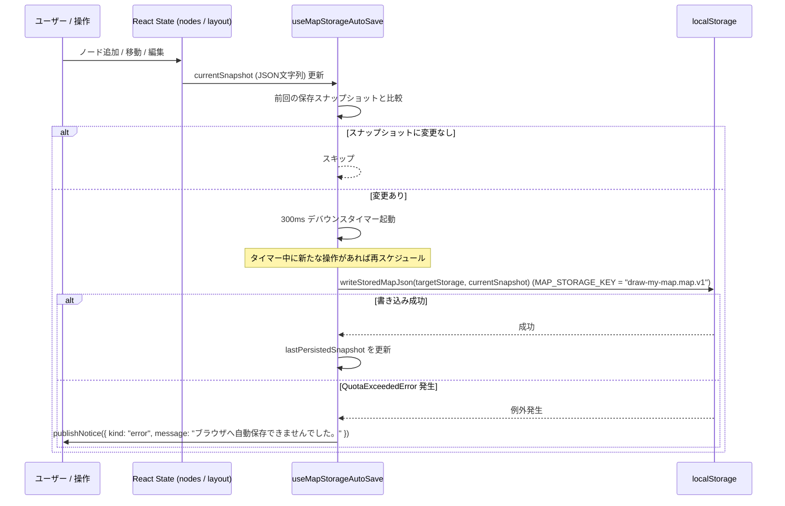

# Draw My Map データモデル・永続化仕様書

本書は、**Draw My Map** におけるデータモデル、TypeScript 型定義、JSON 永続化スキーマ（Version 1 〜 Version 3）、デコード・マイグレーション・バリデーション、およびブラウザ `localStorage` 永続化アーキテクチャの完全な技術仕様書です。

---

## 目次

1. [データモデル概要](#1-データモデル概要)
   - 1.1 [マインドマップのデータ構造](#11-マインドマップのデータ構造)
   - 1.2 [データモデルの設計原則](#12-データモデルの設計原則)
2. [TypeScript 型定義リファレンス](#2-typescript-型定義リファレンス)
   - 2.1 [ノード・キャンバス状態型](#21-ノードキャンバス状態型)
   - 2.2 [レイアウト・解像度フィルタリング型](#22-レイアウト解像度フィルタリング型)
   - 2.3 [永続化・ドキュメント型](#23-永続化ドキュメント型)
   - 2.4 [AI イラスト生成・通知型](#24-ai-イラスト生成通知型)
   - 2.5 [画像エクスポート型](#25-画像エクスポート型)
3. [MapDocument JSON スキーマ仕様](#3-mapdocument-json-スキーマ仕様)
   - 3.1 [Version 1 スキーマ（Phase 5 初期）](#31-version-1-スキーマphase-5-初期)
   - 3.2 [Version 2 スキーマ（Phase 6）](#32-version-2-スキーマphase-6)
   - 3.3 [Version 3 スキーマ（Phase 7 現行）](#33-version-3-スキーマphase-7-現行)
   - 3.4 [バージョン間差分対照表](#34-バージョン間差分対照表)
4. [デコード・マイグレーション・バリデーション仕様](#4-デコードマイグレーションバリデーション仕様)
   - 4.1 [デコード・パイプライン概要](#41-デコードパイプライン概要)
   - 4.2 [バージョンマイグレーション規則](#42-バージョンマイグレーション規則)
   - 4.3 [ノード入力値バリデーション仕様](#43-ノード入力値バリデーション仕様)
   - 4.4 [イラスト画像・Data URL バリデーション仕様](#44-イラスト画像data-url-バリデーション仕様)
   - 4.5 [グラフ構造整合性バリデーション仕様](#45-グラフ構造整合性バリデーション仕様)
   - 4.6 [エラーメッセージ一覧](#46-エラーメッセージ一覧)
5. [ブラウザ localStorage 永続化仕様](#5-ブラウザ-localstorage-永続化仕様)
   - 5.1 [ストレージ設定と保存フォーマット](#51-ストレージ設定と保存フォーマット)
   - 5.2 [自動保存ライフサイクル（useMapStorageAutoSave）](#52-自動保存ライフサイクルusemapstorageautosave)
   - 5.3 [初期ロード・復元ライフサイクル（useMapStorageRestoration）](#53-初期ロード復元ライフサイクルusemapstoragerestoration)
   - 5.4 [ストレージ容量ハンドリングと防御機構](#54-ストレージ容量ハンドリングと防御機構)
   - 5.5 [JSON ファイル エクスポート／インポート仕様](#55-json-ファイル-エクスポートインポート仕様)
   - 5.6 [枝のクリップボード形式](#56-枝のクリップボード形式)

---

## 1. データモデル概要

### 1.1 マインドマップのデータ構造

Draw My Map のキャンバスデータは、**多重ツリー（フォレスト: Forest）** 構造を持つ有向グラフとしてモデル化されています。

```text
[Forest 構造の表現]

Root Node A (id: 1, parentId: null)
 ├── Child Node A1 (id: 2, parentId: 1)
 └── Child Node A2 (id: 3, parentId: 1)
      └── Leaf Node A2a (id: 4, parentId: 3)

Root Node B (id: 5, parentId: null)
 └── Child Node B1 (id: 6, parentId: 5)
```

- **フォレスト（多重ツリー）対応**:
  マインドマップ全体で単一の根（Root）を強制せず、複数の独立したルートノード（`parentId: null`）が共存できます。各ルートノードを頂点とする互いに独立したツリー群（木構造の集合）を構成します。
- **暗黙的エッジ表現（Adjacency List on Node）**:
  エッジ（親子接続線）を個別のデータエンティティ（例: Edge オブジェクト）として管理せず、子ノードが親ノードの ID を参照する `parentId: number | null` 属性によって暗黙的に表現します。
  これにより、エッジIDの管理オーバーヘッドを排除し、ノードの追加・削除に伴うエッジ同期の整合性不整合を根本から防ぎます。
- **フラットなノード配列**:
  メモリ上および永続化データにおいて、階層構造を入れ子オブジェクト（ネストされた `children: []`）ではなく、フラットな `Node[]` 配列として保持します。これにより、インデックスアクセスや特定ノードの検索・更新を `O(1)` 〜 `O(N)` でシンプルに処理できます。

### 1.2 データモデルの設計原則

1. **正規化とプロジェクション（Normalization & Projection）**:
   - 永続化されるドキュメントおよびメモリ上の状態は、厳密に必要なプロパティのみを持つ正規化された形で管理されます。
   - 未知のプロパティや余分なプロパティが注入された場合、エンコーダーおよびデコーダー（`projectMapDocumentNode`）によって確実に除外されます。
2. **不変データ（Immutable Data Flow）**:
   - ノード編集、位置移動、自動レイアウト計算、永続化処理のすべてのパイプラインにおいて、既存のノードオブジェクトを直接破壊的に変更（ミューテート）しません。
   - 常に新しいオブジェクトおよび配列を生成して状態を更新します。
3. **循環参照の完全排除（Acyclic Guarantee）**:
   - ツリー構造であるため、親子関係に閉路（サイクル）が存在してはなりません。
   - 自身を親とする自己ループ（`id === parentId`）や、子孫を親とする循環関係（`1 -> 2 -> 3 -> 1`）は、デコード時およびノード移動時に有向非巡回グラフ（DAG）検出アルゴリズムによって厳密に拒絶されます。
4. **レイアウトと幾何情報の分離**:
   - ノードの幾何座標（`x`, `y`）およびサイズ（`width`, `height`）はノード自体が保持しますが、配置方針（`layoutMode`: `"manual"` または `"auto"`）はマップドキュメント全体のグローバル状態として管理されます。
   - 自動配置モード時でも、計算されたレイアウト座標はそのまま各ノードの `x`, `y` に反映され、保存されます。

---

## 2. TypeScript 型定義リファレンス

システムの中核を構成する共有型定義は `client/src/types/` 配下の全 9 ファイルに集約されています。

| ファイルパス | エクスポートされる型名 | 役割・用途 |
| :--- | :--- | :--- |
| `client/src/types/node.ts` | `Node` | マインドマップのノードエンティティ型 |
| `client/src/types/nodeImportance.ts` | `NodeImportance` | ノード重要度レベル（`"high" \| "medium" \| "low"`） |
| `client/src/types/nodeLayout.ts` | `NodeLayoutMode` | レイアウト配置モード（`"manual" \| "auto"`） |
| `client/src/types/nodeMapState.ts` | `NodeMapState` | マップ全体のインメモリ状態（`layoutMode`, `nodes`） |
| `client/src/types/nodeResolution.ts` | `ResolutionLevel`, `ResolutionFilterMode` | 解像度フィルタの表示レベルとフィルタモード |
| `client/src/types/mapDocument.ts` | `MapDocumentVersion`, `MapDocumentV1`, `MapDocumentV3`, `MapDocument`, `MapDocumentResult` | JSON 永続化ドキュメントスキーマおよび Result 型 |
| `client/src/types/illustrationGeneration.ts` | `IllustrationGenerationState` | AI イラスト生成の非同期状態マシン（判別共用体） |
| `client/src/types/operationNotice.ts` | `OperationNotice` | ヘッダー通知バーに表示する操作結果・警告・エラー通知型 |
| `client/src/types/mapImageExport.ts` | `CreateSvgExport`, `DownloadImage`, `RasterizePng` | SVG / PNG 画像エクスポート処理の依存注入用関数シグネチャ型 |

### 2.1 ノード・キャンバス状態型

#### `Node` (`client/src/types/node.ts`)
マインドマップ上の個々のノードを表す基本型です。

```typescript
import type { NodeImportance } from "@/types/nodeImportance";

export type Node = {
  /** ノードの一意識別子（1以上の安全な整数） */
  id: number;
  /** 親ノードのID。ルートノードの場合は null */
  parentId: number | null;
  /** キャンバス上の X 座標（左端） */
  x: number;
  /** キャンバス上の Y 座標（上端） */
  y: number;
  /** ノード矩形の幅（px） */
  width: number;
  /** ノード矩形の高さ（px）。イラスト保持時は getIllustratedNodeMinHeight により最低 116px */
  height: number;
  /** ノード内に表示されるテキストラベル */
  label: string;
  /** ノードの重要度（Phase 6 以降） */
  importance: NodeImportance;
  /**
   * 縮小済みのイラストの data URL（Phase 7 以降）。
   * イラストを持たないノードでは、プロパティ自体が存在しない（undefined）
   */
  illustration?: string;
};
```

#### `NodeImportance` (`client/src/types/nodeImportance.ts`)
ノードの重要度を表現するユニオン型です。解像度フィルタリングの基準となります。

```typescript
export type NodeImportance = "high" | "medium" | "low";
```

#### `NodeMapState` (`client/src/types/nodeMapState.ts`)
アプリケーション内部のマップ状態を表す型です。

```typescript
import type { Node } from "@/types/node";
import type { NodeLayoutMode } from "@/types/nodeLayout";

export type NodeMapState = {
  /** レイアウト配置モード */
  layoutMode: NodeLayoutMode;
  /** マップを構成する全ノードの配列 */
  nodes: Node[];
};
```

#### 編集履歴（`client/src/domain/history/mapHistory.ts`）
`NodeMapState` を1操作ぶんのスナップショットとして、過去・現在・未来の配列でメモリ上に保持します。

- 上限は `MAP_HISTORY_LIMIT`（100操作）です。変更のないノードオブジェクトと画像文字列は履歴間で共有し、操作のたびに deep clone や JSON 化は行いません。
- 復元対象は `nodes` と `layoutMode` です。選択、パン・ズーム、表示フィルター、イラスト生成のプレビューは含めません。
- 履歴は保存も書き出しもしません。JSON と `localStorage` の Version 3 形式は変わりません。
- 初回の保存データ復元と JSON 読み込みの成功は新しい起点となり、過去・未来・進行中のドラッグのグループを消去します。

### 2.2 レイアウト・解像度フィルタリング型

#### `NodeLayoutMode` (`client/src/types/nodeLayout.ts`)
ノードの配置方式を指定するモードです。

```typescript
export type NodeLayoutMode = "manual" | "auto";
```
- `"manual"`: ユーザーによる自由なドラッグ配置。
- `"auto"`: 多重ツリー（フォレスト）対応の階層的水平自動レイアウトアルゴリズムによる自動配置。

#### `ResolutionLevel` / `ResolutionFilterMode` (`client/src/types/nodeResolution.ts`)
キャンバス上のノード表示閾値を指定する型です。

```typescript
export type ResolutionLevel = "high" | "medium" | "all";

export type ResolutionFilterMode = "auto" | ResolutionLevel;
```
- `ResolutionLevel`:
  - `"high"`: 重要度 `high` のノードのみ表示。
  - `"medium"`: 重要度 `high` および `medium` のノードを表示。
  - `"all"`: すべてのノード（`high`, `medium`, `low`）を表示。
- `ResolutionFilterMode`:
  - `"auto"`: キャンバスのズーム率に応じて `ResolutionLevel` を自動切り替え（ヒステリシス制御付き）。
  - `"high"` / `"medium"` / `"all"`: ユーザーによる手動固定表示。

### 2.3 永続化・ドキュメント型

#### `MapDocumentVersion` (`client/src/types/mapDocument.ts`)
保存フォーマットのスキーマバージョンを表す型です。

```typescript
export type MapDocumentVersion = 1 | 2 | 3;
```

#### `MapDocumentV1` / `MapDocumentV3` / `MapDocument` (`client/src/types/mapDocument.ts`)

```typescript
import type { NodeMapState } from "@/types/nodeMapState";
import type { Node } from "@/types/node";

/** Version 1 のノード定義（importance, illustration を持たない） */
type MapDocumentV1Node = Pick<
  Node,
  "id" | "parentId" | "x" | "y" | "width" | "height" | "label"
>;

/** Version 1 ドキュメント */
export type MapDocumentV1 = {
  version: 1;
  layoutMode: NodeMapState["layoutMode"];
  nodes: MapDocumentV1Node[];
};

/** Version 3 ドキュメント（現行フォーマット） */
export type MapDocumentV3 = NodeMapState & { version: 3 };

/** 共通ドキュメント型（最新の Version 3 と等価） */
export type MapDocument = MapDocumentV3;
```

#### `MapDocumentResult<T>` (`client/src/types/mapDocument.ts`)
パースやバリデーションの結果を表現する Result 型です。例外（throw）を使用せず、型安全な成功/失敗の分岐を提供します。

```typescript
export type MapDocumentResult<T> =
  | { ok: true; value: T }
  | { ok: false; error: string };
```

### 2.4 AI イラスト生成・通知型

#### `IllustrationGenerationState` (`client/src/types/illustrationGeneration.ts`)
ノードイラスト生成機能の非同期状態マシンを表す型です。

```typescript
/**
 * generating・succeeded の label は、生成開始時点のノードテキスト。
 * テキストが途中で変更されたかを検知するために保持される。
 */
export type IllustrationGenerationState =
  | { status: "idle" }
  | { status: "generating"; nodeId: number; label: string }
  | { status: "succeeded"; nodeId: number; label: string; dataUrl: string }
  | { status: "failed"; nodeId: number; message: string };
```

#### `OperationNotice` (`client/src/types/operationNotice.ts`)
自動保存失敗時や復元時の警告を UI ヘッダーのトースト通知へ伝える型です。

```typescript
export type OperationNotice = {
  kind: "status" | "warning" | "error";
  message: string;
};
```

### 2.5 画像エクスポート型

#### `CreateSvgExport` / `DownloadImage` / `RasterizePng` (`client/src/types/mapImageExport.ts`)
SVG および PNG 画像エクスポートフック（`useMapImageExport`, `useMapSvgExport`, `useMapPngExport`）とサービス層の間で共有される関数シグネチャ型です。

```typescript
import type { MapSvgDocument } from "@/domain/imageExport/mapSvgDocument";
import type { Node } from "@/types/node";

export type CreateSvgExport = (nodes: readonly Node[]) => MapSvgDocument | null;
export type DownloadImage = (blob: Blob, fileName: string) => void;
export type RasterizePng = (
  svg: string,
  width: number,
  height: number,
) => Promise<Blob>;
```
- `CreateSvgExport`: ノード配列から SVG XML 文字列と寸法（`MapSvgDocument: { svg: string; width: number; height: number }`）を生成する関数型（ノードが空の場合は `null`）。
- `DownloadImage`: 生成された画像 `Blob` を指定ファイル名でブラウザダウンロードさせる関数型。
- `RasterizePng`: SVG XML 文字列と論理幅・高さを受け取り、2倍スケールの PNG `Blob` へ非同期ラスタライズする関数型。

---

## 3. MapDocument JSON スキーマ仕様

### 3.1 Version 1 スキーマ（Phase 5 初期）

Phase 5 の初期実装で策定された基本フォーマットです。ノードの基本幾何情報とラベル、ツリー構造のみを記録します。

#### JSON サンプル (Version 1)
```json
{
  "version": 1,
  "layoutMode": "manual",
  "nodes": [
    {
      "id": 1,
      "parentId": null,
      "x": 0,
      "y": 0,
      "width": 160,
      "height": 64,
      "label": "プロジェクト構想"
    },
    {
      "id": 2,
      "parentId": 1,
      "x": 240,
      "y": -50,
      "width": 160,
      "height": 64,
      "label": "要件定義"
    }
  ]
}
```

#### プロパティ仕様 (Version 1)
| プロパティ名 | 型 | 必須 | 制約・解説 |
| :--- | :--- | :---: | :--- |
| `version` | `1` (数値) | ○ | 必ず数値の `1` |
| `layoutMode` | `string` | ○ | `"manual"` または `"auto"` |
| `nodes` | `Array<object>` | ○ | ノードオブジェクトの配列 |
| `nodes[].id` | `number` | ○ | 1 以上の安全な整数 |
| `nodes[].parentId` | `number \| null` | ○ | `null` または 1 以上の安全な整数 |
| `nodes[].x` | `number` | ○ | 有限の数値 (`Number.isFinite`) |
| `nodes[].y` | `number` | ○ | 有限の数値 (`Number.isFinite`) |
| `nodes[].width` | `number` | ○ | 0 より大きい有限の数値 |
| `nodes[].height` | `number` | ○ | 0 より大きい有限の数値 |
| `nodes[].label` | `string` | ○ | ノード文字列 |

---

### 3.2 Version 2 スキーマ（Phase 6）

Phase 6 で追加された解像度フィルタリング（ズーム連動表示切り替え）に対応し、各ノードに `importance` プロパティが追加されました。

#### JSON サンプル (Version 2)
```json
{
  "version": 2,
  "layoutMode": "auto",
  "nodes": [
    {
      "id": 1,
      "parentId": null,
      "x": 0,
      "y": 0,
      "width": 160,
      "height": 64,
      "label": "プロジェクト構想",
      "importance": "high"
    },
    {
      "id": 2,
      "parentId": 1,
      "x": 240,
      "y": -50,
      "width": 160,
      "height": 64,
      "label": "要件定義",
      "importance": "medium"
    },
    {
      "id": 3,
      "parentId": 2,
      "x": 480,
      "y": -50,
      "width": 160,
      "height": 64,
      "label": "細部仕様メモ",
      "importance": "low"
    }
  ]
}
```

#### プロパティ仕様 (Version 2 追加項目)
| プロパティ名 | 型 | 必須 | 制約・解説 |
| :--- | :--- | :---: | :--- |
| `version` | `2` (数値) | ○ | 必ず数値の `2` |
| `nodes[].importance` | `string` | ○ | `"high"`, `"medium"`, `"low"` のいずれか（必須） |

---

### 3.3 Version 3 スキーマ（Phase 7 現行）

Phase 7（現行バージョン）で策定されたスキーマです。AI イラスト生成機能で作成されたサムネイル画像をノードに埋め込む `illustration` プロパティ（オプショナル）が追加されました。

#### JSON サンプル (Version 3)
```json
{
  "version": 3,
  "layoutMode": "manual",
  "nodes": [
    {
      "id": 1,
      "parentId": null,
      "x": 0,
      "y": 0,
      "width": 160,
      "height": 116,
      "label": "未来都市構想",
      "importance": "high",
      "illustration": "data:image/jpeg;base64,/9j/4AAQSkZJRgABAQEASABIAAD/2wBDAP//////////////////////////////////////////////////////////////////////////////////////wgALCAEAAQEBREA/8QAFBABAAAAAAAAAAAAAAAAAAAAAP/aAAgBAQABPxA="
    },
    {
      "id": 2,
      "parentId": 1,
      "x": 240,
      "y": 0,
      "width": 160,
      "height": 64,
      "label": "スマート交通網",
      "importance": "medium"
    }
  ]
}
```

#### プロパティ仕様 (Version 3 追加項目)
| プロパティ名 | 型 | 必須 | 制約・解説 |
| :--- | :--- | :---: | :--- |
| `version` | `3` (数値) | ○ | 必ず数値の `3` |
| `nodes[].height` | `number` | ○ | `illustration` を持つノードは最低 116px (`ILLUSTRATED_NODE_HEIGHT`) |
| `nodes[].illustration` | `string` | △ (任意) | 縮小 JPEG の Data URL。イラストが無い場合は **キー自体を含めない** |

---

### 3.4 バージョン間差分対照表

| 項目 | Version 1 | Version 2 | Version 3 (現行) |
| :--- | :--- | :--- | :--- |
| **策定フェーズ** | Phase 5 | Phase 6 | Phase 7 |
| **`version` 値** | `1` | `2` | `3` |
| **`nodes[].importance`** | 未対応（読込時 `"medium"` 補完） | **必須** (`"high" \| "medium" \| "low"`) | **必須** (`"high" \| "medium" \| "low"`) |
| **`nodes[].illustration`**| 未対応（存在しても破棄） | 未対応（存在しても破棄） | **対応** (JPEG Data URL、省略可能) |
| **最小ノード高制約** | 0 超の有限数値 | 0 超の有限数値 | イラスト有りの場合 最低 116px |
| **保存時出力形式** | — | — | **常に Version 3 形式で出力** |

---

## 4. デコード・マイグレーション・バリデーション仕様

ドキュメントの解析および検証ロジックは `client/src/domain/persistence/` 配下に隔離され、完全なテストカバレッジによって保護されています。

```text
[デコード・バリデーション パイプライン]

入力 JSON 文字列
      │
      ▼
 1. JSON.parse (構文解析) ─────────── 構文不正 ───► エラー: "JSONを解析できませんでした。"
      │ 正常
      ▼
 2. トップレベル構造検証 ──────────── 形式不正 ───► エラー: "マップデータの形式が不正です。"
    (version: 1|2|3, layoutMode)      未対応version ─► エラー: "未対応のマップ形式です。"
      │ 正常
      ▼
 3. ノード個別正規化 (ループ)
    ├─ 基本型検証 (id, parentId, x, y, width, height, label)
    ├─ importance マイグレーション & 検証
    └─ illustration マイグレーション & 検証
      │ 不正あり ──────────────────────────────► エラー: "node[i].xxxは..."
      ▼ 全ノード正常
 4. グラフ構造整合性検証 (validateMapDocumentGraph)
    ├─ ID 重複検出
    ├─ 親ノード存在検証
    └─ 循環参照 (サイクル) / 自己ループ検出
      │ 不正あり ──────────────────────────────► エラー: "親子関係が循環しています。" 等
      ▼ 正常
 Version 3 ドキュメント オブジェクト (ok: true)
```

### 4.1 デコード・パイプライン概要

`client/src/domain/persistence/mapDocumentDecoder.ts` の `parseMapDocumentJsonWithVersion` 関数がエントリポイントとなります。

```typescript
export function parseMapDocumentJsonWithVersion(
  json: string,
): MapDocumentResult<{ document: MapDocumentV3; sourceVersion: MapDocumentVersion }>
```

- 入力文字列を `JSON.parse` し、オブジェクトであること、`version` が `1`, `2`, `3` のいずれかであること、`layoutMode` が `"manual"` または `"auto"` であること、`nodes` が配列であることを検証します。
- 各ノードを `normalizeMapDocumentNode` に渡し、マイグレーションと正規化を適用します。
- 全ノードが正規化された後、`validateMapDocumentGraph` でグラフ全体の構造的整合性を検証します。
- 成功時は、入力が Version 1 や 2 であっても、**常に最新の `MapDocumentV3` 形式へ自動アップグレード** されて返却されます（元のバージョンは `sourceVersion` として返されます）。

### 4.2 バージョンマイグレーション規則

| 入力バージョン | `importance` の処理 | `illustration` の処理 | 出力バージョン |
| :--- | :--- | :--- | :--- |
| **Version 1** | デフォルト値 `"medium"`（`DEFAULT_NODE_IMPORTANCE`）を自動補完。もし入力中に `importance` フィールドが存在しても無視・上書きされる。 | 存在しても完全に無視され、`undefined`（項目なし）へ正規化される。 | **Version 3** |
| **Version 2** | 入力値の検証を厳格に実施（`"high"`, `"medium"`, `"low"` 以外はエラー）。 | 存在しても完全に無視され、`undefined`（項目なし）へ正規化される。 | **Version 3** |
| **Version 3** | 入力値の検証を厳格に実施。 | Data URL 形式および画像サイズの厳格な検証を実施し、適合すれば保持。 | **Version 3** |

### 4.3 ノード入力値バリデーション仕様

`client/src/domain/persistence/mapDocumentNode.ts` において、各ノードのフィールドは以下の条件で検証されます。違反した場合は `node[${index}].${field}は...` の形式でエラーが返されます。

1. **オブジェクト型チェック**:
   - `typeof value !== "object" || value === null || Array.isArray(value)` の場合:
     `"node[${index}]はオブジェクトである必要があります。"`
2. **`id`**:
   - 条件: `Number.isSafeInteger(id) && id > 0`
   - エラー: `"node[${index}].idは1以上の安全な整数である必要があります。"`
3. **`parentId`**:
   - 条件: `parentId === null || (Number.isSafeInteger(parentId) && parentId > 0)`
   - エラー: `"node[${index}].parentIdはnullまたは1以上の安全な整数である必要があります。"`（`0` や負数、小数はエラー）
4. **`x`, `y`**:
   - 条件: `typeof val === "number" && Number.isFinite(val)`
   - エラー: `"node[${index}].xは有限の数値である必要があります。"` / `"node[${index}].yは有限の数値である必要があります。"`
5. **`width`**:
   - 条件: `typeof width === "number" && Number.isFinite(width) && width > 0`
   - エラー: `"node[${index}].widthは0より大きい有限の数値である必要があります。"`
6. **`height`**:
   - 条件: `typeof height === "number" && Number.isFinite(height) && height > 0`
   - エラー: `"node[${index}].heightは0より大きい有限の数値である必要があります。"`
   - **自動補正**: イラストが有効なノードの場合、`getIllustratedNodeMinHeight(height)` により、`Math.max(height, 116)` に引き上げられます。
7. **`label`**:
   - 条件: `typeof label === "string"`
   - エラー: `"node[${index}].labelは文字列である必要があります。"`
8. **`importance`**:
   - Version 2 および 3 で検証:
     `importance === "high" || importance === "medium" || importance === "low"`
   - エラー: `"node[${index}].importanceはhigh、medium、lowのいずれかである必要があります。"`

### 4.4 イラスト画像・Data URL バリデーション仕様

`client/src/domain/persistence/mapDocumentNodeIllustration.ts`、`client/src/domain/illustration/illustrationDataUrl.ts`、および `client/src/domain/illustration/jpegDimensions.ts` で実装されています。

不正なイラストが指定された場合のエラー:
`"node[${index}].illustrationは、画像のdata URLである必要があります。"`

#### 検証ルール:
1. **正規表現および文字長制限 (`isIllustrationDataUrl`)**:
   - パターン: `/^data:image\/jpeg;base64,[A-Za-z0-9+/]+={0,2}$/`
   - **JPEG 形式のみ許可**: SVG（XSS スクリプト混入リスク）や PNG は拒否。
   - **文字長制限**: 文字列長が `100_000` 文字（`MAX_ILLUSTRATION_DATA_URL_LENGTH`）以下であること。localStorage 容量（約 5MB）の圧迫を防ぎます。
2. **JPEG バイナリ寸法制限 (`isAcceptableIllustrationSize`)**:
   - 巨大画像を仕込んでデコード時にブラウザがメモリ不足（OOM）でクラッシュする攻撃を防ぐため、**画像をデコードせずにバイナリ解析（SOF マーカー）** します。
   - `getJpegDimensions` により、SOF0〜SOF15（Start of Frame）マーカーからヘッダの幅・高さを読み取ります。
   - 条件: `1 <= width <= 512` かつ `1 <= height <= 512` (`MAX_ILLUSTRATION_IMAGE_DIMENSION = 512`)。

### 4.5 グラフ構造整合性バリデーション仕様

`client/src/domain/persistence/mapDocumentGraph.ts` の `validateMapDocumentGraph` 関数が担当します。


1. **ノード ID 重複チェック**:
   - `nodesById = new Map<number, Node>()` に登録しながら探索。
   - 既に登録済みの ID が現れた場合:
     `"ノードID ${current.id} が重複しています。"`
2. **親ノード（`parentId`）存在チェック**:
   - `current.parentId !== null` かつ `!nodesById.has(current.parentId)` の場合:
     `"親ノード ${current.parentId} が存在しません。"`
     （ツリーから切り離された不正な親参照を検出）
3. **循環参照（サイクル）検出アルゴリズム**:
   - 各ノードを起点として、親ノードをルート方向へ遡るトラバーサルを実行。
   - 訪問状態を `"visiting"`（現在探索中パス）と `"visited"`（探索完了済みパス）の 2 状態で管理。
   - トラバーサル中に現在 `"visiting"` 状態のノードに再度到達した場合、閉路（サイクル）が存在すると判定:
     `"親子関係が循環しています。"`
   - **検出可能な不正例**:
     - 自己ループ: `node.parentId === node.id`
     - 相互参照ループ: `nodeA.parentId = nodeB` かつ `nodeB.parentId = nodeA`
     - 長大な間接ループ: `A -> B -> C -> A`
     - ルートノードを持たない閉じたループ
   - **スケーラビリティ**: 再帰関数ではなく `while` ループによる非再帰探索を行っているため、10,000 ノード規模のチェーン構造でもコールスタック制限（RangeError: Maximum call stack size exceeded）に達することなく高速に検証可能です。

### 4.6 エラーメッセージ一覧

| 対象 | エラーメッセージ文字列 | 発生契機 |
| :--- | :--- | :--- |
| **JSON** | `JSONを解析できませんでした。` | `JSON.parse` 例外 |
| **ルート構造** | `マップデータの形式が不正です。` | ルートがオブジェクトでない、`null`、配列 |
| **ルート構造** | `未対応のマップ形式です。` | `version` が `1`, `2`, `3` 以外 |
| **ルート構造** | `レイアウトモードが不正です。` | `layoutMode` が `"manual"`, `"auto"` 以外 |
| **ルート構造** | `ノード一覧が不正です。` | `nodes` が配列でない |
| **ノード単体** | `node[${i}]はオブジェクトである必要があります。` | ノード要素がオブジェクトでない |
| **ノード単体** | `node[${i}].idは1以上の安全な整数である必要があります。` | `id` が 0 以下、小数、非数値、安全外整数 |
| **ノード単体** | `node[${i}].parentIdはnullまたは1以上の安全な整数である必要があります。` | `parentId` が 0、負数、小数、非数値 |
| **ノード単体** | `node[${i}].xは有限の数値である必要があります。` | `x` が NaN、無限大、非数値 |
| **ノード単体** | `node[${i}].yは有限の数値である必要があります。` | `y` が NaN、無限大、非数値 |
| **ノード単体** | `node[${i}].widthは0より大きい有限の数値である必要があります。` | `width` が 0 以下、NaN、無限大 |
| **ノード単体** | `node[${i}].heightは0より大きい有限の数値である必要があります。` | `height` が 0 以下、NaN、無限大 |
| **ノード単体** | `node[${i}].labelは文字列である必要があります。` | `label` が文字列でない |
| **ノード単体** | `node[${i}].importanceはhigh、medium、lowのいずれかである必要があります。` | V2/V3 で重要度値が不正 |
| **ノード単体** | `node[${i}].illustrationは、画像のdata URLである必要があります。` | V3 で Data URL 形式違反、10万文字超過、512px超過 |
| **グラフ整合性**| `ノードID ${id} が重複しています。` | 同一 ID を持つノードが複数存在 |
| **グラフ整合性**| `親ノード ${parentId} が存在しません。` | `parentId` がノードリスト内に存在しない |
| **グラフ整合性**| `親子関係が循環しています。` | 自己ループまたは循環参照が存在 |

---

## 5. ブラウザ localStorage 永続化仕様

### 5.1 ストレージ設定と保存フォーマット

- **保存先**: ブラウザの標準 `window.localStorage`
- **ストレージキー定数**:
  ```typescript
  // client/src/services/persistence/mapStorage.ts
  export const MAP_STORAGE_KEY = "draw-my-map.map.v1";
  ```
  *(キー名には互換性識別のため `.v1` サフィックスが付与されていますが、格納される JSON のスキーマは常に最新の Version 3 です)*
- **保存データ形式**:
  インデント 2 スペースで整形され、末尾に改行コード（`\n`）が付与された Version 3 の JSON 文字列。

```typescript
// client/src/domain/persistence/mapDocumentEncoder.ts
export function serializeMapDocument(document: MapDocument): string {
  return `${JSON.stringify(
    projectMapDocument(document.nodes, document.layoutMode),
    null,
    2,
  )}\n`;
}
```

### 5.2 自動保存ライフサイクル（`useMapStorageAutoSave`）

`client/src/hooks/useMapStorageAutoSave.ts` が React コンポーネント側で自動保存を担当します。



1. **300ms デバウンス**:
   ドラッグ移動やキー入力による頻繁な状態変更時、ブラウザの I/O 負荷を軽減するため 300 ミリ秒のデバウンスを適用します。
2. **スナップショット比較**:
   `lastPersistedSnapshotRef.current` に直近の保存スナップショット文字列を保持し、シリアライズ結果に実質的な差分がない場合は書き込みを行いません。
3. **強制保存トリガー (`requestSnapshotSave`)**:
   重要な状態変更や明示的な保存要求時には、比較をバイパスして強制保存を実行するトリガーが用意されています。

### 5.3 初期ロード・復元ライフサイクル（`useMapStorageRestoration`）

`client/src/hooks/useMapStorageRestoration.ts` がアプリケーション起動時（マウント時）の復元処理を制御します。

1. **マウント時実行**:
   `hydrated` が `false` の初回マウント時（`restoredRef.current === false`）に `readStoredMapJson` を呼び出します。
2. **データ存在時とバージョン別スナップショット同期**:
   - `parseMapDocumentJsonWithVersion(stored.value)` を実行します。
   - パース成功時: `replaceMap({ layoutMode: document.layoutMode, nodes: document.nodes })` を呼び出して React 状態を復元します。
   - **初期ベースラインスナップショット (`initialPersistedSnapshot`) の分岐**:
     - **`sourceVersion === 1` の場合**: `initialPersistedSnapshot` には元の V1 生文字列（`stored.value`）をそのまま設定します。これにより、復元後の `currentSnapshot`（`importance: "medium"` が補完された Version 3 シリアライズ文字列）との間に差分が生じるため、`useMapStorageAutoSave` が働いて **300ms 後に Version 3 形式で `localStorage` へ自動移行保存**されます。
     - **`sourceVersion === 2` または `3` の場合**: `initialPersistedSnapshot` には正規化後の Version 3 シリアライズ文字列（`serializeMapDocument(document)`）を設定します。これにより、復元直後の `currentSnapshot` と一致するため、**起動直後の不要な即時再書き込みを抑止**します。
3. **データ破損・復元失敗時**:
   - 不正な JSON やスキーマ不整合、`localStorage` アクセス例外等が発生した場合、ユーザーに次の警告通知を表示し、`initialPersistedSnapshot: currentSnapshot` としてデフォルトの空マップで安全に起動します。
     - メッセージ: `"保存データを復元できませんでした。空のマップで開始します。"`（`RESTORE_WARNING`）
     - 種別: `warning`

### 5.4 ストレージ容量ハンドリングと防御機構

#### 1. 容量制約の課題
ブラウザの `localStorage` にはオリジンごとに **約 5MB** の容量制限（Quota）が存在します。マインドマップに複数のイラスト（Base64 Data URL）が含まれる場合、容量を急速に圧迫するリスクがあります。Phase 9 の枝の複製では、画像データはメモリ上で共有されますが、保存と JSON 書き出しではノードごとに書き出されるため、イラスト付きの枝を複製すると保存サイズが画像の数だけ増えます。

#### 2. 本システムの多層防御対策

| 対策レベル | 実装仕様 | 効果 |
| :--- | :--- | :--- |
| **サムネイル縮小** | 128x128 px, JPEG 品質 0.85 (`ILLUSTRATION_THUMBNAIL_SIZE`, `ILLUSTRATION_THUMBNAIL_QUALITY`) | 1枚あたり約 10〜30KB 程度に抑制（未加工画像の 1/50 以下）。 |
| **Data URL 文字長制限** | 100,000 文字以下 (`MAX_ILLUSTRATION_DATA_URL_LENGTH`) | 異常に大きな画像の混入をデコード・保存前にブロック。 |
| **画像寸法制限** | 512x512 px 以下 (`MAX_ILLUSTRATION_IMAGE_DIMENSION`) | 改ざんデータによるデコード時 OOM を防御。 |
| **エラー検知** | `DOMException`（`QuotaExceededError`）を捕捉 | アプリケーションがクラッシュせず安全にフォールバック。 |
| **ユーザー警告** | トースト通知 (`kind: "error"`) | `"ブラウザへ自動保存できませんでした。"` を画面上部に明示。 |
| **回避策の提供** | JSON エクスポート機能 | 容量制限のないローカルストレージ（ファイル）への退避を推奨。 |

### 5.5 JSON ファイル エクスポート／インポート仕様

#### エクスポート（ダウンロード）仕様 (`mapJsonDownload.ts`, `useMapJsonExport.ts`)
- **トリガー**: アプリケーションヘッダーの「**JSON書き出し**」ボタン。
- **ファイル名命名規則**:
  ```text
  draw-my-map-YYYYMMDD-HHmmss.json
  ```
  *(例: 2026年10月10日 01時30分15秒の場合 `draw-my-map-20261010-013015.json`)*
- **形式**: MIME タイプ `application/json` の UTF-8 テキスト（Version 3 形式）。

#### インポート（ファイル読込）仕様 (`mapJsonFileReader.ts`, `useMapJsonImport.ts`)
- **トリガー**: アプリケーションヘッダーの「**JSON読み込み**」ボタン。
- **処理**:
  - `file.text()` によりファイル内容を取得（連続してファイルが選択された場合は `latestImportRevisionRef` により最新のリクエストのみを有効化）。
  - `parseMapDocumentJson` パイプラインにより、Version 1, 2, 3 の自動識別・マイグレーション・バリデーションを実行。
  - バリデーションエラー時は `${error}現在のマップは変更されていません。` をエラー通知として表示し、現在のマップ状態を維持。
  - 成功時は `requestSnapshotSave(importedSnapshot)` で強制保存を予約したうえで新しいマップデータでキャンバスを置き換え（`replaceMap`）、300ms デバウンス後に `localStorage` へ自動保存。

#### 永続化・JSON 入出力の操作通知メッセージ (`OperationNotice`) 一覧

永続化および JSON ファイル入出力パイプラインで発行される `OperationNotice` の全定数文言一覧です。

| 操作・発生箇所 | 種別 (`kind`) | 通知メッセージ (`message`) | 発生条件・備考 |
| :--- | :---: | :--- | :--- |
| **初期復元失敗**<br/>(`useMapStorageRestoration.ts`) | `warning` | `保存データを復元できませんでした。空のマップで開始します。` | `localStorage` 取得例外、`readStoredMapJson` 失敗、または保存 JSON のデコード・検証エラー時 |
| **自動保存失敗**<br/>(`useMapStorageAutoSave.ts`, `mapStorage.ts`) | `error` | `ブラウザへ自動保存できませんでした。` | `localStorage` アクセス不可または `setItem` 書き込み例外（`QuotaExceededError` 等）発生時 |
| **JSON 書き出し成功**<br/>(`useMapJsonExport.ts`) | `status` | `JSONファイルを書き出しました。` | `downloadJson(currentSnapshot)` の正常完了時 |
| **JSON 書き出し失敗**<br/>(`useMapJsonExport.ts`) | `error` | `JSONファイルを書き出せませんでした。` | `downloadJson` 実行中に例外が送出された場合 |
| **JSON 読み込み成功**<br/>(`useMapJsonImport.ts`) | `status` | `マップを読み込みました。` | JSON ファイルのパース・検証・マップ置換が正常完了した時 |
| **JSON ファイル読取失敗**<br/>(`useMapJsonImport.ts`, `mapJsonFileReader.ts`) | `error` | `JSONファイルを読み取れませんでした。現在のマップは変更されていません。` | `file.text()` の失敗または `readFile` が例外を送出した場合 |
| **JSON 検証エラー**<br/>(`useMapJsonImport.ts`) | `error` | `${parsed.error}現在のマップは変更されていません。` | 4.6節の各バリデーションエラー文言の末尾に `現在のマップは変更されていません。`（`IMPORT_PRESERVED_MESSAGE`）を連結して通知 |

*(※ なお、`readStoredMapJson` 内部では `getItem` 例外時に `error: "ブラウザの保存データを読み取れませんでした。"` を返しますが、呼び出し元の `useMapStorageRestoration` では上記の `RESTORE_WARNING` に統一してユーザーへ通知します。)*

### 5.6 枝のクリップボード形式

選択ノードと全子孫のコピー＆ペースト（`Ctrl`/`Cmd`+`C`・`V`）が、OS のクリップボードの `text/plain` で受け渡す専用形式です（`domain/clipboard/subtreeClipboardCodec.ts`）。マップの保存形式（`MapDocument` の Version 1, 2, 3）とは別で、V3 の保存形式、`localStorage`、JSON ファイルの書き出し・読み込みは変わりません。貼り付けたノードは、貼り付け後のマップの一部として通常の V3 形式で保存されます。

```json
{"type":"draw-my-map/subtree","version":1,"nodes":[{"id":1,"parentId":null,"x":0,"y":0,"width":100,"height":60,"label":"例","importance":"medium"}]}
```

| 項目 | 仕様 |
| :--- | :--- |
| `type` | 文字列 `"draw-my-map/subtree"` のみ受け付ける |
| `version` | 数値 `1` のみ受け付ける |
| `nodes` | 空でない配列。各要素は V3 のノード（`id`, `parentId`, `x`, `y`, `width`, `height`, `label`, `importance`, 任意の `illustration`）。配列の順序を保つ |
| 根 | `parentId: null` のノードがちょうど 1 つ。`rootId` は形式に含めず、読み取り時にこのノードから求める。コピー時は選択ノードの `parentId` を `null` にして書き出す |
| 保存しないもの | 元のマップの配置モード、生成中の画像、プレビュー、選択、viewport |
| 上限 | 文字数 5,000,000（UTF-16 コード単位。`string.length`）、ノード数 10,000。コピーと貼り付けに同じ上限を適用する。文字数は `JSON.parse` の前に、ノード数は各ノードの検証の前に判定する |

- **検証**: 貼り付けの入力は信用せず、`type` / `version`、非空の `nodes`、単一の根を確認します。各ノードは V3 の `normalizeMapDocumentNode(..., 3)` で検証し、既知の項目だけで作り直します（イラストは Data URL・寸法の検証と高さ補正を V3 と同じ規則で適用）。グラフは `validateMapDocumentGraph` で検証し、重複 ID・循環・存在しない親・複数の根を拒否します。普通のテキストや `MapDocument` の JSON は枝形式として受け付けません。
- **計算量**: デコードと単一の根の判定は、10,000 ノードに対して線形で終わります（逆順に並んだ深い鎖や、全件が衝突する ID でも、配列要素と `id` の読み取り回数がノード数の定数倍以内）。
- **貼り付け時の ID**: 形式の中の ID は貼り付け先の ID と対応付けるための仮のものです。貼り付けでは全ノードに未使用の新しい ID を一括で発行し（`nextAvailableIds`）、根の `parentId` は `null`、子孫の `parentId` は新しい ID へ付け替えます。元の ID は引き継ぎません。

#### 枝のコピー＆ペーストの操作通知メッセージ (`OperationNotice`) 一覧

`useMapClipboardEvents.ts` が発行し、`page.tsx` が `documentRevision` と組にして保持します。枝の複製の通知とは独立した枠で表示します。

| 操作・発生箇所 | 種別 (`kind`) | 通知メッセージ (`message`) | 発生条件・備考 |
| :--- | :---: | :--- | :--- |
| **コピー成功** | `status` | `枝をコピーしました。` | 専用形式の文字列を `clipboardData.setData` で書き込めた時 |
| **貼り付け成功** | `status` | `枝を貼り付けました。見えない場合は表示を『すべて』に切り替えてください。` | 検証済みの枝を 1 回で挿入できた時 |
| **コピー失敗** | `error` | `枝をコピーできませんでした。` | スナップショット生成の失敗、`clipboardData` の欠落、`setData` の例外（`preventDefault` はしない） |
| **非対応・不正な貼り付け** | `error` | `貼り付ける枝データが無効です。` | 専用形式でない、または検証に失敗した時 |
| **上限超過**（コピー・貼り付け共通） | `error` | `枝データが大きすぎます（10,000ノード・5,000,000文字以内）。` | 文字数またはノード数が上限を超えた時 |
| **取得・配置の失敗** | `error` | `枝を貼り付けできませんでした。` | `clipboardData` の欠落、`getData` の例外、手動配置で座標を表現できない／自動配置で並べられない時 |

入力欄・文字選択中・ラベル編集中・ジェスチャー中など、対象外のイベントでは通知を変更しません。
