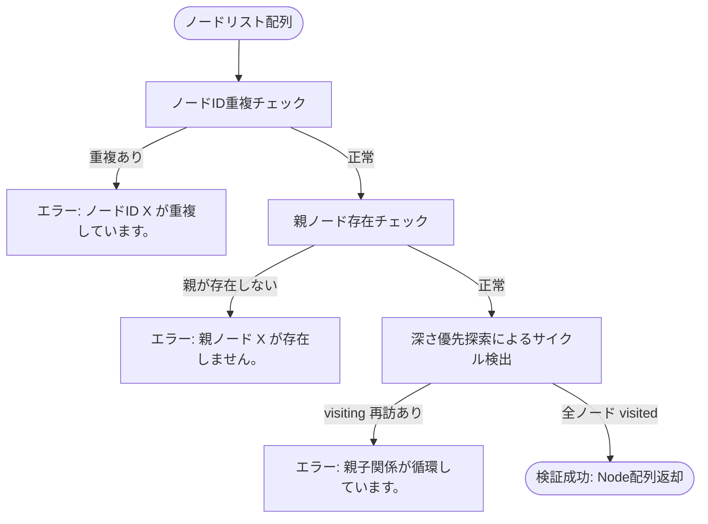
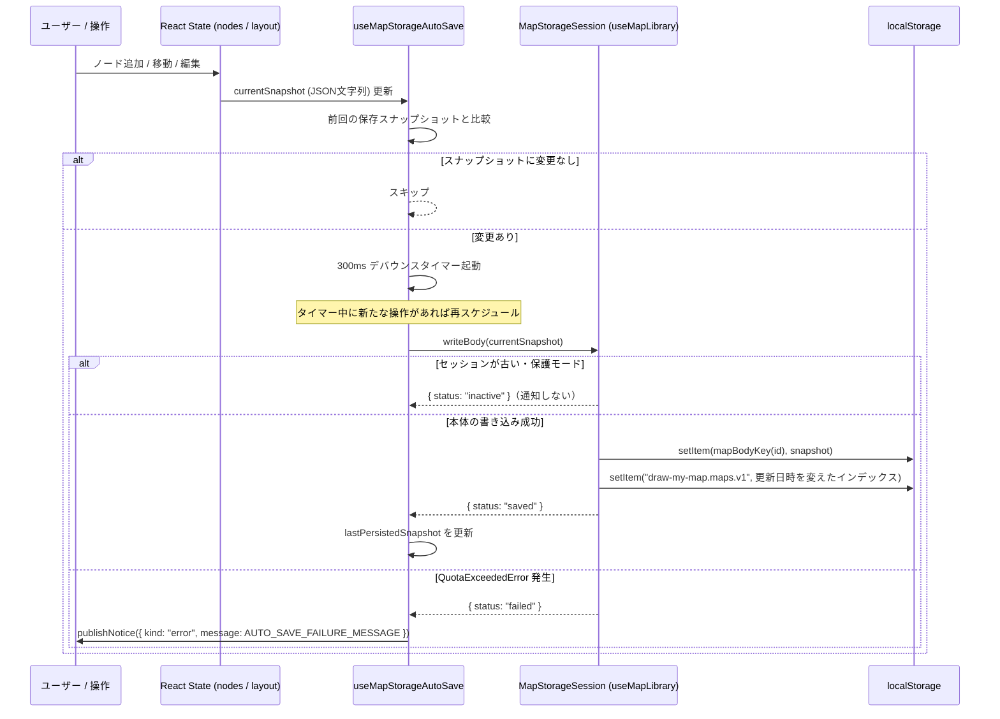

# Draw My Map データモデル・永続化仕様書

本書は、**Draw My Map** におけるデータモデル、TypeScript 型定義、JSON 永続化スキーマ（Version 1 〜 Version 3）、デコード・マイグレーション・バリデーション、枝のクリップボード形式（5.10）、箇条書きからの追加で受け渡す型（2.6。保存形式は変えない）、およびブラウザ `localStorage` 永続化アーキテクチャ（複数マップのインデックスと本体、起動時の移行。5.1〜5.9）の完全な技術仕様書です。

---

## 目次

1. [データモデル概要](#1-データモデル概要)
   - 1.1 [マインドマップのデータ構造](#11-マインドマップのデータ構造)
   - 1.2 [データモデルの設計原則](#12-データモデルの設計原則)
2. [TypeScript 型定義リファレンス](#2-typescript-型定義リファレンス)
   - 2.1 [ノード・キャンバス状態型](#21-ノードキャンバス状態型)
   - 2.2 [レイアウト・解像度フィルタリング型](#22-レイアウト解像度フィルタリング型)
   - 2.3 [永続化・ドキュメント型](#23-永続化ドキュメント型)
   - 2.4 [AI イラスト生成・通知型](#24-ai-イラスト生成通知型)
   - 2.5 [画像エクスポート型](#25-画像エクスポート型)
   - 2.6 [箇条書きからの追加の型](#26-箇条書きからの追加の型)
   - 2.7 [兄弟ノードの順序変更の型](#27-兄弟ノードの順序変更の型)
   - 2.8 [階層の上げ下げの型](#28-階層の上げ下げの型)
   - 2.9 [途中への親ノード挿入の型](#29-途中への親ノード挿入の型)
   - 2.10 [枝の移動の型](#210-枝の移動の型)
3. [MapDocument JSON スキーマ仕様](#3-mapdocument-json-スキーマ仕様)
   - 3.1 [Version 1 スキーマ（Phase 5 初期）](#31-version-1-スキーマphase-5-初期)
   - 3.2 [Version 2 スキーマ（Phase 6）](#32-version-2-スキーマphase-6)
   - 3.3 [Version 3 スキーマ（Phase 7 現行）](#33-version-3-スキーマphase-7-現行)
   - 3.4 [バージョン間差分対照表](#34-バージョン間差分対照表)
4. [デコード・マイグレーション・バリデーション仕様](#4-デコードマイグレーションバリデーション仕様)
   - 4.1 [デコード・パイプライン概要](#41-デコードパイプライン概要)
   - 4.2 [バージョンマイグレーション規則](#42-バージョンマイグレーション規則)
   - 4.3 [ノード入力値バリデーション仕様](#43-ノード入力値バリデーション仕様)
   - 4.4 [イラスト画像・Data URL バリデーション仕様](#44-イラスト画像data-url-バリデーション仕様)
   - 4.5 [グラフ構造整合性バリデーション仕様](#45-グラフ構造整合性バリデーション仕様)
   - 4.6 [エラーメッセージ一覧](#46-エラーメッセージ一覧)
5. [ブラウザ localStorage 永続化仕様](#5-ブラウザ-localstorage-永続化仕様)
   - 5.1 [ストレージキーと保存フォーマット](#51-ストレージキーと保存フォーマット)
   - 5.2 [インデックスの型と読み込み・正規化](#52-インデックスの型と読み込み正規化)
   - 5.3 [起動の分岐と移行](#53-起動の分岐と移行)
   - 5.4 [書き込み順序と途中失敗の扱い](#54-書き込み順序と途中失敗の扱い)
   - 5.5 [自動保存ライフサイクル（useMapStorageAutoSave）と flush](#55-自動保存ライフサイクルusemapstorageautosaveと-flush)
   - 5.6 [初期ロード・復元ライフサイクル（useMapStorageRestoration）](#56-初期ロード復元ライフサイクルusemapstoragerestoration)
   - 5.7 [ストレージ容量ハンドリングと防御機構](#57-ストレージ容量ハンドリングと防御機構)
   - 5.8 [JSON ファイル エクスポート／インポート仕様](#58-json-ファイル-エクスポートインポート仕様)
   - 5.9 [マップの一覧の操作通知メッセージ (OperationNotice) 一覧](#59-マップの一覧の操作通知メッセージ-operationnotice-一覧)
   - 5.10 [枝のクリップボード形式](#510-枝のクリップボード形式)
   - 5.11 [枝の移動のジャーナル](#511-枝の移動のジャーナル)

---

## 1. データモデル概要

### 1.1 マインドマップのデータ構造

Draw My Map のキャンバスデータは、**多重ツリー（フォレスト: Forest）** 構造を持つ有向グラフとしてモデル化されています。

```text
[Forest 構造の表現]

Root Node A (id: 1, parentId: null)
 ├── Child Node A1 (id: 2, parentId: 1)
 └── Child Node A2 (id: 3, parentId: 1)
      └── Leaf Node A2a (id: 4, parentId: 3)

Root Node B (id: 5, parentId: null)
 └── Child Node B1 (id: 6, parentId: 5)
```

- **フォレスト（多重ツリー）対応**:
  マインドマップ全体で単一の根（Root）を強制せず、複数の独立したルートノード（`parentId: null`）が共存できます。各ルートノードを頂点とする互いに独立したツリー群（木構造の集合）を構成します。
- **暗黙的エッジ表現（Adjacency List on Node）**:
  エッジ（親子接続線）を個別のデータエンティティ（例: Edge オブジェクト）として管理せず、子ノードが親ノードの ID を参照する `parentId: number | null` 属性によって暗黙的に表現します。
  これにより、エッジIDの管理オーバーヘッドを排除し、ノードの追加・削除に伴うエッジ同期の整合性不整合を根本から防ぎます。
- **フラットなノード配列**:
  メモリ上および永続化データにおいて、階層構造を入れ子オブジェクト（ネストされた `children: []`）ではなく、フラットな `Node[]` 配列として保持します。これにより、インデックスアクセスや特定ノードの検索・更新を `O(1)` 〜 `O(N)` でシンプルに処理できます。

### 1.2 データモデルの設計原則

1. **正規化とプロジェクション（Normalization & Projection）**:
   - 永続化されるドキュメントおよびメモリ上の状態は、厳密に必要なプロパティのみを持つ正規化された形で管理されます。
   - 未知のプロパティや余分なプロパティが注入された場合、エンコーダーおよびデコーダー（`projectMapDocumentNode`）によって確実に除外されます。
2. **不変データ（Immutable Data Flow）**:
   - ノード編集、位置移動、自動レイアウト計算、永続化処理のすべてのパイプラインにおいて、既存のノードオブジェクトを直接破壊的に変更（ミューテート）しません。
   - 常に新しいオブジェクトおよび配列を生成して状態を更新します。
3. **循環参照の完全排除（Acyclic Guarantee）**:
   - ツリー構造であるため、親子関係に閉路（サイクル）が存在してはなりません。
   - 自身を親とする自己ループ（`id === parentId`）や、子孫を親とする循環関係（`1 -> 2 -> 3 -> 1`）は、デコード時およびノード移動時に有向非巡回グラフ（DAG）検出アルゴリズムによって厳密に拒絶されます。
4. **レイアウトと幾何情報の分離**:
   - ノードの幾何座標（`x`, `y`）およびサイズ（`width`, `height`）はノード自体が保持しますが、配置方針（`layoutMode`: `"manual"` または `"auto"`）はマップドキュメント全体のグローバル状態として管理されます。
   - 自動配置モード時でも、計算されたレイアウト座標はそのまま各ノードの `x`, `y` に反映され、保存されます。
   - 箇条書きからの追加（Phase 13）は、解析の結果（`ParsedOutline`）を通常の `Node` として `nodes` の末尾に足すだけで、`Node` 型、`NodeMapState`、編集履歴、V3 の保存形式、JSON の形式に項目を足しません（2.6 節）。
   - 兄弟ノードの順序変更（Phase 14）は、`nodes` 配列の中で移動する枝の根ノード1つの位置を変える（手動配置では縦位置も変える）だけで、順序のフィールドや保存形式・JSON・編集履歴の項目を足しません（2.7 節）。
   - 階層の上げ下げ（Phase 14）は、上げ下げする枝の根ノード1つの `parentId` と `nodes` 配列内の位置を変える（手動配置では枝の座標も平行移動する）だけで、保存形式・JSON・編集履歴の項目を足しません（2.8 節）。
   - 親の挿入（Phase 14）は、新しいノードを1つ足し、T（選択中のノード）の `parentId` を変える（手動配置では T の枝を平行移動する）だけで、保存形式・JSON・編集履歴の項目を足しません（2.9 節）。新しいノードは通常の `Node` です。
   - 枝の折りたたみ（Phase 11）は画面表示専用の状態で、`NodeMapState`、編集履歴、JSON、`localStorage` に含めません。自動配置で折りたたみ中に使う表示用の座標（`displayNodes`）も保存せず、正本の `nodes` の `x`, `y` は変えません。import、自動復元、成功した Undo / Redo の後は全展開に戻ります。

---

## 2. TypeScript 型定義リファレンス

システムの中核を構成する共有型定義は `client/src/types/` 配下の全 15 ファイルに集約されています。

| ファイルパス | エクスポートされる型名 | 役割・用途 |
| :--- | :--- | :--- |
| `client/src/types/node.ts` | `Node` | マインドマップのノードエンティティ型 |
| `client/src/types/nodeImportance.ts` | `NodeImportance` | ノード重要度レベル（`"high" \| "medium" \| "low"`） |
| `client/src/types/nodeLayout.ts` | `NodeLayoutMode` | レイアウト配置モード（`"manual" \| "auto"`） |
| `client/src/types/nodeMapState.ts` | `NodeMapState` | マップ全体のインメモリ状態（`layoutMode`, `nodes`） |
| `client/src/types/nodeResolution.ts` | `ResolutionLevel`, `ResolutionFilterMode` | 解像度フィルタの表示レベルとフィルタモード |
| `client/src/types/mapDocument.ts` | `MapDocumentVersion`, `MapDocumentV1`, `MapDocumentV3`, `MapDocument`, `MapDocumentResult` | JSON 永続化ドキュメントスキーマおよび Result 型 |
| `client/src/types/illustrationGeneration.ts` | `IllustrationGenerationState` | AI イラスト生成の非同期状態マシン（判別共用体） |
| `client/src/types/operationNotice.ts` | `OperationNotice` | ヘッダー通知バーに表示する操作結果・警告・エラー通知型 |
| `client/src/types/mapImageExport.ts` | `CreateSvgExport`, `DownloadImage`, `RasterizePng` | SVG / PNG 画像エクスポート処理の依存注入用関数シグネチャ型 |
| `client/src/types/nodeSearch.ts` | `NodeSearchListItem` | ノード検索の候補（一致結果 `NodeSearchMatch` に、現在の表示で隠れているかの `hidden` を加えたもの） |
| `client/src/types/nodeFocusRequest.ts` | `NodeFocusRequest` | 検索からの中央移動要求（`nodeId`, `sequence`, `documentRevision`） |
| `client/src/types/nodeLabelEditRequest.ts` | `NodeLabelEditRequest` | 親の挿入の後のラベルの編集の開始要求（`nodeId`, `sequence`, `documentRevision`。2.9 節） |
| `client/src/types/revisionScopedNodeRequest.ts` | `RevisionScopedNodeRequest` | ノードへの要求（中央移動・ラベルの編集）の共通の形（`nodeId`, `sequence`, `documentRevision`）。発行側の `useRevisionScopedNodeRequest` と振り分け側の `classifyNodeRequest` が共有する |
| `client/src/types/mapStorageSession.ts` | `MapStorageSession`, `MapBodyWriteResult`, `MapFlushResult` | 開いているマップの本体の読み書きと flush の登録（5.5 節） |
| `client/src/types/mapLibraryDialog.ts` | `MapLibraryDialogScreen`, `OpenMapLibraryDialogScreen`, `MapLibraryRowAction`, `MapLibraryDialogFocusTarget`, `MapLibraryDialogNotices` | マップのダイアログの画面、行の操作、フォーカス先、ダイアログ内の通知 |

### 2.1 ノード・キャンバス状態型

#### `Node` (`client/src/types/node.ts`)
マインドマップ上の個々のノードを表す基本型です。

```typescript
import type { NodeImportance } from "@/types/nodeImportance";

export type Node = {
  /** ノードの一意識別子（1以上の安全な整数） */
  id: number;
  /** 親ノードのID。ルートノードの場合は null */
  parentId: number | null;
  /** キャンバス上の X 座標（左端） */
  x: number;
  /** キャンバス上の Y 座標（上端） */
  y: number;
  /** ノード矩形の幅（px） */
  width: number;
  /** ノード矩形の高さ（px）。イラスト保持時は getIllustratedNodeMinHeight により最低 116px */
  height: number;
  /** ノード内に表示されるテキストラベル */
  label: string;
  /** ノードの重要度（Phase 6 以降） */
  importance: NodeImportance;
  /**
   * 縮小済みのイラストの data URL（Phase 7 以降）。
   * イラストを持たないノードでは、プロパティ自体が存在しない（undefined）
   */
  illustration?: string;
};
```

- 兄弟とルートの順は `nodes` 配列の相対順です（同じ `parentId` を持つノード同士の、配列の中の前後）。並べ替えは根ノード1つの配列内の位置を変え、子孫の位置は変えません。順序のフィールド（`order` など）は持ちません。親子は `parentId` で表すので、子が親より前にあってもかまいません（[features.md の 14 章](./features.md#14-兄弟ノードの順序変更)）。
- `parentId` は接続（`Shift` + ドラッグ）に加えて、階層の上げ下げ（[features.md の 15 章](./features.md#15-階層の上げ下げ)）でも変わります。上げ下げは、上げ下げする枝の根 T の `parentId` と、T の根ノード1つの配列内の位置を変え、子孫の `parentId` と位置は変えません（下げて新しい親に子が無いときは T の位置も変えません）。
- `parentId` は途中への親ノード挿入（[features.md の 16 章](./features.md#16-途中への親ノード挿入)）でも変わります。挿入は、新しいノード N を T の直前の配列の位置に足し、T の `parentId` を N の ID に変えます。N の `parentId` は T の元の親（T がルートなら `null`）です。子孫の `parentId` と位置は変えません。

#### `NodeImportance` (`client/src/types/nodeImportance.ts`)
ノードの重要度を表現するユニオン型です。解像度フィルタリングの基準となります。

```typescript
export type NodeImportance = "high" | "medium" | "low";
```

#### `NodeMapState` (`client/src/types/nodeMapState.ts`)
アプリケーション内部のマップ状態を表す型です。

```typescript
import type { Node } from "@/types/node";
import type { NodeLayoutMode } from "@/types/nodeLayout";

export type NodeMapState = {
  /** レイアウト配置モード */
  layoutMode: NodeLayoutMode;
  /** マップを構成する全ノードの配列 */
  nodes: Node[];
};
```

#### 編集履歴（`client/src/domain/history/mapHistory.ts`）
`NodeMapState` を1操作ぶんのスナップショットとして、過去・現在・未来の配列でメモリ上に保持します。

- 上限は `MAP_HISTORY_LIMIT`（100操作）です。変更のないノードオブジェクトと画像文字列は履歴間で共有し、操作のたびに deep clone や JSON 化は行いません。
- 復元対象は `nodes` と `layoutMode` です。選択、パン・ズーム、表示フィルター、枝の折りたたみ、イラスト生成のプレビューは含めません。
- 履歴は保存も書き出しもしません。JSON と `localStorage` の Version 3 形式は変わりません。
- 初回の保存データ復元と JSON 読み込みの成功は新しい起点となり、過去・未来・進行中のドラッグのグループを消去します。

### 2.2 レイアウト・解像度フィルタリング型

#### `NodeLayoutMode` (`client/src/types/nodeLayout.ts`)
ノードの配置方式を指定するモードです。

```typescript
export type NodeLayoutMode = "manual" | "auto";
```
- `"manual"`: ユーザーによる自由なドラッグ配置。
- `"auto"`: 多重ツリー（フォレスト）対応の階層的水平自動レイアウトアルゴリズムによる自動配置。

#### `ResolutionLevel` / `ResolutionFilterMode` (`client/src/types/nodeResolution.ts`)
キャンバス上のノード表示閾値を指定する型です。

```typescript
export type ResolutionLevel = "high" | "medium" | "all";

export type ResolutionFilterMode = "auto" | ResolutionLevel;
```
- `ResolutionLevel`:
  - `"high"`: 重要度 `high` のノードのみ表示。
  - `"medium"`: 重要度 `high` および `medium` のノードを表示。
  - `"all"`: すべてのノード（`high`, `medium`, `low`）を表示。
- `ResolutionFilterMode`:
  - `"auto"`: キャンバスのズーム率に応じて `ResolutionLevel` を自動切り替え（ヒステリシス制御付き）。
  - `"high"` / `"medium"` / `"all"`: ユーザーによる手動固定表示。

### 2.3 永続化・ドキュメント型

#### `MapDocumentVersion` (`client/src/types/mapDocument.ts`)
保存フォーマットのスキーマバージョンを表す型です。

```typescript
export type MapDocumentVersion = 1 | 2 | 3;
```

#### `MapDocumentV1` / `MapDocumentV3` / `MapDocument` (`client/src/types/mapDocument.ts`)

```typescript
import type { NodeMapState } from "@/types/nodeMapState";
import type { Node } from "@/types/node";

/** Version 1 のノード定義（importance, illustration を持たない） */
type MapDocumentV1Node = Pick<
  Node,
  "id" | "parentId" | "x" | "y" | "width" | "height" | "label"
>;

/** Version 1 ドキュメント */
export type MapDocumentV1 = {
  version: 1;
  layoutMode: NodeMapState["layoutMode"];
  nodes: MapDocumentV1Node[];
};

/** Version 3 ドキュメント（現行フォーマット） */
export type MapDocumentV3 = NodeMapState & { version: 3 };

/** 共通ドキュメント型（最新の Version 3 と等価） */
export type MapDocument = MapDocumentV3;
```

#### `MapDocumentResult<T>` (`client/src/types/mapDocument.ts`)
パースやバリデーションの結果を表現する Result 型です。例外（throw）を使用せず、型安全な成功/失敗の分岐を提供します。

```typescript
export type MapDocumentResult<T> =
  | { ok: true; value: T }
  | { ok: false; error: string };
```

#### `MapIndexEntry` / `MapIndexV1` (`client/src/domain/mapLibrary/mapIndex.ts`)
複数マップの一覧（インデックス）の型です。`localStorage` のキー `draw-my-map.maps.v1` に JSON で保存します。型の定義と読み込み時の正規化は 5.2 節を参照してください。マップ本体（`MapDocument`）にはマップ名を含めず、名前・作成日時・更新日時はこの型だけが持ちます。

#### `MapStorageSession` / `MapBodyWriteResult` / `MapFlushResult` (`client/src/types/mapStorageSession.ts`)
エディタが開いているマップの本体を読み書きするための、マップ id とセッション番号を閉じ込めた保存先の型です。定義と照合の規則は 5.5 節を参照してください。

### 2.4 AI イラスト生成・通知型

#### `IllustrationGenerationState` (`client/src/types/illustrationGeneration.ts`)
ノードイラスト生成機能の非同期状態マシンを表す型です。

```typescript
/**
 * generating・succeeded の label は、生成開始時点のノードテキスト。
 * テキストが途中で変更されたかを検知するために保持される。
 */
export type IllustrationGenerationState =
  | { status: "idle" }
  | { status: "generating"; nodeId: number; label: string }
  | { status: "succeeded"; nodeId: number; label: string; dataUrl: string }
  | { status: "failed"; nodeId: number; message: string };
```

#### `OperationNotice` (`client/src/types/operationNotice.ts`)
自動保存失敗時や復元時の警告を UI ヘッダーのトースト通知へ伝える型です。

```typescript
export type OperationNotice = {
  kind: "status" | "warning" | "error";
  message: string;
};
```

### 2.5 画像エクスポート型

#### `CreateSvgExport` / `DownloadImage` / `RasterizePng` (`client/src/types/mapImageExport.ts`)
SVG および PNG 画像エクスポートフック（`useMapImageExport`, `useMapSvgExport`, `useMapPngExport`）とサービス層の間で共有される関数シグネチャ型です。

```typescript
import type { MapSvgDocument } from "@/domain/imageExport/mapSvgDocument";
import type { Node } from "@/types/node";

export type CreateSvgExport = (nodes: readonly Node[]) => MapSvgDocument | null;
export type DownloadImage = (blob: Blob, fileName: string) => void;
export type RasterizePng = (
  svg: string,
  width: number,
  height: number,
) => Promise<Blob>;
```
- `CreateSvgExport`: ノード配列から SVG XML 文字列と寸法（`MapSvgDocument: { svg: string; width: number; height: number }`）を生成する関数型（ノードが空の場合は `null`）。
- `DownloadImage`: 生成された画像 `Blob` を指定ファイル名でブラウザダウンロードさせる関数型。
- `RasterizePng`: SVG XML 文字列と論理幅・高さを受け取り、2倍スケールの PNG `Blob` へ非同期ラスタライズする関数型。

### 2.6 箇条書きからの追加の型

箇条書きからの追加（Phase 13。[features.md の 13 章](./features.md#13-箇条書きからの追加)）の解析と挿入で受け渡す型です。いずれもメモリ上だけで使い、保存形式（V3）・JSON・`localStorage`・編集履歴には現れません。追加したノードは通常の `Node`（重要度 `"medium"`、イラスト無し、幅100・高さ60）として保存されます。

#### `OutlineItem` / `OutlineWarning` / `ParsedOutline` / `OutlineParseError` / `OutlineParseResult` (`client/src/domain/outline/outlineParser.ts`)
`parseOutlineText(text: string): OutlineParseResult` の結果の型です。成功と失敗を判別共用体で返し、呼び出し元（`useOutlineImport`）は成功したときだけプレビューへ進みます。

```typescript
export type OutlineItem = {
  label: string; // 記号・前後の空白を除き、制御文字を半角空白にした値。空でない
  depth: number; // 0 が一番上の階層。直前の項目の depth + 1 以下
  parentIndex: number | null; // items の添字（自分より前）。depth 0 は null
  lineNumber: number; // 1 始まりの入力の行番号
};

export type OutlineWarningKind =
  | "depth-adjusted"
  | "empty-label"
  | "long-label";

export type OutlineWarning = {
  kind: OutlineWarningKind;
  count: number; // 1 以上
  lineNumbers: number[]; // 先頭の OUTLINE_WARNING_LINE_NUMBER_LIMIT 件まで（昇順）
};

export type ParsedOutline = {
  items: OutlineItem[]; // 入力の順（先行順）。1件以上 OUTLINE_MAX_ITEMS 件以下
  rootCount: number; // depth 0 の件数
  maxDepth: number; // depth の最大値
  warnings: OutlineWarning[]; // count が1以上のものだけ。種類の順は固定
};

export type OutlineParseError =
  | { kind: "too-long"; length: number }
  | { kind: "too-many-lines"; lines: number }
  | { kind: "no-items" };

export type OutlineParseResult =
  | { ok: true; outline: ParsedOutline }
  | { ok: false; error: OutlineParseError };
```
- `OUTLINE_WARNING_LINE_NUMBER_LIMIT`（5）は `outlineParser.ts` に、`OUTLINE_MAX_ITEMS`（10,000）は `outlineLimits.ts` に定義しています。文字数の上限 `OUTLINE_MAX_TEXT_LENGTH`（1,000,000。UTF-16 コード単位）を超えると `too-long`、空行でない行が 10,000 を超えると `too-many-lines`、取り込める行が無いと `no-items` になります。
- `items` は先行順で、親は常に自分より前にあります。プレビュー用の木（`buildOutlinePreview`、`client/src/domain/outline/outlinePreview.ts`）は、この並びの先頭の最大200件から作ります。

#### `ForestItem` / `ForestInsertionTarget` / `ForestInsertionResult` (`client/src/domain/nodes/nodeForestInsertion.ts`)
`insertNodeForest(current, items, target, mode, allocateIds): ForestInsertionResult` の引数と結果の型です。`domain/nodes` は `domain/outline` を参照せず、`OutlineItem` は `ForestItem` の形を満たすので、`useOutlineImport` が `ParsedOutline.items` をそのまま渡します。

```typescript
export type ForestItem = { label: string; parentIndex: number | null }; // parentIndex は自分より前の添字

export type ForestInsertionTarget =
  | { kind: "root" }
  | { kind: "child"; parentId: number };

export type ForestInsertionFailureReason = "parent-missing" | "invalid-items" | "placement-failed";

export type ForestInsertionResult =
  | { ok: true; nodes: Node[]; rootIds: number[] } // rootIds は深さ0の項目の新しい ID（入力の順）
  | { ok: false; reason: ForestInsertionFailureReason };
```
- 成功時の `nodes` は、`current` を変えずに、その後ろへ `items` の順で新しいノードを足した配列です。ID は検査（項目の形、親の存在、座標）をすべて済ませた後に `allocateIds` を1回だけ呼んで採番します。
- `useNodes.insertForest(items, target)` は、これを `applyTreeChange` の1回の commit の中で呼び、`InsertForestResult`（`{ ok: true; rootId: number; count: number } | { ok: false; reason: ForestInsertionFailureReason }`。`client/src/hooks/useNodes.ts`）を返します。自動配置での全体の再配置に失敗したときは `placement-failed` です。

### 2.7 兄弟ノードの順序変更の型

兄弟ノードの順序変更（Phase 14。[features.md の 14 章](./features.md#14-兄弟ノードの順序変更)）で受け渡す型です。定義元はすべて `client/src/domain/nodes/nodeSiblingOrder.ts` です。いずれもメモリ上だけで使い、保存形式（V3）・JSON・`localStorage`・編集履歴には現れません。

#### `SiblingReorderDirection` / `SiblingReorderTarget` / `SiblingReorderRequest` (`client/src/domain/nodes/nodeSiblingOrder.ts`)

```typescript
export type SiblingReorderDirection = "up" | "down";

// anchorId は、移動するノード T と同じ親を持つ「見えている」兄弟。
// "before": T を anchor の直前へ移す（anchor は T より前）。"after": T を anchor の直後へ移す（anchor は T より後ろ）
export type SiblingReorderTarget = {
  position: "before" | "after";
  anchorId: number;
};

export type SiblingReorderRequest =
  | { kind: "step"; direction: SiblingReorderDirection } // ショートカット・ボタン
  | { kind: "drop"; target: SiblingReorderTarget }; // ドラッグ
```
- 対象と挿入先は ID で指定し、配列の添字は受け渡しません。`step` は、`useNodes.reorderSibling` が `applyTreeChange` のコールバックの中で呼ぶ `reorderSiblingByRequest` が、最新のノード配列から `findSiblingReorderTarget` で挿入先へ解決します。

#### `SiblingReorderResult` (`client/src/domain/nodes/nodeSiblingOrder.ts`)
`reorderSiblingNodes(nodes, nodeId, target, visibleNodeIds, mode): SiblingReorderResult` の結果の型です。

```typescript
export type SiblingReorderFailureReason =
  | "node-missing" // T が無い
  | "node-hidden" // T が見えていない
  | "invalid-target" // anchor が無い・見えていない・兄弟でない・T 自身・向きが合わない・枝が重複している
  | "placement-failed"; // reorderSiblingNodes では手動配置の座標の計算の失敗（有限でない・桁落ち）。useNodes.reorderSibling ではそれに加えて自動配置の失敗も含む

export type SiblingReorderResult =
  | {
    ok: true;
    nodes: Node[];
    direction: SiblingReorderDirection; // "before" なら "up"、"after" なら "down"
    visibleIndex: number; // 移動後の、見えている兄弟の中での位置（0始まり）
    visibleCount: number; // 見えている兄弟の数（T を含む）
    isRoot: boolean;
  }
  | { ok: false; reason: SiblingReorderFailureReason };
```
- 成功時の `nodes` は、`nodes` を1回走査して作った新しい配列です。座標を変えないノードは同じオブジェクトのままです。手動配置では `swapSiblingBranchPositions`（`client/src/domain/nodes/nodeSiblingSwapPlacement.ts`）で2つの組の `y` を平行移動し、自動配置では先頭のルートが変わるときだけ旧先頭の `x` / `y` を新しい先頭へ引き継ぎます。

#### `ReorderSiblingResult` (`client/src/domain/nodes/nodeSiblingOrder.ts`)
`useNodes.reorderSibling(nodeId, request, visibleNodeIds): ReorderSiblingResult` の戻り値の型です。domain の `formatSiblingReorderNotice` からも参照するため、`hooks/useNodes.ts` ではなく domain に置きます。

```typescript
export type ReorderSiblingResult =
  | {
    ok: true;
    direction: SiblingReorderDirection;
    visibleIndex: number;
    visibleCount: number;
    isRoot: boolean;
  }
  | {
    ok: false;
    reason: "at-edge";
    direction: SiblingReorderDirection;
    hiddenBeyond: boolean; // その向きに隠れた兄弟が1つ以上ある
    isRoot: boolean;
  }
  | { ok: false; reason: SiblingReorderFailureReason };
```
- `applyTreeChange` を1回だけ呼びます。成功したときだけ1回の commit になり、選択と `documentRevision` は変えません。端と失敗ではノード・選択・履歴・「やり直す」を変えません。自動配置の `layoutNodeForest` が失敗したときは `placement-failed` です。

### 2.8 階層の上げ下げの型

階層の上げ下げ（Phase 14。[features.md の 15 章](./features.md#15-階層の上げ下げ)）で受け渡す型です。定義元はすべて `client/src/domain/nodes/nodeIndent.ts` です。いずれもメモリ上だけで使い、保存形式（V3）・JSON・`localStorage`・編集履歴には現れません。`useNodes.changeNodeIndent` の戻り値の型も、domain の `formatNodeIndentNotice`（`client/src/domain/nodes/nodeIndentMessages.ts`）から参照するため、`hooks/useNodes.ts` ではなく domain に置きます。

#### `NodeIndentDirection` / `NodeIndentAvailability` (`client/src/domain/nodes/nodeIndent.ts`)

```typescript
export type NodeIndentDirection = "indent" | "outdent"; // indent = 階層を下げる、outdent = 階層を上げる

export type NodeIndentAvailability = { indent: boolean; outdent: boolean };
```
- `getNodeIndentAvailability(nodes, nodeId, visibleNodeIds): NodeIndentAvailability` が、ヘッダーのボタンの有効・無効を返します。未選択（`nodeId` が `null`）・対象が無い・見えていないときは両方 `false`、それ以外は `indent` が「見えている直前の兄弟があるか」、`outdent` が「ルートでないか」です。座標の失敗や不正なデータはここでは予測しません。

#### `NodeIndentFailureReason` / `NodeIndentResult` (`client/src/domain/nodes/nodeIndent.ts`)
`changeNodeIndent(nodes, nodeId, direction, visibleNodeIds, mode): NodeIndentResult` の結果の型です。

```typescript
export type NodeIndentFailureReason =
  | "node-missing" // T が無い
  | "node-hidden" // T が見えていない
  | "invalid-structure" // 不正なデータ。下げるとき新しい親が T の子孫か、新しい親の祖先の鎖に循環がある。上げるとき親または祖父母が配列に無い。移した後の T の祖先の鎖が途切れる・循環している（深さが求められない）
  | "placement-failed"; // 手動配置の座標が有限でない・桁落ちする・間隔が取れない。useNodes.changeNodeIndent ではそれに加えて自動配置の失敗も含む

type NodeIndentSuccess = {
  ok: true;
  direction: NodeIndentDirection;
  newParentId: number | null; // 上げてルートになったら null
  newParentLabel: string | null; // 新しい親の label（生の値。空文字もそのまま）。ルートなら null
  depth: number; // 移した後の T の深さ。ルートが 1
};

type NodeIndentAtEdge =
  | { ok: false; reason: "at-edge"; direction: "indent"; hiddenBeyond: boolean; isRoot: boolean }
  | { ok: false; reason: "at-edge"; direction: "outdent" }; // 上げられないのはルートだけ

export type NodeIndentResult =
  | (NodeIndentSuccess & { nodes: Node[] })
  | NodeIndentAtEdge
  | { ok: false; reason: NodeIndentFailureReason };
```
- 下げる `at-edge` の `hiddenBeyond` は、T より前に隠れた兄弟が1つ以上あるとき `true`、`isRoot` は T がルートのとき `true` です。
- 成功時の `nodes` は、`nodes` を1回走査して作った新しい配列です。T 以外のノードは、座標を変えなければ同じオブジェクトのままです。手動配置では `calculateIndentTranslation` / `calculateOutdentTranslation` と `translateBranch`（`client/src/domain/nodes/nodeIndentPlacement.ts`）で T の枝を平行移動し、自動配置では座標を変えません（呼び出し元の `applyTreeChange` が `layoutNodeForest` で配置し直します）。
- `NodeIndentSuccess` と `NodeIndentAtEdge` は export しない内部の型で、`NodeIndentResult` と `ChangeNodeIndentResult` の部品です。

#### `ChangeNodeIndentResult` (`client/src/domain/nodes/nodeIndent.ts`)
`useNodes.changeNodeIndent(nodeId, direction, visibleNodeIds): ChangeNodeIndentResult` の戻り値の型です。

```typescript
export type ChangeNodeIndentResult =
  | NodeIndentSuccess
  | NodeIndentAtEdge
  | { ok: false; reason: NodeIndentFailureReason };
```
- `applyTreeChange` を1回だけ呼び、新しい親はそのコールバックの中で最新のノード配列から解決します。成功したときだけ1回の commit になり、選択と `documentRevision` は変えません。端と失敗ではノード・選択・履歴・「やり直す」を変えません。自動配置の `layoutNodeForest` が失敗したときは `placement-failed` です。
- 下げたときの新しい親の展開は、この型を受け取った `useNodeIndentAction` が、成功した下げのときだけ `expandNodes([newParentId])` で行います。

### 2.9 途中への親ノード挿入の型

途中への親ノード挿入（Phase 14。[features.md の 16 章](./features.md#16-途中への親ノード挿入)）で受け渡す型です。いずれもメモリ上だけで使い、保存形式（V3）・JSON・`localStorage`・編集履歴には現れません。`useNodes.insertParentNode` の戻り値の型 `InsertParentNodeResult` も、挿入の型を1か所にまとめるため `hooks/useNodes.ts` ではなく domain に置き、`hooks/useNodes.ts` から再 export しません。`useNodes` と `useNodeParentInsertionAction` はどちらも domain から import します。domain の `formatNodeParentInsertionFailureNotice`（`client/src/domain/nodes/nodeParentInsertionMessages.ts`）は `NodeParentInsertionFailureReason` だけを参照し、hooks を import しません。

#### `NodeParentInsertionFailureReason` / `NodeParentInsertionResult` (`client/src/domain/nodes/nodeParentInsertion.ts`)
`insertParentNode(nodes, nodeId, newNodeId, visibleNodeIds, mode): NodeParentInsertionResult` の結果の型です。

```typescript
export type NodeParentInsertionFailureReason =
  | "node-missing" // T が無い
  | "node-hidden" // T が見えていない
  | "invalid-structure" // T の親が配列に無い、T が自分自身を親にしている
  | "id-conflict" // 渡された新しい ID が既存のノードと重なる
  | "placement-failed"; // 手動配置の座標が有限でない・桁落ちする・間隔が取れない。useNodes.insertParentNode ではそれに加えて自動配置の失敗も含む

export type NodeParentInsertionResult =
  | { ok: true; nodes: Node[]; insertedId: number }
  | { ok: false; reason: NodeParentInsertionFailureReason };
```
- 検査はこの順で行い、最初に当たった理由を返します。端（`at-edge`）はありません（見えているノードなら、ルートを含めて必ず親を入れられます）。
- 成功時の `nodes` は、`nodes` を1回走査して作った新しい配列です。新しいノード N（`createParentNode(T, newNodeId)`。`client/src/domain/nodes/nodePlacement.ts`）を T の直前に積み、T を `parentId: newNodeId` に置き換えます。T 以外のノード（子孫を含む）は同じオブジェクトのままです。手動配置では `calculateIndentTranslation` と `translateBranch`（`client/src/domain/nodes/nodeIndentPlacement.ts`）で T の枝を平行移動し、自動配置では座標を変えません（呼び出し元の `applyTreeChange` が `layoutNodeForest` で配置し直します）。
- ヘッダーのボタンの有効・無効は `canInsertParentNode(nodes, nodeId, visibleNodeIds): boolean` が返します。未選択（`nodeId` が `null`）・見えていない・対象が無いときは `false` です。座標の失敗や不正なデータはここでは予測しません。

#### `InsertParentNodeResult` (`client/src/domain/nodes/nodeParentInsertion.ts`)
`useNodes.insertParentNode(nodeId, visibleNodeIds): InsertParentNodeResult` の戻り値の型です。

```typescript
export type InsertParentNodeResult =
  | { ok: true; insertedId: number }
  | { ok: false; reason: NodeParentInsertionFailureReason };
```
- `applyTreeChange` を1回だけ呼び、T と新しい ID（`nodeIdAllocator.nextAvailableId`）はそのコールバックの中で最新のノード配列から解決・採番します。成功したときだけ1回の commit になり、N を選択します。`documentRevision` は変えません。失敗ではノード・選択・履歴・「やり直す」を変えません。自動配置の `layoutNodeForest` が失敗したときは `placement-failed` です。
- この型を受け取った `useNodeParentInsertionAction` が、成功したときだけ通知の枠を空にし（`clearNotice`）、ラベルの編集の要求を出します。失敗したときだけ `formatNodeParentInsertionFailureNotice(reason)`（理由によらず `{ kind: "error", message: "親ノードを挿入できませんでした。" }`）を通知します。

#### `NodeLabelEditRequest` (`client/src/types/nodeLabelEditRequest.ts`)
親の挿入の後に、`MapEditor` から `MapStage` へラベルの編集の開始を頼む要求です。検索の `NodeFocusRequest` と同じ形です。

```typescript
export type NodeLabelEditRequest = {
  nodeId: number;
  sequence: number;
  documentRevision: number;
};
```
- `useNodeParentInsertionAction` が、挿入が成功するたびに `sequence` を1増やして作ります。要求の `documentRevision` が今の値と等しいときだけ `labelEditRequest` として返し、違えば `null` を返します（成功した Undo / Redo・マップの置き換えの後に古い要求で編集を始めない）。
- `MapStage` の `useNodeLabelEditRequest` が受け取り、まだ処理していない `sequence` で、`documentRevision` が一致し、ノードがあるときだけ `startEditing(nodeId, "")` を1回呼びます。保存・書き出しの対象ではありません。

### 2.10 枝の移動の型

枝の切り取り・移動（Phase 14。[features.md の 17 章](./features.md#17-枝の切り取り移動)）で受け渡す型です。保存形式（V3）と JSON は変えません。別マップへの移動の間だけ使うジャーナルは 5.11 節を参照してください。

#### `BranchMoveFailureReason` / `BranchMoveResult` / `BranchTransferResult` (`client/src/domain/nodes/nodeBranchMove.ts`)
`moveNodeBranch(nodes, rootId, parentId, mode): BranchMoveResult`（同一マップ）と `transferNodeBranch(source, target, rootId, allocateIds): BranchTransferResult`（別マップ）の結果の型です。

```typescript
export type BranchMoveFailureReason =
  | "missing-node"
  | "invalid-parent"
  | "same-parent"
  | "placement-failed";

export type BranchMoveResult =
  | { ok: true; nodes: Node[]; rootId: number }
  | { ok: false; reason: BranchMoveFailureReason };

export type BranchTransferResult =
  | { ok: true; source: NodeMapState; target: NodeMapState; rootId: number }
  | { ok: false; reason: BranchMoveFailureReason };
```

#### `MoveBranchResult` (`client/src/hooks/useNodes.ts`)
`useNodes.moveBranch(rootId, parentId)` の戻り値です。

```typescript
export type MoveBranchResult =
  | { ok: true; rootId: number }
  | { ok: false; reason: BranchMoveFailureReason };
```

#### `BranchMoveMapTarget` (`client/src/hooks/branchMoveDialogState.ts`)
ダイアログの移動先の選択肢です。`MapIndexEntry` はこの形を満たすので、`Home` は `view.maps` をそのまま渡します。`updatedAt` は同じ名前のマップを見分ける表示に使います。

```typescript
export type BranchMoveMapTarget = Pick<MapIndexEntry, "id" | "name" | "updatedAt">;
```

#### `MapLibraryOperationResult` の `enteredProtectedMode` (`client/src/hooks/mapLibraryState.ts`)
操作の失敗で保護モードへ移ったことを示す値です。編集画面が作り直されてダイアログのエラー表示が消えるので、`useMapLibraryDialogState` はこの値を見てシェルの通知へ出し、フォーカスをヘッダーの「JSON書き出し」へ移します。

```typescript
export type MapLibraryOperationResult =
  | {
      ok: true;
      remounted: boolean;
      notice: OperationNotice | null;
      saveRetryNotice: OperationNotice | null;
    }
  | { ok: false; notice: OperationNotice; enteredProtectedMode?: true };
```

---

## 3. MapDocument JSON スキーマ仕様

### 3.1 Version 1 スキーマ（Phase 5 初期）

Phase 5 の初期実装で策定された基本フォーマットです。ノードの基本幾何情報とラベル、ツリー構造のみを記録します。

#### JSON サンプル (Version 1)
```json
{
  "version": 1,
  "layoutMode": "manual",
  "nodes": [
    {
      "id": 1,
      "parentId": null,
      "x": 0,
      "y": 0,
      "width": 160,
      "height": 64,
      "label": "プロジェクト構想"
    },
    {
      "id": 2,
      "parentId": 1,
      "x": 240,
      "y": -50,
      "width": 160,
      "height": 64,
      "label": "要件定義"
    }
  ]
}
```

#### プロパティ仕様 (Version 1)
| プロパティ名 | 型 | 必須 | 制約・解説 |
| :--- | :--- | :---: | :--- |
| `version` | `1` (数値) | ○ | 必ず数値の `1` |
| `layoutMode` | `string` | ○ | `"manual"` または `"auto"` |
| `nodes` | `Array<object>` | ○ | ノードオブジェクトの配列 |
| `nodes[].id` | `number` | ○ | 1 以上の安全な整数 |
| `nodes[].parentId` | `number \| null` | ○ | `null` または 1 以上の安全な整数 |
| `nodes[].x` | `number` | ○ | 有限の数値 (`Number.isFinite`) |
| `nodes[].y` | `number` | ○ | 有限の数値 (`Number.isFinite`) |
| `nodes[].width` | `number` | ○ | 0 より大きい有限の数値 |
| `nodes[].height` | `number` | ○ | 0 より大きい有限の数値 |
| `nodes[].label` | `string` | ○ | ノード文字列 |

---

### 3.2 Version 2 スキーマ（Phase 6）

Phase 6 で追加された解像度フィルタリング（ズーム連動表示切り替え）に対応し、各ノードに `importance` プロパティが追加されました。

#### JSON サンプル (Version 2)
```json
{
  "version": 2,
  "layoutMode": "auto",
  "nodes": [
    {
      "id": 1,
      "parentId": null,
      "x": 0,
      "y": 0,
      "width": 160,
      "height": 64,
      "label": "プロジェクト構想",
      "importance": "high"
    },
    {
      "id": 2,
      "parentId": 1,
      "x": 240,
      "y": -50,
      "width": 160,
      "height": 64,
      "label": "要件定義",
      "importance": "medium"
    },
    {
      "id": 3,
      "parentId": 2,
      "x": 480,
      "y": -50,
      "width": 160,
      "height": 64,
      "label": "細部仕様メモ",
      "importance": "low"
    }
  ]
}
```

#### プロパティ仕様 (Version 2 追加項目)
| プロパティ名 | 型 | 必須 | 制約・解説 |
| :--- | :--- | :---: | :--- |
| `version` | `2` (数値) | ○ | 必ず数値の `2` |
| `nodes[].importance` | `string` | ○ | `"high"`, `"medium"`, `"low"` のいずれか（必須） |

---

### 3.3 Version 3 スキーマ（Phase 7 現行）

Phase 7（現行バージョン）で策定されたスキーマです。AI イラスト生成機能で作成されたサムネイル画像をノードに埋め込む `illustration` プロパティ（オプショナル）が追加されました。

#### JSON サンプル (Version 3)
```json
{
  "version": 3,
  "layoutMode": "manual",
  "nodes": [
    {
      "id": 1,
      "parentId": null,
      "x": 0,
      "y": 0,
      "width": 160,
      "height": 116,
      "label": "未来都市構想",
      "importance": "high",
      "illustration": "data:image/jpeg;base64,/9j/4AAQSkZJRgABAQEASABIAAD/2wBDAP//////////////////////////////////////////////////////////////////////////////////////wgALCAEAAQEBREA/8QAFBABAAAAAAAAAAAAAAAAAAAAAP/aAAgBAQABPxA="
    },
    {
      "id": 2,
      "parentId": 1,
      "x": 240,
      "y": 0,
      "width": 160,
      "height": 64,
      "label": "スマート交通網",
      "importance": "medium"
    }
  ]
}
```

#### プロパティ仕様 (Version 3 追加項目)
| プロパティ名 | 型 | 必須 | 制約・解説 |
| :--- | :--- | :---: | :--- |
| `version` | `3` (数値) | ○ | 必ず数値の `3` |
| `nodes[].height` | `number` | ○ | `illustration` を持つノードは最低 116px (`ILLUSTRATED_NODE_HEIGHT`) |
| `nodes[].illustration` | `string` | △ (任意) | 縮小 JPEG の Data URL。イラストが無い場合は **キー自体を含めない** |

---

### 3.4 バージョン間差分対照表

| 項目 | Version 1 | Version 2 | Version 3 (現行) |
| :--- | :--- | :--- | :--- |
| **策定フェーズ** | Phase 5 | Phase 6 | Phase 7 |
| **`version` 値** | `1` | `2` | `3` |
| **`nodes[].importance`** | 未対応（読込時 `"medium"` 補完） | **必須** (`"high" \| "medium" \| "low"`) | **必須** (`"high" \| "medium" \| "low"`) |
| **`nodes[].illustration`**| 未対応（存在しても破棄） | 未対応（存在しても破棄） | **対応** (JPEG Data URL、省略可能) |
| **最小ノード高制約** | 0 超の有限数値 | 0 超の有限数値 | イラスト有りの場合 最低 116px |
| **保存時出力形式** | — | — | **常に Version 3 形式で出力** |

---

## 4. デコード・マイグレーション・バリデーション仕様

ドキュメントの解析および検証ロジックは `client/src/domain/persistence/` 配下に隔離され、完全なテストカバレッジによって保護されています。

```text
[デコード・バリデーション パイプライン]

入力 JSON 文字列
      │
      ▼
 1. JSON.parse (構文解析) ─────────── 構文不正 ───► エラー: "JSONを解析できませんでした。"
      │ 正常
      ▼
 2. トップレベル構造検証 ──────────── 形式不正 ───► エラー: "マップデータの形式が不正です。"
    (version: 1|2|3, layoutMode)      未対応version ─► エラー: "未対応のマップ形式です。"
      │ 正常
      ▼
 3. ノード個別正規化 (ループ)
    ├─ 基本型検証 (id, parentId, x, y, width, height, label)
    ├─ importance マイグレーション & 検証
    └─ illustration マイグレーション & 検証
      │ 不正あり ──────────────────────────────► エラー: "node[i].xxxは..."
      ▼ 全ノード正常
 4. グラフ構造整合性検証 (validateMapDocumentGraph)
    ├─ ID 重複検出
    ├─ 親ノード存在検証
    └─ 循環参照 (サイクル) / 自己ループ検出
      │ 不正あり ──────────────────────────────► エラー: "親子関係が循環しています。" 等
      ▼ 正常
 Version 3 ドキュメント オブジェクト (ok: true)
```

### 4.1 デコード・パイプライン概要

`client/src/domain/persistence/mapDocumentDecoder.ts` の `parseMapDocumentJsonWithVersion` 関数がエントリポイントとなります。

```typescript
export function parseMapDocumentJsonWithVersion(
  json: string,
): MapDocumentResult<{ document: MapDocumentV3; sourceVersion: MapDocumentVersion }>
```

- 入力文字列を `JSON.parse` し、オブジェクトであること、`version` が `1`, `2`, `3` のいずれかであること、`layoutMode` が `"manual"` または `"auto"` であること、`nodes` が配列であることを検証します。
- 各ノードを `normalizeMapDocumentNode` に渡し、マイグレーションと正規化を適用します。
- 全ノードが正規化された後、`validateMapDocumentGraph` でグラフ全体の構造的整合性を検証します。
- 成功時は、入力が Version 1 や 2 であっても、**常に最新の `MapDocumentV3` 形式へ自動アップグレード** されて返却されます（元のバージョンは `sourceVersion` として返されます）。

### 4.2 バージョンマイグレーション規則

| 入力バージョン | `importance` の処理 | `illustration` の処理 | 出力バージョン |
| :--- | :--- | :--- | :--- |
| **Version 1** | デフォルト値 `"medium"`（`DEFAULT_NODE_IMPORTANCE`）を自動補完。もし入力中に `importance` フィールドが存在しても無視・上書きされる。 | 存在しても完全に無視され、`undefined`（項目なし）へ正規化される。 | **Version 3** |
| **Version 2** | 入力値の検証を厳格に実施（`"high"`, `"medium"`, `"low"` 以外はエラー）。 | 存在しても完全に無視され、`undefined`（項目なし）へ正規化される。 | **Version 3** |
| **Version 3** | 入力値の検証を厳格に実施。 | Data URL 形式および画像サイズの厳格な検証を実施し、適合すれば保持。 | **Version 3** |

### 4.3 ノード入力値バリデーション仕様

`client/src/domain/persistence/mapDocumentNode.ts` において、各ノードのフィールドは以下の条件で検証されます。違反した場合は `node[${index}].${field}は...` の形式でエラーが返されます。

1. **オブジェクト型チェック**:
   - `typeof value !== "object" || value === null || Array.isArray(value)` の場合:
     `"node[${index}]はオブジェクトである必要があります。"`
2. **`id`**:
   - 条件: `Number.isSafeInteger(id) && id > 0`
   - エラー: `"node[${index}].idは1以上の安全な整数である必要があります。"`
3. **`parentId`**:
   - 条件: `parentId === null || (Number.isSafeInteger(parentId) && parentId > 0)`
   - エラー: `"node[${index}].parentIdはnullまたは1以上の安全な整数である必要があります。"`（`0` や負数、小数はエラー）
4. **`x`, `y`**:
   - 条件: `typeof val === "number" && Number.isFinite(val)`
   - エラー: `"node[${index}].xは有限の数値である必要があります。"` / `"node[${index}].yは有限の数値である必要があります。"`
5. **`width`**:
   - 条件: `typeof width === "number" && Number.isFinite(width) && width > 0`
   - エラー: `"node[${index}].widthは0より大きい有限の数値である必要があります。"`
6. **`height`**:
   - 条件: `typeof height === "number" && Number.isFinite(height) && height > 0`
   - エラー: `"node[${index}].heightは0より大きい有限の数値である必要があります。"`
   - **自動補正**: イラストが有効なノードの場合、`getIllustratedNodeMinHeight(height)` により、`Math.max(height, 116)` に引き上げられます。
7. **`label`**:
   - 条件: `typeof label === "string"`
   - エラー: `"node[${index}].labelは文字列である必要があります。"`
8. **`importance`**:
   - Version 2 および 3 で検証:
     `importance === "high" || importance === "medium" || importance === "low"`
   - エラー: `"node[${index}].importanceはhigh、medium、lowのいずれかである必要があります。"`

### 4.4 イラスト画像・Data URL バリデーション仕様

`client/src/domain/persistence/mapDocumentNodeIllustration.ts`、`client/src/domain/illustration/illustrationDataUrl.ts`、および `client/src/domain/illustration/jpegDimensions.ts` で実装されています。

不正なイラストが指定された場合のエラー:
`"node[${index}].illustrationは、画像のdata URLである必要があります。"`

#### 検証ルール:
1. **正規表現および文字長制限 (`isIllustrationDataUrl`)**:
   - パターン: `/^data:image\/jpeg;base64,[A-Za-z0-9+/]+={0,2}$/`
   - **JPEG 形式のみ許可**: SVG（XSS スクリプト混入リスク）や PNG は拒否。
   - **文字長制限**: 文字列長が `100_000` 文字（`MAX_ILLUSTRATION_DATA_URL_LENGTH`）以下であること。localStorage 容量（約 5MB）の圧迫を防ぎます。
2. **JPEG バイナリ寸法制限 (`isAcceptableIllustrationSize`)**:
   - 巨大画像を仕込んでデコード時にブラウザがメモリ不足（OOM）でクラッシュする攻撃を防ぐため、**画像をデコードせずにバイナリ解析（SOF マーカー）** します。
   - `getJpegDimensions` により、SOF0〜SOF15（Start of Frame）マーカーからヘッダの幅・高さを読み取ります。
   - 条件: `1 <= width <= 512` かつ `1 <= height <= 512` (`MAX_ILLUSTRATION_IMAGE_DIMENSION = 512`)。

### 4.5 グラフ構造整合性バリデーション仕様

`client/src/domain/persistence/mapDocumentGraph.ts` の `validateMapDocumentGraph` 関数が担当します。



1. **ノード ID 重複チェック**:
   - `nodesById = new Map<number, Node>()` に登録しながら探索。
   - 既に登録済みの ID が現れた場合:
     `"ノードID ${current.id} が重複しています。"`
2. **親ノード（`parentId`）存在チェック**:
   - `current.parentId !== null` かつ `!nodesById.has(current.parentId)` の場合:
     `"親ノード ${current.parentId} が存在しません。"`
     （ツリーから切り離された不正な親参照を検出）
3. **循環参照（サイクル）検出アルゴリズム**:
   - 各ノードを起点として、親ノードをルート方向へ遡るトラバーサルを実行。
   - 訪問状態を `"visiting"`（現在探索中パス）と `"visited"`（探索完了済みパス）の 2 状態で管理。
   - トラバーサル中に現在 `"visiting"` 状態のノードに再度到達した場合、閉路（サイクル）が存在すると判定:
     `"親子関係が循環しています。"`
   - **検出可能な不正例**:
     - 自己ループ: `node.parentId === node.id`
     - 相互参照ループ: `nodeA.parentId = nodeB` かつ `nodeB.parentId = nodeA`
     - 長大な間接ループ: `A -> B -> C -> A`
     - ルートノードを持たない閉じたループ
   - **スケーラビリティ**: 再帰関数ではなく `while` ループによる非再帰探索を行っているため、10,000 ノード規模のチェーン構造でもコールスタック制限（RangeError: Maximum call stack size exceeded）に達することなく高速に検証可能です。

### 4.6 エラーメッセージ一覧

| 対象 | エラーメッセージ文字列 | 発生契機 |
| :--- | :--- | :--- |
| **JSON** | `JSONを解析できませんでした。` | `JSON.parse` 例外 |
| **ルート構造** | `マップデータの形式が不正です。` | ルートがオブジェクトでない、`null`、配列 |
| **ルート構造** | `未対応のマップ形式です。` | `version` が `1`, `2`, `3` 以外 |
| **ルート構造** | `レイアウトモードが不正です。` | `layoutMode` が `"manual"`, `"auto"` 以外 |
| **ルート構造** | `ノード一覧が不正です。` | `nodes` が配列でない |
| **ノード単体** | `node[${i}]はオブジェクトである必要があります。` | ノード要素がオブジェクトでない |
| **ノード単体** | `node[${i}].idは1以上の安全な整数である必要があります。` | `id` が 0 以下、小数、非数値、安全外整数 |
| **ノード単体** | `node[${i}].parentIdはnullまたは1以上の安全な整数である必要があります。` | `parentId` が 0、負数、小数、非数値 |
| **ノード単体** | `node[${i}].xは有限の数値である必要があります。` | `x` が NaN、無限大、非数値 |
| **ノード単体** | `node[${i}].yは有限の数値である必要があります。` | `y` が NaN、無限大、非数値 |
| **ノード単体** | `node[${i}].widthは0より大きい有限の数値である必要があります。` | `width` が 0 以下、NaN、無限大 |
| **ノード単体** | `node[${i}].heightは0より大きい有限の数値である必要があります。` | `height` が 0 以下、NaN、無限大 |
| **ノード単体** | `node[${i}].labelは文字列である必要があります。` | `label` が文字列でない |
| **ノード単体** | `node[${i}].importanceはhigh、medium、lowのいずれかである必要があります。` | V2/V3 で重要度値が不正 |
| **ノード単体** | `node[${i}].illustrationは、画像のdata URLである必要があります。` | V3 で Data URL 形式違反、10万文字超過、512px超過 |
| **グラフ整合性**| `ノードID ${id} が重複しています。` | 同一 ID を持つノードが複数存在 |
| **グラフ整合性**| `親ノード ${parentId} が存在しません。` | `parentId` がノードリスト内に存在しない |
| **グラフ整合性**| `親子関係が循環しています。` | 自己ループまたは循環参照が存在 |

---

## 5. ブラウザ localStorage 永続化仕様

Phase 12 から、名前を付けた複数のマップを保存します。マップの一覧（インデックス）と各マップの中身（本体）を別のキーに分け、本体の中身は今までどおり Version 3 の JSON です。`localStorage` を直接読み書きするのは `client/src/services/persistence/mapLibraryStorage.ts` だけで（旧キーの読み取り・削除・移行のやり直しが失敗したときの書き戻しは、ここから `mapStorage.ts` の関数を呼ぶ）、フックやコンポーネントは `getItem`・`setItem`・`removeItem` を直接呼びません。

### 5.1 ストレージキーと保存フォーマット

- **保存先**: ブラウザの標準 `window.localStorage`（取得は `getBrowserMapLibraryStorage()`。取得が例外を投げたときは `null`）

| 用途 | キー | 定数・関数 | 中身 |
| :--- | :--- | :--- | :--- |
| インデックス | `draw-my-map.maps.v1` | `MAP_INDEX_STORAGE_KEY` | `MapIndexV1` の JSON（`encodeMapIndex` = `JSON.stringify(index)`。整形しない） |
| マップ本体 | `draw-my-map.maps.v1.doc.<id>` | `mapBodyKey(id)`（接頭辞 `MAP_BODY_KEY_PREFIX`） | Version 3 の JSON（`serializeMapDocument` の出力） |
| 壊れたインデックスの退避 | `draw-my-map.maps.v1.corrupt-backup` | `MAP_INDEX_BACKUP_STORAGE_KEY` | 壊れていたインデックスの生の文字列 |
| 旧キー（移行元） | `draw-my-map.map.v1` | `MAP_STORAGE_KEY`（`mapStorage.ts`） | Phase 11 までの単一マップの JSON（Version 1〜3） |
| 枝の移動のジャーナル | `draw-my-map.branch-move.v1` | `BRANCH_MOVE_JOURNAL_KEY`（`branchMoveJournal.ts`） | 別マップへの移動の間だけ置く原本の JSON（5.11 節） |

- 本体のキーは `mapBodyKey(id)` の1か所だけで作ります。id は `MAP_ID_PATTERN`（`/^[A-Za-z0-9_-]{1,64}$/`）に合う文字列で、区切りの `.` を含みません。
- 一覧と本体のキーはすべて `draw-my-map.maps.v1` で始まり、旧キー `draw-my-map.map.v1` とは前方一致で重なりません。本体を列挙するときは接頭辞 `draw-my-map.maps.v1.doc.` で探し、残りが id の形式に合うものだけを本体とみなすため、旧キーや退避キーを本体と取り違えません。
- インデックスに載っていない本体（孤立した本体）は、読み込み時に無視し、自動では消しません。インデックスにあって本体が無い項目は、空のマップ（まだ一度も保存していないマップ）として開きます。
- **本体の保存データ形式**:
  インデント 2 スペースで整形され、末尾に改行コード（`\n`）が付与された Version 3 の JSON 文字列。マップ名は本体に含めず、インデックスにだけ持ちます。

```typescript
// client/src/domain/persistence/mapDocumentEncoder.ts
export function serializeMapDocument(document: MapDocument): string {
  return `${JSON.stringify(
    projectMapDocument(document.nodes, document.layoutMode),
    null,
    2,
  )}\n`;
}
```

- **id の生成** (`generateMapId` in `services/persistence/mapIdGenerator.ts`): `crypto.randomUUID()` が使えればそれを使い、使えなければ `Date.now().toString(36)` と `Math.random().toString(36).slice(2, 10)` を `-` でつないだ文字列にします。`pickUnusedMapId`（`domain/mapLibrary/mapIndex.ts`）が、形式に合わない id と、インデックスの既存の id・`localStorage` に本体が残っている id（孤立した本体。読み取りに失敗した id も使用済みとみなす）を避けて、最大10回まで作り直します。決まらなければ `null` を返し、呼び出し元は作成を中止します。
- **日時**: 作成日時と更新日時は `now().toISOString()`（UTC）で保存します。一覧の表示は `formatMapUpdatedAt` が数値から組み立てる「更新: YYYY/MM/DD HH:mm」（ローカル時刻）で、`toLocaleString` は使いません。

### 5.2 インデックスの型と読み込み・正規化

#### `MapIndexEntry` / `MapIndexV1` (`client/src/domain/mapLibrary/mapIndex.ts`)

```typescript
export type MapIndexEntry = {
  id: string;        // MAP_ID_PATTERN に合う文字列
  name: string;      // 正規化済み。1〜50 コードポイント
  createdAt: string; // ISO 8601（UTC、toISOString の形式）
  updatedAt: string; // 同上
};

export type MapIndexV1 = {
  version: 1;
  currentMapId: string;          // maps のいずれかの id
  maps: MapIndexEntry[];         // 作成順。1件以上
  legacyCleanupPending: boolean; // 旧キーを次の起動で消すか
};
```

- `maps` の配列順は作成順で、表示順には使いません。一覧の表示順（`sortMapEntriesForDisplay`）は「更新日時の新しい順 → 作成日時の新しい順 → id の昇順」です。開いているマップを削除したときに次に開くマップも、同じ規則で残りの先頭を選びます（`selectNextMapAfterRemoval`）。
- 更新日時を変えるのは、そのマップの本体の書き込みが成功したときだけです（自動保存、flush、JSON 読み込みの後の強制保存）。名前の変更と切り替えでは変えません。作成時は作成日時と同じ値にします。

#### 読み込みと正規化（`decodeMapIndex(raw: string): MapIndexDecodeResult`）

起動時のインデックスの判定は、すべてこの純関数の結果で行います。結果は `{ kind: "ok", index, repaired }` か `{ kind: "corrupt" }` です。インデックスのキーが無い（`getItem` が `null`）場合は、呼び出し側で「無い」として別に扱います。

| 入力 | 扱い |
| :--- | :--- |
| JSON として読めない、トップレベルがオブジェクトでない、`version !== 1`、`maps` が配列でない | `corrupt` |
| `maps` の項目で、`id` が `MAP_ID_PATTERN` に合わない、または `name` が文字列でない | その項目だけを除外（本体は孤立した本体として残る） |
| `name` | `normalizeStoredMapName` で正規化し直す（制御文字を半角空白に、前後の空白を除き、空なら「無題のマップ」、50 コードポイントを超えれば先頭 50 コードポイントに切り詰める） |
| `createdAt`・`updatedAt` が `toISOString` の形式でない | 項目を捨てずに `1970-01-01T00:00:00.000Z`（`UNKNOWN_MAP_TIMESTAMP`）として扱う（表示は「更新: 不明」）。`updatedAt` は本体を次に保存したときに上書きされ、`createdAt` は補正後の値のまま残る |
| 同じ id が2回以上出る | 最初の項目だけを残す |
| 有効な項目が1件も残らない | `corrupt` |
| `currentMapId` が文字列でない、または `maps` に無い | 表示順の先頭（最後に更新したマップ）を現在のマップにする |
| `legacyCleanupPending` が真偽値でない | `false` として扱う |

- 正規化で値を直した場合は `repaired: true` を返します。起動時に直した内容はすぐには書き込まず、次にインデックスを書くときに反映します（読み取りの経路で保存データを変えないため）。

### 5.3 起動の分岐と移行

起動の処理は、`localStorage` から読み取った値（`readMapLibrarySnapshot` が返す、インデックスの生の文字列・旧キーの生の文字列・本体の id の一覧）を入力に「書き込む内容・開く状態・通知」を決める純関数 `planMapLibraryStartup(snapshot, deps)`（`domain/mapLibrary/mapLibraryStartup.ts`）と、その計画を書き込みとともに実行する `runMapLibraryStartup(storage, deps)`（`services/persistence/mapLibraryStartupRunner.ts`）に分かれます。

- 起動の処理は書き込みを伴い、書き込んだ結果が次の判定の入力を変えるため、何度実行しても同じ結果にはなりません。`useMapLibrary` は `startupRef` に最初の結果を入れ、StrictMode の2回目の effect では `localStorage` を読み書きせず、ref の結果をそのまま state に設定します。この effect は購読やタイマーを持たないため cleanup がありません。状態がすでに確定している（`libraryRef` が null でない）ときの再実行（開発時の Fast Refresh）では、起動時の結果で設定し直すと起動後の操作が巻き戻るため、何もしません。StrictMode の擬似的な再マウントでは layout effect が `libraryRef` をレンダー時の null に戻してから2回目が実行されるため、2回目は従来どおり ref の結果を設定します。
- 移行と旧キーの後始末は、同じ起動の計画に入りません。移行した起動では旧キーを残し、次の起動で消します。例外は、本体かインデックスの書き込みが容量不足で失敗したときのやり直し（「旧キーからの移行」の 4）で、このときだけ移行した起動のうちに旧キーを消します。

#### 起動の分岐とインデックス・通知

判定の順は表の上から下です。「書くインデックス」の `M` は `maps`、`P` は `legacyCleanupPending` です。保護モードの行ではインデックスを書きません。通知はすべてシェルの通知（`MapLibraryNoticeRegion`）に1回だけ出します。

| 分岐（`MapLibraryStartupPlan` の `kind`） | 書くインデックス | 保護モード | 開く内容 | 通知（種類） |
| :--- | :--- | :--- | :--- | :--- |
| `localStorage` を使えない（取得・`getItem`・旧キーの読み取り・キーの列挙のいずれかが例外。`protected`） | なし | はい | 空 | ブラウザの保存領域を使えないため、このマップは保存されません。必要な場合はJSONで書き出してください。（warning） |
| インデックスが正常、`P: false`（`open`） | 書かない | いいえ | 現在のマップ | なし |
| インデックスが正常、`P: true`（`cleanupLegacy`） | 旧キーの `removeItem` に成功したら `P: false` にして書く。失敗したら書かない | いいえ | 現在のマップ | なし |
| 初回起動。インデックスも旧キーも無い（`initialize`） | `M: [無題のマップ]`、`P: false` | いいえ | 空 | なし |
| 初回起動で、インデックスの書き込みに失敗 | なし | はい | 空 | ブラウザに保存できないため、このマップは保存されません。必要な場合はJSONで書き出してください。（error） |
| 旧キーの移行に成功（`migrate`） | `M: [無題のマップ]`、`P: true` | いいえ | 旧キーの内容 | なし |
| 旧キーの移行で、本体かインデックスが容量不足で書けず、旧キーを消したやり直しで成功（`migrate`） | `M: [無題のマップ]`、`P: false` | いいえ | 旧キーの内容 | なし |
| 旧キーの移行で、本体またはインデックスの書き込みに失敗 | なし（書いた本体は戻す。やり直した場合は旧キーを書き戻す） | はい | 旧キーの内容 | 以前の保存データを新しい形式へ移行できませんでした。この画面での変更は保存されません。必要な場合はJSONで書き出してください。（error） |
| 旧キーの移行のやり直しで失敗し、旧キーの書き戻しにも失敗 | なし | はい | 旧キーの内容 | 以前の保存データを新しい形式へ移行できず、ブラウザにも残せませんでした。この画面での変更は保存されません。ページを閉じる前に、JSONで書き出してください。（error） |
| 旧キーが壊れている（`initialize`） | `M: [無題のマップ]`、`P: false` | いいえ | 空 | 以前の保存データを読み込めなかったため、空のマップで開始します。以前の保存データは消さずに残しています。（warning） |
| 旧キーが壊れていて、インデックスの書き込みに失敗 | なし | はい | 空 | 以前の保存データを読み込めず、ブラウザにも保存できないため、このマップは保存されません。以前の保存データは消さずに残しています。（error） |
| インデックスが壊れていて、本体が1件以上（`rebuild`） | `M: [復元したマップ 1…N]`、`P: false` | いいえ | 表示順の先頭 | マップの一覧を読み取れなかったため、保存済みのマップから一覧を作り直しました。マップ名は「復元したマップ」になっています。（warning） |
| インデックスが壊れていて、本体が0件（旧キーの有無・状態は問わず、旧キーには触れない。`rebuild`） | `M: [無題のマップ]`、`P: false` | いいえ | 空 | マップの一覧を読み取れなかったため、空のマップで開始します。（warning） |
| インデックスが壊れていて、退避キーかインデックスの書き込みに失敗 | なし（壊れたインデックスは残す） | はい | 空 | マップの一覧を読み取れませんでした。保存データを守るため、この画面での変更は保存されません。（error） |

- 「空」は、本体の無いマップとして開くことを表します。新しい「無題のマップ」の id を決められなかった場合も、その分岐の失敗と同じ保護モードと通知になります。
- 「現在のマップ」の本体の中身は、起動の判定では読みません。エディタの復元（5.6 節）が読みます。

#### 旧キーからの移行

1. 旧キーの文字列を `parseMapDocumentJsonWithVersion` でデコードします。
2. デコードに成功した場合は、新しい id を作り、本体キーへ `serializeMapDocument(document)`（Version 3。Version 1・2 も Version 3 へ正規化する）を書きます。ノードの id・座標・イラストなどの中身は、デコード結果をそのまま引き継ぎます。続けてインデックス `{ version: 1, currentMapId: id, maps: [{ id, name: "無題のマップ", createdAt: now, updatedAt: now }], legacyCleanupPending: true }` を書きます（`writeMigratedMap`）。
3. 本体の書き込みが容量不足以外で失敗したら、何も書かずに保護モードで旧キーの内容を開きます。インデックスの書き込みに失敗したら、書いた本体を `removeItem` で消して戻し、容量不足以外の失敗か、本体を戻せなかった場合は、同じく保護モードで開きます。戻す操作の成否は結果（`MigrationWriteResult` の `rollback: "removed" | "failed"`）に含め、戻せなかった本体は孤立した本体として残ります。どちらの場合も旧キーは変えないため、次の起動で再び移行を試します。
4. 本体の書き込みが容量不足（`DOMException` の `name` が `QuotaExceededError` か `NS_ERROR_DOM_QUOTA_REACHED`、または `code` が 22 か 1014）で失敗したとき、または本体は書けたがインデックスの書き込みが容量不足で失敗し、書いた本体を消せたときだけ、「旧キーを1回分残す」方針の例外として、メモリ上の旧キーの元の文字列を控えたまま、「旧キーを消す → 本体を書く → インデックス（`legacyCleanupPending: false`）を書く」の順でやり直します。旧キーが容量の約半分を超えていると、旧キーと本体（とインデックス）を同時に置けないためです。
   - やり直しで成功したら、通常のモードで開きます（`{ ok: true, legacy: "removed" }`）。旧キーはもう無いため、インデックスは `P: false` です。旧キーを残して成功した通常の移行は `{ ok: true, legacy: "kept" }` で、`P: true` です。
   - 旧キーを消せなかったら、何も書かずに保護モードで開きます（`legacy: "kept"`）。
   - 本体の書き込みに失敗したら、旧キーを元の文字列で書き戻します。インデックスの書き込みに失敗したら、書いた本体を `removeItem` で消してから（書き戻しに要る容量を空けるため）旧キーを書き戻します。どちらも保護モードで、通知は 3 と同じです（`legacy: "restored"`）。本体を消す操作の成否は `bodyRollback: "notNeeded" | "removed" | "failed"` で返します。
   - 書き戻しにも失敗したら（`legacy: "lost"`）、旧キーはブラウザに残りません。旧キーの元の文字列は保護モードのセッション（`initialJson`）で画面に開いたままなので、通知で JSON での書き出しを案内します。この状態で再読み込みすると、旧キーもインデックスも無い初回起動として空のマップで始まります（本体を消せなかった場合は孤立した本体として残ります）。
   - 書き戻しが成功した場合、次の起動でも同じ容量なら同じ結果になります。不要なデータを消して容量を空けるまでは保護モードが続きます。
5. デコードに失敗した場合は、旧キーを消さず、変更もしません。初回起動と同じく空の「無題のマップ」でインデックスを作ります（`legacyCleanupPending: false`）。
6. 移行に成功したときは通知を出しません。一覧には「無題のマップ」として表示されます。

#### 旧キーの後始末

- インデックスがあれば、旧キーの有無にかかわらず移行は行いません。
- `legacyCleanupPending: true` のときだけ、旧キーを `removeItem` します（`removeLegacyMap`）。成功したら `legacyCleanupPending: false` にしてインデックスを書きます。旧キーの削除に失敗したら、`true` のまま次の起動で再試行します。インデックスの書き込みに失敗しても、次の起動で旧キーの削除（既に無いキーの削除）を再試行するだけです。通知は出しません。
- 移行が成功した起動のうちに旧キーを消さないのは、移行の直後に問題が見つかったときに、開発者ツールで旧キーから戻せる余地を1回分残すためです。容量は2重になりますが、次の起動で解消します。ただし、2重にすると本体を書けない（旧キーが容量の約半分を超える）場合は、移行の 4 のやり直しで旧キーを先に消すため、この余地は残りません。

#### インデックスの破損

1. 壊れたインデックスの生の文字列を `draw-my-map.maps.v1.corrupt-backup` へ書きます（既にある場合は上書き）。
2. `key(i)` で列挙したキーのうち、`draw-my-map.maps.v1.doc.` で始まり、残りが id の形式に合うものを集めます。id の昇順に並べ、名前を「復元したマップ 1」「復元したマップ 2」…、日時を `now` にした項目を作ります。本体の中身はここでは読みません（開くときにデコードします）。
3. 本体が1件以上あれば、それらで新しいインデックス（`legacyCleanupPending: false`）を作ります。本体が無ければ、空の「無題のマップ」1件のインデックスを作ります。どちらの場合も、旧キーには触れず、移行もやり直しません。
4. 新しいインデックスを書きます。
5. 1 または 4 の書き込みに失敗したら、保護モードで開きます。1 が失敗した場合はインデックスを書かないため、壊れたインデックスは元の文字列のまま残ります。

#### 保護モード

- `localStorage` へ書き込めないとき、または書き込むと保存済みのデータを壊すおそれがあるときのモードです。`useMapLibrary` の状態 `storageMode: "persistent" | "protected"` で表します。
- 保護モードでは、`createProtectedStorageSession(mapId, initialJson)`（`services/persistence/protectedStorageSession.ts`）で作ったセッションをエディタへ渡します。`mapId` は `generateMapId()` で作ったメモリ上だけの id で、どこにも書きません。ただし枝の移動から入る場合は、移動の実行中なら現在のマップの既存の id、起動時の復旧ならジャーナルの `sourceId`（ジャーナルが壊れているときは固定の `branch-move-recovery`）を使います。`readBody` は `{ ok: true, value: initialJson }`（移行に失敗した場合は旧キーの生の文字列、枝の移動の実行中は移動元の原本、起動時の復旧はジャーナルの `sourceBefore`、それ以外は `null`）を返し、`writeBody` は常に `{ status: "inactive" }` を返して何も書きません。`registerFlush` は何もしない解除関数を返します。
- 自動保存と flush は何も書かず、通知も出しません。ヘッダーの「マップ一覧」「新しいマップ」は無効です。JSON の読み込み・書き出しと画像の書き出しは使えます。
- 起動の分岐のほかに、枝の移動のジャーナルが壊れている・原本を復元できないときも保護モードになります（5.11 節）。

### 5.4 書き込み順序と途中失敗の扱い

- 1つの操作で書き換えるキーは、できるだけインデックス1つにします。新規作成・名前変更・切り替えはインデックスだけを書きます。
- 本体とインデックスの両方に関わる操作は、読み込み時に無害な中間状態（孤立した本体、または本体の無い項目）を経由する順序にします。
- 書き込みはすべて `mapLibraryStorage.ts` の関数を通し、`StorageWriteResult`（`{ ok: true } | { ok: false; error: string }`）を返します。例外は外へ投げません。
- インデックスの書き込みが成功してから React の状態（インデックス、現在の id、セッション番号）を更新します。失敗したら状態を変えません。同じイベントの中の続けての更新は、最新のインデックスを持つ ref を基準に順に計算します。

| 操作 | 順序 | 途中で失敗したとき |
| :--- | :--- | :--- |
| 新規作成（`createMap`） | flush → インデックス（項目の追加・現在の id の変更） | flush の失敗: 中止（何も変わらない）。インデックスの失敗: 中止（本体は書いていないので戻す物は無い） |
| 切り替え（`switchMap`） | flush → インデックス（現在の id の変更） | flush の失敗: 中止。インデックスの失敗: 中止（flush で書いた本体は、そのマップの最新の内容なので戻さない） |
| 名前変更（`renameMap`） | インデックス（名前の変更） | 失敗: 名前は変わらない |
| 開いていない別のマップの削除（`deleteMap`） | インデックス（項目の削除）→ 本体の削除 → 現在のマップの flush（再試行） | インデックスの失敗: 中止。本体の削除の失敗: 孤立した本体として残し、warning。flush の失敗: 自動保存の失敗と同じ文言の error |
| 開いているマップの削除（ほかにマップがある） | インデックス（項目の削除・現在の id を次のマップへ）→ セッション番号を進める → 本体の削除 → 再マウント | インデックスの失敗: 中止（開いたまま、保存待ちも残る）。本体の削除の失敗: 孤立した本体として残し、warning |
| 最後の1つの削除 | インデックス（項目を新しい「無題のマップ」に置き換え、現在の id も新しい id へ）→ セッション番号を進める → 本体の削除 → 再マウント | 同上 |
| 自動保存・flush（`writeBody`） | 本体 → インデックス（更新日時） | 本体の失敗: 保存の失敗として通知。インデックスの失敗: 保存は成功として扱い、通知しない（本体が正本。次の保存で更新日時を書き直す） |
| 移行（`writeMigratedMap`） | 本体 → インデックス。本体かインデックスが容量不足のときだけ、（書いた本体の削除 →）旧キーの削除 → 本体 → インデックス（`P: false`）でやり直す | インデックスの失敗: 本体を `removeItem` で戻す（戻す操作の失敗も結果に含める）。やり直しの本体・インデックスの失敗: 本体を `removeItem` で消してから旧キーを元の文字列で書き戻す（書き戻しの失敗は `legacy: "lost"` として結果に含める） |
| インデックスの作り直し | 退避キー → インデックス | 退避の失敗: インデックスを書かずに保護モード |

- 開いているマップを削除するときは、本体を消す前にセッション番号を進めます。まだアンマウントされていない旧エディタの保存（タイマーや flush）がセッションの照合で拒否され、消した本体が書き戻されません。

### 5.5 自動保存ライフサイクル（`useMapStorageAutoSave`）と flush

`client/src/hooks/useMapStorageAutoSave.ts` が React コンポーネント側で自動保存を担当します。保存先は `localStorage` を直接持たず、シェルから渡される `MapStorageSession` の `writeBody` を呼びます。

#### `MapStorageSession` (`client/src/types/mapStorageSession.ts`)

```typescript
export type MapBodyWriteResult =
  | { status: "saved" }
  | { status: "failed"; error: string }
  | { status: "inactive" }; // セッションが古い、または保護モード。書き込まない

export type MapFlushResult =
  | { status: "saved" }
  | { status: "unchanged" } // 保存待ちが無い、または復元前
  | { status: "failed"; error: string };

export type MapStorageSession = {
  mapId: string;
  readBody: () => MapDocumentResult<string | null>; // 本体の読み込み（復元に使う）
  writeBody: (json: string) => MapBodyWriteResult;  // 本体の書き込み＋更新日時の更新
  registerFlush: (flush: () => MapFlushResult) => () => void;
};
```

- `useMapLibrary` は、現在のマップが変わるたびにセッション番号を進め、新しいセッションを作ります。`writeBody` は作られたときの `mapId` とセッション番号を閉じ込め、呼ばれたときに、セッション番号がシェルの現在の番号と一致し、`mapId` がインデックスにあるときだけ書きます。そうでなければ `{ status: "inactive" }` を返し、何も書かず、通知もしません。照合はマップ id ではなくセッション番号で行うため、A → B → A と切り替えたときに、最初の A のエディタの書き込みは `inactive` になります。
- `registerFlush` も、古いセッションからの登録を受け付けません（現在の登録を上書きしない）。



1. **300ms デバウンス**:
   ドラッグ移動やキー入力による頻繁な状態変更時、ブラウザの I/O 負荷を軽減するため 300 ミリ秒のデバウンスを適用します。
2. **スナップショット比較**:
   `lastPersistedSnapshotRef.current` に直近の保存スナップショット文字列を保持し、シリアライズ結果に実質的な差分がない場合は書き込みを行いません。
3. **強制保存トリガー (`requestSnapshotSave`)**:
   重要な状態変更や明示的な保存要求時には、比較をバイパスして強制保存を実行するトリガーが用意されています。
4. **失敗時**: `AUTO_SAVE_FAILURE_MESSAGE`（`domain/mapLibrary/mapLibraryMessages.ts`）の「ブラウザへ自動保存できませんでした。不要なマップを削除するか、JSONで書き出してください。」を通知し、次の変更で再試行します。
5. **アンマウント**: 保存待ちのタイマーを破棄するだけで、書き込みません。再マウントを伴う操作（切り替え・新規作成）は、シェルが事前に flush します。

#### flush（`flushPendingSave(): MapFlushResult`）

- 復元が終わる前は `unchanged` を返し、何も書きません（空のマップの内容で、まだ読み込んでいない本体を上書きしないため）。
- 保存待ちのタイマーを取り消し、最新の `currentSnapshot`（`useLayoutEffect` で同期する ref から読む）が最後に保存した内容と異なるか、強制保存の要求が残っている場合だけ、`writeBody` を同期で呼びます。`saved` なら最後に保存した内容を更新し、`clearSaveFailureNotice()` を呼んで `saved` を返します。`failed` なら、エディタの操作通知バーに自動保存の失敗と同じ通知（`autoSaveFailedNotice()`、`publishNotice` は ref から呼ぶ）を出して `failed` を返します。`inactive` なら `unchanged` を返します。操作ごとの失敗の通知（ダイアログ内）は、呼び出し元が出します。ダイアログ内の通知は閉じると消えるため、エディタにも出して、未保存であることを画面に残します（ダイアログを開いている間はエディタが `inert` なので、読み上げは重なりません）。
- `useMapStoragePersistence` は `useLayoutEffect` で `storageSession.registerFlush(flushPendingSave)` を呼び、cleanup で登録を外します。`useMapLibrary` は「登録したセッション番号」と組で持ち、現在のセッション番号の登録だけを呼びます。登録が無ければ `unchanged` として扱います。
- `clearSaveFailureNotice` は `useMapPersistence` が渡す関数で、関数形式の state 更新で「現在の通知が自動保存の失敗の通知（`kind: "error"` で文言が `AUTO_SAVE_FAILURE_MESSAGE`）なら `null` にする」だけを行います。JSON の読み込みの結果など、ほかの通知は消しません。

| 操作 | flush の扱い |
| :--- | :--- |
| 切り替え・新規作成 | 事前に flush し、`failed` なら操作を中止してダイアログ内に error を通知する。エディタの操作通知バーにも自動保存の失敗の通知が出る。ダイアログは開いたまま |
| 開いているマップの削除 | flush しない。保存待ちは削除するマップの内容なので捨てる |
| 開いていない別のマップの削除 | 削除の前には flush せず、削除の後に再試行する。`failed` ならダイアログ内に自動保存の失敗と同じ文言を出す（エディタの操作通知バーにも同じ通知が出る）。`saved` ならエディタの自動保存の失敗の通知を消す |
| 名前変更 | flush しない |

### 5.6 初期ロード・復元ライフサイクル（`useMapStorageRestoration`）

`client/src/hooks/useMapStorageRestoration.ts` が、エディタ（`MapEditor`）のマウント時の復元処理を制御します。マップを切り替えるとエディタが再マウントされるため、マップを開くたびに1回ずつ実行されます。

1. **マウント時実行**:
   `hydrated` が `false` の初回マウント時（`restoredRef.current === false`）に `storageSession.readBody()` を呼び出します（通常は `readMapBody` が本体キーを読み、保護モードではメモリ上の文字列を返します）。
2. **本体が無い場合**:
   `readBody` が `{ ok: true, value: null }` を返したときは、通知を出さずに空のマップのまま `hydrated` にします（新規作成の直後など）。
3. **データ存在時とバージョン別スナップショット同期**:
   - `parseMapDocumentJsonWithVersion(stored.value)` を実行します。
   - パース成功時: `replaceMap({ layoutMode: document.layoutMode, nodes: document.nodes })` を呼び出して React 状態を復元します。
   - **初期ベースラインスナップショット (`initialPersistedSnapshot`) の分岐**:
     - **`sourceVersion === 1` の場合**: `initialPersistedSnapshot` には元の V1 生文字列（`stored.value`）をそのまま設定します。これにより、復元後の `currentSnapshot`（`importance: "medium"` が補完された Version 3 シリアライズ文字列）との間に差分が生じるため、`useMapStorageAutoSave` が働いて **300ms 後に Version 3 形式で本体へ自動移行保存**されます。
     - **`sourceVersion === 2` または `3` の場合**: `initialPersistedSnapshot` には正規化後の Version 3 シリアライズ文字列（`serializeMapDocument(document)`）を設定します。これにより、復元直後の `currentSnapshot` と一致するため、**起動直後の不要な即時再書き込みを抑止**します。
4. **データ破損・復元失敗時**:
   - 不正な JSON やスキーマ不整合、`readBody` の失敗が発生した場合、ユーザーに次の警告通知を表示し、`initialPersistedSnapshot: currentSnapshot` としてデフォルトの空マップで安全に起動します。本体は、利用者が編集するまで上書きしません（flush も、変更が無ければ書きません）。
     - メッセージ: `"保存データを復元できませんでした。空のマップで開始します。"`（`RESTORE_WARNING`）
     - 種別: `warning`

### 5.7 ストレージ容量ハンドリングと防御機構

#### 1. 容量制約の課題
ブラウザの `localStorage` にはオリジンごとに **約 5MB** の容量制限（Quota）が存在し、Phase 12 からはこの容量をすべてのマップ（インデックスと各本体）で共有します。マップの数が増えるほど、またマップにイラスト（Base64 Data URL）が多いほど、どのマップの保存も失敗しやすくなります。旧キーから移行した起動の間は、旧キーと移行後の本体で容量が2重になります（次の起動で旧キーを消します）。旧キーが容量の約半分を超えていて2重にできない場合は、旧キーを先に消してから本体を書き直します（5.3 節「旧キーからの移行」の 4）。Phase 9 の枝の複製では、画像データはメモリ上で共有されますが、保存と JSON 書き出しではノードごとに書き出されるため、イラスト付きの枝を複製すると保存サイズが画像の数だけ増えます。クリップボードから貼り付けた画像も、ノードごとに新しく保存されるため同様に増え、別タブから何度も貼り付けると約 5MB に近づきます。

#### 2. 本システムの多層防御対策

| 対策レベル | 実装仕様 | 効果 |
| :--- | :--- | :--- |
| **サムネイル縮小** | 128x128 px, JPEG 品質 0.85 (`ILLUSTRATION_THUMBNAIL_SIZE`, `ILLUSTRATION_THUMBNAIL_QUALITY`) | 1枚あたり約 10〜30KB 程度に抑制（未加工画像の 1/50 以下）。 |
| **Data URL 文字長制限** | 100,000 文字以下 (`MAX_ILLUSTRATION_DATA_URL_LENGTH`) | 異常に大きな画像の混入をデコード・保存前にブロック。 |
| **画像寸法制限** | 512x512 px 以下 (`MAX_ILLUSTRATION_IMAGE_DIMENSION`) | 改ざんデータによるデコード時 OOM を防御。 |
| **エラー検知** | `setItem` の例外（`QuotaExceededError` 等）を `mapLibraryStorage.ts` で捕捉し、`StorageWriteResult` で返す | アプリケーションがクラッシュせず安全にフォールバック。 |
| **ユーザー警告** | 操作通知バーの通知 (`kind: "error"`) | `"ブラウザへ自動保存できませんでした。不要なマップを削除するか、JSONで書き出してください。"` を表示。 |
| **切り替えの中止** | 切り替え・新規作成の前の flush が失敗したら中止 | 保存できていないマップの変更を、切り替えで失わない。 |
| **容量の回復** | 開いていない別のマップを削除した後に flush を再試行 | 不要なマップを消して空いた容量へ、保存待ちの変更を書き込む。 |
| **回避策の提供** | JSON エクスポート機能 | 容量制限のないローカルストレージ（ファイル）への退避を推奨。 |

### 5.8 JSON ファイル エクスポート／インポート仕様

#### エクスポート（ダウンロード）仕様 (`mapJsonDownload.ts`, `useMapJsonExport.ts`)
- **トリガー**: アプリケーションヘッダーの「**JSON書き出し**」ボタン。
- **ファイル名命名規則**（`createMapJsonFileName(mapName, now)` → `createMapFileName`。`domain/mapLibrary/mapFileName.ts`）:
  ```text
  <安全なマップ名>-YYYYMMDD-HHmmss.json
  ```
  *(例: マップ名「無題のマップ」で 2026年10月10日 01時30分15秒の場合 `無題のマップ-20261010-013015.json`)*
  - 安全なマップ名は `toSafeFileNameBase(name)` で作ります（`\ / : * ? " < > |` と制御文字を `_` に、連続する空白を1つに、前後の空白・先頭の `.` と空白・末尾の `.` と空白を除き、Windows の予約名には先頭に `_` を付け、空なら `draw-my-map`）。PNG・SVG のファイル名（`createMapImageFileName(extension, mapName, now?)`）も同じ関数を使います。
  - `useMapPersistence` → `useMapFilePersistence` → `useMapJsonExport` → `downloadJson(json, mapName)` と、エディタの props の `mapName` を渡します。書き出しの時点の名前を使います。
- **形式**: MIME タイプ `application/json` の UTF-8 テキスト（Version 3 形式）。マップ名は JSON に含めません。

#### インポート（ファイル読込）仕様 (`mapJsonFileReader.ts`, `useMapJsonImport.ts`)
- **トリガー**: アプリケーションヘッダーの「**JSON読み込み**」ボタン。
- **処理**:
  - `file.text()` によりファイル内容を取得（連続してファイルが選択された場合は `latestImportRevisionRef` により最新のリクエストのみを有効化）。
  - `parseMapDocumentJson` パイプラインにより、Version 1, 2, 3 の自動識別・マイグレーション・バリデーションを実行。
  - バリデーションエラー時は `${error}現在のマップは変更されていません。` をエラー通知として表示し、現在のマップ状態を維持。
  - 成功時は `requestSnapshotSave(importedSnapshot)` で強制保存を予約したうえで新しいマップデータでキャンバスを置き換え（`replaceMap`）、300ms デバウンス後に開いているマップの本体へ自動保存。新しいマップは作らず、インデックスのマップ名も変えません（更新日時だけが保存の成功で変わります）。
  - `useMapJsonImport` はアンマウントの印（`mountedRef`。effect で `true`、cleanup で `false`）を持ち、`await` の後で印を確かめます。ファイルの読み取り中にマップを切り替えた場合は、`replaceMap`・`requestSnapshotSave`・通知を呼びません。`useMapPngExport` も同じ印で、ラスタライズ中に切り替えた場合のダウンロードと通知を止めます。

#### 永続化・JSON 入出力の操作通知メッセージ (`OperationNotice`) 一覧

永続化および JSON ファイル入出力パイプラインで発行される `OperationNotice` の全定数文言一覧です。

| 操作・発生箇所 | 種別 (`kind`) | 通知メッセージ (`message`) | 発生条件・備考 |
| :--- | :---: | :--- | :--- |
| **初期復元失敗**<br/>(`useMapStorageRestoration.ts`) | `warning` | `保存データを復元できませんでした。空のマップで開始します。` | `readBody`（`readMapBody`）の失敗、または保存 JSON のデコード・検証エラー時 |
| **自動保存失敗**<br/>(`useMapStorageAutoSave.ts`, `mapLibraryMessages.ts`) | `error` | `ブラウザへ自動保存できませんでした。不要なマップを削除するか、JSONで書き出してください。` | `writeBody` が `failed` を返した時（本体の `setItem` の例外。`QuotaExceededError` 等）。文言は定数 `AUTO_SAVE_FAILURE_MESSAGE` |
| **JSON 書き出し成功**<br/>(`useMapJsonExport.ts`) | `status` | `JSONファイルを書き出しました。` | `downloadJson(currentSnapshot, mapName)` の正常完了時 |
| **JSON 書き出し失敗**<br/>(`useMapJsonExport.ts`) | `error` | `JSONファイルを書き出せませんでした。` | `downloadJson` 実行中に例外が送出された場合 |
| **JSON 読み込み成功**<br/>(`useMapJsonImport.ts`) | `status` | `マップを読み込みました。` | JSON ファイルのパース・検証・マップ置換が正常完了した時 |
| **JSON ファイル読取失敗**<br/>(`useMapJsonImport.ts`, `mapJsonFileReader.ts`) | `error` | `JSONファイルを読み取れませんでした。現在のマップは変更されていません。` | `file.text()` の失敗または `readFile` が例外を送出した場合 |
| **JSON 検証エラー**<br/>(`useMapJsonImport.ts`) | `error` | `${parsed.error}現在のマップは変更されていません。` | 4.6節の各バリデーションエラー文言の末尾に `現在のマップは変更されていません。`（`IMPORT_PRESERVED_MESSAGE`）を連結して通知 |

*(※ なお、`readMapBody` 内部では `getItem` 例外時に `error: "ブラウザの保存データを読み取れませんでした。"` を返しますが、呼び出し元の `useMapStorageRestoration` では上記の `RESTORE_WARNING` に統一してユーザーへ通知します。)*

### 5.9 マップの一覧の操作通知メッセージ (`OperationNotice`) 一覧

マップの作成・切り替え・名前変更・削除の結果の文言は `client/src/domain/mapLibrary/mapLibraryMessages.ts`、名前の長さのエラーは `mapName.ts` の `validateMapNameInput`、起動時の通知は `mapLibraryStartup.ts` にあります（起動時の通知は 5.3 節の表）。通知を出す場所は次の2つに分かれます。

- **ダイアログ内の通知**: ダイアログを開いたまま終わる操作の結果（名前変更の成功、開いていないマップの削除の結果、各操作の失敗、削除の後の保存の再試行の失敗）。ダイアログの中に常設した `role="status"` と `role="alert"` の領域に出し、ダイアログを閉じると消します。`status` 以外は `role="alert"` に出し、本体の削除の失敗と保存の再試行の失敗が重なったときは、半角空白でつないで1つにします。
- **シェルの通知** (`MapLibraryNoticeRegion.tsx`): ダイアログを閉じて終わる操作の結果（作成・切り替え・開いているマップの削除）、枝の別マップへの移動の成功と保護モードへの移行（文言は features.md の 17.3・17.4 節）、起動時の通知。エディタ（`MapEditor`）の外にあり、再マウントでは消えず、次のシェルの通知で置き換わります。

| 場面 | 関数 | 種別 (`kind`) | 通知メッセージ (`message`) | 出す場所 |
| :--- | :--- | :---: | :--- | :--- |
| 新規作成の成功 | `mapCreatedNotice` | `status` | `マップ「<名前>」を作成しました。` | シェル |
| 切り替えの成功 | `mapSwitchedNotice` | `status` | `マップ「<名前>」を開きました。` | シェル |
| 名前変更の成功 | `mapRenamedNotice` | `status` | `マップの名前を「<名前>」に変更しました。` | ダイアログ |
| 開いていないマップの削除の成功 | `mapDeletedNotice` | `status` | `マップ「<名前>」を削除しました。` | ダイアログ |
| 開いているマップの削除の成功 | `currentMapDeletedNotice` | `status` | `マップ「<名前>」を削除し、「<次の名前>」を開きました。` | シェル |
| 最後のマップの削除の成功 | `lastMapDeletedNotice` | `status` | `マップ「<名前>」を削除し、新しい「無題のマップ」を作成しました。` | シェル |
| 切り替えの前の flush の失敗 | `switchFlushFailedNotice` | `error` | `現在のマップを保存できなかったため、マップを切り替えませんでした。不要なマップを削除するか、JSONで書き出してください。` | ダイアログ（エディタの操作通知バーにも自動保存の失敗の通知） |
| 新規作成の前の flush の失敗 | `createFlushFailedNotice` | `error` | `現在のマップを保存できなかったため、新しいマップを作成しませんでした。不要なマップを削除するか、JSONで書き出してください。` | ダイアログ（エディタの操作通知バーにも自動保存の失敗の通知） |
| インデックスの書き込みの失敗 | `indexWriteFailedNotice(operation)` | `error` | `マップの一覧を保存できなかったため、<操作>できませんでした。不要なマップを削除してください。`（`<操作>` は `マップを作成`・`マップを切り替え`・`名前を変更`・`マップを削除`） | ダイアログ |
| 本体の削除の失敗（開いていないマップ） | `bodyRemovalFailedNotice` | `warning` | `マップ「<名前>」を一覧から削除しましたが、保存データの一部を消せませんでした。` | ダイアログ |
| 本体の削除の失敗（開いているマップ） | `currentBodyRemovalFailedNotice` | `warning` | `マップ「<名前>」を一覧から削除し、「<次の名前>」を開きましたが、保存データの一部を消せませんでした。` | シェル |
| 本体の削除の失敗（最後のマップ） | `lastBodyRemovalFailedNotice` | `warning` | `マップ「<名前>」を一覧から削除し、新しい「無題のマップ」を作成しましたが、保存データの一部を消せませんでした。` | シェル |
| id を決められない | `mapIdUnavailableNotice` | `error` | `新しいマップを作成できませんでした。もう一度お試しください。` | ダイアログ |
| 削除の後の保存の再試行の失敗 | `AUTO_SAVE_FAILURE_MESSAGE` | `error` | `ブラウザへ自動保存できませんでした。不要なマップを削除するか、JSONで書き出してください。` | ダイアログ（エディタの操作通知バーにも同じ通知） |
| 名前が長すぎる | `validateMapNameInput` | — | `マップ名は50文字以内で入力してください。（現在 N 文字）` | 入力欄の下（`role="alert"`）。確定しない |

- 本体だけを消せなかった削除では、成功の `status` は出さず、上の `warning` だけを出します。
- 名前は通知の中でも正規化済みの名前をそのまま表示します。

### 5.10 枝のクリップボード形式

選択ノードと全子孫のコピー＆ペースト（`Ctrl`/`Cmd`+`C`・`V`）が、OS のクリップボードの `text/plain` で受け渡す専用形式です（`domain/clipboard/subtreeClipboardCodec.ts`）。マップの保存形式（`MapDocument` の Version 1, 2, 3）とは別で、V3 の保存形式、`localStorage`、JSON ファイルの書き出し・読み込みは変わりません。貼り付けたノードは、貼り付け後のマップの一部として通常の V3 形式で保存されます。

```json
{"type":"draw-my-map/subtree","version":1,"nodes":[{"id":1,"parentId":null,"x":0,"y":0,"width":100,"height":60,"label":"例","importance":"medium"}]}
```

| 項目 | 仕様 |
| :--- | :--- |
| `type` | 文字列 `"draw-my-map/subtree"` のみ受け付ける |
| `version` | 数値 `1` のみ受け付ける |
| `nodes` | 空でない配列。各要素は V3 のノード（`id`, `parentId`, `x`, `y`, `width`, `height`, `label`, `importance`, 任意の `illustration`）。配列の順序を保つ |
| 根 | `parentId: null` のノードがちょうど 1 つ。`rootId` は形式に含めず、読み取り時にこのノードから求める。コピー時は選択ノードの `parentId` を `null` にして書き出す |
| 保存しないもの | 元のマップの配置モード、枝の折りたたみ指定、生成中の画像、プレビュー、選択、viewport |
| 上限 | 文字数 5,000,000（UTF-16 コード単位。`string.length`）、ノード数 10,000。コピーと貼り付けに同じ上限を適用する。文字数は `JSON.parse` の前に、ノード数は各ノードの検証の前に判定する |

- **検証**: 貼り付けの入力は信用せず、`type` / `version`、非空の `nodes`、単一の根を確認します。各ノードは V3 の `normalizeMapDocumentNode(..., 3)` で検証し、既知の項目だけで作り直します（イラストは Data URL・寸法の検証と高さ補正を V3 と同じ規則で適用）。グラフは `validateMapDocumentGraph` で検証し、重複 ID・循環・存在しない親・複数の根を拒否します。普通のテキストや `MapDocument` の JSON は枝形式として受け付けません。
- **計算量**: デコードと単一の根の判定は、10,000 ノードに対して線形で終わります（逆順に並んだ深い鎖や、全件が衝突する ID でも、配列要素と `id` の読み取り回数がノード数の定数倍以内）。
- **貼り付け時の ID**: 形式の中の ID は貼り付け先の ID と対応付けるための仮のものです。貼り付けでは全ノードに未使用の新しい ID を一括で発行し（`nextAvailableIds`）、根の `parentId` は `null`、子孫の `parentId` は新しい ID へ付け替えます。元の ID は引き継ぎません。コピーは折りたたみで隠れた子孫も含み、貼り付けた枝は折りたたみ指定を持たないため、展開した状態で追加されます。

#### 枝のコピー＆ペーストの操作通知メッセージ (`OperationNotice`) 一覧

`useMapClipboardEvents.ts` が発行し、`MapEditor.tsx` が `useRevisionScopedNotice` で `documentRevision` と組にして保持します。枝の複製の通知とは独立した枠で表示します。

| 操作・発生箇所 | 種別 (`kind`) | 通知メッセージ (`message`) | 発生条件・備考 |
| :--- | :---: | :--- | :--- |
| **コピー成功** | `status` | `枝をコピーしました。` | 専用形式の文字列を `clipboardData.setData` で書き込めた時 |
| **貼り付け成功** | `status` | `枝を貼り付けました。Fキーで選択ノードへ移動できます。見えない場合は表示を『すべて』に切り替えてください。` | 検証済みの枝を 1 回で挿入できた時 |
| **コピー失敗** | `error` | `枝をコピーできませんでした。` | スナップショット生成の失敗、`clipboardData` の欠落、`setData` の例外（`preventDefault` はしない） |
| **非対応・不正な貼り付け** | `error` | `貼り付ける枝データが無効です。` | 専用形式でない、または検証に失敗した時 |
| **上限超過**（コピー・貼り付け共通） | `error` | `枝データが大きすぎます（10,000ノード・5,000,000文字以内）。` | 文字数またはノード数が上限を超えた時。数値は `subtreeClipboardCodec.ts` の `MAX_SUBTREE_CLIPBOARD_NODES` / `MAX_SUBTREE_CLIPBOARD_LENGTH` から組み立てる |
| **取得・配置の失敗** | `error` | `枝を貼り付けできませんでした。` | `clipboardData` の欠落、`getData` の例外、手動配置で座標を表現できない／自動配置で並べられない時 |

入力欄・文字選択中・ラベル編集中・ジェスチャー中など、対象外のイベントでは通知を変更しません。

### 5.11 枝の移動のジャーナル

別マップへの枝の移動は、移動先の本体・移動元の本体・インデックスの3つのキーを書き換えます。`localStorage` は複数のキーを一度に書けないので、キー `draw-my-map.branch-move.v1` に原本を残してから書き、途中で失敗・中断しても原本へ戻せるようにします（`services/persistence/branchMoveJournal.ts`、`branchMoveTransaction.ts`）。

```typescript
// client/src/services/persistence/branchMoveJournal.ts
export type BranchMoveJournal = {
  version: 1;
  sourceId: string;
  targetId: string;
  sourceBefore: string | null; // null はキーが無かったことを表す
  targetBefore: string | null;
  indexBefore: string;
};
```

- ジャーナルは `JSON.stringify` した文字列で、書き込みの間だけ存在します。`decodeBranchMoveJournal` は項目がちょうど6個で、`version` が 1、`sourceId` と `targetId` が id の形式に合って異なり、`indexBefore` がインデックスとして読め、その `currentMapId` が `sourceId` で `maps` に `targetId` があるときだけ受け付けます。
- `indexBefore` は保存済みの原文そのものです。起動は補正を書き戻さないので、補正待ちのインデックスも移動できます。`mapBranchTransfer.ts` は補正後の値で計算し、成功すると補正済みのインデックスを書きます。失敗・中断では原文（補正前の文字列）へ戻します。
- 移動の間に要る空きは、ジャーナルの分と移す枝の分の合計です。ジャーナルは本体2つの全文を JSON の文字列として別のキーに持ち、再エスケープの分だけ増えるので、両方の本体の合計の約 1.2 倍になります（500 ノードの実測で 1.174 倍）。さらに、移動先の本体（枝の分だけ増える）を移動元の本体（枝の分だけ減る）より先に書くので、枝の大きさの分の空きも一時的に要ります。この順序は、元の枝を消す前に移動先を保存するという設計の決定で、必要な空きを減らすためには変えません。500 ノードの手動配置で実測した必要な空きは、両方の本体の合計に対して、移動先に既存の 500 ノードがあり葉を1つ移すときに 1.17 倍、移動先が未作成でルートごと移すときに 2.29 倍でした。このように幅があるので、通知には倍率を書きません。イラストの多いマップでは、切り替えは成功しても移動だけが容量不足で失敗することがあります。

#### 書き込みの順序

`writeBranchMove`（`mapBranchTransfer.ts` の `transferStoredBranch` から呼ぶ）は同期で次の順に行います。

1. 既にジャーナルがあれば書かずに失敗します（`recoveryRequired: true`）。3つのキーの現在の値が読み込んだ原本と違えば、書かずに失敗します。原本は同じ同期処理の中で直前に読んだ値なので、これは処理の内部の防御で、別のタブの保存を検出するものではありません。ここでの読み取りが例外のときも、何も書いていないので復旧を求めずに失敗します（`recoveryRequired: false`）。
2. ジャーナルを書きます。書けなければ本体を変えずに失敗します。容量不足（`isQuotaExceededError`）のときは、原因と、不要なマップやイラストを減らすことを案内する文言にします。
3. 移動先の本体を書きます。
4. 移動元の本体を書きます。
5. インデックスを書きます（`currentMapId` を移動先へ、両方のマップの `updatedAt` を更新）。
6. ジャーナルを消します。これが確定点で、成功の通知とセッションの切り替えはこの後です。

3〜6 のどこかで失敗したら、書き終えたキーを原本へ戻してからジャーナルを消します。`sourceBefore` などが `null` のキーは `removeItem` で戻します。ひとつ戻せなくても残りのキーは戻します。戻せて、失敗の原因が容量不足なら、手順 2 と同じ文言で失敗します。

#### 起動時の復旧

`runMapLibraryStartup` は、通常の起動の判定の前に `recoverBranchMove` を呼びます。

| 状態 | 結果 |
| :--- | :--- |
| ジャーナルが無い | 通常どおり起動する |
| ジャーナルが読めて、原本へ戻せた | ジャーナルを消して通常どおり起動する。繰り返しても同じ結果になる |
| ジャーナルが読めて、原本へ戻せない | ジャーナルを残して保護モード。`sourceBefore` を表示する |
| ジャーナルが壊れている | 消さず、無視もせず保護モード（`mapId` は `branch-move-recovery`、`kind: "error"`）。空の内容で開き、ジャーナルが壊れていることとキー名を通知する |
| ジャーナルの `getItem` が例外 | `recoverBranchMove` は `unavailable` を返し、`runMapLibraryStartup` は保存領域を使えない起動（`kind: "unavailable"` のスナップショット）として計画する。通知は `kind: "warning"`、`mapId` は `generateId` の値で、ほかのキーが読めても未復旧かもしれない本体は開かない |

- 移動の実行中に原本へ戻せなかったときも、ジャーナルを残して保護モードへ移ります。`useMapLibrary` はセッション番号を進めて旧セッションを無効にするので、遅れて届いた自動保存が移動前の枝を書き戻すことはありません。結果の `enteredProtectedMode` は 2.10 節を参照してください。
- 同期の `localStorage` の単一タブでの失敗と再読み込みを対象とします。複数のタブをまたぐ排他制御はしません。別のタブの保存は検出できません。
- **既知の制限**: ジャーナルが壊れていると、保護モードが再読み込みの後も続き、解除の手段は画面にありません。ジャーナルからは原本を取り出せないので、自動では消さず、消すかどうかを利用者が判断する手順も用意していません。データは `draw-my-map.branch-move.v1` と各本体のキーに残っています。

## 6. Markdown・箇条書き書き出しと保存形式（Phase 15）

`.md` / `.txt` は保存スキーマではなく、正本 `nodes` から作る UTF-8 テキストです。各行は深さと正規化したラベルだけを含み、ID、`parentId`、座標、サイズ、重要度、イラスト、履歴、マップ名を保持しません。前後空白と制御文字は失われ、空ラベルは `（空のノード）` になります。`Node`・`NodeMapState`・`MapDocument` Version 3、`localStorage` と JSON の形式は変更しません。完全バックアップには JSON を使います。
