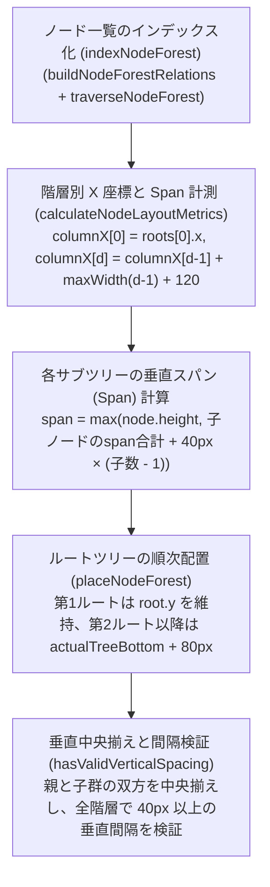
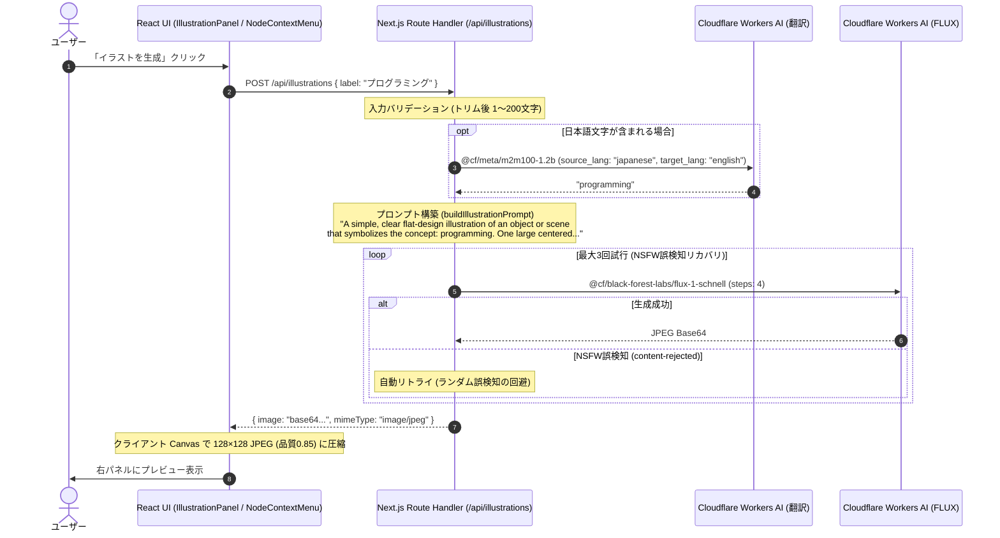

# Draw My Map 全機能仕様・操作マニュアル

本書は、**Draw My Map** が提供するすべての機能（Phase 0 〜 Phase 10。枝の複製、枝のコピー＆ペースト、ノード検索と移動を含む）の詳細な動作仕様およびユーザー操作マニュアルです。
グラフィックス描画エンジン（Pixi.js）、ツリー構造計算アルゴリズム、解像度フィルタリング、データ永続化・エクスポート、AI イラスト生成パイプラインの実装に厳密に準拠しています。

---

## 目次

1. [機能概要](#1-機能概要)
2. [キャンバス操作仕様](#2-キャンバス操作仕様)
3. [ノード基本操作仕様](#3-ノード基本操作仕様)
4. [自動レイアウト機能](#4-自動レイアウト機能)
5. [解像度フィルタリング機能（重要度システム）](#5-解像度フィルタリング機能重要度システム)
6. [データ永続化とエクスポート機能](#6-データ永続化とエクスポート機能)
7. [AI イラスト生成機能](#7-ai-イラスト生成機能)
8. [編集履歴（元に戻す / やり直す）](#8-編集履歴元に戻す--やり直す)
9. [ノード検索と移動](#9-ノード検索と移動)
10. [完全操作リファレンス](#10-完全操作リファレンス)

---

## 1. 機能概要

Draw My Map は、アイデアの創出、構造化、ビジュアル化をブラウザ完結でスムーズに行うためのマインドマップアプリケーションです。
Pixi.js による高速な 2D キャンバス描画と、React 19 による宣言的 UI を組み合わせ、直感的で滑らかな操作感を提供します。

### 1.1 フェーズ別機能マトリクス

`ROADMAP.md` のフェーズ定義に基づく機能一覧です。

| フェーズ | 主要機能 | 概要 |
| :--- | :--- | :--- |
| **Phase 0** | 基盤 | PixiJS キャンバス描画、ダブルクリックでのノード追加、ヘッダー+キャンバスレイアウト、ダークモード対応、高解像度対応、Jestテスト基盤 |
| **Phase 1** | ノード基本操作 | ルート・子・兄弟ノード作成、単一選択、ドラッグ移動、インラインラベル編集、ノード削除 |
| **Phase 2** | ノード間接続 | 三次ベジェ曲線による親子接続線描画、`Shift + ドラッグ` による親子接続の追加・付け替え、自己接続・循環参照防止 |
| **Phase 3** | キャンバス操作 | 背景ドラッグによるパン、カーソル基準のホイールズーム 0.25x〜4.0x、2本指ピンチズーム、`F` キーによるノードフォーカス、親移動時の子孫一括移動 |
| **Phase 4** | 自動レイアウト | 階層型ツリー自動整列アルゴリズム、重なり回避、手動配置 / 自動配置モード切替 |
| **Phase 5** | データの永続化・エクスポート | `localStorage` 300ms デバウンス自動保存、JSON インポート/エクスポート、PNG / SVG 画像エクスポート |
| **Phase 6** | 解像度フィルタリング | ノード重要度 `high`/`medium`/`low`、ズーム連動 Auto フィルタ、手動フィルタ切替、160ms フェードトランジション |
| **Phase 7** | AI イラスト生成 | Cloudflare Workers AI `m2m100-1.2b` + `FLUX.1 schnell` によるイラスト生成、128×128 JPEG 圧縮、右パネルプレビュー・設定・再生成・削除、コンテキストメニュー連携 |
| **Phase 8** | 編集履歴 | ノード編集・移動・配置モード変更の元に戻す / やり直す（最大100操作、メモリ上のみ）、ヘッダーボタン、`Ctrl`/`Cmd`+`Z` 系ショートカット |
| **Phase 9** | 枝の複製・コピー＆ペースト | ヘッダーの「枝を複製」ボタンによる、選択ノードと全子孫のアプリ内複製（ID再発行、手動 / 自動配置、1操作での Undo / Redo）。`Ctrl`/`Cmd`+`C`・`V` による専用形式でのクリップボード経由のコピー＆ペースト（別タブ・別マップへも貼り付け可、新しいルートとして追加、1操作での Undo / Redo） |
| **Phase 10** | ノード検索と移動 | ヘッダーからのラベル部分一致検索、現在のノード配列順で最大50件と総件数の表示、キー操作、隠れたノードの表示切り替え、選択と中央移動 |

### 1.2 アプリケーション画面レイアウト

```text
+------------------------------------------------------------------------------------------------------+
| AppHeader: [Draw My Map] [手動配置|自動配置] [重要度: 高|中|低] [表示: 自動|高のみ|中以上|すべて] [元に戻す|やり直す] [枝を複製] [コピー/貼り付けの案内] [JSON/画像書き出し] |
+-----------------------------------------------------------------------------------+------------------+
| MapStage (Pixi.js 2D Canvas + DOM Overlay):                                       | IllustrationPanel|
|                                                                                   | (サイドパネル)    |
|   +--------------+         +--------------+                                       |                  |
|   |  ルートノード  |-------->|   子ノード    |                                       | [対象ノード情報]  |
|   +--------------+         +--------------+                                       |                  |
|           \                                                                       | [プレビュー画像]  |
|            \------->+--------------+                                              |                  |
|                     |   子ノード 2   |                                              | [ノードに設定]    |
|                     +--------------+                                              | [イラストを生成]  |
|                                                                                   |                  |
+-----------------------------------------------------------------------------------+------------------+
```

---

## 2. キャンバス操作仕様

キャンバスは無限平面の作業領域を提供し、ユーザーは自由な位置へ移動（パン）および拡大・縮小（ズーム）を行うことができます。

### 2.1 ビューポート座標系モデル

キャンバス内部は、画面上のピクセル座標（**Screen 座標**）と、キャンバス内の絶対位置（**World 座標**）の2つの座標系を持ちます。

- **Viewport 定義**: `client/src/components/map/mapViewport.ts`
  - `offsetX`: 水平方向の描画オフセット（初期値: `0`）
  - `offsetY`: 垂直方向の描画オフセット（初期値: `0`）
  - `scale`: 表示倍率（初期値: `1.0`）
- **スケール制限**:
  - 最小倍率 `MIN_VIEWPORT_SCALE`: **0.25x**（全体俯瞰）
  - 最大倍率 `MAX_VIEWPORT_SCALE`: **4.0x**（詳細閲覧）
- **座標変換式**:
  - $\text{Screen} = \text{World} \times \text{scale} + \text{offset}$
  - $\text{World} = \frac{\text{Screen} - \text{offset}}{\text{scale}}$

### 2.2 パン操作（キャンバスの平行移動）

キャンバス背景をドラッグすることで、画面の表示位置を自由に移動できます。

- **操作方法**:
  1. **マウス**: ノード以外のキャンバス背景上で左ボタンドラッグ
  2. **タッチ**: 背景領域を1本指でドラッグ
- **移動しきい値**: ドラッグ開始判定として **4px**（`dragThreshold = 4`）の移動判定しきい値を設けており、クリック操作時の微細なブレによる誤移動を防ぎます。
- **実装参照**: `client/src/components/map/pixi/canvasPanGesture.ts`

### 2.3 ズーム操作（拡大・縮小）

カーソル位置または指のピンチ中心を中心として、歪みなく滑らかにスケールを変更します。

- **操作方法**:
  1. **マウスホイール**: マウスホイールの回転、またはトラックパッドの2本指スクロール
  2. **ピンチ操作**: トラックパッドのピンチイン／ピンチアウト、またはタッチ対応端末での2本指ピンチジェスチャー
- **アンカーズーム挙動**:
  - ズームの中心（アンカー点）となるカーソルの指す World 座標は、拡大・縮小の前後で画面上の同じ位置に保たれます（`zoomViewportAt`）。
  - マウスホイール感度定数: `WHEEL_ZOOM_SENSITIVITY = 0.001`
  - スケール計算式: $\text{requestedScale} = \text{currentScale} \times e^{-\Delta \times 0.001}$
- **ホイールイベントのデルタ正規化 (`normalizeWheelDeltaY`, `calculateWheelZoomRequest` in `wheelZoom.ts`)**:
  - `deltaMode === 1` (`WHEEL_DELTA_MODE_LINE`): `deltaY * 16`
  - `deltaMode === 2` (`WHEEL_DELTA_MODE_PAGE`): `deltaY * pageHeight`（`runtime.app.screen.height`）
  - `deltaMode === 0` (ピクセル単位等): `deltaY` をそのまま使用
  - 倍率更新式 `clampViewportScale(currentScale * Math.exp(-delta * 0.001))` の結果が `currentScale` と等しい場合（`deltaY === 0` の場合や、最小倍率 `0.25x`・最大倍率 `4.0x` の上下限にすでに到達している場合）は `calculateWheelZoomRequest` が `null` を返し、`useMapWheelZoom` は `event.preventDefault()` を呼ばずにブラウザのデフォルト挙動を妨げません。有効なズーム要求が成立したときのみ `event.preventDefault()` と進行中ジェスチャーのキャンセル（`onBeforeZoom`）を実行します。
- **2本指ピンチズーム (`calculatePinchViewport` in `pinchViewport.ts`, `pinchZoomGesture.ts`, `touchGestureCoordinator.ts`)**:
  - 2本指タッチ開始時の2点間距離 `startDistance` と現在距離 `currentDistance` の比から `rawScale = startViewport.scale * (currentDistance / startDistance)` を算出し、`clampViewportScale(rawScale)` でクランプします。
  - **初期座標が同一（距離0）のときのベースライン遅延確定 (`waitingForBaseline` in `pinchZoomGesture.ts`)**: 2本指の初期スクリーン座標 `startFirst`, `startSecond` が完全に同一（距離 `0`）または非有限で `!hasFinitePositiveDistance(startFirst, startSecond)` となった場合は、`waitingForBaseline = true` としてピンチ計算を保留します。その後、後続の `move` イベントで2点間に正の有限距離（`hasFinitePositiveDistance(first, second) === true`）が得られた最初の時点で `startFirst = { ...first }`, `startSecond = { ...second }` をベースラインとして確定（`waitingForBaseline = false`）し、以降の `move` から `calculatePinchViewport` によるズーム・パン更新を開始します。
  - 開始時の2点の中点 `startCenter`（`x = a.x / 2 + b.x / 2`, `y = a.y / 2 + b.y / 2`）をアンカーとして `zoomViewportAt` を適用したうえで、現在の中点 `currentCenter` との移動差分（`deltaX = currentCenter.x - startCenter.x`, `deltaY = currentCenter.y - startCenter.y`）を `panViewport` で加算し、ピンチズームと2本指パンの同時追従を行います。
  - **単一ポインタ操作との排他制御**: 2本目のタッチ（`pointerType === "touch"`）が検出された時点で、`onBeforePinch()` により進行中の単一ポインタ操作（キャンバスパンやノード移動等）を即時キャンセルしてピンチズームへ移行します。ピンチ終了またはキャンセル後は、タッチ中のすべての指が画面から離れるまで（`suppressUntilAllReleased = true`、かつ `samples.size === 0` になるまで）単一ポインタ操作の再開を抑止し、指を離す際の意図しないジャンプや誤ドラッグを防止します。
- **実装参照**:
  - `client/src/components/map/wheelZoom.ts`
  - `client/src/components/map/useMapWheelZoom.ts`
  - `client/src/components/map/pixi/pinchViewport.ts`
  - `client/src/components/map/pixi/pinchZoomGesture.ts`
  - `client/src/components/map/pixi/touchGestureCoordinator.ts`

### 2.4 ノードフォーカス機能（`F` キー）

広大なマップ上で作業している際、選択中のノードを即座に画面中央へセンタリングするショートカット機能です。

- **操作方法**: ノードを選択した状態で、キーボードの **`F`** キーを押下
- **挙動**:
  - 現在の表示倍率（`scale`）を維持したまま、選択中ノードの中心座標 $(x + \frac{w}{2}, y + \frac{h}{2})$ が画面の中央に来るよう `offsetX` と `offsetY` が再計算されます。
- **誤動作防止条件**:
  - テキスト編集中（`<input>` や `contenteditable` にフォーカスがある状態）はフォーカス移動は発火しません。
  - ドラッグやジェスチャーの操作中、またはノードが未選択の場合は無効化されます。
- **実装参照**:
  - `client/src/components/map/nodeViewportFocus.ts`
  - `client/src/components/map/viewportFocusShortcut.ts`

---

## 3. ノード基本操作仕様

マインドマップを構成するノードの追加、編集、移動、接続、削除の仕様です。

### 3.1 ノードの形状と構造

- **ノードデータ型**: `client/src/types/node.ts`
  ```typescript
  type Node = {
    id: number;
    parentId: number | null;
    x: number;
    y: number;
    width: number;
    height: number;
    label: string;
    importance: NodeImportance; // "high" | "medium" | "low"
    illustration?: string;      // 縮小済み JPEG data URL
  };
  ```
- **ノード寸法定数**: `client/src/config/shapes.ts`
  - 基本幅 `RECT_WIDTH`: **100px**
  - 基本高さ `RECT_HEIGHT`: **60px**
  - イラスト付きノード高さ `ILLUSTRATED_NODE_HEIGHT`: **116px**（`RECT_HEIGHT + ILLUSTRATION_AREA_HEIGHT`）
    - イラスト表示サイズ `ILLUSTRATION_SIZE`: **48px × 48px**（上部余白 `ILLUSTRATION_TOP_PADDING = 8px`、イラスト領域高さ `ILLUSTRATION_AREA_HEIGHT = 56px`）
- **形状とスタイリング** (`renderMapNodes.ts`, `mapSvgNodes.ts`):
  - **形状**: 角丸なしの**直角矩形**（Pixi.js の `graphics.rect(node.x, node.y, node.width, node.height)`、SVG エクスポートの `<rect>` ともに `rx`/`ry` なし）。
  - **背景色 (`fill`)**:
    - 通常時: `#ffffff`（`0xffffff`、ダークモード時もキャンバス上のノード背景は白固定）
    - 選択時 (`isSelected`): `#eff6ff`（`0xeff6ff`）
    - 接続ターゲット候補ハイライト時 (`isConnectionTarget`): `#ecfdf5`（`0xecfdf5`、選択時より優先）
  - **枠線 (`stroke`)**:
    - 通常時: 線幅 **2px**、色 `#3b82f6`（`0x3b82f6`）
    - 選択時 (`isSelected`): 線幅 **3px**、色 `#2563eb`（`0x2563eb`）
    - 接続ターゲット候補ハイライト時 (`isConnectionTarget`): 線幅 **3px**、色 `#10b981`（`0x10b981`、選択時より優先）
- **イラスト描画領域 (`getNodeIllustrationRect` in `nodeIllustration.ts`)**:
  - サイズ: `48px × 48px`（`size = ILLUSTRATION_SIZE = 48`）
  - X 座標: `node.x + (node.width - 48) / 2`（水平中央、幅 100px の場合は `node.x + 26`）
  - Y 座標: `node.y + 8`（ノード上端から `ILLUSTRATION_TOP_PADDING = 8px` 下）
- **ラベル描画位置 (`getNodeLabelCenterOffset` in `nodeIllustration.ts`, `createNodeLabelText` in `renderMapNodes.ts`)**:
  - フォントサイズ: `14px`、文字色: `#27272a`（`0x27272a`）、折り返し幅 (`wordWrapWidth`): `node.width - 16`（標準幅 100px のとき **84px**）、水平揃え (`align`): `"center"`、アンカー: `0.5`（中央基準）。
  - 中心 X 座標: `node.x + node.width / 2`
  - 中心 Y 座標オフセット (`getNodeLabelCenterOffset`): `node.height / 2 + (node.illustration === undefined ? 0 : 28)`（`ILLUSTRATION_AREA_HEIGHT / 2 = 28`）。イラストなし（高さ 60px）では上端から **30px**、イラストあり（高さ 116px）では上端から **86px**（下部 60px のラベル領域の中央）。
  - インライン編集中 (`isEditing: node.id === editingNodeId`) のノードでは、DOM `<input>` との二重描画を防ぐため Pixi.js 側の `Text` オブジェクトを描画しません（非表示）。

### 3.2 ノードの新規作成

ノードの作成方法は、操作コンテキストに応じて 3 種類提供されています。

| 作成操作 | トリガー | 配置先と親子関係 | 作成後の状態 |
| :--- | :--- | :--- | :--- |
| **ルートノード作成** | キャンバス背景を**ダブルクリック** | クリックした World 座標を中心として配置（`parentId: null`） | 空ラベル（`label: ""`、画面表示は「新しいノード」）のルートノードとして配置される（自動選択やインライン編集の即時開始は行わない） |
| **子ノード作成** | ノード選択中に **`Tab`** キー | 選択ノードの右側に自動配置（`parentId: 親ノードID`） | 新規作成された子ノードを選択し、直ちにインラインラベル編集を開始 |
| **兄弟ノード作成** | ノード選択中に **`Enter`** キー | 選択ノードと同じ `parentId` を持つ兄弟として下方に配置（ルート選択中なら `parentId: null` の別ルート） | 新規作成された兄弟ノードを選択し、直ちにインラインラベル編集を開始 |

- **初期配置座標計算** (`client/src/domain/nodes/nodePlacement.ts`):
  - 新規ノードの初期プロパティは `width: 100` (`RECT_WIDTH`)、`height: 60` (`RECT_HEIGHT`)、`label: ""`、`importance: "medium"` (`DEFAULT_NODE_IMPORTANCE`) です。
  - **ルートノード (`createRootNode`)**: ダブルクリックされた World 座標 `(centerX, centerY)` に対し、矩形の中心が一致するよう `(centerX - 50, centerY - 30)`（`centerX - RECT_WIDTH / 2`, `centerY - RECT_HEIGHT / 2`）に配置されます。
  - **子ノード (`createChildNode`)**:
    - X 座標: `parent.x + parent.width + 120`（`CHILD_HORIZONTAL_GAP = 120`、標準幅 100px の親なら `parent.x + 220`）
    - Y 座標: 既存の兄弟ノード（同じ `parentId` を持つノード）が 0 件なら `parent.y`、1 件以上存在する場合は全既存兄弟の下端最大値 `Math.max(...siblings.map((n) => n.y + n.height)) + 40`（`SIBLING_VERTICAL_GAP = 40`）
  - **兄弟ノード (`createSiblingNode`)**:
    - 親 ID: `source.parentId`（選択中ノードがルート `parentId === null` の場合は、新しいノードも `parentId = null` の別ルートノードになります）
    - X 座標: `source.x`
    - Y 座標: 同じ `parentId` を持つ全兄弟ノード（`source` 自身や、ルートの場合は全ルートノードを含む）の下端最大値 `Math.max(...siblings.map((n) => n.y + n.height)) + 40`（`SIBLING_VERTICAL_GAP = 40`）
  - 自動レイアウトモード（`layoutMode === "auto"`）時は、上記で初期生成された直後に `layoutNodeForest` が適用され、ツリー全体の整列座標へ即座に再配置されます。
- **ノード ID 採番仕様** (`nodeIdGenerator.ts`, `nodeIdAllocator.ts`):
  - `createMonotonicIdGenerator` は現在時刻ミリ秒 `Date.now()` を基準とし、同一ミリ秒内の連続生成や時計の逆行時にも `previousId === null ? currentTime : Math.max(currentTime, previousId + 1)` によって狭義単調増加する正の整数を生成します。
  - `createNodeIdAllocator` の一括採番 `nextAvailableIds(nodes, count)` は、現在マップ上に存在する全ノードの ID 集合（`occupiedIds`）を1回だけ作り、生成した ID が集合にあれば飛ばし、採番した ID も集合に加えながら `count` 個を返します。既存 ID とも、返す ID 同士とも衝突しません。単数の `nextAvailableId(nodes)` は同じ規則で1個だけ採番します（`nextAvailableIds(nodes, 1)[0]`）。枝の複製と枝の貼り付けでは、どちらも対象のノード数ぶんを一括採番で1回で得ます。
  - マップ全体の置換時（`replaceMap`: `localStorage` からの初期復元や JSON ファイルのインポート時）には `allocator.reset()` が呼ばれ、内部ジェネレーターの状態がリセットされます。

### 3.3 ノードの選択と解除

- **選択**: ノードをクリックすると選択状態となり、青い太枠線（`3px`, `#2563eb`）と薄青背景（`#eff6ff`）でハイライト表示されます。ヘッダーの「重要度」セレクター、「枝を複製」ボタン（未選択時は無効）、`Ctrl`/`Cmd` + `C` のコピー対象（選択ノードとその子孫）、右パネルの「イラスト」が選択中ノードに連動します。
- **選択解除**: キャンバスの空き背景をクリックすると、選択が解除されます。
- **重なり時のヒットテスト優先順** (`findNodeAtPoint` in `mapGeometry.ts`):
  - ダブルクリック判定、コンテキストメニューの対象判定、接続先ターゲット判定等で用いられる `findNodeAtPoint(nodes, point)` は、`nodes` 配列を**末尾から先頭へ逆順走査**（`index = nodes.length - 1` から `0` へ）し、`point.x >= node.x && point.x <= node.x + node.width && point.y >= node.y && point.y <= node.y + node.height`（境界線上の点を含む閉区間）を満たす最初の可視ノードを返します。また Pixi.js の描画順も配列順で `stage.addChild` されるため、ノード同士が重なっている場合は常に**最前面（後から作成された配列末尾側）の可視ノード**が優先されます。

### 3.4 テキスト編集（インライン編集）

日本語 IME 入力や確定・キャンセルの挙動に完全対応したインラインエディタです。

- **編集開始**: 可視ノードを**ダブルクリック**する、または `Tab` / `Enter` キーで子・兄弟ノードを新規作成する。
- **エディタ UI とレイアウト追従** (`NodeLabelEditor.tsx`, `nodeLabelEditorLayout.ts`):
  - `getNodeLabelEditorLayout(node, viewport)` により、現在のビューポートのパン・ズーム（`viewport.scale`）に完全追従した座標・サイズ・フォントサイズ（`14 * viewport.scale`）で HTML `<input type="text">` 要素が DOM オーバーレイ表示されます。
  - **イラスト領域の回避 (`topInset`)**: `topInset = getNodeLabelCenterOffset(node) * 2 - node.height` により、イラストなしノードでは `topInset = 0`（ノード全体 `100×60px` に重畳）、イラスト付きノード（高さ `116px`）では `topInset = 56px`（`ILLUSTRATION_AREA_HEIGHT`）となり、上部のイラスト表示領域を避けて**下部 `60px` のラベル領域のみ**に `<input>` が重畳されます。
  - 編集開始時は既存のラベルテキスト（`node.label`）が入力欄にセットされた状態で**自動フォーカス（`autoFocus`）**されます（テキスト全選択は行いません）。
- **確定とキャンセル**:
  - **`Enter` キー**: `event.currentTarget.blur()` を呼び出し、テキストを確定して編集を終了する。
  - **フォーカスアウト (Blur)**: 入力枠外をクリックした際もテキストを確定して編集を終了する（`actionHandledRef` により二重確定やキャンセル後の誤確定を防止）。
  - **`Escape` キー**: 編集を破棄（キャンセル）し、編集前のテキストのままエディタを閉じる。
- **空文字確定時のデータ保持と表示フォールバック** (`nodeDisplayLabel.ts`, `nodeLabel.ts`):
  - 空文字 `""` のまま確定した場合、ノードデータの `node.label` 自体は空文字 `""` のまま保持されます。
  - キャンバス描画、右サイドパネルの表示、および SVG/PNG エクスポート時には `getNodeDisplayLabel(node.label)`（`label || FALLBACK_NODE_LABEL`）を通すことで、表示上のみデフォルト名「**新しいノード**」にフォールバックされます（再度ダブルクリックして編集を開くと、入力欄は空文字 `""` の状態で開きます）。

### 3.5 ノード削除

- **操作方法**: ノードを選択した状態で、**`Delete`** または **`Backspace`** キーを押下。
- **サブツリー連動削除の仕様**:
  - 親ノードを削除した場合、そのノードのみならず**配下の子・孫などすべてのサブツリーノードが一括して削除**されます（`collectSubtreeIds` による探索）。
  - 削除されたサブツリー内に選択状態のノードが含まれていた場合、選択は安全に解除（`null`）されます。

### 3.6 ドラッグ移動と子孫連動移動

手動レイアウト時、ノードを直感的にドラッグして移動できます。

- **ドラッグ判定**: 4px（`dragThreshold = 4`）以上のポインタ移動でドラッグ状態へ移行。
- **子孫連動移動（サブツリー移動）**:
  - 親ノードをドラッグして移動させると、その親に連なる**すべての子孫ノードが相対座標（$\Delta x, \Delta y$）を完全に維持したまま一体となって追従移動**します（`moveNodeSubtree`）。
  - 木の途中のノードをドラッグした場合は、そのノードを頂点とする部分木のみが追従し、先祖ノードや別の兄弟ノードの位置は変化しません。

### 3.7 ノード間の接続（エッジ作成）

離れたノード同士をドラッグ操作で直感的に親子関係として接続できます。

- **操作方法** (`nodeConnectionGesture.ts`):
  - **`Shift` + ノードドラッグ**: 接続元（親となるノード）上で `Shift` キーを押しながら左ボタン押下（`pointerdown`）すると、4px の移動しきい値を待たずに直ちに接続ジェスチャーが開始され、接続元ノードが選択状態になります。
  - **接続先ターゲットのハイライト表示**: ドラッグ中に接続ガイドラインは描画されず、ポインタ位置（`findNodeAtPoint` による最前面の可視ノード）が `canConnectNodes(nodes, sourceNodeId, target.id)` を満たす接続可能なノード上にあるとき、そのターゲット候補ノードが**エメラルドグリーンの太枠線（`3px`, `#10b981`）と薄緑背景（`#ecfdf5`）**でハイライトされます（`connectionTargetNodeId`）。
  - 接続可能なターゲットノード上でドロップ（`pointerup`）すると接続が確定します。
- **親子関係の更新**:
  - ターゲットノードの `parentId` が接続元ノードの ID に更新され、以前の親からは自動的に付け替えられます（自動レイアウトモード時は即座にツリー全体が再整列されます）。
  - 接続完了時、ターゲットとなった子ノードが自動的に選択状態になります。
- **接続バリデーション (`canConnectNodes` in `nodeTree.ts`)**:
  - `canConnectNodes(nodes, parentId, childId)` が検査する拒否条件（`false` を返す条件）は、①**自己接続**（`parentId === childId` の自己ループ）、②**存在しないノード ID**（`!nodesById.has(parentId) || !nodesById.has(childId)`）、③**循環参照および既存グラフ内のサイクル検出**（`!hasAncestorOrCycle(nodesById, parentId, childId)`：親候補 `parentId` から `parentId` チェーンを遡った際に `childId` に到達する場合や、既存チェーン内にサイクルが存在する場合）の **3 条件のみ**です。
  - すでに同じ親に接続済み（`child.parentId === parentId`）の場合は `canConnectNodes` は `true` を返し、ターゲット候補のハイライトおよびドロップ時の `connectNodeTree` が実行されます。ノードは単一の `parentId` プロパティのみを持つ構造であるため重複エッジは発生せず、同一の `parentId` が冪等に維持（および選択状態が子ノードへ更新）されます。
- **親子接続線（三次ベジェ曲線）の描画仕様** (`getNodeEdgeCurve` in `nodeEdgeCurve.ts`, `renderMapEdges.ts`):
  - 親ノードの右端中央を始点 `start = { x: parent.x + parent.width, y: parent.y + parent.height / 2 }`、子ノードの左端中央を終点 `end = { x: child.x, y: child.y + child.height / 2 }` とします。
  - 水平中間点 `controlX = start.x / 2 + end.x / 2`（数値オーバーフローを防ぐため `(start.x + end.x) / 2` ではなく個別に 2 で割って加算）を用い、第1制御点 `control1 = { x: controlX, y: start.y }`、第2制御点 `control2 = { x: controlX, y: end.y }` とする滑らかな水平S字の三次ベジェ曲線を描画します。
  - スタイルは線幅 **2px**、色 `#64748b`（`0x64748b`、スレートグレー）で、エッジ自体はポインタイベントを受け取りません（`eventMode = "none"`）。

### 3.8 枝の複製

- **操作方法**: ノードを選択し、ヘッダーの **「枝を複製」** ボタンを押下（ノード未選択時は無効）。右クリックメニューや専用のショートカットはありません。クリップボード経由のコピー＆ペースト（3.9 節）は別の機能です。
- **複製の対象**: 選択ノードと全子孫。表示フィルターで隠れている子孫も含めます。元のノードと、枝の外のノードは変更しません。
- **親子関係**: 選択ノードがルートなら複製もルート、親があれば複製は同じ親の子になります。子孫の親は、対応する複製側のノードになります。複製したすべてのノードに、未使用の新しいIDを割り当てます。
- **引き継ぐ内容**: ラベル（接尾辞は付けない）、重要度、イラスト、幅、高さ。イラストは既存の画像データを共有し、再生成しません（画像はメモリ上では共有しますが、`localStorage` への保存と JSON 書き出しではノードごとに書き出されるため、イラスト付きの枝を複製すると保存サイズは画像の数だけ増えます）。
- **配置**:
  - 手動配置では、マップ全体の下端から 40px 空けた位置へ、枝の形を保ったまま真下へ平行移動して置きます（x は変わらない）。大きなマップでは離れた位置になるため、`F` キーで複製したノードへ移動できます。
  - 自動配置では平行移動せず、既存の自動配置に任せて、同じ親の子（またはルート）として整列します。
- **複製後の状態**: 複製した枝の根が選択され、「枝を複製しました。Fキーで選択ノードへ移動できます。」と通知されます。viewport は動かしません。通知は次の複製で新しい結果に置き換わり、元に戻す / やり直すの成功や JSON 読み込みの成功（マップの置き換え）で消えます。JSON 読み込みに失敗したときは消えません。
- **失敗**: 対象ノードが存在しないとき、手動配置で座標が表現できる範囲を超えて間隔を確保できないとき、自動配置で並べられないときは、いずれも「枝を複製できませんでした。」と通知します。マップ、選択、履歴は変わりません。
- **Undo / Redo**: 複製全体（自動配置での再配置を含む）を 1 操作として扱います。元に戻すと枝全体が消え、やり直すと同じID・画像・座標で戻ります。ダブルクリックは 2 回の複製として扱い、Undo は 1 回ずつ戻します。
- **ラベル編集中**: ボタンを押すと、入力中のラベルを確定してから、その値で複製します。
- **フォーカスとキー操作**: アプリは複製後にフォーカスを移さず、ボタンにフォーカスがあればそのまま残ります（Safari と macOS の Firefox では、ブラウザの仕様でクリックによってボタンにフォーカスが入りません）。`F` キーは、ボタンにフォーカスがある状態でも使えます。ボタン上で `Enter` を押し続けても、連続して複製しません（1 回だけ）。
- **保存**: 複製後のマップは通常どおり 300ms デバウンスで `localStorage` に保存されます。保存形式（V3）は変わりません。

### 3.9 枝のコピー＆ペースト

選択ノードと全子孫を OS のクリップボードへコピーし、同じ画面・別タブ・別マップへ貼り付けます。ブラウザが発火する `copy` / `paste` イベントを使うため、`Ctrl`/`Cmd` + `C`・`V` で操作します。ブラウザの編集メニューからも動く場合がありますが、選択範囲が無いと項目が無効になる環境があり、実ブラウザでは未確認です（browser-test-cases.md の L-11）。専用のコピーボタン・貼り付けボタンはなく、ヘッダーに案内「枝をコピー: Ctrl/Cmd+C ／ 貼り付け: Ctrl/Cmd+V（新しいルートとして追加）」を常時表示します。

- **コピー**: ノードを選択して `Ctrl`/`Cmd` + `C`。選択ノードと全子孫（表示フィルターで隠れている子孫も含む）を、その時点のスナップショットとして保存します。選択ノードの `parentId` は `null` に切り離して保存するため、元の親は含まれません。コピーはマップ、選択、履歴を変えず、コピー後に元を編集・削除してもクリップボードの内容は変わりません。ノードを選択していないときは何もしません。
- **貼り付け**: `Ctrl`/`Cmd` + `V`。クリップボードの枝を、常に**新しいルート**として追加します。選択中のノードの子にはならず、ノードを選択していなくても貼り付けられます（親へ付けたい場合は `Shift` + ドラッグで接続します）。全ノードに未使用の新しい ID を割り当て、枝内の親子関係・座標の相対位置・幅・高さ・ラベル・重要度・イラストを引き継ぎます。成功すると、貼り付けた枝の根が選択されます。viewport は動かしません。`Ctrl`/`Cmd` + `V` を押し続けると、キーリピートの回数だけ 1 回ずつ貼り付けます（各回が Undo の 1 操作）。
- **配置**（貼り付け先の最新のレイアウトモードに従い、コピー元のモードは持ち込みません）:
  - 手動配置でマップにノードがあるとき: 枝の形を保ったまま、マップ全体の下端から 40px 空けた位置へ真下に平行移動して置きます（x は変わりません）。
  - 手動配置で空のマップのとき: コピー時の座標のまま置きます。
  - 自動配置: 平行移動せず、既存の自動配置に任せて新しいルートとして整列します。
- **コピーの形式**: `text/plain` に次の専用 JSON を書き込みます。`rootId` は持たず、`parentId: null` のノードが唯一の根です。元の ID、配列の順序、座標、寸法、ラベル、重要度、設定済みのイラストを保存します。生成中の画像やプレビューは含みません。
  ```json
  {"type":"draw-my-map/subtree","version":1,"nodes":[{"id":1,"parentId":null,"x":0,"y":0,"width":100,"height":60,"label":"例","importance":"medium"}]}
  ```
  別アプリへ貼り付けると、この JSON 文字列がそのまま入ります。マップの V3 保存形式は変わらず、`localStorage` と JSON 書き出しには貼り付け後のマップだけが通常の形式で保存されます。
- **貼り付けの検証**: 外部入力として扱い、`type` / `version`、空でない `nodes` 配列、単一の根を検証します。各ノードは V3 のノードとして検証し、既知の項目だけで作り直します（イラストは V3 の Data URL と寸法の検証・高さ補正を適用）。ID の重複、循環、存在しない親、複数の根は拒否します。普通の文章、JSON マップ（`MapDocument`）、画像ファイル、他形式の JSON は枝として貼り付けられません。HTML の描画や外部 URL の読み込みもしません。
- **上限**: 文字数 5,000,000（UTF-16 コード単位。`string.length`）、ノード数 10,000。コピーにも貼り付けにも同じ上限を適用します。超過したコピーは失敗し、直前のクリップボードの内容を上書きしません。貼り付けでは、文字数を `JSON.parse` の前に、ノード数を各ノードの検証の前に判定します。
- **入力・選択・編集中の優先**: 次のときは何もせずブラウザ標準の動作に任せます（通知も出しません）。
  - イベントの対象、またはフォーカス中の要素が、入力欄・`<textarea>`・`<select>`・`contenteditable`。
  - ページ上の文字（DOM の範囲選択）を選択している。選択を解除すると、マップの操作に戻ります。
  - ノードのラベル編集中。
  - ドラッグなどのジェスチャーの途中（ジェスチャー中のコピーに中間座標を取り込まないため）。
  - 他の処理がすでにそのイベントを処理済み（`defaultPrevented`）。

  なお、ヘッダーのボタンにフォーカスがあっても、編集可能な要素でなければ、ブラウザに任せずに枝のコピー・貼り付けとして処理します。
- **失敗**: コピーが失敗（例外、`clipboardData` が無い、上限超過）しても `preventDefault` はせず、ブラウザの既定動作に任せます（`setData` せずに止めると、直前のクリップボードの内容を空で上書きしうるため）。貼り付けが失敗（`clipboardData` が無い、取得の例外、非対応形式、配置不能）しても、マップ、選択、履歴、Redo は変わりません。失敗した貼り付けで採番した ID は欠番になりえます。
- **通知**:

  | 場面 | 種別 | メッセージ |
  | :--- | :---: | :--- |
  | コピー成功 | `status` | 枝をコピーしました。 |
  | 貼り付け成功 | `status` | 枝を貼り付けました。Fキーで選択ノードへ移動できます。見えない場合は表示を『すべて』に切り替えてください。 |
  | コピー失敗 | `error` | 枝をコピーできませんでした。 |
  | 非対応・不正な貼り付け | `error` | 貼り付ける枝データが無効です。 |
  | 上限超過（コピー・貼り付け共通） | `error` | 枝データが大きすぎます（10,000ノード・5,000,000文字以内）。（数値は codec の `MAX_SUBTREE_CLIPBOARD_NODES` / `MAX_SUBTREE_CLIPBOARD_LENGTH` から組み立てる） |
  | 取得・配置の失敗 | `error` | 枝を貼り付けできませんでした。 |

  通知は次のコピー／貼り付けの要求で新しい結果に置き換わり、元に戻す / やり直すの成功や JSON 読み込みの成功（`documentRevision` の変化）で消えます。枝の複製の通知とは独立した枠で表示し、互いに消しません。対象外のイベントでは通知を変えません。
- **貼り付けた枝が見えない場合**: コピー時に重要度が低い枝は、貼り付け後も重要度を保持します。現在の表示フィルターは維持するため、貼り付けた枝が見えず、選択が外れる場合があります。表示を「すべて」に切り替えると現れます。
- **Undo / Redo**: 貼り付け（自動配置での再配置を含む）を 1 操作として扱います。貼り付けの成功は「やり直す」の履歴を破棄します。元に戻すと貼り付けた枝全体が消え、やり直すと同じ ID・画像・座標で戻ります。コピーは履歴に記録しません。
- **対象ブラウザ**: Chrome と Firefox を必須とします。Safari は、選択範囲が無い状態で `copy` / `paste` イベントが発火しない場合があり、その場合は既知の制約です（キー入力とクリップボード API による代替経路は設けていません）。実ブラウザでの実キーボードの確認は未実施で、手順は `docs/testing/browser-test-cases.md` の L 節にあります。
- **対象外**: 切り取り、普通の文章からのノード生成、画像ファイルの貼り付け、専用のコピーボタン・貼り付けボタン。
- **枝の複製（3.8 節）との違い**: 複製はヘッダーのボタンで、選択ノードと同じ親の下（ルートならルート）に置きます。貼り付けは常に新しいルートで、選択に依存せず、別タブ・別マップへも渡せます。

---

## 4. 自動レイアウト機能

マインドマップのノード群を、階層構造に基づいて美しく自動整列する機能です。

### 4.1 手動モード (manual) と自動モード (auto)

ヘッダーの「レイアウトモード」切り替えコントロールから即座に切り替え可能です。

- **手動配置 (`manual`)**:
  - ユーザーが自由に配置した座標 $(x, y)$ をそのまま保持します。
  - ノードの追加・削除・接続を行っても、他のノードの位置は自動移動しません。
- **自動配置 (`auto`)**:
  - ツリー構造の変更（ノード追加、削除、親子接続、枝の複製、枝の貼り付け、イラスト追加・削除によるノード伸縮など）が発生するたびに、レイアウトエンジンが自動的に全ノードの理想座標を再計算します。
  - 手動ドラッグ移動は無効化され、常に整然としたツリーが保たれます。

### 4.2 レイアウトアルゴリズム仕様

Draw My Map の自動レイアウトは、単一ツリーだけでなく複数のルートノードが存在する**フォレスト（森林）構造**に完全対応しています。

- **実装モジュール**:
  - `client/src/domain/nodes/nodeAutoLayout.ts` (`layoutNodeForest`)
  - `client/src/domain/nodes/nodeLayoutForest.ts` (`indexNodeForest`)
  - `client/src/domain/nodes/nodeLayoutForestRelations.ts` (`buildNodeForestRelations`: ノードの有限値・正寸法・ID重複・親存在の検証、および `roots` と `childrenByParent` の構築)
  - `client/src/domain/nodes/nodeLayoutForestTraversal.ts` (`traverseNodeForest`: 非再帰スタックによるサイクル検出、および `depthById`・深さ別リスト `nodesByDepth`・後順走査リスト `postOrder` の構築)
  - `client/src/domain/nodes/nodeLayoutGeometry.ts` (`calculateNodePositions`)
  - `client/src/domain/nodes/nodeLayoutMetrics.ts` (`calculateNodeLayoutMetrics`)
  - `client/src/domain/nodes/nodeLayoutPlacement.ts` (`placeNodeForest`)
  - `client/src/domain/nodes/nodeLayoutSpacing.ts` (`hasValidVerticalSpacing`)
  - `client/src/domain/nodes/nodeLayoutArithmetic.ts` (`checkedAdd`, `checkedSubtract`, `checkedMultiply`, `calculateRoundingTolerance`, `hasSufficientGap`)

#### 主要パラメータと間隔定数

| 定数名 | 設定値 | 役割 |
| :--- | :--- | :--- |
| `CHILD_HORIZONTAL_GAP` | **120px** | 各階層（深さ $d-1$ の最大ノード幅の右端）から次の階層（深さ $d$ の左端）までの水平距離 |
| `SIBLING_VERTICAL_GAP` | **40px** | 同一の親を持つ兄弟サブツリー間の垂直間隔（および同一深さの隣接ノード間の最小垂直間隔） |
| `TREE_VERTICAL_GAP` | **80px** | 異なるルートツリー同士の実際の描画下端から次ツリーの上端までの垂直間隔（`SIBLING_VERTICAL_GAP * 2`） |

#### アルゴリズムの動作ステップ



1. **フォレスト分割と深さ別列 X 座標の決定 (`indexNodeForest`, `calculateNodeLayoutMetrics`)**:
   - `buildNodeForestRelations` で全ノードの座標・寸法の有効性と親子関係を検証して `parentId === null` のルート群（`roots`）と親子マップ（`childrenByParent`）を構築し、`traverseNodeForest` で深さ（`depth`）ごとのノードリスト `nodesByDepth` と後順（ボトムアップ）リスト `postOrder` を構築します（孤立参照やサイクルがある不正グラフの場合は `null` を返して中断）。
   - 各深さ $d$ における最大ノード幅 $\text{maxWidth}(d) = \max_{n \in \text{level}[d]} n.\text{width}$ を求め、列 X 座標 `columnX` を以下の漸化式で決定します：
     - $\text{columnX}[0] = \text{roots}[0].x$（第1ルートノードの現在の X 座標を基準とする）
     - $\text{columnX}[d] = \text{columnX}[d - 1] + \text{maxWidth}(d - 1) + 120$（`CHILD_HORIZONTAL_GAP = 120`）
2. **サブツリーのスパン（専有領域高さ）計算 (`calculateNodeLayoutMetrics`)**:
   - ボトムアップ順（`postOrder`）で各ノードの `childrenHeight` と `span` を計算します。
   - 子を持たない葉ノードでは `childrenHeight = 0`、`span = current.height`（通常 60px、イラスト付き 116px）。
   - 子を持つ親ノードでは、全子ノードの `span` の総和に `40 * (children.length - 1)` を加えた値を `childrenHeight` とし、`span = Math.max(current.height, childrenHeight)` とします。
3. **第1ルート Y 座標の維持と複数ルートツリー配置 (`placeNodeForest`)**:
   - **第1ルート (`rootIndex === 0`)**: 第1ルートノード自身の Y 座標が元の `root.y` から動かないよう、ツリーの割り当て上端 `top` を `root.y - (rootSpan - root.height) * 0.5` から逆算し、第1ルート自身の Y 座標には厳密に `root.y` を設定します。
   - **第2ルート以降 (`rootIndex >= 1`)**: 前のルートツリーに属する全ノードの実際の配置下端の最大値 `actualTreeBottom = Math.max(..., actualY + node.height)` を追跡し、次のルートツリーの上端 `nextTreeTop` を `actualTreeBottom + 80`（`TREE_VERTICAL_GAP = 80`）に配置します。
   - **親ノードと子ノード群の双方向垂直中央揃え**:
     - 子ノード群の総高 `childrenHeight` が親ノードの `height` より大きい場合、親ノードは `frame.top + (span - node.height) * 0.5` により子ノード群の中央に配置されます。
     - 逆に親ノードがイラスト付き（116px）等で子ノード群の総高（例: 子1個で 60px）より大きい場合、子ノード群の開始位置 `childTop` に `childTopOffset = (span - childrenHeight) * 0.5`（例: `(116 - 60) * 0.5 = 28px`）が加算され、親ノードの垂直中央に揃えて子ノード群が配置されます。
4. **数値オーバーフロー・浮動小数点 ULP 精度劣化の防御と `layoutNodeForest === null` 時の棄却挙動 (`nodeLayoutArithmetic.ts`, `nodeLayoutSpacing.ts`, `useNodeLayoutState.ts`)**:
   - すべての座標加算・減算・乗算は `checkedAdd`、`checkedSubtract`、`checkedMultiply` を介して行われ、`Number.isFinite` チェックに加え、巨大座標での桁落ち（`right > 0 && result <= left` 等）を検出した時点で `null` を返します。
   - 隣接間隔の検証関数 `hasSufficientGap(start, end, requiredGap)` は、独立に丸められた浮動小数点境界のわずかな ULP 誤差（`calculateRoundingTolerance`: `Math.min(requiredGap * 1e-9, Number.EPSILON * Math.max(1, Math.abs(start), Math.abs(end)) * 4)`）のみを許容し、実質的な間隔不足を厳密に拒否します。
   - 配置計算完了後、`hasValidVerticalSpacing(forest, positions)` によって同じ深さ（列）に属するすべての隣接ノード間に `SIBLING_VERTICAL_GAP`（40px）以上の垂直間隔が確保されているかを最終検証します。いずれかの検証で `null` または `false` となった場合、`layoutNodeForest` は `null` を返します。
   - **`useNodeLayoutState` における `null` 返却時の安全な棄却**:
     - **自動モード（`layoutMode === "auto"`）中のツリー変更（`applyTreeChange`）**: `layoutNodeForest(candidateNodes)` が `null` を返した場合、単に座標を維持するだけでなく **`applyTreeChange` 自体が `false` を返してツリー変更操作そのものを棄却**し、変更前の `nodes` をそのまま維持します（呼び出し元の `useNodes` でも `if (!applied) return ...;` により `selectedNodeId` の更新を行いません）。
     - **手動モードから自動モードへの切替（`setLayoutMode("auto")`）**: `layoutNodeForest(nodesRef.current)` が `null` を返した場合は、**自動モードへの移行自体を中止（早期 `return`）し、`layoutMode: "manual"` と元のノード群（`nodes`）をそのまま維持**します。

---

## 5. 解像度フィルタリング機能（重要度システム）

ノードの重要度とズーム倍率を連動させ、ズームアウト時は重要なノードだけを表示し、ズームインすると詳細ノードが現れる**解像度制御（LOD: Level of Detail）機能**です。

### 5.1 重要度タグ (Importance)

各ノードには 3 段階の重要度を設定できます。

- **重要度レベル**:
  - `high`（高）: 最重要のコンセプト・メインテーマ
  - `medium`（中）: 標準の重要度（**新規作成ノードのデフォルト値** `DEFAULT_NODE_IMPORTANCE = "medium"`）
  - `low`（低）: 補足情報・詳細なメモ
- **変更方法**:
  - ノードを選択し、ヘッダーの「重要度」セレクター（`高` / `中` / `低` ボタン）をクリックして変更します。

### 5.2 ズーム連動自動フィルタリングと祖先ノード可視維持ルール

ヘッダーの表示モードが「**自動**」のとき、ビューポートのズームスケールに応じて表示ノードが自動的に切り替わります。

| 表示レベル (`ResolutionLevel`) | 基本表示対象ノード | 概要 |
| :--- | :--- | :--- |
| **`high`**（高のみ） | `importance: "high"` のみ | ズームアウト時。全体構造・主要トピックのみを俯瞰 |
| **`medium`**（中以上） | `high` および `medium` | 標準ズーム時。主要トピックと標準ノードを表示 |
| **`all`**（すべて） | `high`, `medium`, `low` の全ノード | ズームイン時。すべての詳細・メモまで表示 |

- **祖先ノードの可視維持ルール** (`collectVisibleNodeIds` in `nodeVisibility.ts`):
  - ツリー構造の分断（宙に浮いた孤立ノードの発生）を防ぐため、現在の表示レベル `level` の条件を満たすノードが存在する場合、そのノードから `parentId` を辿って到達する**すべての祖先ノードも、自身の重要度に関わらず強制的に可視集合（`visibleNodeIds`）に含まれます**（例: `low` の親の下に `high` の子がある場合、`high` フィルタ時でもその親およびルートまでの経路上の全祖先が表示維持されます）。
- **エッジ（接続線）の可視判定** (`collectVisibleMapKeys` in `mapVisibilityKeys.ts`):
  - 親子接続線（`edge:${childNodeId}`）は、**子ノードと親ノードの両方が `visibleNodeIds` に含まれているときのみ**可視となります。

### 5.3 ヒステリシス制御（チラつき防止）とマップ置換時のリセット

ズーム操作境界付近で表示・非表示が小刻みに激しく切り替わる現象（チャタリング）を防ぐため、**拡大時と縮小時で異なるしきい値を持つヒステリシス**を採用しています。

- **しきい値定数**: `client/src/domain/nodes/nodeResolutionLevel.ts`
  - `HIGH_TO_MEDIUM_SCALE`: **0.65x**（拡大時: high → medium）
  - `MEDIUM_TO_HIGH_SCALE`: **0.55x**（縮小時: medium → high）
  - `MEDIUM_TO_ALL_SCALE`: **1.05x**（拡大時: medium → all）
  - `ALL_TO_MEDIUM_SCALE`: **0.95x**（縮小時: all → medium）
  - `INITIAL_HIGH_TO_MEDIUM_SCALE`: **0.6x**（初回・ヒステリシス未確定時の high / medium 境界）
  - `INITIAL_MEDIUM_TO_ALL_SCALE`: **1.0x**（`1`、初回・ヒステリシス未確定時の medium / all 境界）

```text
ズームアウト方向 (<---)                                     ズームイン方向 (--->)
---------------------------------------------------------------------------------> スケール (scale)
         0.55x                    0.65x            0.95x           1.05x
           |                        |                |               |
           |<-- [medium → high]     |                |<-- [all → med]|
           |                        |                |               |
           |     [high → medium] -->|                |   [med → all]->|
```

- **初回判定（`previousAutoLevel === null` 時）**: 前回の自動表示レベルが未確定（`previousAutoLevel === null`）の場合、`scale < 0.6`（`INITIAL_HIGH_TO_MEDIUM_SCALE = 0.6`）で `high`、`0.6 <= scale < 1.0`（`INITIAL_MEDIUM_TO_ALL_SCALE = 1`）で `medium`、`scale >= 1.0` で `all` と判定されます。
- **手動フィルタモードから自動（`"auto"`）モードへの復帰時のヒステリシス初期化** (`reduceResolutionFilterState` in `mapResolutionFilterState.ts`):
  - 手動フィルタモード（`"high" | "medium" | "all"`）から `"auto"` モードへ戻した際（`action.mode === "auto" && state.mode !== "auto"`）は、`createResolutionFilterState()` により `previousAutoLevel` が `null` に初期化されます。これにより、手動固定へ移行する前の古いヒステリシス状態を引きずることなく、現在のズーム倍率 `scale` が初期しきい値（`INITIAL_HIGH_TO_MEDIUM_SCALE = 0.6` / `INITIAL_MEDIUM_TO_ALL_SCALE = 1.0`）でクリーンに再評価されます。
- **マップ置換時のフィルタリセットと `pendingResetScale` による同期制御** (`useMapResolutionFilter.ts`, `mapResolutionFilterState.ts`):
  - JSON インポートや初期ストレージ復元によりマップ全体が置換されて `resetRevision` が更新されると、フィルタ状態は自動的に `mode: "auto"`、および初期ビューポート倍率（`resetScale = INITIAL_VIEWPORT.scale = 1.0`）に対応する `level: "all"` へリセットされます。
  - この際、親コンポーネント（`page.tsx`）から渡される `scale`（`viewportScale`）が `MapStage` 側のリセットを経て `1.0` に同期されるまでのタイムラグ中に、リセット前の古い `scale` によって表示レベルが誤って再計算されるのを防ぐため、`scale !== resetScale` の間は `pendingResetScale = 1.0` を設定します。`resolveEffectiveFilterScale(state, scale)`（`state.pendingResetScale ?? scale`）により実効スケールを `1.0` に固定し、かつ `setPreviousAutoLevel` の更新を抑止したうえで、親の `scale` が `1.0` に追いついた時点で `completePendingReset` アクションにより `pendingResetScale` を `null` に解除します。

### 5.4 手動フィルタリング固定

ヘッダーの「表示」セレクターから、ズーム倍率に関わらず常時特定の重要度以上を表示するよう手動固定できます。

- **選択肢**:
  - **自動 (`auto`)**: ズーム倍率に連動（現在の判定レベルを「現在: 中以上」のようにヘッダーに表示）
  - **高のみ (`high`)**: スケールに関わらず `high` ノード（およびその祖先）のみ表示
  - **中以上 (`medium`)**: スケールに関わらず `high` と `medium`（およびその祖先）を表示
  - **すべて (`all`)**: スケールに関わらず全ノードを表示

### 5.5 フェードアニメーション・ヒットテスト・非表示化時の強制リセット

- **160ms イージング Tween** (`mapVisibilityAnimator.ts`, `mapVisibilityTween.ts`):
  - 表示／非表示が切り替わる際、**160ms**（`DEFAULT_DURATION_MS = 160`）の滑らかな不透明度（Opacity）フェードイン・フェードアウト Tween が実行されます。
  - イージング関数: 3次イージング（cubic ease-out: `easedProgress = 1 - (1 - progress) ** 3`）
- **アクセシビリティ対応**: OS の「視覚効果を減らす（`prefers-reduced-motion: reduce`）」が有効な環境では、Tween をスキップして瞬時に不透明度 `0` または `1` に切り替わります。
- **ヒットテスト無効化**: フェードアウト開始の瞬間に `setInteractive(false)`（`container.eventMode = "none"`, `cursor = "default"`）が適用され、フェード完了後に `setRendered(false)`（`container.visible = false`）となります。
- **ノード非表示化時の選択・編集・ジェスチャー強制リセット**:
  - `useHiddenNodeInteractionReset.ts`: 選択中のノード（`selectedNodeId`）またはインライン編集中のノード（`editingNodeId`）がフィルタ切り替えやズームアウトにより `visibleNodeIds` から外れて非表示になった場合、`useLayoutEffect` で即座に選択解除（`onSelectNode(null)`）、インライン編集の破棄（`cancelEditing()`）、および進行中ジェスチャーの強制キャンセル（`cancelActiveGesture()`）を実行します。
  - `useMapStageInteractions.ts`: ドラッグ移動や親子接続ジェスチャーの関与ノード（`interactions.activeNodeIds()`）のいずれかが非表示になった場合も、即座に `interactions.cancelActiveGesture()` を呼び出して操作を中断します。

---

## 6. データ永続化とエクスポート機能

作成したマップデータはブラウザ内に自動保存されるほか、JSON ファイルとしてのバックアップや、プレゼンテーション・共有用の画像書き出しが可能です。

### 6.1 `localStorage` 自動保存

- **保存キー**: `draw-my-map.map.v1`（定数 `MAP_STORAGE_KEY`）
- **保存トリガー**: ノードの追加・編集・移動・削除・接続・重要度変更・イラスト設定など、マップ状態に変更が生じるたびに **300ms デバウンス**で自動保存されます。
- **保存フォーマット**: 最適化された **Version 3** 形式の JSON。
- **エラー処理**: ブラウザのストレージ容量上限を超過した場合（`QuotaExceededError` 等）、画面上部に「**ブラウザへ自動保存できませんでした。**」というエラー通知（`kind: "error"`）が表示されます。

### 6.2 JSON インポート / エクスポート

- **JSON エクスポート**:
  - ヘッダーの「**JSON書き出し**」ボタンをクリック。
  - ファイル名形式: `draw-my-map-YYYYMMDD-HHmmss.json`（例: `draw-my-map-20261010-011500.json`）
- **JSON インポート**:
  - ヘッダーの「**JSON読み込み**」ボタンからローカルの JSON ファイルを選択（`<input type="file" accept="application/json,.json" className="hidden" />`）。
  - **同一ファイルの連続再選択対応** (`MapPersistenceControls.tsx`): `handleFileChange` の `finally` 節で必ず `input.value = ""` にクリアするため、直前に読み込んだものと同じ JSON ファイルを続けて再選択した場合でも確実に `onChange` イベントが発火します。
  - **自動マイグレーション**: 過去の形式（Version 1: 基本ツリー、Version 2: 重要度対応）も自動的に Version 3 へアップグレードして復元されます。
  - **バリデーション**: 不正な JSON 構造、壊れたグラフ関係（循環参照や存在しない `parentId`）を自動検出し、現在のマップを保持したまま安全にエラーを通知します。

### 6.3 画像エクスポート（PNG / SVG）

マップ全体を美しく切り出して画像ファイルとしてダウンロードできます。

#### 共通仕様（対象ノード・空マップ通知・バウンディングボックス計算）
- **対象ノード（フィルタ非依存）**: 現在の解像度フィルタ（`visibleNodeIds`）やビューポートの表示範囲に関わらず、**マップ内の全ノード（`nodes` 全件）**が書き出し対象となります。また選択枠や接続ターゲットのハイライトは含まれず、すべて通常時のスタイルで出力されます。
- **空マップ時の警告通知**: `nodes.length === 0` の状態で「PNG書き出し」または「SVG書き出し」を押下した場合、ダウンロードは行わず、通知バーに「**書き出すノードがありません。**」（`kind: "warning"`）を表示します。
- **ファイル名規則** (`createMapImageFileName` in `mapImageFileName.ts`):
  - 形式: `draw-my-map-YYYYMMDD-HHmmss.png` / `draw-my-map-YYYYMMDD-HHmmss.svg`
- **バウンディングボックス計算** (`getMapExportBounds` in `mapExportBounds.ts`):
  - 全ノードの矩形領域 `[node.x, node.x + node.width] × [node.y, node.y + node.height]` と、折り返し後のラベルテキスト領域 `[centerX - layout.width / 2, centerX + layout.width / 2] × [layout.top, layout.bottom]` の双方を包含する外接矩形 `(minX, minY, maxX, maxY)` を算出します。
  - 四方に余白 `MAP_EXPORT_PADDING = 32`（**32px**）を加え、`width = maxX - minX + 64`、`height = maxY - minY + 64`、平行移動オフセット `offsetX = 32 - minX`、`offsetY = 32 - minY` を決定します。
  - 座標が非有限値になる場合や、極端な巨大座標により浮動小数点精度限界を超えて余白 32px が正確に表現できない場合（`!hasRepresentablePadding`）は `RangeError("Map export bounds must be finite")` を送出し、エラー通知「PNGファイルを書き出せませんでした。」／「SVGファイルを書き出せませんでした。」（`kind: "error"`）を表示します。

#### SVG 書き出し（ベクター形式）
- ヘッダーの「**SVG書き出し**」ボタンをクリック（`createMapSvgExport.ts`, `mapSvgDocument.ts`, `mapSvgNodes.ts`, `mapSvgEdges.ts`）。
- **5レイヤーの厳密な描画順序**:
  1. **白背景レイヤー**: `<rect width="${bounds.width}" height="${bounds.height}" fill="#ffffff" />`
  2. **エッジ（接続線）レイヤー**: `<path d="M ... C ..." fill="none" stroke="#64748b" stroke-width="2" />`
  3. **ノード直角矩形レイヤー**: `<rect x="..." y="..." width="..." height="..." fill="#ffffff" stroke="#3b82f6" stroke-width="2" />`（角丸なし）
  4. **イラスト画像レイヤー**: `isIllustrationDataUrl` を満たす `data:image/jpeg;base64,...` のみ `<image href="..." xlink:href="..." x="..." y="..." width="48" height="48" />` として出力
  5. **ラベルテキストレイヤー**: `<text xml:space="preserve" text-anchor="middle" font-size="14" font-family="Arial, Helvetica, sans-serif" fill="#27272a"><tspan x="..." y="...">...</tspan></text>`
- **テキスト折り返しと XML サニタイズ** (`mapExportText.ts`, `mapXmlText.ts`):
  - フォント設定は `14px Arial, Helvetica, sans-serif`（`MAP_EXPORT_FONT_SIZE = 14`）、行高は `18px`（`MAP_EXPORT_LINE_HEIGHT = 18`）、左右インセットは各 `8px`（`MAP_EXPORT_HORIZONTAL_INSET = 8`、最大折り返し幅 `node.width - 16`）。
  - `normalizeMapXmlText` により、XML 1.0 で許可されない制御文字および孤立サロゲート（`[^\t\n\r\u0020-\uD7FF\uE000-\uFFFD\u{10000}-\u{10FFFF}]`）を置換文字 `\uFFFD`（``）へサニタイズしたうえで、`escapeMapXmlText` で `&`, `<`, `>`, `"`, `'` を XML 実体参照へエスケープします。
  - `wrapMapExportText` は Unicode コードポイント配列（`Array.from`）単位で、**指数探索（倍々探索）＋二分探索**（`findFittingLength`）を用いて `maxWidth` に収まる最大文字数を高速に特定します。行内に空白文字がある場合は単語境界（最後の空白位置）で優先改行し、単一コードポイントで `maxWidth` を超える場合も最低1文字ずつ進めて無限ループを防ぎます。行数上限による切り詰め（省略記号等）は行わず、**全行を出力**します。

#### PNG 書き出し（高解像度ラスタライズ）
- ヘッダーの「**PNG書き出し**」ボタンをクリック（`useMapPngExport.ts`, `mapPngRasterizer.ts`, `loadMapSvgImage.ts`, `mapCanvasPngEncoder.ts`）。
- **Canvas 寸法の先行検証と一時 Object URL の確実な解放**:
  1. `rasterizeMapSvgToPng(svg, width, height)`（`mapPngRasterizer.ts`）は、SVG の `Blob` や Object URL を生成する前にまず `createMapPngEncoder(width, height)`（`mapCanvasPngEncoder.ts`）を呼び出し、2倍スケール（`PNG_SCALE = 2`）でのオフスクリーン `<canvas>` 寸法（`Math.ceil(width * 2) × Math.ceil(height * 2)`）が `1` 以上 `2^32 - 1`（`MAX_CANVAS_ATTRIBUTE_DIMENSION = 2 ** 32 - 1`）以下の有限値であるかを先行検証します（違反時は Object URL を作らず即座に `RangeError` を送出）。
  2. 続いて `withLoadedMapSvgImage(svg, encode)`（`loadMapSvgImage.ts`）が、`createMapSvgBlob(svg)` で生成した SVG `Blob` から一時的な Object URL（`URL.createObjectURL`）を発行し、`new Image()`（`HTMLImageElement`）に読み込ませます。
  3. 画像のロード完了後に `encode(loadedImage)` で `<canvas>` に `context.scale(2, 2)` 描画および `canvas.toBlob(..., "image/png")` エンコードを実行し、成功時・画像ロード失敗時・エンコード例外時のいずれの経路でも `finish` ヘルパーにより `image.onload = null`, `image.onerror = null` のクリアと `URL.revokeObjectURL(objectUrl)` を一度だけ確実に実行してメモリリークを防ぎます。
- **二重実行防止**: PNG 変換処理が進行している間（`isExportingPng === true`）、ヘッダーの「PNG書き出し」ボタンは `disabled`（`disabled:cursor-wait disabled:opacity-60`）となり、重複クリックは拒否されます。

---

## 7. AI イラスト生成機能

ノードのテキスト内容に応じたアイコン・イラストを AI で自動生成し、ノードに付与することができます。

### 7.1 生成トリガーとノードコンテキストメニュー仕様

ノードのイラスト生成は、以下の 2 つの導線から開始できます：
1. **ノード右クリックメニュー（コンテキストメニュー）**: 「**イラストを生成**」（イラスト設定済みノードでは「**イラストを再生成**」）をクリック（`NodeContextMenu.tsx`）
2. **右サイドパネル**: 「イラスト」パネルの青色ボタン「**イラストを生成**」（または「**イラストを再生成**」）をクリック（`IllustrationPanel.tsx`）

#### ノードコンテキストメニューの詳細仕様
- **レイアウトとクランプ** (`nodeContextMenuLayout.ts`):
  - メニュー寸法は固定サイズ **幅 `176px` × 高さ `44px`**（`NODE_CONTEXT_MENU_SIZE = { width: 176, height: 44 }`）。
  - ステージ右端・下端からはみ出さないよう、`clampNodeContextMenuPosition` により `x = Math.max(0, Math.min(anchor.x, container.width - 176))`、`y = Math.max(0, Math.min(anchor.y, container.height - 44))` にクランプされます。
- **右クリック時のアクション分岐** (`resolveMapContextMenuAction` in `mapContextMenuAction.ts`):
  - インライン編集中（`isEditing`）またはテキスト入力要素上（`isTextEntryTarget`）での右クリックは `"native"` を返し、ブラウザ標準のコンテキストメニューをそのまま表示します。
  - 既存メニュー内部（`isInsideMenu`）またはドラッグ・ピンチ等のジェスチャー進行中（`hasActiveGesture`）は `"suppress"` を返し、`event.preventDefault()` のみを行います（macOS の `Ctrl + クリック` による副ボタン発火時は、先に進行中の主ボタンジェスチャーを `cancelActiveGesture()` で解除します）。
  - 右クリック位置に可視ノードが存在しない場合（`target === null`）は `"dismiss"` を返し、開いているメニューを閉じます。
  - 可視ノード上で右クリックされた場合は、そのノードを即座に選択状態（`onSelectNode(action.nodeId)`）にしたうえで、クランプ済み位置にメニューを開きます（`"open"`、または `onGenerateIllustration` 未指定時は `"select"` のみ）。
- **自動クローズ条件** (`nodeContextMenuStaleness.ts`, `useNodeContextMenuDismissal.ts`):
  - キーボードの `Escape` または `Tab` キー押下、メニュー領域外の `pointerdown`、ホイール操作（`wheel`）、ウィンドウの `blur`、メニュー外へのフォーカス移動（`focusout`）で自動的に閉じます。
  - さらに、対象ノードの削除・非表示化、ビューポートの変化（`offsetX`, `offsetY`, `scale` の変化）、またはマップ置換（`resetRevision` 更新）が起きた場合も `isNodeContextMenuStale` により即座に閉じます。加えて、マップ置換と成功した Undo／Redo で `documentRevision` が増えたときも、`useDocumentRestoreInteractionReset` が編集中のラベル・進行中のジェスチャーとあわせてメニューを閉じます。
- **メニュー項目クリック直後のダブルクリック誤発火防止** (`menuActivationDoubleClick.ts`):
  - メニュー項目をクリックして閉じた直後に素早く2回目のクリックが行われた際、背面のキャンバスで `dblclick`（新規ノード追加や編集開始）が誤発火するのを防ぐため、メニュー実行時刻から **500ms 以内**（`MENU_ACTIVATION_DOUBLE_CLICK_WINDOW_MS = 500`）のダブルクリックイベントは `isDoubleClickFromMenuActivation` によって無視されます。

### 7.2 生成パイプライン

サーバーサイド Route Handler（`POST /api/illustrations`）を介して、安全に Cloudflare Workers AI の推論パイプラインを実行します。



1. **入力バリデーション**:
    - トリム後のラベル長が **1〜200文字**（`ILLUSTRATION_LABEL_MAX_LENGTH = 200`）であることをクライアントおよびサーバー双方で検証します。空文字（`""`、画面表示上「新しいノード」となっている未入力ノードを含む）または 200 文字超過時は API を呼ばずに即座にエラーメッセージ「**ノードのテキストが空、または長すぎるため、イラストを生成できません。**」を表示します。
2. **日本語自動英訳**:
    - 画像生成モデルはプロンプトに日本語が混ざると画像内に不要な文字を描画してしまう傾向があるため、日本語文字を含むラベルは `@cf/meta/m2m100-1.2b` モデルにより自動的に英語へ翻訳されます。
3. **4 ステップ高速画像生成**:
    - `@cf/black-forest-labs/flux-1-schnell` モデルを使用し、フラットデザイン・純白背景・文字なしを指定するプロンプトテンプレート（`buildIllustrationPrompt`）を付与して 4 ステップで高速生成します。
4. **NSFW 誤検知の自動再試行**:
    - クラウド側のセーフティフィルターが誤検知した場合（`content-rejected`）、**最大 3 回まで同一プロンプトで自動的に再試行**（`MAX_GENERATION_ATTEMPTS = 3`）を行い、生成成功率を高めます。

### 7.3 右サイドパネルとプレビュー確認・ノード適用・Pixi Texture ライフサイクル

右サイドパネル（`IllustrationPanel.tsx`, `illustrationPanelView.ts`, `useIllustrationGeneration.ts`）およびキャンバス上のテクスチャ管理（`useIllustrationTextures.ts`）の仕様は以下の通りです。

- **パネルレイアウトと同時生成制限**:
  - 右サイドパネルは固定幅 **240px**（Tailwind `w-60`）で常時表示されます。ノード未選択時は「ノードを選択してください」と案内し、生成ボタンは無効化（`disabled`）されます。
  - アプリケーション全体で**同時に実行できるイラスト生成は 1 件まで**です（`controllerRef.current !== null` の間は新規リクエストを無視し、`view.isGenerating === true` により他のノードに切り替えても生成ボタンは「生成中…」として `disabled` になります）。
  - マップ全体が置換された際や成功した Undo／Redo の後（いずれも `documentRevision` 更新時）、およびアンマウント時には、`AbortController.abort()` により進行中の生成リクエストが即座に中断・破棄されます。
- **プレビュー表示とラベル一致チェック (`getIllustrationPanelView`)**:
  - 生成およびクライアント側での **128×128px JPEG**（品質 `0.85`、`data:image/jpeg;base64,...`）への正方形中央トリミング（Cover Crop）＆圧縮が完了すると、`generation` ステートが `{ status: "succeeded", nodeId, label, dataUrl }` に遷移します。
  - 右パネルにプレビュー画像と「**ノードに設定**」ボタンが表示されるのは、**現在選択中のノード ID が `generation.nodeId` と一致し、かつ現在のノードのラベル文字列 `selectedNode.label` が生成開始時点の `generation.label` と完全一致している場合のみ**です。
  - 生成完了後に別のノードを選択するとプレビューは一時的に非表示になりますが、元のノードを再選択すれば（ラベルを変更していない限り）再びプレビューと「ノードに設定」ボタンが表示されます。一方、ノードのテキストを編集して変更した場合は古いテキスト向けのプレビューは表示されず、設定済みイラストがあればそちらが表示されます。
- **ノードへの適用**:
  - 右パネルの「**ノードに設定**」ボタンをクリックすると、`attachIllustration(nodeId, dataUrl)` により `node.illustration` に Data URL が保存され、`dismissGeneration()` によりプレビュー状態はクリアされて「設定済みのイラスト」表示へ切り替わります。
- **ノード高さの更新仕様（UI 操作時と JSON 復元・インポート時の使い分け）**:
  - **UI からのイラスト設定・削除時** (`replaceNodeIllustration`, `clearNodeIllustration` in `nodeIllustrationUpdate.ts`): `attachIllustration`（`replaceNodeIllustration`）を実行した際は、対象ノードの既存の高さに関わらず `height: ILLUSTRATED_NODE_HEIGHT`（**`116px` 固定**）に設定されます。対になる `removeIllustration`（`clearNodeIllustration`）実行時は `height: RECT_HEIGHT`（**`60px` 固定**）に戻ります。
  - **JSON 復元・インポート時の正規化** (`normalizeMapDocumentNode` in `mapDocumentNode.ts`, `getIllustratedNodeMinHeight` in `nodeIllustration.ts`): 保存データや外部 JSON のデコード時には、イラストを持つノードに対して `getIllustratedNodeMinHeight(height)`（`Math.max(height, ILLUSTRATED_NODE_HEIGHT)`）が適用されます。これにより `116px` 未満の高さは `116px` に引き上げられる一方、JSON 内で `116px` を超えるカスタム高さが指定されていた場合はその高さが維持されます。
  - 自動レイアウトモード（`layoutMode === "auto"`）時は、イラスト設定・削除による高さ変更も `applyTreeChange` を通じて即座にツリー全体の再整列をトリガーします。
- **Pixi `Texture` のセッション管理と GPU リソース解放** (`useIllustrationTextures.ts`, `illustrationTextureLoader.ts`):
  - `useIllustrationTextures(runtime, nodes)` は、`PixiRuntime` インスタンスごとに独立した `TextureSession`（`requested: Set<string>`, `textures: Map<string, Texture>`, `disposed: boolean`）を生成・管理します。
  - 各ノードの `node.illustration`（Data URL）を走査し、未リクエストの URL を `session.requested.add(url)` に記録したうえで `loadIllustrationTexture` を非同期実行します。デコードに失敗（`image.onerror` 等）した場合も URL は `session.requested` に残るため、再レンダリング時に壊れた Data URL に対して無限リトライが発生するのを防ぎます。
  - コンポーネントのアンマウント時や `PixiRuntime` の再生成（クリーンアップ）時には、`session.disposed = true` を設定し、キャッシュ済みの全テクスチャに対して `texture.destroy(true)` を呼び出してベーステクスチャを含む GPU メモリを確実に解放します（非同期デコード完了時点で既に `session.disposed === true` だった場合もその場で `texture.destroy(true)` を実行します。なお、同一 `runtime` 内でノード削除やマップ置換により使われなくなったテクスチャは枚数が少ないためその場では個別破棄せず、`runtime` 終了時にまとめて `destroy(true)` で解放する設計となっています）。

### 7.4 再生成と削除

- **再生成**:
  - すでにイラストが設定されているノード（`node.illustration !== undefined`）では、右パネルおよびコンテキストメニューのボタン文言が「**イラストを再生成**」（`getIllustrationActionLabel(true)`）に変化します。
  - 新たに生成された結果はプレビューとして優先表示され、「ノードに設定」を押すまで既存のイラストはノード上に保持されます。
- **削除**:
  - イラストが設定されているノードを選択すると、右パネルに赤枠の「**設定済みのイラストを削除**」ボタンが表示されます。
  - クリックすると**確認ダイアログなしで即座に**イラストが削除（`clearNodeIllustration`）され、ノードの高さは元の **60px**（`RECT_HEIGHT`）に戻ります（自動レイアウトモード時は即座に再整列されます）。

---

## 8. 編集履歴（元に戻す / やり直す）

マップの編集を最大100操作まで元に戻し、やり直せます。履歴はメモリ上にだけ保持されます。

### 8.1 履歴の単位

| 操作 | 1回の履歴 |
| :--- | :--- |
| ノードの追加（ルート・子・兄弟） | 追加と、自動配置モードでの既存ノードの再配置をまとめて1操作 |
| ノードの削除 | 対象と全子孫の削除を1操作 |
| 枝の複製 | 複製した全ノードの追加と、自動配置モードでの再配置をまとめて1操作 |
| 枝の貼り付け | 貼り付けた全ノードの追加と、自動配置モードでの再配置をまとめて1操作（コピーは履歴に記録しない） |
| 親子接続の追加・付け替え | 接続と自動配置による再配置を1操作 |
| ラベル編集 | `Enter` またはフォーカス離脱による確定を1操作（入力中の文字ごとは記録しない） |
| 重要度の変更 | 1回の変更を1操作 |
| イラストの設定・再生成・削除 | 画像、ノード寸法、自動配置による再配置をまとめて1操作 |
| ノードのドラッグ移動 | 閾値を超えて移動を始めてから離すまでを1操作（子孫の連動移動を含む） |
| レイアウトモードの切り替え | モードと配置結果を1操作 |

追加した直後のラベル入力は追加とは別の操作です。1回目の「元に戻す」で確定したラベルが戻り、2回目でノードが消えます。

### 8.2 動作の詳細

- **保持する範囲**: ノード（座標・親子関係・ラベル・重要度・イラスト・寸法）とレイアウトモードを一体で復元します。パン・ズーム・選択・表示フィルター・イラスト生成のプレビューは履歴に含めません。
- **上限**: 100操作。超えた分は古いものから失われます。操作数の上限であり、異なる画像を多数設定するとメモリ使用量は増えます。
- **何も変わらない操作**: 同じ値の再設定、拒否された接続、存在しないノードの操作、自動配置の失敗は履歴を増やさず、「やり直す」も消しません。新しい実際の変更だけが「やり直す」の履歴を破棄します。
- **元に戻した直後の状態**: 成功した「元に戻す」「やり直す」でノードの選択を解除し、編集中のラベル、ドラッグ中の操作、コンテキストメニュー、進行中または表示中のイラスト生成結果、枝の複製の通知、枝のコピー／貼り付けの通知を破棄します。パン・ズームと表示フィルター設定は維持します。自動配置の再計算は行わず、保存した座標をそのまま復元します。
- **ドラッグ中**: ドラッグ元と同じ座標に戻した場合は履歴を増やしません。ドラッグ中に「元に戻す」を行うと、そこまでの移動を1操作として確定したうえで取り消すため、ノードはドラッグ前の位置に戻ります。「やり直す」や別の編集が入った場合は、そこまでの移動を1操作として確定します。いずれの場合も、以降そのドラッグではノードが動かなくなります。
- **イラスト**: 「やり直す」でも画像の再生成は行わず、保存済みの画像を復元します。
- **履歴が消える場面**: ページのリロード、初回の保存データ復元、JSON 読み込みの成功時。JSON 読み込みに失敗した場合は、履歴も現在のマップも維持します。
- **保存**: 復元後のマップは通常どおり 300ms デバウンスで `localStorage` に自動保存されます。履歴自体は保存・書き出ししません。
- **入力欄での Undo**: ラベル編集の入力欄内ではマップの履歴を操作せず、ブラウザ標準の入力欄の編集に任せます。編集中に有効な履歴ボタンを押すと、入力中のラベルを先に確定してからボタンの操作を行います。ボタンが無効なとき（例: JSON 読み込み直後で履歴が空）は、無効なボタンのクリックによる確定には依存せず（ブラウザによってはクリックで入力欄からフォーカスが外れて確定されることもあります）、Enter キーなどでラベルを確定してから操作します。
- **ボタンのフォーカス**: キーボードで押した履歴ボタンが、その操作で無効になった場合（最後まで元に戻した、または最後までやり直した場合）は、フォーカスをもう一方の有効なボタンへ移します。両方とも無効なときや、フォーカスが履歴ボタンの外にあるとき（ショートカットでの操作など）は、フォーカスを動かしません。

## 9. ノード検索と移動

ヘッダーの「ノードを検索」入力欄から、現在メモリ上にある全ノードのラベルを検索できます。解像度フィルターで非表示のノードも検索対象です。

### 9.1 照合と表示

- 入力とラベルを Unicode NFKC で正規化し、小文字化して部分一致で照合します。全角・半角と大文字・小文字の違いは吸収しますが、ひらがなとカタカナは区別します。
- 検索語の前後の空白は無視し、途中の空白は検索文字として扱います。空白だけの入力と空ラベルの代替表示「新しいノード」は一致しません。
- 検索は入力のたびに現在の `nodes` から同期的に行います。結果は `nodes` の配列順で最大50件を表示し、50件を超える場合も一致総数を表示します。
- 各候補にはラベル、親ラベル（または「ルート」）、現在の表示条件で隠れている場合は「非表示」を示します。候補は配列位置ではなくノードIDで保持します。

### 9.2 操作と移動

- `↓` / `↑`: 候補を先頭と末尾の間で循環します。選択中の候補は一覧内へスクロールされます。
- `Enter`: 一覧が開いている場合だけ、選択中の候補へ移動します。修飾キー併用、キーリピート、IME変換中（`isComposing` または `keyCode === 229`）は処理しません。
- `Escape`: 一覧が開いていれば閉じます。検索語を保持したまま閉じている場合は、もう一度押すと検索語を消します。IME変換中は処理しません。
- 候補のクリックまたは `Enter` で、そのノードを選択して現在倍率を保ったままキャンバス中央へ移動します。選択後も検索入力にフォーカスを置き、候補一覧を開いたままにします。
- 選択実行時にIDのノードが現在の `nodes` に実在するかを再確認します。解像度フィルターで隠れている場合は、その重要度を表示できる最小の手動表示モードへ切り替え、「自動」へ戻す案内を通知してから選択・移動します。存在しない場合はエラー通知を表示します。
- `Tab` は一覧を閉じて次のコントロールへ移動します。検索入力中は既存のノード操作、履歴、枝のコピー＆ペーストを発火させず、ブラウザ標準の `Ctrl`/`Cmd` + `F` も奪いません。

検索、結果選択、表示モードの切り替え、選択、中央移動、通知は編集履歴に追加せず、`documentRevision`を増やしません。マップのV3 JSONと`localStorage`の保存形式にも項目を追加しません。

2026-10-15にCodex In-app Browser（デスクトップ、ダーク配色）で、最大50件と総件数、正規化照合、候補の循環、隠れたノードの表示切り替えと中央移動、選択後の一覧、狭い画面、候補一覧上の操作遮断を確認しました。実日本語IME、実キーボード、Safari、タッチ端末、ライト配色は未確認です。

## 10. 完全操作リファレンス

### 10.1 キーボードショートカット一覧

| キー | 対象・状態 | 機能・動作 |
| :--- | :--- | :--- |
| **`Tab`** | ノード選択中（非編集中） | 選択ノードの**子ノードを作成**し、直ちにラベル入力へ入る |
| **`Enter`** | ノード選択中（非編集中） | 選択ノードの**兄弟ノードを作成**し、直ちにラベル入力へ入る（ルートなら新規ルート） |
| **`Delete`** / **`Backspace`** | ノード選択中（非編集中） | 選択ノードおよびその**配下の全子孫ノードを削除**する |
| **`F`** | ノード選択中（非編集中） | 選択ノードを画面中央に**センタリング表示**する（フォーカス） |
| **`Enter`** | ノードのラベル編集中 | 入力中のテキストを**確定**して編集を終了する |
| **`Escape`** | ノードのラベル編集中 | 入力中のテキストを破棄（**キャンセル**）して元のラベルに戻す |
| **`Ctrl`/`Cmd` + `C`** | ノード選択中（入力欄・文字選択・ラベル編集・ジェスチャーの外） | 選択ノードと全子孫を専用形式でクリップボードへ**コピー**する（ブラウザの `copy` イベントを使用） |
| **`Ctrl`/`Cmd` + `V`** | 入力欄・文字選択・ラベル編集・ジェスチャーの外（ノード未選択でも可） | クリップボードの枝を**新しいルートとして貼り付け**る（ブラウザの `paste` イベントを使用） |
| **`Ctrl`/`Cmd` + `Z`** | 入力欄の外 | マップの編集を**元に戻す** |
| **`Ctrl`/`Cmd` + `Shift` + `Z`**、**`Ctrl` + `Y`** | 入力欄の外 | 元に戻した編集を**やり直す** |
| **`↑` / `↓`** | ノード検索の候補一覧が開いている | 候補を前後へ循環して選ぶ |
| **`Enter`** | ノード検索の候補一覧が開いている | 選択中の候補へ移動する（IME変換中は処理しない） |
| **`Escape`** | ノード検索入力 | 開いている一覧を閉じ、閉じた状態では検索語を消す（IME変換中は処理しない） |

> [!NOTE]
> ラベル編集中（`<input>` や `contenteditable` 等にフォーカスがある状態）は、タイピングを妨げないよう `Tab`, `Enter`, `Delete`, `Backspace`, `F` によるノード操作ショートカットは一時的に無効化されます。

> [!NOTE]
> `Ctrl`/`Cmd` + `C`・`V` はキー入力を捕まえず、ブラウザが発火する `copy` / `paste` イベントで動作します（3.9 節）。入力欄・文字選択中・ラベル編集中・ジェスチャー中は、ブラウザ標準の動作に任せます。

> [!NOTE]
> `Ctrl`/`Cmd` + `Z` 系のショートカットは、`<input>`・`<textarea>`・`<select>`・`contenteditable` の内側ではブラウザ標準の編集に任せ、マップの履歴は操作しません。`Alt` との併用、`Ctrl` と `Cmd` の同時押し、IME 変換中、キーリピートも処理しません。ヘッダーのボタンにフォーカスがある場合はマップのショートカットが使えます。

### 10.2 マウス・ポインタ操作一覧

| マウス操作 | 対象 | 機能・動作 |
| :--- | :--- | :--- |
| **左クリック** | ノード | ノードを選択する（青太枠 `#2563eb`・薄青背景 `#eff6ff` ハイライト表示） |
| **左クリック** | キャンバス背景 | ノードの選択を解除する |
| **ダブルクリック** | キャンバス背景 | クリック位置を中心として**新規ルートノードを作成**する（空ラベル・表示「新しいノード」） |
| **ダブルクリック** | ノード | そのノードの**インラインテキスト編集を開始**する |
| **ドラッグ** | ノード | ノードを位置移動する（手動モード時、**子孫ノードも連動移動**） |
| **ドラッグ** | キャンバス背景 | キャンバスを**パン（平行移動）**する |
| **`Shift` + ドラッグ** | ノード → 別ノード | ドロップ先ノードを子として**親子接続（エッジ作成・付け替え）**する（ドラッグ中は接続可能なターゲット候補を緑枠 `#10b981`・薄緑背景 `#ecfdf5` でハイライト） |
| **マウスホイール回転** | キャンバス上 | カーソル位置を中心に**拡大・縮小（ズーム）**する（0.25x 〜 4.0x） |
| **右クリック** | ノード | そのノードを選択し、**コンテキストメニュー**を表示（「イラストを生成」/「イラストを再生成」） |

### 10.3 タッチジェスチャー一覧（スマートフォン・タブレット）

| タッチ操作 | 対象 | 機能・動作 |
| :--- | :--- | :--- |
| **1本指タップ** | ノード | ノードを選択する |
| **1本指タップ** | キャンバス背景 | ノードの選択を解除する |
| **1本指ドラッグ** | ノード | ノードを位置移動する（手動モード時、子孫も連動移動） |
| **1本指ドラッグ** | キャンバス背景 | キャンバスを**パン（平行移動）**する |
| **2本指ピンチイン / アウト** | キャンバス上 | 2本指の開始中点をアンカーとして**拡大・縮小（ズーム）および中点移動に伴う同時パン**を行う |

### 10.4 ヘッダー・パネルコントロール・通知バー仕様

| UI 部品 | ラベル / 選択肢 | 機能・動作 |
| :--- | :--- | :--- |
| **レイアウトモード** | `手動配置` / `自動配置` | 自由配置モードと自動ツリー整列モードを切り替える |
| **操作ヒント表示** | （モード連動テキスト） | 現在のレイアウトモードに応じた操作ガイドをヘッダー内に常時表示 |
| **重要度セレクター** | `高` / `中` / `低` | 選択中ノードの重要度を変更する（未選択時は無効化） |
| **表示セレクター** | `自動` / `高のみ` / `中以上` / `すべて` | ズーム連動自動表示、または重要度別表示フィルタを手動固定する |
| **ノード検索** | `ノードを検索` | 現在の全ノードを部分一致検索し、最大50件と総件数を表示。結果から対象を選択して中央へ移動する |
| **枝の複製** | `枝を複製` | 選択ノードと全子孫を複製する（未選択時は無効。複製後にアプリがフォーカスを移さない。Enter の押し続けでは連続実行しない）。成功・失敗は通知バーに表示 |
| **枝のコピー＆ペースト案内** | （テキスト） | 「枝をコピー: Ctrl/Cmd+C ／ 貼り付け: Ctrl/Cmd+V（新しいルートとして追加）」を常時表示（ボタンはなく、操作は 3.9 節のキーボードで行う） |
| **編集履歴** | `元に戻す` / `やり直す` | マップの直前の編集を戻す / 戻した編集をやり直す（戻せる操作がない側は無効化。Enter の押し続けでは連続実行しない） |
| **データ管理** | `JSON書き出し` | 現在のマップを `draw-my-map-YYYYMMDD-HHmmss.json` としてダウンロード |
| **データ管理** | `JSON読み込み` | 外部 JSON ファイルを選択して読み込み、マップを復元（`finally` で `input.value = ""` にリセットし同一ファイルの再選択に対応） |
| **画像書き出し** | `PNG書き出し` | マップ全体を高解像度 PNG 画像（2倍スケール）としてダウンロード（変換中はボタン無効化） |
| **画像書き出し** | `SVG書き出し` | マップ全体をベクター SVG 画像としてダウンロード |
| **操作通知バー** | （4系統独立表示） | ヘッダー下段に永続化通知・画像エクスポート通知・枝の複製の通知・枝のコピー／貼り付けの通知を独立して表示 |
| **イラストパネル** | `イラストを生成` / `イラストを再生成` | AI によるノードアイコン画像生成を実行（生成中は `生成中…` となり無効化） |
| **イラストパネル** | `ノードに設定` | 生成されたプレビュー画像をノードに紐付け、ノード高さを 116px に拡張 |
| **イラストパネル** | `設定済みのイラストを削除` | 確認なしで即座にノードからイラストを外し、ノード高さを元の 60px に戻す |

#### 各 UI コンポーネントのアクセシビリティ（ARIA 属性）と表示仕様
- **ボタングループ・セレクター群**:
  - `LayoutModeSelector.tsx`: コンテナに `role="group"` と `aria-label="レイアウトモード"` を付与し、各ボタン（`手動配置` / `自動配置`）に選択状態を示す `aria-pressed={layoutMode === mode}` を設定します。
  - `NodeImportanceSelector.tsx`: コンテナに `role="group"` と `aria-label="重要度"` を付与し、各ボタンに `aria-label="重要度 高"` / `"重要度 中"` / `"重要度 低"` および `aria-pressed={selected}`、ノード未選択時の `disabled` 属性を設定します。
  - `ResolutionFilterSelector.tsx`: コンテナに `role="group"` と `aria-label="表示"` を付与し、各ボタンに `aria-label="表示 自動"` / `"表示 高のみ"` / `"表示 中以上"` / `"表示 すべて"` および `aria-pressed={selected}` を設定します。`mode === "auto"` のときのみ右隣に `現在: ${levelLabels[level]}` を表示します。
- **右サイドパネル (`IllustrationPanel.tsx`, `IllustrationImage.tsx`)**:
  - `IllustrationPanel.tsx` は `<aside aria-label="イラスト">` ランドマークとして構成されます。
  - 選択中ノードのラベル表示部は `line-clamp-3 break-words` により最大 3 行で省略表示され、全文は `title={selectedNode.label || undefined}` 属性でツールチップ参照可能です。
  - 生成進行中のテキスト（「生成中です」）には `role="status"`、エラーメッセージには `role="alert"` が付与され、スクリーンリーダーへ即座に通知されます。
  - `IllustrationImage.tsx` は Data URL（`data:image/jpeg;base64,...`）を直接描画するため、`next/image` ではなくネイティブの `` 要素を使用します。
- **JSON ファイル入力のリセット (`MapPersistenceControls.tsx`)**:
  - `MapPersistenceControls.tsx` の非表示ファイル入力（`<input type="file" accept="application/json,.json" className="hidden" />`）は、`onImport(file)` の完了・失敗に関わらず `finally` 節で `input.value = ""` を実行し、同じ JSON ファイルを連続して再読み込みできるようにしています。

#### マップ全体置換時の同期リセット (`useResettingMapReplacement.ts`)
初期ロード時の `localStorage` 復元（`useMapStorageRestoration`）および JSON ファイル読み込み（`useMapJsonImport`）では、`useResettingMapReplacement.ts` の `replaceMapAndReset` が呼び出されます。これにより、`useNodes.replaceMap`（ノード配列・レイアウトモードの置換、ID アロケータのリセット、`selectedNodeId` の `null` クリア）と同時に **`resetRevision` カウンタが `+1` インクリメント**され、以下の 3 系統の状態（ステージ・コンテキストメニュー・解像度フィルタ）が同期的に初期状態へリセットされます。なお `replaceMap` は `documentRevision` も増やすため、編集・ジェスチャー・メニューの破棄、イラスト生成の失効（4 番）、枝の複製の通知の消去（5 番）、枝のコピー／貼り付けの通知の消去（6 番）は `documentRevision` 側で行われます。

1. **ステージ操作とビューポート (`useMapStageReset.ts`)**: `useLayoutEffect` により、インラインラベル編集の破棄（`cancelEditing()`）、進行中のポインタ／タッチジェスチャーの強制中断（`cancelActiveGesture()`）、およびビューポートの初期状態（`INITIAL_VIEWPORT = { offsetX: 0, offsetY: 0, scale: 1 }`）へのリセットを一括実行します。
2. **ノードコンテキストメニュー (`useNodeContextMenu.ts`)**: メニューオープン時の `stored.revision` と現在の `resetRevision` の不一致を `isNodeContextMenuStale` が検知し、開いているコンテキストメニューを即座に閉じます。
3. **解像度フィルタ (`useMapResolutionFilter.ts`)**: `useLayoutEffect` で `reset` アクションを発行し、フィルタモードを `"auto"`、表示レベルを初期スケール（`resetScale = 1.0`）に対する `"all"` へ戻します（親の `viewportScale` が `1.0` に追いつくまでは `pendingResetScale` で古いスケールによる再計算をブロックします）。
4. **AI イラスト生成 (`useIllustrationGeneration.ts`)**: `resetRevision` ではなく `documentRevision`（マップ置換と成功した Undo／Redo で増加）で失効を管理します。`stored.revision === documentRevision` 比較により古い生成結果・エラー表示を即座に `IDLE`（`{ status: "idle" }`）扱いに戻すとともに、`useEffect` で `controllerRef.current?.abort()` を呼び出して進行中の API リクエストを中断し、生成ロック（`controllerRef.current = null`）を解放します。
5. **枝の複製の通知 (`useNodeDuplicationAction.ts`)**: 同じく `documentRevision` で管理します。通知の保持と失効は `useRevisionScopedNotice.ts` が担い、通知を出した時点のリビジョンを組にして保持し、`stored.revision === documentRevision` の比較により、古い通知を隠します。
6. **枝のコピー／貼り付けの通知 (`page.tsx`)**: 同じく `documentRevision` で管理します。`page.tsx` が `useRevisionScopedNotice.ts` を複製の通知とは別の枠として呼び、`MapStage` から受けた通知を同じ規則で隠します。

#### レイアウトモード別操作ヒント (`LayoutModeOperationHint.tsx`)
ヘッダー内には現在の `layoutMode` に応じて以下の操作ヒント文字列が表示されます（`LayoutModeOperationHint.tsx`）：
- **手動配置モード (`manual`)**:
  `空白ダブルクリックで追加・ノードダブルクリックで編集・ノードドラッグで移動・空白ドラッグで移動・ホイール/ピンチで拡大縮小・Fで中央表示・Shift+ノードドラッグで接続`
- **自動配置モード (`auto`)**:
  `空白ダブルクリックで追加・ノードダブルクリックで編集・追加・削除・接続時に自動整列・空白ドラッグで移動・ホイール/ピンチで拡大縮小・Fで中央表示・Shift+ノードドラッグで接続`

#### 操作通知バー (`MapOperationNotice.tsx`) の4系統独立表示と ARIA 属性
ヘッダー下部（`data-testid="operation-notices"`）には、**永続化・JSON入出力系の通知（`persistence.notice`）**、**画像エクスポート系の通知（`imageExport.notice`）**、**枝の複製の通知（成功は `role="status"`、失敗は `role="alert"`）**、**枝のコピー／貼り付けの通知（同様に成功は `role="status"`、失敗は `role="alert"`）**の **4 系統がそれぞれ独立した `<MapOperationNotice />` として同時表示可能**な構造になっています（`page.tsx`, `MapOperationNotice.tsx`）。

| 通知種別 (`kind`) | `role` 属性 | `aria-live` 属性 | スタイルクラス（配色） | 主な用途 |
| :--- | :---: | :---: | :--- | :--- |
| **`status`** | `"status"` | `"polite"` | `text-zinc-600 dark:text-zinc-400` | JSON / PNG / SVG 書き出し完了、JSON 読み込み完了、枝の複製の成功、枝のコピー・貼り付けの成功 |
| **`warning`** | `"alert"` | `"assertive"` | `text-amber-700 dark:text-amber-300` | 初期復元失敗（空マップで開始）、空マップ時の画像書き出し警告 |
| **`error`** | `"alert"` | `"assertive"` | `text-red-700 dark:text-red-300` | `localStorage` 自動保存失敗、JSON 読み込みエラー、画像書き出し失敗、枝の複製の失敗、枝のコピー・貼り付けの失敗 |
