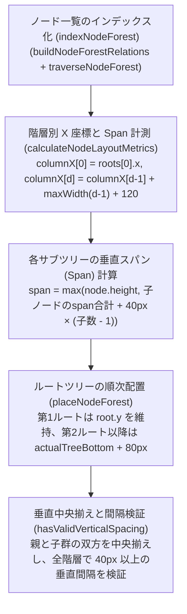
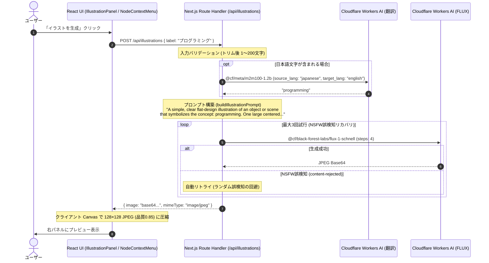

# Draw My Map 全機能仕様・操作マニュアル

本書は、**Draw My Map** が提供するすべての機能（Phase 0 〜 Phase 13 と、Phase 14 のうち兄弟ノードの順序変更と階層の上げ下げ。枝の複製、枝のコピー＆ペースト、ノード検索と移動、枝の折りたたみ・展開、複数マップの保存・切り替え、箇条書きからの追加、兄弟ノードの順序変更、階層の上げ下げを含む）の詳細な動作仕様およびユーザー操作マニュアルです。
グラフィックス描画エンジン（Pixi.js）、ツリー構造計算アルゴリズム、解像度フィルタリング、データ永続化・エクスポート、AI イラスト生成パイプラインの実装に厳密に準拠しています。

---

## 目次

1. [機能概要](#1-機能概要)
2. [キャンバス操作仕様](#2-キャンバス操作仕様)
3. [ノード基本操作仕様](#3-ノード基本操作仕様)
4. [自動レイアウト機能](#4-自動レイアウト機能)
5. [解像度フィルタリング機能（重要度システム）](#5-解像度フィルタリング機能重要度システム)
6. [データ永続化とエクスポート機能](#6-データ永続化とエクスポート機能)
7. [AI イラスト生成機能](#7-ai-イラスト生成機能)
8. [編集履歴（元に戻す / やり直す）](#8-編集履歴元に戻す--やり直す)
9. [ノード検索と移動](#9-ノード検索と移動)
10. [枝の折りたたみ・展開](#10-枝の折りたたみ展開)
11. [完全操作リファレンス](#11-完全操作リファレンス)
12. [複数マップ](#12-複数マップ)
13. [箇条書きからの追加](#13-箇条書きからの追加)
14. [兄弟ノードの順序変更](#14-兄弟ノードの順序変更)
15. [階層の上げ下げ](#15-階層の上げ下げ)

---

## 1. 機能概要

Draw My Map は、アイデアの創出、構造化、ビジュアル化をブラウザ完結でスムーズに行うためのマインドマップアプリケーションです。
Pixi.js による高速な 2D キャンバス描画と、React 19 による宣言的 UI を組み合わせ、直感的で滑らかな操作感を提供します。

### 1.1 フェーズ別機能マトリクス

`ROADMAP.md` のフェーズ定義に基づく機能一覧です。

| フェーズ | 主要機能 | 概要 |
| :--- | :--- | :--- |
| **Phase 0** | 基盤 | PixiJS キャンバス描画、ダブルクリックでのノード追加、ヘッダー+キャンバスレイアウト、ダークモード対応、高解像度対応、Jestテスト基盤 |
| **Phase 1** | ノード基本操作 | ルート・子・兄弟ノード作成、単一選択、ドラッグ移動、インラインラベル編集、ノード削除 |
| **Phase 2** | ノード間接続 | 三次ベジェ曲線による親子接続線描画、`Shift + ドラッグ` による親子接続の追加・付け替え、自己接続・循環参照防止 |
| **Phase 3** | キャンバス操作 | 背景ドラッグによるパン、カーソル基準のホイールズーム 0.25x〜4.0x、2本指ピンチズーム、`F` キーによるノードフォーカス、親移動時の子孫一括移動 |
| **Phase 4** | 自動レイアウト | 階層型ツリー自動整列アルゴリズム、重なり回避、手動配置 / 自動配置モード切替 |
| **Phase 5** | データの永続化・エクスポート | `localStorage` 300ms デバウンス自動保存、JSON インポート/エクスポート、PNG / SVG 画像エクスポート |
| **Phase 6** | 解像度フィルタリング | ノード重要度 `high`/`medium`/`low`、ズーム連動 Auto フィルタ、手動フィルタ切替、160ms フェードトランジション |
| **Phase 7** | AI イラスト生成 | Cloudflare Workers AI `m2m100-1.2b` + `FLUX.1 schnell` によるイラスト生成、128×128 JPEG 圧縮、右パネルプレビュー・設定・再生成・削除、コンテキストメニュー連携 |
| **Phase 8** | 編集履歴 | ノード編集・移動・配置モード変更の元に戻す / やり直す（最大100操作、メモリ上のみ）、ヘッダーボタン、`Ctrl`/`Cmd`+`Z` 系ショートカット |
| **Phase 9** | 枝の複製・コピー＆ペースト | ヘッダーの「枝を複製」ボタンによる、選択ノードと全子孫のアプリ内複製（ID再発行、手動 / 自動配置、1操作での Undo / Redo）。`Ctrl`/`Cmd`+`C`・`V` による専用形式でのクリップボード経由のコピー＆ペースト（別タブ・別マップへも貼り付け可、新しいルートとして追加、1操作での Undo / Redo） |
| **Phase 10** | ノード検索と移動 | ヘッダーからのラベル部分一致検索、現在のノード配列順で最大50件と総件数の表示、キー操作、隠れたノードの表示切り替え、選択と中央移動 |
| **Phase 11** | 枝の折りたたみ・展開 | ヘッダーの「枝を折りたたむ」/「枝を展開」による全子孫の表示切り替え（表示専用で保存・履歴の対象外）、全子孫数の表示、入れ子の指定の保持、解像度フィルターとの統合、自動配置の表示用座標、検索による閉じた祖先の展開 |
| **Phase 12** | 複数マップの保存・切り替え | 名前を付けたマップの新規作成、保存済みマップの一覧と切り替え、名前変更、削除（確認ダイアログ付き）、マップごとの自動保存、旧形式の単一マップの保存データの移行、切り替え時の編集履歴と非同期処理の破棄 |
| **Phase 13** | 箇条書きからマップを作成 | ヘッダーの「箇条書きから追加」で開くダイアログでの、インデント付きの箇条書きテキストの解析（タブ・半角スペース・全角スペースの深さ、行頭の記号と番号の除去、階層の補正と警告）、変換結果のプレビュー（先頭200件）、新しいルート（森）または選択中のノードの子としての一括追加（手動 / 自動配置）、取り込み全体を1操作とした Undo / Redo |
| **Phase 14** | ツリー構造の編集（兄弟ノードの順序変更、階層の上げ下げ） | ヘッダーの「上へ」「下へ」と `Alt`（`Option`）+ `↑` / `↓` による、選択中のノードの枝を同じ親の見えている兄弟（ルート同士を含む）の中で1つ上・1つ下へ移す並べ替え、自動配置でのドラッグによる並べ替え（挿入位置の青い線）、手動配置での縦位置の入れ替え、1操作での Undo / Redo（14 章）。ヘッダーの「階層を上げる」「階層を下げる」と `Alt`（`Option`）+ `←` / `→` による、選択中のノードの枝を見えている直前の兄弟の子にする（下げる）・元の親の直後の兄弟にする（上げる）階層の変更、手動配置での枝の平行移動、自動配置での再配置、1操作での Undo / Redo（15 章）。同じ Phase のほかの3項目（途中への親ノードの挿入、枝の切り取り・移動、ノードだけの削除）は未実装 |

### 1.2 アプリケーション画面レイアウト

```text
+------------------------------------------------------------------------------------------------------+
| MapLibraryNoticeRegion: シェルの通知（マップの作成・切り替え・削除の結果、起動時の通知。文言が無いときは高さを持たない） |
+------------------------------------------------------------------------------------------------------+
| AppHeader: [Draw My Map] [マップ: <名前>] [マップ一覧] [新しいマップ] [ノードを検索] [手動配置|自動配置] [操作ヒント] [重要度: 高|中|低] [表示: 自動|高のみ|中以上|すべて] [元に戻す|やり直す] [枝を折りたたむ|枝を展開] [枝を複製] [上へ|下へ] [階層を上げる|階層を下げる] [コピー/貼り付けの案内] [箇条書きから追加] [JSON/画像書き出し] |
| [操作通知バー（エディタ内の通知）]                                                                      |
+-----------------------------------------------------------------------------------+------------------+
| MapStage (Pixi.js 2D Canvas + DOM Overlay):                                       | IllustrationPanel|
|                                                                                   | (サイドパネル)    |
|   +--------------+         +--------------+                                       |                  |
|   |  ルートノード  |-------->|   子ノード    |                                       | [対象ノード情報]  |
|   +--------------+         +--------------+                                       |                  |
|           \                                                                       | [プレビュー画像]  |
|            \------->+--------------+                                              |                  |
|                     |   子ノード 2   |                                              | [ノードに設定]    |
|                     +--------------+                                              | [イラストを生成]  |
|                                                                                   |                  |
+-----------------------------------------------------------------------------------+------------------+
```

- **シェルとエディタ**: 画面の最上位（`app/page.tsx` の `Home`）はシェルで、マップの一覧の状態、ダイアログ、シェルの通知（`MapLibraryNoticeRegion`）を持ちます。ヘッダー以下の編集画面は `MapEditor`（`components/map/MapEditor.tsx`）で、シェルが現在のマップの id を `key` にして描画します。マップを切り替えると `MapEditor` が作り直されます（12.3 節）。
- **起動中の表示**: シェルは起動時の判定（12.9 節）が終わるまでエディタを描画せず、「マップを読み込んでいます…」を `role="status"` で表示します。
- **マップの操作**: ヘッダーの「Draw My Map」の直後に、現在のマップ名（「マップ: <名前>」）と「マップ一覧」「新しいマップ」ボタンを置きます（`MapLibraryControls.tsx`）。ボタンを押すと、画面中央にモーダルダイアログ（`MapLibraryDialog.tsx`）が開きます（12 章）。
- **箇条書きから追加**: ヘッダーの「箇条書きから追加」ボタン（`OutlineImportControl.tsx`。コピー／貼り付けの案内と「JSON書き出し」の間）を押すと、画面中央にモーダルダイアログ（`OutlineImportDialog.tsx`）が開き、箇条書きのテキストからノードをまとめて追加できます（13 章）。このダイアログは `MapEditor` が描画します。
- **兄弟の順序**: ヘッダーの「上へ」「下へ」ボタン（`NodeSiblingOrderControl.tsx`。「枝を複製」の右隣、コピー／貼り付けの案内の前）で、選択中のノードの枝を見えている兄弟の中で1つ上・1つ下へ移します（14 章）。
- **階層**: ヘッダーの「階層を上げる」「階層を下げる」ボタン（`NodeIndentControl.tsx`。「上へ」「下へ」の右隣、コピー／貼り付けの案内の前）で、選択中のノードの枝を元の親の兄弟にする・見えている直前の兄弟の子にします（15 章）。
- **通知の場所**: エディタ内の操作の通知（自動保存の失敗、JSON・画像の書き出し、箇条書きからの追加の成功など）はヘッダー下段の操作通知バーに出し、マップを切り替えると消えます。マップの作成・切り替え・開いているマップの削除の結果と起動時の通知は、ヘッダーの上の1行（シェルの通知）に出し、切り替えの後も残ります。

---

## 2. キャンバス操作仕様

キャンバスは無限平面の作業領域を提供し、ユーザーは自由な位置へ移動（パン）および拡大・縮小（ズーム）を行うことができます。

### 2.1 ビューポート座標系モデル

キャンバス内部は、画面上のピクセル座標（**Screen 座標**）と、キャンバス内の絶対位置（**World 座標**）の2つの座標系を持ちます。

- **Viewport 定義**: `client/src/components/map/mapViewport.ts`
  - `offsetX`: 水平方向の描画オフセット（初期値: `0`）
  - `offsetY`: 垂直方向の描画オフセット（初期値: `0`）
  - `scale`: 表示倍率（初期値: `1.0`）
- **スケール制限**:
  - 最小倍率 `MIN_VIEWPORT_SCALE`: **0.25x**（全体俯瞰）
  - 最大倍率 `MAX_VIEWPORT_SCALE`: **4.0x**（詳細閲覧）
- **座標変換式**:
  - $\text{Screen} = \text{World} \times \text{scale} + \text{offset}$
  - $\text{World} = \frac{\text{Screen} - \text{offset}}{\text{scale}}$

### 2.2 パン操作（キャンバスの平行移動）

キャンバス背景をドラッグすることで、画面の表示位置を自由に移動できます。

- **操作方法**:
  1. **マウス**: ノード以外のキャンバス背景上で左ボタンドラッグ
  2. **タッチ**: 背景領域を1本指でドラッグ
- **移動しきい値**: ドラッグ開始判定として **4px**（`dragThreshold = 4`）の移動判定しきい値を設けており、クリック操作時の微細なブレによる誤移動を防ぎます。
- **実装参照**: `client/src/components/map/pixi/canvasPanGesture.ts`

### 2.3 ズーム操作（拡大・縮小）

カーソル位置または指のピンチ中心を中心として、歪みなく滑らかにスケールを変更します。

- **操作方法**:
  1. **マウスホイール**: マウスホイールの回転、またはトラックパッドの2本指スクロール
  2. **ピンチ操作**: トラックパッドのピンチイン／ピンチアウト、またはタッチ対応端末での2本指ピンチジェスチャー
- **アンカーズーム挙動**:
  - ズームの中心（アンカー点）となるカーソルの指す World 座標は、拡大・縮小の前後で画面上の同じ位置に保たれます（`zoomViewportAt`）。
  - マウスホイール感度定数: `WHEEL_ZOOM_SENSITIVITY = 0.001`
  - スケール計算式: $\text{requestedScale} = \text{currentScale} \times e^{-\Delta \times 0.001}$
- **ホイールイベントのデルタ正規化 (`normalizeWheelDeltaY`, `calculateWheelZoomRequest` in `wheelZoom.ts`)**:
  - `deltaMode === 1` (`WHEEL_DELTA_MODE_LINE`): `deltaY * 16`
  - `deltaMode === 2` (`WHEEL_DELTA_MODE_PAGE`): `deltaY * pageHeight`（`runtime.app.screen.height`）
  - `deltaMode === 0` (ピクセル単位等): `deltaY` をそのまま使用
  - 倍率更新式 `clampViewportScale(currentScale * Math.exp(-delta * 0.001))` の結果が `currentScale` と等しい場合（`deltaY === 0` の場合や、最小倍率 `0.25x`・最大倍率 `4.0x` の上下限にすでに到達している場合）は `calculateWheelZoomRequest` が `null` を返し、`useMapWheelZoom` は `event.preventDefault()` を呼ばずにブラウザのデフォルト挙動を妨げません。有効なズーム要求が成立したときのみ `event.preventDefault()` と進行中ジェスチャーのキャンセル（`onBeforeZoom`）を実行します。
- **2本指ピンチズーム (`calculatePinchViewport` in `pinchViewport.ts`, `pinchZoomGesture.ts`, `touchGestureCoordinator.ts`)**:
  - 2本指タッチ開始時の2点間距離 `startDistance` と現在距離 `currentDistance` の比から `rawScale = startViewport.scale * (currentDistance / startDistance)` を算出し、`clampViewportScale(rawScale)` でクランプします。
  - **初期座標が同一（距離0）のときのベースライン遅延確定 (`waitingForBaseline` in `pinchZoomGesture.ts`)**: 2本指の初期スクリーン座標 `startFirst`, `startSecond` が完全に同一（距離 `0`）または非有限で `!hasFinitePositiveDistance(startFirst, startSecond)` となった場合は、`waitingForBaseline = true` としてピンチ計算を保留します。その後、後続の `move` イベントで2点間に正の有限距離（`hasFinitePositiveDistance(first, second) === true`）が得られた最初の時点で `startFirst = { ...first }`, `startSecond = { ...second }` をベースラインとして確定（`waitingForBaseline = false`）し、以降の `move` から `calculatePinchViewport` によるズーム・パン更新を開始します。
  - 開始時の2点の中点 `startCenter`（`x = a.x / 2 + b.x / 2`, `y = a.y / 2 + b.y / 2`）をアンカーとして `zoomViewportAt` を適用したうえで、現在の中点 `currentCenter` との移動差分（`deltaX = currentCenter.x - startCenter.x`, `deltaY = currentCenter.y - startCenter.y`）を `panViewport` で加算し、ピンチズームと2本指パンの同時追従を行います。
  - **単一ポインタ操作との排他制御**: 2本目のタッチ（`pointerType === "touch"`）が検出された時点で、`onBeforePinch()` により進行中の単一ポインタ操作（キャンバスパンやノード移動等）を即時キャンセルしてピンチズームへ移行します。ピンチ終了またはキャンセル後は、タッチ中のすべての指が画面から離れるまで（`suppressUntilAllReleased = true`、かつ `samples.size === 0` になるまで）単一ポインタ操作の再開を抑止し、指を離す際の意図しないジャンプや誤ドラッグを防止します。
- **実装参照**:
  - `client/src/components/map/wheelZoom.ts`
  - `client/src/components/map/useMapWheelZoom.ts`
  - `client/src/components/map/pixi/pinchViewport.ts`
  - `client/src/components/map/pixi/pinchZoomGesture.ts`
  - `client/src/components/map/pixi/touchGestureCoordinator.ts`

### 2.4 ノードフォーカス機能（`F` キー）

広大なマップ上で作業している際、選択中のノードを即座に画面中央へセンタリングするショートカット機能です。

- **操作方法**: ノードを選択した状態で、キーボードの **`F`** キーを押下
- **挙動**:
  - 現在の表示倍率（`scale`）を維持したまま、選択中ノードの中心座標 $(x + \frac{w}{2}, y + \frac{h}{2})$ が画面の中央に来るよう `offsetX` と `offsetY` が再計算されます。
  - 自動配置で枝を折りたたんでいる間は、正本の `x, y` ではなく、表示中の枝を詰めた表示用座標で中心を求めます（10.4 節）。
- **誤動作防止条件**:
  - テキスト編集中（`<input>` や `contenteditable` にフォーカスがある状態）はフォーカス移動は発火しません。
  - ドラッグやジェスチャーの操作中、またはノードが未選択の場合は無効化されます。
- **実装参照**:
  - `client/src/components/map/nodeViewportFocus.ts`
  - `client/src/components/map/viewportFocusShortcut.ts`

---

## 3. ノード基本操作仕様

マインドマップを構成するノードの追加、編集、移動、接続、削除の仕様です。

### 3.1 ノードの形状と構造

- **ノードデータ型**: `client/src/types/node.ts`
  ```typescript
  type Node = {
    id: number;
    parentId: number | null;
    x: number;
    y: number;
    width: number;
    height: number;
    label: string;
    importance: NodeImportance; // "high" | "medium" | "low"
    illustration?: string;      // 縮小済み JPEG data URL
  };
  ```
- **ノード寸法定数**: `client/src/config/shapes.ts`
  - 基本幅 `RECT_WIDTH`: **100px**
  - 基本高さ `RECT_HEIGHT`: **60px**
  - イラスト付きノード高さ `ILLUSTRATED_NODE_HEIGHT`: **116px**（`RECT_HEIGHT + ILLUSTRATION_AREA_HEIGHT`）
    - イラスト表示サイズ `ILLUSTRATION_SIZE`: **48px × 48px**（上部余白 `ILLUSTRATION_TOP_PADDING = 8px`、イラスト領域高さ `ILLUSTRATION_AREA_HEIGHT = 56px`）
- **形状とスタイリング** (`renderMapNodes.ts`, `mapSvgNodes.ts`):
  - **形状**: 角丸なしの**直角矩形**（Pixi.js の `graphics.rect(node.x, node.y, node.width, node.height)`、SVG エクスポートの `<rect>` ともに `rx`/`ry` なし）。
  - **背景色 (`fill`)**:
    - 通常時: `#ffffff`（`0xffffff`、ダークモード時もキャンバス上のノード背景は白固定）
    - 選択時 (`isSelected`): `#eff6ff`（`0xeff6ff`）
    - 接続ターゲット候補ハイライト時 (`isConnectionTarget`): `#ecfdf5`（`0xecfdf5`、選択時より優先）
  - **枠線 (`stroke`)**:
    - 通常時: 線幅 **2px**、色 `#3b82f6`（`0x3b82f6`）
    - 選択時 (`isSelected`): 線幅 **3px**、色 `#2563eb`（`0x2563eb`）
    - 接続ターゲット候補ハイライト時 (`isConnectionTarget`): 線幅 **3px**、色 `#10b981`（`0x10b981`、選択時より優先）
- **イラスト描画領域 (`getNodeIllustrationRect` in `nodeIllustration.ts`)**:
  - サイズ: `48px × 48px`（`size = ILLUSTRATION_SIZE = 48`）
  - X 座標: `node.x + (node.width - 48) / 2`（水平中央、幅 100px の場合は `node.x + 26`）
  - Y 座標: `node.y + 8`（ノード上端から `ILLUSTRATION_TOP_PADDING = 8px` 下）
- **ラベル描画位置 (`getNodeLabelCenterOffset` in `nodeIllustration.ts`, `createNodeLabelText` in `renderMapNodes.ts`)**:
  - フォントサイズ: `14px`、文字色: `#27272a`（`0x27272a`）、折り返し幅 (`wordWrapWidth`): `node.width - 16`（標準幅 100px のとき **84px**）、水平揃え (`align`): `"center"`、アンカー: `0.5`（中央基準）。
  - 中心 X 座標: `node.x + node.width / 2`
  - 中心 Y 座標オフセット (`getNodeLabelCenterOffset`): `node.height / 2 + (node.illustration === undefined ? 0 : 28)`（`ILLUSTRATION_AREA_HEIGHT / 2 = 28`）。イラストなし（高さ 60px）では上端から **30px**、イラストあり（高さ 116px）では上端から **86px**（下部 60px のラベル領域の中央）。
  - インライン編集中 (`isEditing: node.id === editingNodeId`) のノードでは、DOM `<input>` との二重描画を防ぐため Pixi.js 側の `Text` オブジェクトを描画しません（非表示）。

### 3.2 ノードの新規作成

ノードの作成方法は、操作コンテキストに応じて 3 種類提供されています。

| 作成操作 | トリガー | 配置先と親子関係 | 作成後の状態 |
| :--- | :--- | :--- | :--- |
| **ルートノード作成** | キャンバス背景を**ダブルクリック** | クリックした World 座標を中心として配置（`parentId: null`） | 空ラベル（`label: ""`、画面表示は「新しいノード」）のルートノードとして配置される（自動選択やインライン編集の即時開始は行わない） |
| **子ノード作成** | ノード選択中に **`Tab`** キー | 選択ノードの右側に自動配置（`parentId: 親ノードID`） | 新規作成された子ノードを選択し、直ちにインラインラベル編集を開始。選択ノードが折りたたまれていた場合は、追加に成功したときだけその親を展開し、新規ノードの編集が見える状態にする（10.1 節）。解像度フィルターによる非表示の扱いは変えない |
| **兄弟ノード作成** | ノード選択中に **`Enter`** キー | 選択ノードと同じ `parentId` を持つ兄弟として下方に配置（ルート選択中なら `parentId: null` の別ルート） | 新規作成された兄弟ノードを選択し、直ちにインラインラベル編集を開始 |

- **初期配置座標計算** (`client/src/domain/nodes/nodePlacement.ts`):
  - 新規ノードの初期プロパティは `width: 100` (`RECT_WIDTH`)、`height: 60` (`RECT_HEIGHT`)、`label: ""`、`importance: "medium"` (`DEFAULT_NODE_IMPORTANCE`) です。
  - **ルートノード (`createRootNode`)**: ダブルクリックされた World 座標 `(centerX, centerY)` に対し、矩形の中心が一致するよう `(centerX - 50, centerY - 30)`（`centerX - RECT_WIDTH / 2`, `centerY - RECT_HEIGHT / 2`）に配置されます。
  - **子ノード (`createChildNode`)**:
    - X 座標: `parent.x + parent.width + 120`（`CHILD_HORIZONTAL_GAP = 120`、標準幅 100px の親なら `parent.x + 220`）
    - Y 座標: 既存の兄弟ノード（同じ `parentId` を持つノード）が 0 件なら `parent.y`、1 件以上存在する場合は全既存兄弟の下端最大値 `Math.max(...siblings.map((n) => n.y + n.height)) + 40`（`SIBLING_VERTICAL_GAP = 40`）
  - **兄弟ノード (`createSiblingNode`)**:
    - 親 ID: `source.parentId`（選択中ノードがルート `parentId === null` の場合は、新しいノードも `parentId = null` の別ルートノードになります）
    - X 座標: `source.x`
    - Y 座標: 同じ `parentId` を持つ全兄弟ノード（`source` 自身や、ルートの場合は全ルートノードを含む）の下端最大値 `Math.max(...siblings.map((n) => n.y + n.height)) + 40`（`SIBLING_VERTICAL_GAP = 40`）
  - 自動レイアウトモード（`layoutMode === "auto"`）時は、上記で初期生成された直後に `layoutNodeForest` が適用され、ツリー全体の整列座標へ即座に再配置されます。
- **ノード ID 採番仕様** (`nodeIdGenerator.ts`, `nodeIdAllocator.ts`):
  - `createMonotonicIdGenerator` は現在時刻ミリ秒 `Date.now()` を基準とし、同一ミリ秒内の連続生成や時計の逆行時にも `previousId === null ? currentTime : Math.max(currentTime, previousId + 1)` によって狭義単調増加する正の整数を生成します。
  - `createNodeIdAllocator` の一括採番 `nextAvailableIds(nodes, count)` は、現在マップ上に存在する全ノードの ID 集合（`occupiedIds`）を1回だけ作り、生成した ID が集合にあれば飛ばし、採番した ID も集合に加えながら `count` 個を返します。既存 ID とも、返す ID 同士とも衝突しません。単数の `nextAvailableId(nodes)` は同じ規則で1個だけ採番します（`nextAvailableIds(nodes, 1)[0]`）。枝の複製と枝の貼り付けでは、どちらも対象のノード数ぶんを一括採番で1回で得ます。
  - マップ全体の置換時（`replaceMap`: `localStorage` からの初期復元や JSON ファイルのインポート時）には `allocator.reset()` が呼ばれ、内部ジェネレーターの状態がリセットされます。

### 3.3 ノードの選択と解除

- **選択**: ノードをクリックすると選択状態となり、青い太枠線（`3px`, `#2563eb`）と薄青背景（`#eff6ff`）でハイライト表示されます。ヘッダーの「重要度」セレクター、「枝を折りたたむ / 枝を展開」ボタンと「折りたたみで非表示: N件」（10.1 節）、「枝を複製」ボタン（未選択時は無効）、`Ctrl`/`Cmd` + `C` のコピー対象（選択ノードとその子孫）、右パネルの「イラスト」が選択中ノードに連動します。
- **選択解除**: キャンバスの空き背景をクリックすると、選択が解除されます。
- **重なり時のヒットテスト優先順** (`findNodeAtPoint` in `mapGeometry.ts`):
  - ダブルクリック判定、コンテキストメニューの対象判定、接続先ターゲット判定等で用いられる `findNodeAtPoint(nodes, point)` は、`nodes` 配列を**末尾から先頭へ逆順走査**（`index = nodes.length - 1` から `0` へ）し、`point.x >= node.x && point.x <= node.x + node.width && point.y >= node.y && point.y <= node.y + node.height`（境界線上の点を含む閉区間）を満たす最初の可視ノードを返します。また Pixi.js の描画順も配列順で `stage.addChild` されるため、ノード同士が重なっている場合は常に**最前面（配列の末尾側）の可視ノード**が優先されます。配列の順は、ノードを追加した順を基本とし、兄弟の並べ替え（14 章）では、動かした枝の根ノードの配列の位置が変わります。

### 3.4 テキスト編集（インライン編集）

日本語 IME 入力や確定・キャンセルの挙動に完全対応したインラインエディタです。

- **編集開始**: 可視ノードを**ダブルクリック**する、または `Tab` / `Enter` キーで子・兄弟ノードを新規作成する。
- **エディタ UI とレイアウト追従** (`NodeLabelEditor.tsx`, `nodeLabelEditorLayout.ts`):
  - `getNodeLabelEditorLayout(node, viewport)` により、現在のビューポートのパン・ズーム（`viewport.scale`）に完全追従した座標・サイズ・フォントサイズ（`14 * viewport.scale`）で HTML `<input type="text">` 要素が DOM オーバーレイ表示されます。
  - **イラスト領域の回避 (`topInset`)**: `topInset = getNodeLabelCenterOffset(node) * 2 - node.height` により、イラストなしノードでは `topInset = 0`（ノード全体 `100×60px` に重畳）、イラスト付きノード（高さ `116px`）では `topInset = 56px`（`ILLUSTRATION_AREA_HEIGHT`）となり、上部のイラスト表示領域を避けて**下部 `60px` のラベル領域のみ**に `<input>` が重畳されます。
  - 編集開始時は既存のラベルテキスト（`node.label`）が入力欄にセットされた状態で**自動フォーカス（`autoFocus`）**されます（テキスト全選択は行いません）。
- **確定とキャンセル**:
  - **`Enter` キー**: `event.currentTarget.blur()` を呼び出し、テキストを確定して編集を終了する。
  - **フォーカスアウト (Blur)**: 入力枠外をクリックした際もテキストを確定して編集を終了する（`actionHandledRef` により二重確定やキャンセル後の誤確定を防止）。
  - **`Escape` キー**: 編集を破棄（キャンセル）し、編集前のテキストのままエディタを閉じる。
- **空文字確定時のデータ保持と表示フォールバック** (`nodeDisplayLabel.ts`, `nodeLabel.ts`):
  - 空文字 `""` のまま確定した場合、ノードデータの `node.label` 自体は空文字 `""` のまま保持されます。
  - キャンバス描画、右サイドパネルの表示、および SVG/PNG エクスポート時には `getNodeDisplayLabel(node.label)`（`label || FALLBACK_NODE_LABEL`）を通すことで、表示上のみデフォルト名「**新しいノード**」にフォールバックされます（再度ダブルクリックして編集を開くと、入力欄は空文字 `""` の状態で開きます）。

### 3.5 ノード削除

- **操作方法**: ノードを選択した状態で、**`Delete`** または **`Backspace`** キーを押下。
- **サブツリー連動削除の仕様**:
  - 親ノードを削除した場合、そのノードのみならず**配下の子・孫などすべてのサブツリーノードが一括して削除**されます（`collectSubtreeIds` による探索）。表示フィルターや枝の折りたたみで隠れている子孫も削除します（10.4 節）。
  - 削除されたサブツリー内に選択状態のノードが含まれていた場合、選択は安全に解除（`null`）されます。

### 3.6 ドラッグ移動と子孫連動移動

手動レイアウト時、ノードを直感的にドラッグして移動できます。

- **ドラッグ判定**: 4px（`dragThreshold = 4`）以上のポインタ移動でドラッグ状態へ移行。
- **子孫連動移動（サブツリー移動）**:
  - 親ノードをドラッグして移動させると、その親に連なる**すべての子孫ノードが相対座標（$\Delta x, \Delta y$）を完全に維持したまま一体となって追従移動**します（`moveNodeSubtree`）。
  - 木の途中のノードをドラッグした場合は、そのノードを頂点とする部分木のみが追従し、先祖ノードや別の兄弟ノードの位置は変化しません。
  - 枝を折りたたんだ親をドラッグすると、隠れている子孫も同じ量だけ動き、展開すると移動後の位置に現れます（10.4 節）。
- **自動配置のとき**: ノードのドラッグは位置の移動ではなく、同じ親の兄弟の中での順序の変更になります（14.3 節）。

### 3.7 ノード間の接続（エッジ作成）

離れたノード同士をドラッグ操作で直感的に親子関係として接続できます。

- **操作方法** (`nodeConnectionGesture.ts`):
  - **`Shift` + ノードドラッグ**: 接続元（親となるノード）上で `Shift` キーを押しながら左ボタン押下（`pointerdown`）すると、4px の移動しきい値を待たずに直ちに接続ジェスチャーが開始され、接続元ノードが選択状態になります。
  - **接続先ターゲットのハイライト表示**: ドラッグ中に接続ガイドラインは描画されず、ポインタ位置（`findNodeAtPoint` による最前面の可視ノード）が `canConnectNodes(nodes, sourceNodeId, target.id)` を満たす接続可能なノード上にあるとき、そのターゲット候補ノードが**エメラルドグリーンの太枠線（`3px`, `#10b981`）と薄緑背景（`#ecfdf5`）**でハイライトされます（`connectionTargetNodeId`）。
  - 接続可能なターゲットノード上でドロップ（`pointerup`）すると接続が確定します。
- **親子関係の更新**:
  - ターゲットノードの `parentId` が接続元ノードの ID に更新され、以前の親からは自動的に付け替えられます（自動レイアウトモード時は即座にツリー全体が再整列されます）。
  - 接続完了時、ターゲットとなった子ノードが自動的に選択状態になります。ただし、接続先の親が折りたたまれている場合は親を開かないため（Tab で子を追加したときとは異なり、親は閉じたまま）、接続した子は隠れ、既存の非表示時のリセットにより選択も外れます（10.4 節）。
  - 見えている直前の兄弟の子にする付け替えと、祖父母の子（元の親の直後の兄弟）にする付け替えは、ドラッグを使わずに階層の上げ下げ（15 章）でも行えます。
- **接続バリデーション (`canConnectNodes` in `nodeTree.ts`)**:
  - `canConnectNodes(nodes, parentId, childId)` が検査する拒否条件（`false` を返す条件）は、①**自己接続**（`parentId === childId` の自己ループ）、②**存在しないノード ID**（`!nodesById.has(parentId) || !nodesById.has(childId)`）、③**循環参照および既存グラフ内のサイクル検出**（`!hasAncestorOrCycle(nodesById, parentId, childId)`：親候補 `parentId` から `parentId` チェーンを遡った際に `childId` に到達する場合や、既存チェーン内にサイクルが存在する場合）の **3 条件のみ**です。
  - すでに同じ親に接続済み（`child.parentId === parentId`）の場合は `canConnectNodes` は `true` を返し、ターゲット候補のハイライトおよびドロップ時の `connectNodeTree` が実行されます。ノードは単一の `parentId` プロパティのみを持つ構造であるため重複エッジは発生せず、同一の `parentId` が冪等に維持（および選択状態が子ノードへ更新）されます。
- **親子接続線（三次ベジェ曲線）の描画仕様** (`getNodeEdgeCurve` in `nodeEdgeCurve.ts`, `renderMapEdges.ts`):
  - 親ノードの右端中央を始点 `start = { x: parent.x + parent.width, y: parent.y + parent.height / 2 }`、子ノードの左端中央を終点 `end = { x: child.x, y: child.y + child.height / 2 }` とします。
  - 水平中間点 `controlX = start.x / 2 + end.x / 2`（数値オーバーフローを防ぐため `(start.x + end.x) / 2` ではなく個別に 2 で割って加算）を用い、第1制御点 `control1 = { x: controlX, y: start.y }`、第2制御点 `control2 = { x: controlX, y: end.y }` とする滑らかな水平S字の三次ベジェ曲線を描画します。
  - スタイルは線幅 **2px**、色 `#64748b`（`0x64748b`、スレートグレー）で、エッジ自体はポインタイベントを受け取りません（`eventMode = "none"`）。

### 3.8 枝の複製

- **操作方法**: ノードを選択し、ヘッダーの **「枝を複製」** ボタンを押下（ノード未選択時は無効）。右クリックメニューや専用のショートカットはありません。クリップボード経由のコピー＆ペースト（3.9 節）は別の機能です。
- **複製の対象**: 選択ノードと全子孫。表示フィルターや枝の折りたたみで隠れている子孫も含めます。複製した新しいIDには折りたたみ指定を引き継ぎません。元のノードと、枝の外のノードは変更しません。
- **親子関係**: 選択ノードがルートなら複製もルート、親があれば複製は同じ親の子になります。子孫の親は、対応する複製側のノードになります。複製したすべてのノードに、未使用の新しいIDを割り当てます。
- **引き継ぐ内容**: ラベル（接尾辞は付けない）、重要度、イラスト、幅、高さ。イラストは既存の画像データを共有し、再生成しません（画像はメモリ上では共有しますが、`localStorage` への保存と JSON 書き出しではノードごとに書き出されるため、イラスト付きの枝を複製すると保存サイズは画像の数だけ増えます）。
- **配置**:
  - 手動配置では、マップ全体の下端から 40px 空けた位置へ、枝の形を保ったまま真下へ平行移動して置きます（x は変わらない）。大きなマップでは離れた位置になるため、`F` キーで複製したノードへ移動できます。
  - 自動配置では平行移動せず、既存の自動配置に任せて、同じ親の子（またはルート）として整列します。
- **複製後の状態**: 複製した枝の根が選択され、「枝を複製しました。Fキーで選択ノードへ移動できます。」と通知されます。viewport は動かしません。通知は次の複製で新しい結果に置き換わり、元に戻す / やり直すの成功や JSON 読み込みの成功（マップの置き換え）で消えます。JSON 読み込みに失敗したときは消えません。
- **失敗**: 対象ノードが存在しないとき、手動配置で座標が表現できる範囲を超えて間隔を確保できないとき、自動配置で並べられないときは、いずれも「枝を複製できませんでした。」と通知します。マップ、選択、履歴は変わりません。
- **Undo / Redo**: 複製全体（自動配置での再配置を含む）を 1 操作として扱います。元に戻すと枝全体が消え、やり直すと同じID・画像・座標で戻ります。ダブルクリックは 2 回の複製として扱い、Undo は 1 回ずつ戻します。
- **ラベル編集中**: ボタンを押すと、入力中のラベルを確定してから、その値で複製します。
- **フォーカスとキー操作**: アプリは複製後にフォーカスを移さず、ボタンにフォーカスがあればそのまま残ります（Safari と macOS の Firefox では、ブラウザの仕様でクリックによってボタンにフォーカスが入りません）。`F` キーは、ボタンにフォーカスがある状態でも使えます。ボタン上で `Enter` を押し続けても、連続して複製しません（1 回だけ）。
- **保存**: 複製後のマップは通常どおり 300ms デバウンスで `localStorage` に保存されます。保存形式（V3）は変わりません。

### 3.9 枝のコピー＆ペースト

選択ノードと全子孫を OS のクリップボードへコピーし、同じ画面・別タブ・別マップへ貼り付けます。ブラウザが発火する `copy` / `paste` イベントを使うため、`Ctrl`/`Cmd` + `C`・`V` で操作します。ブラウザの編集メニューからも動く場合がありますが、選択範囲が無いと項目が無効になる環境があり、実ブラウザでは未確認です（browser-test-cases.md の L-11）。専用のコピーボタン・貼り付けボタンはなく、ヘッダーに案内「枝をコピー: Ctrl/Cmd+C ／ 貼り付け: Ctrl/Cmd+V（新しいルートとして追加）」を常時表示します。

- **コピー**: ノードを選択して `Ctrl`/`Cmd` + `C`。選択ノードと全子孫（表示フィルターや枝の折りたたみで隠れている子孫も含む）を、その時点のスナップショットとして保存します。選択ノードの `parentId` は `null` に切り離して保存するため、元の親は含まれません。コピーはマップ、選択、履歴を変えず、コピー後に元を編集・削除してもクリップボードの内容は変わりません。ノードを選択していないときは何もしません。
- **貼り付け**: `Ctrl`/`Cmd` + `V`。クリップボードの枝を、常に**新しいルート**として追加します。選択中のノードの子にはならず、ノードを選択していなくても貼り付けられます（親へ付けたい場合は `Shift` + ドラッグで接続します）。全ノードに未使用の新しい ID を割り当て、枝内の親子関係・座標の相対位置・幅・高さ・ラベル・重要度・イラストを引き継ぎます。成功すると、貼り付けた枝の根が選択されます。折りたたみ指定は引き継がず、閉じた枝をコピーして貼り付けても、貼り付けた枝はすべて展開した状態で追加します（元の枝は閉じたまま。10.4 節）。viewport は動かしません。`Ctrl`/`Cmd` + `V` を押し続けると、キーリピートの回数だけ 1 回ずつ貼り付けます（各回が Undo の 1 操作）。
- **配置**（貼り付け先の最新のレイアウトモードに従い、コピー元のモードは持ち込みません）:
  - 手動配置でマップにノードがあるとき: 枝の形を保ったまま、マップ全体の下端から 40px 空けた位置へ真下に平行移動して置きます（x は変わりません）。
  - 手動配置で空のマップのとき: コピー時の座標のまま置きます。
  - 自動配置: 平行移動せず、既存の自動配置に任せて新しいルートとして整列します。
- **コピーの形式**: `text/plain` に次の専用 JSON を書き込みます。`rootId` は持たず、`parentId: null` のノードが唯一の根です。元の ID、配列の順序、座標、寸法、ラベル、重要度、設定済みのイラストを保存します。生成中の画像やプレビューは含みません。
  ```json
  {"type":"draw-my-map/subtree","version":1,"nodes":[{"id":1,"parentId":null,"x":0,"y":0,"width":100,"height":60,"label":"例","importance":"medium"}]}
  ```
  別アプリへ貼り付けると、この JSON 文字列がそのまま入ります。マップの V3 保存形式は変わらず、`localStorage` と JSON 書き出しには貼り付け後のマップだけが通常の形式で保存されます。
- **貼り付けの検証**: 外部入力として扱い、`type` / `version`、空でない `nodes` 配列、単一の根を検証します。各ノードは V3 のノードとして検証し、既知の項目だけで作り直します（イラストは V3 の Data URL と寸法の検証・高さ補正を適用）。ID の重複、循環、存在しない親、複数の根は拒否します。普通の文章、JSON マップ（`MapDocument`）、画像ファイル、他形式の JSON は枝として貼り付けられません。HTML の描画や外部 URL の読み込みもしません。
- **上限**: 文字数 5,000,000（UTF-16 コード単位。`string.length`）、ノード数 10,000。コピーにも貼り付けにも同じ上限を適用します。超過したコピーは失敗し、直前のクリップボードの内容を上書きしません。貼り付けでは、文字数を `JSON.parse` の前に、ノード数を各ノードの検証の前に判定します。
- **入力・選択・編集中の優先**: 次のときは何もせずブラウザ標準の動作に任せます（通知も出しません）。
  - イベントの対象、またはフォーカス中の要素が、入力欄・`<textarea>`・`<select>`・`contenteditable`。
  - ページ上の文字（DOM の範囲選択）を選択している。選択を解除すると、マップの操作に戻ります。
  - ノードのラベル編集中。
  - ドラッグなどのジェスチャーの途中（ジェスチャー中のコピーに中間座標を取り込まないため）。
  - 他の処理がすでにそのイベントを処理済み（`defaultPrevented`）。

  なお、ヘッダーのボタンにフォーカスがあっても、編集可能な要素でなければ、ブラウザに任せずに枝のコピー・貼り付けとして処理します。
- **失敗**: コピーが失敗（例外、`clipboardData` が無い、上限超過）しても `preventDefault` はせず、ブラウザの既定動作に任せます（`setData` せずに止めると、直前のクリップボードの内容を空で上書きしうるため）。貼り付けが失敗（`clipboardData` が無い、取得の例外、非対応形式、配置不能）しても、マップ、選択、履歴、Redo は変わりません。失敗した貼り付けで採番した ID は欠番になりえます。
- **通知**:

  | 場面 | 種別 | メッセージ |
  | :--- | :---: | :--- |
  | コピー成功 | `status` | 枝をコピーしました。 |
  | 貼り付け成功 | `status` | 枝を貼り付けました。Fキーで選択ノードへ移動できます。見えない場合は表示を『すべて』に切り替えてください。 |
  | コピー失敗 | `error` | 枝をコピーできませんでした。 |
  | 非対応・不正な貼り付け | `error` | 貼り付ける枝データが無効です。 |
  | 上限超過（コピー・貼り付け共通） | `error` | 枝データが大きすぎます（10,000ノード・5,000,000文字以内）。（数値は codec の `MAX_SUBTREE_CLIPBOARD_NODES` / `MAX_SUBTREE_CLIPBOARD_LENGTH` から組み立てる） |
  | 取得・配置の失敗 | `error` | 枝を貼り付けできませんでした。 |

  通知は次のコピー／貼り付けの要求で新しい結果に置き換わり、元に戻す / やり直すの成功や JSON 読み込みの成功（`documentRevision` の変化）で消えます。枝の複製の通知とは独立した枠で表示し、互いに消しません。対象外のイベントでは通知を変えません。
- **貼り付けた枝が見えない場合**: コピー時に重要度が低い枝は、貼り付け後も重要度を保持します。現在の表示フィルターは維持するため、貼り付けた枝が見えず、選択が外れる場合があります。表示を「すべて」に切り替えると現れます。
- **Undo / Redo**: 貼り付け（自動配置での再配置を含む）を 1 操作として扱います。貼り付けの成功は「やり直す」の履歴を破棄します。元に戻すと貼り付けた枝全体が消え、やり直すと同じ ID・画像・座標で戻ります。コピーは履歴に記録しません。
- **対象ブラウザ**: Chrome と Firefox を必須とします。Safari は、選択範囲が無い状態で `copy` / `paste` イベントが発火しない場合があり、その場合は既知の制約です（キー入力とクリップボード API による代替経路は設けていません）。実ブラウザでの実キーボードの確認は未実施で、手順は `docs/testing/browser-test-cases.md` の L 節にあります。
- **対象外**: 切り取り、普通の文章の貼り付け（`Ctrl`/`Cmd` + `V`）からのノード生成（箇条書きのテキストからの追加は 13 章のダイアログで行う）、画像ファイルの貼り付け、専用のコピーボタン・貼り付けボタン。
- **枝の複製（3.8 節）との違い**: 複製はヘッダーのボタンで、選択ノードと同じ親の下（ルートならルート）に置きます。貼り付けは常に新しいルートで、選択に依存せず、別タブ・別マップへも渡せます。

---

## 4. 自動レイアウト機能

マインドマップのノード群を、階層構造に基づいて美しく自動整列する機能です。

### 4.1 手動モード (manual) と自動モード (auto)

ヘッダーの「レイアウトモード」切り替えコントロールから即座に切り替え可能です。

- **手動配置 (`manual`)**:
  - ユーザーが自由に配置した座標 $(x, y)$ をそのまま保持します。
  - ノードの追加・削除・接続を行っても、他のノードの位置は自動移動しません。
- **自動配置 (`auto`)**:
  - ツリー構造の変更（ノード追加、削除、親子接続、枝の複製、枝の貼り付け、箇条書きからの追加、イラスト追加・削除によるノード伸縮など）が発生するたびに、レイアウトエンジンが自動的に全ノードの理想座標を再計算します。
  - ノードのドラッグは位置の移動ではなく兄弟の順序の変更になり（14 章）、常に整然としたツリーが保たれます。
  - 枝を折りたたんでいる間は、表示されている枝だけを詰めた表示用の座標で描画します。保存される座標は変わりません（10.2 節）。

### 4.2 レイアウトアルゴリズム仕様

Draw My Map の自動レイアウトは、単一ツリーだけでなく複数のルートノードが存在する**フォレスト（森林）構造**に完全対応しています。

- **ルートと兄弟の順序**: ルート同士と、同じ親の子同士は、ノード配列の順に上から並びます。箇条書きからの追加（13 章）では、取り込んだノードを配列の末尾へ入力の順に足すため、新しいルートとして追加した森は既存のすべての木の下に入力の順で並び、子として追加した項目は既存の兄弟の後ろ（下）に並びます。この順は、兄弟ノードの順序変更（14 章）で後から変えられます。並べ替えで先頭のルートが変わるときは、新しい先頭のルートが旧先頭のルートのノードの `x` / `y` を引き継ぎ、それを基準に全体を配置し直します（14.5 節）。

- **実装モジュール**:
  - `client/src/domain/nodes/nodeAutoLayout.ts` (`layoutNodeForest`)
  - `client/src/domain/nodes/nodeLayoutForest.ts` (`indexNodeForest`)
  - `client/src/domain/nodes/nodeLayoutForestRelations.ts` (`buildNodeForestRelations`: ノードの有限値・正寸法・ID重複・親存在の検証、および `roots` と `childrenByParent` の構築)
  - `client/src/domain/nodes/nodeLayoutForestTraversal.ts` (`traverseNodeForest`: 非再帰スタックによるサイクル検出、および `depthById`・深さ別リスト `nodesByDepth`・後順走査リスト `postOrder` の構築)
  - `client/src/domain/nodes/nodeLayoutGeometry.ts` (`calculateNodePositions`)
  - `client/src/domain/nodes/nodeLayoutMetrics.ts` (`calculateNodeLayoutMetrics`)
  - `client/src/domain/nodes/nodeLayoutPlacement.ts` (`placeNodeForest`)
  - `client/src/domain/nodes/nodeLayoutSpacing.ts` (`hasValidVerticalSpacing`)
  - `client/src/domain/nodes/nodeLayoutArithmetic.ts` (`checkedAdd`, `checkedSubtract`, `checkedMultiply`, `calculateRoundingTolerance`, `calculateGapRoundingTolerance`, `hasSufficientGap`)

#### 主要パラメータと間隔定数

| 定数名 | 設定値 | 役割 |
| :--- | :--- | :--- |
| `CHILD_HORIZONTAL_GAP` | **120px** | 各階層（深さ $d-1$ の最大ノード幅の右端）から次の階層（深さ $d$ の左端）までの水平距離 |
| `SIBLING_VERTICAL_GAP` | **40px** | 同一の親を持つ兄弟サブツリー間の垂直間隔（および同一深さの隣接ノード間の最小垂直間隔） |
| `TREE_VERTICAL_GAP` | **80px** | 異なるルートツリー同士の実際の描画下端から次ツリーの上端までの垂直間隔（`SIBLING_VERTICAL_GAP * 2`） |

#### アルゴリズムの動作ステップ



1. **フォレスト分割と深さ別列 X 座標の決定 (`indexNodeForest`, `calculateNodeLayoutMetrics`)**:
   - `buildNodeForestRelations` で全ノードの座標・寸法の有効性と親子関係を検証して `parentId === null` のルート群（`roots`）と親子マップ（`childrenByParent`）を構築し、`traverseNodeForest` で深さ（`depth`）ごとのノードリスト `nodesByDepth` と後順（ボトムアップ）リスト `postOrder` を構築します（孤立参照やサイクルがある不正グラフの場合は `null` を返して中断）。
   - 各深さ $d$ における最大ノード幅 $\text{maxWidth}(d) = \max_{n \in \text{level}[d]} n.\text{width}$ を求め、列 X 座標 `columnX` を以下の漸化式で決定します：
     - $\text{columnX}[0] = \text{roots}[0].x$（第1ルートノードの現在の X 座標を基準とする）
     - $\text{columnX}[d] = \text{columnX}[d - 1] + \text{maxWidth}(d - 1) + 120$（`CHILD_HORIZONTAL_GAP = 120`）
2. **サブツリーのスパン（専有領域高さ）計算 (`calculateNodeLayoutMetrics`)**:
   - ボトムアップ順（`postOrder`）で各ノードの `childrenHeight` と `span` を計算します。
   - 子を持たない葉ノードでは `childrenHeight = 0`、`span = current.height`（通常 60px、イラスト付き 116px）。
   - 子を持つ親ノードでは、全子ノードの `span` の総和に `40 * (children.length - 1)` を加えた値を `childrenHeight` とし、`span = Math.max(current.height, childrenHeight)` とします。
3. **第1ルート Y 座標の維持と複数ルートツリー配置 (`placeNodeForest`)**:
   - **第1ルート (`rootIndex === 0`)**: 第1ルートノード自身の Y 座標が元の `root.y` から動かないよう、ツリーの割り当て上端 `top` を `root.y - (rootSpan - root.height) * 0.5` から逆算し、第1ルート自身の Y 座標には厳密に `root.y` を設定します。
   - **第2ルート以降 (`rootIndex >= 1`)**: 前のルートツリーに属する全ノードの実際の配置下端の最大値 `actualTreeBottom = Math.max(..., actualY + node.height)` を追跡し、次のルートツリーの上端 `nextTreeTop` を `actualTreeBottom + 80`（`TREE_VERTICAL_GAP = 80`）に配置します。
   - **親ノードと子ノード群の双方向垂直中央揃え**:
     - 子ノード群の総高 `childrenHeight` が親ノードの `height` より大きい場合、親ノードは `frame.top + (span - node.height) * 0.5` により子ノード群の中央に配置されます。
     - 逆に親ノードがイラスト付き（116px）等で子ノード群の総高（例: 子1個で 60px）より大きい場合、子ノード群の開始位置 `childTop` に `childTopOffset = (span - childrenHeight) * 0.5`（例: `(116 - 60) * 0.5 = 28px`）が加算され、親ノードの垂直中央に揃えて子ノード群が配置されます。
4. **数値オーバーフロー・浮動小数点 ULP 精度劣化の防御と `layoutNodeForest === null` 時の棄却挙動 (`nodeLayoutArithmetic.ts`, `nodeLayoutSpacing.ts`, `useNodeLayoutState.ts`)**:
   - すべての座標加算・減算・乗算は `checkedAdd`、`checkedSubtract`、`checkedMultiply` を介して行われ、`Number.isFinite` チェックに加え、巨大座標での桁落ち（`right > 0 && result <= left` 等）を検出した時点で `null` を返します。
   - 隣接間隔の検証関数 `hasSufficientGap(start, end, requiredGap)` は、独立に丸められた浮動小数点境界のわずかな ULP 誤差（`calculateGapRoundingTolerance(start, end, requiredGap)`: `calculateRoundingTolerance` の上限を `requiredGap × 1e-9` にしたもの。式は `Math.min(requiredGap * 1e-9, Number.EPSILON * Math.max(1, Math.abs(start), Math.abs(end)) * 4)`）のみを許容し、実質的な間隔不足を厳密に拒否します。
   - 配置計算完了後、`hasValidVerticalSpacing(forest, positions)` によって同じ深さ（列）に属するすべての隣接ノード間に `SIBLING_VERTICAL_GAP`（40px）以上の垂直間隔が確保されているかを最終検証します。いずれかの検証で `null` または `false` となった場合、`layoutNodeForest` は `null` を返します。
   - **`useNodeLayoutState` における `null` 返却時の安全な棄却**:
     - **自動モード（`layoutMode === "auto"`）中のツリー変更（`applyTreeChange`）**: `layoutNodeForest(candidateNodes)` が `null` を返した場合、単に座標を維持するだけでなく **`applyTreeChange` 自体が `false` を返してツリー変更操作そのものを棄却**し、変更前の `nodes` をそのまま維持します（呼び出し元の `useNodes` でも `if (!applied) return ...;` により `selectedNodeId` の更新を行いません）。
     - **手動モードから自動モードへの切替（`setLayoutMode("auto")`）**: `layoutNodeForest(nodesRef.current)` が `null` を返した場合は、**自動モードへの移行自体を中止（早期 `return`）し、`layoutMode: "manual"` と元のノード群（`nodes`）をそのまま維持**します。

---

## 5. 解像度フィルタリング機能（重要度システム）

ノードの重要度とズーム倍率を連動させ、ズームアウト時は重要なノードだけを表示し、ズームインすると詳細ノードが現れる**解像度制御（LOD: Level of Detail）機能**です。

### 5.1 重要度タグ (Importance)

各ノードには 3 段階の重要度を設定できます。

- **重要度レベル**:
  - `high`（高）: 最重要のコンセプト・メインテーマ
  - `medium`（中）: 標準の重要度（**新規作成ノードのデフォルト値** `DEFAULT_NODE_IMPORTANCE = "medium"`）
  - `low`（低）: 補足情報・詳細なメモ
- **変更方法**:
  - ノードを選択し、ヘッダーの「重要度」セレクター（`高` / `中` / `低` ボタン）をクリックして変更します。

### 5.2 ズーム連動自動フィルタリングと祖先ノード可視維持ルール

ヘッダーの表示モードが「**自動**」のとき、ビューポートのズームスケールに応じて表示ノードが自動的に切り替わります。

| 表示レベル (`ResolutionLevel`) | 基本表示対象ノード | 概要 |
| :--- | :--- | :--- |
| **`high`**（高のみ） | `importance: "high"` のみ | ズームアウト時。全体構造・主要トピックのみを俯瞰 |
| **`medium`**（中以上） | `high` および `medium` | 標準ズーム時。主要トピックと標準ノードを表示 |
| **`all`**（すべて） | `high`, `medium`, `low` の全ノード | ズームイン時。すべての詳細・メモまで表示 |

- **祖先ノードの可視維持ルール** (`collectVisibleNodeIds` in `nodeVisibility.ts`):
  - ツリー構造の分断（宙に浮いた孤立ノードの発生）を防ぐため、現在の表示レベル `level` の条件を満たすノードが存在する場合、そのノードから `parentId` を辿って到達する**すべての祖先ノードも、自身の重要度に関わらず強制的に可視集合（`visibleNodeIds`）に含まれます**（例: `low` の親の下に `high` の子がある場合、`high` フィルタ時でもその親およびルートまでの経路上の全祖先が表示維持されます）。
- **エッジ（接続線）の可視判定** (`collectVisibleMapKeys` in `mapVisibilityKeys.ts`):
  - 親子接続線（`edge:${childNodeId}`）は、**子ノードと親ノードの両方が `visibleNodeIds` に含まれているときのみ**可視となります。
- **折りたたみとの統合**: 上記の `collectVisibleNodeIds` の結果は解像度フィルターだけの可視集合です。`MapStage` が受け取る `visibleNodeIds` は、これと枝の折りたたみによる可視集合との積集合（`useMapDisplayState` が作る最終可視集合。10.2 節）です。接続線、ヒットテスト、コンテキストメニュー、ダブルクリックでの編集開始、選択解除はこの最終可視集合を使います。`F` キーと検索からの中央移動は、表示用座標（10.4 節）を使います。

### 5.3 ヒステリシス制御（チラつき防止）とマップ置換時のリセット

ズーム操作境界付近で表示・非表示が小刻みに激しく切り替わる現象（チャタリング）を防ぐため、**拡大時と縮小時で異なるしきい値を持つヒステリシス**を採用しています。

- **しきい値定数**: `client/src/domain/nodes/nodeResolutionLevel.ts`
  - `HIGH_TO_MEDIUM_SCALE`: **0.65x**（拡大時: high → medium）
  - `MEDIUM_TO_HIGH_SCALE`: **0.55x**（縮小時: medium → high）
  - `MEDIUM_TO_ALL_SCALE`: **1.05x**（拡大時: medium → all）
  - `ALL_TO_MEDIUM_SCALE`: **0.95x**（縮小時: all → medium）
  - `INITIAL_HIGH_TO_MEDIUM_SCALE`: **0.6x**（初回・ヒステリシス未確定時の high / medium 境界）
  - `INITIAL_MEDIUM_TO_ALL_SCALE`: **1.0x**（`1`、初回・ヒステリシス未確定時の medium / all 境界）

```text
ズームアウト方向 (<---)                                     ズームイン方向 (--->)
---------------------------------------------------------------------------------> スケール (scale)
         0.55x                    0.65x            0.95x           1.05x
           |                        |                |               |
           |<-- [medium → high]     |                |<-- [all → med]|
           |                        |                |               |
           |     [high → medium] -->|                |   [med → all]->|
```

- **初回判定（`previousAutoLevel === null` 時）**: 前回の自動表示レベルが未確定（`previousAutoLevel === null`）の場合、`scale < 0.6`（`INITIAL_HIGH_TO_MEDIUM_SCALE = 0.6`）で `high`、`0.6 <= scale < 1.0`（`INITIAL_MEDIUM_TO_ALL_SCALE = 1`）で `medium`、`scale >= 1.0` で `all` と判定されます。
- **手動フィルタモードから自動（`"auto"`）モードへの復帰時のヒステリシス初期化** (`reduceResolutionFilterState` in `mapResolutionFilterState.ts`):
  - 手動フィルタモード（`"high" | "medium" | "all"`）から `"auto"` モードへ戻した際（`action.mode === "auto" && state.mode !== "auto"`）は、`createResolutionFilterState()` により `previousAutoLevel` が `null` に初期化されます。これにより、手動固定へ移行する前の古いヒステリシス状態を引きずることなく、現在のズーム倍率 `scale` が初期しきい値（`INITIAL_HIGH_TO_MEDIUM_SCALE = 0.6` / `INITIAL_MEDIUM_TO_ALL_SCALE = 1.0`）でクリーンに再評価されます。
- **マップ置換時のフィルタリセットと `pendingResetScale` による同期制御** (`useMapResolutionFilter.ts`, `mapResolutionFilterState.ts`):
  - JSON インポートや初期ストレージ復元によりマップ全体が置換されて `resetRevision` が更新されると、フィルタ状態は自動的に `mode: "auto"`、および初期ビューポート倍率（`resetScale = INITIAL_VIEWPORT.scale = 1.0`）に対応する `level: "all"` へリセットされます。
  - この際、親コンポーネント（`MapEditor.tsx`）から渡される `scale`（`viewportScale`）が `MapStage` 側のリセットを経て `1.0` に同期されるまでのタイムラグ中に、リセット前の古い `scale` によって表示レベルが誤って再計算されるのを防ぐため、`scale !== resetScale` の間は `pendingResetScale = 1.0` を設定します。`resolveEffectiveFilterScale(state, scale)`（`state.pendingResetScale ?? scale`）により実効スケールを `1.0` に固定し、かつ `setPreviousAutoLevel` の更新を抑止したうえで、親の `scale` が `1.0` に追いついた時点で `completePendingReset` アクションにより `pendingResetScale` を `null` に解除します。

### 5.4 手動フィルタリング固定

ヘッダーの「表示」セレクターから、ズーム倍率に関わらず常時特定の重要度以上を表示するよう手動固定できます。

- **選択肢**:
  - **自動 (`auto`)**: ズーム倍率に連動（現在の判定レベルを「現在: 中以上」のようにヘッダーに表示）
  - **高のみ (`high`)**: スケールに関わらず `high` ノード（およびその祖先）のみ表示
  - **中以上 (`medium`)**: スケールに関わらず `high` と `medium`（およびその祖先）を表示
  - **すべて (`all`)**: スケールに関わらず全ノードを表示

### 5.5 フェードアニメーション・ヒットテスト・非表示化時の強制リセット

- **160ms イージング Tween** (`mapVisibilityAnimator.ts`, `mapVisibilityTween.ts`):
  - 表示／非表示が切り替わる際、**160ms**（`DEFAULT_DURATION_MS = 160`）の滑らかな不透明度（Opacity）フェードイン・フェードアウト Tween が実行されます。
  - イージング関数: 3次イージング（cubic ease-out: `easedProgress = 1 - (1 - progress) ** 3`）
- **アクセシビリティ対応**: OS の「視覚効果を減らす（`prefers-reduced-motion: reduce`）」が有効な環境では、Tween をスキップして瞬時に不透明度 `0` または `1` に切り替わります。
- **ヒットテスト無効化**: フェードアウト開始の瞬間に `setInteractive(false)`（`container.eventMode = "none"`, `cursor = "default"`）が適用され、フェード完了後に `setRendered(false)`（`container.visible = false`）となります。
- **ノード非表示化時の選択・編集・ジェスチャー強制リセット**:
  - `useHiddenNodeInteractionReset.ts`: 選択中のノード（`selectedNodeId`）またはインライン編集中のノード（`editingNodeId`）がフィルタ切り替え、ズームアウト、枝の折りたたみ、接続の付け替えなどの構造変更により `visibleNodeIds`（折りたたみとの積集合）から外れて非表示になった場合、`useLayoutEffect` で即座に選択解除（`onSelectNode(null)`）、インライン編集の破棄（`cancelEditing()`）、および進行中ジェスチャーの強制キャンセル（`cancelActiveGesture()`）を実行します。
  - `useMapStageInteractions.ts`: ドラッグ移動や親子接続ジェスチャーの関与ノード（`interactions.activeNodeIds()`）のいずれかが非表示になった場合も、即座に `interactions.cancelActiveGesture()` を呼び出して操作を中断します。

---

## 6. データ永続化とエクスポート機能

作成したマップデータはブラウザ内に自動保存されるほか、JSON ファイルとしてのバックアップや、プレゼンテーション・共有用の画像書き出しが可能です。

### 6.1 `localStorage` 自動保存

- **マップごとの保存**: マップは1つずつ別のキーに保存します。マップの一覧（インデックス）は `draw-my-map.maps.v1`（定数 `MAP_INDEX_STORAGE_KEY`）、各マップの中身（本体）は `draw-my-map.maps.v1.doc.<id>`（`mapBodyKey(id)` で作る）です。Phase 11 までの単一のキー `draw-my-map.map.v1`（定数 `MAP_STORAGE_KEY`）は旧キーとして、起動時の移行だけが読みます（12.9 節。キーの詳細は [data-model.md の 5 章](./data-model.md#5-ブラウザ-localstorage-永続化仕様)）。
- **保存トリガー**: ノードの追加・編集・移動・削除・接続・重要度変更・イラスト設定など、マップ状態に変更が生じるたびに **300ms デバウンス**で、開いているマップの本体へ自動保存されます。本体の書き込みに成功すると、一覧の更新日時も書き換えます（一覧の書き込みに失敗しても保存は成功として扱い、通知しません）。
- **保存フォーマット**: 最適化された **Version 3** 形式の JSON。マップ名は本体に含めず、一覧にだけ保存します。
- **保存待ちの書き込み（flush）**: マップの切り替えと新規作成の前に、300ms の待ちの途中にある変更を、待たずにその場で書き込みます。この書き込みに失敗したときは、切り替え・作成を中止してエラーを通知します（12.3 節）。このとき、エディタの操作通知バーにも自動保存の失敗の通知を出します。ページを閉じる直前（300ms 以内）の変更は、これまでどおり保存されません。
- **保存先の照合**: 切り替え・削除の後に、前のマップの編集画面に残っていた保存の予約が届いても、何も書き込まず、通知もしません。保存先の照合はマップ id ではなく、切り替えのたびに進む番号（セッション番号）で行います。そのため、A → B → A と切り替えても、最初に開いた A の編集画面の保存が、2回目に開いた A へ紛れ込みません。
- **枝の折りたたみ**: 折りたたみ状態は保存せず、自動復元の後は全展開になります。自動配置で折りたたみ中も、保存するのは正本の座標です（10.3 節）。
- **容量の共有**: すべてのマップで、ブラウザの `localStorage` の容量（通常約 5MB）を共有します。マップの数が増えたり、イラストの多いマップがあったりすると、別のマップの保存も失敗しやすくなります。
- **エラー処理**: 容量上限を超過した場合（`QuotaExceededError` 等）、操作通知バーに「**ブラウザへ自動保存できませんでした。不要なマップを削除するか、JSONで書き出してください。**」というエラー通知（`kind: "error"`）が表示されます。次の変更で再び保存を試みます。開いていない別のマップを削除すると、空いた容量へ保存待ちの変更を書き込み直し、成功したときはこのエラー通知を消します（12.5 節）。

### 6.2 JSON インポート / エクスポート

- **JSON エクスポート**:
  - ヘッダーの「**JSON書き出し**」ボタンをクリック。
  - ファイル名形式: `<マップ名>-YYYYMMDD-HHmmss.json`（例: マップ名が「無題のマップ」なら `無題のマップ-20261010-011500.json`）。マップ名は書き出した時点の名前で、ファイル名に使えない文字は下の「ファイル名の規則」のとおり置き換えます。
  - 書き出す JSON は今までどおり Version 3 で、マップ名は含めません。
  - 折りたたみ状態は書き出しません。自動配置で折りたたみ中に書き出しても、全ノードと正本の座標を出力します（10.3 節）。
- **JSON インポート**:
  - ヘッダーの「**JSON読み込み**」ボタンからローカルの JSON ファイルを選択（`<input type="file" accept="application/json,.json" className="hidden" />`）。
  - **同一ファイルの連続再選択対応** (`MapPersistenceControls.tsx`): `handleFileChange` の `finally` 節で必ず `input.value = ""` にクリアするため、直前に読み込んだものと同じ JSON ファイルを続けて再選択した場合でも確実に `onChange` イベントが発火します。
  - **自動マイグレーション**: 過去の形式（Version 1: 基本ツリー、Version 2: 重要度対応）も自動的に Version 3 へアップグレードして復元されます。
  - 読み込みに成功すると、枝の折りたたみは全展開に戻ります（10.3 節）。
  - **バリデーション**: 不正な JSON 構造、壊れたグラフ関係（循環参照や存在しない `parentId`）を自動検出し、現在のマップを保持したまま安全にエラーを通知します。
  - **現在のマップだけを置き換える**: 読み込んだ内容は、開いているマップの中身だけを置き換え、そのマップの本体へ保存します。新しいマップは作らず、マップの名前も変えません。
  - **切り替えの前に始めた読み込み**: ファイルの読み取り中にマップを切り替えた場合、読み取りが終わっても結果を捨て、マップの置き換え・保存・通知を行いません。
- **ファイル名の規則** (`toSafeFileNameBase` in `domain/mapLibrary/mapFileName.ts`。JSON・PNG・SVG で共通):
  1. `\ / : * ? " < > |` と制御文字（U+0000〜U+001F、U+007F）を `_` に置き換えます。
  2. 連続する空白を半角空白1つにし、前後の空白を除きます。
  3. 先頭の `.` と空白、末尾の `.` と空白を除きます。
  4. Windows の予約名（`CON`、`PRN`、`AUX`、`NUL`、`COM1`〜`COM9`、`LPT1`〜`LPT9`。大文字・小文字を区別しない。`CON.txt` のように、予約名に `.` で始まる拡張子が続く場合も含む）と一致したら、先頭に `_` を付けます。
  5. 結果が空なら `draw-my-map` にします。
  - 日本語や絵文字はそのまま残します。日時の部分（`YYYYMMDD-HHmmss`）はローカル時刻です。

### 6.3 画像エクスポート（PNG / SVG）

マップ全体を美しく切り出して画像ファイルとしてダウンロードできます。

#### 共通仕様（対象ノード・空マップ通知・バウンディングボックス計算）
- **対象ノード（フィルタ・折りたたみ非依存）**: 現在の解像度フィルタ（`visibleNodeIds`）、枝の折りたたみ、ビューポートの表示範囲に関わらず、**マップ内の全ノード（`nodes` 全件）**が保存座標で書き出し対象となります。自動配置で折りたたみ中の表示用座標は使いません。また選択枠や接続ターゲットのハイライトは含まれず、すべて通常時のスタイルで出力されます。
- **空マップ時の警告通知**: `nodes.length === 0` の状態で「PNG書き出し」または「SVG書き出し」を押下した場合、ダウンロードは行わず、通知バーに「**書き出すノードがありません。**」（`kind: "warning"`）を表示します。
- **ファイル名規則** (`createMapImageFileName` in `mapImageFileName.ts`):
  - 形式: `<マップ名>-YYYYMMDD-HHmmss.png` / `<マップ名>-YYYYMMDD-HHmmss.svg`。マップ名の変換は JSON と同じ規則です（6.2 節の「ファイル名の規則」）。
  - PNG は、書き出しを始めた時点のマップ名を使います。
- **切り替えの前に始めた PNG 書き出し**: ラスタライズ中にマップを切り替えた場合、変換が終わっても結果を捨て、ダウンロードと通知を行いません。SVG の書き出しは同期で終わるため、切り替えの影響を受けません。
- **バウンディングボックス計算** (`getMapExportBounds` in `mapExportBounds.ts`):
  - 全ノードの矩形領域 `[node.x, node.x + node.width] × [node.y, node.y + node.height]` と、折り返し後のラベルテキスト領域 `[centerX - layout.width / 2, centerX + layout.width / 2] × [layout.top, layout.bottom]` の双方を包含する外接矩形 `(minX, minY, maxX, maxY)` を算出します。
  - 四方に余白 `MAP_EXPORT_PADDING = 32`（**32px**）を加え、`width = maxX - minX + 64`、`height = maxY - minY + 64`、平行移動オフセット `offsetX = 32 - minX`、`offsetY = 32 - minY` を決定します。
  - 座標が非有限値になる場合や、極端な巨大座標により浮動小数点精度限界を超えて余白 32px が正確に表現できない場合（`!hasRepresentablePadding`）は `RangeError("Map export bounds must be finite")` を送出し、エラー通知「PNGファイルを書き出せませんでした。」／「SVGファイルを書き出せませんでした。」（`kind: "error"`）を表示します。

#### SVG 書き出し（ベクター形式）
- ヘッダーの「**SVG書き出し**」ボタンをクリック（`createMapSvgExport.ts`, `mapSvgDocument.ts`, `mapSvgNodes.ts`, `mapSvgEdges.ts`）。
- **5レイヤーの厳密な描画順序**:
  1. **白背景レイヤー**: `<rect width="${bounds.width}" height="${bounds.height}" fill="#ffffff" />`
  2. **エッジ（接続線）レイヤー**: `<path d="M ... C ..." fill="none" stroke="#64748b" stroke-width="2" />`
  3. **ノード直角矩形レイヤー**: `<rect x="..." y="..." width="..." height="..." fill="#ffffff" stroke="#3b82f6" stroke-width="2" />`（角丸なし）
  4. **イラスト画像レイヤー**: `isIllustrationDataUrl` を満たす `data:image/jpeg;base64,...` のみ `<image href="..." xlink:href="..." x="..." y="..." width="48" height="48" />` として出力
  5. **ラベルテキストレイヤー**: `<text xml:space="preserve" text-anchor="middle" font-size="14" font-family="Arial, Helvetica, sans-serif" fill="#27272a"><tspan x="..." y="...">...</tspan></text>`
- **テキスト折り返しと XML サニタイズ** (`mapExportText.ts`, `mapXmlText.ts`):
  - フォント設定は `14px Arial, Helvetica, sans-serif`（`MAP_EXPORT_FONT_SIZE = 14`）、行高は `18px`（`MAP_EXPORT_LINE_HEIGHT = 18`）、左右インセットは各 `8px`（`MAP_EXPORT_HORIZONTAL_INSET = 8`、最大折り返し幅 `node.width - 16`）。
  - `normalizeMapXmlText` により、XML 1.0 で許可されない制御文字および孤立サロゲート（`[^\t\n\r\u0020-\uD7FF\uE000-\uFFFD\u{10000}-\u{10FFFF}]`）を置換文字 `\uFFFD`（``）へサニタイズしたうえで、`escapeMapXmlText` で `&`, `<`, `>`, `"`, `'` を XML 実体参照へエスケープします。
  - `wrapMapExportText` は Unicode コードポイント配列（`Array.from`）単位で、**指数探索（倍々探索）＋二分探索**（`findFittingLength`）を用いて `maxWidth` に収まる最大文字数を高速に特定します。行内に空白文字がある場合は単語境界（最後の空白位置）で優先改行し、単一コードポイントで `maxWidth` を超える場合も最低1文字ずつ進めて無限ループを防ぎます。行数上限による切り詰め（省略記号等）は行わず、**全行を出力**します。

#### PNG 書き出し（高解像度ラスタライズ）
- ヘッダーの「**PNG書き出し**」ボタンをクリック（`useMapPngExport.ts`, `mapPngRasterizer.ts`, `loadMapSvgImage.ts`, `mapCanvasPngEncoder.ts`）。
- **Canvas 寸法の先行検証と一時 Object URL の確実な解放**:
  1. `rasterizeMapSvgToPng(svg, width, height)`（`mapPngRasterizer.ts`）は、SVG の `Blob` や Object URL を生成する前にまず `createMapPngEncoder(width, height)`（`mapCanvasPngEncoder.ts`）を呼び出し、2倍スケール（`PNG_SCALE = 2`）でのオフスクリーン `<canvas>` 寸法（`Math.ceil(width * 2) × Math.ceil(height * 2)`）が `1` 以上 `2^32 - 1`（`MAX_CANVAS_ATTRIBUTE_DIMENSION = 2 ** 32 - 1`）以下の有限値であるかを先行検証します（違反時は Object URL を作らず即座に `RangeError` を送出）。
  2. 続いて `withLoadedMapSvgImage(svg, encode)`（`loadMapSvgImage.ts`）が、`createMapSvgBlob(svg)` で生成した SVG `Blob` から一時的な Object URL（`URL.createObjectURL`）を発行し、`new Image()`（`HTMLImageElement`）に読み込ませます。
  3. 画像のロード完了後に `encode(loadedImage)` で `<canvas>` に `context.scale(2, 2)` 描画および `canvas.toBlob(..., "image/png")` エンコードを実行し、成功時・画像ロード失敗時・エンコード例外時のいずれの経路でも `finish` ヘルパーにより `image.onload = null`, `image.onerror = null` のクリアと `URL.revokeObjectURL(objectUrl)` を一度だけ確実に実行してメモリリークを防ぎます。
- **二重実行防止**: PNG 変換処理が進行している間（`isExportingPng === true`）、ヘッダーの「PNG書き出し」ボタンは `disabled`（`disabled:cursor-wait disabled:opacity-60`）となり、重複クリックは拒否されます。

---

## 7. AI イラスト生成機能

ノードのテキスト内容に応じたアイコン・イラストを AI で自動生成し、ノードに付与することができます。

### 7.1 生成トリガーとノードコンテキストメニュー仕様

ノードのイラスト生成は、以下の 2 つの導線から開始できます：
1. **ノード右クリックメニュー（コンテキストメニュー）**: 「**イラストを生成**」（イラスト設定済みノードでは「**イラストを再生成**」）をクリック（`NodeContextMenu.tsx`）
2. **右サイドパネル**: 「イラスト」パネルの青色ボタン「**イラストを生成**」（または「**イラストを再生成**」）をクリック（`IllustrationPanel.tsx`）

#### ノードコンテキストメニューの詳細仕様
- **レイアウトとクランプ** (`nodeContextMenuLayout.ts`):
  - メニュー寸法は固定サイズ **幅 `176px` × 高さ `44px`**（`NODE_CONTEXT_MENU_SIZE = { width: 176, height: 44 }`）。
  - ステージ右端・下端からはみ出さないよう、`clampNodeContextMenuPosition` により `x = Math.max(0, Math.min(anchor.x, container.width - 176))`、`y = Math.max(0, Math.min(anchor.y, container.height - 44))` にクランプされます。
- **右クリック時のアクション分岐** (`resolveMapContextMenuAction` in `mapContextMenuAction.ts`):
  - インライン編集中（`isEditing`）またはテキスト入力要素上（`isTextEntryTarget`）での右クリックは `"native"` を返し、ブラウザ標準のコンテキストメニューをそのまま表示します。
  - 既存メニュー内部（`isInsideMenu`）またはドラッグ・ピンチ等のジェスチャー進行中（`hasActiveGesture`）は `"suppress"` を返し、`event.preventDefault()` のみを行います（macOS の `Ctrl + クリック` による副ボタン発火時は、先に進行中の主ボタンジェスチャーを `cancelActiveGesture()` で解除します）。
  - 右クリック位置に可視ノードが存在しない場合（`target === null`）は `"dismiss"` を返し、開いているメニューを閉じます。
  - 可視ノード上で右クリックされた場合は、そのノードを即座に選択状態（`onSelectNode(action.nodeId)`）にしたうえで、クランプ済み位置にメニューを開きます（`"open"`、または `onGenerateIllustration` 未指定時は `"select"` のみ）。
- **自動クローズ条件** (`nodeContextMenuStaleness.ts`, `useNodeContextMenuDismissal.ts`):
  - キーボードの `Escape` または `Tab` キー押下、メニュー領域外の `pointerdown`、ホイール操作（`wheel`）、ウィンドウの `blur`、メニュー外へのフォーカス移動（`focusout`）で自動的に閉じます。
  - さらに、対象ノードの削除・非表示化、ビューポートの変化（`offsetX`, `offsetY`, `scale` の変化）、またはマップ置換（`resetRevision` 更新）が起きた場合も `isNodeContextMenuStale` により即座に閉じます。加えて、マップ置換と成功した Undo／Redo で `documentRevision` が増えたときも、`useDocumentRestoreInteractionReset` が編集中のラベル・進行中のジェスチャーとあわせてメニューを閉じます。
- **メニュー項目・ダイアログのクリック直後のダブルクリック誤発火防止** (`menuActivationDoubleClick.ts`):
  - メニュー項目をクリックして閉じた直後に素早く2回目のクリックが行われた際、背面のキャンバスで `dblclick`（新規ノード追加や編集開始）が誤発火するのを防ぐため、メニュー実行時刻から **500ms 以内**（`MENU_ACTIVATION_DOUBLE_CLICK_WINDOW_MS = 500`）のダブルクリックイベントは `isDoubleClickFromOverlayActivation` によって無視されます。マップ管理ダイアログ内のマウスのクリックの時刻も同じ判定で扱います（12.7 章）。

### 7.2 生成パイプライン

サーバーサイド Route Handler（`POST /api/illustrations`）を介して、安全に Cloudflare Workers AI の推論パイプラインを実行します。



1. **入力バリデーション**:
    - トリム後のラベル長が **1〜200文字**（`ILLUSTRATION_LABEL_MAX_LENGTH = 200`）であることをクライアントおよびサーバー双方で検証します。空文字（`""`、画面表示上「新しいノード」となっている未入力ノードを含む）または 200 文字超過時は API を呼ばずに即座にエラーメッセージ「**ノードのテキストが空、または長すぎるため、イラストを生成できません。**」を表示します。
2. **日本語自動英訳**:
    - 画像生成モデルはプロンプトに日本語が混ざると画像内に不要な文字を描画してしまう傾向があるため、日本語文字を含むラベルは `@cf/meta/m2m100-1.2b` モデルにより自動的に英語へ翻訳されます。
3. **4 ステップ高速画像生成**:
    - `@cf/black-forest-labs/flux-1-schnell` モデルを使用し、フラットデザイン・純白背景・文字なしを指定するプロンプトテンプレート（`buildIllustrationPrompt`）を付与して 4 ステップで高速生成します。
4. **NSFW 誤検知の自動再試行**:
    - クラウド側のセーフティフィルターが誤検知した場合（`content-rejected`）、**最大 3 回まで同一プロンプトで自動的に再試行**（`MAX_GENERATION_ATTEMPTS = 3`）を行い、生成成功率を高めます。

### 7.3 右サイドパネルとプレビュー確認・ノード適用・Pixi Texture ライフサイクル

右サイドパネル（`IllustrationPanel.tsx`, `illustrationPanelView.ts`, `useIllustrationGeneration.ts`）およびキャンバス上のテクスチャ管理（`useIllustrationTextures.ts`）の仕様は以下の通りです。

- **パネルレイアウトと同時生成制限**:
  - 右サイドパネルは固定幅 **240px**（Tailwind `w-60`）で常時表示されます。ノード未選択時は「ノードを選択してください」と案内し、生成ボタンは無効化（`disabled`）されます。
  - アプリケーション全体で**同時に実行できるイラスト生成は 1 件まで**です（`controllerRef.current !== null` の間は新規リクエストを無視し、`view.isGenerating === true` により他のノードに切り替えても生成ボタンは「生成中…」として `disabled` になります）。
  - マップ全体が置換された際や成功した Undo／Redo の後（いずれも `documentRevision` 更新時）、およびアンマウント時には、`AbortController.abort()` により進行中の生成リクエストが即座に中断・破棄されます。
- **プレビュー表示とラベル一致チェック (`getIllustrationPanelView`)**:
  - 生成およびクライアント側での **128×128px JPEG**（品質 `0.85`、`data:image/jpeg;base64,...`）への正方形中央トリミング（Cover Crop）＆圧縮が完了すると、`generation` ステートが `{ status: "succeeded", nodeId, label, dataUrl }` に遷移します。
  - 右パネルにプレビュー画像と「**ノードに設定**」ボタンが表示されるのは、**現在選択中のノード ID が `generation.nodeId` と一致し、かつ現在のノードのラベル文字列 `selectedNode.label` が生成開始時点の `generation.label` と完全一致している場合のみ**です。
  - 生成完了後に別のノードを選択するとプレビューは一時的に非表示になりますが、元のノードを再選択すれば（ラベルを変更していない限り）再びプレビューと「ノードに設定」ボタンが表示されます。一方、ノードのテキストを編集して変更した場合は古いテキスト向けのプレビューは表示されず、設定済みイラストがあればそちらが表示されます。
- **ノードへの適用**:
  - 右パネルの「**ノードに設定**」ボタンをクリックすると、`attachIllustration(nodeId, dataUrl)` により `node.illustration` に Data URL が保存され、`dismissGeneration()` によりプレビュー状態はクリアされて「設定済みのイラスト」表示へ切り替わります。
- **ノード高さの更新仕様（UI 操作時と JSON 復元・インポート時の使い分け）**:
  - **UI からのイラスト設定・削除時** (`replaceNodeIllustration`, `clearNodeIllustration` in `nodeIllustrationUpdate.ts`): `attachIllustration`（`replaceNodeIllustration`）を実行した際は、対象ノードの既存の高さに関わらず `height: ILLUSTRATED_NODE_HEIGHT`（**`116px` 固定**）に設定されます。対になる `removeIllustration`（`clearNodeIllustration`）実行時は `height: RECT_HEIGHT`（**`60px` 固定**）に戻ります。
  - **JSON 復元・インポート時の正規化** (`normalizeMapDocumentNode` in `mapDocumentNode.ts`, `getIllustratedNodeMinHeight` in `nodeIllustration.ts`): 保存データや外部 JSON のデコード時には、イラストを持つノードに対して `getIllustratedNodeMinHeight(height)`（`Math.max(height, ILLUSTRATED_NODE_HEIGHT)`）が適用されます。これにより `116px` 未満の高さは `116px` に引き上げられる一方、JSON 内で `116px` を超えるカスタム高さが指定されていた場合はその高さが維持されます。
  - 自動レイアウトモード（`layoutMode === "auto"`）時は、イラスト設定・削除による高さ変更も `applyTreeChange` を通じて即座にツリー全体の再整列をトリガーします。
- **Pixi `Texture` のセッション管理と GPU リソース解放** (`useIllustrationTextures.ts`, `illustrationTextureLoader.ts`):
  - `useIllustrationTextures(runtime, nodes)` は、`PixiRuntime` インスタンスごとに独立した `TextureSession`（`requested: Set<string>`, `textures: Map<string, Texture>`, `disposed: boolean`）を生成・管理します。
  - 各ノードの `node.illustration`（Data URL）を走査し、未リクエストの URL を `session.requested.add(url)` に記録したうえで `loadIllustrationTexture` を非同期実行します。デコードに失敗（`image.onerror` 等）した場合も URL は `session.requested` に残るため、再レンダリング時に壊れた Data URL に対して無限リトライが発生するのを防ぎます。
  - コンポーネントのアンマウント時や `PixiRuntime` の再生成（クリーンアップ）時には、`session.disposed = true` を設定し、キャッシュ済みの全テクスチャに対して `texture.destroy(true)` を呼び出してベーステクスチャを含む GPU メモリを確実に解放します（非同期デコード完了時点で既に `session.disposed === true` だった場合もその場で `texture.destroy(true)` を実行します。なお、同一 `runtime` 内でノード削除やマップ置換により使われなくなったテクスチャは枚数が少ないためその場では個別破棄せず、`runtime` 終了時にまとめて `destroy(true)` で解放する設計となっています）。

### 7.4 再生成と削除

- **再生成**:
  - すでにイラストが設定されているノード（`node.illustration !== undefined`）では、右パネルおよびコンテキストメニューのボタン文言が「**イラストを再生成**」（`getIllustrationActionLabel(true)`）に変化します。
  - 新たに生成された結果はプレビューとして優先表示され、「ノードに設定」を押すまで既存のイラストはノード上に保持されます。
- **削除**:
  - イラストが設定されているノードを選択すると、右パネルに赤枠の「**設定済みのイラストを削除**」ボタンが表示されます。
  - クリックすると**確認ダイアログなしで即座に**イラストが削除（`clearNodeIllustration`）され、ノードの高さは元の **60px**（`RECT_HEIGHT`）に戻ります（自動レイアウトモード時は即座に再整列されます）。

---

## 8. 編集履歴（元に戻す / やり直す）

マップの編集を最大100操作まで元に戻し、やり直せます。履歴はメモリ上にだけ保持されます。

### 8.1 履歴の単位

| 操作 | 1回の履歴 |
| :--- | :--- |
| ノードの追加（ルート・子・兄弟） | 追加と、自動配置モードでの既存ノードの再配置をまとめて1操作 |
| ノードの削除 | 対象と全子孫の削除を1操作 |
| 枝の複製 | 複製した全ノードの追加と、自動配置モードでの再配置をまとめて1操作 |
| 枝の貼り付け | 貼り付けた全ノードの追加と、自動配置モードでの再配置をまとめて1操作（コピーは履歴に記録しない） |
| 箇条書きからの追加 | 追加した全ノードと、自動配置モードでの再配置をまとめて1操作（13 章） |
| 兄弟の順序変更 | 配列の順と、手動配置での2つの組の平行移動、自動配置での再配置をまとめて1操作（ドラッグは落としたときの1回。14 章） |
| 階層の上げ下げ | `parentId` の変更、配列の位置、手動配置での枝の平行移動、自動配置での再配置をまとめて1操作（15 章） |
| 親子接続の追加・付け替え | 接続と自動配置による再配置を1操作 |
| ラベル編集 | `Enter` またはフォーカス離脱による確定を1操作（入力中の文字ごとは記録しない） |
| 重要度の変更 | 1回の変更を1操作 |
| イラストの設定・再生成・削除 | 画像、ノード寸法、自動配置による再配置をまとめて1操作 |
| ノードのドラッグ移動 | 閾値を超えて移動を始めてから離すまでを1操作（子孫の連動移動を含む） |
| レイアウトモードの切り替え | モードと配置結果を1操作 |

追加した直後のラベル入力は追加とは別の操作です。1回目の「元に戻す」で確定したラベルが戻り、2回目でノードが消えます。

### 8.2 動作の詳細

- **保持する範囲**: ノード（座標・親子関係・ラベル・重要度・イラスト・寸法）とレイアウトモードを一体で復元します。パン・ズーム・選択・表示フィルター・枝の折りたたみ・イラスト生成のプレビューは履歴に含めません。
- **上限**: 100操作。超えた分は古いものから失われます。操作数の上限であり、異なる画像を多数設定するとメモリ使用量は増えます。
- **何も変わらない操作**: 同じ値の再設定、拒否された接続、存在しないノードの操作、自動配置の失敗は履歴を増やさず、「やり直す」も消しません。新しい実際の変更だけが「やり直す」の履歴を破棄します。
- **元に戻した直後の状態**: 成功した「元に戻す」「やり直す」でノードの選択を解除し、編集中のラベル、ドラッグ中の操作、コンテキストメニュー、進行中または表示中のイラスト生成結果、枝の複製の通知、枝のコピー／貼り付けの通知、ノード検索の通知、箇条書きからの追加の成功の通知、枝の構造の変更の通知（兄弟の順序変更・階層の上げ下げ）を破棄し、枝の折りたたみをすべて展開します。パン・ズームと表示フィルター設定は維持します。履歴が空で何も戻らない「元に戻す」「やり直す」では、折りたたみも含めて何も変わりません。自動配置の再計算は行わず、保存した座標をそのまま復元します。
- **ドラッグ中**: ドラッグ元と同じ座標に戻した場合は履歴を増やしません。ドラッグ中に「元に戻す」を行うと、そこまでの移動を1操作として確定したうえで取り消すため、ノードはドラッグ前の位置に戻ります。「やり直す」や別の編集が入った場合は、そこまでの移動を1操作として確定します。いずれの場合も、以降そのドラッグではノードが動かなくなります。
- **イラスト**: 「やり直す」でも画像の再生成は行わず、保存済みの画像を復元します。
- **履歴が消える場面**: ページのリロード、初回の保存データ復元、JSON 読み込みの成功時、マップの切り替え・新規作成・開いているマップの削除。JSON 読み込みに失敗した場合は、履歴も現在のマップも維持します。
- **マップの切り替え**: 履歴はマップごとに持たず、切り替えると編集画面（`MapEditor`）ごと破棄します。切り替えた直後は「元に戻す」「やり直す」が無効になり、前のマップの操作を戻すことはできません。元のマップへ戻っても、そのマップの履歴は戻りません（12.3 節）。名前の変更と、開いていない別のマップの削除では、履歴は消えません。
- **保存**: 復元後のマップは通常どおり 300ms デバウンスで `localStorage` に自動保存されます。履歴自体は保存・書き出ししません。
- **入力欄での Undo**: ラベル編集の入力欄内ではマップの履歴を操作せず、ブラウザ標準の入力欄の編集に任せます。編集中に有効な履歴ボタンを押すと、入力中のラベルを先に確定してからボタンの操作を行います。ボタンが無効なとき（例: JSON 読み込み直後で履歴が空）は、無効なボタンのクリックによる確定には依存せず（ブラウザによってはクリックで入力欄からフォーカスが外れて確定されることもあります）、Enter キーなどでラベルを確定してから操作します。
- **ボタンのフォーカス**: キーボードで押した履歴ボタンが、その操作で無効になった場合（最後まで元に戻した、または最後までやり直した場合）は、フォーカスをもう一方の有効なボタンへ移します。両方とも無効なときや、フォーカスが履歴ボタンの外にあるとき（ショートカットでの操作など）は、フォーカスを動かしません。両方とも無効でフォーカスを移せないときは、押したボタンの記録も捨てます。そのため、後で片方が有効になっても、フォーカスがボタンへ勝手に移ることはありません。

## 9. ノード検索と移動

ヘッダーの「ノードを検索」入力欄から、現在メモリ上にある全ノードのラベルを検索できます。解像度フィルターで非表示のノードと、折りたたまれた枝の中のノードも検索対象です。

### 9.1 照合と表示

- 入力とラベルを Unicode NFKC で正規化し、小文字化して部分一致で照合します。全角・半角と大文字・小文字の違いは吸収しますが、ひらがなとカタカナは区別します。
- 検索語の前後の空白は無視し、途中の空白は検索文字として扱います。空白だけの入力と空ラベルの代替表示「新しいノード」は一致しません。
- 検索は入力のたびに現在の `nodes` から同期的に行います。結果は `nodes` の配列順で最大50件を表示し、50件を超える場合も一致総数を表示します。
- 各候補にはラベル、親ラベル（または「ルート」）、現在の表示条件（折りたたみと解像度フィルターの両方）で隠れている場合は「非表示」を示します。候補は配列位置ではなくノードIDで保持します。

### 9.2 操作と移動

- `↓` / `↑`: 候補を先頭と末尾の間で循環します。選択中の候補は一覧内へスクロールされます。
- `Enter`: 一覧が開いている場合だけ、選択中の候補へ移動します。修飾キー併用、キーリピート、IME変換中（`isComposing` または `keyCode === 229`）は処理しません。
- `Escape`: 一覧が開いていれば閉じます。検索語を保持したまま閉じている場合は、もう一度押すと検索語を消します。IME変換中は処理しません。
- 候補のクリックまたは `Enter` で、そのノードを選択して現在倍率を保ったままキャンバス中央へ移動します。選択後も検索入力にフォーカスを置き、候補一覧を開いたままにします。
- 選択実行時にIDのノードが現在の `nodes` に実在するかを再確認します。対象の祖先に閉じた枝がある場合は、閉じた祖先だけを展開し、「検索結果を表示するため、祖先の枝を展開しました。」と通知します（対象自身と無関係な枝の折りたたみは維持します）。解像度フィルターで隠れている場合は、その重要度を表示できる最小の手動表示モードへ切り替え、「自動」へ戻す案内を通知します。折りたたみだけで隠れている場合は表示モードを変えません。両方を行った場合は、2つの通知文を半角空白で連結して1件の通知にします。そのうえで選択し、展開後の表示用座標へ移動します。存在しない場合はエラー通知を表示し、展開・表示モード・選択・移動のいずれも変えません。
- `Tab` は一覧を閉じて次のコントロールへ移動します。検索入力中は既存のノード操作、履歴、枝のコピー＆ペーストを発火させず、ブラウザ標準の `Ctrl`/`Cmd` + `F` も奪いません。

検索、結果選択、祖先の展開、表示モードの切り替え、選択、中央移動、通知は編集履歴に追加せず、`documentRevision`を増やしません。マップのV3 JSONと`localStorage`の保存形式にも項目を追加しません。

2026-10-15にCodex In-app Browser（デスクトップ、ダーク配色）で、最大50件と総件数、正規化照合、候補の循環、隠れたノードの表示切り替えと中央移動、選択後の一覧、狭い画面、候補一覧上の操作遮断を確認しました。実日本語IME、実キーボード、Safari、タッチ端末、ライト配色は未確認です。

## 10. 枝の折りたたみ・展開

### 10.1 操作と非表示件数

- 子を持つノードを選択すると、ヘッダーの「枝を折りたたむ」で対象自身を残して全子孫を隠せます。未選択と葉ではボタンが無効です。閉じた親では「枝を展開」と表示されます。
- 「折りたたみで非表示: N件」の N は、選択中のノード自身が閉じている間はその全子孫数です。重要度によってすでに非表示の子孫も含み、解像度フィルターの変更では増減しません。未選択、葉、展開中の親を選択しているときは 0件です。
- 内側の枝を閉じたまま外側の枝を閉じても、内側の指定は残ります。外側だけを展開すると、内側の枝は閉じたままです。折りたたみと展開は編集履歴へ追加されません。
- 閉じた親を選択して `Tab` で子を追加すると、追加に成功したときだけその親を展開し、新規ノードのラベル編集が見える状態にします。追加できなかったときは折りたたみを変えません。親の選択は折りたたみ・展開の操作では変わりません。折りたたみや構造変更で選択中・編集中のノードが隠れた場合は、5.5 節と同じく選択解除・編集の破棄・ジェスチャーの中断を行います。

### 10.2 解像度、自動配置、検索

- 画面に表示するノードは、折りたたみで表示可能かつ解像度フィルターで表示可能なノードです。高重要度の子孫でも、閉じた祖先を越えて表示されません。
- 自動配置では、折りたたみで表示される枝だけを詰めた表示用座標を使います。正本の保存座標は変えず、解像度だけを変更しても配置を変えません。手動配置へ戻すと正本座標へ戻ります。
- **既知の制約**: 自動配置で別の枝が閉じている状態からさらに枝を閉じると、消えるノードと接続線がフェードアウトの間（約160ms）だけ、詰める前の位置に描かれます。隠れたノードは表示座標として正本座標を保つ契約を変えないため、利用者の判断で修正しません。操作・保存・画像出力には影響しません。
- **既知の制約**: 正本の座標が自動配置の結果と一致しない auto マップ（手で編集した JSON や、配置アルゴリズムが異なる時期に保存したデータを import・自動復元したもの）では、最初の構造変更か「自動配置」を選び直すまでは、折りたたむたびに可視部分全体が並べ直され、閉じた枝と無関係なノードも動きます。展開すると正本座標に戻り、保存データは変わりません。読み込み時の再配置は保存・履歴へ影響するため行いません。
- 検索は折りたたまれた枝のノードも含む全件を対象にします。「非表示」の結果を選ぶと、対象までの閉じた祖先だけを展開し、必要なら解像度表示も変更して、最新の表示用座標へ移動します。対象自身と無関係な枝の折りたたみは維持します。

### 10.3 保存、復元、画像出力

- 折りたたみ状態は画面表示専用です。JSON、`localStorage`、V3保存形式には含めず、import、自動復元、成功した Undo / Redo で全展開へ戻ります。
- 自動配置で折りたたみ中に自動保存・JSON 書き出しを行っても、表示用座標ではなく正本の全ノードと座標を保存します。
- PNG / SVG は折りたたみ中も正本の全ノードと保存座標を出力します。

### 10.4 既存の編集操作との関係

折りたたみは表示だけを変え、既存の編集操作は正本の全ノードを対象にします。各操作の節には短い注記だけを置き、例外をここにまとめます。

- **選択とヘッダー**: 選択中のノードに連動するヘッダーの部品には、「枝を折りたたむ / 枝を展開」と「折りたたみで非表示: N件」が加わります（3.3 節、10.1 節）。
- **`F` キーと中央移動**: 自動配置で折りたたみ中は、表示中の枝を詰めた表示用座標で中心を求めます。手動配置では正本の座標と同じです（2.4 節）。ダブルクリックによる編集開始やラベル入力欄の位置も、同じ表示用座標に合わせます。
- **削除**: 閉じた枝を削除すると、画面に見えていない子孫もまとめて削除します（3.5 節）。
- **ドラッグ移動**: 手動配置で閉じた親をドラッグすると、隠れている子孫も同じ量だけ動きます。展開すると移動後の位置に現れます（3.6 節）。
- **接続**: 閉じた親へ `Shift` + ドラッグで接続しても、親は開きません（`Tab` で子を追加したときとは異なります）。接続した子は隠れ、5.5 節の非表示時のリセットにより選択も外れます。後で親を展開すると接続結果が見えます（3.7 節）。
- **複製**: 隠れている子孫も含めて複製し、新しい ID には折りたたみ指定を引き継ぎません。複製した枝は展開した状態で現れ、元の枝は閉じたまま残ります（3.8 節）。
- **コピー＆ペースト**: コピーは隠れている子孫も含めます。貼り付けでは折りたたみ指定を引き継がず、閉じた枝をコピーして貼り付けても、貼り付けた枝はすべて展開した状態で追加します。元の枝は閉じたまま残ります（3.9 節）。
- **並べ替え**: 閉じた枝も並べ替えられ、手動配置では隠れた子孫も一緒に動きます。折りたたみは保ちます（14 章）。
- **階層の上げ下げ**: 上げ下げは折りたたみを保ちます。閉じた枝も上げ下げでき、手動配置では隠れた子孫も一緒に動きます。階層を下げるとき、閉じた新しい親は、成功したときだけ展開します（`Tab` で子を追加したときと同じで、接続とは異なります）。端・失敗では展開しません（15.5 節）。
- **フェード**: 折りたたみと展開でも、解像度フィルターと同じ 160ms のフェードと、フェードアウト開始時の `setInteractive(false)` が働きます（5.5 節。10.2 節の既知の制約もこのフェードによるものです）。

## 11. 完全操作リファレンス

### 11.1 キーボードショートカット一覧

| キー | 対象・状態 | 機能・動作 |
| :--- | :--- | :--- |
| **`Tab`** | ノード選択中（非編集中） | 選択ノードの**子ノードを作成**し、直ちにラベル入力へ入る（閉じた親では、追加に成功したときだけ親を展開する） |
| **`Enter`** | ノード選択中（非編集中） | 選択ノードの**兄弟ノードを作成**し、直ちにラベル入力へ入る（ルートなら新規ルート） |
| **`Delete`** / **`Backspace`** | ノード選択中（非編集中） | 選択ノードおよびその**配下の全子孫ノードを削除**する（折りたたみで隠れた子孫も含む） |
| **`F`** | ノード選択中（非編集中） | 選択ノードを画面中央に**センタリング表示**する（フォーカス。自動配置で折りたたみ中は表示用座標を使う） |
| **`Alt`（`Option`）+ `↑` / `↓`** | ノード選択中（非編集中。入力欄・ボタンなどの対話要素・ジェスチャーの外。ただしヘッダーの「上へ」「下へ」「階層を上げる」「階層を下げる」にフォーカスがある間は働く） | 選択ノードの枝を、同じ親の見えている兄弟（ルート同士を含む）の中で**1つ上 / 1つ下へ移す**（14 章。押し続けると続けて移動し、端では理由を通知する。`Ctrl`・`Cmd`・`Shift` との併用と IME 変換中は処理しない） |
| **`Alt`（`Option`）+ `←` / `→`** | ノード選択中（非編集中。入力欄・ボタンなどの対話要素・ジェスチャーの外。ただしヘッダーの「上へ」「下へ」「階層を上げる」「階層を下げる」にフォーカスがある間は働く） | `←` で選択ノードの枝の**階層を上げる**（元の親の直後の兄弟にする）、`→` で**階層を下げる**（見えている直前の兄弟の子の末尾にする）（15 章。押し続けると続けて動き、端では理由を通知する。`Ctrl`・`Cmd`・`Shift` との併用と IME 変換中は処理しない。働かないときも、文字入力欄の外ではブラウザの「戻る」「進む」を止める） |
| **`Escape`** | 自動配置でノードを押してから離すまで（しきい値の 4px に達する前も含む） | 並べ替えのドラッグを**中止**し、並びを変えない（14.3 節。IME 変換中は処理しない） |
| **`Enter`** | ノードのラベル編集中 | 入力中のテキストを**確定**して編集を終了する |
| **`Escape`** | ノードのラベル編集中 | 入力中のテキストを破棄（**キャンセル**）して元のラベルに戻す |
| **`Ctrl`/`Cmd` + `C`** | ノード選択中（入力欄・文字選択・ラベル編集・ジェスチャーの外） | 選択ノードと全子孫（折りたたみで隠れた子孫も含む）を専用形式でクリップボードへ**コピー**する（ブラウザの `copy` イベントを使用） |
| **`Ctrl`/`Cmd` + `V`** | 入力欄・文字選択・ラベル編集・ジェスチャーの外（ノード未選択でも可） | クリップボードの枝を**新しいルートとして貼り付け**る（ブラウザの `paste` イベントを使用。折りたたみ指定は引き継がず、展開した状態で追加する） |
| **`Ctrl`/`Cmd` + `Z`** | 入力欄の外 | マップの編集を**元に戻す** |
| **`Ctrl`/`Cmd` + `Shift` + `Z`**、**`Ctrl` + `Y`** | 入力欄の外 | 元に戻した編集を**やり直す** |
| **`↑` / `↓`** | ノード検索の候補一覧が開いている | 候補を前後へ循環して選ぶ |
| **`Enter`** | ノード検索の候補一覧が開いている | 選択中の候補へ移動する（IME変換中は処理しない） |
| **`Escape`** | ノード検索入力 | 開いている一覧を閉じ、閉じた状態では検索語を消す（IME変換中は処理しない） |

> [!NOTE]
> ラベル編集中（`<input>` や `contenteditable` 等にフォーカスがある状態）は、タイピングを妨げないよう `Tab`, `Enter`, `Delete`, `Backspace`, `F`, `Alt+↑/↓`, `Alt+←/→` によるノード操作ショートカットは一時的に無効化されます。ボタン・リンク・入力欄・`select`・`contenteditable` にフォーカスがある間は、`Alt+↑/↓` は働かず、ブラウザ標準の動作に任せます。`Alt+←/→` も上げ下げはしませんが、ブラウザ標準の動作に任せるのは文字入力欄（`input`・`textarea`・`select`・有効な `contenteditable`）の中だけで、ボタン・リンクなどの文字入力欄の外では「戻る」「進む」を止めます（後の「戻る」「進む」の NOTE）。例外として、これらのショートカットを案内しているヘッダーの「上へ」「下へ」「階層を上げる」「階層を下げる」の4つのボタンにフォーカスがある間は、4方向のキーがすべて働きます（14.7 節、15.7 節）。

> [!NOTE]
> `Ctrl`/`Cmd` + `C`・`V` はキー入力を捕まえず、ブラウザが発火する `copy` / `paste` イベントで動作します（3.9 節）。入力欄・文字選択中・ラベル編集中・ジェスチャー中は、ブラウザ標準の動作に任せます。

> [!NOTE]
> マップのダイアログ（12 章）と箇条書きからの追加のダイアログ（13 章）を開いている間は、上の表のマップ用のショートカット（ノードの追加・削除、`F`、`Alt+↑/↓`、`Alt+←/→`、コピー・貼り付け、元に戻す・やり直す、コンテキストメニューを閉じる操作）はすべて働きません。フォーカスがダイアログの外（`body` など）にあっても同じです。ダイアログの入力欄の中の文字のコピー・貼り付け・取り消しは、ブラウザ標準の動作のままです。

> [!NOTE]
> Windows・Linux のブラウザでは `Alt` + `←` / `→` がページの「戻る」「進む」に割り当てられています。マップを離れないよう、`Alt`（`Ctrl`・`Cmd`・`Shift` の併用なし）+ `←` / `→` は、上げ下げが働かないとき（未選択、ジェスチャーの途中、目印の無いボタンにフォーカスがあるときなど）も、文字入力欄（`input`・`textarea`・`select`・有効な `contenteditable`）の外であれば `preventDefault()` して「戻る」「進む」を止めます（何も変えません）。ラベル編集中・IME 変換中・ほかの処理が `preventDefault()` 済みのときは止めません。**既知の制限**: 文字入力欄の中（ラベルの入力欄、検索入力欄など）ではブラウザに任せる（macOS の単語単位のカーソル移動を壊さないため）ので、Windows・Linux では「戻る」「進む」になることがあります。また、マップのダイアログ・箇条書きからの追加のダイアログを開いている間は抑止しません（ダイアログの中で押すと、ページが「戻る」「進む」ことがあります。15.7 節）。

> [!NOTE]
> `Ctrl`/`Cmd` + `Z` 系のショートカットは、`<input>`・`<textarea>`・`<select>`・`contenteditable` の内側ではブラウザ標準の編集に任せ、マップの履歴は操作しません。`Alt` との併用、`Ctrl` と `Cmd` の同時押し、IME 変換中、キーリピートも処理しません。ヘッダーのボタンにフォーカスがある場合はマップのショートカットが使えます。

### 11.2 マウス・ポインタ操作一覧

| マウス操作 | 対象 | 機能・動作 |
| :--- | :--- | :--- |
| **左クリック** | ノード | ノードを選択する（青太枠 `#2563eb`・薄青背景 `#eff6ff` ハイライト表示） |
| **左クリック** | キャンバス背景 | ノードの選択を解除する |
| **ダブルクリック** | キャンバス背景 | クリック位置を中心として**新規ルートノードを作成**する（空ラベル・表示「新しいノード」） |
| **ダブルクリック** | ノード | そのノードの**インラインテキスト編集を開始**する |
| **ドラッグ** | ノード | 手動配置: ノードを位置移動する（**子孫ノードも連動移動**。閉じた親では隠れた子孫も動く） ／ 自動配置: 兄弟の順序の変更（挿入位置に青い線 `#2563eb`。14.3 節） |
| **ドラッグ** | キャンバス背景 | キャンバスを**パン（平行移動）**する |
| **`Shift` + ドラッグ** | ノード → 別ノード | ドロップ先ノードを子として**親子接続（エッジ作成・付け替え）**する（閉じた親へ接続しても親は開かない。ドラッグ中は接続可能なターゲット候補を緑枠 `#10b981`・薄緑背景 `#ecfdf5` でハイライト） |
| **マウスホイール回転** | キャンバス上 | カーソル位置を中心に**拡大・縮小（ズーム）**する（0.25x 〜 4.0x） |
| **右クリック** | ノード | そのノードを選択し、**コンテキストメニュー**を表示（「イラストを生成」/「イラストを再生成」） |

### 11.3 タッチジェスチャー一覧（スマートフォン・タブレット）

| タッチ操作 | 対象 | 機能・動作 |
| :--- | :--- | :--- |
| **1本指タップ** | ノード | ノードを選択する |
| **1本指タップ** | キャンバス背景 | ノードの選択を解除する |
| **1本指ドラッグ** | ノード | 手動配置: ノードを位置移動する（子孫も連動移動。閉じた親では隠れた子孫も動く） ／ 自動配置: 兄弟の順序の変更（挿入位置に青い線 `#2563eb`。途中で2本目の指を置くと中止してピンチになる。14.3 節） |
| **1本指ドラッグ** | キャンバス背景 | キャンバスを**パン（平行移動）**する |
| **2本指ピンチイン / アウト** | キャンバス上 | 2本指の開始中点をアンカーとして**拡大・縮小（ズーム）および中点移動に伴う同時パン**を行う |

### 11.4 ヘッダー・パネルコントロール・通知バー仕様

| UI 部品 | ラベル / 選択肢 | 機能・動作 |
| :--- | :--- | :--- |
| **現在のマップ名** | `マップ: <名前>` | 開いているマップの名前を表示する（最大幅 `16rem` を超える部分は省略し、`title` に全文を入れる） |
| **マップ一覧** | `マップ一覧` | マップのダイアログを一覧の画面で開く（12.2 節。保護モードでは無効。Enter・Space の押し続けでは開いた直後のダイアログへ入力を送らない） |
| **新しいマップ** | `新しいマップ` | マップのダイアログを新規作成の画面で開く（12.1 節。保護モードでは無効。押し続けの扱いは「マップ一覧」と同じ） |
| **レイアウトモード** | `手動配置` / `自動配置` | 自由配置モードと自動ツリー整列モードを切り替える |
| **操作ヒント表示** | （モード連動テキスト） | 現在のレイアウトモードに応じた操作ガイドをヘッダー内に常時表示 |
| **重要度セレクター** | `高` / `中` / `低` | 選択中ノードの重要度を変更する（未選択時は無効化） |
| **表示セレクター** | `自動` / `高のみ` / `中以上` / `すべて` | ズーム連動自動表示、または重要度別表示フィルタを手動固定する |
| **ノード検索** | `ノードを検索` | 現在の全ノード（折りたたまれた枝の中も含む）を部分一致検索し、最大50件と総件数を表示。結果から対象を選択し、必要なら閉じた祖先の展開と表示モードの切り替えを行って中央へ移動する |
| **枝の折りたたみ** | `枝を折りたたむ` / `枝を展開` | 選択ノードの全子孫を隠す / 再表示する（未選択時と葉では無効。閉じた親では `枝を展開` と表示。Enter の押し続けでは連続実行しない）。右隣に「折りたたみで非表示: N件」（選択中の親が閉じている間はその全子孫数。未選択・葉・展開中は 0件）と、補足文「折りたたみは保存・画像出力に反映されません。」「手動配置へ戻すと元の座標に戻ります。」を常時表示 |
| **枝の複製** | `枝を複製` | 選択ノードと全子孫を複製する（未選択時は無効。複製後にアプリがフォーカスを移さない。Enter の押し続けでは連続実行しない）。成功・失敗は通知バーに表示 |
| **兄弟の順序** | `上へ` / `下へ` | 選択ノードの枝を、同じ親の見えている兄弟（ルート同士を含む）の中で1つ上 / 1つ下へ移す（14 章。未選択、見えている兄弟の端、一人っ子では `disabled`。押したボタンにフォーカスがあり、端で無効になったときだけ、もう一方の有効なボタンへフォーカスを移す（14.7 節）。Enter の押し続けでは連続実行しない）。成功・端・失敗は通知バーに表示 |
| **階層** | `階層を上げる` / `階層を下げる` | 選択ノードの枝を、元の親の直後の兄弟にする / 見えている直前の兄弟の子の末尾にする（15 章。「階層を上げる」は未選択とルートで、「階層を下げる」は未選択と見えている直前の兄弟が無いとき（先頭の兄弟・一人っ子・先頭のルート）に `disabled`。押したボタンにフォーカスがあり、端で無効になったときだけ、もう一方の有効なボタンへフォーカスを移す（15.7 節）。Enter の押し続けでは連続実行しない）。成功・端・失敗は通知バーに表示 |
| **枝のコピー＆ペースト案内** | （テキスト） | 「枝をコピー: Ctrl/Cmd+C ／ 貼り付け: Ctrl/Cmd+V（新しいルートとして追加）」を常時表示（ボタンはなく、操作は 3.9 節のキーボードで行う） |
| **箇条書きから追加** | `箇条書きから追加` | 箇条書きからの追加のダイアログを開く（13 章。ノードの選択の有無、配置モード、保護モードによらず押せる。`aria-haspopup="dialog"` と、ダイアログを開いている間だけ `true` になる `aria-expanded` を付ける。Enter・Space の押し続けでは開いた直後のダイアログへ入力を送らない）。成功は通知バーに表示 |
| **編集履歴** | `元に戻す` / `やり直す` | マップの直前の編集を戻す / 戻した編集をやり直す（戻せる操作がない側は無効化。Enter の押し続けでは連続実行しない） |
| **データ管理** | `JSON書き出し` | 現在のマップを `<マップ名>-YYYYMMDD-HHmmss.json` としてダウンロード（6.2 節） |
| **データ管理** | `JSON読み込み` | 外部 JSON ファイルを選択して読み込み、開いているマップの中身を置き換える（マップ名は変えない。`finally` で `input.value = ""` にリセットし同一ファイルの再選択に対応） |
| **画像書き出し** | `PNG書き出し` | マップ全体を高解像度 PNG 画像（2倍スケール）としてダウンロード（変換中はボタン無効化） |
| **画像書き出し** | `SVG書き出し` | マップ全体をベクター SVG 画像としてダウンロード |
| **操作通知バー** | （8系統独立表示） | ヘッダー下段に自動配置不能の通知・永続化通知・画像エクスポート通知・枝の複製の通知・枝のコピー／貼り付けの通知・ノード検索の通知・箇条書きからの追加の成功の通知・枝の構造の変更の通知（兄弟の順序変更・階層の上げ下げ）を独立して表示（マップを切り替えると消える） |
| **シェルの通知** | （常設のライブリージョン） | ヘッダーの上の1行に、マップの作成・切り替え・開いているマップの削除の結果と、起動時の通知を表示する（マップを切り替えても残り、次のシェルの通知で置き換わる） |
| **イラストパネル** | `イラストを生成` / `イラストを再生成` | AI によるノードアイコン画像生成を実行（生成中は `生成中…` となり無効化） |
| **イラストパネル** | `ノードに設定` | 生成されたプレビュー画像をノードに紐付け、ノード高さを 116px に拡張 |
| **イラストパネル** | `設定済みのイラストを削除` | 確認なしで即座にノードからイラストを外し、ノード高さを元の 60px に戻す |

#### 各 UI コンポーネントのアクセシビリティ（ARIA 属性）と表示仕様
- **ボタングループ・セレクター群**:
  - `LayoutModeSelector.tsx`: コンテナに `role="group"` と `aria-label="レイアウトモード"` を付与し、各ボタン（`手動配置` / `自動配置`）に選択状態を示す `aria-pressed={layoutMode === mode}` を設定します。
  - `NodeImportanceSelector.tsx`: コンテナに `role="group"` と `aria-label="重要度"` を付与し、各ボタンに `aria-label="重要度 高"` / `"重要度 中"` / `"重要度 低"` および `aria-pressed={selected}`、ノード未選択時の `disabled` 属性を設定します。
  - `NodeCollapseControl.tsx`: ボタンに展開状態を示す `aria-expanded`（閉じた親では `false`、開いた親では `true`。操作できない未選択時と子を持たないノードでは属性を出さない）を設定し、ラベルを `枝を折りたたむ` / `枝を展開` で切り替えます。ノード未選択時と、子を持たないノード（`useBranchCollapse` の `canToggle` が `false`）では `disabled` 属性を設定します。ボタンの `aria-describedby` で、件数 `折りたたみで非表示: N件` と補足文2つ（`useId` で作る ID を付けた要素）を参照し、フォーカス時に件数と補足も読み上げられるようにします。
  - `ResolutionFilterSelector.tsx`: コンテナに `role="group"` と `aria-label="表示"` を付与し、各ボタンに `aria-label="表示 自動"` / `"表示 高のみ"` / `"表示 中以上"` / `"表示 すべて"` および `aria-pressed={selected}` を設定します。`mode === "auto"` のときのみ右隣に `現在: ${levelLabels[level]}` を表示します。
- **右サイドパネル (`IllustrationPanel.tsx`, `IllustrationImage.tsx`)**:
  - `IllustrationPanel.tsx` は `<aside aria-label="イラスト">` ランドマークとして構成されます。
  - 選択中ノードのラベル表示部は `line-clamp-3 break-words` により最大 3 行で省略表示され、全文は `title={selectedNode.label || undefined}` 属性でツールチップ参照可能です。
  - 生成進行中のテキスト（「生成中です」）には `role="status"`、エラーメッセージには `role="alert"` が付与され、スクリーンリーダーへ即座に通知されます。
  - `IllustrationImage.tsx` は Data URL（`data:image/jpeg;base64,...`）を直接描画するため、`next/image` ではなくネイティブの `` 要素を使用します。
- **マップの操作 (`MapLibraryControls.tsx`)**:
  - 現在のマップ名の要素に `data-testid="current-map-name"` と `title={mapName}` を付け、`max-w-[16rem] truncate` で省略表示します。
  - 「マップ一覧」ボタンに `aria-haspopup="dialog"` と、一覧の画面を表示している間だけ `true` になる `aria-expanded` を付けます。「新しいマップ」ボタンには `aria-haspopup="dialog"` を付けます。
  - 2つのボタンは、`keydown` の `event.repeat` が真の Enter・Space で `preventDefault()` します。
  - 保護モード（12.8 節）では2つのボタンに `disabled` を付け、右隣に「保存できないため、マップの切り替えは使えません。」を表示します。
- **マップのダイアログ (`MapLibraryDialog.tsx`, `MapLibraryListScreen.tsx`, `MapLibraryNameForm.tsx`, `MapLibraryDeleteConfirm.tsx`)**:
  - ダイアログの要素に `role="dialog"`、`aria-modal="true"`、画面によらない名前 `aria-label="マップの管理"` と `tabIndex={-1}` を付けます。
  - 各画面（一覧・新規作成・名前変更・削除の確認）の中身は `role="group"` の要素で包み、`aria-labelledby` でその画面の見出しを参照します。削除の確認の画面では、group の `aria-describedby` で本文（元に戻せないこと、次に開くマップ）を参照します。group は画面ごとに作り直すため、画面が切り替わってフォーカスが移ると、新しい画面の見出しと説明が読み上げられます。見出しと本文はダイアログの要素からは参照しないため、二度読まれません。
  - 一覧は `<ul aria-label="保存済みのマップ">` です。開いているマップの「開く」ボタンには `aria-current="true"` と、見える文字「（開いています）」を付けます。各行の「名前を変更」「削除」ボタンには、見える文字を先頭に含む `aria-label="名前を変更: <名前>"` / `aria-label="削除: <名前>"` を付けます。
  - 名前の入力欄は `<label>`「マップ名」付きです。50文字を超えたときは、入力欄の下に `role="alert"` でエラーを表示し、入力欄に `aria-invalid="true"` と、エラーを参照する `aria-describedby` を付けます。新規作成の画面では、補足文「空欄のときは「無題のマップ」になります。」も `aria-describedby` で参照します。`maxLength` 属性は使いません。
  - ダイアログの中には、どの画面でも同じ位置に `role="status"`（`aria-live="polite"`）と `role="alert"`（`aria-live="assertive"`）の領域を空のまま常設し、文言だけを差し替えます。新しい通知を出すたびに同じ要素を一度空にしてから次の描画で文言を入れるため、同じ失敗が続いても読み上げられます（シェルの通知と共通の仕組みです）。
  - ダイアログを開いている間は、`MapEditor` の根の要素に `inert` を付けます。キャンバス、ヘッダーのほかのボタン、操作通知バーへフォーカスやクリックが届かず、支援技術からも隠れます。シェルの通知は `MapEditor` の外にあるため `inert` になりません。
- **箇条書きからの追加 (`OutlineImportControl.tsx`, `OutlineImportDialog.tsx`, `OutlineImportInputScreen.tsx`, `OutlineImportPreviewScreen.tsx`, `OutlinePreviewTree.tsx`)**:
  - ヘッダーの「箇条書きから追加」ボタンに `aria-haspopup="dialog"` と、ダイアログを開いている間だけ `true` になる `aria-expanded` を付けます。`keydown` の `event.repeat` が真の Enter・Space で `preventDefault()` します。
  - ダイアログの要素に `role="dialog"`、`aria-modal="true"`、画面によらない名前 `aria-label="箇条書きから追加"` と `tabIndex={-1}` を付けます。各画面の中身は画面ごとに作り直す `role="group"` で包み、`aria-labelledby` で見出しを、プレビューの画面では `aria-describedby` で要約と警告を参照します。
  - 入力欄は `<label>`「テキスト」付きで、`aria-describedby` で説明文を参照し、エラーがある間だけ `aria-invalid="true"` とエラーの欄（常設の `role="alert"`）の参照を加えます。プレビューの木は `role="region"`・`aria-label="変換結果のプレビュー"`・`tabIndex={0}` の領域の中の入れ子の `<ul>` です。追加する位置は `<fieldset>`・`<legend>` とネイティブのラジオボタンです。
  - ダイアログの中の通知は、常設の `role="status"`（`aria-live="polite"`）と `role="alert"`（`aria-live="assertive"`）に出します。詳細は 13 章です。
- **兄弟の順序 (`NodeSiblingOrderControl.tsx`)**:
  - 2つのボタンを `role="group"`・`aria-label="兄弟の順序"` の要素で囲みます。見た目は「枝を複製」と同じです。
  - 「上へ」は `aria-label="枝を上へ移動"`・`aria-keyshortcuts="Alt+ArrowUp"`・`title="枝を上へ移動（Alt/Option+↑）"`、「下へ」は `aria-label="枝を下へ移動"`・`aria-keyshortcuts="Alt+ArrowDown"`・`title="枝を下へ移動（Alt/Option+↓）"` です。`aria-label` は見える文字を含みます。
  - 動かせない向きのボタンには `disabled` 属性を付け、クリックしても何も起きません。`keydown` の `event.repeat` が真の Enter で `preventDefault()` します（14.7 節）。
- **階層 (`NodeIndentControl.tsx`)**:
  - 2つのボタンを `role="group"`・`aria-label="階層"` の要素で囲みます。見た目は「上へ」「下へ」と同じです。並びは「階層を上げる」「階層を下げる」の順です。
  - 「階層を上げる」は `aria-label="枝の階層を上げる"`・`aria-keyshortcuts="Alt+ArrowLeft"`・`title="枝の階層を上げる（Alt/Option+←）"`、「階層を下げる」は `aria-label="枝の階層を下げる"`・`aria-keyshortcuts="Alt+ArrowRight"`・`title="枝の階層を下げる（Alt/Option+→）"` です。`aria-label` は見える文字を含みます。
  - 動かせない向きのボタンには `disabled` 属性を付け、クリックしても何も起きません。`keydown` の `event.repeat` が真の Enter で `preventDefault()` します（15.7 節）。
- **シェルの通知 (`MapLibraryNoticeRegion.tsx`)**:
  - `role="status"`（`aria-live="polite"`）と `role="alert"`（`aria-live="assertive"`）の要素を最初の描画から空のまま置き、`status` は前者、`warning`・`error` は後者に文言を入れます。新しい通知を出すときは一度空にしてから次の描画で文言を入れるため、同じ文言が続いても読み上げられます。
- **JSON ファイル入力のリセット (`MapPersistenceControls.tsx`)**:
  - `MapPersistenceControls.tsx` の非表示ファイル入力（`<input type="file" accept="application/json,.json" className="hidden" />`）は、`onImport(file)` の完了・失敗に関わらず `finally` 節で `input.value = ""` を実行し、同じ JSON ファイルを連続して再読み込みできるようにしています。

#### マップ全体置換時の同期リセット (`useResettingMapReplacement.ts`)
初期ロード時の `localStorage` 復元（`useMapStorageRestoration`）および JSON ファイル読み込み（`useMapJsonImport`）では、`useResettingMapReplacement.ts` の `replaceMapAndReset` が呼び出されます。これにより、`useNodes.replaceMap`（ノード配列・レイアウトモードの置換、ID アロケータのリセット、`selectedNodeId` の `null` クリア）と同時に **`resetRevision` カウンタが `+1` インクリメント**され、以下の 3 系統の状態（ステージ・コンテキストメニュー・解像度フィルタ）が同期的に初期状態へリセットされます。なお `replaceMap` は `documentRevision` も増やすため、編集・ジェスチャー・メニューの破棄、イラスト生成の失効（4 番）、枝の複製の通知の消去（5 番）、枝のコピー／貼り付けの通知の消去（6 番）、ノード検索の通知と移動要求の失効（7 番）、枝の折りたたみの全展開（8 番）、箇条書きからの追加の成功の通知の消去（9 番）、枝の構造の変更の通知（兄弟の順序変更・階層の上げ下げ）の消去（10 番）は `documentRevision` 側で行われます。

1. **ステージ操作とビューポート (`useMapStageReset.ts`)**: `useLayoutEffect` により、インラインラベル編集の破棄（`cancelEditing()`）、進行中のポインタ／タッチジェスチャーの強制中断（`cancelActiveGesture()`）、およびビューポートの初期状態（`INITIAL_VIEWPORT = { offsetX: 0, offsetY: 0, scale: 1 }`）へのリセットを一括実行します。
2. **ノードコンテキストメニュー (`useNodeContextMenu.ts`)**: メニューオープン時の `stored.revision` と現在の `resetRevision` の不一致を `isNodeContextMenuStale` が検知し、開いているコンテキストメニューを即座に閉じます。
3. **解像度フィルタ (`useMapResolutionFilter.ts`)**: `useLayoutEffect` で `reset` アクションを発行し、フィルタモードを `"auto"`、表示レベルを初期スケール（`resetScale = 1.0`）に対する `"all"` へ戻します（親の `viewportScale` が `1.0` に追いつくまでは `pendingResetScale` で古いスケールによる再計算をブロックします）。
4. **AI イラスト生成 (`useIllustrationGeneration.ts`)**: `resetRevision` ではなく `documentRevision`（マップ置換と成功した Undo／Redo で増加）で失効を管理します。`stored.revision === documentRevision` 比較により古い生成結果・エラー表示を即座に `IDLE`（`{ status: "idle" }`）扱いに戻すとともに、`useEffect` で `controllerRef.current?.abort()` を呼び出して進行中の API リクエストを中断し、生成ロック（`controllerRef.current = null`）を解放します。
5. **枝の複製の通知 (`useNodeDuplicationAction.ts`)**: 同じく `documentRevision` で管理します。通知の保持と失効は `useRevisionScopedNotice.ts` が担い、通知を出した時点のリビジョンを組にして保持し、`stored.revision === documentRevision` の比較により、古い通知を隠します。
6. **枝のコピー／貼り付けの通知 (`MapEditor.tsx`)**: 同じく `documentRevision` で管理します。`MapEditor.tsx` が `useRevisionScopedNotice.ts` を複製の通知とは別の枠として呼び、`MapStage` から受けた通知を同じ規則で隠します。
7. **ノード検索の通知と移動要求 (`useNodeSearchNavigation.ts`)**: 同じく `documentRevision` で管理します。通知は `useRevisionScopedNotice.ts` の別の枠で保持し、中央移動の要求も発行時の `documentRevision` と組にして、文書が変わった後には適用しません。
8. **枝の折りたたみ (`useBranchCollapse.ts`)**: 折りたたみ指定を `documentRevision` と組にして保持し、値が変わった描画で空集合（全展開）へ戻します。同じ世代の中でも、削除や接続の付け替えで存在しなくなったノードや子を持たなくなったノードの指定は `normalizeCollapsedNodeIds` で除外します。成功した Undo／Redo でも同じく全展開になり、何も戻らない Undo／Redo では保持します。
9. **箇条書きからの追加の成功の通知 (`useOutlineImport.ts`)**: 同じく `documentRevision` で管理します。`useOutlineImport.ts` が `useRevisionScopedNotice.ts` をほかの通知とは別の枠として呼びます。ダイアログを開いた時点の `documentRevision` も控え、子として追加する確定の時点で値が変わっていれば、控えた親は無くなったものとして扱います（13.6 節）。
10. **枝の構造の変更の通知（兄弟の順序変更・階層の上げ下げ。`MapEditor.tsx`）**: 同じく `documentRevision` で管理します。`MapEditor.tsx` が `useRevisionScopedNotice.ts` をほかの通知とは別の枠として1つ呼び、その `publishNotice` を `useSiblingReorderAction.ts` と `useNodeIndentAction.ts` の両方へ渡します（2つのフックは通知を自分で持ちません）。並べ替えの通知の後に上げ下げをすると上げ下げの通知に置き換わり、逆も同じです。並べ替えのドラッグの途中で `documentRevision` が変わると、既存の `useDocumentRestoreInteractionReset` がジェスチャーを中止します。

#### レイアウトモード別操作ヒント (`LayoutModeOperationHint.tsx`)
ヘッダー内には現在の `layoutMode` に応じて以下の操作ヒント文字列が表示されます（`LayoutModeOperationHint.tsx`）：
- **手動配置モード (`manual`)**:
  `空白ダブルクリックで追加・ノードダブルクリックで編集・ノードドラッグで移動・空白ドラッグで移動・ホイール/ピンチで拡大縮小・Fで中央表示・Shift+ノードドラッグで接続・Alt(Option)+↑/↓で兄弟の順序を変更・Alt(Option)+←/→で階層を上げ下げ`
- **自動配置モード (`auto`)**:
  `空白ダブルクリックで追加・ノードダブルクリックで編集・追加・削除・接続時に自動整列・ノードドラッグで兄弟の順序を変更・空白ドラッグで移動・ホイール/ピンチで拡大縮小・Fで中央表示・Shift+ノードドラッグで接続・Alt(Option)+↑/↓で兄弟の順序を変更・Alt(Option)+←/→で階層を上げ下げ`

#### 操作通知バー (`MapOperationNotice.tsx`) の8系統独立表示と ARIA 属性
ヘッダー下部（`data-testid="operation-notices"`）には、**永続化・JSON入出力系の通知（`persistence.notice`）**、**画像エクスポート系の通知（`imageExport.notice`）**、**枝の複製の通知（成功は `role="status"`、失敗は `role="alert"`）**、**枝のコピー／貼り付けの通知（同様に成功は `role="status"`、失敗は `role="alert"`）**の 4 系統に加え、**自動配置不能の通知（折りたたみ中の表示用の自動配置ができない間だけ `role="status"` で「表示用の自動配置ができないため、元の位置で表示しています。」を先頭に表示）**、**ノード検索の通知（表示の切り替え・祖先の枝の展開は `role="status"`、対象が見つからない場合は `role="alert"`）**、**箇条書きからの追加の成功の通知（`role="status"`。失敗はダイアログの中に出し、ここには出さない）**、**枝の構造の変更の通知（兄弟の順序変更・階層の上げ下げで1つの枠を共有する。成功と端の通知は `role="status"`、失敗は `role="alert"`）**の **8 系統がそれぞれ独立した `<MapOperationNotice />` として同時表示可能**な構造になっています（`MapEditor.tsx`, `MapOperationNotice.tsx`）。操作通知バーは `MapEditor` の中にあるため、マップを切り替えると 8 系統とも消えます。

| 通知種別 (`kind`) | `role` 属性 | `aria-live` 属性 | スタイルクラス（配色） | 主な用途 |
| :--- | :---: | :---: | :--- | :--- |
| **`status`** | `"status"` | `"polite"` | `text-zinc-600 dark:text-zinc-400` | JSON / PNG / SVG 書き出し完了、JSON 読み込み完了、枝の複製の成功、枝のコピー・貼り付けの成功、箇条書きからの追加の成功、兄弟の順序変更の成功と端の通知、階層の上げ下げの成功と端の通知、表示用の自動配置ができない間の案内、検索結果へ移動する際の表示切り替え・祖先の枝の展開 |
| **`warning`** | `"alert"` | `"assertive"` | `text-amber-700 dark:text-amber-300` | 初期復元失敗（空マップで開始）、空マップ時の画像書き出し警告 |
| **`error`** | `"alert"` | `"assertive"` | `text-red-700 dark:text-red-300` | `localStorage` 自動保存失敗（「ブラウザへ自動保存できませんでした。不要なマップを削除するか、JSONで書き出してください。」）、JSON 読み込みエラー、画像書き出し失敗、枝の複製の失敗、枝のコピー・貼り付けの失敗、兄弟の順序変更の失敗、階層の上げ下げの失敗、検索結果のノードが見つからない場合 |

## 12. 複数マップ

名前を付けた複数のマップをブラウザ内に保存し、切り替えながら編集できます。マップの一覧と作成・名前変更・削除は、ヘッダーの「マップ一覧」「新しいマップ」から開く1つのモーダルダイアログで行います。保存構造の詳細は [data-model.md の 5 章](./data-model.md#5-ブラウザ-localstorage-永続化仕様) を参照してください。

### 12.1 マップの作成

- ヘッダーの「新しいマップ」、または一覧の画面の「新しいマップ」を押すと、ダイアログが新規作成の画面（見出し「新しいマップ」）になります。入力欄「マップ名」（初期値は空、`placeholder="無題のマップ"`）、補足文「空欄のときは「無題のマップ」になります。」、「作成」「キャンセル」ボタンがあります。
- 「作成」または入力欄での Enter（`<form>` の送信）で確定します。名前は 12.6 節の規則で整えます。
- 確定すると、まず開いているマップの保存待ちの変更を書き込み（flush）、次に一覧へ新しいマップを加えて、それを開きます。新しいマップは空で、本体はまだ書きません（最初の自動保存で書きます）。ダイアログは閉じ、フォーカスは作り直したヘッダーの「マップ一覧」ボタンへ移ります。シェルの通知に「マップ「<名前>」を作成しました。」（`status`）を出します。
- 保存待ちの書き込みに失敗したときは作成を中止し、ダイアログの中に「現在のマップを保存できなかったため、新しいマップを作成しませんでした。不要なマップを削除するか、JSONで書き出してください。」（`error`）を出します。画面とフォーカスはそのままで、もう一度「作成」を押して再試行できます。ダイアログを閉じても未保存であることが画面に残るよう、エディタの操作通知バーにも「ブラウザへ自動保存できませんでした。不要なマップを削除するか、JSONで書き出してください。」（`error`）を出します。
- 一覧の書き込みに失敗したときは「マップの一覧を保存できなかったため、マップを作成できませんでした。不要なマップを削除してください。」、新しいマップの id を決められなかったとき（10回作り直しても、一覧や残っている本体の id と重なるか、形式に合わない id しかできなかったとき）は「新しいマップを作成できませんでした。もう一度お試しください。」（いずれも `error`）をダイアログの中に出し、何も変えません。

### 12.2 マップの一覧

- ヘッダーの「マップ一覧」を押すと、ダイアログが一覧の画面（見出し「マップ一覧」）で開きます。上部に「新しいマップ」、下部に「閉じる」ボタンがあります。
- 一覧（`<ul aria-label="保存済みのマップ">`）は、更新日時の新しい順に並びます。更新日時が同じなら作成日時の新しい順、それも同じなら id の昇順です。一覧が長いときは、一覧の部分だけが縦にスクロールします（最大高さは画面の高さの 60%）。
- 各行には、マップを開くボタン（表示は名前。開いているマップには「（開いています）」を付ける）、「更新: YYYY/MM/DD HH:mm」（ローカル時刻。日時を読めない項目は「更新: 不明」）、「名前を変更」「削除」ボタンがあります。同じ名前のマップは、更新日時と一覧の並び順で見分けます（1分以内に作った同名のマップは並び順だけで見分けます）。長い名前は折り返して全文を表示します。
- 更新日時は、そのマップの本体の書き込みが成功したとき（自動保存、flush、JSON 読み込みの後の保存）だけ変わります。名前の変更と切り替えでは変わりません。

### 12.3 マップの切り替え

- 一覧で別のマップの名前のボタンを押すと、そのマップへ切り替えます。開いているマップの名前を押した場合は、何もせずにダイアログを閉じます。
- 切り替えでは、まず開いているマップの保存待ちの変更を書き込み（flush）、次に一覧の「現在のマップ」を書き換えます。ダイアログは閉じ、フォーカスは作り直したヘッダーの「マップ一覧」ボタンへ移ります。シェルの通知に「マップ「<名前>」を開きました。」（`status`）を出します。
- 保存待ちの書き込みに失敗したときは切り替えを中止し、ダイアログの中に「現在のマップを保存できなかったため、マップを切り替えませんでした。不要なマップを削除するか、JSONで書き出してください。」（`error`）を出します。開いているマップと画面・フォーカスはそのままです。ダイアログを閉じても未保存であることが画面に残るよう、エディタの操作通知バーにも「ブラウザへ自動保存できませんでした。…」（`error`）を出します。一覧の書き込みに失敗したときは「マップの一覧を保存できなかったため、マップを切り替えできませんでした。不要なマップを削除してください。」（`error`）を出します。
- 切り替えると、編集画面（`MapEditor`）を作り直します。次のものは前のマップから引き継がず、初期状態に戻ります。
  - ノード、選択、編集履歴（Undo / Redo。8.2 節）。切り替えた後に「元に戻す」を押しても、前のマップの操作は戻りません。
  - ビューポート（倍率 1 倍、原点）、表示フィルター（「自動」）、枝の折りたたみ、検索語と検索の移動要求、コンテキストメニュー、編集中のラベル、進行中のドラッグ。
  - 操作通知バーの通知（自動保存の失敗、JSON・画像の書き出しなどの通知）。
  - 生成中のイラスト（生成を中断し、新しいマップには付けません）。
  - ファイルの読み取り中の JSON 読み込みと、ラスタライズ中の PNG 書き出し（結果が出ても捨て、置き換え・ダウンロード・通知をしません。6.2 節、6.3 節）。
- 前のマップの編集画面に残っていた保存の予約は、新しいマップへ書き込まれません（6.1 節の「保存先の照合」）。
- ページを再読み込みすると、最後に開いていたマップが開きます。

### 12.4 名前の変更

- 一覧の行の「名前を変更」を押すと、名前変更の画面（見出し「マップ名を変更」）になります。入力欄「マップ名」の初期値は今の名前で、開いたときに全選択されます。「変更」「キャンセル」ボタンがあります。
- 確定すると一覧の名前だけを書き換え、一覧の画面へ戻ります。ダイアログの中に「マップの名前を「<名前>」に変更しました。」（`status`）を出し、フォーカスはその行の「名前を変更」ボタンへ戻ります。開いているマップの名前を変えた場合は、ヘッダーの表示も変わります。
- 名前の変更では、マップの中身・更新日時・編集履歴は変わらず、編集画面も作り直しません。変更後の JSON・PNG・SVG の書き出しには新しい名前を使います。
- 12.6 節の規則で整えた名前が今の名前と同じときは、何も書き込まずに一覧の画面へ戻ります（通知は出しません）。
- 一覧の書き込みに失敗したときは、ダイアログの中に「マップの一覧を保存できなかったため、名前を変更できませんでした。不要なマップを削除してください。」（`error`）を出し、名前は変わりません。

### 12.5 マップの削除

一覧の行の「削除」を押すと、削除の確認の画面（見出し「マップを削除」）になります。本文は「マップ「<名前>」を削除します。削除したマップは元に戻せません。」で、開いているマップのときは「開いているマップです。削除すると「<次のマップ名>」を開きます。」、最後の1つのときは「最後のマップのため、削除すると空の「無題のマップ」を作成します。」を続けて表示します。「キャンセル」と「このマップを削除」ボタンがあり、開いたときのフォーカスは「キャンセル」です。

- 「このマップを削除」は、Enter・Space の押し続け（`event.repeat`）とダブルクリック（`click` の `event.detail > 1`）を無視します。一覧の「削除」の押し続けやダブルクリックで、確認が飛ばされません。
- 「キャンセル」と Escape では何も変えずに一覧の画面へ戻り、フォーカスはその行の「削除」ボタンへ戻ります。
- 一覧の書き込みに失敗したときは、ダイアログの中に「マップの一覧を保存できなかったため、マップを削除できませんでした。不要なマップを削除してください。」（`error`）を出し、何も変えません（開いているマップの保存待ちも残ります）。

削除は対象によって次の3通りに分かれます。どの場合も、一覧を先に書き、本体を後に消します。本体を消せなかった場合は、その本体を一覧に載らない保存データとして残し（読み込み時は無視し、自動では消しません）、成功の通知の代わりに `warning` を1つだけ出します。

| 対象 | 動き | 成功の通知 | 本体を消せなかったときの通知 |
| :--- | :--- | :--- | :--- |
| 開いていない別のマップ | 一覧から消し、本体を消す。開いているマップと編集履歴はそのまま。ダイアログは一覧の画面に戻り、フォーカスは削除した行の次の行の名前のボタン（次が無ければ前の行、どちらも無ければ一覧の「新しいマップ」）へ移る | ダイアログの中に「マップ「<名前>」を削除しました。」 | ダイアログの中に「マップ「<名前>」を一覧から削除しましたが、保存データの一部を消せませんでした。」 |
| 開いているマップ（ほかにマップがある） | 保存待ちの変更は書き込まずに捨てる。一覧から消し、一覧の表示順で先頭のマップ（最後に更新した別のマップ）を開く。ダイアログを閉じ、フォーカスは作り直したヘッダーの「マップ一覧」へ移る | シェルの通知に「マップ「<名前>」を削除し、「<次の名前>」を開きました。」 | シェルの通知に「マップ「<名前>」を一覧から削除し、「<次の名前>」を開きましたが、保存データの一部を消せませんでした。」 |
| 最後の1つ | 保存待ちの変更は捨てる。一覧の項目を新しい空の「無題のマップ」に置き換えて開く（常に1つ以上残す）。ダイアログとフォーカスは上と同じ | シェルの通知に「マップ「<名前>」を削除し、新しい「無題のマップ」を作成しました。」 | シェルの通知に「マップ「<名前>」を一覧から削除し、新しい「無題のマップ」を作成しましたが、保存データの一部を消せませんでした。」 |

- 開いていない別のマップを削除したときは、削除の後に、開いているマップの保存待ちの変更を書き込み直します。容量不足で自動保存に失敗していた変更を、削除で空いた容量へ保存するためです。成功したときは、操作通知バーに残っている自動保存の失敗の通知（「ブラウザへ自動保存できませんでした。…」）だけを消します（ほかの通知は消しません）。失敗したときは、ダイアログの中に「ブラウザへ自動保存できませんでした。不要なマップを削除するか、JSONで書き出してください。」（`error`）を出します。
- 開いているマップを削除するときは、本体を消す前に保存先の照合の番号を進めます。削除の直後に前の編集画面の保存の予約が届いても、消した本体を書き戻しません。

### 12.6 名前の規則

- 制御文字（U+0000〜U+001F、U+007F。改行やタブを含む）を半角空白に置き換え、前後の空白を除きます。空になったら「無題のマップ」にします（`normalizeMapName`）。
- 長さはコードポイント数（`Array.from(name).length`。絵文字やサロゲートペアも1文字）で数え、上限は50文字です。超えると確定せず、入力欄の下に「マップ名は50文字以内で入力してください。（現在 N 文字）」を表示します。この表示は入力のたびに更新します。黙って切り詰めることはしません。
- 同じ名前のマップを複数作れます。重複しても警告しません。
- 入力欄の Enter は `<form>` の送信として扱います。IME の変換中（`isComposing` または `keyCode === 229`）の Enter と、押し続け（`event.repeat`）の Enter では送信しません（ヘッダーの「新しいマップ」で押し続けた Enter が、開いた直後の入力欄に届いて作成しないようにするため）。入力欄からフォーカスが外れても確定しません。
- 確定のボタンは無効にしません。失敗したときは画面と入力をそのまま残し、もう一度確定できます。
- 保存済みの一覧に50文字を超える名前があった場合は、読み込むときに先頭50文字へ切り詰めます。
- マップ名は JSON の中身には含めず、書き出すファイルの名前にだけ使います（6.2 節）。

### 12.7 ダイアログのキーボード操作とフォーカス

- **開いたときのフォーカス**: 一覧の画面は開いているマップの名前のボタン、新規作成と名前変更の画面は入力欄、削除の確認の画面は「キャンセル」です。
- **Tab**: Tab と Shift + Tab は、ダイアログの中のフォーカスできる要素の間で循環します。無効なボタンは除き、押すたびに数え直します。
- **フォーカスの閉じ込め**: ダイアログを開いている間に、フォーカスがダイアログの外へ移ったときは、ダイアログの中で最後にフォーカスがあった要素（無ければ最初のフォーカスできる要素）へ戻します。
- **余白のクリック**: ダイアログの中のボタンや入力欄の無い余白を押すと、フォーカスは `body` に落ちず、ダイアログ自身（`tabIndex={-1}`。Tab で巡る対象には含めない）に移ります。そこから Tab を押すと先頭の要素へ、Shift + Tab を押すと末尾の要素へ移ります。
- **背景のクリック**: ダイアログの外側の半透明の背景を押しても、ダイアログは閉じず、フォーカスも動かしません（`pointerdown` と `mousedown` を `preventDefault()` し、上と同じ規則でダイアログの中へ戻します）。入力欄からのドラッグで閉じる事故を避けるためです。
- **Escape**: フォーカスがどこにあっても受け付けます（`window` の `keydown` を capture で受ける）。IME の変換中と押し続け（`event.repeat`）では何もしません。新規作成・名前変更・削除の確認の画面では、その画面を開いた元へ戻ります（一覧から開いたなら一覧へ、ヘッダーの「新しいマップ」から開いた新規作成ならダイアログを閉じる）。一覧の画面ではダイアログを閉じます。「キャンセル」ボタンも Escape と同じ動きです。
- **フォーカスの戻し先**:

| 終わり方 | フォーカスの行き先 |
| :--- | :--- |
| 一覧を閉じる（Escape、「閉じる」、開いているマップの名前のボタン） | ヘッダーの「マップ一覧」ボタン |
| ヘッダーの「新しいマップ」から開いた新規作成を、キャンセルまたは Escape で閉じる | ヘッダーの「新しいマップ」ボタン |
| 新規作成・名前変更・削除の確認から一覧へ戻る（キャンセル、Escape） | その画面を開いた一覧のボタン（新規作成は一覧の「新しいマップ」、名前変更・削除はその行の同じボタン） |
| 名前変更の成功 | その行の「名前を変更」ボタン |
| 開いていない別のマップの削除の成功 | 削除した行の次の行の名前のボタン。次の行が無ければ前の行、どちらも無ければ一覧の「新しいマップ」 |
| 作成・切り替え・開いているマップの削除の成功（編集画面を作り直す） | ダイアログを閉じ、作り直したヘッダーの「マップ一覧」ボタン |
| 操作の失敗 | 画面とフォーカスを変えない |

- 一覧の行のボタンは、要素そのものではなく `data-map-id` と `data-map-action` の属性で探してフォーカスします。行の削除や再描画で要素が入れ替わっても、戻し先を見失いません。
- 名前変更・削除の確認の画面を開いている間に対象のマップが一覧から消えた場合は、キャンセルと同じく一覧の画面へ戻ります。
- **エディタのショートカットの停止**: ダイアログを開いている間は、`MapEditor` の根に `inert` を付け、マップ用のショートカット（元に戻す・やり直す、ノードの追加・削除、`F`、枝のコピー・貼り付け、コンテキストメニューを閉じる操作）を処理する側で止めます。フォーカスが `body` にあっても動きません。ダイアログの入力欄の中の文字操作は妨げません。
  - ダイアログを開いた時点でノードのドラッグ（手動配置の移動、`Shift` + ドラッグの接続、自動配置の兄弟の並べ替え）やピンチが進行中なら、そのジェスチャーを中止します（`MapStage` が `shortcutsEnabled` の false への変化を受けて `cancelActiveGesture()` を呼ぶ）。マウスを押したまま `Tab` と `Enter` / `Space` でヘッダーのボタンを押した場合や、2本目の指でヘッダーのボタンをタップした場合でも、閉じた後の `pointerup` では、接続・並べ替えの確定も、手動配置の追加の移動も起きません。手動配置の移動では、開く前に動かした分はそのまま残り、1回の履歴になります（「元に戻す」1回で戻せる）。閉じた後は、新しいドラッグを普通に始められます。
- **ダブルクリックの続き**: 一覧の名前・「作成」・「このマップを削除」・「閉じる」などは1回目のクリックでダイアログを閉じるため、ダブルクリックの2回目は閉じた後のキャンバスに届きます。シェルはダイアログの中のマウスのクリック（`click` の `detail > 0`）の時刻を控え、`MapStage` はその時刻から 500ms 以内の `dblclick` を無視します（コンテキストメニューの項目と同じ時間窓と判定。7 章）。ノードは追加されず、ラベル編集も始まりません。切り替え・作成で編集画面を作り直しても、時刻はシェルが持つので引き継がれます。キーボードによるクリック（`detail` が 0）は数えません。OS のダブルクリックの間隔が 500ms より長い設定では防げないことがあります。
  - ダイアログの中で画面が切り替わる操作（「名前を変更」「削除」「キャンセル」など）では、ダブルクリックの2回目は切り替わった後の画面の同じ位置の要素に届きます。ダイアログは `detail > 1` のクリックを、どの要素にも届けずに止めます（`preventDefault()` と `stopPropagation()`）。たとえば一覧の「削除」をダブルクリックしても、確認の画面のボタンは押されず、名前の変更の画面の「キャンセル」をダブルクリックしても、一覧のマップへは切り替わりません。キーボードによるクリック（`detail` が 0）とマウスの1回目（`detail` が 1）は通常どおり動きます。「このマップを削除」自身も `detail > 1` を無視します（二重の防御）。止めたクリックも、上の時刻の控えには数えます。
  - 既知の挙動: 2回目のクリックの `pointerdown` はキャンバスへ届くため、選択は変わります。空き領域なら選択が外れ、ノードの上ならそのノードが選択されます。ノードの追加とラベル編集は起きません。コンテキストメニューの項目でも同じです。
- ダイアログのボタンと入力欄には、ヘッダーのボタンと同じフォーカスリングを表示します。
- **画面の読み上げ**: 各画面の中身は、その画面の見出しを名前に持つ group（削除の確認では本文を説明に持つ）で包まれています。画面が切り替わって既定のフォーカス先へ移ると、スクリーンリーダーは新しい画面の見出しと、削除の確認では「元に戻せません」を含む本文を読み上げます。ダイアログ自身の名前は「マップの管理」です。
- ダイアログを閉じると、ダイアログの中の通知は消えます。同じ失敗の通知が続いた場合も、そのたびに読み上げられます。
- 箇条書きからの追加のダイアログ（13 章）も、フォーカスの閉じ込め、Tab の循環、余白と背景のクリック、Escape（IME の変換中と押し続けでは何もしない）、エディタのショートカットの停止、ダブルクリックの続きを、この節と同じ仕組みで扱います。違う部分（フォーカスの行き先、Escape で戻る先、入力欄のキー）は 13.9 節に書きます。

### 12.8 保護モード

- ブラウザの保存領域を使えないとき、または書き込むと保存済みのデータを壊すおそれがあるとき（12.9 節の表の「保護モード」の行）は、保存しない保護モードで開きます。
- 保護モードでは、マップを1つだけメモリ上に作って開きます。自動保存と保存待ちの書き込みは何も書かず、通知も出しません。ヘッダーの「マップ一覧」「新しいマップ」は無効になり、右隣に「保存できないため、マップの切り替えは使えません。」と表示します。JSON の読み込み・書き出し、画像の書き出し、箇条書きからの追加（13 章）は使えます。
- ページを再読み込みすると、起動時の判定をやり直します。

### 12.9 起動時の判定と通知

- 起動時に、保存データを読んで「書き込む内容・開くマップ・通知」を決め（`planMapLibraryStartup`）、その計画を実行します（`runMapLibraryStartup`）。判定はシェルの最初の描画の後に1回だけ行い、開発時の StrictMode で effect が2回動いても、2回目は1回目の結果を使います。
- 起動時の通知は、シェルの通知に1回だけ出します。

| 状態 | 動き | 保護モード | 通知（種類） |
| :--- | :--- | :--- | :--- |
| 保存領域を使えない | 空のマップを開く | はい | ブラウザの保存領域を使えないため、このマップは保存されません。必要な場合はJSONで書き出してください。（warning） |
| 一覧が正常 | 一覧の「現在のマップ」を開く。前回の起動で旧キーを移行していれば、旧キー `draw-my-map.map.v1` をここで消す | いいえ | なし |
| 初回起動（一覧も旧キーも無い） | 空の「無題のマップ」1件の一覧を作って開く | いいえ | なし |
| 初回起動で、一覧を書けない | 空のマップを開く | はい | ブラウザに保存できないため、このマップは保存されません。必要な場合はJSONで書き出してください。（error） |
| 旧キーだけがある（読める） | 旧キーの内容を「無題のマップ」として移行して開く。旧キーはこの起動では残し、次の起動で消す | いいえ | なし |
| 旧キーの移行で、本体か一覧が容量不足で書けず、旧キーを消してやり直して書けた | 旧キーを消してから本体と一覧を書き、旧キーの内容を「無題のマップ」として開く（旧キーはこの起動で無くなる） | いいえ | なし |
| 旧キーの移行で書き込みに失敗 | 書いた本体を消して戻し、旧キーの内容を開く。容量不足でやり直した場合は、消した旧キーを元の文字列で書き戻す。旧キーが残るため、次の起動で再び移行を試す（容量が空かない限り、同じ結果になる） | はい | 以前の保存データを新しい形式へ移行できませんでした。この画面での変更は保存されません。必要な場合はJSONで書き出してください。（error） |
| 旧キーの移行のやり直しで失敗し、旧キーも書き戻せない | 旧キーの内容を画面に開く。旧キーはブラウザに残らないため、画面を閉じると失われる | はい | 以前の保存データを新しい形式へ移行できず、ブラウザにも残せませんでした。この画面での変更は保存されません。ページを閉じる前に、JSONで書き出してください。（error） |
| 旧キーが壊れている | 旧キーは消さずに残し、空の「無題のマップ」で始める | いいえ | 以前の保存データを読み込めなかったため、空のマップで開始します。以前の保存データは消さずに残しています。（warning） |
| 旧キーが壊れていて、一覧を書けない | 空のマップを開く。旧キーは残す | はい | 以前の保存データを読み込めず、ブラウザにも保存できないため、このマップは保存されません。以前の保存データは消さずに残しています。（error） |
| 一覧が壊れていて、本体が1件以上ある | 壊れた一覧を退避キーへ写し、残っている本体から「復元したマップ 1」「復元したマップ 2」…の一覧を作り直す | いいえ | マップの一覧を読み取れなかったため、保存済みのマップから一覧を作り直しました。マップ名は「復元したマップ」になっています。（warning） |
| 一覧が壊れていて、本体が無い | 壊れた一覧を退避キーへ写し、空の「無題のマップ」で始める。旧キーには触れない | いいえ | マップの一覧を読み取れなかったため、空のマップで開始します。（warning） |
| 一覧が壊れていて、退避か一覧の書き込みに失敗 | 壊れた一覧はそのまま残し、空のマップを開く | はい | マップの一覧を読み取れませんでした。保存データを守るため、この画面での変更は保存されません。（error） |

- 開いたマップの本体が壊れているときは、これまでどおり「保存データを復元できませんでした。空のマップで開始します。」（`warning`）を操作通知バーに出し、空のマップで開きます。本体は、編集するまで上書きしません。本体が無いマップ（作成した直後など）は、通知を出さずに空のマップとして開きます。

### 12.10 ほかのタブとの同時編集

- ほかのタブ・ウィンドウとの同時編集には対応していません（`storage` イベントは購読しません）。
- 各タブは、自分のメモリ上の一覧を基準に一覧全体を書き込むため、最後に書き込んだタブの一覧が残ります。もう一方のタブで作ったマップが一覧から消え、その本体が一覧に載らない保存データとして残る場合があります。同じマップを2つのタブで編集した場合も、最後に保存したタブの内容が残ります。

## 13. 箇条書きからの追加

メモや議事録などのインデント付きの箇条書きテキストを、プレビューで確かめてから、ノードとしてまとめてマップへ追加します。ヘッダーの「箇条書きから追加」で開くモーダルダイアログで、「テキスト入力 → プレビュー → 追加」と進めます。解析は純関数（`client/src/domain/outline/`）、森の挿入は純関数 `insertNodeForest`（`client/src/domain/nodes/nodeForestInsertion.ts`）、ダイアログの状態と操作は `useOutlineImport`（`client/src/hooks/useOutlineImport.ts`）が受け持ちます。保存形式（V3）、JSON、`Node` 型、編集履歴の形式は変わりません。

### 13.1 開き方と画面の流れ

- ヘッダーの「箇条書きから追加」（`OutlineImportControl.tsx`）を押すと、ダイアログ（`OutlineImportDialog.tsx`、名前は「箇条書きから追加」）がテキスト入力の画面で開きます。ノードの選択の有無、配置モード、保護モード（12.8 節）によらず押せます。ラベルの編集中に押すと、入力中のラベルを確定してから開きます。
- ダイアログは `MapEditor` の根の要素の兄弟として描かれ、開いている間は `MapEditor` の根に `inert` が付きます（13.9 節）。ヘッダーの「マップ一覧」「新しいマップ」も押せないため、マップのダイアログ（12 章）と同時に開くことはありません。

| 操作 | 画面の遷移 |
| :--- | :--- |
| ヘッダーの「箇条書きから追加」 | 閉じた状態 → テキスト入力（開いた時点の選択中のノードを追加先の候補として控え、追加する位置を「新しいルート」に戻す。テキストは前回の値のまま） |
| 「プレビュー」（解析が成功） | テキスト入力 → プレビュー |
| 「プレビュー」（解析が失敗） | テキスト入力のまま、入力欄の下にエラーを表示 |
| 「戻る」、プレビューの画面での Escape | プレビュー → テキスト入力（テキストはそのまま。解析の結果は捨てる） |
| 「キャンセル」、テキスト入力の画面での Escape | テキスト入力 → 閉じた状態（テキストは残す） |
| 「マップに追加」（成功） | プレビュー → 閉じた状態（テキストを空にし、操作通知バーに成功の通知を出す） |
| 「マップに追加」（失敗） | プレビューのまま、ダイアログの中にエラーを出す |

- **テキスト入力の画面**（見出し「箇条書きのテキスト」）: 説明文「1行を1つのノードにします。行頭の空白（タブ・半角スペース・全角スペース）の深さで親子を決めます。行頭の「- * + ・ •」と「1.」「1)」は取り除きます。空行は無視します。」、`<label>`「テキスト」付きの入力欄（`<textarea>`、12行、`spellCheck={false}`、`maxLength` 属性なし）、「キャンセル」「プレビュー」ボタンがあります。どちらのボタンも無効になりません。
- **プレビューの画面**（見出し「変換結果の確認」）: 要約、警告、変換結果の木、追加する位置、「戻る」「マップに追加」ボタンがあります（13.5 節、13.6 節）。
- 入力したテキストは、キャンセルや Escape で閉じても、同じ編集画面（`MapEditor`）が続く間は残ります。マップを切り替えると消えます。

### 13.2 記法

1行が1つのノードになります。解析（`parseOutlineText`）は「プレビュー」を押したときに1回だけ行い、入力中には行いません。

- **改行**: `\r\n`、`\r`、`\n` を区切りとして扱います（混在してもよい）。U+2028・U+2029・U+0085 では区切りません。行番号はこの区切りで1から数えます（空行も数える）。
- **BOM**: 入力の先頭の1文字が U+FEFF なら取り除きます。
- **空行**: インデントの後の残りが、制御文字の置き換えと前後の空白の除去で空になる行（空白だけ、制御文字だけの行を含む）は無視します。
- **インデントの数え方**: 行頭に続くタブ（U+0009）、半角スペース（U+0020）、全角スペース（U+3000）を数えます。行ごとに、タブの数 `T` と、空白の幅 `S`（半角スペースは1、全角スペースは2。並びの順序によらず合計）を測ります。ノーブレークスペースなど、ほかの空白はインデントに数えません（ラベルの前後の空白として取り除かれます）。
- **標準の1段の幅 `W`**: 取り込む行（空行と記号だけの行を除く）を入力の順に並べ、隣り合う2行の間で `S` が増えた量のうち、最も多く現れた値を `W` にします。最も多い値が複数あれば、先に現れた値にします。増えた箇所が無ければ `W = 1` です。各行のインデント値は `T × W + S` で、タブは1段（`W` 文字分）として数えます。
- **階層の決め方**: 最初の取り込む行は、インデントされていても一番上の階層（0段）にします。2行目以降は、インデント値がその行より浅い段のうち最も深い段に揃えた値と一致すれば、その段の兄弟にします。直前の行の段に揃えたどの値よりも深ければ、どれだけ深くても1段だけ深い子にします。それ以外（どの段とも一致しない浅さ、段の値の間）は、それより浅い段のうち最も近い段（最初の段より浅ければ0段）に揃えます。揃えた段にはその行のインデント値も加えるので、後に続く同じインデントの行は同じ段の兄弟になります。階層の深さに上限はありません。
- **階層の補正の警告**: 「1段だけ深くした行のうち、親の行より `W` と違う量だけ深い行」と「どの段にも合わず、浅い段に揃えた行」を補正した行として数えます（13.4 節）。補正の影響で親が変わっただけの後続の行には出しません。
  - 既知の制限: 増えた量の種類が同数で並ぶ短い入力（例: 増分が2と4の1回ずつ）では、先に現れた値を `W` とみなすため、利用者の意図と逆の行に警告が出ることがあります。親子関係は `W` によらず決まるので、プレビューの木は変わりません。
- **ラベルの作り方**: インデントの後の残りから、次の順にラベルを作ります（`extractOutlineLabel`）。
  1. 制御文字（U+0000〜U+001F、U+007F）を半角空白に置き換えます（ラベルの途中のタブも半角空白になります）。
  2. 前後の空白（全角スペースやノーブレークスペースを含む）を取り除きます。
  3. 先頭が次のいずれかに当てはまれば、その記号を1つだけ取り除きます（上から順に判定し、最初に当てはまったものだけ）。
     - `・`（U+30FB）、`•`（U+2022）: 後ろの文字によらず取り除きます。
     - `-`、`*`、`+`: 後ろに空白が続くか、その記号で行が終わるときだけ取り除きます。
     - 番号: 半角数字1〜9桁に `.` か `)` が続き、その後ろに空白が続くか、そこで行が終わるときだけ取り除きます。
  4. もう一度、前後の空白を取り除きます。ここで空になった行は「記号だけの行」で、ノードにしません（13.4 節）。
- **取り除かない例**: 記号の直後に文字が続く「-項目」「-5度」「+1」「*注意*」、空白の続かない数値「3.14」「1.5倍」、10桁以上の数字、全角数字の番号「１．」、丸数字「①」、括弧付きの番号「(1)」、ほかの記号（`◦` `■` `○` `‣`）、Markdown の見出し「# 見出し」は、そのままラベルになります。2つ目の記号はラベルの一部になります（「- 1. 手順」は「1. 手順」）。
- ゼロ幅スペース（U+200B）などの書式文字だけの行は空にならず、見た目が空のノードとして取り込みます。
- 追加するノードのラベルは全文のまま（長さの制限なし）で、重要度はすべて既定値の「中」（`"medium"`）、イラストは無し、寸法は幅100・高さ60です。

### 13.3 上限とエラー

上限は、費用の安い順に、解析の重い処理の前に判定します。ちょうどの値は受け付け、1つ超えは拒否します。

| 上限 | 値 | 数え方 | 判定の時点 | 超えたとき |
| :--- | :--- | :--- | :--- | :--- |
| 文字数 | 1,000,000（`OUTLINE_MAX_TEXT_LENGTH`） | UTF-16 コード単位（`text.length`）。BOM と改行も含む | 入力のたびと、解析の最初 | 入力欄の下に「テキストが長すぎます（1,000,000文字以内）。」。上限を超えている間は、その下（ライブリージョンの外）に「現在 N 文字」を表示する。プレビューへ進めない |
| 行数 | 10,000（`OUTLINE_MAX_ITEMS`） | 空行でない行の数。空白・制御文字だけの行は数えず、記号だけの行は数える | 行の分割の直後、ラベルの取り出しと階層の判定の前 | 「プレビュー」を押したときに「行が多すぎます（空行を除いて10,000行以内）。現在 N 行です。」。プレビューへ進めない |

- 取り込める行が無い（空の入力、空行と記号だけの行しかない）ときは、「プレビュー」を押したときに「取り込める行がありません。空行と記号だけの行は取り込みません。」を表示します。
- N は `toLocaleString("en-US")` で桁区切りを付けます。上限の数値は定数から組み立てます。
- 行数の上限は、取り込むノードの数の上限を兼ねます。マップ全体のノード数には上限を設けません。文字数の上限のため、テキストで書ける一本の鎖の深さはタブで最大1,412段です。
- 入力のエラーは、入力欄の下に最初から置いた `role="alert"` の欄に出します。エラーがある間だけ、入力欄に `aria-invalid="true"` を付け、`aria-describedby` にこの欄を加えます。同じエラーで「プレビュー」を続けて押しても、そのたびに読み上げられます。文字数の上限を超えたまま入力を続けても、エラーは読み上げ直しません。行数と「取り込める行が無い」のエラーは、テキストを変えると消えます。

### 13.4 警告

警告は追加を止めません。プレビューの画面の要約の下に、次の順で、文言の先頭に「注意: 」を付けて並べます（件数が0の種類は出しません）。

| 種類 | 対象 | 文言 | 取り込み |
| :--- | :--- | :--- | :--- |
| `depth-adjusted` | 階層を補正した行（13.2 節） | 階層が合わない行を N 行補正しました（3、7、12行目）。プレビューで親子関係を確かめてください。 | する |
| `empty-label` | 記号だけの行 | 記号だけの行を N 行取り込みません（5行目）。 | しない |
| `long-label` | ラベルのコードポイント数（`Array.from(label).length`）が200（`OUTLINE_LONG_LABEL_THRESHOLD`）を超える取り込む行 | 200文字を超える行が N 行あります（9行目）。そのまま取り込みます。 | する（全文） |

- 行番号は各種類の先頭5件まで表示し、6件以上あるときは「（3、7、12、15、20行目ほか）」のように「ほか」を付けます。件数 N はすべての行を数えます。

### 13.5 プレビュー

- 要約: 「追加するノード: 1,234件（一番上の階層: 3件、最も深い階層: 5段目）」。
- 変換結果の木は、入れ子のリスト（`<ul>`。`role="tree"` は使わない）で、階層ごとに左へ字下げして表示します。木は縦横にスクロールできる領域（`role="region"`、`aria-label="変換結果のプレビュー"`、`tabIndex={0}`、高さは画面の高さの40%まで）に入れ、深い階層や長いラベルの横スクロールはこの領域の内側で起きます。
- 表示する項目は先頭の200件（`OUTLINE_PREVIEW_MAX_ITEMS`）までです。それを超えるときは、木の下に「先頭の200件を表示しています（全1,234件）。」を表示します。先頭の一部だけでも、木として閉じた形で表示されます。追加は全件を対象にします。
- 表示用のラベルは、先頭80コードポイント（`OUTLINE_PREVIEW_LABEL_LENGTH`）までにし、それより長いときは末尾に「…」を付けます。全文は `title` に入れません。追加するノードのラベルは全文です。
- プレビューの画面の `role="group"` は、見出しを名前に、要約と警告を説明に持ちます。画面に移ってフォーカスがプレビューの領域へ移ると、見出し・要約・警告が読み上げられます。

### 13.6 追加する位置

| 追加先 | 選べるとき | 親子関係 |
| :--- | :--- | :--- |
| 新しいルート（既定） | いつでも | 一番上の階層の行が新しいルートになる。複数あれば、それぞれを1本の木（森）として入力の順に追加する |
| 選択中のノードの子 | ダイアログを開いた時点でノードを選択していたとき | 一番上の階層の行が、すべてそのノードの子（兄弟）になる |

- 開いた時点でノードを選択していたときは、`<fieldset>`（`<legend>`「追加する位置」）に、ラジオボタン「新しいルートとして追加」（既定）と「選択中のノード「<ラベル>」の子として追加」を置きます。ラベルは表示用のラベル（空なら「新しいノード」）の先頭40コードポイントです。選択していなかったときは「新しいルートとして追加します。」と表示し、ラジオボタンは置きません。
- 追加先の親は、開いた時点の選択を控えたものです。ダイアログを開いている間はエディタが `inert` でショートカットも止まるため、利用者の操作では選択は変わりません。
- 開く前に始めた JSON 読み込みが、開いている間に終わってマップが置き換わった場合は、開いた時点からの `documentRevision` の変化で、控えた親は無くなったものとして扱います（置き換えた後のマップに同じ ID のノードがあっても、別のノードとして扱う）。ラジオボタンの表示は「選択していたノードの子として追加」になり、選べるまま、「マップに追加」でエラーになります。黙って新しいルートへ変えません。新しいルートとして追加する場合は、置き換えた後のマップへ追加します。

### 13.7 配置

- **手動配置・新しいルート**: 取り込む森を、先頭のルートの左上がマップの左端（既存のノードの x の最小値）・y = 40 に来るように、自動配置と同じ規則（2本目以降の木は前の木の下端から80px、深さごとの列は120px 間隔、兄弟は40px 間隔）で並べます。そのうえで、枝の複製・貼り付けと同じ規則（`calculateManualOffsetY`）で、マップ全体の下端から40px 空けた位置へ森全体を真下に平行移動します。空のマップでは移動せず、先頭のルートは (40, 40) に置かれます。
- **手動配置・選択中のノードの子**: 取り込む森を、親と同じ寸法の仮の親の子として並べ（兄弟の間隔は40px）、先頭の項目の左上が、`Tab` による子の追加と同じ位置（`calculateChildPlacement`。x は親の右端から120px、y は既存の子が無ければ親と同じ高さ、あれば既存の子の下端の最大値から40px）に来るように平行移動します。既存のノードと重なることがあります（`Tab` による子の追加と同じ）。
- **自動配置**: 取り込むノードに仮の座標を入れ、全体の再配置に任せます。取り込んだ森は既存のすべての木の下に、子は既存の兄弟の後ろに、入力の順で並びます（4.2 節）。
- 手動配置で座標が有限でなくなる・間隔を確保できない場合と、自動配置で並べられない場合は、追加の失敗として扱います（13.8 節）。

### 13.8 履歴・選択・通知

- **Undo / Redo**: 取り込み全体（全ノードの追加と、自動配置での既存ノードの再配置）を1操作として扱います（8.1 節）。1回の「元に戻す」で取り込んだノードがすべて消え、自動配置で動いた既存のノードも元の位置に戻ります。「やり直す」で同じ ID・ラベル・座標のまま戻ります。成功は「やり直す」の履歴を破棄します。同じ内容を2回取り込むと2回とも追加し、Undo は1回ずつ戻します。
- **ID**: 全ノードの ID は、検査をすべて済ませてから1回でまとめて採番します。自動配置で並べられずに確定しなかった ID は欠番になります。
- **選択と viewport**: 追加すると、先頭のルート（新しいルートなら最初の木の根、子として追加したなら最初の子）が選択されます。viewport は動かしません。`F` キーで選択ノードへ移動できます。
- **閉じた親**: 子として追加した親が折りたたまれていれば、追加に成功したときだけ親を展開します（`Tab` による子の追加と同じ）。
- **通知**:

  | 場面 | 場所 | 種別 | メッセージ |
  | :---: | :--- | :---: | :--- |
  | 追加の成功 | 操作通知バー（7系統目） | `status` | N件のノードを追加しました。Fキーで選択ノードへ移動できます。見えない場合は表示を『すべて』に切り替えてください。 |
  | 親が見つからない | ダイアログの中 | `error` | 選択していたノードが見つからないため、追加できませんでした。「新しいルートとして追加」を選び直してください。 |
  | 配置できない・不正な項目 | ダイアログの中 | `error` | ノードを追加できませんでした。マップは変わっていません。 |

  成功の通知は、次の取り込みの成功か、`documentRevision` の変化（Undo / Redo の成功、マップの置き換え）で消えます。操作通知バーのほかの系統の通知とは独立した枠で表示し、互いに消しません。同じ文言の成功の通知が続くと、読み上げられないことがあります（既知の制限。枝の複製・貼り付けの通知と同じ）。取り込んだノードの重要度は「中」なので、表示が「高のみ」などのときは見えないことがあり、通知の後半で表示の切り替えを案内します。
- **失敗**: ダイアログを開いたまま、ダイアログの中の常設の `role="alert"` に理由を出します（同じ失敗が続いても、そのたびに読み上げられます）。画面・フォーカス・テキストは変わらず、マップ・選択・履歴・「やり直す」も変わりません。失敗を操作通知バーには出しません。ダイアログを閉じると、ダイアログの中の通知は消えます。
- 取り込みの後のマップは、通常どおり 300ms デバウンスで自動保存されます。容量不足で保存に失敗したときは、既存の自動保存の失敗の通知を出し、取り込みは成功のまま（履歴に残る）です。

### 13.9 キーボードとフォーカス

フォーカスの閉じ込め、Tab の循環、余白と背景のクリック、Escape の受け方、ダブルクリックの続きの扱いは、マップのダイアログ（12.7 節）と同じ仕組み（`useDialogFocusTrap`、シェルの `dialogMouseClickedAtRef`）です。ここでは違う部分と、このダイアログに固有の部分を書きます。

| 場面 | フォーカスの行き先 |
| :--- | :--- |
| 開いたとき、プレビューから戻ったとき | 入力欄（カーソルは末尾。全選択はしない） |
| プレビューの画面に移ったとき | プレビューの領域（「マップに追加」には当てない） |
| 閉じたとき（キャンセル、Escape、追加の成功） | ヘッダーの「箇条書きから追加」ボタン |
| 失敗（解析のエラー、追加の失敗） | 画面とフォーカスを変えない |

- **入力欄のキー**: Tab と Shift + Tab はインデントを入力せず、次・前の要素へ移ります（インデントを入れるときは、半角・全角スペースを入力するか、ほかのエディタで作ったテキストを貼り付けます）。Enter は改行を入力し、送信しません。`Ctrl`/`Cmd` + `V`・`C`・`Z` はブラウザ標準のテキストの貼り付け・コピー・取り消しです。
- **Escape**: テキスト入力の画面ではダイアログを閉じ、プレビューの画面ではテキスト入力の画面へ戻ります。IME の変換中（`isComposing` または `keyCode === 229`）と押し続け（`event.repeat`）では何もしません。背景のクリックでは閉じません。
- **ラジオボタン**: 矢印キーで切り替わります（ブラウザ標準）。
- **押し続け**: ヘッダーの「箇条書きから追加」、「プレビュー」、「マップに追加」は、Enter・Space の押し続け（`event.repeat`）を `preventDefault()` します。入力欄も、押し続けの Enter（IME の変換中を除く）を `preventDefault()` し、開いた直後の入力欄に空行を入れ続けません。「戻る」「キャンセル」は止めません。
- **ダブルクリック**: ダイアログの中の `click` のうち `event.detail > 1`（ダブルクリックの2回目以降）は、オーバーレイの capture で `preventDefault` と `stopPropagation` を行い、どの要素にも届けません。「プレビュー」「戻る」のダブルクリックで、2回目が次の画面の同じ位置にある追加先のラジオのラベルや「キャンセル」に届いても、追加先は変わらず、ダイアログも閉じません。キーボードによるクリック（`detail` が 0）とマウスの1回目（`detail` が 1）は通します。「マップに追加」自身も `detail > 1` を無視します（二重の防御）。止めた `click` でも、閉じた後のキャンバスのためのクリックの時刻は控えます。「マップに追加」「キャンセル」のダブルクリックの2回目が閉じた後のキャンバスに届いても、`MapStage` が 500ms 以内の `dblclick` を無視するため、ノードの追加とラベル編集は起きません。
  - 既知の挙動: 2回目のクリックの `pointerdown` はキャンバスへ届くため、選択は変わることがあります。追加の直後に選択した先頭のルートが、空き領域のクリックで選択から外れる場合があります（12.7 節と同じ）。
- **エディタのショートカットの停止**: ダイアログを開いている間は、`MapEditor` の根の `inert`、元に戻す・やり直す、`MapStage` のショートカット（ノードの追加・削除、`F`、枝のコピー・貼り付け、コンテキストメニューを閉じる操作）を同じ値（`editorShortcutsEnabled`）で止めます。フォーカスが `body` にあっても動きません。開いた時点で進行中のドラッグは中止します（12.7 節と同じ）。
- **読み上げ**: ダイアログ自身の名前は「箇条書きから追加」です。各画面の中身は、その画面の見出しを名前に持つ `role="group"` で包まれ、画面ごとに作り直されます。ダイアログの下側に `role="status"` と `role="alert"` を空のまま常設し、文言だけを差し替えます。
  - 既知の挙動: 文字数の上限を超えたテキストを残したまま閉じて開き直すと、入力欄へのフォーカスによる名前・説明の読み上げと、常設の欄に入れ直した入力のエラー（`aria-live="assertive"`）の読み上げが重なり、スクリーンリーダーによってはどちらかが途中で切れることがあります。

### 13.10 既存の操作との関係

| 既存の操作 | 関係 |
| :--- | :--- |
| 枝の貼り付け（`Ctrl`/`Cmd` + `V`。3.9 節） | 変えない。普通の文章をキャンバスへ貼り付けても、今までどおり「貼り付ける枝データが無効です。」になる。ダイアログの入力欄での貼り付けは、テキストの貼り付けになる |
| 枝の複製（3.8 節） | 変えない。手動配置の真下への平行移動の規則（`calculateManualOffsetY`）を共通にした（挙動は同じ） |
| 子の追加（`Tab`） | 変えない。位置の計算（`calculateChildPlacement`）を共通にした（挙動は同じ） |
| 元に戻す / やり直す（8 章） | 取り込み全体が1操作。成功の通知は `documentRevision` の変化で消える |
| 枝の折りたたみ（10 章） | 子として追加した親が閉じていれば、成功したときだけ展開する |
| 解像度フィルター（5 章） | 変えない。取り込んだノードの重要度は「中」 |
| JSON 読み込み・書き出し、自動保存（6 章） | 変えない。取り込みの後は通常の自動保存に流れる |
| マップのダイアログ（12 章） | 同時に開かない。フォーカスの閉じ込め・通知の読み上げ直しの仕組みを共有する |

### 13.11 対象外

- 貼り付け（`Ctrl`/`Cmd` + `V`）の内容の自動判定と、箇条書きの取り込み専用のキーボードショートカット。
- ファイル（.txt、.md、OPML など）からの読み込み。入力はダイアログの入力欄だけです。
- Markdown の見出し（`#`）、チェックボックス（`- [ ]`）、引用（`>`）、コードブロックの特別な扱い。記号を1つ取り除いた後のラベルの一部になります。
- 記法による重要度・イラスト・折りたたみの指定。
- マップから箇条書きへの書き出し（ROADMAP の Phase 15）。取り込んだノードの順序は兄弟ノードの順序変更（14 章）で、階層は階層の上げ下げ（15 章）で後から変えられます。
- マップ全体のノード数の上限。

## 14. 兄弟ノードの順序変更

選択中のノードの枝（ノードと全子孫）を、同じ親を持つ兄弟（ルート同士を含む）の中で1つ上・1つ下へ移し、並びを変えます。自動配置では、ノードをドラッグして兄弟の間へ落としても並べ替えられます。並べ替えの規則は純関数（`client/src/domain/nodes/nodeSiblingOrder.ts` の `findSiblingReorderTarget`・`getSiblingReorderAvailability`・`reorderSiblingNodes`、手動配置の縦位置の入れ替えは `client/src/domain/nodes/nodeSiblingSwapPlacement.ts` の `swapSiblingBranchPositions`、通知の文言は `client/src/domain/nodes/nodeSiblingOrderMessages.ts` の `formatSiblingReorderNotice`）、1回の commit は `useNodes.reorderSibling`、ボタンの有効・無効と通知は `useSiblingReorderAction`（`client/src/hooks/useSiblingReorderAction.ts`）が受け持ちます。

兄弟とルートの順は `nodes` 配列の相対順で表します。並べ替えは、移動する枝の根ノード1つの配列内の位置だけを変え、子孫の配列位置は変えません。`Node` 型、保存形式（V3）、JSON、編集履歴の形式は変わりません。

### 14.1 操作

| 入口 | 操作 | 使えるとき |
| :--- | :--- | :--- |
| ヘッダーの「上へ」「下へ」（`NodeSiblingOrderControl.tsx`。「枝を複製」の右隣） | 選択中のノードを1つ上・1つ下へ移す | 手動配置・自動配置のどちらでも。未選択、見えている兄弟の端、一人っ子のときは、その向きのボタンが `disabled` |
| `Alt`（macOS では `Option`）+ `↑` / `↓` | 同上 | 手動配置・自動配置のどちらでも。止まる場面は 14.7 節 |
| ノードのドラッグ | 同じ親の兄弟の間へ落とすと、その位置へ移す（14.3 節） | 自動配置だけ。手動配置のドラッグは今までどおり位置の移動（3.6 節）、`Shift` + ドラッグは今までどおり接続（3.7 節。ドラッグ元が親、落とした先が子） |

- 移動したノードは選択したままです。続けて押すと、続けて移動します。
- ラベルの編集中にボタンを押すと、編集を確定してから並べ替えます。
- ボタンを押した後、フォーカスが「上へ」「下へ」にあるままでも `Alt`（`Option`）+ `↑` / `↓` で続けて並べ替えられます。目印の属性 `data-tree-edit-shortcut-button` は「上へ」「下へ」「階層を上げる」「階層を下げる」の4つのボタンに付いているので、4つのどれにフォーカスがあっても、`Alt` + `↑` / `↓`（並べ替え）と `Alt` + `←` / `→`（階層の上げ下げ。15 章）の4方向のキーがすべて働きます（14.7 節）。

### 14.2 並べ替えの規則と隠れた兄弟

- **兄弟の列**: 移動するノード T と同じ `parentId` を持つノード（T を含む）を、`nodes` 配列の順に並べたものです。ルートなら `parentId` が `null` のノード全体です。
- **見える兄弟**: 表示集合（折りたたみ × 表示レベル）に含まれる兄弟です。T が見えているなら、兄弟が隠れる理由は表示レベル（5 章）だけです。
- **上へ**: T より前にある見えている兄弟のうち最も近いもの P の直前へ移します。**下へ**: T より後ろにある見えている兄弟のうち最も近いもの N の直後へ移します。間にある隠れた兄弟は飛び越え、T の反対側へ回ります。隠れた兄弟同士の順と、見えている兄弟同士の順は変えず、隠れた兄弟を消しません。
- その向きに見えている兄弟が無ければ端です。端より先に隠れた兄弟があれば、通知で表示を「すべて」に切り替えるよう案内します（14.6 節）。
- 並べ替えは表示で絞り込んだ部分ではなく、正本の全 `nodes` に対して行います。

例（兄弟の列だけを書く。`(隠)` は見えていない兄弟。子孫は配列のどこにあっても動かない）:

| 例 | 操作前 | 操作 | 操作後 |
| :--- | :--- | :--- | :--- |
| A1 | A, B, T, C | 上へ | A, T, B, C |
| A2 | A, B, T, C | 下へ | A, B, C, T |
| A3 | A, P, H1(隠), H2(隠), T, C | 上へ | A, T, P, H1, H2, C |
| A4 | A, T, H1(隠), N, C | 下へ | A, H1, N, T, C |
| A5 | H(隠), T, B | 上へ | 端（隠れた兄弟の案内付き） |
| A6 | T, B | 上へ | 端 |
| A7 | T | 上へ・下へ | どちらも端（一人っ子） |
| A8 | A, B, H(隠), C, T | ドラッグで B と C の間 | A, B, H, T, C（上へドラッグしたので、挿入位置の直後の見えている兄弟 C の前） |
| A9 | T, A, H(隠), B, C | ドラッグで B と C の間 | A, H, B, T, C（下へドラッグしたので、挿入位置の直前の見えている兄弟 B の後ろ） |

- A3 の後に「下へ」を押すと「A, P, T, H1, H2, C」になります。見えている兄弟の並び（A, P, T, C）は元に戻りますが、配列は元と違います。元の配列に正確に戻すには「元に戻す」を使います。
- 配列全体の例: `[R, A(親 R), T(親 R), Tc(親 T), B(親 R)]` で T を下へ移すと `[R, A, Tc, B, T]` になります。Tc が T より前に来ますが、親子は `parentId` で表すので木の形は変わりません。

### 14.3 自動配置のドラッグ

- 自動配置で `Shift` を押さずにノードを押し、縦か横に 4px（`dragThreshold = 4`）以上動かすと、並べ替えのドラッグになります（`createSiblingReorderGesture`）。クリックだけなら選択だけです。手動配置の移動ジェスチャーと違い、ドラッグ中は履歴のグループを開きません。
- **挿入位置**: ポインタの縦位置だけで決めます（横位置は見ません）。T と同じ親の見えている兄弟（T を除く）のうち、中心（`y + height / 2`）がポインタの y 以下にあるものの数が挿入位置です（`resolveSiblingReorderDrop`）。兄弟の列より上・下へ離れても、先頭・末尾として扱います。座標は画面に表示している座標（自動配置で折りたたみ中は詰めた表示用の座標）です。
- **見た目**: 挿入位置に青い横線（`#2563eb`、太さ 6。ワールド座標なので倍率 1 で 6px）を描き、ドラッグ中のノードの枠・背景・イラスト・ラベルを半透明（`alpha` 0.5）にします。ノードはポインタに追従せず、元の位置に置いたままです。線の左右は、T と兄弟の左端の最小値の 8 左から、右端の最大値の 8 右までです。線の縦位置は、先頭なら先頭の兄弟の上端の 20 上、末尾なら末尾の兄弟の下端の 20 下、それ以外は上の兄弟の下端と下の兄弟の上端の中点です。元の位置では線を描きません。
- **落としたとき**: 落とした時点の座標と最新のノードで挿入位置を求め直し、元の位置でなければ1回の commit で並べ替えます。成功・失敗の通知はボタンやショートカットと同じです。別の親の兄弟の間へ落としても、親は変えません（同じ親の兄弟の中の位置として扱います）。
- **中止**: 次の場合は線と半透明の表示を消し、並べ替えません。通知も出しません。

  | 条件 | 扱い |
  | :--- | :--- |
  | `Escape` | 自動配置でノードを押した時点（しきい値の 4px に達する前を含む）から離すまでの間だけ、中止して `preventDefault()` する（`useSiblingReorderDragEscape`。`isSiblingReorderActive` が真の間）。ほかのジェスチャー中やジェスチャーが無いときは何もしない。IME 変換中は処理しない。ダイアログを開いている間も働く |
  | `pointercancel`、ステージの外で離す | 中止 |
  | 2本目の指（ピンチ）、ホイールでの拡大縮小 | 中止して拡大縮小になる |
  | `documentRevision` の変化（成功した Undo / Redo、マップの置き換え） | 中止 |
  | T が見えなくなる・削除される | 中止 |
  | 配置モードが手動になる | 次のポインタの移動・離したときに中止 |
  | 元の位置で離す、しきい値に達せずに離す | 何もしない（クリックなら選択だけ） |

- **既知の制約**: 折りたたみ中の表示用の自動配置ができない間（操作通知バーに「表示用の自動配置ができないため、元の位置で表示しています。」が出ている間）は、表示座標が保存された元の座標のままなので、ドラッグで決まる挿入位置が配列の順とずれることがあります。
- ドラッグ中の画面の自動スクロールはありません。長い兄弟の列は、先にズームアウトしてからドラッグします。

### 14.4 手動配置の縦位置の入れ替え

手動配置では、配列の順と一緒に縦位置も入れ替え、画面の上下と並びを一致させます（`swapSiblingBranchPositions`）。入れ替えるのは、T の組と「飛び越えた組」（飛び越えた見えている兄弟と、その間の隠れた兄弟）の2つで、それぞれ子孫（折りたたみや表示レベルで隠れた子孫を含む）ごと上下に平行移動します。横位置と、ほかのノードは変えません。

- 組の範囲: 組の全ノードの `y` の最小値が上端、`y + height` の最大値が下端です。
- 上へでは T の組が上側に来る組（first）、飛び越えた組が下側に来る組（second）です。下へではその逆です。
- 式:
  1. 画面上で上にある組を X、下にある組を Y とします（上端が等しければ first を X）。
  2. 元の間隔 `gap0 = Y.top - X.bottom`。`gap0 >= 0` ならそのまま、負（重なっている）なら `gap = 40`（`SIBLING_VERTICAL_GAP`）にします。
  3. first の新しい上端は `X.top`（上側の上端を固定）、second の新しい上端は `X.top + first の高さ + gap` です。
- 画面の上下がすでに新しい並びと一致していて重なっていなければ、座標は変わらず配列の順だけが変わります。
- 座標が有限でなくなる・桁落ちする場合は、何も変えずに失敗として扱います。入れ替えた2つの組以外のノードとの重なりは避けません（既存の手動配置の操作と同じ）。

例（高さ 60、幅 100 のノード。範囲は [上端, 下端]）:

| 例 | 操作前 | 操作 | 操作後 |
| :--- | :--- | :--- | :--- |
| 例1 | P [0, 60]。T は y=100 で、子が y=80 と y=140 にあり、T の枝は [80, 200] | T を上へ | `gap = 20`。T の枝 [0, 120]（`dy = -80`）、P [140, 200] |
| 例2 | A [0, 60]、H（隠れている）[100, 160]、T [200, 260] | T を上へ | 飛び越えた組 {A, H}、`gap = 40`。T [0, 60]、A [100, 160]、H [200, 260]。配列も画面も T, A, H |
| 例3 | T [0, 60]、H（隠れている）[100, 160]、N [200, 260] | T を下へ | 飛び越えた組 {H, N}、`gap = 40`。H [0, 60]、N [100, 160]、T [200, 260] |
| 例4 | 配列は A, T だが、A [200, 260]、T [0, 60] | T を上へ | 座標は変わらず、配列だけが T, A になる |
| 例5 | A [0, 100]（子孫を含む）、T [50, 110]（重なっている） | T を上へ | `gap0 = -50` なので `gap = 40`。T [0, 60]、A [100, 200] |

- 折りたたみ: T が閉じていて隠れた子が [300, 360] にあるなら、T の枝の範囲は子を含めて計算し、子も同じ量だけ動きます。展開すると、入れ替えた後の位置に現れます。

### 14.5 自動配置と先頭のルート

- 自動配置では、並べ替えた順で全体を配置し直します（4.2 節）。
- 自動配置の基準は先頭のルートのノード自身の座標です。並べ替えで先頭のルート（配列で最初の `parentId` が `null` のノード）が変わるときは、新しい先頭のルートへ、旧先頭のルートの `x` / `y` をそのまま引き継ぎます。新しい先頭は T とは限りません（先頭のルート T を下へ移し、その前に隠れたルートがあれば、そのルートが引き継ぎます）。
- 例6: ルート R1（子なし）が (0, 0)、その下にルート R2（子が2つ）があるとき、R2 を上へ移すと、R2 が (0, 0) を引き継ぎ、子は R2 を中心に上下へ並びます。R2 の木の上端は -50 になり、R1 の木はその下に 80 空けて並びます。先頭のルートのノードの位置は動きませんが、マップ全体の上端は 50 上へ動きます。
- 自動配置で並べられない場合は、何も変えずに失敗として扱います。

### 14.6 履歴・選択・通知

- **Undo / Redo**: 1回の並べ替え（配列の順と、手動配置での2つの組の平行移動、自動配置での再配置）を1操作として扱います（8.1 節）。ドラッグは落としたときの1回だけです。元の位置へ落とした・中止した・端や失敗で動かなかった場合は、履歴も「やり直す」も変えません。
- **選択と折りたたみ**: 並べ替えても選択は移動したノードのままです。`documentRevision` は上げないので、折りたたみは保ちます。成功した「元に戻す」「やり直す」は、既存の規則どおり選択を外し、折りたたみを全展開します（8.2 節）。
- **通知**: 操作通知バーの8系統目「枝の構造の変更の通知」（`MapEditor` が持つ `useRevisionScopedNotice` の1つの枠。`useSiblingReorderAction` は受け取った `publishNotice` で出す）に、ボタン・ショートカット・ドラッグで並べ替えを試みるたびに、結果ごとに1つ出します。この枠は階層の上げ下げ（15.6 節）と共有し、系統の数は8のままです。「兄弟」は、ルートの並べ替えでは「ルート」になります。N は見えている兄弟の数（T を含む）、M は移動後の位置（1始まり）で、桁区切りは付けません。

  | 結果 | 種別 | メッセージ |
  | :--- | :---: | :--- |
  | 成功（上へ） | `status` | 枝を上へ移動しました（見えている兄弟のN件中M番目）。 |
  | 成功（下へ） | `status` | 枝を下へ移動しました（見えている兄弟のN件中M番目）。 |
  | 端（上へ） | `status` | これ以上上へ移動できません（見えている兄弟の先頭です）。 |
  | 端（下へ） | `status` | これ以上下へ移動できません（見えている兄弟の末尾です）。 |
  | 端で、その先に隠れた兄弟がある | `status` | 上の文言の後に「隠れている兄弟と入れ替えるには、表示を『すべて』に切り替えてください。」を続ける |
  | 対象が無い・見えていない・挿入先が不正・配置できない | `error` | 枝の順序を変更できませんでした。 |

  例: 「枝を上へ移動しました（見えているルートの3件中1番目）。」

  通知は、次の並べ替え・階層の上げ下げの通知か、`documentRevision` の変化（成功した Undo / Redo、マップの置き換え）で消えます。ほかの系統の通知とは独立した枠で、互いに消しません。マップを切り替えると消えます。成功の文言には位置が入るので、続けて移動すると読み上げ直されます。端の通知が同じ文言で続くと読み上げられないことがあります（既知の制限。枝の複製・貼り付けの通知と同じ）。ボタンは端では無効なので、ボタンから端の通知が出ることは通常ありません。
- 並べ替えの後のマップは、通常どおり 300ms デバウンスで自動保存されます。

### 14.7 キーボードとフォーカス

- **ショートカットが働く条件**（`resolveSiblingReorderShortcut`。キー以外の条件は階層の上げ下げと共通の `passesTreeEditShortcutGuard`（`client/src/components/map/treeEditShortcutGuard.ts`））: `Alt` を押していて `Ctrl`・`Cmd`・`Shift` を押していない、ノードを選択している、ラベルを編集していない、フォーカスが対話要素（ボタン・リンク・入力欄・`select`・`contenteditable`）の内側にない（ただし、目印の `data-tree-edit-shortcut-button` 属性（定数 `TREE_EDIT_SHORTCUT_BUTTON_ATTRIBUTE`）を持つヘッダーの「上へ」「下へ」「階層を上げる」「階層を下げる」の4つのボタンは対話要素の扱いから外し、フォーカスがあっても働く。目印はボタン自身に付いている必要があり、ほかのボタンは止める）、ドラッグ・パン・ピンチの途中ではない、IME 変換中（`isComposing`、`keyCode` 229）ではない、ほかの処理が `preventDefault()` していない。どれかを満たさないときは何もせず、`preventDefault()` もしません（検索入力欄・表示セレクターでの `Alt+↑/↓` や、macOS のラベル入力欄でのカーソル移動はブラウザに任せます）。Windows の AltGr（`Ctrl` + `Alt`）では動きません。
- 働いたときは、端で動かせない場合も `preventDefault()` します。キーの押し続け（`repeat`）は許可し、続けて移動します。
- マップのダイアログ（12 章）と箇条書きからの追加のダイアログ（13 章）を開いている間は、ショートカットが `editorShortcutsEnabled`（`MapStage` の `shortcutsEnabled`）で止まり、ボタンとキャンバスは `MapEditor` の根の `inert` で押せません。フォーカスが `body` にあっても動きません。開いた時点で並べ替えのドラッグが進行中なら中止し、閉じた後に離しても並べ替えません（12.7 節）。
- **ボタン**: Tab で移り、Enter・Space で押せます。「上へ」「下へ」（と「階層を上げる」「階層を下げる」）にフォーカスがある間の `Alt+↑/↓` は、ボタン自身では処理せず、`window` のショートカット（上の条件）だけが1回処理します（二重には動きません）。端の通知・押し続け・`preventDefault()` もショートカットと同じです。Enter の押し続け（`event.repeat`）は `preventDefault()` し、連続して移動しません。押したボタンが端で無効になったとき、フォーカスがそのボタンか `body` にあれば、もう一方のボタンが有効ならそちらへフォーカスを移します。それ以外では、押した後にアプリはフォーカスを移しません。
- **ダブルクリック**: ボタンのダブルクリックは2回の移動として扱います（「枝を複製」と同じ）。端に着いて無効になったボタンへの2回目のクリックは何もしません。

### 14.8 既存の操作との関係

| 既存の操作 | 関係 |
| :--- | :--- |
| 枝の折りたたみ（10 章） | 折りたたみは保つ。閉じた枝も並べ替えられ、手動配置では隠れた子孫も一緒に動く。自動配置で折りたたみ中のドラッグは、表示用の座標で挿入位置を決める |
| 表示レベル（5 章） | 隠れた兄弟は飛び越え、消さない・並びを変えない。端の通知で「すべて」への切り替えを案内する |
| ノード検索（9 章） | 変えない。候補の順は配列の順なので、並べ替えに合わせて変わる。T を下へ動かすと、T の子孫が T より先に候補に出ることがある |
| 枝の複製・コピー・貼り付け（3.8 節、3.9 節） | 変えない。並べ替えた後の枝を複製・コピーしても、枝の中の兄弟の順は保たれる。追加した枝は今までどおり兄弟・ルートの最後に入る |
| 子・兄弟の追加（`Tab` / `Enter`） | 変えない。追加は兄弟の末尾。キーは重ならない |
| 削除・接続（3.5 節、3.7 節） | 変えない。`Shift` + ドラッグは自動配置でも接続のまま |
| 手動配置のドラッグ移動（3.6 節） | 変えない |
| 自動配置のドラッグ | 何もしなかった移動ジェスチャーを、並べ替えのジェスチャーに置き換えた |
| `F` キー | 変えない。並べ替えの後も選択中のノードへ移動できる |
| 元に戻す / やり直す（8 章） | 並べ替え1回が1操作。通知は `documentRevision` の変化で消える。ドラッグ中の `Ctrl`/`Cmd` + `Z` は、既存の規則でジェスチャーを中止してから戻す |
| マップの切り替え（12 章） | `MapEditor` ごと作り直すので、通知もジェスチャーも残らない |
| マップのダイアログ・箇条書きからの追加のダイアログ | 開いている間は、根の `inert` でボタンとキャンバスが押せず、ショートカットは `editorShortcutsEnabled` で止まる。ドラッグの途中でダイアログを開いた場合（マウスを押したまま `Tab` と `Enter` / `Space` でヘッダーのボタンを押す、2本目の指でヘッダーのボタンをタップする）は、移動・接続のジェスチャーと同じくドラッグを中止し、閉じた後に離しても並べ替えない（12.7 節） |
| ラベル編集中 | ショートカットは働かない。ボタンを押すと、編集を確定してから並べ替える |
| コンテキストメニュー | 変えない（項目を足さない） |
| JSON の書き出し・読み込み（6.2 節） | 形式は変えない。並びは配列の順として書き出され、読み込むと同じ順になる |
| PNG / SVG の書き出し（6.3 節） | 変えない。並べ替えた後の配置が出る |
| 自動保存（6.1 節） | 変えない。並べ替えで `nodes` が変わると、通常の自動保存に流れる |
| 配置モードの切り替え（4.1 節） | 変えない。並べ替えた順は、手動から自動へ切り替えたときの配置にも効く |
| 階層の上げ下げ（15 章） | 通知の枠、ショートカットの共通の条件（`passesTreeEditShortcutGuard`）、ボタンの目印の属性（`data-tree-edit-shortcut-button`）、ボタンのフォーカスの引き継ぎ（`usePairedButtonFocusHandover`）を共有する。キーは重ならない |

### 14.9 対象外

- Phase 14 のほかの未実装の項目（途中への親ノードの挿入、枝の切り取り・移動、ノードだけの削除）。階層の上げ下げは 15 章です。
- 別の親の下への移動。親の付け替えは今までどおり `Shift` + ドラッグの接続か、階層の上げ下げ（15 章）で行います。
- 手動配置でのドラッグによる並べ替え（手動配置のドラッグは位置の移動）。
- コンテキストメニューへの「上へ」「下へ」の追加。
- 複数のノードをまとめて並べ替えること。
- ドラッグ中の画面の自動スクロール。
- ラベル順などの自動の並べ替え。
- 手動配置で、入れ替えた2つの組以外のノードとの重なりの回避。

## 15. 階層の上げ下げ

選択中のノードの枝（ノードと全子孫）を、見えている直前の兄弟の子にする（階層を下げる）か、元の親の兄弟にする（階層を上げる）操作です。箇条書きから取り込んだノードや、思いついた順に足したノードの親子関係を、ドラッグの接続を使わずにキーボードとボタンで直せます。上げ下げの規則は純関数（`client/src/domain/nodes/nodeIndent.ts` の `getNodeIndentAvailability`・`changeNodeIndent`。兄弟の走査は並べ替えと共通の `client/src/domain/nodes/nodeSiblingNeighbors.ts` の `scanSiblingNeighbors`、手動配置の平行移動は `client/src/domain/nodes/nodeIndentPlacement.ts` の `calculateIndentTranslation`・`calculateOutdentTranslation`・`translateBranch`、通知の文言は `client/src/domain/nodes/nodeIndentMessages.ts` の `formatNodeIndentNotice`）、1回の commit は `useNodes.changeNodeIndent`、ボタンの有効・無効、下げたときの新しい親の展開、通知の発行は `useNodeIndentAction`（`client/src/hooks/useNodeIndentAction.ts`）が受け持ちます。

上げ下げは、T（選択中のノード）の `parentId` と、T の根ノード1つの `nodes` 配列内の位置だけを変えます（下げて新しい親に子が無いときは位置も変えません）。子孫の `parentId` と配列位置は変えません。`Node` 型、保存形式（V3）、JSON、編集履歴の形式は変わりません。

### 15.1 操作

| 入口 | 操作 | 使えるとき |
| :--- | :--- | :--- |
| ヘッダーの「階層を上げる」（`NodeIndentControl.tsx`。部品全体は「上へ」「下へ」の右隣で、並びは「階層を上げる」「階層を下げる」の順） | 選択中のノードの枝を、元の親の兄弟にし、兄弟の並びで元の親の直後に入れる。元の親がルートなら T はルートになる | 手動配置・自動配置のどちらでも。未選択とルートでは `disabled` |
| ヘッダーの「階層を下げる」（同上。「階層を上げる」の右） | 選択中のノードの枝を、見えている直前の兄弟の子の末尾にする。ルートは見えている直前のルートの子になる | 手動配置・自動配置のどちらでも。未選択と、見えている直前の兄弟が無いとき（先頭の兄弟・一人っ子・先頭のルート）は `disabled` |
| `Alt`（macOS では `Option`）+ `→` / `←` | `→` で下げる、`←` で上げる | 手動配置・自動配置のどちらでも。止まる場面は 15.7 節 |

- 動かしたノードは選択したままです。続けて押すと、続けて動きます。
- 上げたとき、T の後ろの兄弟は元の親の子のまま残ります。動くのは T とその子孫だけです。
- ラベルの編集中にボタンを押すと、編集を確定してから上げ下げします。
- ボタンを押した後、フォーカスが4つのボタン（「上へ」「下へ」「階層を上げる」「階層を下げる」）のどれかにあるままでも、`Alt`（`Option`）+ `←` / `→` で続けて上げ下げでき、`Alt` + `↑` / `↓` で並べ替えられます（15.7 節）。
- ドラッグでの階層の変更はありません。任意のノードの子にする付け替えは、今までどおり `Shift` + ドラッグの接続（3.7 節）で行います。

### 15.2 上げ下げの規則と隠れた兄弟

- **兄弟の列**: T と同じ `parentId` を持つノード（T を含む）を、`nodes` 配列の順に並べたものです。ルートなら `parentId` が `null` のノード全体です（14.2 節と同じ）。
- **見える兄弟**: 表示集合（折りたたみ × 表示レベル）に含まれる兄弟です。T が見えているなら、兄弟が隠れる理由は表示レベル（5 章）だけです。
- **下げる**: 兄弟の列で T より前にある見えている兄弟のうち最も近いもの P（見えている直前の兄弟）の子にします。間にある隠れた兄弟は飛び越え、元の階層のまま残します（消さない・並びを変えない）。T は P の子の末尾になります。配列では、P の既存の子（隠れた子を含む）のうち配列で最後のもの L の直後へ T を移します。L が無ければ配列の位置を変えません。見えている直前の兄弟が無ければ端です。T より前に隠れた兄弟があれば、通知で表示を「すべて」に切り替えるよう案内します（15.6 節）。隠れた兄弟の子にしたいときは、表示を「すべて」にしてから下げます。
- **上げる**: T の `parentId` を元の親 P の `parentId`（祖父母。P がルートなら `null`）にし、配列では T を P の直後へ移します。T が配列で P より前にあっても同じです。P の後ろにある隠れた兄弟より前に入ります。ルートは上げられません（端）。
- **「直前の兄弟」の決め方**: 並べ替え（14 章）と同じく、`nodes` 配列の相対順と表示集合で決め、画面の上下（`y`）では決めません。自動配置では配列の順と画面の上下が一致しますが、手動配置では兄弟の配列の順と画面の上下が一致しないことがあります（自由に動かした後など）。そのため、手動配置では画面で真上に見える兄弟と「直前の兄弟」が違い、思っていたのと別の兄弟の子になることがあります。そのときは、先に並べ替え（14 章）で順を直してから下げてください。
- 上げ下げは表示で絞り込んだ部分ではなく、正本の全 `nodes` に対して行います。
- 不正なデータでは、何も変えずに失敗（`invalid-structure`）として扱います。該当するのは、下げるとき新しい親が T の子孫になっている・新しい親の祖先の鎖に循環がある（`canConnectNodes` が偽）場合、上げるとき元の親または祖父母が配列に無い場合、移した後に T から `parentId` を辿る鎖が途切れる・循環していて深さが求められない場合です。

例（括弧は親。`(隠)` は見えていない兄弟。子孫は、書いていないものも配列のどこにあっても動かない）:

| 例 | 操作前 | 操作 | 操作後 | 木 |
| :--- | :--- | :--- | :--- | :--- |
| I1 | `R, A(R), B(R), T(R)` | T を下げる | `R, A, B, T'(B)` | B に子が無いので配列の位置は変えない |
| I2 | `R, A(R), A1(A), T(R), Tc(T)` | T を下げる | `R, A, A1, T'(A), Tc` | L = A1。T はすでに A1 の後ろ。A の子は A1, T |
| I3 | `R, A(R), T(R), A1(A)` | T を下げる | `R, A, A1, T'(A)` | A1 が後から足された場合。T を A1 の直後へ移し、A の子の末尾にする |
| I4 | `R, A(R), H(R・隠), T(R)` | T を下げる | `R, A, H, T'(A)` | 隠れた H を飛び越え、見えている A の子になる。H は R の子のまま |
| I5 | `R, H(R・隠), T(R)` | T を下げる | （変わらない） | 端（隠れた兄弟の案内付き） |
| I6 | `R, T(R), A(R)` | T を下げる | （変わらない） | 端（先頭の兄弟） |
| I7 | `R1, R2` | R2 を下げる | `R1, R2'(R1)` | ルートを下げると、直前のルートの子になる |
| I8 | `R1, A(R1), R2` | R2 を下げる | `R1, A, R2'(R1)` | L = A。R2 はすでに A の後ろ。R1 の子は A, R2 |
| O1 | `R, A(R), A1(A), A2(A), A3(A), B(R)` | A2 を上げる | `R, A, A2'(R), A1, A3, B` | R の子は A, A2, B。A の子は A1, A3（後ろの兄弟 A3 は A に残る） |
| O2 | `R, A1(A), A(R), B(R)` | A1 を上げる | `R, A, A1'(R), B` | T が配列で P より前にある場合（並べ替えの後など） |
| O3 | `R1, T(R1), Tc(T), R2` | T を上げる | `R1, T'(null), Tc, R2` | 元の親がルートなので T はルートになり、ルートの並びは R1, T, R2 |
| O4 | `R, A(R), T(A), H(R・隠), B(R)` | T を上げる | `R, A, T'(R), H, B` | 元の親 A の直後。後ろの隠れた兄弟 H より前に入る |
| O5 | `R` | R を上げる | （変わらない） | 端（ルート） |

- I1 の後に T を上げると、B の直後へ戻り `R, A, B, T(R)` になります（元に戻ります）。I3 の後に上げると `R, A, T(R), A1` になり、配列は元と違いますが、木（R の子は A, T。A の子は A1）は元に戻ります。元の配列に正確に戻すには「元に戻す」を使います。
- 兄弟の順は「同じ `parentId` を持つノード同士の配列内の相対順」だけで決まるので、子孫の配列位置を動かさなくても木の形と枝の中の順は保たれます。

### 15.3 手動配置の座標

手動配置では、新しい親に合わせて枝を平行移動します。根 T の目的の位置 `(rootX, rootY)` を式で決め、子孫を同じ量 `(dx, dy)` だけ動かします。間隔は既存の定数 `CHILD_HORIZONTAL_GAP`（120）と `SIBLING_VERTICAL_GAP`（40）（`client/src/config/shapes.ts`）です。横位置とほかのノードとの重なりは避けません。

- **下げるとき**（`calculateIndentTranslation`。子の追加の規則 `calculateChildPlacement` と同じ式を検査付きで計算する）:
  1. `rootX = P.x + P.width + 120`（新しい親の右端から 120 右）。
  2. P に子（隠れた子を含む。孫は含めない）があれば、子の下端（`y + height`）の最大値から 40 下を `rootY` にします。子が無ければ `rootY = P.y`（新しい親と同じ高さ）。
  3. `dx = rootX − T.x`、`dy = rootY − T.y`。根 T の位置は子の追加の規則で決めるので、T の子が T より上にあると、新しい親の既存の子と重なることがあります。
- **上げるとき**（`calculateOutdentTranslation`）:
  1. 元の親 P の枝（P と全子孫）から T の枝を除いたもの（P、T の前後の兄弟とその子孫を含む）の下端の最大値を `parentBottom`、T の枝の `y` の最小値を `branchTop` とします。
  2. 枝の上端を `newTop = parentBottom + 40` に合わせます（`dy = newTop − branchTop`）。根 T ではなく枝の上端で合わせるのは、自動配置から手動配置へ切り替えたマップでは子が根より上に並ぶことがあり、根で合わせると子が元の親の枝に食い込むためです。
  3. `rootX = P.x`（元の親と同じ列）、`dx = rootX − T.x`。T が枝の上端なら `rootY = newTop`、そうでなければ `rootY = T.y + dy`。
- **平行移動**（`translateBranch`）: 根は式で決めた値をそのまま入れ、子孫は `(dx, dy)` だけ動かします。閉じた枝や表示レベルで隠れた子孫も一緒に動きます。座標が変わらないときは、ノードのオブジェクトをそのまま返します。
- **検査**: 計算は `checkedAdd` / `checkedSubtract`（`client/src/domain/nodes/nodeLayoutArithmetic.ts`）で行い、結果が有限でない・溢れる・0 でない値を足しても結果が変わらない（桁落ち）ときは失敗にします。正の間隔を足したところ（親の右端 + 120、子の下端 + 40、親の枝の下端 + 40）は、`hasSufficientGap` で実際の間隔が丸めの許容を除いて 120 / 40 以上あるかも確かめます。失敗したときは何も変えず（途中まで動いた配列は使わない）、新しい親も展開せず、失敗の通知を出します。
- **丸め誤差の扱い**: 目的の座標と今の座標が等しければ差を計算せず 0 にします（上げるときの y は、根 T の y ではなく、枝の上端 `branchTop` と `newTop` で比べます）。差が丸めの許容誤差以下でも 0 とみなします。手動配置で複製・貼り付けした枝の根は、途中の計算の丸めで目的の座標と 1 ulp ほどずれることがあり、その差で子孫を動かすと `checkedAdd` が桁落ちと判定して失敗するためです。許容誤差は `min(間隔 × 1e-9, Number.EPSILON × max(1, |目的の座標|, |今の座標|, 枝の座標の大きさ) × 4)`（`calculateGapRoundingTolerance`。`hasSufficientGap` と同じ上限）で、目的の座標・今の座標・動かす枝（T と全子孫）の座標の絶対値の最大に比例します（x の差には |x|、y の差には |y| を使う）。上限は x が `120e-9`、y が `40e-9` です。座標が 0〜1e6 の範囲なら許容誤差は 1e-9 未満なので、本来の移動が 0 になることはありません。
  - **既知の制約**: 目的の座標・今の座標・枝の座標のいずれかの大きさが、y で約 4.5e7（x では約 1.35e8）を超えると、許容誤差が上限に達します。そのような座標で、目的の座標と今の座標の差が上限より大きく、かつ子孫の座標に比べて極端に小さいと、遠い子孫に差を足したときに桁落ちして失敗（「枝の階層を変更できませんでした。」）することがあります。追加・自動配置で作る座標ではこの範囲に達せず、失敗しても何も変えずに通知するだけなので、修正しません。

例（ノードはすべて幅 100、高さ 60）:

| 例 | 操作前 | 操作 | 操作後 |
| :--- | :--- | :--- | :--- |
| M1（下げる・新しい親に子がある） | R (0, 0)。R の子 A (220, 0)、A の子 A1 (440, 0)。R の子 T (220, 100)、T の子 Tc (440, 100) | T を下げる（P = A） | `rootX = 220 + 100 + 120 = 440`、A1 の下端 60 から `rootY = 100`。`dx = 220`、`dy = 0`。T (440, 100)、Tc (660, 100) |
| M2（下げる・新しい親に子が無い） | R (0, 0)、A (220, 0)、T (220, 100)、Tc (440, 100) | T を下げる（P = A） | `rootX = 440`、`rootY = A.y = 0`。`dx = 220`、`dy = −100`。T (440, 0)、Tc (660, 0) |
| M3（下げる・閉じた親） | M1 で A が閉じている | T を下げる | M1 と同じ座標（隠れた子 A1 も既存の子に数える）。下げた後に A を展開するので、A1 の下に T が見える |
| M4（上げる・後ろの兄弟が残る） | R (0, 0)。R の子 A (220, 0) と B (220, 200)。A の子 A1 (440, 0)、A2 (440, 100)、A3 (440, 200)。A2 の子 A2a (660, 100) | A2 を上げる（P = A） | P の枝から T の枝を除くと {A, A1, A3}、下端 260。`newTop = 300`、T の枝の上端 100。`dx = −220`、`dy = 200`。A2 (220, 300)、A2a (440, 300)。R の子の並びは A, A2, B だが、画面では B (y = 200) が A2 より上にある |
| M5（上げてルートになる） | R1 (0, 0)、R1 の子 T (220, 0)、T の子 Tc (440, 0) | T を上げる（P = R1） | P の枝から T の枝を除くと {R1}、下端 60。`newTop = 100`、T の枝の上端 0。`dx = −220`、`dy = 100`。T (0, 100)、Tc (220, 100) |
| M6（上げる・子が根より上にある） | P (220, 0)（ほかに子なし）、P の子 T (440, 100)、T の子 Tc1 (660, 50)・Tc2 (660, 150) | T を上げる | P の枝から T の枝を除くと {P}、下端 60。`newTop = 100`、T の枝の上端 50（Tc1）。`dx = −220`、`dy = 50`。T (220, 150)、Tc1 (440, 100)、Tc2 (440, 200) |

- M4 のように、上げた枝が元の親の後ろの兄弟より画面の下に来ることがあります（並びと画面の上下の不一致は避けません）。画面の上下を並びに合わせたいときは、並べ替え（14 章）を使います。
- 座標が極端に大きく、丸めで 40 の間隔が取れないとき（例: A1 の `y` が `1e17`）や、座標が溢れるとき（例: P の `x` が `Number.MAX_VALUE`）は失敗です。

### 15.4 自動配置と先頭のルート

- 自動配置では、上げ下げした木で全体を配置し直します（4.2 節。`changeNodeIndent` は座標を変えず、`applyTreeChange` の `layoutNodeForest` が決めます）。自動配置で並べられない場合は、何も変えずに失敗として扱います。
- 自動配置の基準は先頭のルート F（配列で最初の `parentId` が `null` のノード）の座標です。上げ下げでは F は変わらないので、並べ替え（14.5 節）のような座標の引き継ぎは行わず、F の位置は変わりません。
  - 下げる: T がルートのとき、新しい親 P は T より前にある見えているルートなので、F は P か P より前にあります。T がルートでなくなっても、F の前に新しいルートは現れません。
  - 上げる: T がルートになるのは P がルートのときだけで、T は P の直後に入ります。F は P か P より前にあるので、T は F より後ろです（T が配列で F より前にあった O2 の形でも同じです）。

### 15.5 折りたたみの展開

- **下げるとき**: 新しい親 P が閉じていたら、上げ下げが成功したときだけ P を展開します（`useBranchCollapse` の `expandNodes([P の id])`。`Tab` で子を追加したとき・箇条書きから子として追加したときと同じ）。展開と commit は同じイベントの中で行うので、T が隠れた状態は描画されず、T は見える状態で選択されたままです。展開するのは P だけです（P は見えているので、P の祖先は閉じていません）。
- **上げるとき**: 展開しません（新しい親は T の祖先なので閉じていません）。
- **端・失敗のとき**: 展開しません。
- 上げ下げは `documentRevision` を上げないので、ほかの枝の折りたたみは保ちます。閉じた T も上げ下げでき、手動配置では隠れた子孫も一緒に動きます。
- 展開は表示の状態で、履歴に入りません。「元に戻す」で T は元の親へ戻りますが、P を閉じ直すことはしません（成功した Undo / Redo は既存の規則どおり折りたたみを全展開します。8.2 節）。

### 15.6 履歴・選択・通知

- **Undo / Redo**: 1回の上げ下げ（`parentId` の変更、配列の位置、手動配置での枝の平行移動、自動配置での再配置）を1操作として扱います（8.1 節。`applyTreeChange` を1回だけ呼ぶ1回の commit）。1回の「元に戻す」で木と座標が戻り、「やり直す」で同じ木と座標になります。端・失敗では、ノード・選択・履歴・「やり直す」を変えません。
- **選択**: 上げ下げしても選択は動かしたノードのままです。新しい親は確定の時点の最新のノード配列から解決します。表示レベルで、元の親が T を子孫に持つためだけに見えていた（重要度が表示レベルに満たない）場合は、上げた後に元の親が隠れますが、選択は T のままなので外れません。成功した「元に戻す」「やり直す」は、既存の規則どおり選択を外し、折りたたみを全展開します（8.2 節）。
- **通知**: 操作通知バーの8系統目「枝の構造の変更の通知」に、ボタン・ショートカットで上げ下げを試みるたびに、結果ごとに1つ出します。この枠は兄弟の順序変更（14.6 節）と共有し（`MapEditor` が持つ `useRevisionScopedNotice` の1つの枠。`useNodeIndentAction` は受け取った `publishNotice` で出す）、系統の数は8のままです。並べ替えの通知の後に上げ下げをすると上げ下げの通知に置き換わり、逆も同じです。

  `{親}` は新しい親のラベルです。空なら「新しいノード」にし、コードポイントで数えて21コードポイント以上なら先頭20コードポイントに「…」を付けます（20コードポイントちょうどは付けません。定数 `NODE_INDENT_NOTICE_LABEL_MAX_CODE_POINTS = 20`）。`{D}` は移した後の T の深さ（ルートが第1階層）で、桁区切りは付けません。「兄弟」は、T がルートのときは「ルート」になります。

  | 結果 | 種別 | メッセージ |
  | :--- | :---: | :--- |
  | 成功（下げる） | `status` | 枝の階層を下げました（「{親}」の子、第{D}階層）。 |
  | 成功（上げる・親がある） | `status` | 枝の階層を上げました（「{親}」の子、第{D}階層）。 |
  | 成功（上げる・ルートになった） | `status` | 枝の階層を上げました（ルート、第1階層）。 |
  | 端（下げる） | `status` | これ以上階層を下げられません（見えている直前の兄弟がありません）。 |
  | 端（下げる）で、前に隠れた兄弟がある | `status` | 上の文言の後に「隠れている兄弟の子にするには、表示を『すべて』に切り替えてください。」を続ける |
  | 端（上げる） | `status` | これ以上階層を上げられません（ルートです）。 |
  | 対象が無い・見えていない・不正なデータ・配置できない | `error` | 枝の階層を変更できませんでした。 |

  例: 「枝の階層を下げました（「新しいノード」の子、第3階層）。」「これ以上階層を下げられません（見えている直前のルートがありません）。隠れているルートの子にするには、表示を『すべて』に切り替えてください。」

  通知は、次の上げ下げ・並べ替えの通知か、`documentRevision` の変化（成功した Undo / Redo、マップの置き換え）で消えます。ほかの系統の通知とは独立した枠で、互いに消しません。マップを切り替えると消えます。成功の文言には深さが入るので、続けて上げ下げすると読み上げ直されます。端の通知が同じ文言で続くと読み上げられないことがあります（既知の制限。並べ替えと同じ）。ボタンは端では無効なので、ボタンから端の通知が出ることは通常ありません。
- 上げ下げの後のマップは、通常どおり 300ms デバウンスで自動保存されます。

### 15.7 キーボードとフォーカス

- **ショートカットが働く条件**（`resolveNodeIndentShortcut`。キー以外の条件は並べ替えと共通の `passesTreeEditShortcutGuard`）: 14.7 節の並べ替えのショートカットと同じです。`Alt` を押していて `Ctrl`・`Cmd`・`Shift` を押していない、ノードを選択している、ラベルを編集していない、フォーカスが対話要素（ボタン・リンク・入力欄・`select`・`contenteditable`）の内側にない（ただし、目印の `data-tree-edit-shortcut-button` 属性を持つ「上へ」「下へ」「階層を上げる」「階層を下げる」の4つのボタンは除く）、ドラッグ・パン・ピンチの途中ではない、IME 変換中（`isComposing`、`keyCode` 229）ではない、ほかの処理が `preventDefault()` していない。`→` で下げ、`←` で上げます。Windows の AltGr（`Ctrl` + `Alt`）では動きません。
- 働いたときは、端で動かせない場合も `preventDefault()` します。キーの押し続け（`repeat`）は許可し、続けて動きます（端に着いたら端の通知を出し続けます）。
- `Alt` + `↑` / `↓` と `Alt` + `←` / `→` はキーが重ならないので、1回のキー入力で並べ替えと上げ下げの両方が動くことはありません。ショートカットの登録（`useNodeIndentShortcut`）は並べ替え（`useSiblingReorderShortcut`）とは別です。
- **「戻る」「進む」の抑止**（`shouldSuppressAltArrowNavigation`）: Windows・Linux のブラウザでは `Alt` + `←` / `→` がページの「戻る」「進む」です。「元に戻す」で選択が外れた直後などに押してもマップを離れないよう、上の条件を満たさず上げ下げが働かないとき（未選択、ジェスチャーの途中、目印の無いボタンにフォーカスがあるとき）でも、`Alt` だけを押した `←` / `→` で、ほかの処理が `preventDefault()` しておらず、IME 変換中でもラベル編集中でもなく、フォーカスが文字入力欄（`input`・`textarea`・`select`・有効な `contenteditable`。`isEditableTarget`）の外にあれば、`preventDefault()` だけします（何も変えず、通知も出しません）。
  - **既知の制限（入力欄の中）**: 文字入力欄の中で押した `Alt` + `←` / `→` はブラウザに任せます（macOS の単語単位のカーソル移動を壊さないため）。Windows・Linux では、検索入力欄などの中で押すとページが「戻る」「進む」ことがあります。
  - **既知の制限（ダイアログ）**: マップのダイアログ（12 章）と箇条書きからの追加のダイアログ（13 章）を開いている間は、ショートカットが `editorShortcutsEnabled`（`MapStage` の `shortcutsEnabled`。`useNodeIndentShortcut` の `enabled`）で止まり、このとき「戻る」「進む」の抑止も働きません（`enabled` が偽なら何もしない）。Windows・Linux では、ダイアログの中で押すとページが「戻る」「進む」ことがあります。ダイアログは入力欄を持ち、文字入力欄の中はもともとブラウザに任せるため、規則を単純に保っています。
- マップのダイアログと箇条書きからの追加のダイアログを開いている間は、ボタンが `MapEditor` の根の `inert` で押せず、ショートカットも働きません。フォーカスが `body` にあっても動きません。
- **ボタン**: Tab で移り、Enter・Space で押せます。4つのボタンのどれにフォーカスがある間も、`Alt+←/→` と `Alt+↑/↓` はボタン自身では処理せず、`window` のショートカットだけが1回処理します（二重には動きません）。Enter の押し続け（`event.repeat`）は両方のボタンで `preventDefault()` し、連続して動きません。押したボタンが端で無効になったとき、フォーカスがそのボタンか `body` にあれば、もう一方のボタンが有効ならそちらへフォーカスを移します（`usePairedButtonFocusHandover`。並べ替えのボタンと共通）。例: 上げてルートになり「階層を上げる」が無効になったとき、元の親（T の直前のルート）が見えていれば「階層を下げる」が有効なので、そちらへ移ります。元の親が T を子孫に持つためだけに見えていた（表示レベルで隠れる）場合は、ほかに見えている直前のルートが無ければ「階層を下げる」も無効になり、フォーカスを移さずに記録を捨てます。両方の Enter の押し続けを止めているので、移った先で逆の操作が続けて起きることはありません。移せる先が無ければ、押したボタンの記録を捨て、後でボタンが有効になってもフォーカスを奪いません。それ以外では、押した後にアプリはフォーカスを移しません。
- **ダブルクリック**: ボタンのダブルクリックは2回の操作として扱います（並べ替えと同じ）。端に着いて無効になったボタンへの2回目のクリックは何もしません。
- `pointerdown` の既定の動作は止めません（編集中のラベルを `blur` で確定してから上げ下げするため）。

### 15.8 既存の操作との関係

| 既存の操作 | 関係 |
| :--- | :--- |
| 兄弟の順序変更（14 章） | 通知の枠、ショートカットの共通の条件、ボタンの目印の属性、ボタンのフォーカスの引き継ぎを共有する。4つのボタンのどれにフォーカスがあっても4方向のキーが働く。上げた後は、新しい兄弟の中で並べ替えられる。「直前の兄弟」の決め方（配列の相対順と表示集合）も同じ |
| 枝の折りたたみ（10 章） | `documentRevision` を上げないので、折りたたみは保つ。下げるとき、閉じた新しい親は成功したときだけ展開する。閉じた T も上げ下げでき、手動配置では隠れた子孫も一緒に動く |
| 表示レベル（5 章） | 見えている直前の兄弟の子にする。隠れた兄弟は元の階層のまま残し、消さない・並びを変えない。端の通知で「すべて」への切り替えを案内する。T の可視性は変わらない。上げた後、元の親が T を子孫に持つためだけに見えていたなら元の親は隠れるが、選択は外れない |
| ノード検索（9 章） | 変えない。候補の順は配列の順なので、上げ下げで T を動かすと T の候補の位置が変わる |
| 枝の複製・コピー・貼り付け（3.8 節、3.9 節） | 変えない。上げ下げした後の枝を複製・コピーしても、枝の中の形と順は保たれる |
| 子・兄弟の追加（`Tab` / `Enter`） | 変えない。`Tab` は子の追加のまま。下げた位置は子の追加と同じ規則（末尾・手動配置の座標） |
| 削除・接続（3.5 節、3.7 節） | 変えない。`Shift` + ドラッグの接続は、任意のノードの子にする操作として残る（上げ下げは直前の兄弟・祖父母にだけ移す） |
| 手動配置のドラッグ移動・自動配置のドラッグ（並べ替え） | 変えない。ドラッグの途中はショートカットが働かない |
| `F` キー | 変えない。上げ下げの後も選択中のノードへ移動できる |
| 元に戻す / やり直す（8 章） | 上げ下げ1回が1操作。成功した Undo / Redo は選択を外し、折りたたみを全展開し、通知を消す |
| マップの切り替え（12 章） | `MapEditor` ごと作り直すので、通知も状態も残らない |
| マップのダイアログ・箇条書きからの追加のダイアログ | 開いている間は、根の `inert` でボタンが押せず、ショートカットは `editorShortcutsEnabled` で止まる。このとき「戻る」「進む」の抑止も働かない（既知の制限。15.7 節）。上げ下げにドラッグは無い |
| ラベル編集中 | ショートカットは働かない（`Alt` + `←` / `→` は入力欄のカーソル移動などブラウザに任せる）。ボタンを押すと、編集を確定してから上げ下げする |
| コンテキストメニュー | 変えない（項目を足さない） |
| JSON の書き出し・読み込み（6.2 節） | 形式は変えない。親子は `parentId`、順は配列の順として書き出され、読み込むと同じ木になる |
| PNG / SVG の書き出し（6.3 節） | 変えない。上げ下げした後の配置が出る |
| 自動保存（6.1 節） | 変えない。上げ下げで `nodes` が変わると、通常の自動保存に流れる |
| 配置モードの切り替え（4.1 節） | 変えない。上げ下げした木は、手動から自動へ切り替えたときの配置にも効く |
| 箇条書きからの追加（13 章） | 変えない。取り込んだ後の階層の直しに使える |

### 15.9 対象外

- Phase 14 のほかの未実装の項目（途中への親ノードの挿入、枝の切り取り・移動、ノードだけの削除）。
- ドラッグでの階層の変更（親の付け替えは `Shift` + ドラッグの接続でも行えます）。
- 上げたときに、後ろの兄弟を一緒に動かすこと（後ろの兄弟は元の親の子のまま残します）。
- 隠れた兄弟の子にすること（表示を「すべて」にしてから下げます）。
- コンテキストメニューへの項目の追加。
- 複数のノードをまとめて上げ下げすること。
- 手動配置で、動かした枝とほかの枝との重なりの回避と、画面の上下と兄弟の並びの一致（並べ替えで直せます）。
- `Tab`（子の追加）・`Enter`（兄弟の追加）の挙動の変更。
- 文字入力欄の中で押した `Alt` + `←` / `→` と、ダイアログを開いている間の `Alt` + `←` / `→` の「戻る」「進む」の抑止（既知の制限。15.7 節）。
