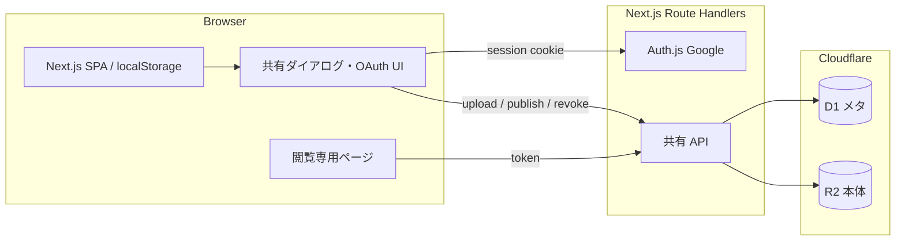

# Phase 37（094/095）: 共有の基盤と閲覧公開 — 設計

対象カード: [スクラム #42](https://scrum-board-jkcejsb6ka-an.a.run.app/items/42?project=5)  
ROADMAP: 候補094「共有権限・公開範囲」、候補095「閲覧専用リンク」

見送り（かんばん Todo）:

- [#64 認証: Magic Link / パスワード](https://scrum-board-jkcejsb6ka-an.a.run.app/items/64?project=5)（代替 2B・2C・2D）
- [#65 共有保存先の他スタック](https://scrum-board-jkcejsb6ka-an.a.run.app/items/65?project=5)（代替 3B・3C・3D）
- [#66 クラウド正本化](https://scrum-board-jkcejsb6ka-an.a.run.app/items/66?project=5)（代替 4B・4C）
- [#67 閲覧リンク: 招待限定 / パスワード付き](https://scrum-board-jkcejsb6ka-an.a.run.app/items/67?project=5)（代替 6B・6C）
- [#68 共有の自動更新・ポーリング](https://scrum-board-jkcejsb6ka-an.a.run.app/items/68?project=5)（代替 7B・7C）
- [#69 comment 権限・UI](https://scrum-board-jkcejsb6ka-an.a.run.app/items/69?project=5)（代替 5B・Phase 38）

## 決めたこと

1. **スコープ**: 094・095 を **1 PR** で実装する（ユーザー選択「推奨」＝1A）。
2. **所有者認証**: **Google OAuth**（Auth.js / NextAuth 系を Next.js App Router に載せる）。Magic Link・パスワード・無ログイン所有者は #64。
3. **共有保存先**: **既存 Next.js Route Handlers（Node）から Cloudflare D1 HTTP API ＋ R2 S3 互換 API** で読み書きする（Workers バインディング／OpenNext 移設は本 Phase 外）。Supabase 等は #65。
4. **ローカルとの関係**: **ローカルファースト維持**。共有するマップだけ所有者が明示的にクラウドへアップロード／「共有を更新」。クラウド正本化は #66。
5. **権限**: Phase 37 は **view / edit** のみ。所有者＝edit、閲覧リンク＝view。comment は #69 / Phase 38。
6. **閲覧専用リンク**: **推測困難なトークン URL**。閲覧にログイン不要。**失効・再発行**あり。平文トークンは **発行・再発行応答でのみ 1 回表示**（再表示 API なし）。招待限定・パスワード付きは #67。
7. **公開内容**: **明示「共有を更新」**で公開スナップショットを差し替える。保存のたび自動更新・ポーリングは #68。リアルタイム共同編集は Phase 39。
8. **ローカル MapDocument**: 共有メタ（公開中か・最終公開時刻など）は **ライブラリメタ or 別キー**に持ち、文書本体スキーマに編集権限フィールドを無理に載せない（閲覧はサーバー側スナップショット）。
9. **閲覧シェル**: Phase 37 の正本は **読み取り専用マップ（Pixi）＋折りたたみ可能なアウトライン併記**。編集用 MapEditor は使わない。アウトラインのみ専用ビューは非目標。
10. **初回共有 UX**: `POST /api/share/maps` 成功時に **初回 publish と view リンク 1 本を同じ応答で返す**（別ボタン必須にしない）。追加リンクは任意で `POST .../links`。
11. **`expires_at`**: 列は nullable で持つが Phase 37 UI/API は **常に null（無期限）**。期限設定 UI は後続。
12. **共有一覧**: サーバー `GET /api/share/maps` を正本とし、ローカルメタはキャッシュ／オフライン表示用。

## 1. 目的

ローカルのマップを、相手が編集せず閲覧できる形で共有できるようにする。その前提として、所有者の認証・共有用保存先・公開範囲（view / edit）を用意する。

## 2. 非目標

- Magic Link / パスワードアカウント / 所有者無ログイン（#64）
- Supabase・Firebase・自前 Postgres・リンク内巨大スナップショット（#65）
- ログイン後クラウド正本・共有機能ON時のクラウド必須（#66）
- 招待アカウント限定閲覧・パスワード付きリンク（#67）
- 保存のたび自動公開・ポーリング同期・リアルタイム共同編集（#68 / Phase 39）
- comment / メンション / 解決管理（#69 / Phase 38）
- 複数人への edit 共有（共同編集者 ACL）。Phase 37 の edit は **所有者セッションのみ**（閲覧リンクは view 固定）
- マップライブラリ全体の一括共有（対象は **1 マップ文書ごと**）
- Workers バインディング専用デプロイ、アウトラインのみの閲覧ビュー、トークン再表示 API、有効期限設定 UI
- 閲覧ページからの画像／JSON 書き出し（Phase 37 は閲覧のみ。書き出しは所有者のローカル編集画面側の既存機能）

## 3. アーキテクチャ概要

- **編集の正本**は従来どおりブラウザ `localStorage`（既存 MapLibrary）。
- **公開の正本**はサーバー上のスナップショット（R2）＋メタ（D1）。閲覧ページはサーバーから読み、ローカルライブラリを触らない。
- **接続方式**: Route Handler は Node ランタイムのまま、D1 は Cloudflare REST、R2 は S3 互換認証付き HTTP。バインディング前提の Workers 専用デプロイにはしない。

## 4. 認証（所有者）

### 4.1 方式

- **Google OAuth**（Auth.js）。セッションは HTTP-only cookie（SameSite=Lax、本番 Secure）。
- 未ログインでもローカル編集は現行どおり可能。共有操作（初回共有・更新・失効・再発行・サーバー共有一覧）だけログイン必須。
- ログイン失敗・拒否は固定日本語文言。プロバイダの生エラー・トークンを UI に出さない（秘密・L-002 系）。

### 4.2 成否契約（L-001）

- 共有 API クライアントは `ok` / `reason`（または同等の Result）を返し、呼び出し元は成功時だけ成功通知と後続を行う。
- **初回共有成功**の応答に `shareUrl`（と必要なら一度きりの `token`）が含まれる → そのときだけリンク表示・コピーを出す。
- 未ログインで共有を押したら成功扱いにせず、ログイン導線へ。

## 5. データモデル（サーバー）

### 5.1 D1 テーブル（論理）

| エンティティ | 主な列 | 備考 |
|---|---|---|
| `users` | `id`, `google_sub`, `email`, `created_at` | 論理枠（将来のプロフィール紐付け）。**Phase 37 は必須ではない** |
| `shared_maps` | `id`, `owner_user_id`, `local_map_id`（参照用・非秘密）, `title`, `current_revision_id`（nullable）, `created_at`, `updated_at` | 所有者の共有マップ 1 行。未 publish 完了時は `current_revision_id` null。**`(owner_user_id, local_map_id)` UNIQUE** |
| `share_revisions` | `id`, `shared_map_id`, `r2_key`, `byte_size`, `content_sha256`, `published_at` | 公開スナップショット版 |
| `share_links` | `id`, `shared_map_id`, `token_hash`, `permission`（`view` のみ Phase 37）, `created_at`, `revoked_at`, `expires_at`（nullable・Phase 37 は常に null） | **平文トークンは保存しない**（ハッシュのみ） |

- 現行の公開 revision は **`shared_maps.current_revision_id`** で指す（null＝閲覧不可）。
- `permission=edit` のリンクは Phase 37 では **作らない**（スキーマに列があっても API が拒否）。
- **`owner_user_id` と `users`**: Auth.js セッションの Google `sub` を不透明 ID として直接格納する。Phase 37 では `shared_maps.owner_user_id → users.id` の **FOREIGN KEY を設けない**（OAuth 後の D1 `users` upsert も実装しない）。FK を付けると upsert 無しでは初回共有が常に失敗するため、意図的に FK 無しとする。

### 5.2 R2 オブジェクト

- キー例: `shares/{shared_map_id}/{revision_id}.json`
- 中身: 既存 MapDocument JSON（V3）のスナップショット。サーバーはスキーマ検証に失敗したら publish を拒否（空や壊れた文書を成功にしない。L-002）。

### 5.3 ローカル側メタ

- `library-meta` または専用キーに、マップ ID → `{ sharedMapId?, lastPublishedAt?, linkActive? }` 程度を保持（無くても編集可）。
- 欠落と空を混同しない（未共有 ≠ 共有情報 `{}`）。読み取り失敗を「未共有」に倒して上書きしない（L-002）。
- **共有一覧 UI 状態**: `loading` / `ready`（0 件含む） / `error` を分ける。`GET /api/share/maps` 失敗時は一覧を空成功にせず、ローカルメタを「未共有」へ書き換えない。空案内は `ready` かつ件数 0 のときだけ。

## 6. 権限と公開範囲（094）

| 主体 | 権限 | できること |
|---|---|---|
| 所有者（ログイン済み・当該 `shared_maps.owner`） | edit | アップロード、共有更新、リンク発行・失効・再発行、共有解除 |
| 閲覧リンク保持者 | view | 公開スナップショットの閲覧（パン／ズーム／折りたたみ表示は可、構造編集・保存・共有操作は不可） |
| その他 | なし | **HTTP 404**（存在を漏らさない固定文言。403 は使わない） |

- UI 上「公開範囲」は Phase 37 では **リンクを知っている人＝view** の 1 モード。将来の comment/edit 招待に備え、リンク作成 API は `permission` を明示し、サーバーで `view` 以外を 400 拒否する。

## 7. 閲覧専用リンク（095）

### 7.1 トークン

- 発行時に暗号論的乱数（例: 256 bit）を生成し、URL に載せる平文と、DB の **ハッシュ**（keyed hash または salt+hash）だけを保存。
- ルート: `/share/[token]`（App Router・path セグメント）。ログ・分析・エラー文言に平文トークンを出さない。
- **失効**: `revoked_at` を立て、以降は閲覧 API が **404**。
- **再発行**（L-003）: **新リンク行を確定してから**旧リンクを失効する（同一トランザクション推奨）。新発行に失敗したら旧リンクは有効のまま。成功時だけ新 `token` を応答で **1 回**返す。**再表示 API は無い**。
- **`expires_at`**: Phase 37 は常に null（無期限）。期限切れ分岐のコードは書いても UI からは設定できない。

### 7.2 閲覧 UI

- 既存 MapEditor は使わない。正本は **読み取り専用 Pixi マップ ＋ 折りたたみ可能なアウトライン**（決めたこと 9）。編集コントロール・音声・取込・AI・保存・共有操作は **マウントしない**（L-061）。
- 文書取得失敗・失効は固定日本語の 404 相当画面。内部 ID や所有者メールを出さない。

### 7.3 明示更新と初回 publish（L-003）

- **更新**（`POST .../publish`）: 検証 → R2 に新オブジェクト → `share_revisions` 行 → `current_revision_id` 更新。途中失敗時は旧 `current_revision_id` のまま（空公開にしない）。
- **初回**（`POST /api/share/maps`）: 検証 →（必要なら）`shared_maps` 行を仮作成 → R2 書込 → revision 行 → `current_revision_id` 設定 → view リンク作成。R2 または revision 確定前に失敗したら **行を残さないか unpublished（`current_revision_id` null・リンク無し）にロールバック**し、成功応答もリンクも返さない。部分成功を成功扱いにしない。

## 8. API 概要（Route Handlers）

| メソッド | パス | 認証 | 結果 |
|---|---|---|---|
| GET/POST | `/api/auth/*` | Auth.js | セッション |
| GET | `/api/share/maps` | 所有者 | 自分の共有一覧（正本） |
| POST | `/api/share/maps` | 所有者 | 初回共有＋publish＋**view リンク 1 本**（`shareUrl` / 一度きり `token`） |
| POST | `/api/share/maps/:id/publish` | 所有者 | 新 revision（Result） |
| POST | `/api/share/maps/:id/links` | 所有者 | 追加 view リンク。`{ url, token }` を **1 回**（再表示なし） |
| POST | `/api/share/links/:id/revoke` | 所有者 | 失効 |
| POST | `/api/share/links/:id/reissue` | 所有者 | 新リンク確定後に旧失効。成功時だけ新 `token` を 1 回返す |
| DELETE | `/api/share/maps/:id` | 所有者 | 共有解除: **全リンク失効 → `current_revision_id` null → 全 revision の R2 オブジェクト削除 → DB 行削除**。途中失敗は Result で返し、可能な範囲でリトライ可能な状態を残す（サイレント成功禁止） |
| GET | `/api/share/view/:token` | なし | 現行 revision の文書。失効・不明は **404** |

- すべて成否を型で返す。void 成功禁止（L-001）。
- 他者の `shared_maps` / `share_links` 操作は **404**（§6 と統一）。
- レート制限・ボディサイズ上限（既存 JSON 上限に合わせる）を設ける。
- リンク発行（S3）: **`current_revision_id` が非 null のときだけ可**。未共有なら先に `POST /api/share/maps`（初回）を使う。

## 9. 入口インベントリ（L-061）

**実装 Task 0（コードより先）** で `docs/superpowers/specs/2026-11-26-phase37-share-view-link-inventory.md` を作る。最低限の行:

| ID | 入口 | 未ログイン | 所有者・未共有 | 所有者・共有中 | 閲覧トークン頁 |
|---|---|---|---|---|---|
| S1 | 共有を開く／作成 | ログイン導線 | 可 | 可 | 非表示 |
| S2 | 共有を更新 | 拒否 | 不可（未共有） | 可 | 非表示 |
| S3 | リンク発行 | 拒否 | **不可**（先に初回共有） | **可**（現行 revision あり） | 非表示 |
| S4 | リンク失効・再発行 | 拒否 | — | 可 | 非表示 |
| S5 | 構造編集・保存・音声・AI・取込 | ローカルどおり | ローカルどおり | ローカルどおり | **不可（未マウント）** |
| S6 | 閲覧ページでの書き出し | — | — | — | **不可**（非目標。入口をマウントしない） |

保護モード・競合・学習・プレゼン・listening 中の共有ダイアログ可否も inventory に 1 列足す（既存排他と揃える）。

## 10. 環境・運用と L-060

- 秘密: `AUTH_SECRET`, Google client id/secret, Cloudflare account id / API token, D1 database id, R2 access key / secret / bucket。`.env.example` に名前だけ。値はリポジトリに入れない。
- イラスト生成用 Cloudflare 資格情報と共有用を **役割ごとに分離**（同じトークンの使い回しを避ける）。
- ローカル開発: Auth の開発用設定と、D1/R2 は **HTTP クライアントのモック**（または remote 資格情報）。Workers バインディングは使わない。
- テスト: ドメインのトークンハッシュ・権限判定は単体。API はモックストレージ。閲覧シェルは「編集コントロールが無い」結合テスト（L-060）。

### 10.1 必須 props（L-060・省略不可）

**MapEditor / ヘッダー入口**

| prop / 配線 | 役割 |
|---|---|
| `shareDialogOpen` / `onShareDialogOpenChange` | 共有ダイアログ |
| `onShareRequest`（または同等） | 未ログインでもダイアログを開く（ログイン導線は Dialog 内。成功扱いにしない） |
| `shareSession`（userId または null） / `shareSessionStatus` | セッション有無。loading と未ログインを混同しない |
| `mapId` / `mapTitle` | 共有対象 |

**ShareDialog**

| prop | 役割 |
|---|---|
| `mapId`, `mapTitle` | 対象 |
| `shareSession` / `shareSessionStatus` | セッション。loading 中はログイン導線を出さない |
| `sharedMapId` / `lastPublishedAt` / `linkActive`（ローカルメタ） | 表示用キャッシュ |
| `listState`: `loading` \| `ready` \| `error` | 一覧（L-002） |
| `onCreateShare`, `onPublish`, `onCreateLink`, `onRevokeLink`, `onReissueLink`, `onDeleteShare` | 各 Result を返す |
| `onLogin` | 未ログイン時（ready かつ null のとき） |
| `dialogMouseClickedAtRef` | 既存誤クリック窓 |

**ShareViewerPage（`/share/[token]`）**

| prop | 役割 |
|---|---|
| `document` \| `loadError` | 取得結果（欠落と空を混同しない） |
| `viewMode` 初期 | map / outline 切替（編集不可） |
| 編集系 props | **渡さない・コンポーネント自体を import しない** |

組み立て結合テストで上記の未配線を RED にする。

## 11. 知見との対応（手順 4）

| ID | 本設計での扱い |
|---|---|
| L-001 | 共有 API・UI は Result。成功時のみリンク表示 |
| L-002 | 未共有/読込失敗/空文書を混同しない。一覧は loading/ready/error。壊れた JSON は publish 拒否 |
| L-003 | publish / 初回は検証→R2→ポインタ。再発行は新確定後に旧失効 |
| L-061 | inventory（Task 0）で閲覧頁の編集入口を未マウント固定 |
| L-060 | §10.1 の必須 props を結合テスト |
| L-166 | §11.1 の通知クリア契機 |

### 11.1 通知クリア（L-166）

共有系 notice（成功・失敗・失効）は既存の revision-scoped または専用枠で:

| 契機 | 動作 |
|---|---|
| 共有ダイアログを閉じる | クリア |
| `mapId` 変更（マップ切替） | クリア |
| 同じ操作の再試行開始 | 直前の成功／失敗をクリアしてから実行 |
| 新しい成功 notice | 直前の error を置換 |
| 同一文言の再成功 | 読み上げ直す（status を付け直す／キー更新） |
| 文書 `documentRevision` 変化（ローカル編集） | 共有成功 status は消してよい（古いリンク案内の残留防止） |

## 12. テスト方針（要約）

- 単体: token hash、permission ガード、revision 切替、失効判定。
- API: 未ログイン 401、他者の shared_map **404**、壊れた body 400、revoke 後 GET view **404**。
- UI: 未ログインで共有押下→ログイン、更新失敗で旧リンク内容維持、閲覧頁に編集ボタンが 0 件。
- 手動: Google ログイン、リンクを別プロファイルで開く、失効後 404、再発行後の旧 URL 無効。

## 13. 実装順（プランへ渡す骨子）

1. **Task 0: inventory**（§9）
2. Auth.js Google＋セッション取得の薄い UI
3. D1/R2 HTTP クライアントと share ドメイン（純関数）
4. Share API（list/create+link/publish/link/revoke/delete/view）
5. 所有者共有ダイアログ（ローカルメタ連携）
6. `/share/[token]` 閲覧シェル（Pixi＋アウトライン）
7. 結合テスト・ROADMAP／features 更新
