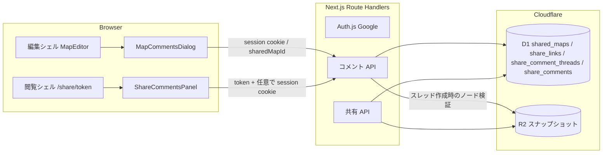

# Phase 38（096/097）: ノードコメントと解決管理 — 設計

対象カード: [スクラム #43](https://scrum-board-jkcejsb6ka-an.a.run.app/items/43?project=5)「Phase 38: コメントと非同期の共同作業」  
ROADMAP: 候補096「ノードへのコメント」、候補097「コメントの解決管理」  
棚卸し（既存実装・入口インベントリ）: `docs/superpowers/specs/2026-11-27-phase38-comments-inventory.md`  
前提: `docs/superpowers/specs/2026-11-26-phase37-share-view-link-design.md`（共有基盤）。Phase 37 で見送った #69「comment 権限・UI」の内容は本 Phase の範囲に含まれる。

見送り:

- [#70 変更通知・メンション](https://scrum-board-jkcejsb6ka-an.a.run.app/items/70?project=5)（候補098）
- [#71 コメントのローカル保存・書き出し](https://scrum-board-jkcejsb6ka-an.a.run.app/items/71?project=5)
- [#72 コメントの編集・入れ子返信・リアクション・添付・Markdown 描画](https://scrum-board-jkcejsb6ka-an.a.run.app/items/72?project=5)
- [#73 閲覧リンク（view）でのコメント閲覧](https://scrum-board-jkcejsb6ka-an.a.run.app/items/73?project=5)
- [#74 未ログイン（匿名）でのコメント投稿](https://scrum-board-jkcejsb6ka-an.a.run.app/items/74?project=5)
- [#75 閲覧シェルでのコメント先ノードへの移動](https://scrum-board-jkcejsb6ka-an.a.run.app/items/75?project=5)
- [#76 コメント先ノード ID の再利用の検出](https://scrum-board-jkcejsb6ka-an.a.run.app/items/76?project=5)
- [#77 コメントの監査ログ・削除の取り消し](https://scrum-board-jkcejsb6ka-an.a.run.app/items/77?project=5)
- リアルタイム更新・ポーリングは既存の [#68](https://scrum-board-jkcejsb6ka-an.a.run.app/items/68?project=5) / Phase 39、Google 以外のログインは既存の [#64](https://scrum-board-jkcejsb6ka-an.a.run.app/items/64?project=5)

## 決めたこと

1. **範囲**: 096・097 を **1 PR** で実装する（ユーザー選択）。098（変更通知・メンション）は本 PR の非目標とし、別カード（#70）へ見送る。
2. **投稿者**: 所有者が **`permission=comment` の共有リンク**を発行できる。comment リンクを開いた人は **Google ログイン（既存 Auth.js）**して投稿する。表示名は **Google の名前**（ユーザー選択）。
3. **view リンクでのコメント**: **閲覧も不可**（コメント UI を未マウント、コメント API は 404）とする（推奨で決定）。理由: Phase 37 で発行済みの view リンクは「マップを見せるだけ」の前提で配られている。後からコメント本文と投稿者の Google の名前を見せると、配布時の想定より公開範囲が広がる。コメントを見せたい相手には comment リンクを渡す。
4. **comment リンクでの閲覧**: コメント一覧の **閲覧はログイン不要**、投稿・返信・解決・削除はログイン必須とする（推奨で決定）。マップ本体の閲覧がトークンだけで可能なのと揃える。投稿欄の上に §7.3 の注意文（正本）「名前（Google アカウントの名前）はこのリンクを知っている人に表示されます。」を常に表示する（閲覧パネルと所有者の `MapCommentsDialog` の両方）。
5. **保存先**: **サーバー D1**。共有済みマップ（`shared_maps.id`）と **ノード ID**（`Node.id`）に紐付ける。所有者は編集画面で、共有中マップのコメントを読み込んで表示・解決できる。**未共有マップではコメント不可**。**MapDocument スキーマは変えない**（ユーザー選択）。
6. **ノード消失**: 公開スナップショット更新でコメント先ノードが消えても、コメントは **消さず「削除されたノード」として一覧に残す**。解決・削除は可能（ユーザー選択）。
7. **スレッド形**: 1 ノードに複数の **スレッド**、各スレッドは最初のコメントと **1 段の返信**（入れ子なし）（推奨で決定）。解決・再開は **スレッド単位**。
8. **解決・削除の権限**: 解決・再開は **所有者とスレッド作成者**。コメント削除は **所有者とそのコメントの投稿者**。スレッド丸ごとの削除は **持たない**（最後のコメントを消せばスレッドも消える。決めたこと 9 で足りる）。コメントの **編集は無し**（推奨で決定）。
9. **削除は物理削除**（推奨で決定）。投稿者が消したい本文をサーバーに残さない。最後のコメントが消えたスレッドも消す。
10. **解決済みスレッドへの返信は拒否**（409 `thread-resolved`）。先に再開する（推奨で決定）。
11. **所有者の編集画面**: ヘッダー「コメント」からダイアログで一覧・投稿・返信・解決・削除を行う。印は **マップ上の未解決件数バッジ**と **右パネルのコメント節**（推奨で決定）。
12. **更新の取り込み**: **手動の「再読み込み」と、ダイアログを開いたとき・自分の書込み直後**だけ取り直す。ポーリング・リアルタイム更新はしない（Phase 37 #68 と同じ方針）。
13. **上限**: 本文 **2,000 文字**（UTF-16 のコード単位。既存 `NODE_NOTE_MAX_LENGTH` と同じ数え方）、マップあたり **スレッド 200 件・コメント 1,000 件**、スレッドあたり **コメント 50 件**、書込みリクエスト本文 **16 KiB**（推奨で決定）。

## 1. 目的

共有したマップのノードごとに、相手が質問や補足を残し（096）、所有者と投稿者が対応済みの議論を「解決」として整理できる（097）ようにする。共有の基盤（Google ログイン・D1・トークンリンク）は Phase 37 のものをそのまま使い、ローカルファースト（編集の正本はブラウザ）を崩さない。

## 2. 非目標

- 変更通知・メンション（098。別カードへ見送り）
- リアルタイム更新・ポーリング・プッシュ通知（Phase 37 #68 / Phase 39 と同じく対象外）
- ローカル文書（MapDocument / localStorage）へのコメント保存、コメントの JSON・OPML・画像への書き出し
- 未共有マップへのコメント、ローカルだけのノードへのコメント（公開スナップショットに無いノードには投稿できない）
- コメントの編集、入れ子の返信、リアクション、添付、Markdown・リンクの描画
- view リンクでのコメント閲覧・投稿（決めたこと 3）
- 匿名（未ログイン）投稿、Google 以外のログイン（#64）
- コメントからの「ノードへ移動」（選択・中央表示・パン・折りたたみの自動展開）。閲覧シェル・所有者の編集シェルとも #75 の範囲。閲覧シェルではノードの選択強調だけ行い、所有者のダイアログにはノードへ移動するボタンを置かない
- 所有者専用の「スレッド丸ごと削除」（決めたこと 8。最後のコメント削除でスレッドが消える）
- ノード ID の再利用の検出（§5.4 の既知の制約）
- コメントの監査ログ・削除の取り消し

## 3. アーキテクチャ概要



- コメントの正本は **D1**。ローカルの MapDocument・ライブラリメタ・`shareLocalMeta` には何も書かない。
- コメントへの到達経路は 2 つだけ: **所有者セッション＋`sharedMapId`**（編集シェル）と、**comment リンクのトークン**（閲覧シェル）。どちらもサーバーで同じ `ShareCommentService` の関数に入り、権限判定を 1 か所にする（L-901）。
- サーバー層の責務分割: `shareCommentStore.ts`（SQL のみ）/ `shareCommentService.ts`（アクセス解決・能力判定・検証・手順）/ `handleShareCommentsApi.ts`（HTTP: レート制限・本文読取・Content-Type・応答）。Phase 37 の `shareStore.ts` / `shareService.ts` / `handleShareApi.ts` と同じ 3 層。

## 4. 認証（コメント投稿者）

### 4.1 投稿者の識別

- 既存 Auth.js（`client/src/auth.ts`）をそのまま使う。`callbacks.jwt` が Google の `sub` を `token.sub` に入れ、`callbacks.session` が `session.user.id` に写す既存処理で、`session.user.id` = Google `sub`、`session.user.name` = Google の名前（Auth.js 既定）になる。
- `domain/share/shareSession.ts` に追加する:

  ```ts
  /** コメント投稿者。userId は Google sub（不透明）。displayName は正規化前の Google の名前 */
  export type ShareCommenter = { userId: string; displayName: string | null };
  export function toShareCommenter(
    user: { id?: string | null; name?: string | null } | undefined | null,
  ): ShareCommenter | null;
  export function requireCommenter(commenter: ShareCommenter | null): ShareResult<ShareCommenter>; // null → "unauthenticated"
  ```

  所有者用の `toShareSession`（email 必須）は変えない。投稿者には email を要求しない・保存しない。
- サーバーは `createShareApiDeps.ts` に `commenterFromAuth()`（`auth()` → `toShareCommenter(session?.user)`）を足し、`ShareApiDeps.getCommenter` として注入する。**表示名はクライアントから受け取らない**。リクエスト本文に `authorName` / `author` / `displayName` などのキーがあれば `invalid-request`（L-1032）。
- **所有者経路の主体**: 所有権は既存どおり `requireOwner(await getSession())` と `requireOwnedMap` で確かめ、投稿・解決時の表示名は `await getCommenter()` から取る。`getCommenter()` が null、または `commenter.userId !== owner.userId`（同じ `auth()` 由来の 2 値が食い違う）のときは `unauthenticated`（401）にする。投稿者・解決者として保存する `sub` は `owner.userId`（= `commenter.userId`）。
- **トークン経路の主体**: `await getCommenter()` だけを使う。所有者かどうかは `commenter.userId === map.ownerUserId` で判定する（§6.1）。
- 表示名の正規化（サーバーのみ・`normalizeShareCommentAuthorName`）: 制御文字を除く（範囲は §5.5 の表）→ 前後の空白を除く → 先頭から 50 コードポイントで切る → 空なら固定文言「名前未設定」。投稿時点の値を行に保存する（後で Google の名前が変わっても過去のコメントは変えない）。

### 4.2 クライアントのセッション

- 新規 `hooks/useShareCommenterSession.ts`: `useSession()` の `status === "loading"` を `{ status: "loading", commenter: null }`、それ以外を `{ status: "ready", commenter: toShareCommenter(data?.user) }` に写す（`useShareSession` と同じ形。loading と未ログインを混同しない・L-463）。
- 閲覧シェルのログイン: `signIn("google", { redirectTo: window.location.pathname })`（next-auth v5 の `redirectTo`）。戻り先はトークン付きの `/share/[token]` パスで、Auth.js の callback cookie に入る。閲覧ページは既に `referrer: "no-referrer"` なので、Google への遷移で Referer にトークンは載らない。
- ログアウト・別アカウントへの切替: 閲覧シェルはページ遷移で読み直されるので保持状態は残らない。編集シェルは §7.6 の世代管理で前の主体の一覧を捨てる（L-1037「ログアウト後に前主体の一覧が見える」・L-571）。

## 5. データモデル（サーバー）

### 5.1 `share_links.permission` の拡張

- 値を **`view` / `comment`** の 2 つにする。`comment` は「マップの閲覧＋コメントの閲覧・投稿」。`edit` 等その他の値は従来どおり発行を 400（`invalid-permission`）、閲覧・コメントとも 404。
- Phase 37 には **DDL の正本が無い**（設計書 §5.1 は論理的な列の表だけで、`share-setup.md` §4 は利用者が「設計どおりのテーブルを用意する」手順のみ）。利用者が `share_links.permission` に `CHECK (permission = 'view')` のような制約を付けている可能性がある。そこで `share-setup.md` に「既存の `share_links` 定義を確かめる手順」（D1 コンソールで `SELECT sql FROM sqlite_master WHERE type = 'table' AND name = 'share_links';` を実行し、`permission` に `'comment'` を拒む CHECK があれば、データを退避してテーブルを作り直す手順）を足す。制約が無ければ DDL の変更は不要。この docs 更新は Task 9 で行う（§13）。許可する値の正本はアプリ側の `domain/share/shareLinkPermission.ts`:

  ```ts
  export type ShareLinkPermission = "view" | "comment";
  /** DB の文字列 → 既知の権限。未知は null（閲覧・コメントとも 404 に倒す） */
  export function parseShareLinkPermission(value: string): ShareLinkPermission | null;
  /** 発行 API 用。未知は invalid-permission */
  export function assertIssuableLinkPermission(value: string): ShareResult<ShareLinkPermission>;
  export function linkPermissionAllowsComments(permission: ShareLinkPermission): boolean; // comment のみ true
  ```

  既存 `assertViewPermission.ts` はこれに置き換えて削除する。
- `planShareLinkCreate` は入力に `permission: ShareLinkPermission` を取り、そのまま `ShareLinkCreatePlan.permission` に入れる。初回共有（`createShare`）のリンクは従来どおり `view`。
- **再発行は権限を引き継ぐ**: `reissueLink` は `owned.value.link.permission` を `parseShareLinkPermission` に通し、null（未知の値）なら `not-found`、それ以外はその権限で新リンクを作る。現状の「常に view で作る」挙動は comment リンクを再発行すると view に落ちるため直す。成功値 `ShareLinkIssued.permission` がサーバーの確定値で、クライアントはこの値を正とする（§7.1）。

### 5.2 新テーブル（D1）

`docs/setup/share-setup.md` §4 に次の DDL を追記し（Task 9）、利用者が D1 コンソールで実行する（Phase 37 と同じく、リポジトリにマイグレーション実行の仕組みは持たない）。FOREIGN KEY は Phase 37 と同じ理由で付けず、削除順をアプリで保証する（§5.3）。

```sql
CREATE TABLE share_comment_threads (
  id TEXT PRIMARY KEY,
  shared_map_id TEXT NOT NULL,
  node_id INTEGER NOT NULL,
  node_label_snapshot TEXT NOT NULL,
  status TEXT NOT NULL CHECK (status IN ('open', 'resolved')),
  created_by_user_id TEXT NOT NULL,
  created_at TEXT NOT NULL,
  updated_at TEXT NOT NULL,
  resolved_by_user_id TEXT,
  resolved_by_name TEXT,
  resolved_at TEXT,
  CHECK (
    (status = 'open' AND resolved_by_user_id IS NULL AND resolved_by_name IS NULL AND resolved_at IS NULL)
    OR (status = 'resolved' AND resolved_by_user_id IS NOT NULL AND resolved_by_name IS NOT NULL AND resolved_at IS NOT NULL)
  )
);
CREATE INDEX idx_share_comment_threads_map ON share_comment_threads (shared_map_id, created_at);

CREATE TABLE share_comments (
  id TEXT PRIMARY KEY,
  thread_id TEXT NOT NULL,
  shared_map_id TEXT NOT NULL,
  author_user_id TEXT NOT NULL,
  author_name TEXT NOT NULL,
  body TEXT NOT NULL,
  created_at TEXT NOT NULL
);
CREATE INDEX idx_share_comments_thread ON share_comments (thread_id, created_at);
CREATE INDEX idx_share_comments_map ON share_comments (shared_map_id);
```

| 列 | 意味 |
|---|---|
| `share_comment_threads.node_id` | `Node.id`（正の安全な整数）。公開スナップショットのノードを指す |
| `node_label_snapshot` | スレッド作成時の **サーバーが公開スナップショットから読んだ** ノードラベル（`normalizeShareCommentNodeLabel`: 改行を空白に、制御文字を除き（§5.5 の表）、前後空白を除き、80 コードポイントで切る。空なら「（無題）」）。ノードが消えた後の「削除されたノード」表示に使う。クライアント送信値は使わない |
| `status` | `open` / `resolved` |
| `created_by_user_id` | スレッド作成者の Google `sub`。解決・再開の権限判定に使う。**応答に出さない** |
| `resolved_by_user_id` / `resolved_by_name` / `resolved_at` | 解決者の `sub`（応答に出さない）・解決時点の表示名・日時。再開で 3 つとも NULL に戻す（履歴は持たない） |
| `share_comments.shared_map_id` | 所属マップ。共有解除時の一括削除と、補償漏れの掃除に使う |
| `author_user_id` / `author_name` | 投稿者の `sub`（**応答に出さない**）と投稿時点の表示名 |
| `body` | `normalizeShareCommentBody` を通った本文（§5.5） |

時刻はすべて ISO 8601 文字列（既存 `nowIso()` と同じ）。ID は `crypto.randomUUID()`（既存 `defaultId`）。

### 5.3 削除と原子性

D1 REST（`d1Client.ts` の `exec`）は 1 リクエスト 1 文で、文をまたぐトランザクションを使わない。そこで「1 文で原子的に判定して書く」か「見えなくなる側を先に消す」に寄せる。

| 操作 | 手順 |
|---|---|
| スレッド作成 | (1) `INSERT INTO share_comment_threads ... SELECT ... WHERE (SELECT COUNT(*) FROM share_comment_threads WHERE shared_map_id = ?) < 200 AND (SELECT COUNT(*) FROM share_comments WHERE shared_map_id = ?) < 1000`。`changes = 0` なら `comment-limit`。(2) 最初のコメントを INSERT。(2) が失敗したらスレッド行を DELETE して補償し `storage-error`。補償も失敗した「コメント 0 件のスレッド」は一覧で返さない（§5.6）。 |
| 返信 | `INSERT INTO share_comments ... SELECT ... WHERE EXISTS (SELECT 1 FROM share_comment_threads WHERE id = ? AND shared_map_id = ? AND status = 'open') AND (SELECT COUNT(*) FROM share_comments WHERE thread_id = ?) < 50 AND (SELECT COUNT(*) FROM share_comments WHERE shared_map_id = ?) < 1000`。`changes = 0` のときだけ、理由を分けるためにスレッドを読み直す（無い → `not-found`、resolved → `thread-resolved`、それ以外 → `comment-limit`）。SELECT してから INSERT する二段にはしない（L-862） |
| 解決 | (0) `SELECT ... FROM share_comment_threads WHERE id = ? AND shared_map_id = ?` で読み、無い・能力なし（§6.2）なら `not-found`。(1) `UPDATE share_comment_threads SET status = 'resolved', resolved_by_user_id = ?, resolved_by_name = ?, resolved_at = ?, updated_at = ? WHERE id = ? AND shared_map_id = ? AND status = 'open'`。(2) 同じ条件で読み直して返す。`changes = 0` で既に resolved なら **成功（冪等）**（解決者は上書きしない）。(0) から (2) の間にスレッドが消えていたら `not-found` |
| 再開 | (0) 解決と同じ読み取りと能力判定。(1) `UPDATE share_comment_threads SET status = 'open', resolved_by_user_id = NULL, resolved_by_name = NULL, resolved_at = NULL, updated_at = ? WHERE id = ? AND shared_map_id = ? AND status = 'resolved'`。(2) 読み直して返す。既に open なら成功（冪等）。途中で消えていたら `not-found` |
| コメント削除 | (0) `SELECT ... FROM share_comments WHERE id = ? AND shared_map_id = ?` で読み、無い・能力なし（投稿者でも所有者でもない）なら `not-found`。(1) `DELETE FROM share_comments WHERE id = ? AND shared_map_id = ?`。`changes = 0`（(0) の後に消えた）なら `not-found`。(2) `DELETE FROM share_comment_threads WHERE id = ? AND shared_map_id = ? AND NOT EXISTS (SELECT 1 FROM share_comments WHERE thread_id = ? AND shared_map_id = ?)`（最後のコメントならスレッドも消える。1 文で判定）。応答は `{ commentId, threadDeleted }`。(2) の失敗は (1) の確定を巻き戻さず、`threadDeleted: false` で成功を返す（空スレッドは一覧に出ないため。L-575） |
| 共有解除（`deleteShare`） | Phase 37 の順（全リンク失効 → `current_revision_id` null → R2 削除 → リンク削除 → revision 削除 → マップ削除）の **マップ削除の直前** に `DELETE FROM share_comments WHERE shared_map_id = ?` → `DELETE FROM share_comment_threads WHERE shared_map_id = ?` を入れる。この 2 文は **D1 のエラーが「テーブルが無い」（メッセージに `no such table` を含む）ときだけ** 削除済みとみなして次へ進む（Phase 38 の DDL を未実行の環境でも共有解除を使えるようにする）。それ以外の失敗は従来どおり `storage-error`（リンクは失効済みなので再試行で続きから消せる）。判定のため `d1Client.ts` の例外にテーブル欠落を区別できる情報を持たせる（`D1QueryError` の `kind: "no-such-table" \| "failed"`。生メッセージは外へ出さない） |

スレッド・コメントを読む・書く SQL は、上の表以外（一覧・返信の存在確認・読み直し）も含めて **すべて `shared_map_id = ?` を条件に持つ**（L-901）。

**既知の制約（補償漏れ）**: スレッド作成の補償削除に失敗した「コメント 0 件のスレッド」と、コメント削除の (2) に失敗して残った「コメント 0 件のスレッド」は一覧に出ないが、§5.3 の上限判定の `COUNT(*)` には数えられる。通常は起きない失敗の後始末なので、上限を少し早く消費することを許容し、共有解除で消える。

`changes` は D1 REST 応答の `meta.changes`。`shareCommentStore.ts` の `readD1Changes(meta: unknown): number` で数値（安全な非負整数）であることを確かめ、そうでなければ例外 → `storage-error`（形が想定と違うのを「0 件」として扱わない・L-044 / L-470）。

### 5.4 ノードとの対応と既知の制約

- スレッドは `node_id` だけでノードを指す。**「削除されたノード」の判定は、いま画面に出している文書**で行う: 閲覧シェルは現行の公開スナップショット、所有者の編集シェルはローカルの文書（`nodes`）。純関数 `classifyShareCommentThreads(threads, nodeIds: ReadonlySet<number>)` → `{ attached: Map<nodeId, thread[]>, orphaned: thread[] }`。
- 「削除されたノード」のスレッドは見出しに `node_label_snapshot` を出し（「削除されたノード: ◯◯」）、一覧の専用節にまとめる。解決・再開・削除・（未解決なら）返信は通常どおりできる（決めたこと 6）。バッジは出さない。
- **既知の制約**: ノード ID 採番（`nodeIdAllocator.ts`）は既存ノードとの衝突だけを避けるので、消したノードの ID が後で別ノードに再利用されうる。その場合スレッドは新しいノードに付いて見える。見出しに常に `node_label_snapshot` を併記して食い違いに気づけるようにし、検出・自動切り離しは非目標とする。

### 5.5 本文の正規化と上限

- `domain/share/normalizeShareCommentBody.ts`（クライアントとサーバーで同じ関数・L-858 / L-836）:

  ```ts
  export type ShareCommentBodyResult =
    | { ok: true; value: string }
    | { ok: false; reason: "empty" | "too-long" };
  export function normalizeShareCommentBody(raw: string): ShareCommentBodyResult;
  ```

  手順: (1) 生の長さが上限の 4 倍（8,000）を超えたら先に `too-long`（巨大入力で正規化に入らない）。(2) `\r\n` と `\r` を `\n` に。(2b) 制御文字を除く（範囲は下の表）。(3) 前後の空白・改行を除く（内側の改行は残す）。(4) 空なら `empty`。(5) 正規化後の `value.length`（UTF-16 のコード単位）が `SHARE_COMMENT_BODY_MAX_LENGTH`（2,000）を超えたら `too-long`。**切り詰めない**（拒否する）。
- クライアントは入力中に同じ関数で残り文字数を表示し、`too-long` / `empty` の間は送信ボタンを無効にする。`textarea` の `maxLength` は付けない（IME 確定前の切り詰めを避ける。L-858 の「`maxLength` に頼らない」）。
- 制御文字の除去範囲（表示崩れ防止。すべて同じ規則を各正規化関数の中で使う）:

  | 対象 | 関数 | 除去する文字 | 残す文字 |
  |---|---|---|---|
  | 本文 | `normalizeShareCommentBody`（手順 (2b)） | C0（U+0000–U+001F）のうち改行 U+000A・タブ U+0009 以外、U+007F、C1（U+0080–U+009F） | 改行・タブ |
  | 表示名 | `normalizeShareCommentAuthorName` | C0 すべて（U+0000–U+001F）、U+007F、C1（U+0080–U+009F） | なし |
  | ノードラベル | `normalizeShareCommentNodeLabel` | 改行（U+000A・U+000D）を空白に置き換えた後、C0 すべて・U+007F・C1 | なし |

### 5.6 一覧の組み立て

- 1 回の一覧で 2 文: `SELECT ... FROM share_comment_threads WHERE shared_map_id = ? ORDER BY created_at ASC, id ASC` と `SELECT ... FROM share_comments WHERE shared_map_id = ? ORDER BY created_at ASC, id ASC`。サーバーで `thread_id` ごとにまとめ、**コメント 0 件のスレッドは返さない**。スレッドに属さないコメント行も返さない。
- 上限（スレッド 200・コメント 1,000・本文 2,000）で、一覧応答の最大はおよそ本文 2,000,000 文字に収まる。ページングはしない。

### 5.7 応答の型（`domain/share/shareComment.ts`。server / client の正本）

```ts
export type ShareCommentView = {
  readonly id: string;
  readonly authorName: string;
  readonly body: string;
  readonly createdAt: string;
  /** 閲覧者がこのコメントを消せるか（サーバー判定） */
  readonly canDelete: boolean;
};

export type ShareCommentThreadView = {
  readonly id: string;
  readonly nodeId: number;
  readonly nodeLabelSnapshot: string;
  readonly status: "open" | "resolved";
  readonly resolvedByName: string | null;
  readonly resolvedAt: string | null;
  readonly createdAt: string;
  readonly updatedAt: string;
  readonly canResolve: boolean;       // 解決・再開とも
  readonly comments: readonly ShareCommentView[];
};

export type ShareCommentViewer = {
  readonly signedIn: boolean;
  readonly canPost: boolean;   // signedIn かつ comment 権限（所有者経路では常に true）
  readonly isOwner: boolean;
};

export type ShareCommentListValue = {
  readonly threads: readonly ShareCommentThreadView[];
  readonly viewer: ShareCommentViewer;
};
```

- `author_user_id`・`created_by_user_id`・`resolved_by_user_id`（Google `sub`）とメールアドレスは **どの応答にも含めない**。作成者かどうかは `canDelete` / `canResolve` の真偽だけで伝える（L-1032）。
- 書込み系の応答: スレッド作成・返信・解決・再開は **更新後の `ShareCommentThreadView`**、コメント削除は `{ commentId: string; threadDeleted: boolean }`。クライアントはこの値で一覧の該当スレッドだけを差し替える（`shareCommentListMutations.ts`。L-039 の「書込み後の状態を読み直す」をサーバーの確定値で満たす）。

## 6. 権限（096/097）

### 6.1 主体

| 主体 | 判定 |
|---|---|
| 所有者 | 所有者経路: `requireOwner(getSession())` かつ `map.ownerUserId === owner.userId`（既存 `requireOwnedMap` を `shareService.ts` から export して使う）。トークン経路: リンクが comment 権限であることを確かめた **後で**、`getCommenter()` の `userId === map.ownerUserId`。**view リンクのトークンでは所有者がログインしていても 404**（所有者の判定まで進まない） |
| comment リンク＋ログイン | トークンが有効（`resolveShareLinkByToken` が成功）・`permission === "comment"`・`getCommenter()` が非 null |
| comment リンク・未ログイン | 上と同じだが `getCommenter()` が null |
| view リンク | トークンは有効だが `permission === "view"` |
| その他 | トークン不明・失効・未公開（`current_revision_id` null）・未知の permission・他人のマップの `sharedMapId` |

`resolveShareLinkByToken(store, token, tokenSecret)`（新規。`viewByToken` から切り出し）: 空トークン → `not-found`、`tokenHash` で検索 → 無い・`revokedAt` 非 null → `not-found`、`parseShareLinkPermission` が null → `not-found`、マップが無い・`currentRevisionId` null → `not-found`。成功値 `{ link, map, permission }`。閲覧（`viewByToken`）とコメントの全トークン経路がこの 1 関数を通る。

### 6.2 操作ごとの可否

| 操作 | 所有者（どちらの経路でも） | comment＋ログイン | comment・未ログイン | view リンク | その他 |
|---|---|---|---|---|---|
| 一覧 | 可 | 可 | 可（`viewer.signedIn=false`, `canPost=false`） | **404** | **404** |
| スレッド作成 | 可（要: 公開中） | 可 | **401** | **404** | **404** |
| 返信（open のみ） | 可 | 可 | **401** | **404** | **404** |
| 解決・再開 | 可（全スレッド） | 作成者のみ可。他人のスレッドは **404** | **401** | **404** | **404** |
| コメント削除 | 可（全コメント） | 投稿者のみ可。他人のコメントは **404** | **401** | **404** | **404** |

- 判定順は「トークン・マップの解決（404。トークン経路では `linkPermissionAllowsComments(permission)` が false ならここで 404）→ ログイン（401）→ 対象の存在と能力（404）」。view リンク・失効トークンでは未ログインでも 401 ではなく 404 を返し、リンクの種類を漏らさない。

### 6.3 アクセス解決の分離

HTTP 層がレート制限を正しい位置に挟めるように、service は「アクセス解決」と「操作」を分けて公開する。

`ShareCommentsScope` は `domain/share/shareComment.ts` に置き、`shareCommentsApiClient.ts` と共用する。`CommentAccess` と `ShareCommentService` は `server/share/shareCommentService.ts` に置く。

```ts
export type ShareCommentsScope =
  | { kind: "token"; token: string }
  | { kind: "owner"; sharedMapId: string };

/** 解決済みの主体。操作関数はこれだけを受け取り、トークンやセッションを読み直さない */
export type CommentAccess = {
  readonly map: SharedMapRecord;
  /** null = 未ログイン（トークン経路の一覧だけで起こりうる） */
  readonly actor: { userId: string; displayName: string } | null;
  readonly isOwner: boolean;
  readonly via: "token" | "owner";
};

export type ShareCommentService = {
  /** 404 / 401 をここで確定する。requireActor=true なら未ログインは unauthenticated */
  resolveAccess(scope: ShareCommentsScope, options: { requireActor: boolean }): Promise<ShareResult<CommentAccess>>;
  list(access: CommentAccess): Promise<ShareResult<ShareCommentListValue>>;
  createThread(access: CommentAccess, input: { nodeId: number; body: string }): Promise<ShareResult<ShareCommentThreadView>>;
  reply(access: CommentAccess, threadId: string, input: { body: string }): Promise<ShareResult<ShareCommentThreadView>>;
  resolveThread(access: CommentAccess, threadId: string): Promise<ShareResult<ShareCommentThreadView>>;
  reopenThread(access: CommentAccess, threadId: string): Promise<ShareResult<ShareCommentThreadView>>;
  deleteComment(access: CommentAccess, commentId: string): Promise<ShareResult<{ commentId: string; threadDeleted: boolean }>>;
};
```

`resolveAccess` の中身: トークン経路は `resolveShareLinkByToken` → `linkPermissionAllowsComments` → `getCommenter()`（`isOwner = commenter?.userId === map.ownerUserId`）。所有者経路は `requireOwnedMap(store, await getSession(), sharedMapId)` → `getCommenter()` の照合（§4.1。食い違い・null は `unauthenticated`）→ `isOwner = true`。`actor.displayName` は `normalizeShareCommentAuthorName` 済みの値。

HTTP 層（`handleShareCommentsApi.ts`）の判定順は全ルートで次に固定する:

1. 経路のレート制限（トークン経路は `view:ip` / `view:<tokenHash>`、所有者経路は `owner:<userId>`。§8.4）
2. `resolveAccess`（404 → 401。一覧は `requireActor: false`、書込みは `true`）
3. 書込みだけ: 書込みレート制限 `comment-write:user:<userId>` / `comment-write:ip:<ip>`（429）
4. 本文を持つ書込みだけ: Content-Type 検査 → 本文サイズ（413）→ JSON・キー・値の検証（400）
5. 操作（service の操作関数。対象の存在・能力の 404、409、502）
- 能力がない既存リソースへの操作も **404**（Phase 37 と同じく 403 は使わない）。
- 所有者経路でも対象のスレッド・コメントは必ず `shared_map_id` で絞って読む・書く（`WHERE id = ? AND shared_map_id = ?`）。別マップのスレッド ID を混ぜても届かない（L-901）。
- 能力判定は唯一の純関数 `resolveShareCommentCapabilities({ viewerUserId, isOwner, threadCreatedByUserId, commentAuthorUserId })`（戻り値 `{ canResolve, canDelete }`。`commentAuthorUserId` はスレッド単位の判定では null）に置き、一覧の `canDelete` / `canResolve` の算出と書込み時の再検査の両方で使う。

## 7. UI

### 7.1 共有ダイアログ（所有者・C1/C2/C7）

- 「閲覧リンクを追加」の隣に **「コメントリンクを追加」**（`SHARE_MESSAGES.createCommentLink`）。有効条件は「閲覧リンクを追加」と同じ（共有中・`busy` でない・メタ読取失敗でない）。`ShareDialogProps` に必須の `onCreateCommentLink: () => Promise<ShareResult<ShareLinkIssued>>` を足す（L-060）。
- `useMapEditorShare` に `onCreateCommentLink` を足す（`resolveApi().createLink(sharedMapId, "comment")`、成功文言「コメントリンクを発行しました。」）。`ShareApiClient.createLink` は `(sharedMapId: string, permission: ShareLinkPermission)` にし、既存の呼び出しは `"view"` を明示する。
- リンク行に権限ラベル（「閲覧」/「コメント可」）。`listActiveShareLinksForMap` の戻り値と `ShareDialogLinkRef` に `permission` を足す。未知の値は「不明」と表示し、失効だけ押せる。
- 発行直後の URL 枠（`share-issued-link`）にも権限ラベルを出す（`ShareLinkIssued.permission`）。
- 再発行: `onReissueLink` は `applyReissueToShareList` に渡す新リンクの `permission` を、**再発行 API の成功値 `ShareLinkIssued.permission`（サーバーの確定値）** にする。クライアント側の旧リンクの値から推測しない。
- 「共有を解除」の上に注意文「共有を解除すると、このマップのコメントもすべて削除されます。」（C7）。
- 失効・再発行の成功文言は comment リンクにも使うため、権限に依らない「リンクを失効しました。」「リンクを再発行しました。」にする（Phase 37 の「閲覧リンクを…」から変更）。

### 7.2 所有者の編集シェル（C3–C6）

- **入口**: ヘッダーの「共有」の右に `CommentsControl`（`ShareControl` と同じ形の props: `expanded`・`disabled`・`disabledReason`・`onOpen`・`buttonRef`）。
  - 未共有（`share.localMeta.status !== "present"`）: 無効、理由「共有中のマップだけコメントを使えます」。未ログインでもこれが優先。
  - 学習中・再生中: 無効（`resolveCommentsOpenBlocked`。理由文言は「学習モード中はコメントを開けません。」「プレゼン再生中はコメントを開けません。」）。
  - 競合・保護: **有効**（コメントはローカル文書を書き換えない）。
  - 開くと `commentsDialogOpen = true`。`resolveMapEditorModalsBlockEditing` に `commentsDialogOpen` を足し、編集ショートカット停止と listening の即停止を既存の束に乗せる（L-061 / L-1211）。
- **`MapCommentsDialog`**（`components/layout/MapCommentsDialog.tsx`。`ShareDialog` と同じダイアログ部品: `useDialogFocusTrap`・`handleDialogClickCapture`・`useReannouncedNotice`・`dialogMouseClickedAtRef`）:
  - 上部: 絞り込み「選択中のノード / すべて」（ラジオの組。`fieldset` の見えない凡例は `SHARE_COMMENT_MESSAGES.filterLegend`「絞り込み」。ヘッダーから開いたときは「すべて」、右パネルから開いたときは「選択中のノード」）、「再読み込み」。
  - 本体: `classifyShareCommentThreads(threads, ローカル nodes の ID 集合)` の結果を、(1) ノードごとの未解決スレッド、(2) 「解決済み（n）」折りたたみ、(3) 「削除されたノード（n）」節の順に表示。各スレッドの描画は `ShareCommentThreadList`（閲覧シェルと共用）。
  - 新規スレッド: 絞り込みが「選択中のノード」で、選択ノードがあるときだけ `ShareCommentComposer` を出す。サーバーは公開スナップショットにノードが無ければ `invalid-node` を返し、文言「公開中のマップにこのノードがありません。共有を更新してから投稿してください。」を出す。
  - 投稿欄の上に §7.3 の注意文（正本）を表示する。
  - セッション: `shareSessionStatus === "loading"` は確認中表示、`ready` かつ null はログイン導線（既存 `onShareLogin` を呼ぶ）。
- **右パネル**: `NodeDetailPanel` に必須 props `commentSummary: { open: number; resolved: number } | null`、`onOpenNodeComments: (() => void) | null`、`openNodeCommentsDisabledReason: string | null` を足す。`commentSummary` が非 null のとき `NodeCommentsSection`（「コメント: 未解決 n / 解決済み m」と「コメントを開く」）。学習中・再生中は「コメントを開く」を **理由付きの無効表示**（`disabled` と `title`・`aria-label` に C3 と同じ理由文言）にする。`onOpenNodeComments` は C3 と同じガードを通る関数（入口 1 本化）。
- **マップ上のバッジ**（C5）: `RenderMapNodesOptions` に必須 `commentNodeCounts: ReadonlyMap<number, number>`（未解決スレッド数。0 のノードはキーを持たない）を足し、`renderMapScene` → `useRenderedMapScene` → `MapStage`（必須 prop）→ `MapEditor` の順に配線する。描画はノード本体の左下の角（`node.x`, `node.y + node.height`）を中心に直径 14px の円（`Graphics`）と件数の `Text`（10 以上は「9+」）を最前面に置く。左上（ピン）・右上（リンク）・右下（ロック）の角印は使用済みなので、空いている左下にして他の角印と重ならないようにする。`taskProgress` バッジとも位置が重ならない。値は `countOpenThreadsByNode(classify(...).attached)`。一覧が `ready` でないときは空 Map。アウトライン（`OutlineEditor`）には印を足さない（右パネルとダイアログで足りる。変更範囲を抑える）。

### 7.3 閲覧シェル（V-C1–V-C9）

- `ShareViewerPage` が `planShareViewLoad` の `ready.permission` を見る。`"view"` なら `ShareViewer` に `commentsPanel={null}`・`commentTarget={null}` を渡し、コメント API を一切呼ばない（V-C-UM1）。`"comment"` のときだけ:
  - `createShareCommentsApiClient()` を `{ kind: "token", token }` で使い、一覧を取得する。
  - 対象ノードの state（`selectedCommentNodeId: number | null`）を持つ。
  - `ShareCommentsPanel` を組み立てて `commentsPanel` に、`{ counts, selectedNodeId, onSelectNode }` を `commentTarget` に渡す。
- `ShareViewerProps` に必須の `commentsPanel: ReactNode | null` と `commentTarget: ShareCommentTarget | null` を足す（L-060。省略可能にしない）。レイアウトは、`commentsPanel` が非 null のとき `md` 以上で右に幅 360px の列、狭い画面ではマップの下に置く。
- `ShareMapView` / `ShareOutlineView` に必須 prop `commentTarget` を足す。
  - Map: 非 null なら `createNodePointerDownHandler` がノードの pointerdown で **候補ノード ID と押下位置だけを控え**、同じ pointer の `pointerup` までの移動量が 4px（`SHARE_VIEWER_NODE_TAP_SLOP_PX`）以下のときだけ `onSelectNode(nodeId)` を呼ぶ。超えたらパンとみなして選ばない。`pointercancel` で候補を捨てる。`selectedNodeIds` に `[selectedNodeId]`、`commentNodeCounts` に `counts` を渡す。null なら現状どおり no-op・空配列・空 Map。キャンバスのパン（既存の pointer 処理）は変えない。
  - パネルのスレッドを押したときは `onSelectNode(thread.nodeId)` で選択強調だけ行う。折りたたみで隠れていれば展開しない（非目標「ノードへの移動」）。
  - Outline: 非 null なら各行の右に件数（未解決が 1 以上のとき「コメント n」）と「コメント」ボタン（押すと `onSelectNode`）。
- `ShareCommentsPanel`（`components/share/ShareCommentsPanel.tsx`）:
  - 見出し「コメント」、「再読み込み」、選択中ノードのラベル（なければ「ノードを選ぶとコメントを書けます」）。
  - 一覧は §7.2 と同じ 3 節（未解決 / 解決済み折りたたみ / 削除されたノード）。判定の文書は公開スナップショット。
  - セッション loading: 「ログイン状態を確認しています…」。投稿系ボタンは出さない（L-463）。
  - 未ログイン: 「コメントするには Google でログインしてください。」＋「Google でログイン」（V-C3）。
  - ログイン済み・`viewer.canPost`: 選択ノードがあるとき新規スレッドの `ShareCommentComposer`、各 open スレッドに返信欄。能力に応じて解決 / 再開 / 削除。
  - 常に「名前（Google アカウントの名前）はこのリンクを知っている人に表示されます。」を投稿欄の上に出す（**この文言が正本**。`SHARE_COMMENT_MESSAGES.nameVisibilityNotice`。決めたこと 4 と所有者の `MapCommentsDialog` も同じ定数を使う）。
  - 削除の確認は共通部品 `ShareCommentThreadList` が持つ（§7.4）。

### 7.4 共通部品と表示の安全

- `ShareCommentThreadList` と `ShareCommentComposer` は `components/share/` に置き、編集系（MapEditor・`useNodes` など）を import しない。所有者ダイアログと閲覧パネルの両方から使う。
- **削除の確認（L-408）**: コメント削除は `ShareCommentThreadList` の中で、押したコメントの直下にインラインの確認（「このコメントを削除しますか？」と「削除する」/「キャンセル」）を出してから `onDeleteComment` を呼ぶ。確認の表示中はフォーカスを「キャンセル」に置き、「削除する」「キャンセル」の両方に既存 `preventRepeatedActivationClick`（`components/layout/repeatedEnterClick.ts`）を付けて、削除ボタンを押した Enter のキーリピートで確定しないようにする。所有者のダイアログと閲覧パネルで同じ部品を使うので、確認を省いた経路は作らない。
- **返信の下書き（L-859 / L-775）**: 返信欄の入力は `ShareCommentThreadList` が **スレッド ID をキーにした Map** で持つ（`ShareCommentComposer` は制御コンポーネントで、値と `onChange` を受け取る）。一覧の差し替え（書込み応答・再読み込み）では下書きを消さず、差し替え後の一覧に無くなったスレッドの下書きだけ捨てる。送信成功でそのスレッドの下書きを空にする。新規スレッドの下書きは、新規スレッドの投稿欄を持つ側（閲覧シェルの `ShareCommentsPanel`・所有者の `MapCommentsDialog`）が対象ノード ID をキーにした Map で持つ。ノードを切り替えて戻ると残り、一覧の差し替えでは消さず、送信成功でそのノードの分を空にする。
- **スレッド見出しのラベル**: attached のスレッドは現在の文書のラベルを出し、`node_label_snapshot` と異なるときは「コメント時: <snapshot>」を併記する（ID 再利用の食い違いに気づけるように。§5.4）。orphaned は「削除されたノード: <snapshot>」だけ。
- **操作後のフォーカス（L-397）**: フォーカスのある要素が操作で DOM から外れる場合の移動先を固定する。
  - コメント削除: 同じスレッドに残るコメントがあれば、そのスレッドの見出し。スレッドごと消えたら、一覧で次のスレッドの見出し、無ければ前のスレッドの見出し、どちらも無ければ一覧の見出し（「コメント」）。
  - 解決: スレッドが「解決済み」節へ移るので、元の位置の次のスレッドの見出し（無ければ一覧の見出し）。
  - 再開: 未解決の節へ移ったそのスレッドの見出し。
  - スレッドの見出しは `tabIndex={-1}` で focus できるようにする。
- **本文・表示名・ラベルはプレーンテキストとして React の子要素で描く**。`dangerouslySetInnerHTML`・`NodeNoteMarkdown`・自動リンクは使わない。改行は `whitespace-pre-wrap`、長い連続文字は `break-words`。
- 日時は `Intl.DateTimeFormat("ja-JP", { dateStyle: "medium", timeStyle: "short" })`。
- `ShareCommentComposer`:
  - 送信は「送信」ボタンと Ctrl+Enter / Cmd+Enter。Enter 単独は改行。キー処理の先頭で `event.nativeEvent.isComposing` と `keyCode === 229` を見て IME 変換中は何もしない（L-474）。
  - 二重送信は `useRef` の同期フラグで止め、`finally` で解除し、送信中はボタンを `disabled` にする（L-653）。
  - 成功時だけ入力を空にする。失敗時は入力を残す（L-001）。
  - 残り文字数を `normalizeShareCommentBody` の結果から表示する。

### 7.5 通知（L-166 / L-931）

コメント UI の通知は `shareNotice.ts` の `ShareNoticeState` を使う（所有者ダイアログと閲覧パネルで別々の枠）。

| 契機 | 動作 |
|---|---|
| ダイアログを閉じる（所有者） | クリア |
| `mapId` 変更・`sharedMapId` 変更・ログイン主体の変更 | クリア |
| 操作が実際に API を呼ぶ直前 | 直前の通知をクリア |
| 送信前の検証で止めた（空・長すぎ・二重送信の拒否） | **前の通知を消さない**。必要ならその理由の error を出す（L-931） |
| 成功 | status で「コメントを投稿しました。」「返信しました。」「解決しました。」「再開しました。」「削除しました。」 |
| 同一文言の再成功 | `sequence` を進めて読み上げ直す |

失敗文言は `shareCommentOperationFailureMessage(reason)`: `unauthenticated` → 「ログインが必要です。」、`not-found` → 「コメントが見つかりません。削除されたか、リンクが無効になった可能性があります。」、`thread-resolved` → 「解決済みのスレッドです。再開してから返信してください。」、`comment-limit` → 「コメント数の上限に達しました。」、`invalid-node` → §7.2 の文言、`invalid-comment` → 「コメントは 1〜2,000 文字で入力してください。」、`rate-limited` → 「操作が多すぎます。しばらく待ってからやり直してください。」、それ以外 → 「コメントの操作に失敗しました。」。プロバイダ・D1 の生エラーは出さない。

### 7.6 所有者側の取得と世代（`useMapEditorComments`）

```ts
export type UseMapEditorCommentsOptions = {
  mapId: string;
  sharedMapId: string | null;          // share.localMeta が present のときだけ非 null
  shareSession: ShareSession;
  shareSessionStatus: "loading" | "ready";
  dialogOpen: boolean;
  nodeIds: ReadonlySet<number>;        // ローカル nodes の ID
  api?: ShareCommentsApiClient;
};
// 戻り値: listState ("idle" | "loading" | "ready" | "error"), threads, viewer,
//         classified, openCountByNode, summaryForNode(nodeId)（ready なら 0 件でも { open: 0, resolved: 0 }、ready 以外は null）,
//         createThread / reply / resolve / reopen / deleteComment / reload,
//         notice, noticeSequence, busy, clearNotice
```

- 取得の契機: `(mapId, sharedMapId, userId)` が揃ったとき 1 回、ダイアログを開いたとき、「再読み込み」、書込み成功後は応答で差し替え（再取得しない）。
- **世代**: `(mapId, sharedMapId, userId)` が変わるたびに世代番号を進め、一覧を `idle` と空に戻す。各 `await` の後に開始時の世代と比べ、違えば結果を捨てる（L-037 / L-040 / L-571）。ログアウト（userId が null）でも同じく空にする（L-1037）。
- **要求番号（L-040 / L-883）**: 世代とは別に、一覧取得のたびに要求番号を振る（`listRequestSeq` を進めて控える）。書込みが成功して一覧をその応答で差し替えたときも番号を進める。一覧の応答は、開始時に控えた番号が現在の番号と同じときだけ適用し、違えば捨てる。これで「再読み込み中に書込みが成功し、後から届いた書込み前の一覧が書込み結果を上書きする」ことと、並行した 2 つの取得のうち古い方が後から届いて新しい方を上書きすることを防ぐ。
- `listState` は `idle`（未共有・未ログイン）/ `loading` / `ready`（0 件含む）/ `error` を分け、`error` で前回の一覧やバッジを残さない（L-002）。
- 閲覧シェル側も同じ規則（世代と要求番号の両方）を `ShareViewerPage` 内の小さな hook（`useShareViewerComments`、同じファイル群に置く）で持つ。世代のキーは `token` とコメント投稿者の `userId`。
- 実装では、世代・要求番号・書込み・通知の本体を共通 hook `hooks/useShareCommentsController.ts`（`generationKey`・`scope`）に置き、`useMapEditorComments` と `useShareViewerComments` はそれを包む。一覧の節分け（`components/share/shareCommentThreadSections.ts`）と新規スレッドの下書き（`components/share/useNodeKeyedDrafts.ts`）も、閲覧パネルと所有者のダイアログで共用する。

## 8. API（Route Handlers）

### 8.1 既存 API の変更

| メソッド | パス | 変更 |
|---|---|---|
| POST | `/api/share/maps/:id/links` | 本文 `permission` に `"comment"` を許す。省略時は従来どおり `"view"`。成功値 `ShareLinkIssued` に `permission` |
| POST | `/api/share/links/:id/reissue` | 旧リンクの権限を引き継ぐ。成功値に `permission` |
| GET | `/api/share/maps` | 変更なし（各リンクの `permission` は既に返している） |
| DELETE | `/api/share/maps/:id` | コメントとスレッドも削除（§5.3） |
| GET | `/api/share/view/:token` | 成功値を `{ documentJson, permission }` にする。comment リンクでも文書の取得は同じ |

### 8.2 コメント API

トークン経路（閲覧シェル）と所有者経路（編集シェル）で同じ形にする。`{base}` はトークン経路が `/api/share/view/:token`、所有者経路が `/api/share/maps/:id`。

| メソッド | パス | 本文 | 成功値 |
|---|---|---|---|
| GET | `{base}/comment-threads` | — | `ShareCommentListValue` |
| POST | `{base}/comment-threads` | `{ nodeId: number, body: string }` | `ShareCommentThreadView` |
| POST | `{base}/comment-threads/:threadId/replies` | `{ body: string }` | `ShareCommentThreadView` |
| POST | `{base}/comment-threads/:threadId/resolve` | — | `ShareCommentThreadView` |
| POST | `{base}/comment-threads/:threadId/reopen` | — | `ShareCommentThreadView` |
| DELETE | `{base}/comments/:commentId` | — | `{ commentId, threadDeleted }` |

- ルートファイルは `app/api/share/view/[token]/comment-threads/route.ts` などに置き、各ルートは既存と同じく `createShareApiDepsFromEnv(process.env, request)` → null なら `notConfiguredResponse()` → `handleShareCommentsApi.ts` の関数を呼ぶだけにする。
- 本文の検証: JSON オブジェクトで、許すキーは作成が `nodeId`・`body`、返信が `body` のみ（`hasOnlyKeys`。余計なキー、特に表示名系は `invalid-request`）。`nodeId` は `typeof === "number" && Number.isSafeInteger && >= 1`（文字列の数字は拒否・L-046）。`body` は文字列で `normalizeShareCommentBody` が `ok`（失敗は `invalid-comment`）。
- スレッド作成時のノード検証: `loadCurrentShareDocument(store, map)`（新規。`viewByToken` の revision → R2 → sha256 照合を切り出したもの）で現行スナップショットを読み、`parseMapDocumentJson` → `nodes` に `nodeId` が無ければ `invalid-node`。ラベルはここで取った `node.label` から `node_label_snapshot` を作る。所有者経路でも同じ（ローカルにしか無いノードへは投稿できない）。未公開（`currentRevisionId` null）は所有者経路で `not-published`、トークン経路ではそもそも 404。
- 経路パラメータ `threadId` / `commentId` は空文字なら `not-found`。形式の検査はせず、`shared_map_id` で絞った検索の結果で決める。
- 本文を持つ書込み（スレッド作成・返信）は `Content-Type` が `application/json`（`;` 以降と大文字小文字は無視）でなければ `invalid-request`。本文を持たない解決・再開・DELETE は **本文を読まず、Content-Type も検査しない**（送られた本文は無視する）。セッション cookie は既存どおり SameSite=Lax なので、他サイトからのフォーム POST には cookie が付かない。

### 8.3 成否契約（L-001）

- すべて `ShareResult<T>`（`{ ok: true, value }` / `{ ok: false, reason }`）を `shareResultResponse` で返す。void 成功は使わない。
- 追加する reason と HTTP: `invalid-comment` 400、`invalid-node` 400、`thread-resolved` 409、`comment-limit` 409（`STATUS_BY_REASON` に追記）。既存の `unauthenticated` 401、`not-found` 404、`invalid-request` 400、`not-published` 400、`too-large` 413、`rate-limited` 429、`not-configured` 503、`storage-error` 502 をそのまま使う。
- クライアント（`shareCommentsApiClient.ts`）は既存 `parseShareResult` を使い、`fetch` の例外は `network-error`、本文が Result の形でなければ `invalid-response`。呼び出し側は `ok` のときだけ一覧の差し替え・入力のクリア・成功通知を行う。
- トークン経路の応答には `withViewResponseHeaders`（`Cache-Control: private, no-store`・`Referrer-Policy: no-referrer`）を成否とも付ける。所有者経路の応答にも成否とも `Cache-Control: private, no-store` を付ける（他人のコメントを中間キャッシュに残さない）。

### 8.4 レート制限と本文サイズ

| 経路 | キー | 上限 |
|---|---|---|
| トークン経路（読み・書き共通） | 既存 `processShareViewRateLimiter` の `view:ip:<ip>` と `view:<tokenHash>` | 既存 `SHARE_VIEW_RATE_LIMIT`（1 分 120 回）。マップ閲覧と同じ枠を共有する |
| 所有者経路（読み・書き共通） | 既存 `processShareOwnerRateLimiter` の `owner:<userId>` | 既存 `SHARE_OWNER_RATE_LIMIT`（1 分 60 回） |
| 書込み（両経路に追加） | 新規 `processShareCommentWriteRateLimiter` の `comment-write:user:<userId>` と `comment-write:ip:<ip>` | 新規 `SHARE_COMMENT_WRITE_RATE_LIMIT`（1 分 20 回） |

- 書込みの制限は §6.3 の順（`resolveAccess` で 404・401 を確定した後、本文読取の前）に掛ける（未ログインの 401 や view リンクの 404 を書込みの枠で消費しない）。IP は既存 `clientIpFromRequest`。平文トークンをキーに載せない（既存どおり `tokenHash`）。
- 本文サイズは `readShareBodyWithinLimit(request, SHARE_COMMENT_MAX_BODY_BYTES)`（16 KiB）。超過は `too-large`。2,000 文字の本文は UTF-8 でも最大 6,000 バイト程度なので、16 KiB で正常な入力を拒否しない。

## 9. 入口インベントリ（L-061）

正本は棚卸し `2026-11-27-phase38-comments-inventory.md` の第 2 部（§2.2–§2.7）。要約:

| ID | 入口 | 所有者・未共有 | 所有者・共有中 | view リンク | comment リンク |
|---|---|---|---|---|---|
| C1 | 共有ダイアログ「コメントリンクを追加」 | 不可 | 有効 | — | — |
| C2 | リンク行の権限表示・再発行（権限引継ぎ） | — | 有効 | — | — |
| C3 | ヘッダー「コメント」→ `MapCommentsDialog` | 無効 | 有効（学習・再生中は拒否、競合・保護は有効、listening は即停止） | — | — |
| C4 | 右パネル `NodeCommentsSection` | 非表示 | 有効（学習・再生中は「コメントを開く」を理由付き無効） | — | — |
| C5 | マップ上の未解決件数バッジ | 非表示 | `ready` で表示 | — | — |
| C6 | ダイアログ内の投稿・返信・解決・再開・削除・再読み込み | — | 有効（能力はサーバー応答） | — | — |
| C7 | 共有解除の注意文 | — | 表示 | — | — |
| V-C1–V-C9 | 閲覧シェルのコメントパネル・選択・件数バッジ・ログイン・投稿系 | — | — | **未マウント** | 権限 × ログイン状態で出し分け |
| V-C-UM1–4 | 閲覧シェルにマウントしないもの | — | — | 必須 | 必須 |

**閲覧シェルにマウントしないもの**: view リンクでのコメント UI 一式（パネル・バッジ・ノード選択・ログイン導線）、所有者用の `MapCommentsDialog`・`CommentsControl`・`NodeCommentsSection`・`useMapEditorComments`、所有者経路の API 呼び出し、本文の Markdown・HTML 描画。Phase 37 の V-UM（MapEditor・編集入口・書き出し・共有ダイアログ）は維持する。

## 10. 環境・運用

- 環境変数の追加は無い（Phase 37 の `AUTH_*`・`CF_SHARE_*` をそのまま使う）。
- D1 に §5.2 の DDL を追加で実行する必要がある。`share-setup.md` に「Phase 38 のテーブル追加」の手順（D1 コンソールで実行、既存テーブルは触らない、実行前にデータベース名を確かめる）を書く。テーブルが無い状態でコメント API を呼ぶと D1 がエラーを返し `storage-error`（502）になる。マップの閲覧・共有の既存機能は影響を受けない: コメント一覧の失敗はパネル内のエラーに閉じ、共有解除（`deleteShare`）はコメント表の削除で「テーブルが無い」エラーだけを許容して最後まで進む（§5.3）。それ以外の D1 エラーは従来どおり共有解除の失敗になる。
- `share_links.permission` に CHECK 制約を付けている環境では comment リンクの発行が `storage-error` になる。`share-setup.md` に追記する確認・作り直しの手順（§5.1）で解消する。
- 共有解除のコメント削除は既存 API の中で行うので、追加の掃除ジョブは持たない。
- ローカル開発とテストは Phase 37 と同じく D1 / R2 をモック（`createMemoryShareStore` と新規 `createMemoryShareCommentStore`）。

### 10.1 必須 props（L-060・省略不可）

| 面 | props / 配線 | 意味 |
|---|---|---|
| `ShareDialog` | `onCreateCommentLink` | comment リンク発行 |
| `MapEditor` → `MapStage` | `commentNodeCounts` | バッジ（未共有・未取得は空 Map を明示的に渡す） |
| `MapEditor` → `NodeDetailPanel` | `commentSummary`、`onOpenNodeComments`、`openNodeCommentsDisabledReason` | 右パネル節（不要時は `null` を明示） |
| `MapEditor` | `useMapEditorComments` の `sharedMapId`・`shareSession`・`shareSessionStatus`・`dialogOpen`・`nodeIds` | 取得と世代 |
| `resolveMapEditorModalsBlockEditing` | `commentsDialogOpen` | 編集停止・音声停止 |
| `ShareViewer` | `commentsPanel`、`commentTarget` | view リンクでは両方 `null` を明示 |
| `ShareMapView` / `ShareOutlineView` | `commentTarget` | 同上 |
| `renderMapNodes` / `renderMapScene` / `useRenderedMapScene` | `commentNodeCounts` | 描画 |
| `ShareApiDeps` / `ShareServiceDeps` | `getCommenter`（ShareApiDeps）、`commentStore`（ShareServiceDeps） | テストの deps でも省略させない |

組み立て結合テスト（`MapEditorShare.test.tsx` の隣に `MapEditorComments.test.tsx`、`ShareViewerPage.test.tsx`）で未配線を RED にする。

## 11. 知見との対応

| ID | 本設計での扱い |
|---|---|
| L-001 | コメント API・クライアント・UI はすべて `ShareResult`。成功時だけ一覧差し替え・入力クリア・成功通知（§7.4・§8.3） |
| L-002 | 一覧 `idle` / `loading` / `ready` / `error` を分け、`error` で 0 件案内やバッジを出さない。未共有と取得失敗を混同しない（§7.6・inventory §2.4） |
| L-003 | スレッド作成はノード検証・上限判定の後に書く。スレッドの後のコメント INSERT 失敗はスレッドを補償削除（§5.3） |
| L-037 / L-040 / L-883 | 所有者・閲覧の取得に世代番号と要求番号。書込み成功で要求番号を進め、開始時と番号が違う一覧応答を捨てる（§7.6） |
| L-039 | 書込み応答の確定値で該当スレッドを差し替える（§5.7） |
| L-044 / L-470 | `meta.changes` の形を検証し、想定外を 0 件と扱わない（§5.3） |
| L-046 | `nodeId` は数値型の安全な正整数だけ。文字列の数字は拒否（§8.2） |
| L-060 | §10.1 の必須 props を省略不可にし、結合テストで固定 |
| L-061 | 入口インベントリ（inventory 第 2 部）。view リンクと所有者専用 UI を閲覧シェルに未マウント |
| L-166 | コメント通知のクリア契機（§7.5） |
| L-408 | 削除確認を共通部品 `ShareCommentThreadList` に置き、両シェルで確認と `preventRepeatedActivationClick` を通す（§7.4） |
| L-397 | 削除・解決・再開の後のフォーカス移動先を固定する（§7.4） |
| L-859 / L-775 | 返信の下書きをスレッド ID キーで持ち、一覧の差し替えで消さない（消えたスレッドの分だけ捨てる）（§7.4） |
| L-059 | D1 のモックの期待値（条件付き `INSERT ... SELECT ... WHERE (SELECT COUNT(*) ...) < N` の `meta.changes`、`meta` の形、テーブル欠落時のエラー本文のどこに `no such table` が入るか）を Task 2 で D1 REST の公式ドキュメントと既存 `d1Client.ts` の応答パースに合わせて固定する。実環境での挙動は手動テスト（AQ 節）の「上限到達で 409」「Phase 38 の DDL 未実行環境で共有解除が成功」「comment リンクで投稿・解決」で確かめる（§12） |
| L-463 | セッション loading 中は投稿系・ログイン導線を出さない（§4.2・§7.3） |
| L-474 | Ctrl/Cmd+Enter 送信で IME 変換中を除外（§7.4） |
| L-571 / L-1037（「ログアウトが SPA 遷移だけのとき in-memory ボードキャッシュが主体切替で消えず、次ユーザーに前主体の一覧が見える」） | ログイン主体の変更・ログアウトで世代を進めて一覧を捨てる（§4.2・§7.6） |
| L-575 | コメント削除で、主処理確定後の後始末の失敗を失敗として返さない（§5.3） |
| L-653 | 送信の二重実行を `useRef` の同期フラグで止める（§7.4） |
| L-836 / L-858 | 本文の正規化と長さ判定をクライアントとサーバーで同じ関数・同じ数え方（UTF-16）で行い、正規化後の値に上限を掛ける（§5.5） |
| L-862 | 上限・存在の判定と INSERT を 1 文にする（§5.3） |
| L-901 | 全コメント経路を `ShareCommentService` に集め、トークン経路は `resolveShareLinkByToken`、所有者経路は `requireOwnedMap` を通し、対象は常に `shared_map_id` で絞る。経路ごとの 404 テストを必須にする（§6・§12） |
| L-931 | 送信前の検証で止めた経路では前の通知を消さない（§7.5） |
| L-1032 | 投稿者・解決者はセッションからサーバーが設定し、クライアントの表示名キーは拒否。削除・解決は本人（または所有者）のみ。`sub` は応答に出さず能力の真偽だけ返す（§4.1・§5.7・§6.2） |
| L-1211 | `commentsDialogOpen` を `resolveMapEditorModalsBlockEditing` に足し、ダイアログ表示中は背後の編集ショートカットを止める（§7.2） |
| L-017 / L-029 | 平文トークンをレートキー・ログ・エラー文言に出さない（既存の `tokenHash` キーを使う）。D1 の生エラーを UI に出さない（§7.5・§8.4） |

## 12. テスト方針

- **ドメイン単体**:
  - `shareLinkPermission`: `view` / `comment` を通し、`edit`・空・大文字違いは null / `invalid-permission`。
  - `normalizeShareCommentBody`: 空白のみ → `empty`、CRLF の正規化、前後空白の除去、ちょうど 2,000 / 2,001、サロゲートペアを境界に含む場合（UTF-16 で数える）、8,001 の生入力が正規化前に `too-long`、制御文字の除去。
  - `normalizeShareCommentAuthorName` / `normalizeShareCommentNodeLabel`: §5.5 の表の制御文字（C0・U+007F・C1。本文ではタブ・改行が残ること）、50 / 80 コードポイントでの切り詰め（サロゲートペアを割らない）、空 → 固定文言。
  - `resolveShareCommentCapabilities`: 所有者 / 作成者 / 投稿者 / 他人 / 未ログインの表。
  - `classifyShareCommentThreads` / `countOpenThreadsByNode`: 削除されたノードの振り分け、resolved を数えない。
  - `planShareViewLoad`: `permission` の受け渡しと未知の値。
  - `toShareCommenter`: id 欠落 → null、name 欠落 → `displayName: null`。
- **ストア**: `createMemoryShareCommentStore` が D1 と同じ意味（条件付き INSERT の `changes`、上限、`shared_map_id` での絞り込み）を持つことを、service テスト経由で固定する。`createCloudflareShareCommentStore` は `D1Client` のモックで SQL と params、`readD1Changes` の不正な `meta` で例外になることを確かめる。
- **API（`handleShareCommentsApi.test.ts`）**: §6.2 の表を 1 セル 1 ケースで書く（所有者経路・トークン経路の両方。view リンク 404、失効 404、未公開 404、他人のマップ 404、未ログイン 401、他人のスレッドの解決 404、他人のコメントの削除 404、別マップのスレッド ID 404）。加えて: **所有者がログインした状態で view リンクのトークン経路を叩くと全操作 404**（所有者判定に進まない）、所有者経路で `getCommenter()` が null または `getSession()` と userId が食い違うと 401、判定順（view リンク＋未ログインの書込みは 404 で書込み枠を消費しない、未ログインは 401 で書込み枠を消費しない、書込み枠超過は本文が壊れていても 429）、解決・再開・削除で (0) の読み取り後に対象が消えた場合 404、resolve / reopen / DELETE は壊れた本文や `Content-Type` 違いでも成功する、本文 `too-large` 413、`invalid-comment`、`nodeId` が文字列・0・小数で `invalid-request`、存在しないノードで `invalid-node`、表示名キー混入で `invalid-request`、`Content-Type` 違い、解決済みへの返信 409、上限 409、書込みレート制限 429、応答に `sub`・email が含まれないこと、トークン経路の `Cache-Control` / `Referrer-Policy`、解決・再開の冪等、最後のコメント削除でスレッドも消えること、スレッド作成の 2 文目失敗で補償されること。
- **既存 API（`handleShareApi.test.ts`）**: comment リンク発行、`edit` は 400、再発行で permission が引き継がれ成功値の `permission` が comment、view 応答に `permission`、共有解除でコメントとスレッドが消える、コメント表の削除が `no-such-table` のときは共有解除が成功し、それ以外の D1 エラーでは `storage-error`。
- **D1 クライアント**: `D1QueryError` の `kind` が `no such table` を含む応答（D1 REST の `errors[].message` を対象にする。Task 2 で公式ドキュメントと既存パースに合わせて固定）で `no-such-table`、それ以外で `failed`。生のエラーメッセージを `message` に載せない。
- **クライアント**: `shareCommentsApiClient` の URL 組み立て（2 つの scope、`encodeURIComponent`）、`network-error` / `invalid-response`。`shareApiClient.createLink` の permission。
- **UI**:
  - `ShareViewer` / `ShareViewerPage`: view リンクでコメント関連の要素が 0 件で、コメント API を呼ばない（V-C-UM1）。comment リンクで未ログイン → ログイン導線、loading 中は投稿系なし、ログイン後の投稿、能力によるボタンの出し分け、マップでのノードのタップ（しきい値以下の pointerup）で選択されドラッグ（しきい値超え）では選択されない、隠れたノードのスレッドを押しても展開しない、`` を含む本文がテキストのまま表示される、IME 変換中の Ctrl+Enter で送らない、連打で 1 回だけ送る、失敗で入力が残る、削除されたノード節。
  - `ShareDialog`: コメントリンク追加、権限ラベル、解除の注意文。`useMapEditorShare`: 再発行で一覧の permission が引き継がれる。
  - `useMapEditorComments` / `useShareViewerComments`: 再読み込み中に書込みが成功し、後から届いた古い一覧を捨てる。並行した 2 回の取得で古い方が後に届いても新しい方が残る。`mapId` 切替中に届いた古い応答を捨てる、ログアウトで空、`error` でバッジ空、書込み応答で差し替え。
  - `ShareCommentThreadList`（Task 7a）: 削除は確認を経てだけ `onDeleteComment` を呼ぶ、削除ボタンを Enter で押したキーリピートで確定しない、一覧を差し替えても他スレッドの返信下書きが残り、消えたスレッドの下書きだけ捨てられる。
  - `MapCommentsDialog` と `ShareCommentsPanel`: 削除（スレッドが残る / 消える）・解決・再開の後のフォーカス移動先（§7.4）。
  - `MapCommentsDialog`: ガード（学習・再生で開けない、競合・保護で開ける）、右パネルの「コメントを開く」が学習・再生中に理由付き無効、「ノードへ移動」のボタンが無いこと、注意文の表示、`invalid-node` の文言、通知のクリア契機。
  - `renderMapNodes`: `commentNodeCounts` の件数バッジ（0 は描かない、10 以上は「9+」）。
  - 結合: `MapEditorComments.test.tsx` で §10.1 の配線、`commentsDialogOpen` 中に編集ショートカットが効かない。
  - import 境界: `app/share/[token]` と `components/share` から `MapCommentsDialog`・`useMapEditorComments`・`MapEditor` を import していないことをテストで確かめる（Phase 37 の V-UM と同じ方法）。
- **手動**（`browser-test-cases.md` の AQ 節）: comment リンクを別プロファイルで開き Google ログインして投稿、view リンクでコメントが見えない、所有者の編集画面でバッジ・右パネル・ダイアログに出る、解決・再開、ノードを消して「共有を更新」した後に「削除されたノード」に残り解決・削除できる、comment リンクの再発行後も comment のまま、共有解除でコメントが消える。実環境の D1 で確かめる項目（L-059）として、comment リンクで投稿・解決できる、上限到達で 409 の文言が出る（テスト用 D1 で上限件数まで入れて確かめる）、Phase 38 の DDL を実行していない D1 で共有解除が成功する、を入れる。

## 13. 実装順（プランへ渡す骨子）

各 Task はサブエージェント 1 つで実装できる粒度にする。TDD（テストを先に追加して RED を確認）。

**各 Task の終わりに `client` で型検査（`npm run typecheck`）と関連テストが通る状態にする**。ファイルの削除・型やシグネチャの変更・必須 props の追加をする Task は、その呼び出し元とテストの置換を **同じ Task に含める**（下の「同じ Task で直す呼び出し元」）。後の Task へ持ち越さない。

0. **Task 0: inventory の確認**: 棚卸し（本設計と同時に作成済み）と実装の差分が無いかを確かめ、チェック欄を更新する。コードは触らない。
1. **Task 1: ドメイン**: `shareLinkPermission.ts`、`planShareLinkCreate` の permission 入力、`ShareLinkIssued.permission`、`shareComment.ts`（`ShareCommentsScope` を含む）、`shareCommentLimits.ts`、`normalizeShareCommentBody.ts`、`normalizeShareCommentAuthorName.ts`、`shareCommentCapabilities.ts`、`classifyShareCommentThreads.ts`、`shareCommentListMutations.ts`、`shareSession.ts` の `ShareCommenter` 系、`shareCommentMessages.ts`・`shareCommentOperationMessages.ts`、`shareCommentsOpenGuards.ts`。
   - 同じ Task で直す呼び出し元: `assertViewPermission.ts` を削除し、`shareService.ts` の `createLink`・`viewByToken` を `assertIssuableLinkPermission` / `parseShareLinkPermission` へ置換（挙動は view のみ許可のまま）。`planShareLinkCreate` の呼び出し 4 か所（`createShare`・`createLink`・`reissueLink` は `"view"` を明示、`viewByToken` の probe は `tokenHash` の直接呼び出しへ）。`toIssued` に `permission` を足す。`ShareLinkIssued` を作るテストの fixture（`useMapEditorShare`・`ShareDialog`・`handleShareApi` のテスト）に `permission` を足す。
2. **Task 2: ストア**: `shareCommentStore.ts`（SQL・`readD1Changes`）と `testing/memoryShareCommentStore.ts`。モックの期待値（条件付き INSERT の `meta.changes`、`meta` の形、テーブル欠落時のエラー本文のどこに `no such table` が入るか）は D1 REST の公式ドキュメントと既存 `d1Client.ts` の応答パースに合わせて固定し、根拠をテストのコメントに残す（L-059）。`d1Client.ts` の失敗を `D1QueryError`（`kind: "no-such-table" | "failed"`。`message` は従来どおり `d1-query-failed`）にする。
   - 同じ Task で直す呼び出し元: `d1Client.test.ts` の例外の期待値（`message` は不変なので型の確認だけ）。
3. **Task 3a: 既存の共有 API の変更**: `resolveShareLinkByToken.ts`・`loadCurrentShareDocument.ts` の切り出し（`viewByToken` の挙動は不変であることを既存テストで確認）、`shareService.ts` の `requireOwnedMap` の export・comment リンクの発行・再発行の権限引継ぎ・view 応答の `permission`・`deleteShare` のコメント削除と `no-such-table` の許容。テストは `handleShareApi.test.ts`。
   - 同じ Task で直す呼び出し元: `ShareServiceDeps.commentStore`（必須）を渡す `handleShareApi.ts` の `resolveService` と、テストの `createShareService` 呼び出し・`deps()`。
4. **Task 3b: コメントサービス**: `shareCommentService.ts`（`resolveAccess` と操作関数）と、その単体テスト（`shareCommentService.test.ts`。`createMemoryShareStore` と `createMemoryShareCommentStore` を使う）。観点は能力（§6.2 の表の主体ごと）、上限（スレッド・コメント・スレッドあたり）、スレッド作成の補償、解決・再開の冪等、読んでから書くまでに消えたときの 404、最後のコメント削除でスレッドが消えること。
   - 同じ Task で直す呼び出し元: なし（新規ファイルのみ。HTTP 層からはまだ呼ばない）。
5. **Task 3c: コメント API の HTTP 層**: `handleShareCommentsApi.ts`（§6.3 の判定順）、`shareResponses.ts` の reason、`shareRateLimit.ts` の書込み枠、`createShareApiDeps.ts` の `commenterFromAuth`、Route Handler 一式。テストは `handleShareCommentsApi.test.ts` で §6.2 の表を 1 セル 1 ケース、判定順、Content-Type、本文サイズ、ヘッダー。
   - 同じ Task で直す呼び出し元: `ShareApiDeps.getCommenter`（必須）を渡す `createShareApiDepsFromEnv` と `handleShareApi.test.ts` の `deps()`。
6. **Task 4: API クライアント**: `shareApiClient.ts`（`createLink(sharedMapId, permission)`、`viewByToken` の型、`parseShareResult` / `resolveFetch` の export）、`shareCommentsApiClient.ts`、`planShareViewLoad.ts` の permission。
   - 同じ Task で直す呼び出し元: `useMapEditorShare.onCreateLink` を `createLink(sharedMapId, "view")` に、`ShareViewerPage` と `planShareViewLoad`・`shareApiClient.viewByToken` のテストを新しい型に。
7. **Task 5: 共有ダイアログ**: `ShareDialog` のコメントリンク追加・権限表示・注意文、`shareDialogModel.ts` の permission、`useMapEditorShare` の `onCreateCommentLink` と再発行の permission（成功値を使う）。
   - 同じ Task で直す呼び出し元: 必須 prop `onCreateCommentLink` を渡す `MapEditor` と、`ShareDialog` を描くテスト（`ShareDialog.test.tsx`・`MapEditorShare.test.tsx`）。
8. **Task 6: バッジ描画**: `renderMapNodes` / `renderMapScene` / `useRenderedMapScene` / `MapStage` / `ShareMapView` に必須 `commentNodeCounts`。
   - 同じ Task で直す呼び出し元: `MapEditor` から `MapStage` へ空 Map、`ShareMapView` から空 Map、`renderMapNodes`・`renderMapScene`・`MapStage` を直接使うテストの options / props。
9. **Task 7a: コメントの共用部品**: `ShareCommentThreadList`・`ShareCommentComposer` と単体テスト。観点は IME 変換中の送信除外、二重送信の防止、XSS（本文・表示名がテキストのまま）、削除の確認と `preventRepeatedActivationClick`、返信下書きの保持（§7.4）。
   - 同じ Task で直す呼び出し元: なし（新規部品のみ）。
10. **Task 7b: 閲覧シェルの組み立て**: `useShareCommenterSession`、`ShareCommentsPanel`、`ShareViewer` / `ShareMapView` / `ShareOutlineView` の `commentTarget` と `commentsPanel`（タップ判定のしきい値を含む）、`ShareViewerPage` の組み立てと `useShareViewerComments`（世代・要求番号）。操作後のフォーカス移動先のテストを含む。
    - 同じ Task で直す呼び出し元: 必須 props を足した `ShareViewer`・`ShareMapView`・`ShareOutlineView` を描く既存テスト（`ShareViewer.test.tsx`・`ShareViewerPage.test.tsx`）。
11. **Task 8a: 所有者側の hook とダイアログ**: `useMapEditorComments`（世代・要求番号・通知）と `MapCommentsDialog` の単体テスト（状態別表示、ログイン導線、`invalid-node` の文言、操作後のフォーカス、通知のクリア契機）。
    - 同じ Task で直す呼び出し元: なし（`MapEditor` からはまだ使わない）。
12. **Task 8b: 編集シェルの配線**: `CommentsControl`、`NodeCommentsSection`、`mapEditorModalBlocking.ts` の `commentsDialogOpen`、`MapEditor` 配線（バッジ・右パネル・ダイアログ・ガード）、結合テスト `MapEditorComments.test.tsx`。
    - 同じ Task で直す呼び出し元: `resolveMapEditorModalsBlockEditing` の入力を作る `MapEditor` とそのテスト、必須 props を足した `NodeDetailPanel` を描くテスト。
13. **Task 9: ドキュメントと ROADMAP**: `share-setup.md`（§4 に Phase 38 の DDL と既存 `share_links` 定義の確認・CHECK があれば作り直す手順、§6 の確認手順、§7 から「comment 権限・コメント UI」を外す）、`features.md` の 40 章、`api.md` のコメント API、`browser-test-cases.md` の AQ 節、`ROADMAP.md`（096・097 を完了、098 は未完了のまま、Phase 38 は進行中、現在地の次の未完了を 098 に、最終更新日）。最後に `client` で `npm run verify`。
