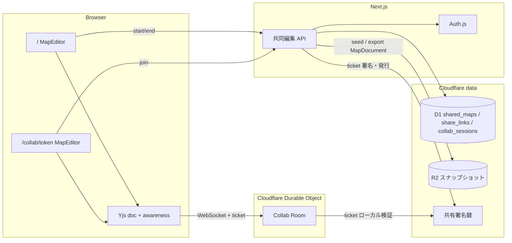

# Phase 39（099/100）: リアルタイム共同編集 — 設計

対象カード: [スクラム #44](https://scrum-board-jkcejsb6ka-an.a.run.app/items/44?project=5)「Phase 39: リアルタイム共同編集」  
ROADMAP: 候補099「リアルタイム共同編集」、候補100「参加者の選択位置・カーソル表示」  
前提: Phase 37 共有基盤（`docs/superpowers/specs/2026-11-26-phase37-share-view-link-design.md`）、Phase 38 コメント（文書外・本 Phase のリアルタイム化は非目標）。

見送り（かんばん Todo）:

- [#66 クラウド正本化・共有時クラウド必須](https://scrum-board-jkcejsb6ka-an.a.run.app/items/66?project=5)（常時クラウド正本。本 Phase はセッション中のみ）
- [#68 共有の自動更新・ポーリング同期](https://scrum-board-jkcejsb6ka-an.a.run.app/items/68?project=5)
- [#78 長時間オフラインの完全マージ](https://scrum-board-jkcejsb6ka-an.a.run.app/items/78?project=5)
- [#79 音声の同時編集チャネル](https://scrum-board-jkcejsb6ka-an.a.run.app/items/79?project=5)
- [#80 モバイル専用 UI](https://scrum-board-jkcejsb6ka-an.a.run.app/items/80?project=5)
- [#81 共同編集の監査ログ](https://scrum-board-jkcejsb6ka-an.a.run.app/items/81?project=5)
- [#82 エンドツーエンド暗号](https://scrum-board-jkcejsb6ka-an.a.run.app/items/82?project=5)
- [#83 コメントのリアルタイム同期](https://scrum-board-jkcejsb6ka-an.a.run.app/items/83?project=5)

## 決めたこと

1. **範囲**: 099・100 を **1 PR** で実装する。コメントのリアルタイム化・常時クラウド正本・ポーリングは非目標（#66 / #68 / #83）。
2. **正本**: **共同編集セッション中だけ** Yjs 文書を **Durable Object ルーム**に置く。単独編集は従来どおり **localStorage 正本**。セッション終了時に MapDocument V3 へ写し、所有者のローカルと（共有中なら）明示 publish 可能なスナップショットへ反映する。
3. **同期**: **Yjs（CRDT）**。OT・LWW 全文置換は採用しない。
4. **トランスポート正本**: **Cloudflare Durable Objects（DO）+ WebSocket**。PartyKit は採用しない（同等概念の説明に出ても実装は DO）。Next.js Route Handlers はセッション開始・認可・スナップショット入出力と **短命参加チケット発行**に使い、Yjs バイナリ同期の常時接続は DO に寄せる。
5. **編集 ACL**: 所有者（session）と **`permission=edit` の共有リンク**保持者（要 Google ログイン）。`view` / `comment` は従来どおり文書を編集しない。未ログインの edit は不可。
6. **presence（100）の必達**: 各参加者の **表示名（Google）・色・選択中ノード ID 集合・ビューポート中心（ワールド座標）** を awareness で共有し、マップ上に他者選択の輪郭色と他者ビューポート枠を出す。**ポインタ座標の連続送信は非目標**（ROADMAP の「カーソル」は選択位置・視点の意味で読む。ポインタ軌跡は後続）。
7. **参加の入口**:
   - **所有者**: 編集シェル（`/` の MapEditor）から「共同編集を開始」。**未共有でも開始可**（localMapId のみ）。共有中なら `sharedMapId` を付ける。
   - **edit リンク参加者**: ルート **`/collab/[token]`**（編集シェル相当。MapEditor を共同編集モードでマウント）。未ログインならログイン導線のみ（編集 UI は出さない）。view/comment 用 `/share/[token]` とは分離する。
   - 1 セッションあたり同時接続上限 **8**（超過は **429 固定**。409 は使わない）。
8. **競合と Undo**: 文書操作は Yjs がマージする。クライアントの Undo は **自操作のみ**（Yjs UndoManager）。他者操作を自分の Undo で消さない。
9. **タブ競合**: 共同編集セッション中は既存タブ競合ガードを **無効化**し Yjs を正とする（L-061）。セッション外は従来どおり。
10. **セキュリティ（L-1230〜1233 を本文化）**:
    - ルーム参加はチケット検証後に WS upgrade。平文 edit トークン・チケットをログ／分析に出さない。
    - **チケット検証**: CollabAPI が共有署名鍵でチケットを発行し、**DO が同一鍵でローカル検証**する（ハンドシェイクのたびに CollabAPI へ照会しない）。
    - 接続チケット寿命は **60 秒固定**。
    - レート制限は **プロセス／isolate 共有のシングルトン**（リクエストごとの新規生成禁止。L-1230）。
    - 発行する `wsUrl` / 絶対 URL の origin は **環境変数の許可オリジン**のみ（`x-forwarded-host` 無検証禁止。L-1231）。
    - 認可付き Collab GET・チケット応答は成否とも `Cache-Control: private, no-store`（L-1232）。**401／429 を含む**失敗応答にも同ヘッダを付ける。
    - `/collab/[token]` は metadata `referrer: "no-referrer"` **および** 文書／HTML 応答ヘッダ `Referrer-Policy: no-referrer` の両方（L-1233）。
    - awareness・文書更新にもレート制限。転送は TLS。E2E 暗号は #82。
11. **コメント**: 文書同期と分離。コメント API は Phase 38 のまま。リアルタイム化は #83。
12. **再接続**: 切断中は **入力を一時ブロック**（キューしない）。再接続中は **ticket 再発行 API**（短命 60 秒）で新しい ticket を取り直してから WS 再接続する。再接続成功で解除、**失敗（120 秒超脱落を含む）は UI `error`**＋notice（L-166）。切断から **ハード上限 120 秒**以内の再接続は Yjs 再同期。**120 秒を超えた切断はセッションから脱落**し、再参加が必要（長時間オフライン完全マージは #78）。意図的 leave／end 成功後は UI **`idle`**。
13. **知見**: L-001 Result、L-002 欠落と空、L-003 検証→書込、L-060 必須 props、L-061、L-166、L-1230〜1233。

## 1. 目的

同じマップを複数人が同時に編集でき（099）、他参加者の **選択位置とビューポート** を把握できる（100）ようにする。ローカルファーストは維持し、共同編集が必要なときだけ DO 上の Yjs 正本に乗る。ポインタ軌跡の共有は目的に含めない。

## 2. 非目標

- 常時クラウド正本化・共有時クラウド必須（#66）
- 保存のたび自動公開・ポーリング同期（#68）
- 長時間オフラインの完全マージ（#78）。短時間の再接続は Yjs 再同期（決めたこと 12）
- ポインタ座標の連続送信・マウスカーソル追従 UI
- 音声同時編集（#79）、モバイル専用 UI（#80）、監査ログ（#81）、E2E 暗号（#82）
- コメントのリアルタイム同期（#83）
- ログインなし edit、Google 以外のログイン（#64）
- OT / LWW 全文置換、PartyKit、Next 単体での大規模 WebSocket を同期正本にする設計

## 3. アーキテクチャ概要

- **共同編集 UI**は `/` の MapEditor（所有者）と `/collab/[token]`（edit 参加者）のみ。`/share/[token]` には編集・presence をマウントしない。
- 接続チケット寿命は **60 秒固定**。CollabAPI が共有署名鍵で発行し、**DO が同一鍵でローカル検証**する（WS ハンドシェイクのたびに CollabAPI へ照会しない）。平文共有トークンを WS URL に長く載せない。

## 4. データと正本の切替

### 4.1 単独編集（既定）

- 正本: `localStorage` の MapDocument V3（現行）。
- 共有 publish は明示ボタン（Phase 37）。

### 4.2 共同編集セッション

| 契機 | 動作 |
|---|---|
| **開始（所有者）** | body: `{ localMapId }` 必須。任意で `sharedMapId`（共有済みのとき）。seed 用に `documentJson`（MapDocument JSON 文字列）を送る。前回成果物がある場合は `seedFromArtifact: true` で取込可（空 artifact は拒否・空で上書きしない）。文書を検証 → Yjs encode → D1 に session 行（`creating`）→ DO ルーム作成・seed 成功後に D1 を `active` → `sessionId` + 所有者用 ticket + `wsUrl`。seed 失敗時は `active` にしない。クライアントは Yjs observer で描画・操作。 |
| **参加（edit リンク）** | `/collab/[token]`。ログイン必須。token → link（permission=edit・未失効）→ shared_map → アクティブ session が無ければ 404 `no-active-session`。あれば ticket。 |
| **再接続（ticket 再発行）** | `POST .../sessions/:id/ticket`。所有者または当該セッション参加者。active のみ。短命 ticket（**60 秒**）を再発行。`reconnecting` 中は旧 ticket の期限に依存せず、この API で取り直してから WS 再接続する（切断から **120 秒**以内）。**参加後に edit リンクを revoke しても、当該セッションの既存参加者の reissue／編集はセッション終了まで維持する**（失効は新規 join のみ。再参加には有効な edit トークンが必要）。 |
| **所有者の明示終了** | `POST .../end`。DO から Yjs → MapDocument export → 所有者クライアントへ配信し localStorage に保存（空で上書きしない）。成功後に DO を destroy（全 WS kick）。UI は **`idle`**。共有中なら UI で「公開を更新しますか？」を任意表示（自動 publish しない）。 |
| **退出（leave）** | `POST .../sessions/:id/leave`。D1 `collab_participants` から当該ユーザーを削除して枠を解放。ルーム／セッションは存続（他者継続）。120 秒脱落時も同様に参加者行を削除し、再参加は edit join が必要。 |
| **全員切断** | 最後の接続切断から **TTL 5 分**でルーム破棄。その前に export 済みでなければ、可能な範囲で DO が最終状態を R2/D1 のセッション成果物へ退避し、所有者が次回開始時に `seedFromArtifact` で取り込めるようにする。所有者クライアントが生きていれば終了時と同じく localStorage へ適用を試みる。 |
| **所有者だけ先に落ちた** | 他参加者は編集継続可。所有者再参加は ticket 再発行 API。最終の localStorage 反映は所有者が再接続したとき、または TTL 終了時の成果物取り込み。 |
| **失敗** | seed / 接続 / export 失敗は Result。失敗時にローカル正本を空文書へ置き換えない（L-001 / L-002 / L-003）。 |

### 4.3 Yjs スキーマ（論理）

- **`nodes`**: `Y.Map<string, Y.Map>`（キーはノード ID 文字列）。各ノードは既存 `Node` フィールドを保持。配列は使わない（並びはノードの `parent` / 順序フィールドで表現）。
- **`meta`**: title 等、共同編集で共有する文書メタのみ。
- **awareness**: `{ userId, displayName, color, selectedNodeIds, viewportCenter }`（pointer フィールドは持たない）。必須欠落の正規化は §11.1（L-002）。

**ID 採番（固定）**: 共同編集中の新規ノード ID はルームの Yjs `meta.nextId`（整数）を **atomic increment** して採番する。seed 時に既存ノードの最大 ID+1 を `nextId` の初期値にする。ローカル単調 ID と衝突する値が seed に含まれる場合は開始を拒否する（remap はしない。所有者に「ローカルで整理してから開始」を返す）。

## 5. 権限とリンク

| 主体 | できること |
|---|---|
| 所有者（session） | セッション開始・終了、編集、presence、edit リンク発行 |
| edit リンク + ログイン | 参加・編集・presence |
| comment / view リンク | 文書の共同編集不可（従来の閲覧／コメント） |
| 未ログイン | 参加不可 |

- `POST .../links` で `permission=edit` を許可する（Phase 37 の「edit リンク作らない」を本 Phase で解除。view/comment の既定は維持）。
- 他者リソース・失効トークンは **404**（Phase 37 と同じ）。

## 6. UI

### 6.1 所有者・参加者（編集シェル）

- ヘッダー: 「共同編集」開始／退出、接続状態、参加者一覧（名前・色）。
- マップ: 他者選択ノードの輪郭色、他者ビューポートの薄い枠（ポインタ軌跡は出さない）。
- 再接続中は操作を一時ブロックし、失敗は notice（L-166・決めたこと 12）。

### 6.2 必須 props（L-060）

**共同編集コントロール**

| prop | 役割 |
|---|---|
| `collabSession` | `idle` / `connecting` / `active` / `reconnecting` / `error` |
| `participants` | 参加者一覧（必須。空配列は ready かつ 0 件） |
| `participantsState` | 一覧の取得状態（必須・別 prop。`loading` / `ready` / `error`） |
| `onStartCollab` | 開始 |
| `onLeaveCollab` | 参加者退出（session は他人がいれば active のまま。成功後 UI `idle`） |
| `onEndCollab` | 所有者終了（leave と end は分離。両方必須。成功後 UI `idle`） |
| `shareSession` | ログイン状態 |
| `dialogMouseClickedAtRef` | シェル由来のダイアログクリック時刻（MapStage へ透過。省略不可・L-060） |

**presence 描画**（`CollabControl` とは別正本。MapEditor／`/collab` 組み立てで両方を必須配線）

| prop | 役割 |
|---|---|
| `remoteSelections` | userId → nodeIds（欠落≠空） |
| `remoteViewports` | userId → center |

### 6.3 通知クリア（L-166）

共同編集の成功／失敗 notice は、ダイアログ閉鎖・mapId 変更・再試行開始・成功で error 置換・同一文言再読み上げ・セッション状態変化でクリアする。

## 7. API 骨子（Next）

- `POST /api/collab/sessions` — 所有者のみ。body: `{ localMapId: string, sharedMapId?: string, documentJson?: string, seedFromArtifact?: boolean }`。`documentJson`（seed 用 JSON）か `seedFromArtifact: true`（前回 artifact）のどちらかで seed。→ `{ sessionId, ticket, wsUrl }`
- `POST /api/collab/join` — body: `{ token: string }`（edit 共有トークン）。ログイン必須。→ `{ sessionId, ticket, wsUrl }`
- `POST /api/collab/sessions/:id/ticket` — 所有者または当該セッション参加者。active のみ。**ticket 再発行**（短命 **60 秒**）。→ `{ sessionId, ticket, wsUrl }`。`reconnecting` 中の再接続がこれを使う
- `POST /api/collab/sessions/:id/end` — 所有者のみ。export トリガ
- `GET /api/collab/sessions/:id` — 所有者または当該セッション参加者。それ以外は **404**
- WS: Durable Object（**共有署名鍵によるローカル ticket 検証**後に Yjs 同期。CollabAPI への毎回照会はしない）
- 接続チケット claims: `{ sessionId, userId, exp }`（**`iat` は持たない**。寿命は発行時 `exp = floor(nowSec)+60`）

### 7.1 HTTP 地位（固定）

| 状況 | 地位 |
|---|---|
| 未ログインで開始／join／end／ticket 再発行 | 401 |
| view/comment トークンで join | **404**（存在を漏らさない） |
| 失効・不明トークン | 404 |
| edit だがアクティブセッションなし | 404 `no-active-session`（本文 reason。地位は 404） |
| 同時接続上限超過 | **429**（409 は使わない） |
| 認可付き GET／チケット応答（**成功・404・401・429・その他失敗**） | `Cache-Control: private, no-store` |

レート制限はシングルトン（L-1230）。`wsUrl` の origin は env 正本（L-1231）。

## 8. テスト方針

- 単体: Yjs ↔ MapDocument 往復、権限ガード、awareness 正規化（必須フィールド欠落を成功の空に倒さない・§11）、Result 経路。
- API: 未ログイン 401、view トークン join **404**、edit+ログイン成功、失効 404、レート制限、no-store ヘッダ（成功・404・**401・429**）。ticket 再発行成功／期限切れ旧 ticket 拒否。
- UI: L-060 必須 props、セッション中はタブ競合 UI 無効（L-061）、presence の空と欠落、`/collab` の Referrer-Policy。
- **結合（L-060 props 外し変異）**: CollabControl / PresenceLayer / MapEditor 共同編集配線 / `/collab/[token]` 組み立てで、必須 props を意図的に欠落させた変異が **型エラーまたはテスト失敗**になること（省略を実行時の空配列・空 Map 成功に倒さない）。単体のキー一覧 assert に加え、配線結合テストでも外し変異を要求する。
- 手動: 2 ブラウザで同時ノード編集、選択色とビューポート枠、切断再接続、セッション終了後のローカル保存。

## 9. 実装順とプラン境界

1 つの実装プランに収めるが、**サブエージェントは次の Task 単位**で起動する（1 Task = 1 サブエージェント。共有ファイル競合を避けるため同時実行しない）。

| Task | 内容 | 主な成果物 |
|------|------|------------|
| 0 | L-061 inventory（入口×状態） | `…-phase39-…-inventory.md` |
| 1 | Yjs codec + ID/`nextId` | `domain/collab/*` と単体テスト |
| 2 | CollabAPI session/ticket + D1 | Route Handlers・契約テスト |
| 3 | Durable Object ルーム + WS クライアント | DO・接続フック・モック |
| 4 | MapEditor / `/collab/[token]`・Undo・タブ競合切替 | UI 配線・L-060 テスト |
| 5 | presence UI（100） | 選択色・ビューポート枠 |
| 6 | `permission=edit` リンク API 拡張 | share API・テスト |
| 7 | docs / ROADMAP / browser-test-cases | 文書 |

## 10. 環境・運用

- 秘密: 既存 Auth / CF_SHARE_* に加え、DO 用バインディング名・チケット署名秘密を `.env.example` に名前だけ列挙。
- イラスト用 Cloudflare 資格情報と共有・共同編集用を分離。
- ローカル開発: DO モックまたは `wrangler` ローカル。実 DO が無い CI はモック契約テストで固定。

## 11. 成否契約（L-001）と欠落の扱い（L-002）

- 開始・参加・終了・export・接続はすべて **Result**（または HTTP 地位 + body `reason`）。呼び出し元は失敗時に成功 UI を出さない。
- **成功時だけ** localStorage 上書き・セッション active 表示・WS 接続継続を行う。
- export 成果物が無い／decode 失敗は概念上 `missing` / `invalid` とし、**空の MapDocument 成功にしない**。実装・プランの具体 reason との対応（正本）:

| 概念（本節） | codec `CollabCodecResult.reason` | API／取込の代表 reason |
|---|---|---|
| `invalid` | `invalid-document` / `decode-error` | `invalid-document` |
| `missing` | （codec 単体では出さない） | `export-empty`（空 artifact／空 export） |
| ID 衝突 | `id-collision` | 開始拒否（`active` にしない） |
| 符号化失敗 | `encode-error` | seed 失敗（空 seed 成功にしない） |

- awareness で他者がいないことは `participants: []`（ready）。未取得は `loading` または `error` で、空配列成功と混同しない。

### 11.1 awareness 必須フィールドの正規化（L-002）

awareness ペイロードの必須フィールドは `{ userId, displayName, color, selectedNodeIds, viewportCenter }`（§4.3。pointer は持たない）。

| 入力 | 正規化結果（固定） |
|---|---|
| 他 peer が 0 件（取得成功） | `participants: []` + `participantsState: ready`。remote Maps は空でよい |
| 一覧未取得／接続前 | `participantsState: loading`（または `error`）。**空配列 ready にしない** |
| 必須フィールドの欠落・型不正・`displayName` 空・`viewportCenter` 欠落 | その peer の **`RemotePresence` を作らない**。`remoteSelections` / `remoteViewports` に **キーを載せない**（`null`・`{0,0}`・`[]` で埋めない／成功の空に倒さない） |
| local の viewport 未準備 | local awareness を **publish しない**（`{0,0}` 捏造禁止） |
| `selectedNodeIds: []` かつ必須が揃っている | 明示的未選択として **キーあり + 空配列**（キー欠落≠空選択） |

## 12. 書込順序（L-003）

1. **開始（L-003）**: MapDocument 検証 → Yjs encode 成功 → D1 に session 行（**`creating`**）→ DO seed → **成功後にだけ** D1 を **`active`** → ticket 発行。seed／途中失敗時は session を **`active` にしない**（`failed` または行削除）。DO を空のまま公開しない。
2. **end**: まず DO から export 確定 → 所有者へ配信 → 成功後に session を ended。export 失敗なら session は active のまま（再試行可）。空 export で localStorage を消さない。
3. **TTL 破棄**: export 未完了なら破棄前に成果物退避を試み、失敗しても「空文書を正本にした」ことにはしない（失敗を記録し所有者に再開始を促す）。

## 13. 必須 props 面（L-060）

**共同編集コントロール**（§6.2 に加え）

| 組み立て | 必須配線 |
|---|---|
| CollabControl（ヘッダー） | §6.2 のコントロール props（`dialogMouseClickedAtRef` 含む）。**presence Maps は含めない** |
| PresenceLayer | `remoteSelections` / `remoteViewports`（省略不可） |
| MapEditor | Control 必須 props **＋** Presence 必須 props（両方を配線。片側だけ成功に倒さない） |
| `/collab/[token]/page` | token、login 導線、`collabSession`、編集シェルへの同一必須 props（Control + Presence） |
| ShareDialog / リンク発行 | `permission` に `edit` を選べること、未ログインで発行成功にしない |

**presence 描画**（MapStage または専用 overlay）: `remoteSelections` / `remoteViewports` は省略不可（空集合は「誰も選んでいない」）。

**接続層 → UI（固定）**: `reconnecting` 失敗（120 秒超脱落を含む）→ UI **`error`**。意図的 leave／end 成功後の `closed` → UI **`idle`**。`closed` を UI にそのまま出さない。

## 14. inventory 要件（L-061）

Task 0 で別紙 inventory を作り、少なくとも次を表にする（実装前）:

- 共同編集 `idle` / `connecting` / `active` / `reconnecting` / `error` × 既存入口（保存、タブ競合、学習、プレゼン、音声、共有ダイアログ、コメント）
- Phase 36/37 の **機械列挙入口**（少なくとも JSON 読込・パレット MUTATING・AI・一括系）を行として含め、**共同編集中**の扱いを **1 列**で **`無効` / `Yjs経由` / `拒否` のいずれかのみ**に固定する
- `active` 中に無効化または拒否する入口の列（語彙は上に合わせる）
- `reconnecting` 中の入力ブロックと、切断から **ハード上限 120 秒**超で脱落する列
- `/share/[token]` に共同編集 UI が 0 件であること

## 15. 既知の制約

- 同時接続上限 8。超えたら参加拒否（明示 reason）。HTTP 地位は **429 固定**（409 は使わない）。
- 接続チケット寿命は **60 秒固定**（claims に `iat` 無し。`exp = floor(nowSec)+60`）。DO は共有署名鍵でローカル検証（CollabAPI への毎回照会なし）。再接続は **ticket 再発行 API** で短命 ticket を取り直す。
- 再接続脱落は切断から **ハード上限 120 秒**（失敗時 UI `error`。leave／end 成功は UI `idle`）。
- 長時間オフラインの完全マージは保証しない（#78）。
- Next と DO でチケット署名鍵を共有する必要がある。
- コメント・学習・プレゼン等との交差は inventory で塞ぐ。
- 新規ノード ID は `meta.nextId` increment。衝突する seed は開始拒否（§4.3）。
