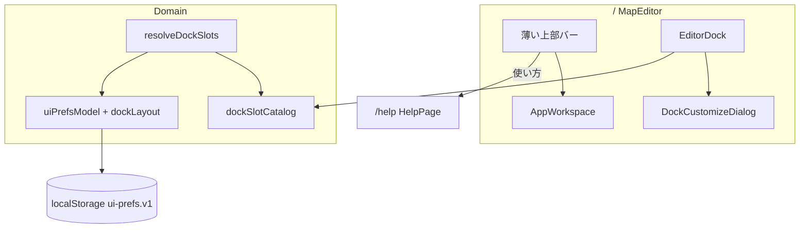

# 下部 Dock 風メニューと項目カスタマイズ — 設計

対象カード: [スクラム #49](https://scrum-board-ajs5phscdq-an.a.run.app/items/49?project=5)「画面上部にあるメニュー一覧をページ下部に持っていく」  
ROADMAP: ロードマップ外（新 Phase は切らない）。完了後に「現在地」へ 1 行追記する。

見送り（かんばん Todo）:

- [#88 下部 Dock: モバイル専用 UI](https://scrum-board-ajs5phscdq-an.a.run.app/items/88?project=5)（狭幅は横スクロール＋オーバーフローのみ。専用モバイル UI は非目標）

## 決めたこと

1. **範囲**: 上部にあった操作ボタン群を **ページ下部の Dock** に移し、Dock に出す項目の **表示／非表示と並び** を利用者がカスタマイズできる。操作ヒント等の **長い説明文言は `/help` へ移し**、編集画面からは常時テキストを外す。1 PR。
2. **上部に残すもの（薄いバー）**: ブランド名「Draw My Map」、マップ名／一覧／新規（`mapControls`）、保存状態、表示切替（マップ｜アウトライン）、検索（ノード検索・全マップ検索）、配置モード（手動｜自動）、レイアウト系コントロール（様式・方向・間隔・整列・スナップ・ロック・文字）。**操作ヒントの常時表示は上部から削除**し、ヘルプへの短いリンクだけ残してよい。
3. **下部 Dock へ移すもの（閉じた一覧）**: 現行 `importanceControls`・`resolutionControls`・`operationControls`・狭幅時以外の `voiceControls` に含まれる操作を、次の **スロット ID 集合**として Dock に移す（コピー／貼り付け案内テキスト・折りたたみ補足文はスロットに含めず `/help` へ）。
   - **edit**: `undoRedo`, `commandPalette`, `wheelZoom`, `importance`, `collapse`, `duplicateBranch`, `moveBranch`, `reorderSiblings`, `changeHierarchy`, `insertParent`, `deleteNodeOnly`, `bulkReplace`, `splitMerge`, `branchNav`, `viewBookmarks`
   - **view-tools**（現行 resolution 束を分割）: `resolutionFilter`, `depthLimit`, `highlightMode`, `nodePins`
   - **session**: `tour`, `presentation`, `learnMode`（学習トグル）。学習中のみ出る「復習カード生成／復習カード／進捗リセット」は **`learnMode` スロット内の付随コントロール**（別スロットにしない）
   - **voice**: `voiceInput`（狭幅でも primary に残さず Dock へ統一）
   - **io**: `importBullets`, `importOpmlCsv`, `exportTarget`, `exportJson`, `exportPngSvg`, `printPdf`, `exportMdBullets`, `exportOpmlCsvTsv`
   - **collab-share**: `collab`, `share`, `comments`
4. **既定の Dock セット**: 次だけが `visibleSlotIds` 既定（この順）: `undoRedo`, `commandPalette`, `wheelZoom`, `importance`, `collapse`, `duplicateBranch`, `moveBranch`, `reorderSiblings`, `changeHierarchy`。上記以外のスロットは **既定では `visibleSlotIds` に含めない**（非表示）。ユーザーがカスタマイズで追加した表示スロットが横幅を超えたときだけ、はみ出し分を Dock の「その他」オーバーフローへ送る（「その他」≠ 既定非表示）。
5. **カスタマイズの粒度**: Dock スロットの **表示／非表示と並び順**のみ。ショートカットキーは変更しない。永続化は既存 `draw-my-map.ui-prefs.v1` を拡張する（`wheelZoomSensitivity` と同居）。破損・欠落・**空の `visibleSlotIds`** は既定セットへフォールバック（L-002）。カスタマイズ UI では **表示ゼロを禁止**（最低 1 スロット。適用ボタンを disabled）。
6. **カスタマイズ UI**: Dock 上の「カスタマイズ」からダイアログ。チェック（表示）と並べ替え（上下ボタン）。「既定に戻す」で既定セットへ。ダイアログは L-408・L-060 を守る。
7. **文言の移設**: 新規ルート **`/help`**。内容は (a) レイアウト操作ヒント、(b) コピー／貼り付け案内、(c) 折りたたみ補足（`NodeCollapseControl` の常時説明文を含む）。編集シェルからは (a)(b)(c) の常時テキストをすべて削除する。`/help` へのリンクは **薄い上部バーに 1 つだけ**（Dock には置かない）。
8. **コマンドパレット**: 現状維持（Ctrl/Cmd+K）。入口ボタンは Dock スロット `commandPalette`。catalog 必須化は非目標。
9. **狭幅**: Dock は横スクロールを優先し、なおはみ出す分は「その他」。専用モバイル UI は #88。`voiceInput` も Dock（primary 残置しない）。
10. **アウトライン表示**: 下部 Dock を共用。規則は次の **1 本**: `outlineVisible === false` または `requiresMapView === true` のスロットはアウトライン中 **DOM に出さない**（disabled 表示は使わない）。マップ表示中に既存理由で押せない場合のみ `disabled`（L-058）。
11. **スロット登録**: 決めたこと 3 の ID を **Dock スロット定義表**（domain）に登録。MapEditor は ID → 制御の配線のみ。未知の保存 ID は読込時に落とす。
12. **operationNotices**: `header-operations-scroll` 削除後は **薄い上部バー直下**（primary の次行、全幅）に残す。Dock には入れない。
13. **Dock のレイアウト配置**: MapEditor ルートを縦 flex とし、上から `AppHeader`（薄いバー＋notices）→ `AppWorkspace`（flex-1）→ `EditorDock`（末尾固定）。「Workspace 内の下」案は採用しない。
14. **知見**: L-058、L-060、L-061、L-002、L-408、L-522、L-166、L-792。

## 1. 目的

編集画面の上部に増え続けた操作一覧を下部 Dock に集め、キャンバス作業領域を広げつつ、利用者が Dock の内容を自分用に整えられるようにする。長い操作説明は編集画面から外し、専用のヘルプページで読めるようにする。

## 2. 非目標

- 専用モバイル UI（#88）
- ショートカットキーのカスタマイズ
- コマンドパレットへの全ヘッダー操作の強制 catalog 化
- テーマ／色の Dock スキン変更、フローティング円形 FAB のみの UI
- リモート同期された UI 設定（端末ローカルの `ui-prefs` のみ）
- `/help` の多言語化・CMS 化

## 3. アーキテクチャ概要



- **domain**: スロット ID・既定並び・表示可否の純関数、`UiPrefsV1` の dock フィールドの normalize／migrate。
- **components**: `EditorDock`（描画＋オーバーフロー）、`DockCustomizeDialog`、薄い `AppHeader`（操作段削除）、`HelpPage`。
- **hooks / MapEditor**: 既存 control 群をスロット ID にマウント。永続化は `useUiPrefs` 拡張。

## 4. データモデル

### 4.1 `UiPrefsV1` 拡張

```ts
type DockLayoutPrefs = {
  /** 表示するスロット ID。並び = 配列順。未知 ID は読込時に落とす。空は不正で既定へ */
  visibleSlotIds: string[];
};

type UiPrefsV1 = {
  version: 1;
  wheelZoomSensitivity: number;
  dockLayout?: DockLayoutPrefs; // 欠落時は createDefaultDockLayout()
};
```

- 保存キーは従来どおり `draw-my-map.ui-prefs.v1`。
- `dockLayout` 欠落・型不正・空配列 → `createDefaultDockLayout()`（`{ visibleSlotIds: createDefaultDockVisibleSlotIds() }`）。保存時も空配列は書かない。
- スキーマを壊さない範囲で optional。`version` は 1 のまま（フィールド追加のみ）。

### 4.2 スロット定義（domain）

各スロット: `id`, `label`, `group`（`edit` | `view-tools` | `session` | `voice` | `io` | `collab-share` — 決めたこと 3 と同一）, `defaultVisible: boolean`, `outlineVisible: boolean`（アウトラインでも出すか）, 任意で `requiresMapView` 等。

既定 `visibleSlotIds` は `defaultVisible === true` の ID を catalog 定義順で並べたもの。

## 5. UI 振る舞い

### 5.1 薄い上部バー

- 現行 `header-primary` 相当を維持（決めたこと 2）。狭幅でも `voiceControls` は primary に出さない。
- `header-operations-scroll` は **削除**（中身は Dock）。
- primary の次に `operationNotices` 用の全幅行を残す（決めたこと 12）。
- `LayoutModeOperationHint` の常時表示をやめる。替わりに primary 内の「使い方」リンク → `/help`（同一タブ。リンクはここだけ）。

### 5.2 EditorDock

- 決めたこと 13 のとおり、縦 flex の末尾に置く。Pixi ヒット領域と重ねない。
- `resolveDockSlots` が返す表示スロットを左から並べる。コンテナ幅を超えた分だけ「その他」へ（既定非表示スロットはここに自動では出ない）。
- 「カスタマイズ」は常時 Dock 右端（カスタマイズ対象外の固定コントロール）。
- マップ表示中の無効操作は `disabled`（L-058）。アウトライン中のマップ専用は非マウント（決めたこと 10）。

### 5.3 カスタマイズダイアログ

- 決めたこと 3 の全スロット一覧（グループ見出し）。表示チェック、上へ／下へで下書きの `visibleSlotIds` を編集。
- 表示ゼロなら適用 disabled。適用で `ui-prefs` 保存。キャンセルは破棄。
- 「既定に戻す」は下書きを既定にし、適用で保存。

### 5.4 `/help`

- 静的（または軽量クライアント）ページ。編集状態に依存しない。
- (a)(b)(c) を見出し付きで掲載。必要なら `features.md` への案内を 1 行。

## 6. 入口インベントリ（L-061）

新表面 × 既存状態での visible / 非マウント / disabled の正本。実装・テストはこの表から外さない。

| 表面 | outline | learningActive | playingPresentation | listening | protect/conflict/deleted | 狭幅 |
| --- | --- | --- | --- | --- | --- | --- |
| Dock 本体 | 出す | 出す | 出す | 出す | 出す（個別スロットは既存 disabled） | 出す（横スクロール） |
| マップ専用スロット | **非マウント** | 既存どおり | 既存 disabled | 既存 | 既存 disabled | 既存 |
| `learnMode` 付随3ボタン | learn 非マウント時なし | **learningActive のときのみ** learn 内 | 既存 disabled | 既存 | 既存 | 同左 |
| 「その他」 | はみ出し表示スロットのみ | 同左 | 同左 | 同左 | 同左 | 同左 |
| カスタマイズ open | 可 | 可 | 可 | 可 | 可 | 可 |
| カスタマイズ中の背面操作 | ダイアログがモーダル。キャンバス編集・Dock 他ボタンは遮る（既存ダイアログ慣行） | 同左 | 同左 | 同左 | 同左 | 同左 |

## 7. L-408 / L-060 / L-522 / L-166 / L-792

### 7.1 L-408（カスタマイズダイアログ）

- 開くボタン・適用・キャンセル・上下並替・閉じるは、`event.repeat` の Enter/Space を無視し、ポインタは `detail > 1`（ダブルクリック続き）を確定に使わない。
- MapEditor 側は既存同様 `dialogMouseClickedAtRef`（または同等）を必須配線し、開いた直後の背面クリック誤確定を防ぐ。
- 閉じた後のフォーカスは「カスタマイズ」ボタンへ戻す。

### 7.2 L-060 必須 props

| 部品 | 省略不可 props（例） |
| --- | --- |
| `EditorDock` | `slots`（描画用ノード配列）, `onCustomize`, `customizeButtonRef`, `isNarrowViewport` |
| `DockCustomizeDialog` | `open`, `draftVisibleSlotIds`, `onDraftChange`, `onApply`, `onCancel`, `onResetDefault`, `dialogMouseClickedAtRef`, `initialFocusRef` |
| MapEditor 配線 | `uiPrefs` / `setDockLayout`（prefs 更新）, スロット ID→control の表 |

組み立てテストで上記を外すと型エラーまたは明示失敗にする。

### 7.3 L-522（ショートカット）

- Dock 内ボタンにフォーカスがあるとき、背面キャンバス向けの破壊的グローバルショートカット（例: 無修飾 Delete でのノード削除）は発火しない（既存の「非テキスト対話要素フォーカス」除外に Dock を含める）。
- Dock／コマンド入口上では、案内しているショートカット（Ctrl/Cmd+K 等）が死なないことを結合テストで固定する。

### 7.4 L-166（notice）

- 本機能は **新規の永続 notice チャネルを足さない**。カスタマイズの保存失敗はダイアログ内インラインエラーとし、`operationNotices` は増やさない。
- 既存 `operationNotices` のクリア契機は **不変**（本 PR で変更しない）。

### 7.5 L-792（CSS）

- Dock / `/help` 用にグローバルへ出すクラスは、必ず祖先セレクタ付き（例: `.editor-dock .…`、`.help-page .…`）にする。裸の汎用クラス名をグローバルに置かない。

## 8. テスト方針

- domain: 既定レイアウト、未知 ID 除去、空配列フォールバック、並びの正規化、表示ゼロ禁止。
- `EditorDock`: 既定スロット表示、非表示スロットが出ない、カスタマイズ適用後の並び、オーバーフロー、「その他」。
- `AppHeader`: 操作段が無い／ヒント常時表示が無い／使い方リンク 1 つ。
- `/help`: (a)(b)(c) 見出しが存在する。
- MapEditor 結合: 上部残置と Dock 代表スロット位置。アウトラインでマップ専用非マウント。
- L-060: §7.2 の必須 props を組み立てテストで固定。
- L-408: リピートキー・detail>1 で適用されない。
- L-522: Dock フォーカス時の Delete 非発火、Ctrl/Cmd+K は入口上で有効。
- §6 表の代表セル（outline×マップ専用、learning×付随ボタン）を 1 本以上固定。
- `npm run verify`。

## 9. ドキュメント

- `docs/specifications/features.md` のレイアウト図・操作ヒント記述を更新。
- `docs/testing/browser-test-cases.md` に Dock／カスタマイズ／help の手動節を短く追加。
- `ROADMAP.md` の「現在地」に #49 完了を 1 行（新 Phase 見出しは作らない）。

## 10. リスクと緩和

| リスク | 緩和 |
| --- | --- |
| スロット数が多く MapEditor が肥大 | ID→ReactNode の表に閉じ、domain と描画を分離（SRP 後続） |
| 既存 e2e／testid 依存 | `header-operations-scroll` 削除をテスト更新。新 `editor-dock` testid |
| キャンバス下部の操作性と Dock の重なり | flex レイアウトで Dock をキャンバス外。狭幅はスクロール |
| prefs 破損 | normalize＋既定フォールバックの単体テスト |

## 11. 受け入れ条件

1. マップ編集画面で、決めたこと 2 の項目が上部にあり、決めたこと 3 の操作ボタンが下部 Dock（またはその他）から実行できる。
2. 既定 Dock は決めたこと 4 のセットを表示する。
3. カスタマイズで表示／並びを変え、リロード後も `ui-prefs.v1` から復元される。既定に戻せる。
4. レイアウト操作ヒント・コピー案内・折りたたみ補足の常時テキストが編集画面に無く、`/help` の (a)(b)(c) で読める。「使い方」リンクは上部バーに 1 つ。
5. アウトライン表示でも Dock が出て、マップ専用スロットは DOM に出ない。
6. 狭幅で Dock が横スクロールまたは「その他」で到達できる（専用モバイル UI は不要）。
7. `operationNotices` が上部バー直下に出る。
8. `cd client && npm run verify` が成功する。
