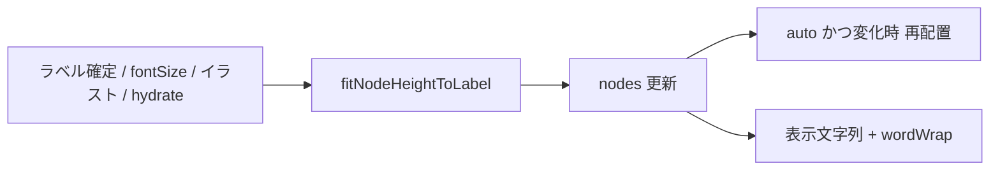

# ノードラベルのはみ出し防止（高さ自動拡張）— 設計

対象カード: [スクラム #51](https://scrum-board-ajs5phscdq-an.a.run.app/items/51?project=5)「テキストがノードをはみ出る」  
ROADMAP: ロードマップ外（新 Phase は切らない）。完了後に「現在地」へ 1 行追記する。

## 決めたこと

1. **方針**: ノード幅は現状どおり（既定 `RECT_WIDTH`、既存の `node.width`）。ラベルはこれまでどおり折り返し（`wordWrapWidth = width - 水平パディング`）。**高さは内容にフィット**する（伸びる／縮む。下限あり）。
2. **上限の語彙**:
   - **本文領域上限** `NODE_LABEL_CONTENT_MAX_HEIGHT` = `RECT_HEIGHT * 4 - VERTICAL_PADDING`（例: 240−16=**224**）。ここに折り返し本文が収まる。
   - **イラスト無しのノード高さ上限** = `NODE_LABEL_CONTENT_MAX_HEIGHT + VERTICAL_PADDING`（= `RECT_HEIGHT * 4` = **240**）。
   - **イラスト有りのノード高さ上限** = `NODE_LABEL_CONTENT_MAX_HEIGHT + VERTICAL_PADDING + ILLUSTRATION_AREA_HEIGHT`（= **296**）。
   - 「約4倍」は **イラスト無しのノード高さ上限**を指す。本文領域はその内側。
3. **フィット経路**:
   - **確定時**（ラベル／対象書式）: 内容へ fit。`height` は `max(下限, min(上限, 必要高))`。短くすれば **下限まで縮む**。
   - **読込補正**: 高さが **不足**しているノードだけ増高。既に十分な高さは **同値 no-op**（参照同一性は要求しない）。縮めない。
4. **下限**: イラスト無しは `RECT_HEIGHT`。イラスト有りは `ILLUSTRATED_NODE_HEIGHT`（現行 116）をノード高さの下限とする。
5. **イラスト合成（1 式）**:  
   `body = min(measuredLabelBodyHeight, NODE_LABEL_CONTENT_MAX_HEIGHT)`  
   `needed = body + VERTICAL_PADDING + (illustration ? ILLUSTRATION_AREA_HEIGHT : 0)`  
   `height = max(needed, illustration ? ILLUSTRATED_NODE_HEIGHT : RECT_HEIGHT)`  
   （`getIllustratedNodeMinHeight` と同等になるよう、イラスト時は最後に `ILLUSTRATED_NODE_HEIGHT` 下限を掛ける。）
6. **イラスト着脱**: `replaceNodeIllustration` / `clearNodeIllustration` の直後も **同じ fit** を通す（固定 116/60 のまま残して再はみ出ししない）。
7. **更新タイミング**: キャンバス／アウトラインのラベル確定、一括置換、`labelFontSize` 変更、イラスト着脱、マップ文書の hydrate／読込補正。**bold / underline は fit しない**（行高に乗せない。常に never）。編集中ライブリサイズはしない。
8. **空ラベルの計測**: キャンバスと同じ表示フォールバック（空なら `FALLBACK_NODE_LABEL` 相当）を計測入力にする。フォールバックが無ければ `""` で既定高さ下限。
9. **省略の正本**: **行単位折り返し後に行数上限で切り、切った場合のみ末尾に `…` を付けた表示文字列**を domain が返す。**Node 文書には保存しない**（都度導出）。`truncateLabelByCodePoints` の単独流用で折り返し前を切ることは禁止。pixi はこの都度導出結果を描く。
10. **自動レイアウトと原子性（L-001）**: `layoutMode === "auto"` かつ高さが実際に変わったら既存の **`applyTreeChange` / `layoutNodeForest` 経路**で再配置を 1 回（`relayoutAfterPinnedMove` は使わない）。**ラベル文字列・高さ・（必要なら）再配置結果は 1 回の状態適用で全体成功か全体不変**。失敗時は全体不変。`updateNodeLabel` 等は **`boolean` を返し**、失敗時 false。呼出元（`useNodeEditing` / `useOutlineLabelDraft`）は false のとき編集／draft を成功扱いしない。手動では左上 `x,y` を保ち下方向にだけ伸縮。
11. **読込補正と履歴**: hydrate 時の不足補正は **履歴エントリに載せない**（初期整合）。通常の編集 fit は既存の非構造変更として 1 Undo に含める。
12. **書き出し**: 今回は **キャンバスと同じ高さ／省略規則を必須**にはしない（非目標寄り）。ノード `height` が文書に正しいので、既存 export は矩形に従う。行省略文字列の完全共有はフォロー可。
13. **fit する入口（列挙）**:
    | 経路 | 扱い |
    | --- | --- |
    | キャンバス／アウトラインのラベル確定、一括置換、`labelFontSize`、イラスト着脱 | **即 fit**（確定経路） |
    | マップ hydrate／JSON 読込／初期表示 | **不足のみ増高**（履歴なし） |
    | `insertForest`／outline・OPML・CSV 取込／AI 構造でノード生成 | 生成後に **即 fit**（取込完了時点で矩形内） |
    | 共同編集の remote ラベル／寸法適用 | **hydrate 同型**（受信適用後に不足補正。履歴は remote 側の規約に従う） |
    | bold/underline のみ | **fit しない** |
14. **知見 L-467**: 計測・省略文字列の導出は **純関数**（updater の外でも呼べる）。updater／hydrate は返ってきた数値・文字列を **適用するだけ**。render 中の setState／計測副作用は禁止。StrictMode 二重実行で I/O が増えないこと。

## 1. 目的

長いラベルでもノード矩形からテキストがはみ出さず、上限超過時は省略で矩形内に収める。

## 2. 非目標

- ノード幅の自動変更
- 編集中のリアルタイム伸縮
- bold/underline による fit
- 書き出しテキスト計測の完全一本化（今回）
- 手動リサイズハンドル UI

## 3. アーキテクチャ概要

## 4. 定数

| 定数 | 値の意味 |
| --- | --- |
| 水平パディング合計 | 16（現行 wrap） |
| `VERTICAL_PADDING` | 16 |
| `NODE_LABEL_CONTENT_MAX_HEIGHT` | `RECT_HEIGHT * 4 - VERTICAL_PADDING`（224） |
| ノード高上限（イラスト無し） | `RECT_HEIGHT * 4`（240） |
| ノード高下限 | `RECT_HEIGHT` / イラスト時 `ILLUSTRATED_NODE_HEIGHT` |

## 5. テスト（受け入れ）

1. 短いラベル → 高さ `RECT_HEIGHT`（イラスト無し）。イラスト有り → 少なくとも `ILLUSTRATED_NODE_HEIGHT`。
2. 長い折り返し → 高さ増、テキストが矩形内。
3. 上限超過 → 高さ頭打ち、表示に `…`、はみ出し無し。
4. 長い→短いへ確定 → 下限まで縮小。
5. `updateNodeLabel` / `labelFontSize` / イラスト着脱で fit。
6. auto で高さ変化 → 再配置。再配置失敗なら高さ変更も無し。
7. 読込: 不足のみ増高・同値 no-op・履歴に載らない。
8. L-467: render 中 setState 無し。

## 6. ドキュメント

- `docs/specifications/features.md` に寸法・fit・省略を追記。
- `ROADMAP.md` 現在地に #51 完了 1 行。

## 7. リスク

- domain 計測と Pixi Text の行高差 → パディング余裕。差が大きい場合は計測寄せをフォロー。
