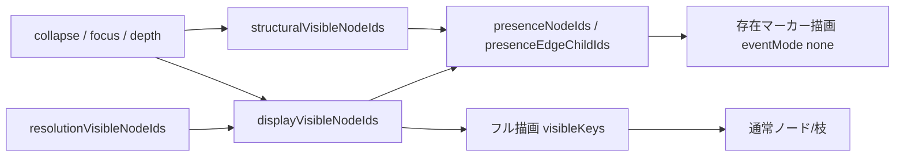

# ズームアウト時の存在マーカー — 設計

対象カード: [スクラム #50](https://scrum-board-ajs5phscdq-an.a.run.app/items/50?project=5)「ズームアウトしても、見えてほしい」  
ROADMAP: ロードマップ外（新 Phase は切らない）。完了後に「現在地」へ 1 行追記する。

## 決めたこと

1. **問題の正本**: 真っ白の主因は、表示モードが **自動（`auto`）** のときズームアウトで解像度レベルが `high` になり、既定重要度 `medium` のノードが解像度フィルタで消え、最終可視集合がほぼ空になること。キャンバス背景は透明（`backgroundAlpha: 0`）のため白地に見える。
2. **方針**: 既存の解像度 LOD（しきい値・ヒステリシス・祖先維持・手動固定）は **変えない**。`auto` のとき、構造上は出すべきなのに **解像度だけ** で隠れたノード／親子枝を、ラベル無しの **存在マーカー**（点・細い線）として残す。「そこに何かがある」が分かればよく、全文は不要。
3. **手動解像度**: `high` / `medium` / `all` 固定のときはマーカーを **出さない**（現状どおり非表示）。マーカーは **`mode === "auto"` のみ**。
4. **操作**: マーカーは **見た目のみ**。ヒット不可（`eventMode: "none"` 相当）。クリック選択・ホバー・ズームイン誘導はしない。編集・選択・ショートカットの対象は従来どおり最終可視集合（フル描画ノード）のみ。
5. **対象**: **ノードの点** と **親子の枝の細い線**。関連線・グループ枠・ピン・ハイライト帯のマーカー化は **非目標**。
6. **構造フィルタとの積**: 折りたたみ・集中・深さで隠れるノードはマーカーにも出さない。  
   `structuralVisible = collapse ∧ focus ∧ depth`（**解像度は含めない**。集中先 `focusRootId` の解像度免除はフル描画 `displayVisible` 側の既存規則のまま）。  
   `presenceNodeIds` の正本は §4.1: `mode==="auto"` のとき **`structuralVisible − displayVisible`**（＝構造は通るがフル描画集合に無い＝実質解像度ゲート落ち）。手動モードや算出不能時は §4.1。
7. **枝マーカー**: 子が `presenceNodeIds` に入り、親が `structuralVisible` にいるとき細い線を描く。子・親がともに `displayVisible` に含まれる（フル描画の通常エッジ相当）場合は **通常エッジを優先**し、同じ親子にマーカー線を二重にしない。照合は `displayVisible` 集合であり、`fullVisibleKeys` / `edge:*` 文字列には依存しない。
8. **カリング**: presence ノードの画面内判定は **フル描画と同じ layout AABB 経路**（`cullNodesInViewport` / `isViewportCullingEnabled` が false または `screenSize` 不正なら全候補を残す。`requiredNodeIds` マージは **presence には適用しない**＝選択維持のための必須マージ対象外）。件数のハード上限は設けない。  
   **枝マーカーのカリング**: 線分とビューポート AABB（パッド込み）が交差するとき描画（一端だけ画面内でも可）。
9. **集合の分離**: 存在マーカー用 ID 集合は **`visibleNodeIds` / `visibleKeys` に混ぜない**。ヒットテスト・選択・コンテキスト・ダブルクリック編集・アウトライン連動は従来の最終可視集合のみ。マーカー用は別キー（例: `presenceNode:` / `presenceEdge:`）または別コンテナ。
10. **見た目の最低契約**: マーカー位置のワールド座標正本は **フル描画と同じ表示座標**（折りたたみ投影後の `displayNodes` 相当。正本 `nodes` の生座標だけを使ってズレさせない）。ノードマーカーは表示座標の中心付近に、スケール非依存に近いスクリーン上の小さな円（実装は「ワールド半径 = 定数 / scale」または固定ワールド半径＋下限のどちらでもよいが、ズームアウトでも潰れて消えないこと）。枝は細いストローク。色は既存ノード／エッジのアクセントに近い控えめな色（テーマ追従は既存トークンがあればそれ）。ラベル・重要度バッジは出さない。presence が空のときは scale を options identity に載せない（ズーム毎の scene 全再生成を避ける）。非空のときだけ半径更新のため scale 連動する。
11. **知見**: L-002（欠落とゼロの区別。§4.1）、L-467（可視集合の同期は effect／純関数。render 中 setState 禁止）、ヒット対象の拡大防止（§9）。

## 1. 目的

ズームアウト（自動解像度）してもマップが真っ白にならず、ノードや枝がおおよそどこにあるかを一目で把握できるようにする。

## 2. 非目標

- LOD しきい値の変更や、ズーム下限でのフィルタ無効化
- 手動解像度モードでのマーカー
- マーカーのクリック／選択／ズームイン
- 関連線・グループ・ミニマップ仕様の変更
- 件数ハードキャップによる間引き UI
- 永続設定の追加（マーカーの ON/OFF 設定は作らない。`auto` に追従）

## 3. アーキテクチャ概要

- **domain**: `collectStructuralVisibleNodeIds`、`arePresenceInputsComplete`、`collectPresenceNodeIds(structural, display, mode)`、`collectPresenceEdgeChildIds(nodes, presence, structural, display)`、`planPresenceMarkers`（オーケストレーション）の純関数。枝は child id 配列。フル edge 相当の重複回避は **display 集合照合**（親子とも display に含まれるか）で行い、`fullVisibleKeys` / `edge:` 文字列には依存しない。単体テスト必須。
- **hooks / scene**: `useMapPresenceRenderOptions` で presence 集合を **`useMemo` 等の純導出**で算出し Pixi に渡す。`mode !== "auto"` なら presence は空。Pixi への反映は既存の scene effect 経路に乗せ、**render 中の setState ミラーは禁止**（L-467）。
- **pixi**: `renderMapPresenceMarkers`（仮）が点と線を描く。通常の `renderMapNodes` / `renderMapEdges` は触らないか、可視キーに presence を混入させない。

## 4. データと契約

### 4.1 集合

| 集合 | 意味 |
| --- | --- |
| `displayVisibleNodeIds` | 現行どおり。フル描画・操作対象（`collectDisplayVisibleNodeIds`。`focusRootId` の解像度免除を含む） |
| `structuralVisibleNodeIds` | `collapse ∧ focus ∧ depth` のみ（解像度を掛けない） |
| `presenceNodeIds` | `mode==="auto"` かつ入力集合が揃っているとき `structural − display`。手動モードは **空**（成功のゼロ）。入力欠落（collapse/focus/depth/display のどれかが未定義で算出不能）は **空に倒さず呼び出し側でフル描画のみ**とし、ログや開発時アサーションで分かるようにする（L-002: 欠落≠候補ゼロ） |
| `presenceEdgeChildIds` | 決めたこと 7。子・親がともに `displayVisible` に含まれる（フル edge 相当）ときは除外した child id の配列 |

### 4.2 モード

- `ResolutionFilterMode === "auto"` → presence 算出を有効化。
- 手動 → presence 空。テストで `high` 固定＋ズームアウトでもマーカー 0 を固定。

### 4.3 操作・a11y

- マーカーはポインタイベントを取らない。
- 空のフル可視でも「解像度で詳細を隠している」ことは既存 UI（表示セレクタの「現在: 高のみ」等）で足りる。専用の empty hint は必須としない（深さ制限の empty hint は現状維持）。「候補ゼロの presence」と「算出不能でマーカー層をスキップ」はテストで分けて固定する。

## 5. テスト方針（受け入れの核）

1. `auto` + scale で level=`high`、文書に medium のみ → `display` は空または祖先のみ、`presence` に medium ノードが入り、マーカー描画入力に含まれる。
2. 同じ文書で `mode=high` 手動 → `presence` 空。
3. 折りたたみで隠れた子孫は `presence` に入らない。
4. 親子とも display 可視なら presence エッジ無し（通常エッジのみ）。
5. マーカー用 ID／キーが **`visibleNodeIds` / `visibleKeys` に混入しない**ことを単体で固定する。加えて、これらの集合を読む下流（ヒットテスト・選択・フィット対象・書き出しの「表示中」・選択 prune・通常接続線の可視判定）が presence を操作対象や通常エッジとして扱わないことを、少なくとも 1 本の結合または契約テストで固定する。
6. ビューポート外の presence はカリングされる（決めたこと 8: フル描画と同じ enabled 経路。枝は線分×AABB）。

## 6. ドキュメント

- `docs/specifications/features.md` の解像度節（5.x）に「自動モード時の存在マーカー」を追記。
- `ROADMAP.md` の現在地に完了 1 行（ロードマップ外・#50）。
- `docs/features.md` があれば同様に短く追記。

## 7. リスクと既知制約

- 超大規模マップではマーカー数がフル描画ノード級になりうる。今回はカリングのみ。劣化が実害になったら別チケットで間引き。
- マーカーのスクリーン上サイズは端末 DPI／scale で見え方が変わる。下限をテストまたは定数で固定する。
- 可視アニメ（fade）と presence の同時切替でチラつく場合は、presence は即時表示でもよい（フル描画のフェード契約は変えない）。
